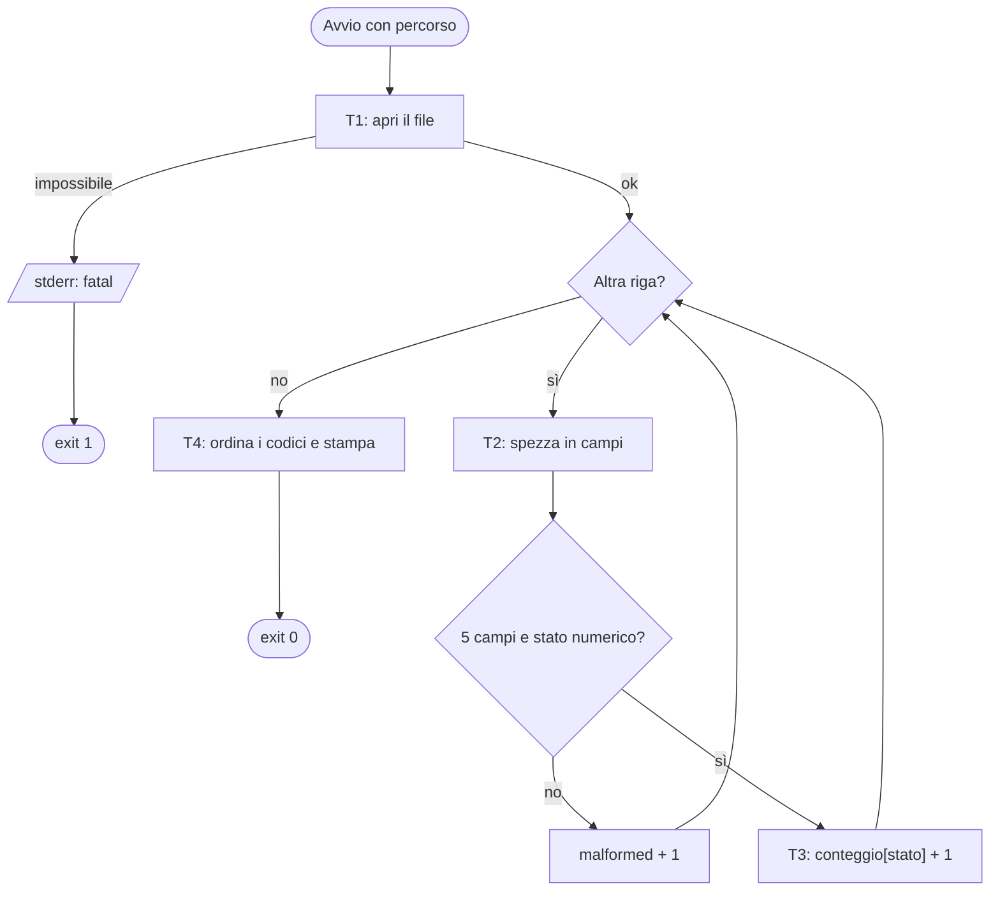
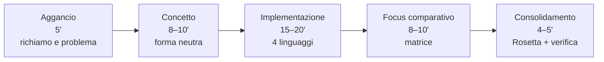
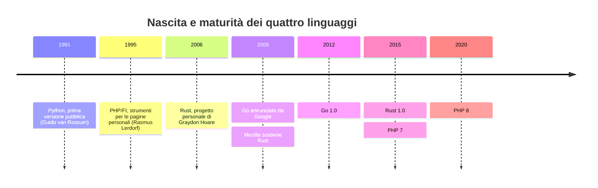
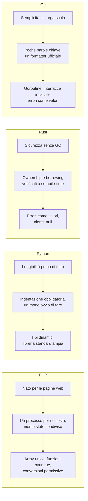
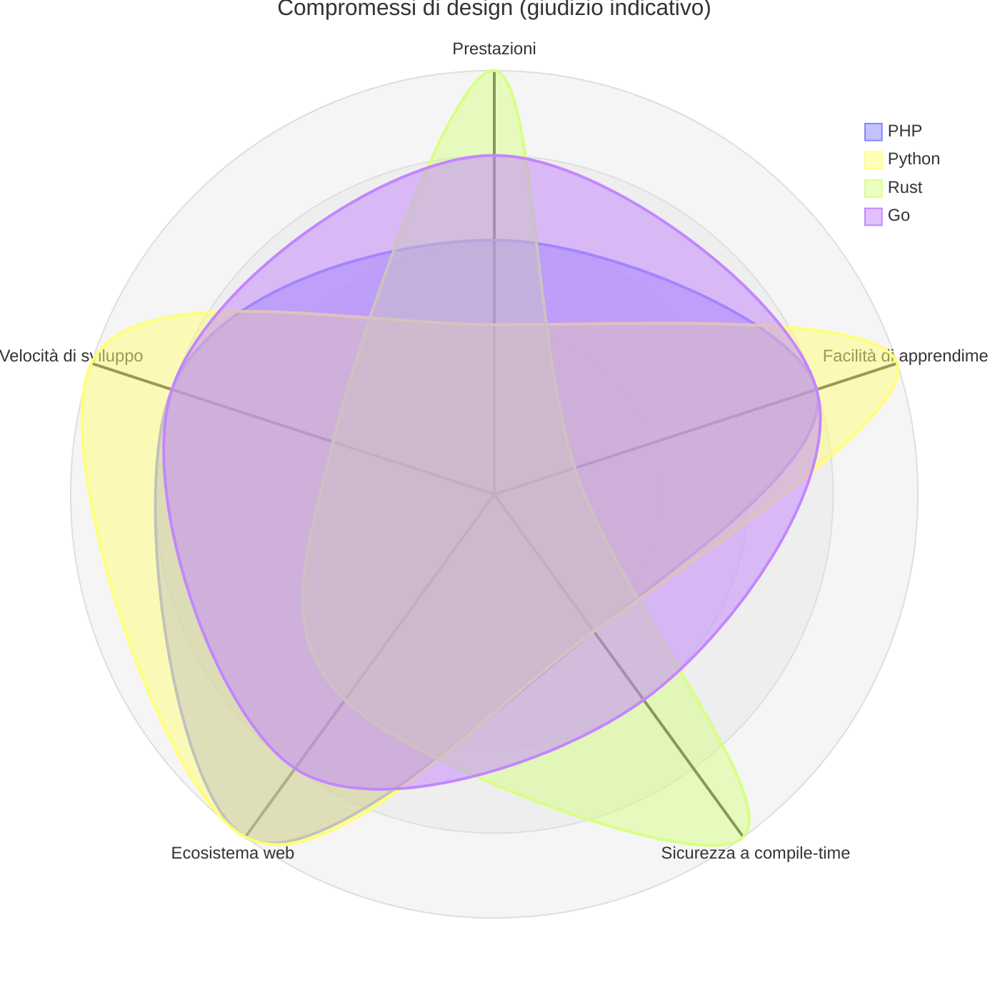
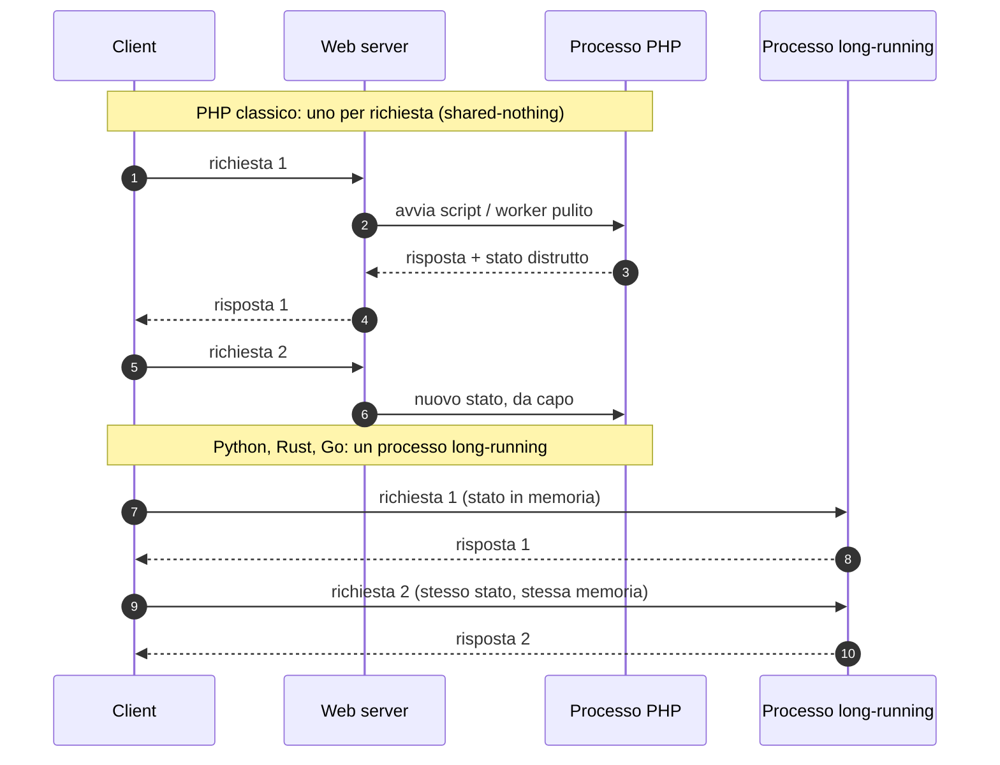
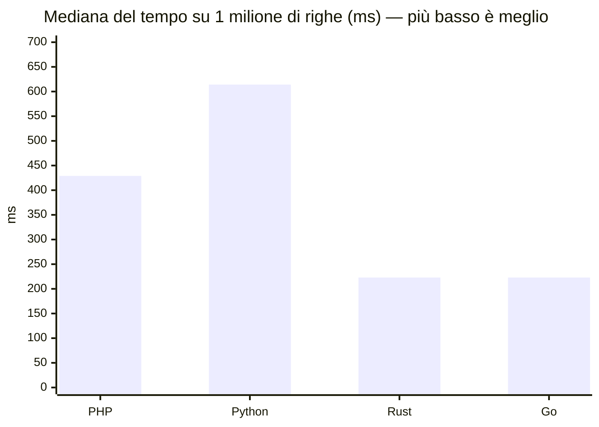
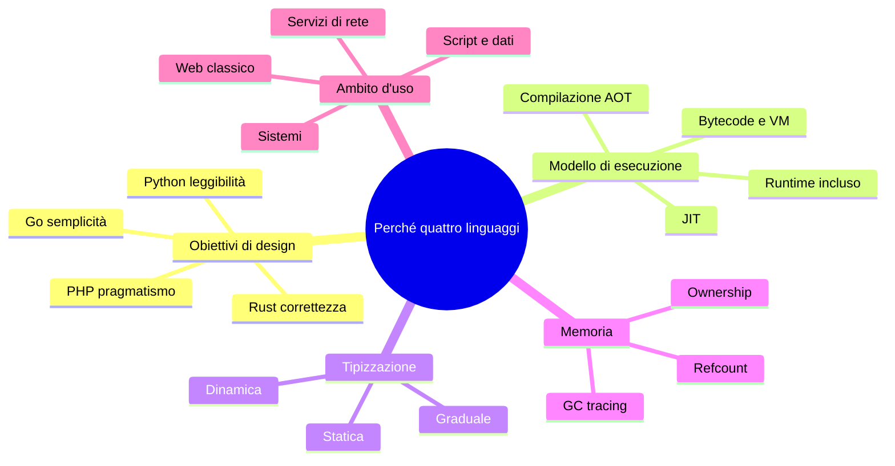

# C00 — Orientamento: quattro filosofie di design

> **Parte 0 — Fondamenta** · 3 lezioni (L00.1–L00.3) · 2,25 ore · capitolo con addendum ◆
> **Ingressi:** B parte da qui; A arriva dopo la Parte P e legge il capitolo con il formato "primario + lettura".
> **Stato:** bozza 1 (2026-10-11). Codice eseguito e verificato su PHP 8.3.6, Python 3.13.16, Rust 1.97.0, Go 1.24.7 (baseline del corso: PHP 8.4+, Go 1.25+; da riverificare a stesura finale). Le misure sono state raccolte in un container con 2 vCPU: valgono come esempio di metodo, non come classifica.

## Obiettivi

Al termine del capitolo si sa: (1) usare il corso, cioè la lezione tipo, gli snippet Rosetta, la matrice degli approcci e le mappe mentali; (2) raccontare **perché** esistono PHP, Python, Rust e Go e quali compromessi ciascuno ha scelto; (3) descrivere il percorso dal sorgente all'esecuzione in ciascun linguaggio (interprete e bytecode, compilazione AOT, runtime); (4) distinguere un linguaggio dal suo modello di esecuzione, evitando le equazioni "interpretato = lento" e "compilato = veloce"; (5) eseguire una misura semplice, leggerla con prudenza e dire che cosa non dimostra.

## Il problema reale

> L'associazione che gestisce il sito di un circolo vuole sapere come va il server web. Ogni richiesta viene scritta dal server su una riga di un file di log: indirizzo del client, metodo, percorso, codice di stato HTTP e byte inviati. Serve un programma che legga il file e dica **quante richieste hanno avuto ciascun codice di stato** (200, 404, 500…), ordinando i codici dal più piccolo al più grande. Il file è scritto da una macchina ma può contenere righe rovinate (un'interruzione, un disco pieno): il programma le **conta come "malformed"** e va avanti. Se il file non si può leggere, si ferma con un messaggio chiaro.

File di esempio (`access.log`):

```text
192.168.1.10 GET /index.html 200 512
192.168.1.11 GET /missing 404 128
192.168.1.10 POST /login 302 0
192.168.1.12 GET /index.html 200 512
garbage line
192.168.1.13 GET /admin 403 64
```

Risultato atteso — identico nei quattro linguaggi:

```text
200=2
302=1
403=1
404=1
malformed=1
```

Perché questo problema in un capitolo di orientamento? Perché è **piccolo da scrivere** (una trentina di righe) ma **sensibile al modo di eseguire**: lo si può far girare su sei righe oppure su un milione, e vedere che cosa cambia tra un linguaggio e l'altro. Il capitolo usa il programma in due modi: per leggere le *scelte di design* nel codice (L00.2) e per osservare i *modelli di esecuzione* (L00.3).

### Scomposizione in attività

| # | Attività | Che cosa mette in luce | Lezione |
|---|---|---|---|
| T1 | Aprire il file e leggerlo riga per riga | Libreria standard, gestione del fallimento | L00.2 |
| T2 | Spezzare la riga in campi e validarla | Stringhe, conversione di tipo | L00.2 |
| T3 | Contare le richieste per codice di stato | La struttura dati scelta da ciascun linguaggio (mappa) | L00.2 |
| T4 | Ordinare i codici e stampare | Ordine delle chiavi: garantito o no | L00.2 |
| T5 | Portare il programma dal sorgente all'esecuzione e misurarlo | Interprete, compilatore, runtime, avvio, tempi | L00.3 |



---

## L00.1 — Come si usa il corso

### Concetto

Il corso è **poliglotta dall'inizio**. Non tratta un linguaggio alla volta, ma un tema alla volta, nei quattro linguaggi insieme. Il vantaggio è che ogni costrutto si capisce meglio per contrasto; il costo è che serve una disciplina di lettura. Le regole sono cinque.

1. **Ogni capitolo parte da un problema reale scritto in italiano**, scomposto in attività numerate (T1, T2…). Le attività sono la guida: ogni lezione ne risolve alcune.
2. **Ogni lezione ha cinque fasi** e dura al massimo 45 minuti.
3. **Ogni lezione produce tre artefatti**: lo snippet Rosetta (stesso problema in quattro file), la riga della matrice comparativa, il nodo della mappa mentale.
4. **Il codice è eseguibile**: nulla è pseudocodice mascherato. Ogni capitolo ha in appendice i programmi completi, con comandi di esecuzione ed exit code.
5. **Similitudini e differenze chiudono ogni lezione**, mai solo le differenze: la parte comune è ciò che si trasferisce a un linguaggio nuovo.



### Due ingressi, un solo materiale

| | Ingresso A (principiante) | Ingresso B (professionista) |
|---|---|---|
| Parte da | Parte P (propedeutica) | Parte 0 (questo capitolo) |
| Scrive in | Un linguaggio primario fino alla Parte II | Tutti e quattro |
| Legge | Gli altri tre | — |
| Formato della lezione | Primario + lettura (15′ di scrittura, 10′ di lettura guidata) | Completo (20′ di implementazione, 8′ di confronto) |

Il materiale è lo stesso: cambia l'uso. Chi è nell'ingresso A trova in ogni lezione esercizi guidati supplementari e può saltare le parti segnate come "approfondimento".

### La matrice degli approcci

A fine capitolo trovi una tabella che confronta i quattro linguaggi riga per riga. Tre simboli:

| Simbolo | Significato |
|---|---|
| ● | Costrutto nativo e idiomatico |
| ◐ | Approccio alternativo assimilabile (libreria, convenzione, costrutto diverso con lo stesso scopo) |
| ○ | Assente o non idiomatico |

**Avvertenza.** La matrice è un indice per orientarsi, non una dichiarazione di equivalenza. Due celle con lo stesso simbolo possono nascondere semantiche diverse: per questo ogni lezione la accompagna con il codice che mostra la differenza.

### Mappe mentali

A fine capitolo c'è una mappa mentale: un diagramma ad albero con una parola al centro e quattro o cinque rami. Non è un riassunto da imparare a memoria, ma un modo per **vedere i collegamenti**: ogni mappa elenca i capitoli collegati. Quando incontri un concetto che si ripete (errore, memoria, tipo), seguila.

### Esercizio Rosetta (4′)

Apri le appendici di C09 e CP4 (se già disponibili) e, senza leggere il testo, individua in ciascun programma: il punto d'ingresso, il ciclo principale, il punto in cui si stampa un errore. Quanto tempo hai impiegato per ciascun linguaggio?

**Domanda di verifica.** Perché la matrice usa tre simboli e non "sì/no"?

**Risposta.** Perché molti costrutti non sono né presenti né assenti: esistono in forma diversa, o come libreria, o come convenzione. Un "sì/no" nasconderebbe proprio le differenze interessanti.

---

## L00.2 — Quattro filosofie di design

### Concetto

Un linguaggio è un insieme di **scelte** fatte per risolvere un problema reale in un momento preciso. Capire il problema che ha originato un linguaggio spiega la maggior parte delle sue stranezze. Una domanda guida per tutto il corso: **che cosa questo linguaggio rende facile, e che cosa rende difficile di proposito?**



### Le quattro filosofie in breve

| | PHP | Python | Rust | Go |
|---|---|---|---|---|
| Problema d'origine | Pagine web dinamiche, senza dover essere programmatori | Un linguaggio leggibile per scrivere e mantenere programmi | Software di sistema sicuro, senza garbage collector | Servizi di rete su larga scala, compilati in fretta, scritti da molti team |
| Parola chiave | Pragmatismo | Leggibilità | Correttezza | Semplicità |
| Che cosa rende facile | Mettere online qualcosa oggi | Esprimere un'idea in poche righe | Dimostrare al compilatore che il programma è corretto | Leggere il codice di un altro team |
| Che cosa rende difficile (di proposito) | Imporre uno stile unico | Controllare tutto a compile-time | Scrivere codice senza capire proprietà e prestito | Scrivere astrazioni sofisticate |
| Compromesso dichiarato | Coerenza in cambio di immediatezza | Velocità di esecuzione in cambio di espressività | Curva di apprendimento in cambio di sicurezza e prestazioni | Espressività in cambio di uniformità |

### Le scelte, lette dentro lo stesso codice

Guarda un frammento del programma del circolo: l'attività **T3**, contare le richieste per codice di stato. Il compito è identico; le soluzioni mostrano quattro modi di pensare.

**PHP**

```php
$status = (int) $parts[3];
$counts[$status] = ($counts[$status] ?? 0) + 1;
```

**Python**

```python
counts[int(parts[3])] += 1  # counts is a collections.Counter
```

**Rust**

```rust
*counts.entry(status).or_insert(0) += 1
```

**Go**

```go
counts[status]++
```

Lo stesso gesto — "aggiungi uno al contatore di quella chiave" — ha richiesto:

- **PHP**: un solo tipo di collezione, l'`array`, che fa da lista e da mappa. L'operatore `??` ("se manca, usa questo") copre la chiave non ancora presente. *Pragmatismo*: un attrezzo solo, buono per tutto.
- **Python**: una classe della libreria standard, `Counter`, fatta per questo caso. Il codice si legge come la frase italiana. *Batterie incluse e leggibilità*.
- **Rust**: la mappa espone un'API ("entry") che dice esplicitamente: "prendi la voce di questa chiave; se manca inseriscila con 0; poi dammi un riferimento modificabile". L'asterisco `*` dereferenzia il riferimento. *Esplicitezza*: nessuna magia, ogni passaggio visibile (e verificato dal compilatore).
- **Go**: la forma più corta di tutte, perché una mappa restituisce il **valore zero** del tipo per le chiavi mancanti (qui 0), quindi `counts[status]++` funziona subito. *Semplicità*: una regola uniforme che evita un caso speciale.

Nell'attività **T4** (ordinare e stampare) emerge un'altra scelta:

| | Come si ottiene l'output ordinato per codice |
|---|---|
| PHP | `ksort($counts)` — l'array **ricorda l'ordine di inserimento**, ma lo ordiniamo noi per chiave |
| Python | `for status in sorted(counts)` — il `Counter` ricorda l'ordine di inserimento; ordiniamo le chiavi |
| Rust | `BTreeMap` — la mappa **tiene le chiavi ordinate** per costruzione |
| Go | Si estraggono le chiavi, si ordinano con `sort.Ints` e si stampa — l'ordine di iterazione di una `map` Go **è volutamente casuale** |

L'ordine di una mappa è una decisione di design con una ragione. In Go è casuale di proposito, per impedire ai programmatori di dipendere da un ordine che non è garantito; in Rust si sceglie il tipo (`HashMap` o `BTreeMap`) in base a ciò che serve; in PHP e Python l'ordine di inserimento è parte del linguaggio. Un lettore che arriva da Python e scrive in Go senza saperlo ottiene un bug difficile da riprodurre (un output che cambia a ogni esecuzione).

### Dalla filosofia alle conseguenze



### I compromessi a colpo d'occhio

Il grafico seguente è un **giudizio didattico dell'autore**, non una misura: serve a ricordare le posizioni relative, e va letto con la stessa prudenza di qualunque classifica a punteggio. I valori sono da 0 a 5 e dipendono dall'uso (un'applicazione web non è un driver di dispositivo).



### Focus comparativo

**Similitudini.** Tutti e quattro sono linguaggi di uso generale, con garbage collection (tranne Rust), una libreria standard ampia, un gestore dei pacchetti, un ecosistema di strumenti per il web e i servizi. Sul problema del circolo, il codice ha la stessa forma: leggi, spezza, valida, conta, stampa.
**Differenze.** Le differenze non stanno nelle operazioni, ma in *che cosa viene reso esplicito*: gestione degli errori e del tipo di una conversione (visibile in Rust e Go, nascosta in PHP e Python), ordine delle chiavi (garantito, casuale o scelto), sicurezza di memoria (a carico del compilatore o del runtime).

### Esercizio Rosetta (4′)

Nel programma del circolo, aggiungi una seconda statistica: **somma dei byte inviati per codice di stato** (il quinto campo di ogni riga). Per ogni linguaggio: quale struttura dati usi e quante righe aggiungi? La soluzione di quale linguaggio ti sembra la più semplice da leggere? E la più sicura?

**Domanda di verifica.** Perché in Go l'iterazione su una mappa ha ordine casuale, mentre in Python no?

**Risposta.** Perché in Go è una scelta di design deliberata: chi scrive non deve poter dipendere da un ordine che l'implementazione non garantisce. Python (dal 3.7) garantisce l'ordine di inserimento come parte della specifica del linguaggio.

---

## L00.3 — Modelli di esecuzione

### Concetto

Un programma scritto in un linguaggio di alto livello non è mai eseguito direttamente dal processore. Tra il sorgente e l'esecuzione c'è sempre almeno una trasformazione. Le trasformazioni possibili sono tre, e **non coincidono con il linguaggio**: lo stesso linguaggio può avere più implementazioni con modelli diversi.

| Modello | Che cosa succede | Esempio tipico |
|---|---|---|
| Interpretazione di bytecode | Il sorgente è tradotto in un codice intermedio (bytecode), eseguito da una macchina virtuale | CPython, PHP (motore Zend) |
| Compilazione AOT (*ahead of time*) | Il sorgente è tradotto prima dell'esecuzione in codice macchina nativo | Rust (via LLVM), Go |
| Compilazione JIT (*just in time*) | Parti del bytecode sono tradotte in codice macchina durante l'esecuzione | JIT opzionale di PHP 8, JIT sperimentale di CPython 3.13 |

```mermaid
flowchart TD
  subgraph PHP
    A1["members.php"] --> A2["Parser + compilatore<br/>in opcode"] --> A3["OPcache<br/>(cache degli opcode)"] --> A4["VM Zend"]
    A3 -.->|"JIT opzionale"| A5["Codice macchina"]
  end
  subgraph Python
    B1["logstat.py"] --> B2["Compilazione in bytecode<br/>(file .pyc)"] --> B3["VM CPython"]
  end
  subgraph Rust
    C1["logstat.rs"] --> C2["rustc → LLVM<br/>ottimizzazioni"] --> C3["Binario nativo"] --> C4["Esecuzione diretta"]
  end
  subgraph Go
    D1["main.go"] --> D2["go build<br/>(compilatore + linker)"] --> D3["Binario nativo<br/>con runtime incluso"] --> D4["Esecuzione diretta<br/>+ scheduler + GC"]
  end
```



### Vedere il bytecode: Python

Python mette a disposizione il modulo `dis` per ispezionare il bytecode. Per la funzione:

```python
def tot(xs):
    t = 0
    for x in xs:
        t += x
    return t
```

`python3 -m dis` (o `dis.dis(tot)`) produce, con Python 3.13, istruzioni di una macchina a pila:

```text
  2           RESUME                   0
  3           LOAD_CONST               1 (0)
              STORE_FAST               1 (t)
  4           LOAD_FAST                0 (xs)
              GET_ITER
      L1:     FOR_ITER                 7 (to L2)
              STORE_FAST_LOAD_FAST    33 (x, t)
              LOAD_FAST                2 (x)
              BINARY_OP               13 (+=)
              STORE_FAST               1 (t)
              JUMP_BACKWARD            9 (to L1)
      L2:     END_FOR
              POP_TOP
  5           LOAD_FAST                1 (t)
              RETURN_VALUE
```

Ogni riga è un'istruzione della macchina virtuale: carica una costante, salva in una variabile locale, itera, somma. Il processore non vede mai queste istruzioni: le vede il ciclo di interpretazione di CPython, scritto in C. La conseguenza pratica è che l'interprete deve decodificare ogni istruzione **a ogni esecuzione**, il che costa; ma consente di modificare e rilanciare il programma senza attese.

PHP funziona in modo analogo: il motore traduce il sorgente in *opcode* e li esegue. In produzione si usa **OPcache**, che salva gli opcode in memoria condivisa per non ritradurre il file a ogni richiesta (da riga di comando è spenta per default: in questo ambiente `opcache.enable_cli` vale `Off`, e il JIT è `Disabled`).

### Compilare: Rust e Go

I comandi per portare il programma del circolo all'esecuzione:

| | Comando | Risultato |
|---|---|---|
| PHP | `php php/logstat.php access.log` | Traduce ed esegue in un colpo solo |
| Python | `python3 py/logstat.py access.log` | Compila in bytecode (in memoria, o in `__pycache__` se è un modulo importato) ed esegue |
| Rust | `rustc --edition 2024 -O rs/logstat.rs` | Produce l'eseguibile `logstat`. `-O` attiva le ottimizzazioni |
| Go | `go build -o logstat .` | Produce l'eseguibile `logstat` |

I due eseguibili hanno forma diversa. Con il comando `file` si legge:

```text
rs/logstat: ELF 64-bit LSB pie executable, x86-64, dynamically linked, interpreter /lib64/ld-linux-x86-64.so.2
go/logstat: ELF 64-bit LSB executable, x86-64, statically linked, with debug_info, not stripped
```

Il binario Rust è **collegato dinamicamente** alla libreria C di sistema (libc); quello Go è **statico**: contiene tutto, runtime compreso (scheduler, garbage collector, rete). Dimensioni in questo esperimento: Rust 4,4 MB, Go 2,3 MB, entrambi non ridotti (`strip` li ridurrebbe). Queste cifre dipendono dalle opzioni e dalla versione: non dicono "chi è più leggero", dicono che **un binario Go è un'unità di deploy autosufficiente** e che un binario Rust normalmente usa la libc del sistema (o si può collegare staticamente, vedi C20).

### Il ciclo di vita del processo

C'è un secondo asse, indipendente dal precedente: *per quanto tempo vive il processo*. È la differenza che più influenza il progetto di un servizio web.



Con PHP, nel modello classico, ogni richiesta parte da uno stato pulito: nessun dato sopravvive da una richiesta all'altra, a meno di salvarlo fuori (database, cache). È una limitazione, ma è anche una **protezione**: un bug o una perdita di memoria non sopravvivono alla richiesta. I server applicativi moderni (FrankenPHP, RoadRunner, Swoole) permettono a PHP di restare in memoria; il modello cambia, e con esso le abitudini (C16). Python, Rust e Go sono da sempre abituati al processo di lunga vita.

### Misurare: un esperimento (e le sue cautele)

Per vedere i modelli all'opera, ho generato con uno script Python un file di **1 milione di righe** (38 MB), con una riga rovinata ogni 5000, e ho cronometrato i quattro programmi. Per ciascuna combinazione: 7 esecuzioni, mostrando minimo, **mediana** e massimo del tempo totale (dal lancio del processo alla sua fine).

| Programma | Sei righe (`access.log`) | 1 milione di righe (`big.log`) — mediana | Intervallo (min–max) |
|---|---|---|---|
| PHP 8.3 (no OPcache, no JIT) | 28 ms | 429 ms | 426–478 ms |
| Python 3.13 | 18 ms | 614 ms | 557–669 ms |
| Rust 1.97 (`-O`) | 2 ms | 223 ms | 209–338 ms |
| Go 1.24 | 2 ms | 223 ms | 205–241 ms |



Che cosa si può dire:

- **Il tempo di avvio** è molto diverso: i due binari nativi partono in circa 2 ms; Python, che deve avviare la VM e importare i moduli, circa 18 ms; PHP, che inizializza il motore e le estensioni, circa 28 ms. Per uno script lanciato mille volte al giorno è irrilevante; per un comando lanciato mille volte al secondo (una funzione serverless, uno strumento in una pipeline) può contare.
- **Sul file grande** i due compilati sono circa il doppio più veloci di PHP e quasi tre volte più veloci di Python.

Che cosa **non** si può dire:

- Che "Rust è il più veloce": Rust e Go sono pari; la parte dominante di questo carico di lavoro è la lettura e la divisione del testo, che sono operazioni di libreria ben ottimizzate in tutti e quattro.
- Che "PHP è più veloce di Python": il carico (un'operazione, un file, una macchina) non permette di generalizzare; con `preg_split` e `ctype_digit` PHP sfrutta funzioni scritte in C. Su altri carichi l'ordine può cambiare.
- Che il risultato si ripeta altrove: una misura vale per il programma, l'input, la macchina e le versioni usate.

Una misura seria richiede più ripetizioni, un confronto a parità di algoritmo, la distinzione tra avvio e regime e intervalli di confidenza. Ne parleranno L13.4 e L21.3. Per ora serve imparare la **forma** di una frase onesta sulle prestazioni: *"Su questo input, su questa macchina, la mediana di sette esecuzioni è X; l'intervallo è Y."*

### Tre equazioni da evitare

| Equazione sbagliata | Perché | Esempio |
|---|---|---|
| "Interpretato = lento" | La velocità dipende dall'implementazione, dall'algoritmo e dal carico; librerie in C o JIT cambiano il quadro | PHP 8 con OPcache e JIT; NumPy in Python |
| "Compilato = veloce" | Un compilatore senza ottimizzazioni o un algoritmo scadente non aiutano | `rustc` senza `-O` qui impiega circa 1,9 s contro 0,22 s di `rustc -O` (9 volte più lento, sullo stesso sorgente) |
| "Tipizzato staticamente = compilato" | Sono due assi indipendenti: tipi (quando si controllano) ed esecuzione (come si trasforma il codice) | Python ha type hints verificati da strumenti esterni; Go ha tipi statici *e* compilazione AOT; PHP ha tipi opzionali e VM |

### Focus comparativo

**Similitudini.** Tutti e quattro trasformano il sorgente in qualcosa di più semplice prima di eseguirlo; tutti hanno un modo di vedere il risultato intermedio (`dis`, opcode, `--emit asm`, `go tool objdump`); tutti ammettono più implementazioni.
**Differenze.** *Quando* avviene la trasformazione (a ogni lancio, una volta per file, una volta per release), *chi* la fa (la VM, il compilatore), *quale* runtime resta (nessuno, GC, scheduler), *quanto* vive il processo (una richiesta o giorni).

### Esercizio Rosetta (4′)

Esegui il programma del circolo sul file grande e misura tu stesso i tempi con il comando `time` della shell (`time python3 py/logstat.py big.log`), ripetendo cinque volte. Poi: (a) cambia il file da 1 milione a 100 000 righe: le proporzioni tra i linguaggi restano? (b) compila Rust **senza** `-O`: di quanto cambia il tempo? (c) Cambia la lettura in Go da `bufio.Scanner` a lettura dell'intero file in memoria: cosa succede alla memoria?

**Domanda di verifica.** Un collega dice: "Il nostro servizio è in Python, quindi è lento perché è interpretato". Quali tre domande gli fai prima di essere d'accordo?

**Risposta.** (1) Lento rispetto a cosa, misurato come e su quale carico? (2) Il tempo è speso nell'interprete o in una query lenta, in rete, in I/O? (3) Il programma è limitato dalla CPU o dall'attesa? Solo dopo ha senso discutere dell'interprete.

---

## Matrice degli approcci (riepilogo C00)

| Aspetto | PHP | Python | Rust | Go |
|---|---|---|---|---|
| Esecuzione | Bytecode + OPcache, JIT opzionale | Bytecode su VM (CPython) | AOT nativo via LLVM | AOT nativo con runtime incluso |
| Tipizzazione | Dinamica, graduale | Dinamica, graduale | Statica, forte | Statica, forte |
| Gestione memoria | Refcount + cycle collector | Refcount + GC ciclico | Ownership, nessun GC | GC tracing concorrente |
| Ciclo di vita tipico | Per richiesta (shared-nothing) | Processo long-running | Processo long-running | Processo long-running |
| Artefatto di distribuzione | Sorgente + runtime | Sorgente o wheel + interprete | Binario (dinamico su libc, o statico) | Binario statico |
| Strumento di misura incluso | ◐ Xdebug, SPX (esterni) | ● `cProfile`, `timeit` | ◐ `criterion` (esterno) | ● `testing.B`, `pprof` |

Legenda: ● nativo e idiomatico · ◐ approccio alternativo assimilabile · ○ assente o non idiomatico. La matrice è un indice, non una dichiarazione di equivalenza.

## Equivoci frequenti

| Equivoco | Realtà |
|---|---|
| "PHP è solo per il web" | Nasce per il web, ma ha una CLI completa e librerie general-purpose; la sua forza resta il web |
| "Python non ha tipi" | Ha tipi forti e dinamici: `"3" + 4` è un errore; i type hint sono facoltativi e verificati da strumenti esterni |
| "Rust è difficile" | La difficoltà è concentrata su ownership e lifetime; molti programmi si scrivono con pochi concetti, e il compilatore guida |
| "Go è povero" | Povero di costrutti, non di strumenti: toolchain, test, profiling, race detector sono inclusi |
| "Il linguaggio più veloce vince" | Nei servizi di rete il collo di bottiglia è quasi sempre fuori dal linguaggio (database, rete) |

## Quiz di verifica

1. Qual è la differenza tra "tipizzazione statica" e "compilazione AOT"? Si può avere l'una senza l'altra? Fai un esempio.
2. Perché un binario Go è più facile da distribuire di uno script Python?
3. Che cosa significa che PHP è "shared-nothing" nel suo modello classico, e che vantaggio e che costo comporta?
4. Perché in questo capitolo si riportano mediana e intervallo e non il tempo di una singola esecuzione?
5. In T4, perché Go richiede di ordinare le chiavi e Rust (con `BTreeMap`) no?

**Risposte**

> 1. Sono assi indipendenti: i tipi riguardano *quando si controlla* il tipo dei valori, la compilazione *come si traduce* il codice. Python ha tipi (forti, dinamici) senza compilazione AOT; Go ha tipi statici e compilazione AOT; PHP con `declare(strict_types=1)` ha tipi controllati a runtime e bytecode.
> 2. Perché è un file eseguibile autosufficiente: non richiede interprete, librerie di terze parti né versioni compatibili sul server.
> 3. Ogni richiesta parte da zero e non condivide memoria con le altre. Vantaggio: isolamento (un bug non contamina le richieste successive) e modello mentale semplice. Costo: niente cache in memoria tra richieste e costo di inizializzazione ripetuto.
> 4. Perché il tempo varia da un'esecuzione all'altra (cache del disco, altri processi): un solo numero può essere eccezionalmente buono o cattivo.
> 5. La mappa di Go è una tabella hash con ordine di iterazione deliberatamente casuale; `BTreeMap` è un albero ordinato che mantiene le chiavi in ordine per costruzione.

## Esercizi

1. **(base)** Esegui il programma del circolo nei quattro linguaggi sul file di esempio e verifica con `diff` che gli output coincidano.
2. **(base)** Aggiungi al programma il conteggio delle richieste per **metodo** (`GET`, `POST`…). Quanto codice cambia in ciascun linguaggio?
3. **(medio)** Rendi il programma tollerante a una riga con più spazi tra i campi. Quale linguaggio lo fa già senza modifiche, e perché?
4. **(medio)** Stampa anche `total=<numero di righe valide>`. Dove lo calcoli: durante il ciclo o sommando i valori della mappa?
5. **(avanzato)** Leggi il bytecode con `python3 -m dis` di una funzione del programma Python e individua l'istruzione che realizza `counts[...] += 1`.
6. **(avanzato, statistica leggera)** Ripeti le misure con 30 esecuzioni per linguaggio e disegna un boxplot (riga di quartili). L'intervallo min–max è un buon indicatore della variabilità? Che differenza c'è con l'intervallo interquartile? (Anticipa L13.4.)

## Mappa mentale



Collegamenti: C02 (tipi), C10 (memoria), C11 (concorrenza), C24 (idiomi e scelta del linguaggio).

---

## Addendum — Il perché della scelta

Ogni linguaggio è una **presa di posizione**, non una raccolta di funzionalità.

**PHP** ha scelto di risolvere subito il problema del web: un linguaggio che si incolla nell'HTML, che funziona alla prima prova e che sparisce a fine richiesta. Il pragmatismo ha un prezzo, che si paga in incoerenza (nomi di funzioni, ordine degli argomenti, conversioni implicite), e il linguaggio ha speso vent'anni a correggerla senza rompere i siti esistenti. Il segno più chiaro è nelle versioni recenti: tipi, `readonly`, enum, `match`, attributi.

**Python** ha scommesso che la leggibilità conta più della concisione: un solo modo ovvio di fare le cose, l'indentazione come struttura. Il codice si legge più di quanto si scriva. Il prezzo è che il linguaggio lascia al programmatore la responsabilità di molte verifiche che altri lasciano al compilatore.

**Rust** ha scommesso che la correttezza si dimostra *prima* dell'esecuzione, senza pagare a runtime. Il prezzo è pagato dal programmatore, all'inizio: ownership e lifetime sono un modo di pensare che non esiste altrove. Il vantaggio è che intere classi di errori (accessi a memoria rilasciata, data race) non possono compilare.

**Go** ha scommesso sulla **semplicità come vincolo voluto**: poche funzionalità, un solo formatter, errori ovunque espliciti, un modello di concorrenza semplice da usare. La rinuncia è nell'espressività, e nelle prime versioni anche nei generics (arrivati solo nel 2022). La conseguenza è che il codice di un altro team è leggibile quasi quanto il proprio.

La domanda che il corso ripete in ogni capitolo è la stessa, e ha una risposta per ciascuno: **che cosa questo linguaggio rende facile, e che cosa rende difficile di proposito?** PHP rende facile cominciare, e difficile imporre uniformità. Python rende facile esprimersi, e difficile garantire. Rust rende facile ragionare sulla correttezza, e difficile scrivere in fretta. Go rende facile leggere, e difficile scrivere in modo "astuto".

## Ponte

C01 mette in piedi l'ambiente per eseguire tutto questo. C02 porta a fondo i temi sfiorati qui (tipi, valori, assenza, conversioni). C10 e C11 riprendono memoria e processo di lunga vita. C13 e C21 insegnano a misurare come si deve. C24 chiude il corso con la scelta del linguaggio in un contesto reale.

---

## Appendice C00.A — Programmi completi

Salvare nella stessa cartella di `access.log`. Exit code: `0` elaborazione completata, `1` file non leggibile, `2` argomento mancante.

#### Python (logstat.py) — `python3 logstat.py access.log`

```python
import sys
from collections import Counter


def main() -> int:
    if len(sys.argv) != 2:
        print("usage: logstat <file>", file=sys.stderr)
        return 2

    counts = Counter()  # status code -> number of requests
    malformed = 0
    try:
        with open(sys.argv[1], encoding="utf-8") as f:
            for line in f:
                parts = line.split()
                # expected: ip method path status bytes
                if len(parts) != 5 or not parts[3].isdigit():
                    malformed += 1
                    continue
                counts[int(parts[3])] += 1
    except OSError:
        print(f"fatal: cannot read {sys.argv[1]}", file=sys.stderr)
        return 1

    for status in sorted(counts):
        print(f"{status}={counts[status]}")
    print(f"malformed={malformed}")
    return 0


if __name__ == "__main__":
    sys.exit(main())
```

#### PHP (logstat.php) — `php logstat.php access.log`

```php
<?php
declare(strict_types=1);

function main(array $argv): int
{
    if (count($argv) !== 2) {
        fwrite(STDERR, "usage: logstat <file>\n");
        return 2;
    }
    $f = @fopen($argv[1], 'r'); // false on failure (legacy convention, see C09)
    if ($f === false) {
        fwrite(STDERR, "fatal: cannot read $argv[1]\n");
        return 1;
    }

    $counts = []; // status code => number of requests
    $malformed = 0;
    while (($line = fgets($f)) !== false) {
        $parts = preg_split('/\s+/', trim($line), -1, PREG_SPLIT_NO_EMPTY);
        // expected: ip method path status bytes
        if (count($parts) !== 5 || !ctype_digit($parts[3])) {
            $malformed++;
            continue;
        }
        $status = (int) $parts[3];
        $counts[$status] = ($counts[$status] ?? 0) + 1;
    }
    fclose($f);

    ksort($counts);
    foreach ($counts as $status => $n) {
        echo "$status=$n\n";
    }
    echo "malformed=$malformed\n";
    return 0;
}

exit(main($argv));
```

#### Rust (logstat.rs) — `rustc --edition 2024 -O logstat.rs && ./logstat access.log`

```rust
use std::collections::BTreeMap;
use std::env;
use std::fs::File;
use std::io::{BufRead, BufReader};
use std::process::ExitCode;

fn main() -> ExitCode {
    let args: Vec<String> = env::args().collect();
    if args.len() != 2 {
        eprintln!("usage: logstat <file>");
        return ExitCode::from(2);
    }
    let file = match File::open(&args[1]) {
        Ok(f) => f,
        Err(_) => {
            eprintln!("fatal: cannot read {}", args[1]);
            return ExitCode::from(1);
        }
    };

    // BTreeMap keeps its keys sorted: status code -> number of requests
    let mut counts: BTreeMap<u32, u64> = BTreeMap::new();
    let mut malformed: u64 = 0;
    for line in BufReader::new(file).lines() {
        let line = match line {
            Ok(l) => l,
            Err(_) => {
                eprintln!("fatal: cannot read {}", args[1]);
                return ExitCode::from(1);
            }
        };
        let parts: Vec<&str> = line.split_whitespace().collect();
        // expected: ip method path status bytes
        if parts.len() != 5 {
            malformed += 1;
            continue;
        }
        match parts[3].parse::<u32>() {
            Ok(status) => *counts.entry(status).or_insert(0) += 1,
            Err(_) => malformed += 1,
        }
    }

    for (status, n) in &counts {
        println!("{status}={n}");
    }
    println!("malformed={malformed}");
    ExitCode::SUCCESS
}
```

#### Go (main.go, go.mod con `module example.com/logstat`) — `go run . access.log`

```go
package main

import (
	"bufio"
	"fmt"
	"os"
	"sort"
	"strconv"
	"strings"
)

func main() { os.Exit(run(os.Args)) }

func run(args []string) int {
	if len(args) != 2 {
		fmt.Fprintln(os.Stderr, "usage: logstat <file>")
		return 2
	}
	f, err := os.Open(args[1])
	if err != nil {
		fmt.Fprintf(os.Stderr, "fatal: cannot read %s\n", args[1])
		return 1
	}
	defer f.Close()

	counts := map[int]int{} // status code -> number of requests
	malformed := 0
	sc := bufio.NewScanner(f)
	for sc.Scan() {
		parts := strings.Fields(sc.Text())
		// expected: ip method path status bytes
		if len(parts) != 5 {
			malformed++
			continue
		}
		status, err := strconv.Atoi(parts[3])
		if err != nil || status < 0 {
			malformed++
			continue
		}
		counts[status]++
	}
	if sc.Err() != nil {
		fmt.Fprintf(os.Stderr, "fatal: cannot read %s\n", args[1])
		return 1
	}

	// Go maps have no defined order: collect the keys and sort them
	keys := make([]int, 0, len(counts))
	for k := range counts {
		keys = append(keys, k)
	}
	sort.Ints(keys)
	for _, k := range keys {
		fmt.Printf("%d=%d\n", k, counts[k])
	}
	fmt.Printf("malformed=%d\n", malformed)
	return 0
}
```

## Appendice C00.B — Generare il file grande e misurare

```python
# gen_big_log.py: writes 1,000,000 lines, one malformed line every 5000
import random

random.seed(7)
statuses = [200] * 70 + [404] * 10 + [302] * 8 + [500] * 3 + [403] * 5 + [301] * 4
with open("big.log", "w") as f:
    for i in range(1_000_000):
        if i % 5000 == 0:
            f.write("garbage line\n")
            continue
        ip = f"192.168.{random.randint(0, 3)}.{random.randint(1, 250)}"
        f.write(f"{ip} GET /p/{i % 977}.html {random.choice(statuses)} {random.randint(0, 9999)}\n")
```

```bash
# 7 runs of each program; read the "real" time, discard stdout
for i in 1 2 3 4 5 6 7; do
  ( time python3 logstat.py big.log > /dev/null ) 2>&1 | grep real
done
```
