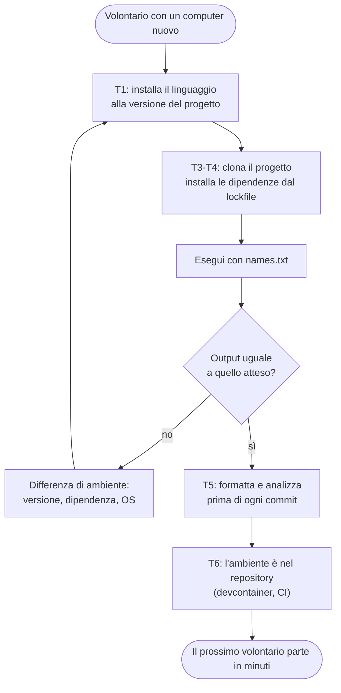
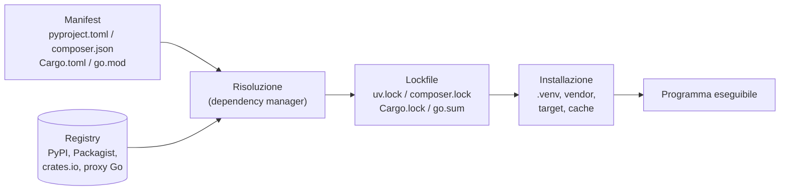
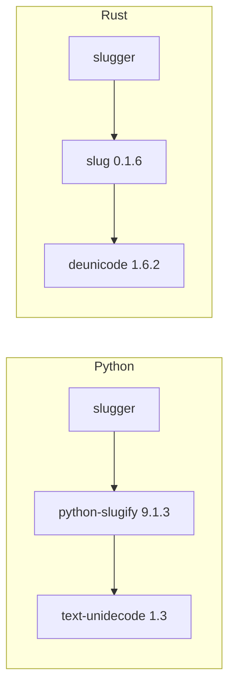
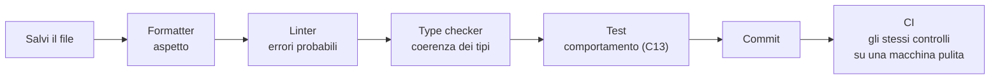
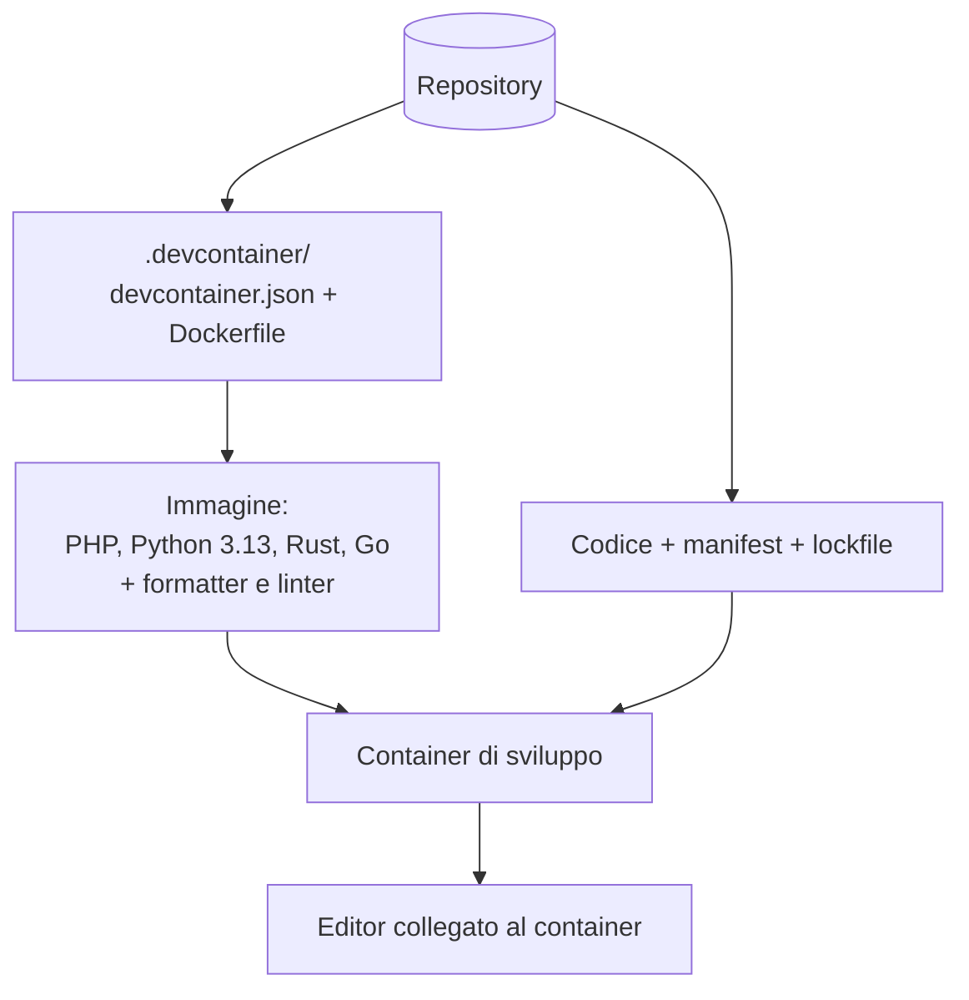
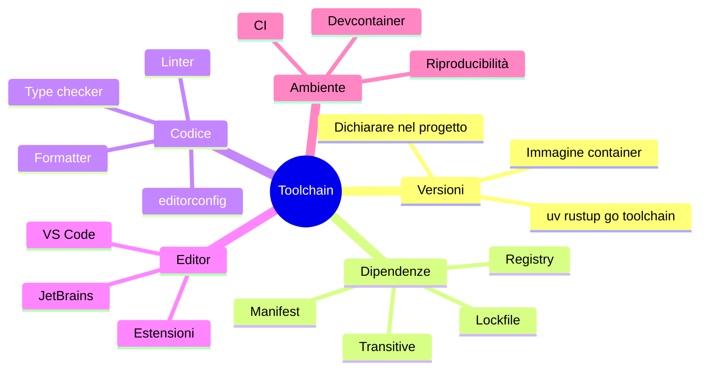

# C01 — Toolchain e ambiente di lavoro

> **Parte 0 — Fondamenta** · 3 lezioni (L01.1–L01.3) · 2,25 ore
> **Ingressi:** B nei quattro linguaggi; A nel linguaggio primario, leggendo gli altri tre.
> **Stato:** bozza 1 (2026-10-11). Verificato su PHP 8.3.6 (Composer 2.8.12), Python 3.13.16 (uv), Rust 1.97.0 (Cargo, rustfmt, clippy), Go 1.24.7 (baseline del corso: PHP 8.4+, Go 1.25+; da riverificare). **Limiti dell'ambiente di verifica**, dichiarati con precisione: il registry Packagist (Composer) e il proxy dei moduli Go non erano raggiungibili dal sandbox in cui sono stati eseguiti i comandi; per questo i progetti PHP e Go usano una libreria locale al posto di una dipendenza scaricata, e i comandi `composer require` e `go get` sono riportati ma non eseguiti qui. Il devcontainer non è stato eseguito (nessun demone container nel sandbox). Dove un comando non è stato verificato, la tabella lo segnala.

## Obiettivi

Al termine del capitolo si sa: (1) installare e **fissare la versione** di un linguaggio in modo riproducibile; (2) usare REPL e playground per esperimenti rapidi, e sapere quando non esistono; (3) creare un progetto con il suo **manifest**, aggiungere una dipendenza e leggere il **lockfile**; (4) formattare e analizzare staticamente il codice con gli strumenti ufficiali o di riferimento; (5) descrivere un ambiente come codice (devcontainer) in modo che un collega parta in pochi minuti.

## Il problema reale

> Il circolo scacchistico stampa le tessere dei soci e ogni file ha come nome quello del socio, per esempio `Élena Rossi.pdf`. Il sistema di stampa non accetta accenti, spazi doppi o apostrofi, e il nome del file deve essere minuscolo e senza caratteri speciali: `elena-rossi`. Serve un piccolo programma che legga i nomi da standard input, uno per riga, e stampi il nome del file corrispondente, saltando le righe vuote. Il problema vero, però, è un altro: **a settembre arriva un volontario nuovo**, che prepara il progetto sul proprio computer e scopre che «sul suo PC non funziona» perché ha un'altra versione del linguaggio, una libreria diversa, un altro formato del codice. Bisogna fare in modo che il progetto si installi, si esegua e si controlli **allo stesso modo ovunque**.

File di esempio (`names.txt`):

```text
Élena Rossi
Maria  D'Angelo
Zoë O'Brien-Smith
Łukasz Kowalski
  Giulia   Bianchi  

Bruno_Verdi 2
```

Risultato atteso — identico nei quattro linguaggi (la riga vuota è saltata):

```text
elena-rossi
maria-d-angelo
zoe-o-brien-smith
lukasz-kowalski
giulia-bianchi
bruno-verdi-2
```

### Scomposizione in attività

| # | Attività | Che cosa si impara | Lezione |
|---|---|---|---|
| T1 | Installare il linguaggio e fissarne la versione | Gestione delle versioni, SDK e runtime | L01.1 |
| T2 | Provare un'idea in un REPL o in un playground | Esplorare senza creare un progetto | L01.1 |
| T3 | Creare il progetto con il suo manifest | Struttura, `pyproject.toml`, `composer.json`, `Cargo.toml`, `go.mod` | L01.2 |
| T4 | Aggiungere una dipendenza e scrivere il programma | Gestore delle dipendenze, lockfile, grafo | L01.2 |
| T5 | Formattare e analizzare il codice | Formatter, linter, controllo dei tipi | L01.3 |
| T6 | Descrivere l'ambiente come codice | Devcontainer, `.editorconfig`, CI | L01.3 |



---

## L01.1 — Installazione, gestione delle versioni, REPL e playground (T1, T2)

### Concetto

Per usare un linguaggio servono due cose distinte, spesso installate insieme:

- il **runtime** (o interprete), che esegue il programma: `php`, `python3`;
- l'**SDK / toolchain**, che comprende anche il compilatore, il gestore dei pacchetti, il formatter, il linter: `rustc` + `cargo` + `rustfmt` + `clippy`; `go` (compilatore, gestore dei moduli, test, formatter, tutto in un solo comando).

Il secondo punto è una delle differenze più concrete tra i quattro linguaggi: **Rust e Go portano gli strumenti con sé**; PHP e Python si completano con strumenti scelti dalla comunità (Composer, uv, ruff, PHPStan…).

La regola operativa è una sola: **la versione del linguaggio fa parte del progetto**, non del computer. Se ognuno usa la versione che ha installato, nascono i bug che compaiono solo su una macchina.

### Come si fissa la versione

| | Dove si dichiara | Esempio | Chi la rispetta |
|---|---|---|---|
| PHP | `composer.json`, chiave `require.php` | `"php": ">=8.3"` | Composer rifiuta l'installazione se il PHP in uso non la soddisfa |
| Python | `pyproject.toml` (`requires-python`) e `.python-version` | `requires-python = ">=3.13"`, file con `3.13` | uv scarica o sceglie l'interprete corrispondente |
| Rust | `Cargo.toml` (`edition`, `rust-version`) e `rust-toolchain.toml` | `edition = "2024"` | rustup installa la toolchain indicata |
| Go | `go.mod`, riga `go` (e `toolchain`) | `go 1.21` (più, se serve, `toolchain go1.24.7`) | Il comando `go` può scaricare automaticamente la toolchain richiesta |

Un esempio di `rust-toolchain.toml` (non eseguito in questo ambiente, sintassi dalla documentazione di rustup):

```toml
[toolchain]
channel = "1.97.0"
components = ["rustfmt", "clippy"]
```

Il file `.python-version` è stato creato con `uv python pin 3.13` e contiene la sola riga `3.13`.

### Come si installa

| | Percorso consigliato | Alternative | Nota |
|---|---|---|---|
| PHP | Pacchetto della distribuzione, oppure immagine container `php:8.4-cli` | Gestori di versione (phpbrew), installazioni da sorgente | Le estensioni (`intl`, `mbstring`…) si installano a parte |
| Python | **uv** (`uv python install 3.13`), oppure `pyenv` | Pacchetto di sistema | Non modificare il Python di sistema: crea un ambiente virtuale per progetto |
| Rust | **rustup** | Pacchetti di sistema (versioni più vecchie) | rustup gestisce toolchain multiple e componenti |
| Go | Archivio ufficiale, pacchetto di sistema, o immagine `golang` | Gestori di versione (`g`, `gvm`) | Dal Go 1.21 il comando `go` sa scaricare la toolchain giusta |

Preferenza del corso: **installare dentro un container** (L01.3). Il sistema operativo resta pulito, la versione è quella dell'immagine, la stessa per tutti.

Per verificare dove si è arrivati, in ogni linguaggio c'è un comando che stampa la versione. I risultati di questo ambiente:

```console
$ php -v | head -1
PHP 8.3.6 (cli) (built: Sep  2 2026 12:56:02) (NTS)
$ python3 --version
Python 3.13.16
$ rustc --version
rustc 1.97.0 (2d8144b78 2026-07-07)
$ go version
go version go1.24.7 linux/amd64
```

### REPL e playground

Un **REPL** (*read–eval–print loop*) legge una riga, la esegue, stampa il risultato e ricomincia. Serve per provare un'idea in dieci secondi. Un **playground** è lo stesso, in un browser, senza installare nulla.

| | REPL da terminale | Esecuzione di una riga | Playground ufficiale |
|---|---|---|---|
| PHP | ● `php -a` (interattiva); ◐ PsySH | `php -r 'echo strtoupper("ciao");'` | ◐ servizi di terze parti |
| Python | ● `python3` (o `ipython`) | `python3 -c 'print("ciao".upper())'` | ◐ servizi di terze parti |
| Rust | ○ nessuno ufficiale (◐ `evcxr`) | — | ● Rust Playground |
| Go | ○ nessuno ufficiale | `go run file.go` | ● Go Playground |

L'assenza di un REPL in Rust e Go è una conseguenza diretta del modello di esecuzione (C00): un linguaggio compilato ha bisogno di compilare un file intero per eseguire anche un'istruzione. Il playground colma il vuoto: invia il sorgente a un server che lo compila e lo esegue.

Sulla nostra funzione di slug, un esperimento da REPL in Python e uno equivalente in PHP:

```console
$ python3 -c 'print("  Élena  Rossi ".strip().lower())'
élena  rossi
$ php -r 'echo trim("  Élena  Rossi "), "\n";'
Élena  Rossi
```

Il primo mette in minuscolo anche la `É` (le stringhe di Python sono Unicode), il secondo no: `strtolower` di PHP lavora sui byte e non sa nulla delle lettere accentate (serve `mb_strtolower`). Un REPL è il posto giusto per scoprire queste differenze, che C02 spiega.

### Focus comparativo

**Similitudini.** Tutti e quattro si possono installare in pochi minuti, hanno un comando che stampa la versione, un modo per fissare la versione nel progetto e una comunità che consiglia di non usare il linguaggio del sistema operativo per i propri progetti.
**Differenze.** Rust e Go forniscono formatter, linter e gestore dei pacchetti insieme al compilatore; PHP e Python no. Python ha i *virtual environment* (una cartella `.venv` con una copia dei pacchetti per progetto), PHP ha `vendor/`, Rust ha `target/` e Go ha una cache condivisa dei moduli.

### Esercizio Rosetta (4′)

Per ciascun linguaggio, scrivi nel REPL o nell'esecuzione-di-una-riga un'espressione che stampi la lunghezza di `"Élena"` e confronta i risultati. Quali linguaggi restituiscono 5 e quali 6? (Anticipa L02.3.)

**Domanda di verifica.** Perché «uso la versione che ho installato» è una cattiva idea per un progetto di gruppo?

**Risposta.** Perché le versioni cambiano il comportamento (sintassi, librerie standard, correzioni). Dichiarare la versione nel progetto e farla rispettare agli strumenti rende l'esito indipendente dal computer.

---

## L01.2 — Primo progetto: struttura, manifest, dependency manager (T3, T4)

### Concetto

Un **progetto** è una cartella con un **manifest**: un file che dice come si chiama, quale versione del linguaggio richiede e da quali **dipendenze** dipende. Un **dependency manager** legge il manifest, scarica le dipendenze da un *registry* (un archivio pubblico) e scrive un **lockfile**: l'elenco esatto di che cosa ha scelto, con le versioni e (spesso) un'impronta crittografica.

La differenza fra i due file è importante.

| File | Chi lo scrive | Che cosa dice | Si committa? |
|---|---|---|---|
| Manifest | Il programmatore | «Mi serve `python-slugify` in versione `>=9.1.3`» (intervallo) | Sì |
| Lockfile | Il dependency manager | «Ho installato `python-slugify` 9.1.3 e `text-unidecode` 1.3, con questi hash» (valori esatti) | Sì, per le applicazioni |

Il manifest esprime l'*intenzione*, il lockfile la *riproducibilità*. Con il lockfile, il volontario di settembre ottiene **esattamente** le stesse versioni dello sviluppatore di giugno.



### Il grafo delle dipendenze

Il manifest dichiara **una** dipendenza; l'albero reale è più grande, perché le librerie hanno a loro volta dipendenze (*transitive*). Dai comandi `uv tree` e `cargo tree`, in questo ambiente:



Le dipendenze transitive sono codice che si esegue ma che nessuno del team ha scelto o letto: è la ragione per cui il lockfile e l'audit (C12, C22) contano. Nel lockfile di Cargo il file registra 15 voci: contiene anche pacchetti opzionali che il grafo reale di questa configurazione non usa.

### Creare il progetto e aggiungere la dipendenza

I comandi eseguiti. Per Python e Rust la dipendenza è stata scaricata dal registry. Per PHP e Go, dove il registry non era raggiungibile, la dipendenza è una **libreria locale** nella cartella `libs/slug`, dichiarata con le funzioni del dependency manager per dipendenze locali: l'effetto sul progetto (manifest, lockfile, autoload) è lo stesso, cambia solo da dove arriva il codice.

| Passo | PHP | Python | Rust | Go |
|---|---|---|---|---|
| Creare | `composer init` | `uv init --bare` | `cargo new slugger` | `go mod init example.com/slugger` |
| Aggiungere una dipendenza da registry | `composer require cocur/slugify` (non eseguito qui) | `uv add python-slugify` ✔ eseguito | `cargo add slug` ✔ eseguito | `go get github.com/gosimple/slug` (non eseguito qui) |
| Installare da lockfile | `composer install` ✔ | `uv sync` ✔ | `cargo build` ✔ | `go mod download` / `go build` ✔ |
| Eseguire | `php src/slugger.php` ✔ | `uv run python src/slugger.py` ✔ | `cargo run` ✔ | `go run .` ✔ |
| Compilare | — | — | `cargo build --release` ✔ | `go build` ✔ |
| Test | `vendor/bin/phpunit` (non eseguito) | `uv run pytest` (non eseguito) | `cargo test` ✔ | `go test ./...` ✔ |

### Struttura dei quattro progetti

```text
php/                       python/                  rust/                   go/
├── composer.json          ├── .python-version      ├── Cargo.toml          ├── go.mod
├── composer.lock          ├── pyproject.toml       ├── Cargo.lock          ├── main.go
├── libs/slug/             ├── uv.lock              └── src/main.rs         └── libs/slug/
│   ├── composer.json      └── src/slugger.py                                   ├── go.mod
│   └── src/Slug.php                                                            └── slug.go
├── src/slugger.php
└── vendor/   (generato)
```

### Il manifest e il programma, lingua per lingua

**Python** — `pyproject.toml`

```toml
[project]
name = "slugger"
version = "0.1.0"
requires-python = ">=3.13"
dependencies = [
    "python-slugify>=9.1.3",
]
```

**Python** — `src/slugger.py`

```python
import sys

from slugify import slugify


def main() -> int:
    for line in sys.stdin:
        name = line.strip()
        if name:  # skip blank lines
            print(slugify(name))
    return 0


if __name__ == "__main__":
    sys.exit(main())
```

**PHP** — `composer.json`

```json
{
    "name": "example/slugger",
    "description": "Generates file names for membership cards",
    "type": "project",
    "require": {
        "php": ">=8.3",
        "example/slug": "*"
    },
    "repositories": [
        { "type": "path", "url": "libs/slug" },
        { "packagist.org": false }
    ],
    "autoload": { "psr-4": { "App\\": "src/" } },
    "config": { "sort-packages": true }
}
```

**PHP** — `src/slugger.php`

```php
<?php
declare(strict_types=1);

require __DIR__ . '/../vendor/autoload.php';

use Example\Slug\Slug;

function main(): int
{
    while (($line = fgets(STDIN)) !== false) {
        $name = trim($line);
        if ($name !== '') { // skip blank lines
            echo Slug::make($name), "\n";
        }
    }
    return 0;
}

exit(main());
```

**Rust** — `Cargo.toml`

```toml
[package]
name = "slugger"
version = "0.1.0"
edition = "2024"

[dependencies]
slug = "0.1.6"
```

**Rust** — `src/main.rs`

```rust
use std::io::{self, BufRead};
use std::process::ExitCode;

fn main() -> ExitCode {
    for line in io::stdin().lock().lines() {
        let Ok(line) = line else {
            eprintln!("fatal: cannot read stdin");
            return ExitCode::from(1);
        };
        let name = line.trim();
        if !name.is_empty() {
            // blank lines are skipped
            println!("{}", slug::slugify(name));
        }
    }
    ExitCode::SUCCESS
}
```

**Go** — `go.mod`

```go
module example.com/slugger

go 1.21

require example.com/slug v0.0.0

// local module instead of a registry download
replace example.com/slug => ./libs/slug
```

**Go** — `main.go`

```go
package main

import (
	"bufio"
	"fmt"
	"os"
	"strings"

	"example.com/slug"
)

func main() { os.Exit(run()) }

func run() int {
	sc := bufio.NewScanner(os.Stdin)
	for sc.Scan() {
		name := strings.TrimSpace(sc.Text())
		if name != "" { // skip blank lines
			fmt.Println(slug.Make(name))
		}
	}
	if sc.Err() != nil {
		fmt.Fprintln(os.Stderr, "fatal: cannot read stdin")
		return 1
	}
	return 0
}
```

Che cosa notare.

1. **Il manifest cambia formato, non contenuto.** TOML per Python e Rust, JSON per PHP, un formato proprio per Go. Tutti dicono: nome, versione del linguaggio, dipendenze. Rust aggiunge `edition = "2024"`: un contratto di compatibilità con la lingua (C00, C12).
2. **L'intervallo di versioni.** Python `>=9.1.3`; Rust `slug = "0.1.6"` significa «compatibile con 0.1.6» (la regola di SemVer di Cargo); Composer `"*"` accetta qualsiasi versione della libreria locale. Go è più rigido: usa *Minimal Version Selection* e non ammette intervalli (C12).
3. **La riga `replace` in `go.mod`.** Dice: «il modulo `example.com/slug` non va cercato in rete, è nella cartella `libs/slug`». È la riga che abbiamo usato in assenza del proxy; in un progetto reale la sostituiremmo con una versione scaricabile.
4. **`"packagist.org": false` in `composer.json`.** Disattiva il registry pubblico, qui perché non raggiungibile. In un progetto normale non si scrive.
5. **Il programma ha la stessa forma**: leggi una riga, togli gli spazi, salta le vuote, chiama la libreria, stampa. Il resto è la libreria.

### La libreria locale (PHP e Go)

**PHP** — `libs/slug/composer.json` e `libs/slug/src/Slug.php`

```json
{
    "name": "example/slug",
    "description": "Turns a display name into a file-name-safe slug",
    "version": "1.0.0",
    "autoload": { "psr-4": { "Example\\Slug\\": "src/" } },
    "require": { "php": ">=8.3", "ext-intl": "*" }
}
```

```php
<?php
declare(strict_types=1);

namespace Example\Slug;

final class Slug
{
    /** "Élena  Rossi" -> "elena-rossi" */
    public static function make(string $text): string
    {
        // Any-Latin + Latin-ASCII removes accents; Lower() lowercases
        $ascii = \Transliterator::create('Any-Latin; Latin-ASCII; Lower()')->transliterate($text);
        $slug = preg_replace('/[^a-z0-9]+/', '-', $ascii);
        return trim($slug, '-');
    }
}
```

**Go** — `libs/slug/go.mod` e `libs/slug/slug.go`

```go
module example.com/slug

go 1.21
```

```go
// Package slug turns a display name into a file-name-safe slug.
// Demo only: it knows a small set of Latin letters; a real project would
// use golang.org/x/text or a published slug module.
package slug

import "strings"

var fold = map[rune]rune{
	'à': 'a', 'á': 'a', 'â': 'a', 'ã': 'a', 'ä': 'a', 'å': 'a',
	'ç': 'c', 'è': 'e', 'é': 'e', 'ê': 'e', 'ë': 'e',
	'ì': 'i', 'í': 'i', 'î': 'i', 'ï': 'i', 'ñ': 'n',
	'ò': 'o', 'ó': 'o', 'ô': 'o', 'õ': 'o', 'ö': 'o', 'ø': 'o',
	'ù': 'u', 'ú': 'u', 'û': 'u', 'ü': 'u', 'ý': 'y', 'ÿ': 'y', 'ł': 'l',
}

// Make turns "Élena  Rossi" into "elena-rossi".
func Make(text string) string {
	var b strings.Builder
	dash := false // true when the last thing written was a separator
	for _, r := range strings.ToLower(text) {
		if f, ok := fold[r]; ok {
			r = f
		}
		if (r >= 'a' && r <= 'z') || (r >= '0' && r <= '9') {
			b.WriteRune(r)
			dash = false
		} else if !dash && b.Len() > 0 {
			b.WriteByte('-')
			dash = true
		}
	}
	return strings.TrimSuffix(b.String(), "-")
}
```

In PHP la libreria usa `Transliterator` dell'estensione `intl`, che conosce tutti gli alfabeti; nel manifest dichiara `ext-intl` come requisito, e Composer **rifiuta l'installazione** se manca l'estensione. In Go la libreria è volutamente un *giocattolo*: la libreria standard non include la trasliterazione e la tabella `fold` copre solo alcune lettere latine. Per un uso reale servirebbe un modulo come `golang.org/x/text` o `gosimple/slug`: è un esempio dei limiti della libreria standard di Go, che ha scelto di essere piccola (C00).

### Autoload: come PHP trova le classi

In PHP, la sezione `autoload` del manifest (`"App\\": "src/"`, `"Example\\Slug\\": "src/"`) genera `vendor/autoload.php`, che il programma include con `require`. Da quel momento `use Example\Slug\Slug;` carica il file `libs/slug/src/Slug.php` al primo uso. È la convenzione **PSR-4**: il nome della classe corrisponde al percorso del file. Python, Rust e Go non hanno un passaggio equivalente: il loro sistema di moduli e package è parte del linguaggio (C12).

### Focus comparativo

| Aspetto | PHP | Python | Rust | Go |
|---|---|---|---|---|
| Dependency manager | ◐ Composer | ◐ uv (o pip) | ● Cargo | ● `go` (moduli) |
| Manifest | `composer.json` | `pyproject.toml` | `Cargo.toml` | `go.mod` |
| Lockfile | `composer.lock` | `uv.lock` | `Cargo.lock` | `go.sum` (+ regole MVS) |
| Registry | Packagist | PyPI | crates.io | Proxy dei moduli (decentralizzato) |
| Cartella delle dipendenze | `vendor/` | `.venv/` | `target/` + cache | Cache dei moduli (fuori dal progetto) |
| Versioni del linguaggio | `require.php` | `requires-python` | `edition`, `rust-version` | riga `go`, `toolchain` |

**Similitudini.** Tutti hanno un manifest dichiarativo, un lockfile, una risoluzione automatica delle dipendenze transitive e una cartella di lavoro generata che **non** si mette nel repository.
**Differenze.** In Rust e Go il gestore dei pacchetti è parte della toolchain ufficiale; in PHP e Python è uno strumento della comunità (Python ne ha avuti molti: pip, pipenv, poetry, uv). Il registry di Go è decentralizzato: i moduli vivono nei repository del loro autore e il proxy li mette in cache.

### Esercizio Rosetta (4′)

Cambia la riga di prova: aggiungi al programma un'opzione che stampa il nome seguito dal numero progressivo (`01-elena-rossi`). Quale file modifichi: il manifest, il programma o la libreria? Perché?

**Domanda di verifica.** Perché il lockfile di un'**applicazione** va nel repository, mentre quello di una **libreria** spesso no?

**Risposta.** Un'applicazione deve essere riprodotta identica ovunque. Una libreria è usata da altri progetti, che hanno i propri vincoli: pubblicare un lockfile non serve agli utenti, che risolvono le dipendenze nel loro contesto (convenzione, con eccezioni).

---

## L01.3 — Formatter, linter, editor, devcontainer (T5, T6)

### Concetto

Tre strumenti diversi, spesso confusi:

| Strumento | Domanda a cui risponde | Modifica il codice? | Esempio |
|---|---|---|---|
| **Formatter** | Il codice ha l'aspetto standard? | Sì (riscrive spazi, a capo) | `ruff format`, `rustfmt`, `gofmt` |
| **Linter / analisi statica** | Il codice contiene errori probabili o stili sconsigliati? | No (segnala, a volte propone) | `ruff check`, `clippy`, `go vet`, PHPStan |
| **Type checker** | I tipi sono coerenti? | No | `mypy`, `pyright`, il compilatore di Rust e Go, PHPStan |



Ordine di costo crescente: il formatter è istantaneo, il linter pure, i test più lenti. Gli strumenti più veloci vanno eseguiti ad ogni salvataggio, i più lenti prima del commit, e **tutti** in CI.

### Formatter: lo stile diventa una macchina

Un formatter elimina le discussioni di stile. Quello di Go (`gofmt`) è obbligatorio per convenzione: **non ha opzioni**, di proposito. Quelli di Rust e Python hanno poche opzioni. Il risultato su un file scritto male, ottenuto eseguendo gli strumenti:

**Python** — `ruff format --diff bad.py`

```diff
-import os,sys
-def f(a,b) :
-    x=[1,2,3 ]
-    return a+b
-print( f(1,2) )
+import os, sys
+
+
+def f(a, b):
+    x = [1, 2, 3]
+    return a + b
+
+
+print(f(1, 2))
```

**Rust** — `rustfmt --check bad.rs` riscrive, tra l'altro, `fn main(){` in `fn main() {` e mette il corpo di `if` su più righe.

**Go** — `gofmt -d bad.go`

```diff
 package main
+
 import "fmt"
-func main(){
-x:=1
-fmt.Printf("%d\n","a")
-    fmt.Println( x )
+
+func main() {
+	x := 1
+	fmt.Printf("%d\n", "a")
+	fmt.Println(x)
 }
```

**PHP.** Non c'è un formatter incluso. Gli strumenti di riferimento sono PHP-CS-Fixer e Laravel Pint, che applicano le raccomandazioni **PSR-12** (e le successive PER-CS). Non erano installati nell'ambiente di verifica: comandi riportati dalla documentazione, non eseguiti qui (`vendor/bin/php-cs-fixer fix --dry-run --diff`).

### Linter: gli errori probabili

Sugli stessi file, ciò che dicono gli analizzatori (output ridotto):

**Python — `ruff check bad.py`**

```text
I001 [*] Import block is un-sorted or un-formatted
F401 [*] `os` imported but unused
```

**Rust — `cargo clippy`**

```text
warning: unused variable: `x`
warning: unneeded `return` statement
warning: length comparison to zero
  help: using `is_empty` is clearer and more explicit: `v.is_empty()`
```

**Go — `go vet`**

```text
./main.go:5:1: fmt.Printf format %d has arg "a" of wrong type string
```

L'ultimo è un errore vero: il compilatore Go accetta il programma, perché `Printf` riceve valori di qualunque tipo; è `go vet` a capire che il segnaposto `%d` non va d'accordo con la stringa.

**PHP.** `php -l` verifica solo la **sintassi**:

```text
PHP Parse error:  syntax error, unexpected token "echo" in bad.php on line 3
```

Per tutto il resto (tipi, variabili inutilizzate, codice irraggiungibile) serve un analizzatore come PHPStan o Psalm (non eseguiti qui).

### Type checker

Python ha tipi facoltativi, controllati da strumenti esterni. Un esempio con `mypy`:

```python
def total(amounts: list[int]) -> int:
    return sum(amounts)

print(total(["a", "b"]))
```

```text
typed_demo.py:4: error: List item 0 has incompatible type "str"; expected "int"  [list-item]
typed_demo.py:4: error: List item 1 has incompatible type "str"; expected "int"  [list-item]
Found 2 errors in 1 file (checked 1 source file)
```

Senza `mypy` questo programma parte e fallisce **a runtime**, quando `sum` incontra una stringa. In Rust e Go lo stesso errore è un errore del **compilatore**, perché i tipi sono parte del linguaggio. In PHP si ottiene un `TypeError` a runtime con `declare(strict_types=1)`, oppure l'avviso statico di PHPStan (C02, C08).

Un dettaglio utile: un primo tentativo con il file chiamato `types.py` è fallito perché il nome **oscurava il modulo `types` della libreria standard**: `mypy` ha segnalato «This file shadows library module "types"». È un errore classico di Python: evitare nomi di file che coincidono con moduli standard.

### Editor e `.editorconfig`

Gli editor (VS Code, JetBrains) usano i formatter e i linter dei progetti tramite estensioni o plugin integrati. Due regole bastano:

1. **Il progetto decide, l'editor obbedisce.** La configurazione degli strumenti sta nel repository (`pyproject.toml`, `rustfmt.toml`…), non nelle preferenze personali.
2. **`.editorconfig`** dice a qualunque editor tabulazioni o spazi, fine riga, codifica. È supportato da quasi tutti.

```ini
# .editorconfig
root = true

[*]
charset = utf-8
end_of_line = lf
insert_final_newline = true
trim_trailing_whitespace = true

[*.{py,php,rs,toml,json,yml}]
indent_style = space
indent_size = 4

[*.go]
indent_style = tab
```

La sezione `[*.go]` esiste perché `gofmt` usa tabulazioni: l'editor non deve combatterlo.

### Devcontainer: l'ambiente come codice

Un **devcontainer** è una descrizione (in un file JSON più un'immagine container) dell'ambiente di sviluppo: sistema operativo, linguaggi, strumenti, estensioni dell'editor. VS Code e JetBrains la leggono e aprono il progetto *dentro* il container. Chi arriva fa un solo gesto («Reopen in Container») e ottiene le versioni giuste, i formatter, i linter.



Modello di partenza (**non eseguito in questo ambiente**: il sandbox di verifica non dispone di un demone container, quindi va collaudato prima di usarlo; i nomi dei pacchetti e delle versioni sono quelli della documentazione ufficiale al momento della stesura):

```dockerfile
# .devcontainer/Dockerfile
FROM ubuntu:24.04

ENV DEBIAN_FRONTEND=noninteractive
RUN apt-get update && apt-get install -y --no-install-recommends \
      ca-certificates curl git build-essential php-cli php-intl php-mbstring composer \
    && rm -rf /var/lib/apt/lists/*

# Python via uv, Rust via rustup, Go from the official archive
RUN curl -LsSf https://astral.sh/uv/install.sh | sh
RUN curl --proto '=https' --tlsv1.2 -sSf https://sh.rustup.rs | sh -s -- -y --profile minimal \
      -c rustfmt -c clippy
ARG GO_VERSION=1.25.0
RUN curl -fsSL https://go.dev/dl/go${GO_VERSION}.linux-amd64.tar.gz | tar -C /usr/local -xz

ENV PATH="/root/.local/bin:/root/.cargo/bin:/usr/local/go/bin:${PATH}"
```

```json
{
  "name": "polyglot-course",
  "build": { "dockerfile": "Dockerfile" },
  "customizations": {
    "vscode": {
      "extensions": [
        "ms-python.python",
        "charliermarsh.ruff",
        "rust-lang.rust-analyzer",
        "golang.go",
        "bmewburn.vscode-intelephense-client"
      ]
    }
  },
  "postCreateCommand": "uv sync && cargo fetch && composer install"
}
```

Con i container (Docker o Podman) un ambiente descritto così è identico per tutti, e identico alla CI (C20). Per un'organizzazione europea con vincoli di sovranità dei dati, la stessa descrizione funziona su un registry interno e su immagini mantenute in proprio: è un motivo in più per preferire immagini ufficiali verificate e un registry controllato.

### Focus comparativo

| Strumento | PHP | Python | Rust | Go |
|---|---|---|---|---|
| Formatter ufficiale | ◐ PHP-CS-Fixer, Pint | ◐ ruff format, black | ● rustfmt | ● gofmt |
| Linter / analisi | ◐ PHPStan, Psalm | ◐ ruff, mypy, pyright | ● clippy | ● go vet, ◐ staticcheck, golangci-lint |
| Controllo sintassi | ● `php -l` | ● `python -m py_compile` | ● il compilatore | ● il compilatore |
| REPL | ● `php -a`, ◐ PsySH | ● `python`, ipython | ○ (playground, evcxr) | ○ (playground) |
| Dependency manager | ◐ Composer | ◐ uv, pip | ● Cargo | ● go mod |

**Similitudini.** Ogni linguaggio ha un formatter diffuso e uno o più linter; tutti si possono integrare in editor e CI; tutti consentono di fissare la configurazione nel repository.
**Differenze.** In Go e Rust l'aspetto è **imposto**; in PHP e Python è una scelta del team, per cui serve scriverla. I linter di Rust e Go sono una parte della toolchain; in PHP e Python vanno aggiunti (e scelti tra più candidati).

### Esercizio Rosetta (4′)

Scrivi un file con un errore di formato e uno di sostanza (una variabile inutilizzata) in ciascun linguaggio. Passa il formatter e poi il linter. Quale errore ha trovato il formatter? Quale il linter? Quale solo il compilatore?

**Domanda di verifica.** Perché si esegue prima il formatter e poi il linter, e non viceversa?

**Risposta.** Il formatter può cambiare le righe su cui il linter segnala; eseguendo prima il formatter, le segnalazioni si riferiscono al codice già pulito. E gli errori di stile non nascondono quelli di sostanza.

---

## Matrice degli approcci (riepilogo C01)

| Strumento | PHP | Python | Rust | Go |
|---|---|---|---|---|
| Dependency manager | ◐ Composer | ◐ uv, pip | ● Cargo | ● go mod |
| Formatter ufficiale | ◐ PHP-CS-Fixer, Pint | ◐ ruff format, black | ● rustfmt | ● gofmt |
| Linter / analisi | ◐ PHPStan, Psalm | ◐ ruff, mypy, pyright | ● clippy | ● go vet, ◐ staticcheck |
| REPL | ● php -a, ◐ PsySH | ● python, ipython | ○ (playground, evcxr) | ○ (playground) |

Legenda: ● nativo e idiomatico · ◐ approccio alternativo assimilabile · ○ assente o non idiomatico. La matrice è un indice, non una dichiarazione di equivalenza.

## Anti-pattern ricorrenti

| Anti-pattern | Dove capita | Perché è un problema | Alternativa |
|---|---|---|---|
| Installare pacchetti nel Python di sistema | Python | Rompe gli strumenti di sistema, versioni in conflitto | Un ambiente virtuale per progetto (`uv`, `venv`) |
| Non committare il lockfile di un'applicazione | Tutti | Due persone ottengono versioni diverse | Committare `uv.lock`, `composer.lock`, `Cargo.lock`, `go.sum` |
| Committare `vendor/`, `.venv/`, `target/` | Tutti | Repository enorme, binari specifici della macchina | `.gitignore`, ricostruire dal lockfile |
| Formattare a mano o discutere lo stile | Tutti | Tempo sprecato, diff rumorosi | Formatter automatico, controllo in CI |
| `latest` come versione dell'immagine | Container | L'ambiente cambia da solo | Fissare tag o digest, aggiornare con intenzione |
| File chiamato come un modulo standard (`types.py`, `random.py`) | Python | Oscura il modulo vero | Nomi specifici del progetto |
| Ignorare gli avvisi del linter finché «sono troppi» | Tutti | Gli errori veri si perdono nel rumore | Azzerare gli avvisi, poi imporre zero avvisi in CI |

## Quiz di verifica

1. Qual è la differenza tra manifest e lockfile, e quale dei due dichiara l'«intenzione»?
2. Perché Rust e Go non hanno un REPL ufficiale?
3. Un formatter e un linter si sovrappongono? In che cosa differiscono?
4. Che cosa significa la riga `replace` in `go.mod`, e quando si usa?
5. Perché nel progetto PHP il lockfile contiene un'impronta (reference) invece di un hash di archivio?
6. Che cosa hai dovuto cambiare nel progetto per mettere un devcontainer? E che cosa **non** hai dovuto cambiare?

**Risposte**

> 1. Il manifest è scritto dal programmatore e contiene intervalli (l'intenzione); il lockfile è generato e contiene versioni esatte (la riproducibilità).
> 2. Perché sono compilati: per eseguire anche un'istruzione servono un file e un ciclo di compilazione. Il playground compila sul server.
> 3. Il formatter riscrive l'aspetto; il linter segnala errori probabili senza riscrivere. Si sovrappongono sullo stile in pochi casi (per esempio l'ordine degli import in ruff).
> 4. Sostituisce un modulo con una cartella locale, ad esempio per sviluppo in parallelo di due moduli o come in questo capitolo, quando il registry non è raggiungibile.
> 5. Perché la dipendenza è un pacchetto *path* (cartella locale): Composer registra un identificativo calcolato sul contenuto della cartella e non un archivio scaricato.
> 6. Si aggiungono i file in `.devcontainer/`; il codice, il manifest e il lockfile restano uguali.

## Esercizi

1. **(base)** Crea il progetto nel tuo linguaggio primario con il suo manifest e il lockfile; esegui il programma con `names.txt` e confronta con l'output atteso.
2. **(base)** Aggiungi una riga al `.gitignore` per ciascuna cartella generata (`vendor/`, `.venv/`, `target/`). Quale cartella **non** va ignorata in nessun linguaggio?
3. **(medio)** Fai girare formatter e linter del tuo linguaggio primario su un file volutamente scritto male. Elenca ogni segnalazione e indica se riguarda lo stile, un errore probabile o un errore di tipo.
4. **(medio)** Cambia la versione minima del linguaggio nel manifest a un valore **superiore** a quello installato. Che cosa succede in ciascun linguaggio? Il messaggio è chiaro?
5. **(avanzato)** Aggiungi `ruff`, `clippy`, `go vet`/`golangci-lint` o PHPStan in uno script `make check` che fallisce se c'è anche un solo avviso. Come la useresti in CI?
6. **(avanzato, sicurezza)** Con `cargo tree` o `uv tree` conta le dipendenze transitive di una libreria di tua scelta. Quanto codice di terzi esegui senza averlo letto? Come si riduce il rischio? (Anticipa C22.)

## Mappa mentale



Collegamenti: C12 (moduli e dipendenze), C13 (test e qualità), C20 (build e container), C22 (supply chain).

## Ponte

C02 usa subito questo ambiente: ogni esperimento sui tipi si fa in un REPL o in un progetto minimo. C12 riprende il dependency manager con SemVer, Minimal Version Selection e workspace. C13 aggiunge i test alla catena formatter-linter-type checker. C20 porta il devcontainer in un'immagine di produzione. C22 guarda le dipendenze transitive come superficie di attacco.

---

## Appendice C01.A — Comandi dei quattro progetti

```bash
# Python (uv)
uv init --bare --name slugger
uv python pin 3.13
uv add python-slugify
uv sync
uv run python src/slugger.py < names.txt

# PHP (Composer), con libreria locale in libs/slug
COMPOSER_ALLOW_SUPERUSER=1 composer install   # only needed when running as root
php src/slugger.php < names.txt

# Rust (Cargo)
cargo new slugger
cargo add slug
cargo run < names.txt

# Go (modules), con libreria locale in libs/slug
go mod init example.com/slugger
go mod tidy
go run . < names.txt
```
