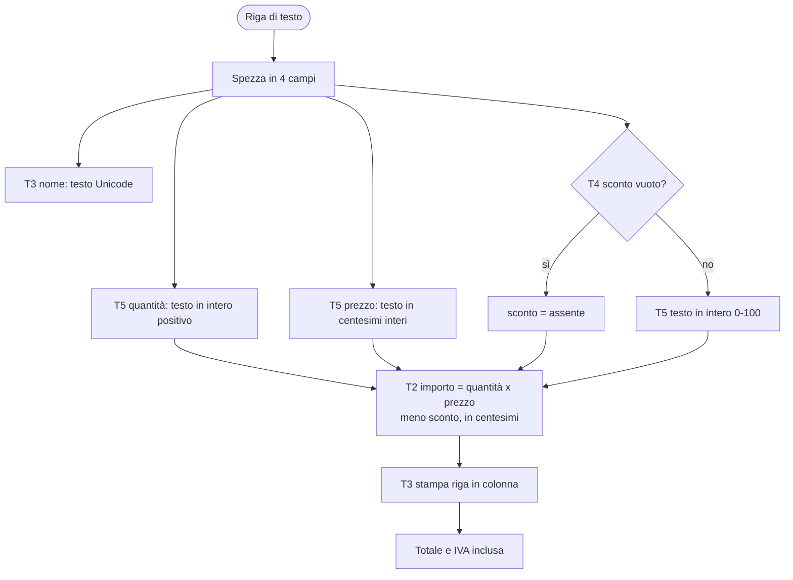
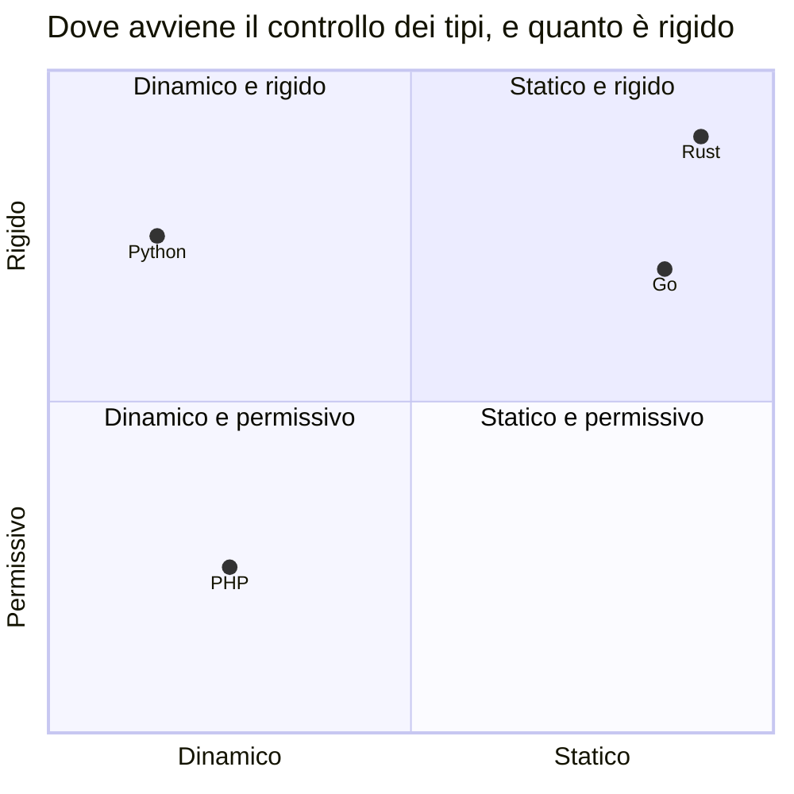
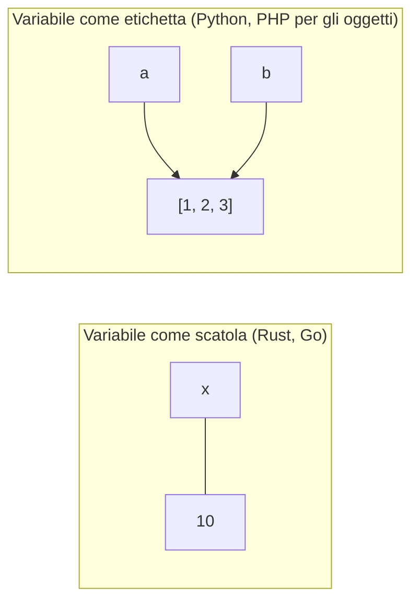
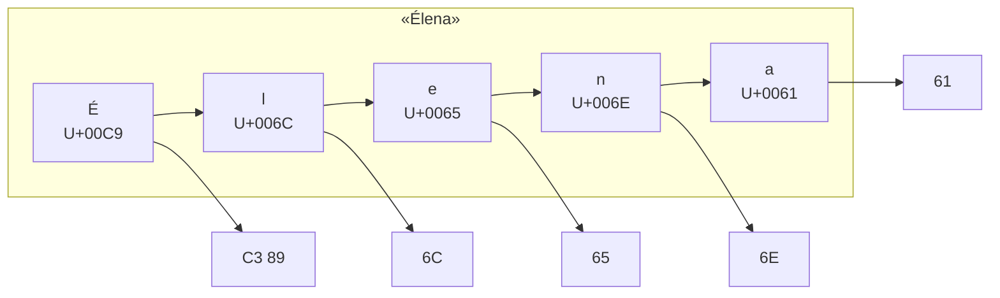

# C02 — Valori, tipi e variabili

> **Parte I — Basi del linguaggio** · 5 lezioni (L02.1–L02.5) · 3,75 ore · capitolo con addendum ◆
> **Ingressi:** B nei quattro linguaggi; A nel linguaggio primario, leggendo gli altri tre.
> **Stato:** bozza 1 (2026-10-11). Tutti i frammenti di questo capitolo sono stati eseguiti su PHP 8.3.6, Python 3.13.16, Rust 1.97.0 (`rustc --edition 2024`), Go 1.24.7 (baseline del corso: PHP 8.4+, Go 1.25+; da riverificare). Gli output riportati sono quelli reali, copiati dai file di uscita. Dove una libreria non è stata eseguita in questo ambiente, il testo lo dice.

## Obiettivi

Al termine del capitolo si sa: (1) distinguere **valore, tipo e variabile**, e dire quando avviene il controllo dei tipi; (2) leggere dichiarazioni, mutabilità, scope e *shadowing* nei quattro linguaggi; (3) scegliere la rappresentazione giusta per interi, decimali e denaro, e prevedere overflow e arrotondamenti; (4) spiegare la differenza fra byte, code point e carattere in una stringa UTF-8 e le sue conseguenze (lunghezza, indice, maiuscole, allineamento); (5) rappresentare l'**assenza di un valore** con `null`, `None`, `Option` o zero value; (6) convertire testo in numeri senza sorprese e riconoscere le conversioni implicite pericolose.

## Il problema reale

> Il bar del circolo vuole stampare lo scontrino a partire da un file di righe d'ordine. Ogni riga ha quattro campi separati da punto e virgola: **nome**, **quantità**, **prezzo unitario** (con la virgola decimale all'americana, per esempio `1.20`) e **sconto in percentuale**, che può mancare. I nomi hanno accenti (`Caffè`, `Água`). Lo scontrino deve mostrare, per ogni riga, nome, quantità, prezzo e importo (con lo sconto applicato), poi il **totale** e la quota di **IVA al 22 %** già inclusa nei prezzi. I numeri devono essere esatti al centesimo, i nomi devono restare allineati in colonna, e se una riga è sbagliata il programma deve dire quale e fermarsi senza stampare un totale falso.

File di esempio (`receipt.csv`), con una riga vuota e uno sconto assente:

```text
Caffè;2;1.20;
Cornetto alla crema;3;1.10;10

Tè alla pesca;1;2.5;
Spremuta d'arancia;2;3.40;50
Água;1;1;
```

Risultato atteso — identico nei quattro linguaggi:

```text
Caffè                  2 x   1.20 =    2.40
Cornetto alla crema    3 x   1.10 =    2.97 (-10%)
Tè alla pesca          1 x   2.50 =    2.50
Spremuta d'arancia     2 x   3.40 =    3.40 (-50%)
Água                   1 x   1.00 =    1.00
-------------------------------------------
TOTAL                                 12.27
of which VAT 22%                       2.21
```

### Scomposizione in attività

| # | Attività | Che cosa mette in gioco | Lezione |
|---|---|---|---|
| T1 | Dare un nome ai dati: riga, quantità, prezzo, sconto, totale | Variabili, binding, mutabilità, scope | L02.1 |
| T2 | Calcolare gli importi senza perdere un centesimo | Interi, decimali, overflow, arrotondamento | L02.2 |
| T3 | Stampare i nomi in colonna | Stringhe, Unicode, byte contro caratteri | L02.3 |
| T4 | Rappresentare «sconto assente» | `null`, `None`, `Option`, `nil` | L02.4 |
| T5 | Convertire i campi di testo in numeri e controllarli | Cast, coercion, type juggling | L02.5 |



Il programma completo è nell'appendice. Qui interessa un fatto: **ogni attività è un piccolo problema di tipi**. Se il prezzo fosse un `float`, il totale potrebbe sbagliare di un centesimo; se la lunghezza di un nome fosse contata in byte, le colonne si sfalderebbero; se «sconto assente» fosse rappresentato con `0`, lo scontrino mostrerebbe `(-0%)` dove lo sconto non c'è; se la quantità fosse convertita con un cast permissivo, `"3 pezzi"` diventerebbe `3` senza avvisare.

### Tipo, valore, variabile e controllo: la mappa



Il quadrante è un giudizio qualitativo, non una misura: le posizioni valgono per il codice di tutti i giorni. PHP può essere spostato verso destra e verso l'alto con `declare(strict_types=1)` e un analizzatore come PHPStan; Python con `mypy` o `pyright`.

---

## L02.1 — Variabili, binding, mutabilità, costanti, shadowing (T1)

| Fase | Minuti | Contenuto |
|---|---|---|
| Aggancio | 5 | Che cosa succede quando scrivo `b = a`? |
| Concetto | 8 | Valore, variabile, binding; scatola contro etichetta |
| Implementazione | 20 | Esperimento Rosetta: assegnazione, mutabilità, scope |
| Focus comparativo | 8 | Matrice di dichiarazione |
| Consolidamento | 4 | Esercizio e verifica |

### Concetto

Tre parole da non confondere.

- **Valore**: un dato concreto in memoria (`42`, `"Élena"`, un elenco).
- **Tipo**: l'insieme dei valori possibili e delle operazioni consentite (`int`, stringa, elenco di interi).
- **Variabile**: un *nome* a cui è associato un valore. L'associazione si chiama **binding**.

Due modelli mentali, entrambi utili:



Nel modello a **scatola**, la variabile *contiene* il valore: assegnare `b = a` ne fa una copia. Nel modello a **etichetta**, la variabile è un nome attaccato a un oggetto: assegnare `b = a` attacca una seconda etichetta allo stesso oggetto. La differenza è invisibile con i numeri, e decisiva con gli elenchi.

### Implementazione — Esperimento 1: che cosa fa `b = a`?

```python
a = [1, 2, 3]
b = a  # b is another name for the SAME list
b.append(4)
print("python list  :", a)

x = 10
x = "ten"  # same name, different type: allowed
print("python rebind:", x, type(x).__name__)
```

```php
<?php
$a = [1, 2, 3];
$b = $a; // arrays are copied on assignment (copy-on-write)
$b[] = 4;
echo "php array  : ", json_encode($a), "\n";

$o = new stdClass();
$o->v = 1;
$p = $o; // objects: the handle is copied, the object is shared
$p->v = 2;
echo "php object : ", $o->v, "\n";

$x = 10;
$x = "ten"; // same variable, different type: allowed
echo "php rebind : $x ", gettype($x), "\n";
```

```rust
fn main() {
    let a = vec![1, 2, 3];
    let mut b = a.clone(); // explicit copy: without clone(), `a` would be moved
    b.push(4);
    println!("rust vec    : {:?}", a);

    let x = 10;
    let x = x * 2; // shadowing: a NEW binding that reuses the name
    {
        let x = "ten"; // inner scope: another new binding, even of another type
        println!("rust inner  : {x}");
    }
    println!("rust shadow : {x}");
}
```

```go
package main

import "fmt"

func main() {
	arr := [3]int{1, 2, 3}
	arr2 := arr // arrays are values: this is a copy
	arr2[0] = 9
	fmt.Println("go array   :", arr)

	sl := []int{1, 2, 3}
	sl2 := sl // slices share the underlying array
	sl2[0] = 9
	fmt.Println("go slice   :", sl)

	x := 10
	{
		x := 20 // new variable in the inner block (shadowing)
		_ = x
	}
	fmt.Println("go shadow  :", x)
}
```

Uscite reali:

```text
python list  : [1, 2, 3, 4]
python rebind: ten str
```

```text
php array  : [1,2,3]
php object : 2
php rebind : ten string
```

```text
rust vec    : [1, 2, 3]
rust inner  : ten
rust shadow : 20
```

```text
go array   : [1 2 3]
go slice   : [9 2 3]
go shadow  : 10
```

Lettura, linguaggio per linguaggio.

- **Python.** `b = a` attacca una seconda etichetta allo stesso elenco: `b.append(4)` modifica anche ciò che vede `a`. La riga `x = "ten"` mostra l'altro lato del modello: **il tipo appartiene al valore, non al nome**; lo stesso nome può indicare prima un intero, poi una stringa.
- **PHP.** Gli *array* sono valori: `$b = $a` ne fa una copia (con *copy-on-write*, cioè la copia reale avviene solo alla prima modifica), quindi `$a` resta `[1,2,3]`. Gli *oggetti* sono invece passati per **handle**: `$p = $o` copia il riferimento, non l'oggetto, e la modifica via `$p` si vede da `$o`. Stesso operatore, due semantiche.
- **Rust.** Qui la domanda diventa «chi possiede il valore?». Senza `.clone()`, `let mut b = a;` **sposta** il vettore in `b` e `a` non è più utilizzabile. Il compilatore lo dice con precisione (errore reale, codice nel file `e1_move.rs`):

```text
error[E0382]: borrow of moved value: `a`
 --> rs/e1_move.rs:5:22
  |
2 |     let a = vec![1, 2, 3];
  |         - move occurs because `a` has type `Vec<i32>`, which does not implement the `Copy` trait
3 |     let mut b = a; // move: `a` gives up the value
  |                 - value moved here
4 |     b.push(4);
5 |     println!("{:?}", a);
  |                      ^ value borrowed here after move
  |
help: consider cloning the value if the performance cost is acceptable
  |
3 |     let mut b = a.clone(); // move: `a` gives up the value
  |                  ++++++++

error: aborting due to 1 previous error

For more information about this error, try `rustc --explain E0382`.
```

  Con `let x = x * 2;` si vede il **shadowing**: non si modifica `x`, se ne crea una *nuova* con lo stesso nome, anche di un altro tipo (nel blocco interno `x` è una stringa). Il vecchio valore resta, ma non è più raggiungibile da quel nome.
- **Go.** Gli *array* sono valori (copia: `arr` resta `[1 2 3]`), le *slice* sono piccoli descrittori che puntano allo stesso array sottostante: `sl2[0] = 9` cambia anche `sl`. Il blocco interno con `x := 20` crea una variabile nuova che muore alla chiusura della graffa: fuori, `x` vale ancora 10.

### Scope: dove vive un nome

| | La variabile del `for` dopo il ciclo | Una variabile creata dentro un `if` |
|---|---|---|
| Python | **Esiste** (`i` = 2) | **Esiste** |
| PHP | **Esiste** (`$i` = 3) | **Esiste** |
| Rust | Non esiste: errore di compilazione | Non esiste fuori dal blocco |
| Go | Non esiste: errore di compilazione | Non esiste fuori dal blocco |

Lo conferma l'esecuzione (file `e1b`):

```text
python: i after loop = 2
python: inner = visible
```

```text
php: i after loop = 3
php: inner = visible
```

```text
error[E0425]: cannot find value `i` in this scope
 --> rs/e1b.rs:5:16
  |
5 |     println!("{i}");
  |                ^ not found in this scope

error: aborting due to 1 previous error
```

```text
# command-line-arguments
go/e1b.go:8:14: undefined: i
```

Python e PHP hanno scope **di funzione**: un blocco `if` o `for` non crea uno scope. Rust e Go hanno scope **di blocco**: ogni coppia di graffe delimita la vita dei nomi dichiarati dentro. Lo scope di blocco impedisce intere classi di errori (riusare per sbaglio la variabile di un ciclo precedente), lo scope di funzione consente scorciatoie che sembrano comode e producono bug di lettura.

### Costanti e immutabilità

| | Variabile che non cambia | Costante vera (valore noto prima di eseguire) |
|---|---|---|
| PHP | Nessun modificatore per le variabili; `readonly` per le proprietà delle classi | `const VAT_PERCENT = 22;` oppure `define(...)` |
| Python | Nessun modificatore: convenzione `VAT_PERCENT` maiuscolo; `typing.Final` per l'analizzatore | Convenzione di nome |
| Rust | **Default**: `let x = 5;` è immutabile; `let mut x` per renderla modificabile | `const VAT_PERCENT: u64 = 22;` |
| Go | Nessuna: ogni variabile è modificabile | `const vatPercent = 22` (solo valori noti a compile-time) |

Il programma dello scontrino usa una costante per l'IVA in tutti e quattro, nella forma propria di ciascuno (`const`, maiuscolo per convenzione, `const`, `const`). In Rust le variabili senza `mut` sono quasi tutte: `mut` compare solo dove serve (`total`). Questo è un modo di leggere un programma Rust: **cerca `mut` per vedere dove cambia lo stato**.

### Come il programma usa le variabili (T1)

Il dato «una riga d'ordine» è un piccolo record con quattro campi. In ciascun linguaggio si dichiara così:

```python
@dataclass(frozen=True)
class Line:
    name: str
    qty: int
    price_cents: int
    discount: int | None  # percent, or None when the field is empty
```

```php
final class Line
{
    public function __construct(
        public readonly string $name,
        public readonly int $qty,
        public readonly int $priceCents,
        public readonly ?int $discount, // percent, or null when the field is empty
    ) {}
}
```

```rust
struct Line {
    name: String,
    qty: u64,
    price_cents: u64,
    discount: Option<u64>, // percent, or None when the field is empty
}
```

```go
type Line struct {
	Name       string
	Qty        int
	PriceCents int
	Discount   *int // percent; nil when the field is empty
}
```

Quattro modi di dire la stessa cosa. Ci tornano due osservazioni: in Python e in PHP il record è **immutabile** (`frozen=True`, `readonly`) per scelta del programmatore; in Rust lo è per default; in Go, i campi si possono modificare, e la protezione si ottiene con i campi non esportati (C06). Il tipo dell'ultimo campo — `int | None`, `?int`, `Option<u64>`, `*int` — è l'argomento di L02.4.

### Focus comparativo

| Aspetto | PHP | Python | Rust | Go |
|---|---|---|---|---|
| Dichiarazione | `$x = 1;` (non serve) | `x = 1` (non serve) | `let x = 1;` | `x := 1` o `var x int = 1` |
| Il tipo è del... | valore | valore | binding, noto a compile-time | binding, noto a compile-time |
| Cambiare tipo con lo stesso nome | Sì | Sì | Solo con shadowing | No |
| Mutabile per default | Sì | Sì | **No** (`mut`) | Sì |
| Scope | Funzione | Funzione | Blocco | Blocco |
| `b = a` su una collezione | Array: copia. Oggetto: stesso oggetto | Stesso oggetto | Sposta (o `clone`) | Array: copia. Slice: condivide |

**Similitudini.** Tutti usano `=` (o `:=`) per associare un nome a un valore; tutti permettono di usare il valore di una variabile in un'espressione; tutti hanno uno scope che limita la visibilità.
**Differenze.** Dove avviene il controllo di tipo (a runtime sul valore o a compile-time sul nome), chi può modificare (default mutabile o immutabile), che cosa significa copiare.

### Esercizio Rosetta (4′)

Nel programma dello scontrino, individua in ciascun linguaggio tutte le variabili che **cambiano durante l'esecuzione** (suggerimento: `total`, `discount`…). In Rust sono segnalate da `mut`: in quale linguaggio la ricerca è più lunga?

**Domanda di verifica.** Perché in Python `b = a` seguito da `b.append(4)` cambia `a`, mentre in PHP `$b = $a; $b[] = 4;` no?

**Risposta.** In Python entrambi i nomi indicano lo stesso elenco. In PHP un array è un valore e l'assegnazione ne produce una copia (logica, con copy-on-write).

---

## L02.2 — Tipi numerici: interi, float, overflow, precisione (T2)

| Fase | Minuti | Contenuto |
|---|---|---|
| Aggancio | 5 | `0.1 + 0.2` non fa `0.3` |
| Concetto | 8 | Interi a larghezza fissa e a precisione arbitraria; il float binario |
| Implementazione | 20 | Esperimento Rosetta e denaro in centesimi |
| Focus comparativo | 8 | Matrice numerica |
| Consolidamento | 4 | Esercizio e verifica |

### Concetto

Un computer rappresenta i numeri in modi diversi, ciascuno con una promessa e un limite.

| Famiglia | Promessa | Limite |
|---|---|---|
| **Interi a larghezza fissa** (`i32`, `uint8`, `int`) | Esattezza dentro un intervallo; operazioni veloci | Fuori dall'intervallo: overflow |
| **Interi a precisione arbitraria** (Python `int`) | Mai overflow | Più lenti; usano più memoria |
| **Virgola mobile binaria** (`float`, `f64`) | Intervallo enorme, hardware nativo | Molti decimali «semplici» (0,1) non sono esatti |
| **Decimali esatti** (librerie) | Esattezza sui decimali | Più lenti, non nativi |

La virgola mobile standard (IEEE 754, in doppia precisione: 64 bit) memorizza un numero come *segno × mantissa × 2^esponente*. Una frazione come 0,1 in base 2 ha infinite cifre (come 1/3 in base 10: 0,333…), quindi si memorizza un'approssimazione. Piccoli errori si accumulano.

### Implementazione — Esperimento 2: overflow e divisione

**Python**

```python
print("2**64      :", 2**64)
print("0.1+0.2    :", 0.1 + 0.2, 0.1 + 0.2 == 0.3)
print("7/2 7//2   :", 7 / 2, 7 // 2)
print("-7//2 -7%3 :", -7 // 2, -7 % 3)
print("1.20*3     :", 1.20 * 3, "| cents:", 120 * 3)
```

**PHP**

```php
<?php
var_dump(PHP_INT_MAX + 1);
var_dump(0.1 + 0.2, 0.1 + 0.2 == 0.3);
var_dump(7 / 2, intdiv(7, 2));
var_dump(intdiv(-7, 2), -7 % 3);
var_dump(1.20 * 3, 120 * 3);
```

**Rust** (due file: `e2.rs` per l'overflow, `e2b.rs` per divisioni e float)

```rust
fn main() {
    // value known only at run time, so the compiler cannot reject the overflow
    let n: i32 = i32::MAX - 2 + std::env::args().count() as i32; // i32::MAX - 1
    println!("checked_add : {:?}", n.checked_add(1)); // Some(i32::MAX): no overflow yet
    println!("checked_add2: {:?}", n.checked_add(2)); // None
    println!("wrapping_add: {}", n.wrapping_add(2));
    println!("plain n + 2 : {}", n + 2); // panic in debug, wraps in release
}
```

```rust
fn main() {
    println!("0.1+0.2     : {} {}", 0.1 + 0.2, 0.1 + 0.2 == 0.3);
    println!("7/2 7%3     : {} {}", 7 / 2, 7 % 3);
    println!("-7/2 -7%3   : {} {}", -7 / 2, -7 % 3);
    println!("rem_euclid  : {}", (-7i32).rem_euclid(3));
    println!("1.20*3      : {} | cents: {}", 1.20 * 3.0, 120 * 3);
}
```

**Go**

```go
package main

import (
	"fmt"
	"math"
)

func main() {
	var n int32 = math.MaxInt32
	n++ // silent wrap-around
	fmt.Println("int32 max+1 :", n)

	a, b := 0.1, 0.2
	fmt.Println("var 0.1+0.2 :", a+b, a+b == 0.3)
	fmt.Println("const 0.1+0.2:", 0.1+0.2) // constants are exact: prints 0.3

	fmt.Println("7/2 7%3     :", 7/2, 7%3)
	x, y := -7, 2
	fmt.Println("-7/2 -7%3   :", x/y, x%3)
	price := 1.20
	fmt.Println("1.20*3      :", price*3, "| cents:", 120*3)
}
```

Uscite reali, nell'ordine:

```text
2**64      : 18446744073709551616
0.1+0.2    : 0.30000000000000004 False
7/2 7//2   : 3.5 3
-7//2 -7%3 : -4 2
1.20*3     : 3.5999999999999996 | cents: 360
```

```text
float(9.223372036854776E+18)
float(0.30000000000000004)
bool(false)
float(3.5)
int(3)
int(-3)
int(-1)
float(3.5999999999999996)
int(360)
```

Rust, compilato senza ottimizzazioni (build di *debug*; l'ultima riga è il panic):

```text
checked_add : Some(2147483647)
checked_add2: None
wrapping_add: -2147483648
thread 'main' (5646) panicked at rs/e2.rs:7:34:
attempt to add with overflow
```

Rust, compilato con `-O` (build *release*): l'ultima riga **non fa panic**, restituisce un numero che «ha girato intorno»:

```text
checked_add : Some(2147483647)
checked_add2: None
wrapping_add: -2147483648
plain n + 2 : -2147483648
```

```text
0.1+0.2     : 0.30000000000000004 false
7/2 7%3     : 3 1
-7/2 -7%3   : -3 -1
rem_euclid  : 2
1.20*3      : 3.5999999999999996 | cents: 360
```

```text
int32 max+1 : -2147483648
var 0.1+0.2 : 0.30000000000000004 false
const 0.1+0.2: 0.3
7/2 7%3     : 3 1
-7/2 -7%3   : -3 -1
1.20*3      : 3.5999999999999996 | cents: 360
```

### Le tre sorprese

**1. L'overflow ha quattro comportamenti.**

| | `intero massimo + 1` |
|---|---|
| Python | Nessun overflow: `2**64` vale 18446744073709551616 |
| PHP | L'intero **diventa un float** (`float(9.223372036854776E+18)`): cambia tipo, e perde precisione |
| Rust | **Panic** in build di debug; **wrap-around** in release (`-2147483648`); metodi espliciti per decidere: `checked_add` (restituisce `Option`), `wrapping_add`, `saturating_add` |
| Go | **Wrap-around silenzioso** (`int32` massimo + 1 = −2147483648) |

È lo stesso errore del contachilometri che ritorna a zero. Rust è l'unico dei quattro a fornire strumenti di prima classe per scegliere: «voglio l'errore», «voglio il giro», «voglio il tetto». Il fatto che il comportamento di `+` cambi fra debug e release è una scelta deliberata (il controllo costa); si può attivare anche in release con `overflow-checks = true` nel profilo di Cargo.

**2. `0.1 + 0.2` non è `0.3`, in nessuno dei quattro.**

I risultati sono tutti `0.30000000000000004` e il confronto con `0.3` è falso. Una sola eccezione, istruttiva, in Go: scritta come **costante** (`0.1 + 0.2` direttamente nel sorgente), l'espressione vale 0,3 esatto, perché le costanti numeriche di Go sono calcolate con precisione arbitraria dal compilatore; con le **variabili** `a, b := 0.1, 0.2` il risultato torna `0.30000000000000004`. È una scelta di design del linguaggio che rende i programmi di prova meno realistici dei programmi reali: provare un'idea con una costante in Go può non riprodurre il problema.

**3. Divisione e resto con i negativi non sono uguali.**

| Espressione | PHP | Python | Rust | Go |
|---|---|---|---|---|
| `7 / 2` | 3.5 (float) | 3.5 (float) | 3 (intero) | 3 (intero) |
| divisione intera di 7 per 2 | `intdiv(7, 2)` = 3 | `7 // 2` = 3 | `7 / 2` = 3 | `7 / 2` = 3 |
| `-7` diviso 2 (intero) | −3 (`intdiv`) | **−4** (`//`: arrotonda verso −∞) | −3 (verso 0) | −3 (verso 0) |
| `-7 % 3` | −1 | **2** (il segno segue il divisore) | −1 (il segno segue il dividendo) | −1 |
| «resto» sempre non negativo | — | `%` | `rem_euclid` = 2 | — |

Python usa la divisione **per difetto** («floor»): il resto ha sempre il segno del divisore. PHP, Rust e Go usano la **troncatura verso zero**, come il C. Chi converte codice da un linguaggio all'altro trova qui bug silenziosi (calcolo di un indice di ciclo, di un giorno della settimana, di un modulo).

### Il denaro non è un float (T2)

Sulla riga `1.20 * 3`, sempre dal file di esperimenti:

- Python, PHP e Rust: `3.5999999999999996`
- Go (con variabile): `3.5999999999999996`
- in centesimi interi: `120 * 3 = 360`

L'errore è piccolo, ma in una somma di mille righe i centesimi diventano euro. Regola di progetto:

> **Il denaro si rappresenta in unità minime intere (centesimi), oppure con un tipo decimale esatto. Mai con `float`.**

Il programma dello scontrino segue la prima via. Ogni importo è un intero di centesimi; lo sconto e l'IVA sono calcolati con **aritmetica intera e arrotondamento esplicito** («half up», cioè 0,5 va verso l'alto): si aggiunge metà del divisore prima di dividere. Ecco il cuore del calcolo nei quattro linguaggi:

```python
def line_total(line: Line) -> int:
    gross = line.qty * line.price_cents
    off = 0 if line.discount is None else (gross * line.discount + 50) // 100  # round half up
    return gross - off


def money(cents: int) -> str:
    return f"{cents // 100}.{cents % 100:02d}"
```

```php
function lineTotal(Line $line): int
{
    $gross = $line->qty * $line->priceCents;
    $off = $line->discount === null ? 0 : intdiv($gross * $line->discount + 50, 100); // round half up
    return $gross - $off;
}

function money(int $cents): string
{
    return intdiv($cents, 100) . '.' . str_pad((string) ($cents % 100), 2, '0', STR_PAD_LEFT);
}
```

```rust
fn line_total(line: &Line) -> u64 {
    let gross = line.qty * line.price_cents;
    let off = match line.discount {
        None => 0,
        Some(pct) => (gross * pct + 50) / 100, // round half up
    };
    gross - off
}

fn money(cents: u64) -> String {
    format!("{}.{:02}", cents / 100, cents % 100)
}
```

```go
func lineTotal(l Line) int {
	gross := l.Qty * l.PriceCents
	off := 0
	if l.Discount != nil {
		off = (gross**l.Discount + 50) / 100 // round half up
	}
	return gross - off
}

func money(cents int) string {
	return fmt.Sprintf("%d.%02d", cents/100, cents%100)
}
```

Si leggono tre idee. (1) `gross = qty * price_cents`, tutto intero. (2) Lo sconto è `(gross × pct + 50) / 100`: l'`+ 50` implementa l'arrotondamento al centesimo più vicino (con metà verso l'alto). Sul cornetto: 3 × 110 = 330 centesimi, sconto 10 % = 33,0 → 33, importo 297. (3) `money(cents)` ricostruisce il formato «euro.centesimi» con due cifre per i centesimi, usando divisione e resto interi. Nessun `float` compare nel flusso del denaro.

Per i casi in cui servono veri decimali (tassi di cambio, calcoli finanziari) ogni linguaggio ha una soluzione, in libreria. Non sono state eseguite in questo capitolo, quindi sono nomi da verificare al momento dell'uso: Python ha il modulo standard `decimal`; PHP `bcmath` (`bcadd`, `bcmul`, estensione standard); Rust la crate `rust_decimal`; Go il pacchetto `math/big` della libreria standard o librerie come `shopspring/decimal`.

### Focus comparativo

| Aspetto | PHP | Python | Rust | Go |
|---|---|---|---|---|
| Tipi interi | `int` (64 bit sulla piattaforma) | `int` (precisione arbitraria) | `i8…i128`, `u8…u128`, `isize`, `usize` | `int8…int64`, `uint8…uint64`, `int`, `uint` |
| Tipi decimali nativi | `float` | `float` | `f32`, `f64` | `float32`, `float64` |
| Overflow | Diventa `float` | Non esiste | Panic (debug) / wrap (release) / metodi espliciti | Wrap silenzioso |
| `/` tra interi | Float | Float | Intero | Intero |
| Resto con segno | Segue il dividendo | Segue il divisore | Segue il dividendo (`rem_euclid` per il non negativo) | Segue il dividendo |
| Conversione numerica | Implicita (se numerica) | Esplicita fra int e float, permessa nelle operazioni | Sempre esplicita (`as`, `try_from`) | Sempre esplicita |

**Similitudini.** Tutti usano la virgola mobile IEEE 754 per i decimali nativi; tutti danno `0.30000000000000004`; nessuno ha un tipo decimale esatto nel linguaggio base.
**Differenze.** Che cosa fa l'intero quando supera il limite, che cosa significa `/` tra interi, e se i tipi numerici si mescolano da soli. Rust vieta di sommare `i64` e `usize` senza una conversione esplicita; PHP e Python li mescolano.

### Esercizio Rosetta (4′)

Calcola l'IVA inclusa su 12,27 € **in virgola mobile** e in centesimi interi, nei quattro linguaggi. Per quali importi i due metodi differiscono di un centesimo? Scrivi un ciclo che li cerchi per importi da 1 a 100000 centesimi.

**Domanda di verifica.** Perché la somma di 0,1 dieci volte non fa esattamente 1.0, mentre dieci volte 10 centesimi fa esattamente 100?

**Risposta.** 0,1 non è esattamente rappresentabile in base 2; ogni somma accumula un piccolo errore. Gli interi sono esatti nel loro intervallo.

---

## L02.3 — Stringhe e Unicode: byte, code point, UTF-8 (T3)

| Fase | Minuti | Contenuto |
|---|---|---|
| Aggancio | 5 | Perché `Caffè` non è allineato |
| Concetto | 10 | Byte, code point, grapheme; UTF-8 |
| Implementazione | 15 | Esperimento Rosetta e allineamento a colonne |
| Focus comparativo | 8 | Matrice delle stringhe |
| Consolidamento | 4 | Esercizio e verifica |

### Concetto: tre livelli

Una stringa di testo ha, nella realtà, **tre livelli** che si confondono facilmente.

| Livello | Che cos'è | Esempio: «Élena» |
|---|---|---|
| **Byte** | L'unità di memoria | 6 byte in UTF-8 (la `É` ne usa due) |
| **Code point** | Un numero assegnato dallo standard Unicode a un simbolo | 5 code point (`É`, `l`, `e`, `n`, `a`) |
| **Grapheme cluster** | Quello che una persona considera «un carattere» | 5 caratteri |

**UTF-8** è la codifica che trasforma ogni code point in 1–4 byte: i caratteri ASCII occupano un byte, le lettere accentate due, quelle di molti alfabeti tre, le emoji quattro. È la codifica universale del web e dei file di testo moderni.



Due casi spigolosi mostrano la differenza fra code point e carattere percepito. «👍» è un solo code point ma occupa **quattro byte**. «é» scritta come `e` + accento combinato (`U+0301`) sono **due** code point, ma un solo carattere per chi legge; la stessa «é» può anche essere un solo code point precomposto (`U+00E9`). Per confrontare testi che sembrano uguali bisogna *normalizzare* (forma NFC o NFD), tema di C14.

### Implementazione — Esperimento 3: lunghezza, indice, maiuscole

**Python**

```python
for s in ["Élena", "👍", "é"]:
    print(f"{s!r:10} len={len(s)} utf8_bytes={len(s.encode())}")
s = "Élena"
print("s[0] =", s[0], "| upper straße:", "straße".upper())
```

**PHP**

```php
<?php
foreach (["Élena", "👍", "e\u{0301}"] as $s) {
    printf("%-10s strlen=%d mb_strlen=%d\n", $s, strlen($s), mb_strlen($s));
}
$s = "Élena";
echo "s[0] = ", bin2hex($s[0]), " (one byte, half of a character)\n";
echo "upper straße: ", mb_strtoupper("straße"), " | strtoupper: ", strtoupper("straße"), "\n";
```

**Rust**

```rust
fn main() {
    for s in ["Élena", "👍", "e\u{0301}"] {
        println!("{:10} len(bytes)={} chars={}", s, s.len(), s.chars().count());
    }
    let s = "Élena";
    println!("first char = {:?} | bytes[0] = {}", s.chars().next().unwrap(), s.as_bytes()[0]);
    println!("upper straße: {}", "straße".to_uppercase());
}
```

**Go**

```go
package main

import (
	"fmt"
	"strings"
	"unicode/utf8"
)

func main() {
	for _, s := range []string{"Élena", "👍", "é"} {
		fmt.Printf("%-10s len(bytes)=%d runes=%d\n", s, len(s), utf8.RuneCountInString(s))
	}
	s := "Élena"
	r, _ := utf8.DecodeRuneInString(s)
	fmt.Printf("s[0] = %d | first rune = %c\n", s[0], r)
	fmt.Println("upper straße:", strings.ToUpper("straße"))
}
```

Uscite reali:

```text
'Élena'    len=5 utf8_bytes=6
'👍'        len=1 utf8_bytes=4
'é'       len=2 utf8_bytes=3
s[0] = É | upper straße: STRASSE
```

```text
Élena     strlen=6 mb_strlen=5
👍       strlen=4 mb_strlen=1
é        strlen=3 mb_strlen=2
s[0] = c3 (one byte, half of a character)
upper straße: STRASSE | strtoupper: STRAßE
```

```text
Élena      len(bytes)=6 chars=5
👍          len(bytes)=4 chars=1
é         len(bytes)=3 chars=2
first char = 'É' | bytes[0] = 195
upper straße: STRASSE
```

```text
Élena      len(bytes)=6 runes=5
👍          len(bytes)=4 runes=1
é         len(bytes)=3 runes=2
s[0] = 195 | first rune = É
upper straße: STRAßE
```

| Test | PHP | Python | Rust | Go |
|---|---|---|---|---|
| Lunghezza di «Élena» | `strlen` = 6 (**byte**); `mb_strlen` = 5 | `len` = 5 (**code point**) | `.len()` = 6 (**byte**); `.chars().count()` = 5 | `len` = 6 (**byte**); `utf8.RuneCountInString` = 5 |
| Lunghezza di «👍» | 4 / 1 | 1 | 4 / 1 | 4 / 1 |
| `e` + accento combinato | 3 / 2 | 2 | 3 / 2 | 3 / 2 |
| Primo «elemento» `s[0]` | un **byte** (`c3`, metà di una lettera) | `É` (un carattere) | non consentito: errore di compilazione | un **byte** (195) |
| `"straße"` in maiuscolo | `mb_strtoupper` = STRASSE; `strtoupper` = STRAßE | STRASSE | STRASSE | **STRAßE** |

In Rust l'indicizzazione di una stringa è vietata, e il compilatore suggerisce l'alternativa:

```text
error[E0277]: the type `str` cannot be indexed by `{integer}`
 --> rs/e3_index.rs:3:22
  |
3 |     println!("{}", s[0]);
  |                      ^ string indices are ranges of `usize`
  |
  = help: the trait `SliceIndex<str>` is not implemented for `{integer}`
  = note: you can use `.chars().nth()` or `.bytes().nth()`
          for more information, see chapter 8 in The Book: <https://doc.rust-lang.org/book/ch08-02-strings.html#indexing-into-strings>
```

È una difesa dal bug che gli altri tre permettono: prendere «il terzo carattere» e ottenere metà di una lettera. Con `.chars().nth(2)` si chiede esplicitamente un code point; con `.as_bytes()[2]` un byte. Il programmatore deve **scegliere il livello**.

La riga `"straße"` mette in luce un altro fatto: la trasformazione in maiuscolo non è carattere per carattere. In tedesco `ß` diventa `SS`; Python, Rust e `mb_strtoupper` lo fanno; la libreria standard di Go lavora carattere per carattere e lascia `ß`, e `strtoupper` di PHP (dalla 8.2) è deliberatamente limitata ad ASCII. Per i confronti insensibili alle maiuscole, le librerie dei linguaggi offrono funzioni di *case folding*.

### Il problema dell'allineamento (T3)

Lo scontrino deve incolonnare i nomi su 20 posizioni. La domanda è: *20 che cosa?* Byte, code point o larghezza sullo schermo? La risposta pratica è: **code point**, che per testi comuni coincidono con i caratteri visibili.

In PHP la funzione `printf("%-20s")` conta i **byte**, quindi un nome con la `è` risulta più corto di una posizione. Uscita reale di `printf("%-10s|", ...)`:

```text
Caffè    |
Caffe     |
```

Per questo il programma PHP definisce due funzioni che contano i **caratteri** con `mb_strlen`:

```php
/** printf("%-20s") counts bytes, so accented names would misalign: pad by characters. */
function padRight(string $s, int $width): string
{
    return $s . str_repeat(' ', max(0, $width - mb_strlen($s)));
}

function padLeft(string $s, int $width): string
{
    return str_repeat(' ', max(0, $width - mb_strlen($s))) . $s;
}
```

Negli altri tre linguaggi il formato `{:<20}` / `%-20s` fa già la cosa giusta, perché conta i code point (Python, Rust, Go):

```python
        print(f"{line.name:<20} {line.qty:>3} x {money(line.price_cents):>6} = {money(amount):>7}{suffix}")
```

```rust
        // {:<20} pads by characters (Unicode scalar values), not by bytes
        println!(
            "{:<20} {:>3} x {:>6} = {:>7}{}",
            line.name,
            line.qty,
            money(line.price_cents),
            money(amount),
            suffix
        );
```

```go
		// %-20s pads by runes (Unicode code points), not by bytes
		fmt.Printf("%-20s %3d x %6s = %7s%s\n", line.Name, line.Qty, money(line.PriceCents), money(amount), suffix)
```

```php
        echo padRight($line->name, 20), ' ', padLeft((string) $line->qty, 3), ' x ',
            padLeft(money($line->priceCents), 6), ' = ', padLeft(money($amount), 7), $suffix, "\n";
```

**Un'avvertenza sui limiti.** Contare code point non basta per l'allineamento perfetto nei casi estremi (emoji complesse, cinese, arabo, caratteri combinati): per quelli servono la larghezza dei grafemi e la larghezza visiva (caratteri «larghi»). Per un bar di paese bastano i code point; per un'interfaccia internazionale serve una libreria dedicata.

### Focus comparativo

| Aspetto | PHP | Python | Rust | Go |
|---|---|---|---|---|
| Che cos'è una stringa | Sequenza di **byte** | Sequenza di **code point** | UTF-8 **validato** (`String`, `&str`) | Sequenza di **byte** (UTF-8 per convenzione) |
| Funzioni «a caratteri» | `mb_*` (estensione `mbstring`) | Predefinite | `.chars()` | `[]rune`, `utf8`, `range` |
| Indicizzare `s[i]` | Byte | Carattere | **Vietato** | Byte |
| Tipo del carattere | Nessuno (stringa di 1) | Nessuno (stringa di 1) | `char` (un code point) | `rune` (un code point) |
| Confronto con `==` | Byte per byte | Code point per code point | Byte (UTF-8) | Byte (UTF-8) |

**Similitudini.** Tutti e quattro usano UTF-8 nei file e sui canali di rete; tutti hanno funzioni per dividere, sostituire, cercare; nessuno normalizza automaticamente.
**Differenze.** Quale livello offrono per default. Python ti fa pensare al code point, PHP e Go al byte, Rust ti costringe a scegliere. In pratica: se un programma PHP o Go tratta nomi con accenti, **deve** sapere quando usare le funzioni «a caratteri».

### Esercizio Rosetta (4′)

Scrivi in ciascun linguaggio una funzione che **inverte** una stringa. Provala con «Élena» e con «e» seguita dall'accento combinato (`"é"`). In quali linguaggi l'inversione produce una stringa corrotta? Che cosa cambia se usi i code point rispetto ai grapheme?

**Domanda di verifica.** Perché il campo `name` del programma può essere tagliato a 20 caratteri in Python ma non con un semplice `substr` in PHP?

**Risposta.** `substr` lavora sui byte e può tagliare un carattere a metà, producendo UTF-8 non valido; occorre `mb_substr`. In Python lo slicing lavora sui code point.

---

