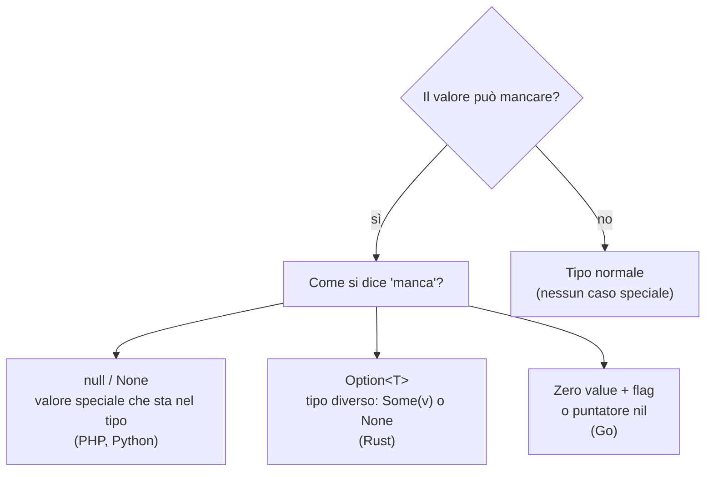
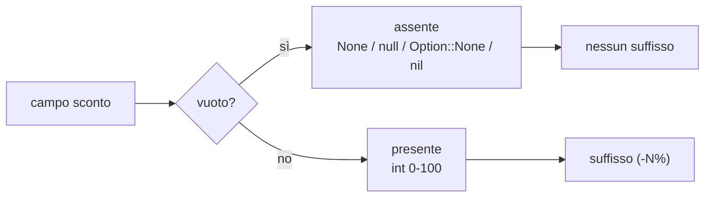
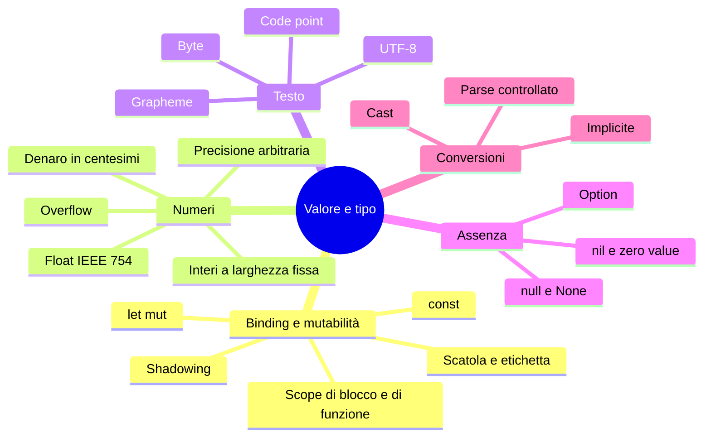

## L02.4 — L'assenza di valore: null, None, Option, nil e zero values (T4)

| Fase | Minuti | Contenuto |
|---|---|---|
| Aggancio | 5 | `(-0%)`: sconto assente o sconto zero? |
| Concetto | 8 | Quattro idee di «niente» |
| Implementazione | 20 | Esperimento Rosetta e lo sconto opzionale |
| Focus comparativo | 8 | Matrice dell'assenza |
| Consolidamento | 4 | Esercizio e verifica |

### Concetto: quattro risposte alla stessa domanda

Un campo può non avere valore: lo sconto non è stato dato, la chiave non è nel dizionario, l'utente non ha un secondo nome. Come si rappresenta?



- **`null` / `None` (PHP, Python).** Un valore speciale che può comparire al posto di qualsiasi tipo. Comodo, ma ogni variabile può contenerlo: chiamare un metodo su un `None` produce un errore a runtime. Tony Hoare, che lo introdusse nel 1965, lo ha definito il suo «errore da un miliardo di dollari».
- **`Option<T>` (Rust).** Non esiste un valore nullo: un valore che può mancare ha un **tipo diverso**, `Option<T>`, con due varianti: `Some(valore)` e `None`. Per usare il valore bisogna passare per il `match` (o per metodi come `unwrap_or`): il compilatore obbliga a considerare il caso «manca».
- **Zero value (Go).** Ogni tipo ha un valore predefinito utilizzabile subito: `0`, `""`, `false`, `nil` per puntatori, mappe, slice. La variabile non è mai «non inizializzata». Ma «zero» e «assente» possono confondersi.

### Implementazione — Esperimento 4: chiave mancante

**Python**

```python
d = {"a": 1}
print("get missing :", d.get("x"))
try:
    d["x"]
except KeyError as e:
    print("d['x']      : KeyError", e)
try:
    None + 1
except TypeError as e:
    print("None + 1    : TypeError:", e)
```

**PHP**

```php
<?php
$d = ["a" => 1];
var_dump($d["x"] ?? null);     // explicit default
var_dump(@$d["x"]);            // warning silenced (without @: "Undefined array key")
var_dump(null + 1);            // null is coerced to 0
var_dump(null == 0, null == false, null === 0);
```

**Rust**

```rust
use std::collections::HashMap;

fn main() {
    let mut d: HashMap<&str, i32> = HashMap::new();
    d.insert("a", 1);
    println!("get missing : {:?}", d.get("x"));
    println!("get present : {:?}", d.get("a"));
    println!("unwrap_or   : {}", d.get("x").copied().unwrap_or(0));
    match d.get("x") {
        Some(v) => println!("found {v}"),
        None => println!("match       : None handled explicitly"),
    }
}
```

**Go**

```go
package main

import "fmt"

func main() {
	d := map[string]int{"a": 1}
	fmt.Println("d[\"x\"]      :", d["x"]) // missing key: zero value, no error
	v, ok := d["x"]
	fmt.Println("comma-ok    :", v, ok)

	var s string
	var p *int
	var m map[string]int
	var sl []int
	fmt.Printf("zero values : %q %v %v %v\n", s, p, m == nil, sl == nil)
	fmt.Println("read nil map:", m["k"], "| len(nil slice):", len(sl))
	defer func() { fmt.Println("write nil map -> panic:", recover()) }()
	m["k"] = 1
}
```

Uscite reali:

```text
get missing : None
d['x']      : KeyError 'x'
None + 1    : TypeError: unsupported operand type(s) for +: 'NoneType' and 'int'
```

```text
NULL
NULL
int(1)
bool(true)
bool(true)
bool(false)
```

```text
get missing : None
get present : Some(1)
unwrap_or   : 0
match       : None handled explicitly
```

```text
d["x"]      : 0
comma-ok    : 0 false
zero values : "" <nil> true true
read nil map: 0 | len(nil slice): 0
write nil map -> panic: assignment to entry in nil map
```

Lettura.

- **Python** offre due porte: `d.get("x")` restituisce `None`, `d["x"]` solleva `KeyError`; `None + 1` è un `TypeError` esplicito e immediato.
- **PHP** mette tre livelli: `$d["x"] ?? null` (operatore *null coalescing*: «se manca, usa questo») è la forma sicura; senza di esso PHP emette un **warning** («Undefined array key») e prosegue con `null`; infine **`null + 1` vale `1`**, perché `null` viene silenziosamente convertito in 0. Nelle ultime tre righe: `null == 0` e `null == false` sono veri, `null === 0` è falso (`===` confronta anche il tipo).
- **Rust**: `d.get("x")` restituisce `None` di tipo `Option<&i32>`, mentre `d.get("a")` restituisce `Some(1)`. Il valore non è raggiungibile se non si passa per `match`, `unwrap_or`, `if let`… Il compilatore **non lascia dimenticare** il caso.
- **Go**: leggere una chiave mancante restituisce il **valore zero** (`0`) **senza errore**: un `d["x"]` che vale 0 può significare «c'è ed è zero» oppure «non c'è». Per distinguere serve la forma a due valori (*comma ok*): `v, ok := d["x"]`. Le variabili non inizializzate valgono il valore zero (`""`, `nil`); leggere una mappa `nil` è consentito, **scriverci è un panic**, e la stringa del panic è l'ultima riga dell'esperimento.

### Lo sconto opzionale (T4)

Lo sconto del programma è esattamente questo caso. Una riga con il campo vuoto non ha sconto; una riga con `0` ha sconto dello 0 %. Per lo scontrino sono casi diversi: nel secondo si stampa `(-0%)`. Se si rappresentasse l'assenza con `0`, i due casi si confonderebbero. Le soluzioni, già viste nel record:

```python
    discount = None  # absence of a value
    if discount_text != "":
        if not all_digits(discount_text) or int(discount_text) > 100:
            raise ValueError(f'discount "{discount_text}" is not an integer between 0 and 100')
        discount = int(discount_text)
    return Line(name.strip(), int(qty_text), parse_price(price_text), discount)
```

```php
    $discount = null; // absence of a value
    if ($discountText !== '') {
        if (!allDigits($discountText) || (int) $discountText > 100) {
            throw new InvalidArgumentException("discount \"$discountText\" is not an integer between 0 and 100");
        }
        $discount = (int) $discountText;
    }
```

```rust
    let discount = if discount_text.is_empty() {
        None // absence of a value
    } else {
        match discount_text.parse::<u64>() {
            Ok(d) if all_digits(discount_text) && d <= 100 => Some(d),
            _ => {
                return Err(format!("discount \"{discount_text}\" is not an integer between 0 and 100"));
            }
        }
    };
    Ok(Line { name: name.trim().to_string(), qty, price_cents: parse_price(price_text)?, discount })
```

```go
	if discountText != "" {
		d, err := strconv.Atoi(discountText)
		if !allDigits(discountText) || err != nil || d > 100 {
			return Line{}, fmt.Errorf("discount \"%s\" is not an integer between 0 and 100", discountText)
		}
		discount = &d
	}
	price, err := parsePrice(priceText)
```

e il punto in cui si usa il valore:

```python
def line_total(line: Line) -> int:
    gross = line.qty * line.price_cents
    off = 0 if line.discount is None else (gross * line.discount + 50) // 100  # round half up
    return gross - off
```

```rust
fn line_total(line: &Line) -> u64 {
    let gross = line.qty * line.price_cents;
    let off = match line.discount {
        None => 0,
        Some(pct) => (gross * pct + 50) / 100, // round half up
    };
    gross - off
}
```

In Python e PHP si confronta con `None`/`null` (`is None`, `=== null`); in Rust il `match` ha due rami e il compilatore verifica che ci siano entrambi; in Go si usa un **puntatore**: `*int` è `nil` se il campo manca, altrimenti punta al numero (`*line.Discount` lo legge). Il puntatore è un modo, non l'unico, per esprimere un valore opzionale in Go: alternative sono una struct con un campo booleano `HasDiscount`, oppure un valore speciale (come `-1`) documentato.

Un dettaglio utile: il collaudo con `Caffè;1;1.20;0` stampa `(-0%)`, mentre `Caffè;1;1.20;` non stampa alcun suffisso. I quattro programmi concordano, perché hanno rappresentato l'assenza in modo distinto dallo zero.



### Focus comparativo

| Aspetto | PHP | Python | Rust | Go |
|---|---|---|---|---|
| Valore «niente» | `null` | `None` | `None` (variante di `Option`) | `nil` (solo per puntatori, mappe, slice, canali, interfacce, funzioni) |
| Tipo opzionale | `?int` / `int\|null` | `int \| None` | `Option<u64>` | `*int` (o flag) |
| Chiave mancante | `null` + warning | `KeyError` o `None` con `.get` | `None` | valore zero |
| Si può usare senza controllare? | Sì (errori tardivi o conversioni silenziose) | Sì (errore a runtime) | **No** (il compilatore obbliga) | Sì per i valori zero; panic per `nil` dereferenziati |
| `null + 1` | `1` | `TypeError` | non compila | non compila |

**Similitudini.** Tutti e quattro hanno un modo di rappresentare «niente»; tutti permettono di distinguere assente da presente se il programmatore lo vuole.
**Differenze.** Dove vive il «niente»: dentro ogni tipo (PHP, Python), in un tipo separato (Rust), come valore predefinito (Go). Il costo si paga in luoghi diversi: errori a runtime, verbosità del `match`, ambiguità fra zero e assente.

### Esercizio Rosetta (4′)

Aggiungi un quinto campo opzionale, `note`, e stampa il testo tra parentesi quadre se presente. In Go: quale rappresentazione scegli per «assente» in una stringa, dove `""` è già il valore zero? Ha senso distinguere nota vuota da nota assente?

**Domanda di verifica.** Perché in Rust l'errore «dimentico il caso assente» è un errore di compilazione, e in Python un errore a runtime?

**Risposta.** Perché in Rust l'assenza è un tipo (`Option<T>`) che non si può usare come `T`; in Python `None` è un valore che può stare ovunque, e l'errore compare solo quando lo si usa.

---

## L02.5 — Conversioni: cast espliciti, coercion, type juggling (T5)

| Fase | Minuti | Contenuto |
|---|---|---|
| Aggancio | 5 | `"10" + 5`: 15, errore o 105? |
| Concetto | 8 | Esplicita, implicita, controllata |
| Implementazione | 20 | Esperimento Rosetta e parsing dello scontrino |
| Focus comparativo | 8 | Matrice delle conversioni |
| Consolidamento | 4 | Esercizio e verifica |

### Concetto: tre famiglie di conversione

| Famiglia | Che cosa succede | Esempio |
|---|---|---|
| **Implicita** (coercion, type juggling) | Il linguaggio converte da solo, secondo regole proprie | PHP: `"10" + 5` vale 15 |
| **Esplicita non controllata** (cast) | Il programmatore chiede la conversione, il linguaggio la esegue anche se perde informazioni | Rust: `300 as u8` vale 44; Go: `uint8(300)` vale 44 |
| **Esplicita controllata** (parse, `try_from`) | La conversione restituisce un esito: successo o errore | Rust: `"10".parse::<i32>()` è `Ok(10)`; Go: `strconv.Atoi` restituisce `(valore, err)` |

Per un dato che arriva dall'esterno (un file, una richiesta) serve sempre la terza famiglia: **se il dato è sbagliato, voglio saperlo**.

### Implementazione — Esperimento 5: «10» più 5, e altre conversioni

**Python**

```python
def show(label, f):
    try:
        print(f"{label:16}", f())
    except Exception as e:
        print(f"{label:16}", type(e).__name__ + ":", e)

show('"10" + 5', lambda: "10" + 5)
show('int("10") + 5', lambda: int("10") + 5)
show('int("3.7")', lambda: int("3.7"))
show('int(3.7)', lambda: int(3.7))
show('bool("False")', lambda: bool("False"))
show('bool("")', lambda: bool(""))
show('"abc" == 0', lambda: "abc" == 0)
show('"10" == "1e1"', lambda: "10" == "1e1")
```

**PHP**

```php
<?php
var_dump("10" + 5);
var_dump((int) "3.7abc");
var_dump((int) 3.7, (int) "abc");
var_dump((bool) "false", (bool) "0", (bool) "0.0", (bool) "");
var_dump("abc" == 0, "10" == "1e1", "abc" <=> "abd");
var_dump(0 == "", null == false, "1" == "01");
try {
    var_dump("abc" * 2);
} catch (TypeError $e) {
    echo "TypeError: ", $e->getMessage(), "\n";
}
```

**Rust**

```rust
fn main() {
    let big: i32 = std::env::args().count() as i32 + 299; // 300, known only at run time
    println!("300 as u8      : {}", big as u8);
    println!("-1 as u8       : {}", (big - 301) as u8);
    println!("3.7 as i32     : {}", (big as f64 / 100.0 + 0.7) as i32);
    println!("NaN as i32     : {}", f64::NAN as i32);
    println!("1e20 as i32    : {}", 1e20_f64 as i32);
    println!("u8::try_from   : {:?}", u8::try_from(big));
    println!("\"10\".parse    : {:?}", "10".parse::<i32>());
    println!("\"3.7\".parse   : {:?}", "3.7".parse::<i32>().is_err());
    println!("\"3.7\" as f64  : {:?}", "3.7".parse::<f64>());
}
```

**Go**

```go
package main

import (
	"fmt"
	"strconv"
)

func main() {
	big := 299 + len("x") // 300, known only at run time
	fmt.Println("uint8(300)     :", uint8(big))
	f := float64(big)/100 + 0.7
	fmt.Println("int(3.7)       :", int(f))
	n, err := strconv.Atoi("10")
	fmt.Println("Atoi(\"10\")    :", n, err)
	_, err = strconv.Atoi("3.7")
	fmt.Println("Atoi(\"3.7\")   :", err)
	fl, err := strconv.ParseFloat("3.7", 64)
	fmt.Println("ParseFloat     :", fl, err)
	fmt.Println("string(65)     :", string(rune(65)), "| strconv.Itoa(65):", strconv.Itoa(65))
}
```

Uscite reali:

```text
"10" + 5         TypeError: can only concatenate str (not "int") to str
int("10") + 5    15
int("3.7")       ValueError: invalid literal for int() with base 10: '3.7'
int(3.7)         3
bool("False")    True
bool("")         False
"abc" == 0       False
"10" == "1e1"    False
```

```text
int(15)
int(3)
int(3)
int(0)
bool(true)
bool(false)
bool(true)
bool(false)
bool(false)
bool(true)
int(-1)
bool(false)
bool(true)
bool(true)
TypeError: Unsupported operand types: string * int
```

Per leggere l'uscita di PHP (una riga per `var_dump`, nell'ordine del sorgente): `"10"+5` → `int(15)`; `(int) "3.7abc"` → `int(3)` (legge il prefisso numerico e ignora il resto); `(int) 3.7` → `int(3)`; `(int) "abc"` → `int(0)`; `(bool) "false"` → `true`; `(bool) "0"` → `false`; `(bool) "0.0"` → `true`; `(bool) ""` → `false`; `"abc" == 0` → `false` (in PHP 8; era `true` in PHP 7); `"10" == "1e1"` → **`true`** (due stringhe numeriche si confrontano come numeri: 10 = 1×10¹); `"abc" <=> "abd"` → `-1`; `0 == ""` → `false`; `null == false` → `true`; `"1" == "01"` → `true`; `"abc" * 2` → **`TypeError`**.

Rust e Go:

```text
300 as u8      : 44
-1 as u8       : 255
3.7 as i32     : 3
NaN as i32     : 0
1e20 as i32    : 2147483647
u8::try_from   : Err(TryFromIntError(PosOverflow))
"10".parse    : Ok(10)
"3.7".parse   : true
"3.7" as f64  : Ok(3.7)
```

```text
uint8(300)     : 44
int(3.7)       : 3
Atoi("10")    : 10 <nil>
Atoi("3.7")   : strconv.Atoi: parsing "3.7": invalid syntax
ParseFloat     : 3.7 <nil>
string(65)     : A | strconv.Itoa(65): 65
```

E i due errori di compilazione che si ottengono scrivendo `"10" + 5`:

```text
error[E0369]: cannot add `{integer}` to `&str`
 --> rs/e5_bad.rs:2:22
  |
2 |     let total = "10" + 5;
  |                 ---- ^ - {integer}
  |                 |
  |                 &str

error: aborting due to 1 previous error
```

```text
# command-line-arguments
go/e5_bad.go:6:11: invalid operation: "10" + 5 (mismatched types untyped string and untyped int)
```

### Le regole, in una tabella

| Conversione | PHP | Python | Rust | Go |
|---|---|---|---|---|
| `"10" + 5` | **15** (coercion) | `TypeError` | Non compila | Non compila |
| `"3.7"` → intero | `(int)` dà 3 (anche con testo dopo il numero) | `int("3.7")` → `ValueError` | `parse::<i32>()` → `Err` | `Atoi` → errore |
| `3.7` → intero | `(int)` = 3 (tronca) | `int(3.7)` = 3 | `as i32` = 3 (tronca) | `int(f)` = 3 |
| Intero troppo grande per il tipo | Diventa float | Nessun limite | `300 as u8` = 44 (wrap); `u8::try_from(300)` = `Err` | `uint8(300)` = 44 (wrap) |
| NaN/infinito a intero | — | `ValueError`/`OverflowError` | `NaN as i32` = 0; `1e20 as i32` = 2147483647 (**saturazione**) | Dipende dalla piattaforma (valore non specificato dal linguaggio) |
| `bool("False")` / `(bool)"false"` | `true` | `True` | Non ammesso | Non ammesso |
| Booleano da stringa vuota | `false` | `False` | — | — |
| `"10" == "1e1"` | **true** | false | Non compila | Non compila |

La riga sul NaN in Go è l'unica che il codice di questo capitolo non ha eseguito: la specifica di Go dichiara che il risultato è dipendente dall'implementazione.

Il caso più pericoloso è la **comparazione con coercion**: in PHP, `"10" == "1e1"` è vera. Con codici o identificativi numerici alfanumerici, questa regola ha causato falle di sicurezza (confronto di hash in forma «0e…»). In PHP si usa `===` (identità) e funzioni come `hash_equals`, mai `==`, per confrontare valori che non sono chiaramente numeri.

### Il parsing nello scontrino (T5)

Il programma converte ogni campo di testo con una combinazione di due passi: **validare la forma** con una funzione `all_digits`, poi **convertire**. Il motivo di non affidarsi alla sola conversione è nella tabella: `int(" 5")` in Python accetta gli spazi, `isdigit()` accetta cifre non ASCII, `Atoi` di Go accetta un `+` iniziale. Per i campi di un formato fissato (quantità, sconto, centesimi) è più sicuro dichiarare la forma ammessa e rifiutare tutto il resto.

```python
def all_digits(s: str) -> bool:
    return s != "" and s.isascii() and s.isdigit()


def parse_price(text: str) -> int:
    """'1.20' -> 120, '2.5' -> 250, '3' -> 300. No floats: money stays an integer."""
    whole, dot, frac = text.partition(".")
    if not all_digits(whole) or (dot != "" and not (all_digits(frac) and len(frac) <= 2)):
        raise ValueError(f'price "{text}" is not a decimal with at most 2 digits')
    return int(whole) * 100 + int(frac.ljust(2, "0"))


def parse_line(raw: str) -> Line:
    fields = raw.split(";")
    if len(fields) != 4:
        raise ValueError(f"expected 4 fields, got {len(fields)}")
    name, qty_text, price_text, discount_text = fields
    if name.strip() == "":
        raise ValueError("name is empty")
    if not all_digits(qty_text) or int(qty_text) == 0:
        raise ValueError(f'quantity "{qty_text}" is not a positive integer')
    discount = None  # absence of a value
    if discount_text != "":
        if not all_digits(discount_text) or int(discount_text) > 100:
            raise ValueError(f'discount "{discount_text}" is not an integer between 0 and 100')
        discount = int(discount_text)
    return Line(name.strip(), int(qty_text), parse_price(price_text), discount)
```

```php
function allDigits(string $s): bool
{
    return $s !== '' && ctype_digit($s); // ctype_digit: ASCII digits only
}

/** '1.20' -> 120, '2.5' -> 250, '3' -> 300. No floats: money stays an integer. */
function parsePrice(string $text): int
{
    [$whole, $frac] = array_pad(explode('.', $text, 2), 2, null);
    $hasDot = $frac !== null;
    if (!allDigits($whole) || ($hasDot && !(allDigits($frac) && strlen($frac) <= 2))) {
        throw new InvalidArgumentException("price \"$text\" is not a decimal with at most 2 digits");
    }
    return (int) $whole * 100 + (int) str_pad($frac ?? '', 2, '0');
}

function parseLine(string $raw): Line
{
    $fields = explode(';', $raw);
    if (count($fields) !== 4) {
        throw new InvalidArgumentException('expected 4 fields, got ' . count($fields));
    }
    [$name, $qtyText, $priceText, $discountText] = $fields;
    if (trim($name) === '') {
        throw new InvalidArgumentException('name is empty');
    }
    if (!allDigits($qtyText) || (int) $qtyText === 0) {
        throw new InvalidArgumentException("quantity \"$qtyText\" is not a positive integer");
    }
    $discount = null; // absence of a value
    if ($discountText !== '') {
        if (!allDigits($discountText) || (int) $discountText > 100) {
            throw new InvalidArgumentException("discount \"$discountText\" is not an integer between 0 and 100");
        }
        $discount = (int) $discountText;
    }
    return new Line(trim($name), (int) $qtyText, parsePrice($priceText), $discount);
}
```

```rust
fn all_digits(s: &str) -> bool {
    !s.is_empty() && s.chars().all(|c| c.is_ascii_digit())
}

/// "1.20" -> 120, "2.5" -> 250, "3" -> 300. No floats: money stays an integer.
fn parse_price(text: &str) -> Result<u64, String> {
    let (whole, frac) = match text.split_once('.') {
        Some((w, f)) => (w, Some(f)),
        None => (text, None),
    };
    let frac_ok = match frac {
        Some(f) => all_digits(f) && f.len() <= 2,
        None => true,
    };
    if !all_digits(whole) || !frac_ok {
        return Err(format!("price \"{text}\" is not a decimal with at most 2 digits"));
    }
    let whole: u64 = whole.parse().map_err(|_| format!("price \"{text}\" is too large"))?;
    let cents: u64 = match frac {
        Some(f) => format!("{f:0<2}").parse().unwrap_or(0), // pad on the right: "5" -> "50"
        None => 0,
    };
    Ok(whole * 100 + cents)
}

fn parse_line(raw: &str) -> Result<Line, String> {
    let fields: Vec<&str> = raw.split(';').collect();
    if fields.len() != 4 {
        return Err(format!("expected 4 fields, got {}", fields.len()));
    }
    let (name, qty_text, price_text, discount_text) = (fields[0], fields[1], fields[2], fields[3]);
    if name.trim().is_empty() {
        return Err("name is empty".to_string());
    }
    let qty: u64 = if all_digits(qty_text) { qty_text.parse().unwrap_or(0) } else { 0 };
    if qty == 0 {
        return Err(format!("quantity \"{qty_text}\" is not a positive integer"));
    }
    let discount = if discount_text.is_empty() {
        None // absence of a value
    } else {
        match discount_text.parse::<u64>() {
            Ok(d) if all_digits(discount_text) && d <= 100 => Some(d),
            _ => {
                return Err(format!("discount \"{discount_text}\" is not an integer between 0 and 100"));
            }
        }
    };
    Ok(Line { name: name.trim().to_string(), qty, price_cents: parse_price(price_text)?, discount })
}
```

```go
func allDigits(s string) bool {
	if s == "" {
		return false
	}
	for _, r := range s {
		if r < '0' || r > '9' {
			return false
		}
	}
	return true
}

// parsePrice: "1.20" -> 120, "2.5" -> 250, "3" -> 300. No floats: money stays an integer.
func parsePrice(text string) (int, error) {
	whole, frac, hasDot := strings.Cut(text, ".")
	if !allDigits(whole) || (hasDot && !(allDigits(frac) && len(frac) <= 2)) {
		return 0, fmt.Errorf("price \"%s\" is not a decimal with at most 2 digits", text)
	}
	w, err := strconv.Atoi(whole)
	if err != nil {
		return 0, fmt.Errorf("price \"%s\" is too large", text)
	}
	c := 0
	if hasDot {
		c, _ = strconv.Atoi(frac + strings.Repeat("0", 2-len(frac))) // "5" -> "50"
	}
	return w*100 + c, nil
}

func parseLine(raw string) (Line, error) {
	fields := strings.Split(raw, ";")
	if len(fields) != 4 {
		return Line{}, fmt.Errorf("expected 4 fields, got %d", len(fields))
	}
	name, qtyText, priceText, discountText := fields[0], fields[1], fields[2], fields[3]
	if strings.TrimSpace(name) == "" {
		return Line{}, fmt.Errorf("name is empty")
	}
	qty := 0
	if allDigits(qtyText) {
		qty, _ = strconv.Atoi(qtyText)
	}
	if qty == 0 {
		return Line{}, fmt.Errorf("quantity \"%s\" is not a positive integer", qtyText)
	}
	var discount *int // nil = absence of a value
	if discountText != "" {
		d, err := strconv.Atoi(discountText)
		if !allDigits(discountText) || err != nil || d > 100 {
			return Line{}, fmt.Errorf("discount \"%s\" is not an integer between 0 and 100", discountText)
		}
		discount = &d
	}
	price, err := parsePrice(priceText)
	if err != nil {
		return Line{}, err
	}
	return Line{strings.TrimSpace(name), qty, price, discount}, nil
}
```

Che cosa notare.

1. **`all_digits` è la porta d'ingresso.** Chiama funzioni diverse (`str.isascii() and str.isdigit()`, `ctype_digit`, `is_ascii_digit`, un ciclo con intervallo), con lo stesso contratto: stringa non vuota di sole cifre ASCII.
2. **`parse_price` non usa mai un `float`.** Divide il testo sul punto (`partition`, `explode`, `split_once`, `strings.Cut`), valida le due parti, e ricostruisce i centesimi: `"2.5"` → parte intera 2, frazione `"5"` completata a destra con zero (`"50"`) → 250. Il completamento a destra è il dettaglio che sbaglia chi scrive `int(frac)`: `"5"` vale 50 centesimi, non 5.
3. **Gli errori portano il valore incriminato** (`price "1.205" is not a decimal…`): è l'informazione che permette a chi corregge il file di trovare l'errore. Il modo di segnalarli cambia da linguaggio a linguaggio (eccezione `ValueError`, `InvalidArgumentException`, `Result<_, String>`, `error`) ed è l'argomento di C09.
4. **Il caso `Caffè;0;1.20;`** viene scartato con un messaggio chiaro, senza che il programma tenti nulla: `0` è un intero valido ma non una quantità valida. La validazione di **dominio** (quantità positiva, sconto fra 0 e 100) viene dopo la validazione di **forma** (solo cifre).

I casi di collaudo (tutti eseguiti nei quattro linguaggi, con identico output e identico exit code):

| Input | Esito | Messaggio su stderr |
|---|---|---|
| `receipt.csv` (valido) | exit 0 | — |
| `Caffè;0;1.20;` | exit 1 | `line 1: quantity "0" is not a positive integer` |
| `Caffè;x;1.20;` | exit 1 | `line 1: quantity "x" is not a positive integer` |
| `Caffè;1;1.205;` | exit 1 | `line 1: price "1.205" is not a decimal with at most 2 digits` |
| `Caffè;1;abc;` | exit 1 | `line 1: price "abc" is not a decimal with at most 2 digits` |
| `Caffè;1;-1;` | exit 1 | `line 1: price "-1" is not a decimal with at most 2 digits` |
| `Caffè;1;1.20;101` | exit 1 | `line 1: discount "101" is not an integer between 0 and 100` |
| `Caffè;1;1.20;-5` | exit 1 | `line 1: discount "-5" is not an integer between 0 and 100` |
| `Caffè;1;1.20` (tre campi) | exit 1 | `line 1: expected 4 fields, got 3` |
| ` ;1;1.20;` (nome vuoto) | exit 1 | `line 1: name is empty` |
| File vuoto | exit 0 | (stampa totale 0.00) |
| File con righe terminate da `\r\n` | exit 0 | (stesso output) |
| File inesistente | exit 1 | `fatal: cannot read nofile.csv` |

Un episodio istruttivo: il collaudo con `\r\n` (file scritti su Windows) ha rivelato, durante la stesura, due difetti reali nelle prime versioni di PHP e Go, che non scartavano il `\r` finale e quindi rifiutavano l'ultimo campo come «non numerico». Sono stati corretti (PHP con `rtrim($content, "\r\n")`, Go con `strings.TrimSuffix(raw, "\r")`). Lezione: i file di testo reali hanno fine riga diverse, e il test con input scomodi è parte del programma.

### Focus comparativo

| Aspetto | PHP | Python | Rust | Go |
|---|---|---|---|---|
| Conversione implicita tra stringa e numero | ● sì, estesa | ○ no (`TypeError`) | ○ no | ○ no |
| Cast esplicito | `(int)`, `intval()` | `int()`, `float()`, `str()` | `as` (non controllato) | `T(x)` (non controllato) |
| Conversione controllata | `filter_var`, `is_numeric` | `int()` con `try` | `parse`, `try_from`, `try_into` | `strconv.*` con `err` |
| Confronto debole | `==` con coercion | `==` stesso tipo (o numerico) | `==` solo fra tipi uguali | `==` solo fra tipi uguali |
| Valore «falso» di stringa | `"0"` e `""` | `""` | — | — |

**Similitudini.** Tutti e quattro hanno cast numerici che troncano (3,7 → 3); tutti offrono almeno una funzione di conversione controllata; in nessuno si deve fidare di un dato esterno senza validarlo.
**Differenze.** PHP converte da solo e a lungo, Python rifiuta le mescolanze ma accetta molte forme nelle funzioni di conversione, Rust e Go rifiutano a compile-time. Rust distingue *cast* (`as`) da *conversione fallibile* (`try_from`) con nomi diversi.

### Esercizio Rosetta (4′)

Per ciascun linguaggio, scrivi un'espressione che usa `"10"` come numero senza una conversione esplicita. In quanti dei quattro funziona? Poi riscrivila con la conversione controllata e un caso d'errore (`"1O"` con la lettera O).

**Domanda di verifica.** Perché `300 as u8` in Rust vale 44 e non produce un errore, e quale alternativa dà un errore?

**Risposta.** `as` fa una conversione non controllata che conserva gli 8 bit meno significativi (300 mod 256 = 44). `u8::try_from(300)` restituisce `Err`.

---

## Matrice degli approcci (riepilogo C02)

| Costrutto | PHP | Python | Rust | Go |
|---|---|---|---|---|
| Tipizzazione statica | ◐ type declarations a runtime, `strict_types` | ◐ type hints verificati da tool esterni | ● | ● |
| Inferenza di tipo | ◐ solo negli analyzer | ◐ solo nei type checker | ● `let` | ● `:=` |
| Immutabilità di default | ○ (`const`, `readonly`) | ○ (convenzione, `Final`) | ● `mut` esplicito | ○ (`const` solo compile-time) |
| Valore nullo | ● `null`, `?T` | ● `None`, `T \| None` | ◐ `Option<T>` | ● `nil` + zero values |
| Overflow degli interi | Promozione a float | Interi a precisione arbitraria | Panic in debug, wrap in release, `checked_*` | Wrap silenzioso |
| Stringa | Sequenza di byte (mbstring) | Sequenza di code point | UTF-8 validato (`String`, `&str`) | Byte, UTF-8 per convenzione (`rune`) |
| Conversioni implicite stringa/numero | ● estese | ○ | ○ | ○ |
| Scope | Funzione | Funzione | Blocco | Blocco |

Legenda: ● nativo e idiomatico · ◐ approccio alternativo assimilabile · ○ assente o non idiomatico. La matrice è un indice, non una dichiarazione di equivalenza.

## Anti-pattern ricorrenti

| Anti-pattern | Dove capita | Perché è un problema | Alternativa |
|---|---|---|---|
| Denaro in `float` | Tutti | Errori di centesimi che si accumulano | Interi in unità minime, o tipo decimale |
| `==` fra stringhe che sembrano numeri | PHP | `"10" == "1e1"` è vero | `===`, `hash_equals` |
| `len`/`strlen` su testo con accenti per contare «caratteri» | PHP, Go, Rust | Conta byte | `mb_strlen`, `utf8.RuneCountInString`, `.chars().count()` |
| Troncare una stringa con `substr` o slicing a byte | PHP, Go, Rust | Può spezzare un carattere in due | `mb_substr`, `[]rune`, `char_indices` |
| `0` per dire «assente» | Tutti | Un valore valido e «nessun valore» si confondono | `None`/`null`/`Option`/puntatore |
| `unwrap()` / `expect()` su dato esterno | Rust | Un input sbagliato diventa un panic | `match`, `?`, `unwrap_or` |
| `as` per convertire dati di input | Rust, Go | Silenzioso su overflow e perdita | `try_from`, controllo di intervallo |
| Variabile riusata con significati diversi | Python, PHP | Il nome non dice più che cosa contiene | Un nome per ciascun significato |
| Fidarsi di `int(x)` o `(int)$x` sull'input | Python, PHP | Accetta spazi, segni, prefissi numerici | Validare la forma, poi convertire |
| Ignorare il fine riga `\r\n` | Tutti | Campi che non si convertono | Normalizzare il fine riga in lettura |

## Quiz di verifica

1. Qual è la differenza fra valore, tipo e variabile? Fai un esempio in cui lo stesso nome indica prima un intero, poi una stringa, e dì in quali linguaggi è permesso.
2. Perché `0.1 + 0.2 == 0.3` è falso, e come si rappresenta il denaro per evitarlo?
3. Qual è la lunghezza di «Élena» in byte e in code point? E per «👍»?
4. Che cosa significa `d["x"]` per una mappa vuota in Python, PHP, Rust e Go?
5. Perché in Go un valore opzionale si esprime spesso con un puntatore, e che alternative ci sono?
6. Qual è la differenza fra `300 as u8` e `u8::try_from(300)` in Rust?
7. Perché si valida la *forma* di un campo (solo cifre) prima di convertirlo?

**Risposte**

> 1. Il valore è il dato; il tipo è l'insieme dei valori ammessi con le operazioni; la variabile è il nome associato (binding). Lo stesso nome con tipi diversi: permesso in Python e PHP, in Rust solo con shadowing (`let x = ...; let x = "...";`), non in Go nello stesso scope.
> 2. Perché 0,1 e 0,2 non sono esatti in base 2 e la somma accumula l'errore. Si usano interi in centesimi o un tipo decimale.
> 3. «Élena»: 6 byte, 5 code point. «👍»: 4 byte, 1 code point.
> 4. Python: `KeyError`; PHP: warning e `null`; Rust: `d.get` dà `None` (e `d["x"]` fa panic); Go: valore zero.
> 5. Perché un puntatore può essere `nil`. Alternative: una struct con flag `HasX`, o un valore speciale documentato.
> 6. `as` converte senza controllare (300 → 44); `try_from` restituisce `Err` se il valore non sta nel tipo.
> 7. Perché le funzioni di conversione accettano forme che il formato non ammette (spazi, segni, cifre non ASCII).

## Esercizi

1. **(base)** Esegui il programma dello scontrino nei quattro linguaggi con `receipt.csv` e confronta con `diff`. Poi modifica il file introducendo un nome con una lettera accentata più lunga di 20 caratteri: che cosa succede alla colonna?
2. **(base)** Aggiungi una colonna «sconto in euro» alla stampa. Dove prendi il valore, e quale arrotondamento usi?
3. **(medio)** Cambia l'aliquota IVA in 10 %. Quali righe cambiano? Il calcolo `(total × 22 + 61) / 122` rimane valido? Derivane la forma generale.
4. **(medio)** Sostituisci l'aritmetica in centesimi con la virgola mobile e trova un input per cui l'importo totale differisce di un centesimo.
5. **(medio)** Aggiungi il supporto per la virgola decimale all'italiana (`1,20`) oltre al punto. Quali funzioni modifichi? Hai introdotto nuove ambiguità (migliaia con il punto: `1.200,50`)?
6. **(avanzato)** In Go sostituisci `*int` con una struct `Option[T]` generica (anticipa C08). Cosa guadagni, cosa perdi rispetto al puntatore?
7. **(avanzato, statistica leggera)** Genera un milione di importi casuali in centesimi, calcola la loro somma come intero e come `float`. Quanto differiscono i due totali? Dopo quanti elementi compare la prima differenza?

## Mappa mentale



Collegamenti: C06 (tipi composti e modellazione), C08 (generics e type system avanzato), C09 (errori), C10 (memoria), C14 (JSON, validazione, Unicode, tempo).

---

## Addendum — Il perché della scelta

Tipizzazione dinamica e statica esprimono due idee di **fiducia**. Fidarsi del programmatore e scoprire l'errore eseguendo (PHP, Python): il linguaggio chiede poco, il programma parte presto, i problemi emergono quando il dato sbagliato attraversa il punto sbagliato. Oppure pretendere la prova prima di eseguire (Rust, Go): il linguaggio chiede di più all'inizio e offre in cambio la garanzia che intere classi di errori non possano accadere. PHP e Python sono, da anni, lungo una strada di *tipizzazione graduale*, con annotazioni e analizzatori che portano la seconda idea nella prima.

Sull'**assenza di valore**: `null` tratta il «niente» come un valore qualsiasi, e per questo può comparire ovunque, anche dove nessuno lo aspetta; è la scelta che il suo inventore ha chiamato l'errore da un miliardo di dollari. L'`Option` di Rust trasforma il «niente» in un caso che il tipo **obbliga a considerare**: la correttezza si paga in verbosità, ma non si può dimenticare. Gli **zero value** di Go partono da un'altra idea: ogni variabile deve essere utilizzabile appena dichiarata, senza ulteriori passaggi. La semplicità ha un prezzo: la differenza fra «zero» e «assente» va gestita dal programmatore.

Sul **modello di variabile**: scatola che contiene un valore (Rust, Go) contro etichetta attaccata a un oggetto (Python). La prima è vicina alla macchina; la seconda è vicina al modo in cui pensiamo agli oggetti. Ciascuna rende facile una cosa e difficile un'altra: l'etichetta rende banale passare oggetti pesanti, e rende possibile modificarli da un posto che non ci si aspetta; la scatola rende prevedibili le copie, e costringe a pensare a chi possiede che cosa (tema di C10).

Domanda guida del corso, applicata qui: **che cosa questo linguaggio rende facile, e che cosa rende difficile di proposito?** PHP rende facile mescolare tipi e difficile fidarsi dei confronti. Python rende facile esprimere e difficile sapere in anticipo che cosa passa per una funzione. Rust rende facile dimostrare e difficile abbozzare. Go rende facile leggere e difficile esprimere sottili differenze di significato (zero contro assente).

## Ponte

C03 usa subito questi valori nei condizionali e nei cicli, con il pattern matching che fa del `match` sull'`Option` uno strumento quotidiano. C06 espande il record dello scontrino in tipi composti e in sum type, dove «sconto assente o percentuale» diventa un tipo esplicito. C08 riprende `Option` e i generics. C09 affronta il tema degli errori di parsing con i quattro modelli visti qui «di passaggio». C10 spiega che cosa significa davvero «spostare» e «copiare». C14 torna su Unicode con normalizzazione, e sul tempo.

---

