# C03 — Controllo di flusso e pattern matching

> **Parte I — Basi del linguaggio** · 3 lezioni (L03.1–L03.3) · 2 ore e 15 minuti · capitolo senza addendum
> **Stato:** bozza 1 (2026-10-12). Codice eseguito e verificato su PHP 8.3.6, Python 3.13.16, Rust 1.97.0 (`rustc --edition 2024`), Go 1.24.7 (baseline del corso: PHP 8.4+, Go 1.25+: il codice non usa nulla di specifico delle versioni più recenti, da riverificare a stesura finale). Per la verifica statica degli esempi Python è stato usato mypy 2.4.0.
> **Nota di esportazione:** questa copia contiene le lezioni complete. I programmi integrali (appendice C03.A: `main.py`, `main.php`, `main.rs`, `main.go`) sono nel file `capitoli/C03-controllo-di-flusso-e-pattern-matching.md` del Project.

## Obiettivi

Al termine del capitolo si sa:

1. distinguere **istruzione** ed **espressione** e usare i condizionali come valori dove il linguaggio lo permette;
2. prevedere come ciascun linguaggio decide che una condizione è vera (*truthiness*) e perché Rust e Go lo vietano;
3. scegliere il ciclo adatto (`for`, `while`, `loop`, `do-while`, `for`/`else`) e controllarne l'uscita con `break`, `continue` ed etichette;
4. scrivere un **pattern matching** che scompone un dato nei suoi pezzi, con *guard* e *or-pattern*;
5. spiegare l'**esaustività** (il controllo che tutti i casi siano coperti) e dire, per ciascun linguaggio, *quando* una dimenticanza viene scoperta: a compilazione, con un type checker, a runtime o mai.

Prerequisiti: C02 (valori, tipi, variabili) e, per chi viene dalla Parte P, CP2 (flowchart e tracing manuale). Il capitolo riusa lo stile di C09: problema reale, scomposizione, flowchart, quattro implementazioni verificate, matrice.

**Percorso per l'ingresso A (formato "primario + lettura").** Si scrive e si esegue il programma nel linguaggio primario scelto in LP1.3; gli altri tre si leggono con l'aiuto delle tabelle di confronto. Le sezioni "Focus comparativo" e gli esperimenti brevi (truthiness, cicli, esaustività) sono pensati per essere letti e riprodotti, non memorizzati.

## Il problema reale

> Un corriere espresso riceve ogni notte da più magazzini un file `events.csv` con gli **eventi di tracking** dei pacchi: creazione (con il peso in grammi), ritiro, transito in un hub, tentativo di consegna fallito (con il motivo), consegna, reso al mittente, smarrimento. Serve un programma che, per ogni pacco, ricostruisca **a che punto è** (l'ultimo stato valido), conti i tentativi falliti, **ignori gli eventi che arrivano dopo uno stato finale** (un pacco smarrito non può essere consegnato) e calcoli quanto fatturare: la tariffa dipende dal peso, un pacco reso dopo tre tentativi falliti costa una volta e mezza la tariffa, un pacco smarrito non si fattura. Le righe malformate o con eventi sconosciuti vanno scartate e segnalate, non devono fermare l'elaborazione.

File di esempio usato in tutto il capitolo (`events.csv`, 22 righe compresa l'intestazione; la riga 12 è vuota di proposito):

```csv
parcel,event,arg
P1,CREATED,800
P1,PICKED_UP,
P1,IN_TRANSIT,MI
P1,DELIVERED,
P2,CREATED,2500
P2,PICKED_UP,
P2,FAILED,absent
P2,FAILED,address
P2,FAILED,absent
P2,RETURNED,

P3,CREATED,300
P3,PICKED_UP,
P3,IN_TRANSIT,RM
P3,TELEPORTED,
P4,CREATED,12000
P5,CREATED,450
P5,PICKED_UP,
P5,LOST,
P5,DELIVERED,
P6,CREATED,abc
```

Che cosa contiene, in termini di eventi validi (18 su 20 righe di dati; 2 righe scartate, la riga vuota non conta):

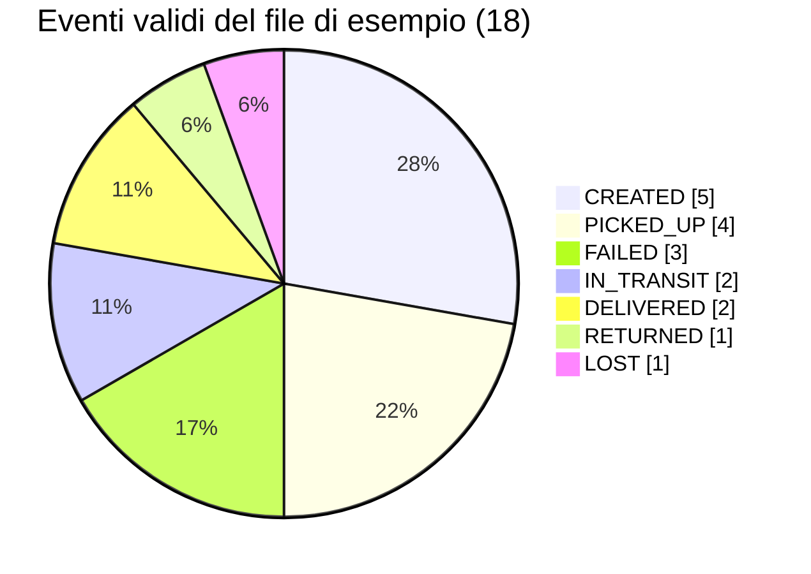

Risultato atteso, **identico nei quattro linguaggi** (`diff` vuoto), exit code `1` perché ci sono righe scartate (`0` se tutto valido, `2` se il file non si legge):

```text
rejected line 16: unknown event 'TELEPORTED'
rejected line 22: bad weight 'abc'
P1 status=delivered failures=0 ignored=0 fee=790
P2 status=returned failures=3 ignored=0 fee=1935
P3 status=in_transit@RM failures=0 ignored=0 fee=0
P4 status=created failures=0 ignored=0 fee=0
P5 status=lost failures=0 ignored=1 fee=0
summary parcels=5 events=18 rejected=2 billed=2725
```

Si noti che il pacco `P5` risulta `lost` con `ignored=1`: la consegna arrivata dopo lo smarrimento è stata ignorata, non applicata. Il pacco `P6` non compare: la sua unica riga (peso `abc`) è stata scartata, quindi non esiste nessun evento valido per lui.

### Scomposizione in attività

| # | Attività | Domanda sul controllo di flusso | Lezione |
|---|---|---|---|
| T1 | Calcolare la tariffa dal peso (scaglioni) | Come si sceglie **un valore** tra più alternative ordinate? | L03.1 |
| T2 | Ricostruire la storia di un pacco evento per evento, fermandosi allo stato finale | Come si **ripete** un'azione e come si **esce** dal ciclo? | L03.2 |
| T3 | Trasformare il testo di una riga in un evento tipizzato, descriverlo, riconoscere gli stati finali, aggiornare il pacco | Come si **distingue** un caso dall'altro e si **estraggono** i dati dal caso? | L03.3 |
| T4 | Calcolare la fattura in base allo stato finale e ai tentativi falliti | Come si combinano **caso e condizione** (guard)? | L03.3 |
| T5 | Leggere il file, raccogliere gli scarti, stampare il riepilogo, restituire l'exit code | Tutto insieme, ai bordi del programma | tutte |

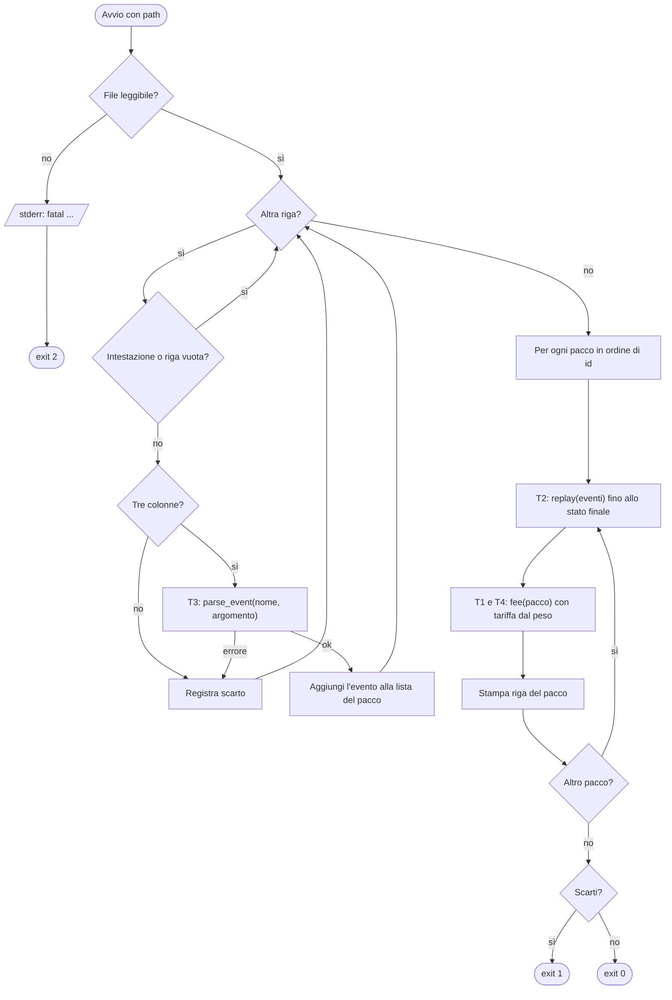

Il flowchart mostra tre forme di controllo di flusso, ciascuna con la sua lezione: **scelte** (i rombi), **ripetizioni** (i due anelli: righe del file, pacchi) e **smistamento per forma del dato** (il nodo `parse_event`, e più avanti `describe` e `fee`). Sono i tre strumenti di tutto il capitolo.

---

## L03.1 — Condizionali: istruzioni contro espressioni (T1)

### Concetto

Un **condizionale** sceglie quale codice eseguire in base a una condizione. Ci sono due modi di intenderlo:

- come **istruzione** (*statement*): esegue qualcosa, non produce un valore. `if (c) { x = 1; } else { x = 2; }` è un'istruzione: l'assegnazione è un effetto collaterale;
- come **espressione** (*expression*): ha un valore. `x = (c ? 1 : 2)` è un'espressione: il condizionale *è* il valore assegnato.

La differenza è pratica: con un'espressione la variabile nasce già col valore giusto (spesso immutabile), non c'è una fase intermedia in cui esiste ma non è ancora inizializzata, e il compilatore può verificare che **ogni ramo produca un valore dello stesso tipo**. Con un'istruzione ci si affida alla disciplina del programmatore.

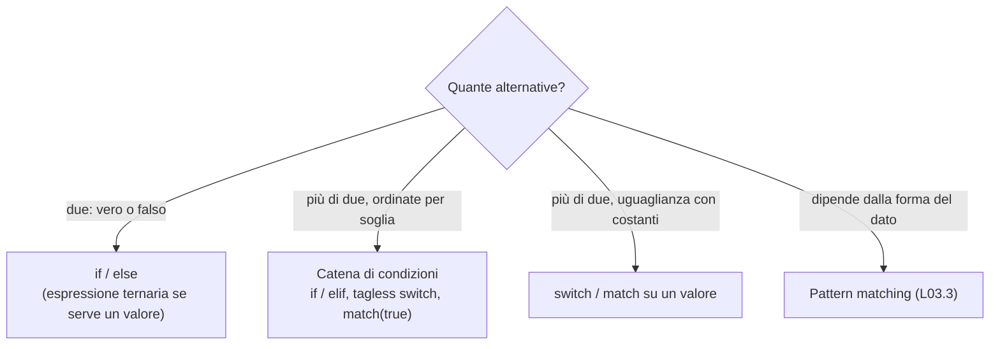

#### Che cosa conta come "vero"

Prima di scegliere il costrutto bisogna sapere come ciascun linguaggio valuta la condizione. Esistono due filosofie:

- **Condizione obbligatoriamente booleana** (Rust, Go): tra le parentesi può esserci solo un `bool`. Scrivere `if n` con `n` intero è un errore di compilazione.
- **Condizione con *truthiness*** (Python, PHP): qualunque valore viene convertito in booleano secondo regole del linguaggio. Comodo, ma le regole non coincidono tra i due linguaggi.

Esperimento e1: la stessa tabella di valori, stampata da Python e da PHP (eseguito davvero):

| Valore | Python | PHP |
|---|---|---|
| `''` (stringa vuota) | falso | falso |
| `'0'` | **vero** | **falso** |
| `'0.0'` | vero | vero |
| `'false'` | vero | vero |
| `[]` (lista/array vuoto) | falso | falso |
| `0` | falso | falso |
| `0.0` | falso | falso |
| `None` / `null` | falso | falso |

L'unica differenza è la stringa `'0'`, ed è un classico: in PHP un valore letto da un form o da un CSV (sempre stringa) che contiene `"0"` è *falso*, in Python è *vero*. Lo stesso `if ($quantita)` si comporta in modo diverso con lo stesso dato.

Rust e Go rifiutano la questione alla radice. Output reali dei compilatori:

```text
error[E0308]: mismatched types
 --> e1.rs:3:8
  |
3 |     if s {
  |        ^ expected `bool`, found `&str`

./e1.go:7:5: non-boolean condition in if statement
```

Regola pratica per chi scrive in Python o PHP: **quando il valore non è un booleano, scrivere il confronto esplicito** (`if qty > 0`, `if name != ""`, `if items`/`if count($items) > 0` solo se si conosce la regola). Rust e Go costringono a farlo; negli altri due è una buona abitudine.

#### Tre famiglie di condizionale

| Famiglia | Che cosa fa | Dove si trova |
|---|---|---|
| `if` / `else if` / `else` | Sceglie in base a una condizione booleana, una dopo l'altra, **la prima vera vince** | Tutti |
| Operatore ternario / `if` come espressione | Produce un valore | Python `a if c else b`; PHP `c ? a : b`; Rust `if c { a } else { b }`; Go **non ha** né ternario né `if` espressione |
| `switch` / `match` | Sceglie in base al valore di *una* espressione confrontata con costanti | Tutti, con semantiche diverse (vedi sotto) |

### Implementazione — T1: la tariffa

Gli scaglioni (in centesimi): fino a 500 g costa 490; fino a 2000 g costa 790; fino a 10000 g costa 1290; oltre costa 2490. Le condizioni sono **ordinate**: ogni soglia presuppone che le precedenti siano false. Per questo basta scrivere solo il limite superiore.

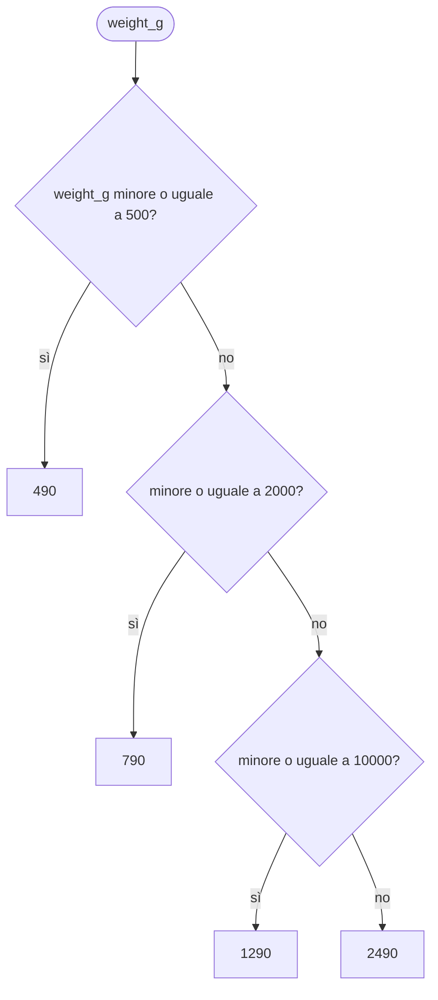

Verifica a mano con il pacco `P2` (2500 g): 2500 ≤ 500? no. 2500 ≤ 2000? no. 2500 ≤ 10000? sì → 1290. Per `P4` (12000 g) tutte le condizioni sono false e si arriva al ramo finale: 2490.

**Python**

```python
# T1 - tariff by weight band (cents): a chain of conditions, first match wins
def tariff(weight_g: int) -> int:
    if weight_g <= 500:
        return 490
    elif weight_g <= 2000:
        return 790
    elif weight_g <= 10000:
        return 1290
    else:
        return 2490
```

**PHP**

```php
// T1 - tariff by weight band (cents): match(true) = chain of conditions, first match wins
function tariff(int $weightG): int
{
    return match (true) {
        $weightG <= 500 => 490,
        $weightG <= 2000 => 790,
        $weightG <= 10000 => 1290,
        default => 2490,
    };
}
```

**Rust**

```rust
// T1 - tariff by weight band (cents): `if` is an expression, the chain has a value
fn tariff(weight_g: u32) -> u32 {
    if weight_g <= 500 {
        490
    } else if weight_g <= 2000 {
        790
    } else if weight_g <= 10000 {
        1290
    } else {
        2490
    }
}
```

**Go**

```go
// T1 - tariff by weight band (cents): tagless switch = chain of conditions, first match wins
func tariff(weightG int) int {
	switch {
	case weightG <= 500:
		return 490
	case weightG <= 2000:
		return 790
	case weightG <= 10000:
		return 1290
	default:
		return 2490
	}
}
```

Quattro stili per lo stesso risultato:

- **Python**: catena `if`/`elif`/`else` con `return` in ogni ramo. Esiste anche l'espressione `a if c else b`, utile per scelte binarie (`label = "ok" if n > 0 else "no"`), ma annidarla più di una volta peggiora la leggibilità.
- **PHP**: `match (true)` con condizioni come braccia. Sfrutta il fatto che `match` confronta il valore (`true`) con ogni condizione *in ordine* e restituisce il valore del primo ramo uguale. `match` è un'espressione e il ramo `default` rende il costrutto completo.
- **Rust**: `if ... else if ... else` **è un'espressione**: l'ultima espressione di ogni blocco (senza punto e virgola) è il valore, e tutti i rami devono avere lo stesso tipo (`u32`). Il corpo della funzione *è* il condizionale, senza `return`.
- **Go**: `switch` senza espressione (*tagless*): ogni `case` è una condizione booleana, valutata in ordine. Go non ha `if` espressione né ternario: si usa `return` in ogni ramo o una variabile assegnata a parte.

### `switch` e `match`: confronto di un valore con costanti

Quando le alternative sono *valori* (non soglie), entra in gioco il costrutto di selezione. Le differenze sono sottili e fonte di bug:

| Aspetto | PHP `switch` | PHP `match` | Python `match` | Rust `match` | Go `switch` |
|---|---|---|---|---|---|
| Tipo di confronto | Debole (`==`) | Stretto (`===`) | Struttura e valore | Struttura e valore | Uguaglianza |
| Fallthrough | **Sì**, serve `break` | No | No | No | No (esplicito con `fallthrough`) |
| È un'espressione? | No | **Sì** | No | **Sì** | No |
| Nessun caso corrisponde | Prosegue silenziosamente | **Errore** `UnhandledMatchError` | Prosegue silenziosamente | **Errore di compilazione** se non esaustivo | Prosegue silenziosamente |

Esperimento e5 in PHP (eseguito davvero):

```php
$code = "1e1"; // a string that looks like a number
switch ($code) {          // switch uses loose comparison (==)
    case "10": echo "switch: matched '10'\n"; break;
    default:   echo "switch: no match\n";
}
echo match ($code) {      // match uses strict comparison (===)
    "10" => "match: matched '10'\n",
    default => "match: no match\n",
};
```

```text
switch: matched '10'
match: no match
```

`"1e1"` è la notazione scientifica di 10: con `==` PHP converte entrambe le stringhe in numeri e le trova uguali. È il tipo di sorpresa che il `match` strict elimina. In PHP moderno si preferisce **sempre `match`** a `switch`, a meno che non serva davvero il fallthrough.

### Focus comparativo

| Aspetto | PHP | Python | Rust | Go |
|---|---|---|---|---|
| Condizione | Qualsiasi valore (truthiness) | Qualsiasi valore (truthiness) | Solo `bool` | Solo `bool` |
| `if` come espressione | ○ (ternario `?:` e `match`) | ◐ (`a if c else b`) | ● | ○ |
| Selezione per soglie | `match (true)` | `if`/`elif` | `if`/`else if` | `switch` senza tag |
| Parentesi attorno alla condizione | Obbligatorie | Non servono | Non servono | Non servono |
| Graffe attorno al blocco | Facoltative con un solo statement (sconsigliato) | Indentazione | **Obbligatorie** | **Obbligatorie** |

**Similitudini.** Le condizioni sono valutate in ordine e il primo ramo vero vince; il resto non viene eseguito (*short-circuit* anche per `&&`, `||`, `and`, `or`).
**Differenze.** Chi vuole un valore da un condizionale usa un costrutto diverso in ogni linguaggio; chi vuole un controllo severo sui tipi della condizione lo ottiene solo in Rust e Go.

**Esercizio Rosetta (4′).** Aggiungere un quinto scaglione: oltre 30000 g il pacco è "fuori misura" e non ha tariffa. Quale tipo di ritorno conviene (richiama C02 sull'assenza di valore)? In quale linguaggio il compilatore aiuta a non dimenticare il nuovo caso?

---

## L03.2 — Cicli e iterazione (T2)

### Concetto

Un **ciclo** ripete un blocco di codice. Ogni ciclo risponde a tre domande: **da dove parte** (inizializzazione), **quando si ferma** (condizione o fine della sequenza), **che cosa cambia a ogni giro** (avanzamento). I linguaggi offrono due forme fondamentali:

- ciclo **su una sequenza** (*foreach*): per ogni elemento fai qualcosa. È la forma più sicura, perché non si può sbagliare l'indice;
- ciclo **su una condizione** (*while*): finché la condizione è vera, continua. Serve quando non si sa in anticipo quante volte; richiede che qualcosa nel corpo avvicini la condizione alla falsità, altrimenti il ciclo è infinito.

Due istruzioni modificano il giro: **`break`** esce dal ciclo, **`continue`** salta al giro successivo.

| Forma | PHP | Python | Rust | Go |
|---|---|---|---|---|
| Su sequenza | `foreach ($xs as $x)` | `for x in xs:` | `for x in xs` | `for _, x := range xs` |
| Su condizione | `while` e `do-while` | `while` | `while` | `for cond { }` |
| Contatore classico | `for ($i = 0; $i < n; $i++)` | `for i in range(n):` | `for i in 0..n` | `for i := 0; i < n; i++` oppure `for i := range n` |
| Infinito | `while (true)` | `while True:` | `loop { }` | `for { }` |
| Eseguire almeno una volta | `do { } while (c)` | (simulato) | (simulato con `loop`) | (simulato) |
| Uscita con valore | ○ | ○ | `break valore` | ○ |
| Ramo "nessun break" | ○ | `for ... else` | ○ | ○ |

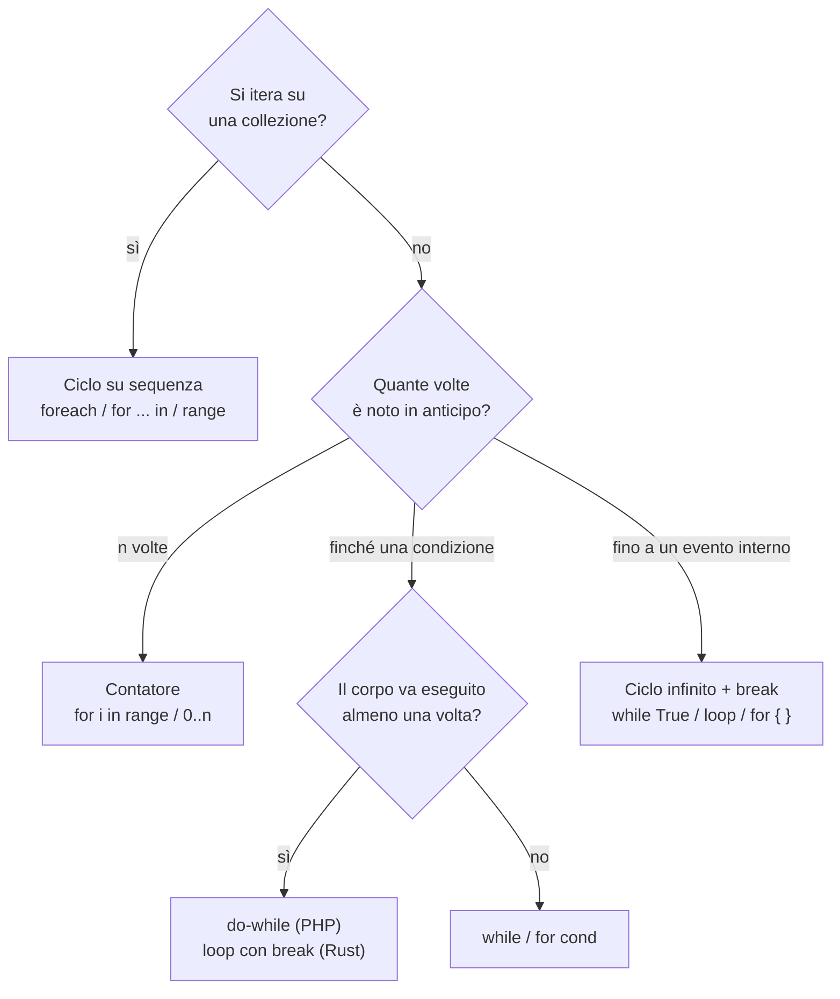

#### Intervalli: la trappola degli estremi

Chi passa da un linguaggio all'altro inciampa quasi sempre sull'**estremo finale**. Esperimento e3 (eseguito davvero), che stampa gli interi da 0 a 5:

| Intento | Python | PHP | Rust | Go |
|---|---|---|---|---|
| Da 0 a 4 (5 escluso) | `range(0, 5)` | `for ($i=0; $i<5; ...)` | `0..5` | `for i := range 5` |
| Da 0 a 5 (5 incluso) | `range(0, 6)` | `range(0, 5)` | `0..=5` | `for i := 0; i <= 5; i++` |
| Passo 2 | `range(0, 10, 2)` | `range(0, 8, 2)` | `(0..10).step_by(2)` | `i += 2` |
| All'indietro | `range(4, -1, -1)` | `range(4, 0)` | `(0..5).rev()` | `i--` |

Python e Rust usano intervalli **semiaperti** (l'ultimo è escluso): la lunghezza di `range(a, b)` è `b - a`. **`range()` di PHP è chiuso**: `range(0, 5)` contiene il 5. Lo stesso nome in due linguaggi, estremi diversi: un classico errore *off-by-one* (CP2 ne ha mostrato l'anatomia).

Go 1.22 ha aggiunto `for i := range 5`, che itera da 0 a 4: prima si scriveva sempre il ciclo con contatore in tre parti. Importante: **la versione del linguaggio è quella dichiarata in `go.mod`** (`go 1.24`), non quella del compilatore installato.

### Implementazione — T2: la storia di un pacco

Per ogni pacco si hanno gli eventi in ordine di arrivo. `replay` li scorre dal primo, aggiorna il pacco e **si ferma al primo evento che porta a uno stato finale** (consegnato, reso, smarrito). Quanti eventi restano nella lista dopo quel punto? Sono quelli da ignorare, e si contano: `len(eventi) - i - 1`.

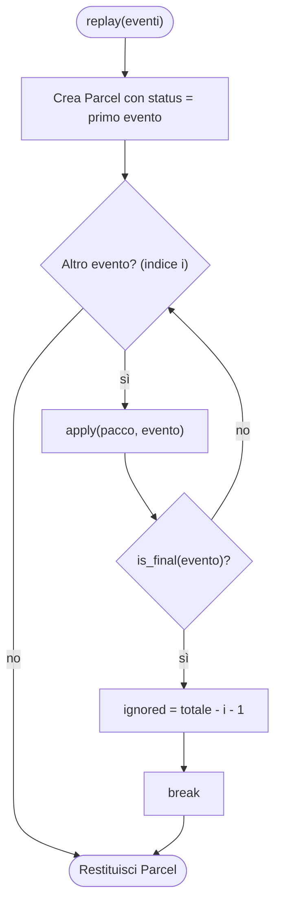

Tracing a mano per `P5` (eventi: `Created(450)`, `PickedUp`, `Lost`, `Delivered`):

| i | evento | `apply` | `is_final` | `status` dopo | `ignored` |
|---|---|---|---|---|---|
| 0 | `Created(450)` | `weight_g = 450` | no | `Created` | 0 |
| 1 | `PickedUp` | niente | no | `PickedUp` | 0 |
| 2 | `Lost` | niente | **sì** | `Lost` | 4 - 2 - 1 = **1** |
| — | `Delivered` | **mai applicato** (uscita con `break`) | — | `Lost` | 1 |

**Python**

```python
# T2 - walk the events of one parcel, stop at the first final event
def replay(events: list[Event]) -> Parcel:
    p = Parcel(status=events[0])  # events is never empty
    for i, ev in enumerate(events):
        apply(p, ev)
        if is_final(ev):
            p.ignored = len(events) - i - 1
            break
    return p
```

**PHP**

```php
/** T2 - walk the events of one parcel, stop at the first final event
 *  @param non-empty-list<Event> $events */
function replay(array $events): Parcel
{
    $p = new Parcel($events[0]);
    foreach ($events as $i => $ev) {
        apply($p, $ev);
        if (isFinal($ev)) {
            $p->ignored = count($events) - $i - 1;
            break;
        }
    }
    return $p;
}
```

**Rust**

```rust
// T2 - walk the events of one parcel, stop at the first final event
fn replay(events: &[Event]) -> Parcel {
    let mut p = Parcel { status: events[0].clone(), weight_g: 0, failures: 0, ignored: 0 };
    for (i, ev) in events.iter().enumerate() {
        apply(&mut p, ev);
        if is_final(ev) {
            p.ignored = events.len() - i - 1;
            break;
        }
    }
    p
}
```

**Go**

```go
// T2 - walk the events of one parcel, stop at the first final event
func replay(events []Event) Parcel {
	p := Parcel{Status: events[0]}
	for i, ev := range events {
		apply(&p, ev)
		if isFinal(ev) {
			p.Ignored = len(events) - i - 1
			break
		}
	}
	return p
}
```

Osservazioni, linguaggio per linguaggio:

- **Python.** `for i, ev in enumerate(events)` produce coppie (indice, valore): senza `enumerate` si scriverebbe `range(len(events))` e `events[i]`, uno stile da evitare. Il `break` interrompe il ciclo: quello che segue è il `return`.
- **PHP.** `foreach ($events as $i => $ev)` dà chiave e valore; per una lista le chiavi sono 0, 1, 2…. Si evita il `for` con `count()` nella condizione quando basta `foreach`.
- **Rust.** `events.iter().enumerate()` è un *iteratore*: il `for` consuma una sequenza che sa produrre elementi uno alla volta (ne parla C05). L'indice è `usize`, il tipo degli indici, per questo `ignored` è `usize`.
- **Go.** `for i, ev := range events` è l'unica forma di ciclo su sequenza. Go ha **una sola** parola chiave, `for`, per tutte le forme.

### Tre costruzioni utili sui cicli

**1. Ciclo con uscita e ramo "nessun break" (esperimento e2).** Si tenta la consegna fino a 3 volte; ogni tentativo dà un esito. Se uno riesce, si stampa il numero del tentativo; se nessuno riesce, si rinuncia. Con gli esiti `[falso, falso, vero]` tutti e quattro stampano `delivered at attempt 3`; con `[falso, falso, falso]` tutti stampano `gave up after 3 attempts` (verificato). Le quattro forme sono molto diverse:

**Python** — `for ... else`: l'`else` del ciclo si esegue **solo se il ciclo è terminato senza `break`**.

```python
outcomes = [False, False, True]  # delivery attempts: failure, failure, success
for attempt, ok in enumerate(outcomes[:3], start=1):
    if ok:
        print(f"delivered at attempt {attempt}")
        break
else:  # runs only if the loop ended without break
    print("gave up after 3 attempts")
```

**PHP** — `do-while`: il corpo gira almeno una volta, la condizione è controllata dopo.

```php
$outcomes = [false, false, true]; // delivery attempts: failure, failure, success
$attempt = 0;
do {
    $attempt++;
    $ok = $outcomes[$attempt - 1];
} while (!$ok && $attempt < 3);
echo $ok ? "delivered at attempt $attempt\n" : "gave up after 3 attempts\n";
```

**Rust** — `loop` è un'espressione: `break valore` dà il risultato al ciclo.

```rust
let outcomes = [false, false, true]; // delivery attempts: failure, failure, success
let mut attempt = 0;
// `loop` is an expression: `break value` gives the loop its result
let result = loop {
    attempt += 1;
    if outcomes[attempt - 1] {
        break Some(attempt);
    }
    if attempt == 3 {
        break None;
    }
};
match result {
    Some(n) => println!("delivered at attempt {n}"),
    None => println!("gave up after 3 attempts"),
}
```

**Go** — `for` con sola condizione e `return` anticipato.

```go
outcomes := []bool{false, false, true} // delivery attempts: failure, failure, success
attempt := 0
for attempt < 3 { // Go has a single keyword: `for` also plays the role of `while`
	attempt++
	if outcomes[attempt-1] {
		fmt.Printf("delivered at attempt %d\n", attempt)
		return
	}
}
fmt.Println("gave up after 3 attempts")
```

**2. Uscire da cicli annidati (esperimento e7).** Trovare la prima coppia di cifre distinte (a < b) con prodotto 12. Risultato in tutti e quattro: `(2, 6)`. Un `break` semplice esce solo dal ciclo più interno; per uscire da entrambi:

| Linguaggio | Soluzione | Esempio |
|---|---|---|
| PHP | `break N` (numero di livelli) | `break 2;` |
| Python | Nessuna etichetta: estrarre il ciclo in una funzione e usare `return` | `return (a, b)` |
| Rust | Etichetta con apostrofo | `'outer: for ...` e `break 'outer;` |
| Go | Etichetta | `outer:` e `break outer` |

**3. Chiusure create dentro un ciclo (esperimento e8).** Si creano tre funzioni, ognuna deve restituire l'indice del proprio giro. Output reale:

| Linguaggio | Risultato | Perché |
|---|---|---|
| Python | `[2, 2, 2]` | La closure cattura la **variabile** `i`, non il suo valore; a fine ciclo `i` vale 2 |
| PHP (`fn`) | `[0,1,2]` | La arrow function cattura il **valore** al momento della creazione |
| Rust (`move`) | `[0, 1, 2]` | `move` copia `i` dentro la closure |
| Go (`go 1.24` in `go.mod`) | `0 1 2` | Dal 1.22 ogni giro ha **la propria** variabile |
| Go (`go 1.21` in `go.mod`) | `3 3 3` | Prima del 1.22 la variabile era una sola per tutto il ciclo |

È un'anticipazione di C04 (closure), ma conviene vederla qui: un ciclo è anche un punto in cui nascono variabili, e **a chi appartiene la variabile del ciclo** cambia da linguaggio a linguaggio e da versione a versione.

### T5 (parte 1): caricare il file con un ciclo e `continue`

Il secondo ciclo del programma è `load`: scorre le righe e ne **salta** alcune con `continue` (intestazione, riga vuota) o dopo aver registrato uno scarto.

**Python**

```python
def load(text: str) -> tuple[dict[str, list[Event]], list[str]]:
    by_parcel: dict[str, list[Event]] = {}
    rejected: list[str] = []
    for n, raw in enumerate(text.splitlines(), start=1):
        if n == 1 or not raw.strip():
            continue  # header and blank lines
        cols = raw.split(",")
        if len(cols) != 3:
            rejected.append(f"rejected line {n}: expected 3 columns, got {len(cols)}")
            continue
        try:
            ev = parse_event(cols[1], cols[2])  # parse first: no empty entry on failure
        except ValueError as e:
            rejected.append(f"rejected line {n}: {e}")
            continue
        by_parcel.setdefault(cols[0], []).append(ev)
    return by_parcel, rejected
```

**PHP**

```php
/** @return array{0: array<string, list<Event>>, 1: list<string>} */
function load(string $text): array
{
    $byParcel = [];
    $rejected = [];
    foreach (explode("\n", $text) as $i => $raw) {
        $n = $i + 1;
        $raw = rtrim($raw, "\r");
        if ($n === 1 || trim($raw) === '') {
            continue; // header and blank lines
        }
        $cols = explode(',', $raw);
        if (count($cols) !== 3) {
            $rejected[] = "rejected line $n: expected 3 columns, got " . count($cols);
            continue;
        }
        try {
            $ev = parseEvent($cols[1], $cols[2]); // parse first: no empty entry on failure
        } catch (InvalidArgumentException $e) {
            $rejected[] = "rejected line $n: " . $e->getMessage();
            continue;
        }
        $byParcel[$cols[0]][] = $ev;
    }
    return [$byParcel, $rejected];
}
```

**Rust**

```rust
fn load(text: &str) -> (BTreeMap<String, Vec<Event>>, Vec<String>) {
    let mut by_parcel: BTreeMap<String, Vec<Event>> = BTreeMap::new();
    let mut rejected = Vec::new();
    for (i, raw) in text.lines().enumerate() {
        let n = i + 1;
        if n == 1 || raw.trim().is_empty() {
            continue; // header and blank lines
        }
        let cols: Vec<&str> = raw.split(',').collect();
        if cols.len() != 3 {
            rejected.push(format!("rejected line {n}: expected 3 columns, got {}", cols.len()));
            continue;
        }
        match parse_event(cols[1], cols[2]) {
            Ok(ev) => by_parcel.entry(cols[0].to_string()).or_default().push(ev),
            Err(msg) => rejected.push(format!("rejected line {n}: {msg}")),
        }
    }
    (by_parcel, rejected)
}
```

**Go**

```go
func load(text string) (map[string][]Event, []string) {
	byParcel := map[string][]Event{}
	var rejected []string
	for i, raw := range strings.Split(text, "\n") {
		n := i + 1
		raw = strings.TrimRight(raw, "\r")
		if n == 1 || strings.TrimSpace(raw) == "" {
			continue // header and blank lines
		}
		cols := strings.Split(raw, ",")
		if len(cols) != 3 {
			rejected = append(rejected, fmt.Sprintf("rejected line %d: expected 3 columns, got %d", n, len(cols)))
			continue
		}
		ev, err := parseEvent(cols[1], cols[2])
		if err != nil {
			rejected = append(rejected, fmt.Sprintf("rejected line %d: %v", n, err))
			continue
		}
		byParcel[cols[0]] = append(byParcel[cols[0]], ev)
	}
	return byParcel, rejected
}
```

Notare un dettaglio che nella prima stesura di questo capitolo ha prodotto un bug reale. Se si scrive in Python `by_parcel.setdefault(cols[0], []).append(parse_event(...))` **prima** di sapere se `parse_event` riesce, per la riga `P6,CREATED,abc` si crea la chiave `P6` con una lista vuota *e poi* l'eccezione fa saltare l'`append`. Più avanti `replay(events)` fa `events[0]` su una lista vuota e il programma si ferma con `IndexError`. La correzione è l'ordine: **prima si valida, poi si registra** (il codice mostrato sopra lo fa, con `continue` sul ramo d'errore). Ogni commento `# events is never empty` è un'invariante: chiedersi sempre *chi la garantisce*.

### Focus comparativo

| Aspetto | PHP | Python | Rust | Go |
|---|---|---|---|---|
| Parole chiave dei cicli | `for`, `foreach`, `while`, `do-while` | `for`, `while` | `loop`, `while`, `for` | solo `for` |
| Intervallo | `range()` chiuso | `range()` semiaperto | `a..b` semiaperto, `a..=b` chiuso | `range n` (da 1.22) |
| Uscita da cicli annidati | `break N` | funzione + `return` | etichette | etichette |
| Ramo "senza break" | ○ | `for ... else` | ○ | ○ |
| Ciclo come espressione | ○ | ○ | `loop` con `break valore` | ○ |
| Modifica della collezione durante il ciclo | Possibile, effetti sottili | Possibile, sconsigliato | **Vietata dal borrow checker** | Possibile |

**Similitudini.** Nei quattro linguaggi il ciclo su sequenza è preferibile al contatore con indice: meno codice, meno errori.
**Differenze.** Rust tratta il ciclo su sequenza come consumo di un iteratore e impedisce di modificare la collezione mentre la si scorre; gli altri lasciano libertà e responsabilità.

**Esercizio Rosetta (4′).** Modificare `replay` perché invece di ignorare silenziosamente gli eventi dopo lo stato finale li **elenchi** (`ignored_events`). Quale ciclo conviene: continuare lo stesso, oppure aggiungere un secondo ciclo dopo il `break`? Perché?

---

## L03.3 — Pattern matching ed esaustività (T3, T4)

### Concetto

Un `if` chiede: *questa condizione è vera?* Il **pattern matching** chiede: *questo valore ha questa forma?* E, se sì, **estrae le parti** della forma in variabili pronte all'uso. Un pattern può contenere:

| Elemento | Significato | Esempio (sintassi Rust) |
|---|---|---|
| Letterale | Il valore è uguale a una costante | `"CREATED"` |
| Jolly (*wildcard*) | Qualsiasi valore, ignorato | `_` |
| Binding | Qualsiasi valore, legato a un nome | `hub` |
| Or-pattern | Uno qualsiasi tra più pattern | `Delivered \| Returned \| Lost` |
| Destrutturazione | Il valore ha una certa struttura; si legano i campi | `InTransit { hub }` |
| Guard | Condizione aggiuntiva sul caso | `Returned if failures >= 3` |

Il pattern matching ha senso insieme a un **tipo somma** (C06 lo approfondisce): un tipo i cui valori sono *uno tra pochi casi*, ciascuno con i propri dati. Qui l'`Event` è un tipo somma a sette casi: `Created` (con il peso), `PickedUp`, `InTransit` (con l'hub), `Failed` (con il motivo), `Delivered`, `Returned`, `Lost`. Un `Event` non può essere "mezzo `Created` e mezzo `Lost`": è esattamente uno dei sette.

Il vantaggio rispetto a una catena di `if`:

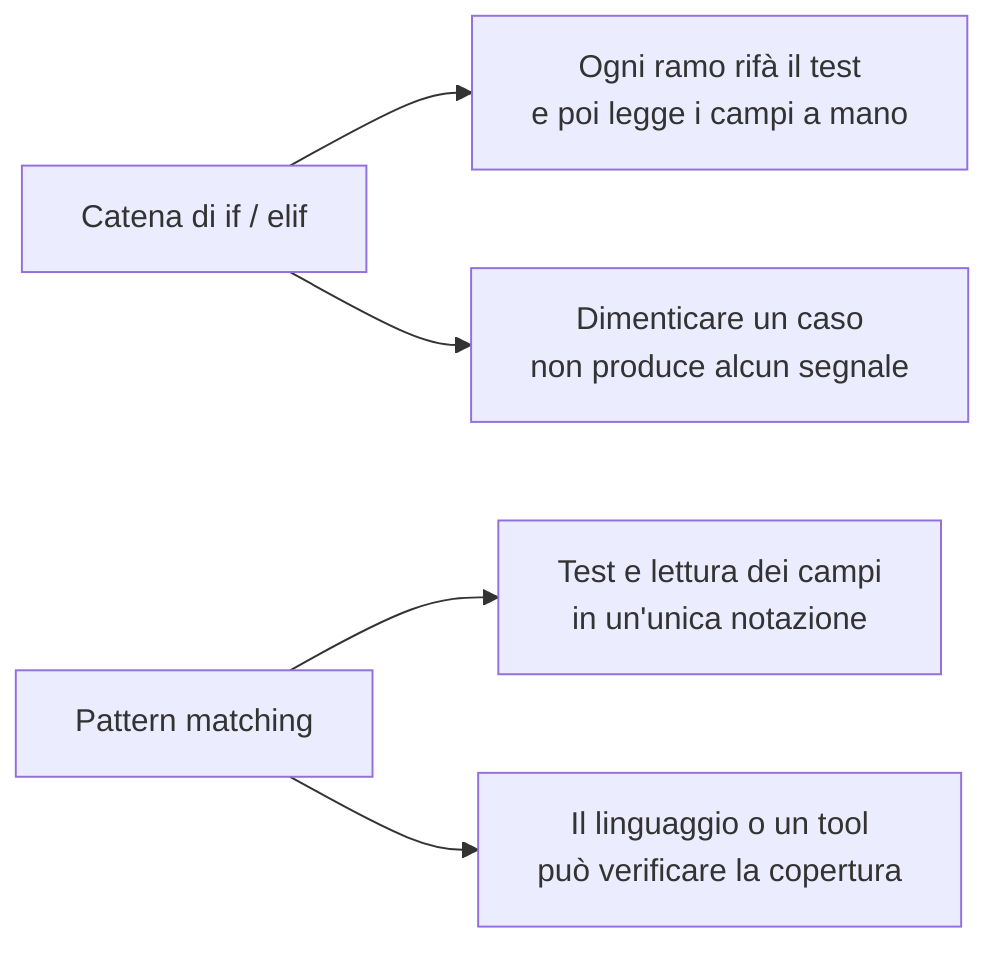

#### Esaustività

Un `match` è **esaustivo** quando ogni valore possibile del tipo è coperto da almeno un ramo. È la proprietà che trasforma l'aggiunta di un nuovo caso (un nuovo evento `Held`: pacco trattenuto in dogana) da **bug silenzioso** a **errore segnalato**. La domanda decisiva è *quando* viene segnalato.

### Il tipo `Event` nei quattro linguaggi

**Python**

```python
@dataclass(frozen=True)
class Created:
    weight_g: int


@dataclass(frozen=True)
class PickedUp:
    pass


@dataclass(frozen=True)
class InTransit:
    hub: str


@dataclass(frozen=True)
class Failed:
    reason: str


@dataclass(frozen=True)
class Delivered:
    pass


@dataclass(frozen=True)
class Returned:
    pass


@dataclass(frozen=True)
class Lost:
    pass


Event = Created | PickedUp | InTransit | Failed | Delivered | Returned | Lost


@dataclass
class Parcel:
    status: Event
    weight_g: int = 0
    failures: int = 0
    ignored: int = 0
```

**PHP**

```php
interface Event {}

final class Created implements Event
{
    public function __construct(public readonly int $weightG) {}
}
final class PickedUp implements Event {}
final class InTransit implements Event
{
    public function __construct(public readonly string $hub) {}
}
final class Failed implements Event
{
    public function __construct(public readonly string $reason) {}
}
final class Delivered implements Event {}
final class Returned implements Event {}
final class Lost implements Event {}

final class Parcel
{
    public int $weightG = 0;
    public int $failures = 0;
    public int $ignored = 0;

    public function __construct(public Event $status) {}
}
```

**Rust**

```rust
#[derive(Debug, Clone)]
enum Event {
    Created { weight_g: u32 },
    PickedUp,
    InTransit { hub: String },
    Failed { reason: String },
    Delivered,
    Returned,
    Lost,
}

struct Parcel {
    status: Event,
    weight_g: u32,
    failures: u32,
    ignored: usize,
}
```

**Go**

```go
// Event is a closed set by convention only: Go cannot seal an interface across packages.
type Event interface{ isEvent() }

type Created struct{ WeightG int }
type PickedUp struct{}
type InTransit struct{ Hub string }
type Failed struct{ Reason string }
type Delivered struct{}
type Returned struct{}
type Lost struct{}

func (Created) isEvent()   {}
func (PickedUp) isEvent()  {}
func (InTransit) isEvent() {}
func (Failed) isEvent()    {}
func (Delivered) isEvent() {}
func (Returned) isEvent()  {}
func (Lost) isEvent()      {}

type Parcel struct {
	Status   Event
	WeightG  int
	Failures int
	Ignored  int
}
```

Da leggere con attenzione, perché la differenza è strutturale:

- **Rust**: un solo `enum` con sette varianti; è un tipo somma *nativo*. Il compilatore conosce l'elenco chiuso delle varianti.
- **Python**: sette classi separate più un alias `Event = A | B | C ...`. L'elenco chiuso esiste solo per il type checker (mypy), non per l'interprete.
- **PHP**: un'interfaccia `Event` e sette classi che la implementano. Nulla vieta di aggiungere un ottavo implementatore in un altro file: l'insieme è **aperto**.
- **Go**: un'interfaccia con un metodo non esportato (`isEvent`) e sette tipi. Come in PHP l'insieme è aperto *dentro il package*; il metodo minuscolo impedisce solo ad altri package di aggiungere implementazioni.

### Implementazione — T3: dal testo all'evento

Ogni riga contiene il nome dell'evento e un argomento (anche vuoto). `parse_event` deve: riconoscere il nome, richiedere l'argomento dove serve (`IN_TRANSIT` e `FAILED`), costruire la variante giusta, e rifiutare il resto. **L'ordine dei casi conta**: il caso "argomento mancante" va prima dei casi che lo usano, altrimenti `InTransit("")` verrebbe costruito.

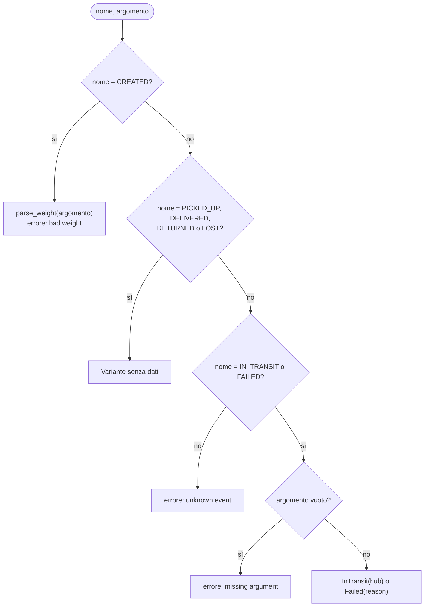

**Python**

```python
# T3 - text -> Event: match on a tuple, with or-pattern and capture
def parse_event(name: str, arg: str) -> Event:
    match name, arg:
        case "CREATED", _:
            return Created(parse_weight(arg))
        case "PICKED_UP", _:
            return PickedUp()
        case ("IN_TRANSIT" | "FAILED"), "":
            raise ValueError(f"missing argument for {name}")
        case "IN_TRANSIT", hub:
            return InTransit(hub)
        case "FAILED", reason:
            return Failed(reason)
        case "DELIVERED", _:
            return Delivered()
        case "RETURNED", _:
            return Returned()
        case "LOST", _:
            return Lost()
        case _:
            raise ValueError(f"unknown event '{name}'")
```

**PHP**

```php
// T3 - text -> Event: match(true) emulates guards; PHP match has no destructuring
function parseEvent(string $name, string $arg): Event
{
    return match (true) {
        $name === 'CREATED' => new Created(parseWeight($arg)),
        $name === 'PICKED_UP' => new PickedUp(),
        in_array($name, ['IN_TRANSIT', 'FAILED'], true) && $arg === ''
            => throw new InvalidArgumentException("missing argument for $name"),
        $name === 'IN_TRANSIT' => new InTransit($arg),
        $name === 'FAILED' => new Failed($arg),
        $name === 'DELIVERED' => new Delivered(),
        $name === 'RETURNED' => new Returned(),
        $name === 'LOST' => new Lost(),
        default => throw new InvalidArgumentException("unknown event '$name'"),
    };
}
```

**Rust**

```rust
// T3 - text -> Event: match on a tuple of &str, with or-pattern and binding
fn parse_event(name: &str, arg: &str) -> Result<Event, String> {
    match (name, arg) {
        ("CREATED", _) => Ok(Event::Created { weight_g: parse_weight(arg)? }),
        ("PICKED_UP", _) => Ok(Event::PickedUp),
        ("IN_TRANSIT" | "FAILED", "") => Err(format!("missing argument for {name}")),
        ("IN_TRANSIT", hub) => Ok(Event::InTransit { hub: hub.to_string() }),
        ("FAILED", reason) => Ok(Event::Failed { reason: reason.to_string() }),
        ("DELIVERED", _) => Ok(Event::Delivered),
        ("RETURNED", _) => Ok(Event::Returned),
        ("LOST", _) => Ok(Event::Lost),
        _ => Err(format!("unknown event '{name}'")),
    }
}
```

**Go**

```go
// T3 - text -> Event: switch on the name; no fallthrough, several values per case
func parseEvent(name, arg string) (Event, error) {
	switch name {
	case "CREATED":
		w, err := parseWeight(arg)
		if err != nil {
			return nil, err
		}
		return Created{w}, nil
	case "PICKED_UP":
		return PickedUp{}, nil
	case "IN_TRANSIT", "FAILED":
		if arg == "" {
			return nil, fmt.Errorf("missing argument for %s", name)
		}
		if name == "FAILED" {
			return Failed{arg}, nil
		}
		return InTransit{arg}, nil
	case "DELIVERED":
		return Delivered{}, nil
	case "RETURNED":
		return Returned{}, nil
	case "LOST":
		return Lost{}, nil
	default:
		return nil, fmt.Errorf("unknown event '%s'", name)
	}
}
```

Come si è tradotto lo stesso smistamento:

- **Python** e **Rust** fanno `match` su una **coppia** (nome, argomento). I pattern combinano un letterale e un'altra cosa nella stessa riga: `("IN_TRANSIT" | "FAILED"), ""` significa "uno dei due nomi **e** argomento stringa vuota" (or-pattern + letterale); `"IN_TRANSIT", hub` significa "nome IN_TRANSIT e **qualsiasi** argomento, che lego a `hub`" (letterale + binding).
- **PHP** ha un `match` che confronta **un solo valore** per uguaglianza stretta. Non sa destrutturare: per combinare nome e argomento si ricorre a `match (true)` con condizioni booleane, che è semplicemente una catena di `if` travestita da espressione. Funziona e si legge bene, ma il controllo di forma è a carico del programmatore.
- **Go** usa `switch` sul nome, con due novità rispetto al C: nessun `fallthrough` implicito, e `case "IN_TRANSIT", "FAILED":` raggruppa più valori nello stesso ramo. Il resto (argomento vuoto, quale delle due varianti) si risolve con `if` nel ramo.

Un caso a sé: `parse_weight`, usato nel ramo `CREATED`. Rifiuta tutto ciò che non è un intero positivo. È la stessa logica di C09 (un errore di riga recuperabile) e non è mostrato qui, ma è nell'appendice.

### Implementazione — T3: descrivere, riconoscere, applicare

Tre funzioni piccole che usano il matching in modo diverso.

**`describe`** produce il testo di stato (`in_transit@MI`). Ogni caso ritorna una stringa; **non c'è un ramo jolly**: è voluto, per l'esaustività.

**Python**

```python
# T3 - no wildcard: a new Event variant makes the type checker complain here
def describe(ev: Event) -> str:
    match ev:
        case Created():
            return "created"
        case PickedUp():
            return "picked_up"
        case InTransit(hub=h):
            return f"in_transit@{h}"
        case Failed(reason=r):
            return f"failed({r})"
        case Delivered():
            return "delivered"
        case Returned():
            return "returned"
        case Lost():
            return "lost"
```

**PHP**

```php
// T3 - no default: an unhandled variant throws UnhandledMatchError at runtime
function describe(Event $ev): string
{
    return match (true) {
        $ev instanceof Created => 'created',
        $ev instanceof PickedUp => 'picked_up',
        $ev instanceof InTransit => "in_transit@{$ev->hub}",
        $ev instanceof Failed => "failed({$ev->reason})",
        $ev instanceof Delivered => 'delivered',
        $ev instanceof Returned => 'returned',
        $ev instanceof Lost => 'lost',
    };
}
```

**Rust**

```rust
// T3 - no wildcard: a new variant is a compile error here (E0004)
fn describe(ev: &Event) -> String {
    match ev {
        Event::Created { .. } => "created".to_string(),
        Event::PickedUp => "picked_up".to_string(),
        Event::InTransit { hub } => format!("in_transit@{hub}"),
        Event::Failed { reason } => format!("failed({reason})"),
        Event::Delivered => "delivered".to_string(),
        Event::Returned => "returned".to_string(),
        Event::Lost => "lost".to_string(),
    }
}
```

**Go**

```go
// T3 - type switch: the compiler does not check that every Event is covered
func describe(ev Event) string {
	switch e := ev.(type) {
	case Created:
		return "created"
	case PickedUp:
		return "picked_up"
	case InTransit:
		return "in_transit@" + e.Hub
	case Failed:
		return "failed(" + e.Reason + ")"
	case Delivered:
		return "delivered"
	case Returned:
		return "returned"
	case Lost:
		return "lost"
	default:
		panic(fmt.Sprintf("unhandled event %T", ev)) // the only safety net
	}
}
```

**`is_final`** è un matching a due casi: gli stati finali (or-pattern) e "tutto il resto".

**Python**

```python
def is_final(ev: Event) -> bool:
    match ev:
        case Delivered() | Returned() | Lost():
            return True
        case _:
            return False
```

**PHP**

```php
function isFinal(Event $ev): bool
{
    return $ev instanceof Delivered || $ev instanceof Returned || $ev instanceof Lost;
}
```

**Rust**

```rust
fn is_final(ev: &Event) -> bool {
    matches!(ev, Event::Delivered | Event::Returned | Event::Lost)
}
```

**Go**

```go
func isFinal(ev Event) bool {
	switch ev.(type) {
	case Delivered, Returned, Lost:
		return true
	}
	return false
}
```

**`apply`** aggiorna il pacco in base all'evento. Qui il jolly è giusto: solo due eventi (`Created`, `Failed`) cambiano i dati del pacco, per tutti gli altri basta aggiornare lo stato.

**Python**

```python
def apply(p: Parcel, ev: Event) -> None:
    match ev:
        case Created(weight_g=w):
            p.weight_g = w
        case Failed():
            p.failures += 1
        case _:
            pass
    p.status = ev
```

**PHP**

```php
function apply(Parcel $p, Event $ev): void
{
    if ($ev instanceof Created) {
        $p->weightG = $ev->weightG;
    } elseif ($ev instanceof Failed) {
        $p->failures++;
    }
    $p->status = $ev;
}
```

**Rust**

```rust
fn apply(p: &mut Parcel, ev: &Event) {
    match ev {
        Event::Created { weight_g } => p.weight_g = *weight_g,
        Event::Failed { .. } => p.failures += 1,
        _ => {}
    }
    p.status = ev.clone();
}
```

**Go**

```go
func apply(p *Parcel, ev Event) {
	switch e := ev.(type) {
	case Created:
		p.WeightG = e.WeightG
	case Failed:
		p.Failures++
	}
	p.Status = ev
}
```

Questo è un caso in cui la **forma** del codice dice qualcosa: `describe` e `fee` elencano *tutti* i casi (cambiano a ogni nuovo `Event`), `apply` e `is_final` usano un jolly (cambiano solo se il nuovo evento ha effetti particolari). Il jolly è una dichiarazione: "gli altri casi li tratto tutti allo stesso modo, anche quelli che aggiungerò in futuro". Va usato consapevolmente.

### Implementazione — T4: la fattura con una guard

Le regole: `Delivered` → la tariffa; `Returned` dopo almeno 3 tentativi falliti → tariffa × 3 / 2; `Returned` altrimenti → la tariffa; `Lost` e tutti gli stati non finali → 0. Il caso `Returned` si **divide in due** secondo una condizione che non riguarda la forma ma un altro dato: è il lavoro di una **guard**.

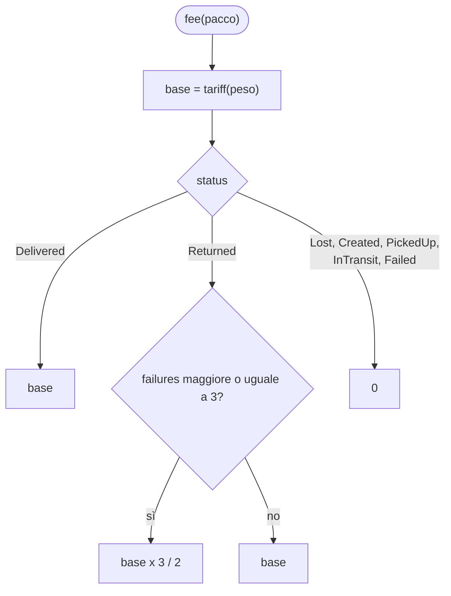

**Python**

```python
# T4 - billing: guard on the failure counter, no wildcard
def fee(p: Parcel) -> int:
    base = tariff(p.weight_g)
    match p.status:
        case Delivered():
            return base
        case Returned() if p.failures >= 3:
            return base * 3 // 2
        case Returned():
            return base
        case Lost() | Created() | PickedUp() | InTransit() | Failed():
            return 0
```

**PHP**

```php
// T4 - billing: the guard is an extra condition in match(true)
function fee(Parcel $p): int
{
    $base = tariff($p->weightG);
    return match (true) {
        $p->status instanceof Delivered => $base,
        $p->status instanceof Returned && $p->failures >= 3 => intdiv($base * 3, 2),
        $p->status instanceof Returned => $base,
        default => 0,
    };
}
```

**Rust**

```rust
// T4 - billing: guard on the failure counter, no wildcard
fn fee(p: &Parcel) -> u32 {
    let base = tariff(p.weight_g);
    match &p.status {
        Event::Delivered => base,
        Event::Returned if p.failures >= 3 => base * 3 / 2,
        Event::Returned => base,
        Event::Lost
        | Event::Created { .. }
        | Event::PickedUp
        | Event::InTransit { .. }
        | Event::Failed { .. } => 0,
    }
}
```

**Go**

```go
// T4 - billing: no guards in a type switch, the condition goes inside the case
func fee(p Parcel) int {
	base := tariff(p.WeightG)
	switch p.Status.(type) {
	case Delivered:
		return base
	case Returned:
		if p.Failures >= 3 {
			return base * 3 / 2
		}
		return base
	default:
		return 0
	}
}
```

Verifica a mano: `P1` è `Delivered`, peso 800 → base 790 → fee **790**. `P2` è `Returned` con 3 fallimenti, peso 2500 → base 1290 → 1290 × 3 / 2 = **1935**. `P5` è `Lost` → 0. `P3` è `InTransit` → 0 (non ancora fatturabile). Totale fatturato: 790 + 1935 = **2725**, come nell'output.

Una nota sul **disegno** delle guard:

- In **Python** e **Rust** la guard è sintassi del `case`/del ramo (`case Returned() if ...`, `Event::Returned if ... =>`). Se la guard è falsa il matching **prosegue con il ramo successivo**: per questo la riga `Returned` senza guard viene dopo. Invertendo l'ordine il caso con la guard non scatterebbe mai. Il compilatore Rust non può dimostrare che un ramo con guard copra davvero un caso, quindi *non* lo conta per l'esaustività: il ramo `Returned` senza guard serve anche per questo.
- In **PHP** la guard è una condizione in più dentro `match (true)`; l'ordine è sempre quello di scrittura.
- In **Go** il type switch **non ha guard**: nel ramo `case Returned:` si scrive un `if`. Meno elegante, stesso risultato.

### Gli stati di un pacco

Il programma non impone un ordine alle transizioni (accetta qualunque sequenza), ma il comportamento atteso è questo. Chi volesse imporlo dovrebbe fare il matching sulla **coppia** (stato, evento) e rifiutare quelle impossibili (esercizio 4).

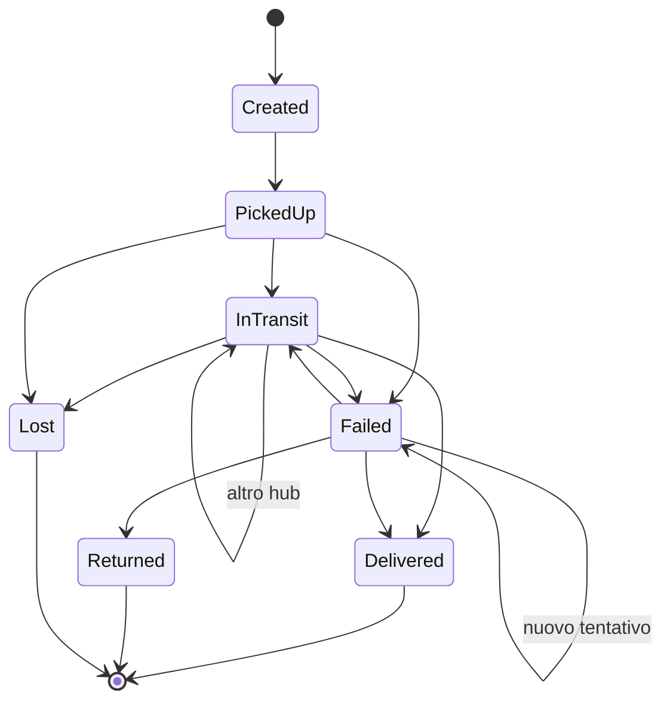

### L'esperimento che conta: aggiungere una variante

Si aggiunge l'ottavo evento `Held` (pacco trattenuto in dogana) in ciascun programma **senza toccare** `describe` e `fee`. Che cosa succede? Risultati reali (esperimento e4):

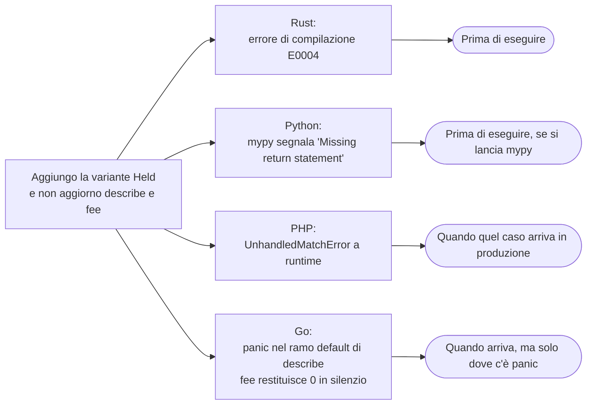

**Rust** — il programma non compila. Estratto reale dell'errore:

```text
error[E0004]: non-exhaustive patterns: `&Event::Held` not covered
  --> p.rs:60:11
   |
60 |     match ev {
   |           ^^ pattern `&Event::Held` not covered
   |
note: `Event` defined here
 5 | enum Event {
...
13 |     Held,
   |     ---- not covered
help: ensure that all possible cases are being handled by adding a match arm with a wildcard pattern or an explicit pattern as shown
```

Il compilatore indica la riga del `match`, la variante non coperta e dove è definita. Segnala **entrambe** le funzioni senza jolly (`describe` e `fee`) e non segnala né `apply` né `is_final`, che hanno il jolly: lì la scelta di trattare il resto in blocco è già esplicita.

**Python** — l'interprete non dice nulla. `mypy` (2.4.0) sì:

```text
p.py:98: error: Missing return statement  [return]
p.py:147: error: Missing return statement  [return]
Found 2 errors in 1 file (checked 1 source file)
```

Sono le due funzioni `describe` e `fee`: poiché il `match` non copre `Held`, c'è un percorso in cui la funzione termina senza `return`. **Senza mypy** il programma parte e crolla lontano dalla causa: `describe` restituisce `None`, `fee` restituisce `None`, e alla riga `billed += fee(p)` arriva `TypeError: unsupported operand type(s) for +=: 'int' and 'NoneType'`. Un errore a distanza dalla causa è il più costoso da diagnosticare. Corollario: in Python l'esaustività esiste **se e solo se** si usa un type checker nella pipeline (C13).

**PHP** — nessun segnale a compilazione. A runtime, quando arriva un `Held`:

```text
PHP Fatal error:  Uncaught UnhandledMatchError: Unhandled match case true in p.php:80
```

L'errore è esplicito (meglio che restituire `null`), ma arriva solo quando quel caso compare nei dati. Gli analyzer statici (PHPStan, Psalm) possono rilevare un `match` non esaustivo su tipi dichiarati chiusi, ma non sono nel linguaggio e non sono stati provati qui.

**Go** — `go build` e `go vet` passano senza avvisi. `describe` ha un ramo `default` con `panic(...)`:

```text
panic: unhandled event main.Held
```

mentre `fee` ha `default: return 0`: l'evento `Held` viene fatturato **zero in silenzio**. Questo è il pericolo del `default`: assorbe anche i casi futuri come se fossero "tutti gli altri". Alcuni linter esterni verificano switch su costanti e interfacce "sigillate" (per esempio `exhaustive` e `go-check-sumtype`), ma non fanno parte della toolchain standard e non sono stati provati qui.

| Linguaggio | Quando si scopre il caso mancante | Stato dell'errore |
|---|---|---|
| Rust | A compilazione | Errore che impedisce di costruire |
| Python | Con un type checker nella CI | Segnalazione del tool; senza tool, errore a distanza |
| PHP | A runtime, quando il caso compare | `UnhandledMatchError` (con `default` assente) |
| Go | A runtime, e solo se c'è un `panic`; altrimenti mai | Silenzio o `panic` |

### Pattern avanzati: Python e Rust a confronto

Per vedere la potenza della destrutturazione, due esperimenti paralleli (e6) con messaggi di un piccolo protocollo.

**Python** — il pattern descrive la struttura: dizionario con chiavi, sequenze con coda `*rest`, tipo con `as`, guard.

```python
def classify(msg):
    match msg:
        case {"type": "ping"}:
            return "ping"
        case {"type": "move", "to": [x, y]} if x >= 0 and y >= 0:
            return f"move to {x},{y}"
        case [first, *rest]:
            return f"list head={first} tail={len(rest)}"
        case str() as s if s.startswith("#"):
            return "comment"
        case _:
            return "unknown"
```

Con sei ingressi l'output reale è:

```text
{'type': 'ping'} -> ping
{'type': 'move', 'to': [3, 4]} -> move to 3,4
{'type': 'move', 'to': [-1, 4]} -> unknown
[1, 2, 3] -> list head=1 tail=2
# hi -> comment
42 -> unknown
```

La terza riga mostra cosa succede quando la guard fallisce: il caso `move` corrisponde alla forma, ma `x >= 0` è falso, quindi Python **prosegue** coi casi successivi; nessuno corrisponde, e si arriva al jolly.

**Rust** — qui i pattern lavorano su un `enum`, con intervalli, binding, guard, `if let` e `let ... else`.

```rust
enum Msg {
    Ping,
    Move { x: i32, y: i32 },
    Text(String),
}

fn classify(m: &Msg) -> String {
    match m {
        Msg::Ping => "ping".to_string(),
        Msg::Move { x, y } if *x >= 0 && *y >= 0 => format!("move to {x},{y}"),
        Msg::Move { .. } => "move out of range".to_string(),
        Msg::Text(s) if s.starts_with('#') => "comment".to_string(),
        Msg::Text(_) => "text".to_string(),
    }
}

// if let / let else: match with a single arm of interest
let raw = "42";
let Ok(n) = raw.parse::<i32>() else {
    println!("not a number");
    return;
};
if let 40..=49 = n {
    println!("{n} is in the forties");
}
```

Output reale: `ping`, `move to 3,4`, `move out of range`, `comment`, `42 is in the forties`. In Rust, il caso `Move` con guard non basta a coprire `Move`: serve il ramo `Move { .. }` senza guard, altrimenti il compilatore rifiuterebbe il `match` perché non esaustivo.

`if let` e `let ... else` sono il matching "a un solo ramo": quando interessa solo un caso (`Ok(n)`) e tutto il resto significa "esci" o "ignora", si evita un `match` con un jolly vuoto.

### Che cosa può fare ciascun linguaggio

| Pattern | PHP | Python | Rust | Go |
|---|---|---|---|---|
| Letterale | ● `match` | ● `case 1:` | ● | ● `case 1:` |
| Più valori nello stesso ramo | ● `1, 2 =>` | ● `1 \| 2` | ● `1 \| 2` | ● `case 1, 2:` |
| Intervallo | ○ (con `match (true)`) | ○ (con guard) | ● `40..=49` | ○ (con `switch` senza tag) |
| Destrutturare un oggetto | ○ | ● `Point(x=0, y=y)` | ● `Point { x, y }` | ○ (si lega l'intero valore) |
| Destrutturare una sequenza | ○ (solo assegnazione) | ● `[a, *rest]` | ● slice pattern | ○ |
| Destrutturare un dizionario | ○ | ● `{"k": v}` | ○ | ○ |
| Guard | ◐ condizione in `match (true)` | ● `if` | ● `if` | ○ (si scrive un `if` nel ramo) |
| Verifica di esaustività | ◐ runtime | ◐ type checker | ● compilatore | ○ (linter esterni) |

### Focus comparativo

| Aspetto | PHP | Python | Rust | Go |
|---|---|---|---|---|
| Costrutto principale | `match` (confronto stretto, al posto di `switch`) | `match`/`case` (dalla 3.10) | `match` | `switch`, type switch |
| Che cosa confronta | Valori per uguaglianza stretta | Forma e valori | Forma e valori | Valori; tipi (type switch) |
| È un'espressione? | ● | ○ (istruzione) | ● | ○ |
| Caso mancante | `UnhandledMatchError` | Prosegue in silenzio | Errore di compilazione | Prosegue in silenzio |
| Modella un tipo somma | Interfaccia + classi | Classi + alias di unione | `enum` | Interfaccia + tipi |

**Similitudini.** Tutti permettono di scrivere "se è così, fai questo" per più casi in modo ordinato, e in tutti l'ordine dei casi decide chi vince.
**Differenze.** Solo Rust fa dell'esaustività una proprietà *del linguaggio*; Python la affida a uno strumento; PHP la applica con un errore a runtime; Go non la offre. Lo stesso programma, con un nuovo caso, fallisce in momenti diversi.

**Esercizio Rosetta (4′).** Aggiungere l'evento `HELD` (con motivo) a ogni programma: parse, `describe`, `fee` (un pacco trattenuto vale 0). Per ciascun linguaggio annotare *quale errore o quale silenzio* ha incontrato prima di arrivare al risultato corretto.

---

## Matrice degli approcci (riepilogo C03)

| Costrutto | PHP | Python | Rust | Go |
|---|---|---|---|---|
| Condizionale come espressione | ● `?:`, `match` | ● `x if c else y` | ● `if` è espressione | ○ |
| Condizione solo booleana | ○ (truthiness) | ○ (truthiness) | ● | ● |
| Cicli | `for`, `foreach`, `while`, `do-while` | `for`, `while` (+ `else`) | `loop`, `while`, `for` | solo `for` |
| Intervallo di default | Chiuso (`range`) | Semiaperto | Semiaperto (`..`) e chiuso (`..=`) | Semiaperto (`range n`) |
| Uscita da cicli annidati | `break N` | funzione + `return` | `break 'etichetta` | `break etichetta` |
| Pattern matching strutturale | ◐ `match` su valori | ● `match`/`case` | ● `match`, `if let` | ◐ `switch`, type switch |
| Guard | ◐ `match (true)` | ● | ● | ○ |
| Esaustività verificata | ◐ errore a runtime | ◐ type checker | ● a compile-time | ○ (linter) |

Legenda: ● nativo e idiomatico · ◐ approccio alternativo assimilabile · ○ assente o non idiomatico. La matrice è un indice, non una dichiarazione di equivalenza: due celle con lo stesso simbolo possono nascondere semantiche diverse (basti pensare a `range` o a `switch`). Le righe "Condizione solo booleana", "Intervallo di default", "Uscita da cicli annidati" e "Guard" estendono quelle del TOC e vanno riportate nella matrice completa dell'appendice D.

## Anti-pattern ricorrenti

| Anti-pattern | Dove capita | Perché è un problema | Alternativa |
|---|---|---|---|
| `if ($valore)` su stringhe lette da file o form | PHP, Python | `"0"` è falso in PHP e vero in Python; `"0.0"` è vero in entrambi | Confronto esplicito (`!== ''`, `> 0`) dopo la conversione |
| `switch` con `==` debole | PHP | `"1e1"` corrisponde a `"10"` | `match` (confronto stretto) |
| `case` dimenticato senza `break` | PHP `switch` | Il fallthrough esegue anche il ramo successivo | `match`, oppure `break` sempre |
| `default`/`_` che assorbe tutto | Tutti | Un caso futuro viene trattato come "gli altri" in silenzio | Elencare tutti i casi dove la cosa conta; jolly solo dove è una scelta |
| `range(0, n)` scambiato per chiuso | PHP verso gli altri | Un elemento in più o in meno | Verificare sempre l'estremo finale |
| Ciclo con indice dove basta `foreach` | Tutti | Errori di indice, off-by-one | `for x in xs`, `enumerate` quando serve l'indice |
| Registrare prima di validare | Tutti | Lascia lo stato a metà (la chiave `P6` con lista vuota) | Validare, poi registrare |
| `unwrap()` / indice diretto per "tanto c'è sempre" | Rust, tutti | L'invariante non è garantita da nessuno | Costruire il dato in modo che l'invariante valga per costruzione |
| Catena di `if` per smistare per tipo | PHP, Python | Il controllo di copertura è a carico dell'umano | Pattern matching, polimorfismo (C07) |

## Quiz di verifica

1. In quale dei quattro linguaggi `if (s)` con `s = "0"` è falso, e in quale è vero?
2. Perché `if n { ... }` non compila in Rust e in Go?
3. Che differenza c'è tra `range(0, 5)` in Python e in PHP?
4. Quando viene eseguito il ramo `else` di un ciclo `for` in Python?
5. Perché in `fee`, nel ramo `Returned`, la guard (`failures >= 3`) deve stare **prima** del caso `Returned` senza guard?
6. Che differenza c'è, in presenza di un nuovo evento `Held`, tra il comportamento di `describe` in Rust e in Go?
7. Perché `apply` può usare un jolly e `describe` no?

**Risposte**

> 1. In PHP `"0"` è falso; in Python è vero. 2. Perché la condizione deve essere un `bool`: nessuna conversione implicita da intero o stringa. 3. Python: da 0 a 4, estremo finale escluso. PHP: da 0 a 5, estremo finale incluso. 4. Solo se il ciclo termina senza `break`, cioè quando la sequenza è finita o la condizione è diventata falsa. 5. Perché il matching procede in ordine e il primo ramo che corrisponde vince: il caso senza guard corrisponderebbe sempre a `Returned` e la guard non verrebbe mai valutata. 6. In Rust il programma non compila finché `describe` non copre `Held`; in Go compila e, a runtime, il `default` provoca un `panic` (in `fee` invece `default` restituisce 0 in silenzio). 7. `apply` deve reagire solo a due eventi e per tutti gli altri fa la stessa cosa (aggiorna lo stato): il jolly esprime proprio questo. `describe` deve dare un testo diverso per ogni caso, quindi un caso nuovo richiede sempre una scelta esplicita.

## Esercizi

1. **(base)** Aggiungere il quinto scaglione di tariffa (oltre 30000 g = "fuori misura", nessuna tariffa) e farlo rispettare in `fee`. Quale tipo di ritorno hai scelto per "nessuna tariffa"? Che cosa cambia nei quattro linguaggi?
2. **(base)** Cambiare la regola del reso: servono **2** fallimenti per applicare il supplemento. Quanti punti del codice cambiano? Perché uno solo?
3. **(base)** Aggiungere l'evento `HELD,reason` e farlo fatturare 0. Annotare il comportamento di ciascun linguaggio *prima* di aggiornare `describe` e `fee` (vedi esercizio Rosetta di L03.3).
4. **(medio)** Imporre le transizioni del diagramma degli stati: un evento non ammesso dallo stato corrente (per esempio `DELIVERED` su un pacco in stato `Created`) diventa una riga scartata con messaggio `invalid transition`. Suggerimento: matching sulla coppia `(stato, evento)`. In quale linguaggio è più naturale scriverlo?
5. **(medio)** Sostituire `ignored` con la **lista** degli eventi ignorati (non solo il conteggio) e stamparla per `P5`. Quale ciclo si usa?
6. **(medio)** Riscrivere `tariff` come tabella di soglie (una lista di coppie `(soglia, tariffa)`) e un ciclo che cerca la prima soglia non inferiore al peso. Qual è la differenza di manutenzione rispetto alla catena di condizioni?
7. **(avanzato)** Aggiungere un test automatico che, in Python, fallisce se qualcuno aggiunge una variante a `Event` senza aggiornare `describe` e `fee` (suggerimento: `typing.assert_never` e mypy in modalità strict). In Go, valutare un linter di esaustività.
8. **(avanzato, statistica leggera)** Misurare il costo di `match (true)` con molte braccia contro un `switch` sul valore in PHP, su un milione di eventi. Quanto varia la misura tra esecuzioni? Quali sono le conseguenze per il confronto (anticipa L13.4)?

## Mappa mentale

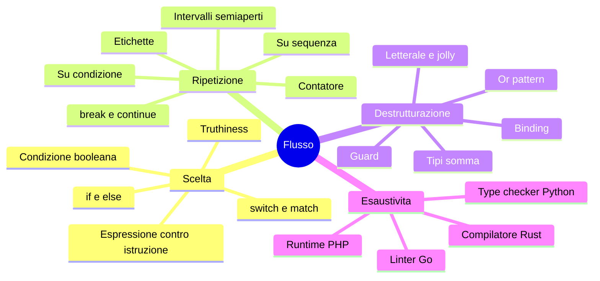

Collegamenti: C05 (iteratori, `range`, generatori: il ciclo su sequenza), C06 (tipi somma ed `enum`: il fondamento del pattern matching), C09 (errori come valori e `match` sul `Result`), C04 (closure create nei cicli), C13 (type checker e linter in CI per l'esaustività).

---

## Ponte

Verso **C04**: `parse_event`, `describe`, `apply`, `fee`, `tariff` sono già funzioni; il capitolo successivo le guarda come oggetto di studio (firme, argomenti, ritorni, closure). Verso **C05**: il `for` di `replay` e di `load` consuma una sequenza, e C05 spiega che cos'è davvero una sequenza e un iteratore, e come si sceglie la struttura (qui `dict`, `BTreeMap`, `map` ordinata a posteriori: tre scelte diverse per ottenere lo stesso output ordinato). Verso **C06**: l'`Event` come tipo somma, i suoi vantaggi e perché Go non lo ha nativamente. Verso **C09**: gli errori di riga di `load` sono quelli di C09; qui sono semplificati a stringhe per non distrarre dal flusso.

---

## Appendice C03.A — Programmi completi

I quattro programmi integrali (`main.py`, `main.php`, `main.rs`, `main.go` con `go.mod`) e i dati di prova sono nel file del Project `capitoli/C03-controllo-di-flusso-e-pattern-matching.md`. Comandi di esecuzione, con `events.csv` nella stessa directory: `python3 main.py events.csv` · `php main.php events.csv` · `rustc --edition 2024 -O main.rs && ./main events.csv` · `go run . events.csv` (con `module example.com/parcels` e `go 1.24` in `go.mod`). Exit code: 0 tutto valido, 1 con righe scartate, 2 file non leggibile.
