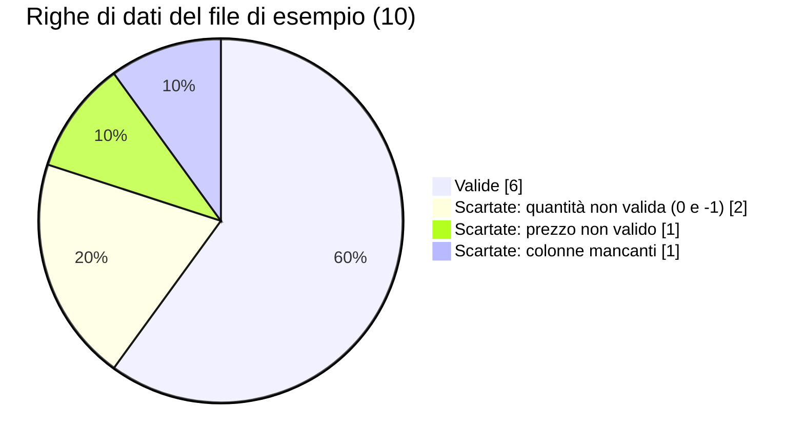
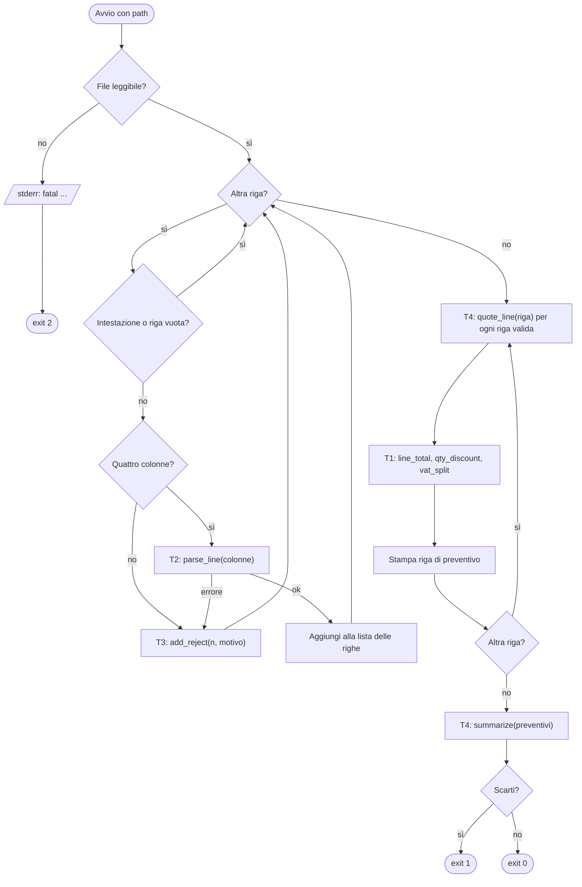
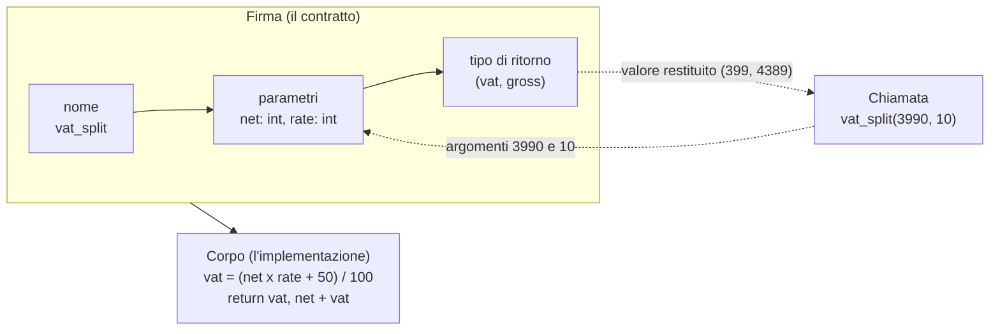
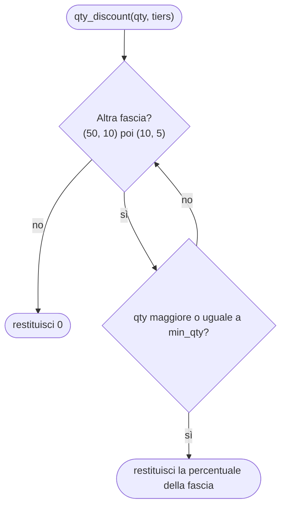
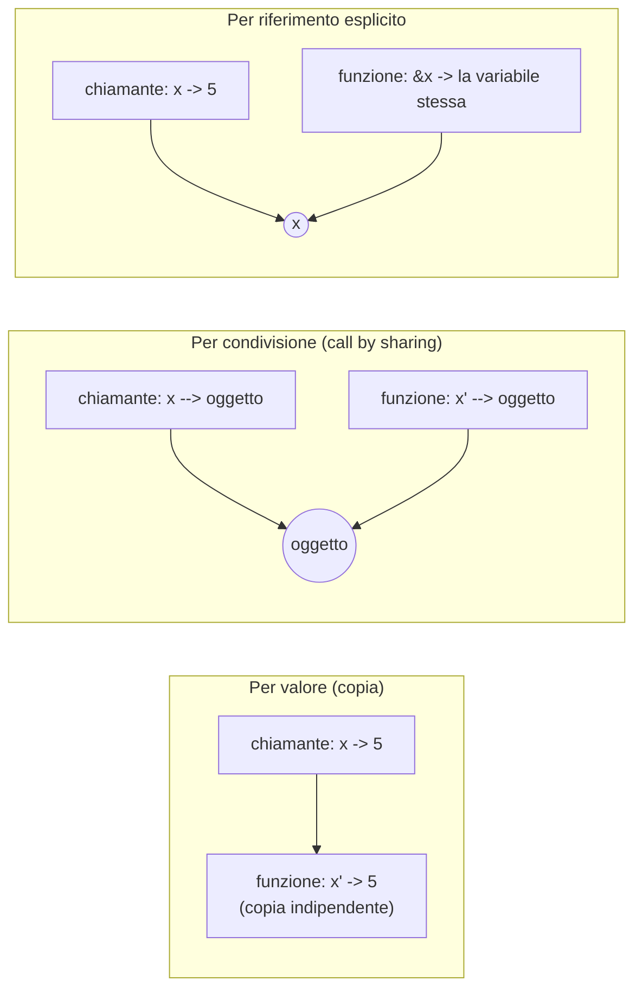

# C04 — Funzioni e closure

> **Parte I — Basi del linguaggio** · 4 lezioni (L04.1–L04.4) · 3 ore · capitolo senza addendum
> **Stato:** bozza 1 (2026-10-13). Codice eseguito e verificato su PHP 8.3.6, Python 3.13.16, Rust 1.97.0 (`rustc --edition 2024`), Go 1.24.7 (baseline del corso: PHP 8.4+, Go 1.25+: il codice non usa nulla di specifico delle versioni più recenti, da riverificare a stesura finale). Per la verifica statica degli esempi Python è stato usato mypy 2.3.1 in modalità `--strict`. Solo libreria standard: nessun pacchetto esterno.

## Obiettivi

Al termine del capitolo si sa:

1. leggere una **firma** (nome, parametri, tipo di ritorno) come un contratto, e usare parametri posizionali, nominati, con valore predefinito e variadici dove il linguaggio li offre;
2. restituire **più valori** da una funzione e dire come lo fa ciascun linguaggio;
3. prevedere che cosa succede a un dato passato a una funzione: **copia**, **condivisione** o **riferimento** (e perché in Go `append` dentro una funzione non cambia la slice del chiamante);
4. spiegare che cos'è una **closure** (una funzione più l'ambiente che ha catturato) e distinguere cattura **per valore**, **per riferimento** e **per move**;
5. usare le **funzioni di ordine superiore** (`map`, `filter`, `reduce`, composizione) e scegliere tra queste e un ciclo;
6. descrivere lo **scope** (dove un nome è visibile) e la **durata** di una variabile, e riconoscere le trappole tipiche (`UnboundLocalError`, `:=` che oscura, valore predefinito mutabile);
7. scrivere una funzione **ricorsiva** con caso base e caso ricorsivo, tracciarne lo stack, e sapere dove ciascun linguaggio pone il limite di profondità.

Prerequisiti: C02 (valori, tipi, variabili), C03 (controllo di flusso: i cicli e i `match` usati qui sono quelli visti lì) e, per chi viene dalla Parte P, CP2 (flowchart e tracing manuale).

**Percorso per l'ingresso A (formato "primario + lettura").** Si scrive e si esegue il programma nel linguaggio primario scelto in LP1.3 e si leggono gli altri tre con l'aiuto delle tabelle di confronto. Gli esperimenti brevi (e1–e7) sono pensati per essere riprodotti uno alla volta: ognuno risponde a una sola domanda e riporta l'output reale.

## Il problema reale

> Un piccolo negozio online riceve dal gestionale un file `cart.csv` con le **righe di un ordine**: codice articolo, quantità, prezzo unitario in centesimi e categoria. Serve un programma che prepari il **preventivo**: per ogni riga il totale senza sconti (*base*), il totale scontato (*net*), l'IVA e il totale ivato (*gross*). Le regole sono tre. Lo **sconto per quantità**: dal decimo pezzo in su il 5%, dal cinquantesimo il 10%. Lo **sconto promozionale di categoria**: oggi i giocattoli (`toys`) hanno un ulteriore 20%. L'**IVA** dipende dalla categoria: 4% per i libri (`books`), 10% per gli alimentari (`food`), 22% per tutto il resto. Gli importi sono sempre in centesimi interi e l'IVA si arrotonda al centesimo più vicino (metà verso l'alto). Le righe con quantità o prezzo non validi o con il numero di colonne sbagliato vanno scartate e segnalate, senza fermare il preventivo. In fondo serve un riepilogo con totali e numero di righe scontate. Il negozio vende anche **kit** (un kit contiene articoli e altri kit): per un kit servono prezzo totale, numero di articoli e profondità di annidamento.

File di esempio usato in tutto il capitolo (`cart.csv`, 12 righe compresa l'intestazione; la riga 11 è vuota di proposito):

```csv
sku,qty,unit_cents,category
A100,2,1999,tools
B200,12,350,food
C300,1,2490,books
D400,60,120,food
E500,0,500,tools
F600,3,abc,tools
G700,5,1000,toys
H800,-1,100,tools
I900,2,300

J010,10,1000,toys
```

Che cosa contiene, in termini di righe di dati (10 righe non vuote: 6 valide, 4 scartate):



Risultato atteso, **identico nei quattro linguaggi** (`diff` vuoto), exit code `1` perché ci sono righe scartate (`0` se tutto valido, `2` se il file non si legge):

```text
rejected line 6: bad qty '0'
rejected line 7: bad price 'abc'
rejected line 9: bad qty '-1'
rejected line 10: expected 4 columns, got 3
A100 base=3998 net=3998 vat=880 gross=4878
B200 base=4200 net=3990 vat=399 gross=4389
C300 base=2490 net=2490 vat=100 gross=2590
D400 base=7200 net=6480 vat=648 gross=7128
G700 base=5000 net=4000 vat=880 gross=4880
J010 base=10000 net=7600 vat=1672 gross=9272
summary lines=6 rejected=4 discounted=4 net=28558 vat=4579 gross=33137
```

Si controlli a mano una riga per fissare le regole. `B200`: 12 pezzi × 350 = 4200 (*base*). Dodici pezzi superano la soglia dei 10, quindi −5%: 4200 × 95 / 100 = 3990 (*net*). Gli alimentari hanno IVA 10%: 3990 × 10 / 100 = 399. Totale ivato: 3990 + 399 = 4389. E `J010` (10 pezzi di giocattoli a 1000): base 10000, −5% per la quantità = 9500, −20% di promozione = 7600, IVA 22% = 1672, gross 9272.

### Scomposizione in attività

| # | Attività | Domanda sulle funzioni | Lezione |
|---|---|---|---|
| T1 | Calcolare totale di riga, scorporo IVA e sconto per quantità | Come si **dichiara** una funzione, come si restituiscono più valori, come si dà un valore predefinito? | L04.1 |
| T2 | Validare quantità e prezzo, costruire una riga | Come si **passa** un dato e come si segnala un errore? | L04.1 |
| T3 | Rappresentare le regole di sconto come valori: "togli il 5%", "togli il 20%"; raccogliere gli scarti | Come si **crea** una funzione a partire da dati e come si fa a ricordare uno stato? | L04.2 |
| T4 | Applicare più regole in sequenza, trasformare tutte le righe, contare le scontate, sommare i totali | Come si **passano funzioni come argomenti** e come si compongono? | L04.3 |
| T5 | Leggere il file, scartare, stampare, restituire l'exit code | Tutto insieme, ai bordi del programma | tutte |
| T6 | Prezzo, numero di articoli e profondità di un kit annidato | Come si **definisce una funzione in termini di se stessa**? | L04.4 |



Le funzioni sono i **mattoni** del programma: ogni rettangolo del flowchart è una funzione con un nome, degli ingressi e un'uscita. Il capitolo guarda quei mattoni da quattro lati: come sono fatti (L04.1), come possono portarsi dietro dati (L04.2), come si combinano (L04.3), dove vivono i loro nomi e come possono richiamare se stessi (L04.4).

---

## L04.1 — Firme, parametri, ritorni; passaggio per valore e per riferimento (T1, T2)

### Concetto

Una **funzione** è un blocco di codice con un nome che riceve degli **ingressi**, fa un lavoro e restituisce un'**uscita**. Serve a tre cose: evitare di riscrivere lo stesso codice, dare un nome a un'idea ("scorpora l'IVA") e permettere di ragionare un pezzo alla volta.

La **firma** (*signature*) è la parte che il chiamante deve conoscere: il nome, i parametri con i loro tipi e il tipo di ritorno. Il **corpo** è il come. Una firma ben scritta è un contratto: da sola dice che cosa entra e che cosa esce.



Due parole spesso confuse: il **parametro** è il nome nella definizione (`net`, `rate`); l'**argomento** è il valore passato nella chiamata (`3990`, `10`).

Una distinzione che orienta tutto il capitolo: una funzione **pura** dipende solo dai suoi argomenti e non ha effetti fuori da sé (`line_total` è pura: stessi ingressi, stessa uscita, niente altro). Una funzione con **effetti collaterali** (*side effects*) modifica qualcosa fuori da sé: scrive su file, stampa, cambia una variabile globale o un oggetto ricevuto. Le funzioni pure sono le più facili da capire, collaudare e riusare; gli effetti non spariscono, vanno confinati ai bordi del programma (qui: `main`).

### Come si passano e si dichiarano i parametri

| Forma | Che cosa permette | PHP | Python | Rust | Go |
|---|---|---|---|---|---|
| Posizionale | Gli argomenti sono associati per ordine | ● | ● | ● | ● |
| Nominato | `f(rate=10)`: l'ordine non conta e la chiamata si legge da sola | ● `f(rate: 10)` | ● `f(rate=10)` | ○ | ○ |
| Valore predefinito | Un parametro si può omettere | ● | ● | ○ (`Option`, `Default`, builder) | ○ (opzioni funzionali) |
| Variadico | Numero variabile di argomenti | ● `...$xs` | ● `*xs`, `**kw` | ◐ slice o `Vec` | ● `xs ...T` |
| Solo posizionale / solo nominato | Si vincola come va chiamata | ◐ | ● `/` e `*` | ○ | ○ |
| Overloading (stesso nome, firme diverse) | | ○ | ○ | ○ (trait) | ○ |

Rust e Go **non hanno** argomenti predefiniti né nominati, di proposito: la chiamata è sempre completa e quello che si legge è quello che succede. Quando serve flessibilità si ricorre a una `struct` di opzioni, a un builder (Rust) o alle *functional options* (Go, che sono funzioni passate come argomenti: tornano nella L04.3).

### Implementazione — T1: le funzioni di calcolo

`line_total` è la funzione più semplice possibile: due ingressi, un'uscita. `vat_split` restituisce **due** valori, IVA e totale ivato. `vat_rate` sceglie l'aliquota in base alla categoria. `qty_discount` percorre le fasce di sconto dalla più alta e restituisce la prima che si applica (con il ciclo `for` e il `return` anticipato visti in C03).

**Python**

```python
# T1 - a function with a signature: two inputs, one output, no side effects
def line_total(qty: int, unit_cents: int) -> int:
    return qty * unit_cents

# T1 - multiple return values (a tuple); rate has no default on purpose
def vat_split(net: int, rate: int) -> tuple[int, int]:
    vat = (net * rate + 50) // 100  # round half up
    return vat, net + vat

def vat_rate(category: str) -> int:
    return VAT_BY_CATEGORY.get(category, DEFAULT_VAT)

# T1 - default argument: callers that do not care get the standard tiers
def qty_discount(qty: int, tiers: tuple[tuple[int, int], ...] = DEFAULT_TIERS) -> int:
    for min_qty, percent in tiers:
        if qty >= min_qty:
            return percent
    return 0
```

**PHP**

```php
// T1 - a function with a signature: two inputs, one output, no side effects
function lineTotal(int $qty, int $unitCents): int
{
    return $qty * $unitCents;
}

/** T1 - multiple return values: PHP returns one array, the caller destructures it
 *  @return array{0: int, 1: int} [vat, gross] */
function vatSplit(int $net, int $rate): array
{
    $vat = intdiv($net * $rate + 50, 100); // round half up
    return [$vat, $net + $vat];
}

function vatRate(string $category): int
{
    return VAT_BY_CATEGORY[$category] ?? DEFAULT_VAT;
}

/** T1 - default argument: callers that do not care get the standard tiers
 *  @param list<array{0: int, 1: int}> $tiers */
function qtyDiscount(int $qty, array $tiers = DEFAULT_TIERS): int
{
    foreach ($tiers as [$minQty, $percent]) {
        if ($qty >= $minQty) {
            return $percent;
        }
    }
    return 0;
}
```

**Rust**

```rust
// T1 - a function with a signature: two inputs, one output, no side effects
fn line_total(qty: u64, unit_cents: u64) -> u64 {
    qty * unit_cents
}

// T1 - multiple return values: a tuple; Rust has no default or named arguments
fn vat_split(net: u64, rate: u64) -> (u64, u64) {
    let vat = (net * rate + 50) / 100; // round half up
    (vat, net + vat)
}

fn vat_rate(category: &str) -> u64 {
    match category {
        "books" => 4,
        "food" => 10,
        _ => DEFAULT_VAT,
    }
}

fn promo(category: &str) -> u64 {
    match category {
        "toys" => 20,
        _ => 0,
    }
}

// T1 - no default arguments: the caller passes the tiers explicitly
fn qty_discount(qty: u64, tiers: &[(u64, u64)]) -> u64 {
    for &(min_qty, percent) in tiers {
        if qty >= min_qty {
            return percent;
        }
    }
    0
}
```

**Go**

```go
// T1 - a function with a signature: two inputs, one output, no side effects
func lineTotal(qty, unitCents int) int {
	return qty * unitCents
}

// T1 - multiple return values are native; the named results document the order
func vatSplit(net, rate int) (vat, gross int) {
	vat = (net*rate + 50) / 100 // round half up
	return vat, net + vat
}

func vatRate(category string) int {
	switch category {
	case "books":
		return 4
	case "food":
		return 10
	}
	return defaultVAT
}

func promo(category string) int {
	if category == "toys" {
		return 20
	}
	return 0
}

// T1 - no default arguments: the caller passes the tiers explicitly
func qtyDiscount(qty int, tiers []Tier) int {
	for _, t := range tiers {
		if qty >= t.MinQty {
			return t.Percent
		}
	}
	return 0
}
```




Verifica a mano: `qty_discount(12)`: 12 ≥ 50? no; 12 ≥ 10? sì → 5. `qty_discount(60)` → 10 già alla prima fascia. `qty_discount(3)`: nessuna fascia → 0. L'ordine delle fasce conta: se la fascia (10, 5) venisse prima di (50, 10), anche 60 pezzi darebbero 5%.

Osservazioni, linguaggio per linguaggio:

- **Python.** Le annotazioni (`qty: int`, `-> int`) sono documentazione che gli strumenti (mypy) controllano; l'interprete le ignora. `vat_split` restituisce `vat, net + vat`, cioè una **tupla** creata senza parentesi. `qty_discount` ha `tiers` con valore predefinito: chi chiama `qty_discount(12)` ottiene le fasce standard, chi vuole altre fasce le passa.
- **PHP.** Con `declare(strict_types=1)` le dichiarazioni di tipo diventano rigide (senza, PHP converte `"12"` in `12` in silenzio). PHP non ha tuple: `vat_split` restituisce un **array** di due elementi, e il commento `@return array{0: int, 1: int}` lo documenta per gli analyzer (PHPStan, Psalm). Il valore predefinito di `$tiers` può essere una costante.
- **Rust.** Tutti i tipi sono obbligatori nella firma (`u64`), e il valore dell'ultima espressione, senza `;`, è il valore di ritorno: `(vat, net + vat)` è una tupla. Niente argomenti predefiniti: `qty_discount` riceve sempre `tiers: &[(u64, u64)]`, una *slice* presa in prestito (il simbolo `&` è il tema di C10).
- **Go.** Più valori di ritorno sono nativi: `func vatSplit(net, rate int) (vat, gross int)`. I risultati possono avere **nome**, che documenta l'ordine (`vat, gross`) e li dichiara già pronti; qui `return vat, net + vat` li assegna comunque in modo esplicito. Nessun valore predefinito: `qtyDiscount` riceve `defaultTiers` dal chiamante.

### Ritornare più valori: quattro modi

| Linguaggio | Meccanismo | Come lo legge il chiamante | Nota |
|---|---|---|---|
| Python | Tupla | `vat, gross = vat_split(...)` | Può essere annotata: `tuple[int, int]` |
| PHP | Array | `[$vat, $gross] = vatSplit(...)` | Nessun tipo per le posizioni, solo documentazione |
| Rust | Tupla | `let (vat, gross) = vat_split(...)` | Tipo `(u64, u64)` verificato |
| Go | Valori multipli nativi | `vat, gross := vatSplit(...)` | Convenzione: l'ultimo valore è l'`error` (tema di C09) |

Quando i valori sono più di due o tre, o hanno significato diverso, conviene una struttura con nomi (la `Quote` del programma) invece di una tupla: `q.net` si legge, `result[1]` no (C06).

### Implementazione — T2: validare e costruire una riga

`parse_positive` accetta solo numeri interi positivi e dà un errore con il motivo; `parse_line` la usa due volte e costruisce una `Line`. È lo schema di C09 (segnalare un errore recuperabile), qui ridotto a una funzione che o restituisce il valore o segnala il problema.

**Python**

```python
def parse_positive(label: str, text: str) -> int:
    if not (text.isascii() and text.isdigit()) or int(text) <= 0:
        raise ValueError(f"bad {label} '{text}'")
    return int(text)

def parse_line(cols: list[str]) -> Line:
    qty = parse_positive("qty", cols[1])
    unit = parse_positive("price", cols[2])
    return Line(cols[0], qty, unit, cols[3])
```

**PHP**

```php
function parsePositive(string $label, string $text): int
{
    $v = filter_var($text, FILTER_VALIDATE_INT);
    if ($v === false || $v <= 0) {
        throw new InvalidArgumentException("bad $label '$text'");
    }
    return $v;
}

/** @param list<string> $cols */
function parseLine(array $cols): Line
{
    $qty = parsePositive('qty', $cols[1]);
    $unit = parsePositive('price', $cols[2]);
    return new Line($cols[0], $qty, $unit, $cols[3]);
}
```

**Rust**

```rust
fn parse_positive(label: &str, text: &str) -> Result<u64, String> {
    text.parse::<u64>()
        .ok()
        .filter(|v| *v > 0)
        .ok_or_else(|| format!("bad {label} '{text}'"))
}

fn parse_line(cols: &[&str]) -> Result<Line, String> {
    let qty = parse_positive("qty", cols[1])?;
    let unit = parse_positive("price", cols[2])?;
    Ok(Line { sku: cols[0].to_string(), qty, unit_cents: unit, category: cols[3].to_string() })
}
```

**Go**

```go
func parsePositive(label, text string) (int, error) {
	v, err := strconv.Atoi(text)
	if err != nil || v <= 0 {
		return 0, fmt.Errorf("bad %s '%s'", label, text)
	}
	return v, nil
}

func parseLine(cols []string) (Line, error) {
	qty, err := parsePositive("qty", cols[1])
	if err != nil {
		return Line{}, err
	}
	unit, err := parsePositive("price", cols[2])
	if err != nil {
		return Line{}, err
	}
	return Line{cols[0], qty, unit, cols[3]}, nil
}
```


Il modo in cui si segnala l'errore è la differenza principale (C09 la approfondisce): **Python** e **PHP** sollevano un'eccezione (`ValueError`, `InvalidArgumentException`) che la funzione chiamante intercetta; **Rust** restituisce un `Result<u64, String>` e il `?` propaga l'errore; **Go** restituisce un secondo valore `error` e il chiamante lo controlla con `if err != nil`. Anche i tipi di partenza si vedono: `isdigit()` in Python, `filter_var` in PHP, `parse::<u64>()` in Rust, `Atoi` in Go sono quattro modi di chiedere "questa stringa è un intero?" con piccole differenze sui casi limite (spazi, segno `+`), motivo per cui ognuno ha il suo test.

### Che cosa succede a un dato passato a una funzione

Quando si chiama `f(x)`, che relazione c'è tra la `x` del chiamante e il parametro della funzione? Esistono tre modelli, e i quattro linguaggi ne usano combinazioni diverse.



| Modello | Effetto di `x = ...` nella funzione | Effetto di `x.append(...)` / `x[0] = ...` | Dove |
|---|---|---|---|
| Copia | Nessuno sul chiamante | Nessuno sul chiamante (si modifica la copia) | Array PHP (copy-on-write), `struct` Go, numeri ovunque |
| Condivisione | Nessuno (si rimpiazza il nome locale) | **Visibile** al chiamante (stesso oggetto) | Oggetti Python, oggetti PHP (handle), slice Go (per il contenuto) |
| Riferimento esplicito | **Visibile** | **Visibile** | PHP `&$x`, Rust `&mut`, Go puntatori `*T` |

Esperimento e1: lo stesso trio di funzioni su una lista `[1, 2]` nei quattro linguaggi. `append_in_place` aggiunge un elemento, `set_first` cambia il primo, `rebind` rimpiazza l'intera lista.

**Python** (`e1.py`)

```python
def append_in_place(xs): xs.append(99)
def set_first(xs): xs[0] = 100
def rebind(xs): xs = [0]  # rebinds the local name only

for f in (append_in_place, set_first, rebind):
    xs = [1, 2]
    f(xs)
    print(f"{f.__name__}: {xs}")
```

```text
append_in_place: [1, 2, 99]
set_first: [100, 2]
rebind: [1, 2]
```

In Python il parametro è un secondo **nome** per lo stesso oggetto lista: `append` e `xs[0] = ...` operano su quell'oggetto, quindi il chiamante li vede. `xs = [0]` invece sposta solo il nome locale su un nuovo oggetto; il chiamante non se ne accorge. Questo modello si chiama *call by sharing* (o *call by object reference*).

**PHP** (`e1.php`)

```php
<?php
function append_in_place(array $xs): void { $xs[] = 99; }
function set_first(array $xs): void { $xs[0] = 100; }
function append_by_ref(array &$xs): void { $xs[] = 99; }

foreach (['append_in_place', 'set_first', 'append_by_ref'] as $f) {
    $xs = [1, 2];
    $f($xs);
    echo "$f: [", implode(', ', $xs), "]\n";
}
// objects are different: the variable holds a handle, and the handle is copied
$o = new stdClass; $o->n = 1;
(function (stdClass $x) { $x->n = 2; })($o);
echo "object: n={$o->n}\n";
```

```text
append_in_place: [1, 2]
set_first: [1, 2]
append_by_ref: [1, 2, 99]
object: n=2
```

In PHP un **array** è un valore: passarlo lo copia (in realtà con *copy-on-write*, la copia vera avviene solo alla prima scrittura), quindi né `append_in_place` né `set_first` cambiano l'array del chiamante. Solo con `&$xs` si ottiene un riferimento. Gli **oggetti** sono diversi: la variabile contiene un *handle* e la copia dell'handle punta allo stesso oggetto, come in Python (riga `object: n=2`).

**Rust** (`e1.rs`)

```rust
fn append_in_place(xs: &mut Vec<i32>) { xs.push(99); }
fn set_first(xs: &mut [i32]) { xs[0] = 100; }
fn rebind(xs: &mut Vec<i32>) { *xs = vec![0]; }

fn main() {
    let mut xs = vec![1, 2];
    append_in_place(&mut xs);
    println!("append_in_place: {xs:?}");
    let mut xs = vec![1, 2];
    set_first(&mut xs);
    println!("set_first: {xs:?}");
    let mut xs = vec![1, 2];
    rebind(&mut xs);
    println!("rebind: {xs:?}");
}
```

```text
append_in_place: [1, 2, 99]
set_first: [100, 2]
rebind: [0]
```

In Rust il chiamante deve scrivere `&mut xs` e la funzione dichiarare `&mut Vec<i32>`: la possibilità di modificare è **visibile nella firma e nella chiamata**. Con un riferimento mutabile anche `rebind` ha effetto: `*xs = vec![0]` sostituisce il contenuto della variabile del chiamante (in PHP e Go lo si otterrebbe solo con `&$xs` o con un puntatore). L'altra faccia: passare un `Vec` per valore, senza `&`, lo **sposta** (*move*) nella funzione e il chiamante non può più usarlo. Errore reale del compilatore (`e1_move.rs`):

```text
error[E0382]: borrow of moved value: `xs`
 --> e1_move.rs:6:26
  |
4 |     let xs = vec![1, 2];
  |         -- move occurs because `xs` has type `Vec<i32>`, which does not implement the `Copy` trait
5 |     let n = consume(xs);
  |                     -- value moved here
6 |     println!("{n} {:?}", xs);
  |                          ^^ value borrowed here after move
  |
note: consider changing this parameter type in function `consume` to borrow instead if owning the value isn't necessary
 --> e1_move.rs:1:16
  |
1 | fn consume(xs: Vec<i32>) -> usize { xs.len() }
  |    -------     ^^^^^^^^ this parameter takes ownership of the value
  |    |
  |    in this function
```

**Go** (`e1.go`)

```go
package main

import "fmt"

func appendInPlace(xs []int)    { xs = append(xs, 99) }
func setFirst(xs []int)         { xs[0] = 100 }
func rebind(xs []int)           { xs = []int{0} }
func appendByPointer(xs *[]int) { *xs = append(*xs, 99) }

func main() {
	xs := []int{1, 2}
	appendInPlace(xs)
	fmt.Println("appendInPlace:", xs)
	xs = []int{1, 2}
	setFirst(xs)
	fmt.Println("setFirst:", xs)
	xs = []int{1, 2}
	rebind(xs)
	fmt.Println("rebind:", xs)
	xs = []int{1, 2}
	appendByPointer(&xs)
	fmt.Println("appendByPointer:", xs)
}
```

```text
appendInPlace: [1 2]
setFirst: [100 2]
rebind: [1 2]
appendByPointer: [1 2 99]
```

Il risultato in Go è il più sorprendente. Una slice è un piccolo valore di tre campi (puntatore ai dati, lunghezza, capacità) e **viene copiato**. `setFirst` scrive attraverso il puntatore agli stessi dati, quindi si vede. `appendInPlace` invece aggiorna la lunghezza della **copia** locale: il chiamante continua a vedere due elementi. Per far crescere la slice del chiamante o si restituisce la nuova slice (`xs = append(xs, 99)` nel chiamante) o si passa un puntatore (`appendByPointer`). La struttura interna di slice e array è l'argomento di C05.

| Operazione nella funzione | Python | PHP | Rust | Go |
|---|---|---|---|---|
| `append` sul parametro | Visibile | Non visibile (`array` per valore) | Visibile con `&mut` | **Non visibile** (copia dell'header) |
| Modifica di un elemento | Visibile | Non visibile | Visibile con `&mut` | Visibile (dati condivisi) |
| Rimpiazzo dell'intera collezione | Non visibile | Non visibile | Visibile con `*xs = ...` | Non visibile |
| Come si chiede la modifica al chiamante | Non si chiede: succede | `&$xs` | `&mut xs` | `*[]int` e `&xs` |

Regola pratica: **una funzione che modifica un argomento deve dirlo**, nel nome, nella documentazione o (Rust) nella firma. Dove il linguaggio non lo impone, la scelta più sicura è restituire il nuovo valore invece di modificare il vecchio.

#### Il valore predefinito mutabile (esperimento e3)

Un caso a parte, specifico di Python e per questo famoso. Il valore predefinito di un parametro è valutato **una sola volta**, quando viene eseguita la `def`, non a ogni chiamata. Se è un oggetto mutabile, resta lo stesso fra una chiamata e l'altra:

```python
def add_tag(tag, tags=[]):  # the list is created ONCE, when `def` runs
    tags.append(tag)
    return tags

print(add_tag("a"))
print(add_tag("b"))  # surprise: the same list again

def add_tag_fixed(tag, tags=None):
    if tags is None:
        tags = []  # a fresh list at every call
    tags.append(tag)
    return tags

print(add_tag_fixed("a"))
print(add_tag_fixed("b"))
```

```text
['a']
['a', 'b']
['a']
['b']
```

La seconda chiamata ritrova la lista della prima. La correzione è il pattern `None` come segnaposto e creazione dentro la funzione. Lo stesso errore in PHP non esiste, perché PHP valuta il valore predefinito a ogni chiamata; Rust e Go non hanno valori predefiniti. È il motivo per cui `DEFAULT_TIERS` del programma è una **tupla** (immutabile) e non una lista.

### Focus comparativo

| Aspetto | PHP | Python | Rust | Go |
|---|---|---|---|---|
| Parametri nominati / predefiniti | ● / ● | ● / ● | ○ / ○ | ○ / ○ |
| Tipi nella firma | Facoltativi (con `strict_types` rigidi a runtime) | Facoltativi, verificati da tool esterni | Obbligatori, verificati a compilazione | Obbligatori, verificati a compilazione |
| Ritorni multipli | Array + destrutturazione | Tupla | Tupla | Nativi |
| Dato passato | Array copiati, oggetti condivisi | Tutto condiviso (riferimento a oggetto) | Move o prestito, esplicito | Tutto copiato (slice e mappe contengono puntatori) |
| Chi può modificare l'argomento | Chi riceve un oggetto | Chi riceve un oggetto mutabile | Solo chi riceve `&mut` | Chi riceve un puntatore o una slice |

**Similitudini.** Nei quattro linguaggi una funzione è un blocco con nome, ingressi e uscita, e le funzioni pure sono le più semplici da collaudare.
**Differenze.** Il tipo e la rigidità della firma, e soprattutto *chi può modificare cosa*: in Rust è scritto, in Go si deve conoscere la regola della slice, in Python e PHP dipende dal tipo del dato.

**Esercizio Rosetta (4′).** Scrivere `clamp(x, low, high)` che limita `x` all'intervallo. Nei linguaggi che lo permettono, dare a `low` e `high` un valore predefinito (0 e 100) e chiamarla con argomenti nominati. Negli altri due, come si ottiene lo stesso risultato per chi chiama?

---

