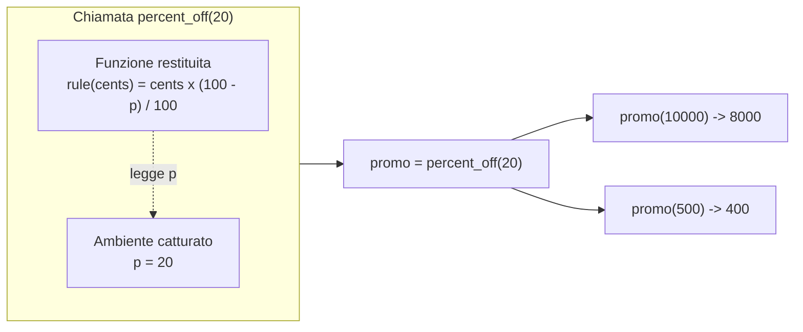
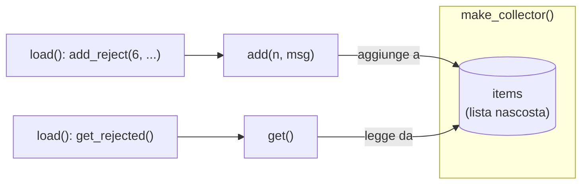
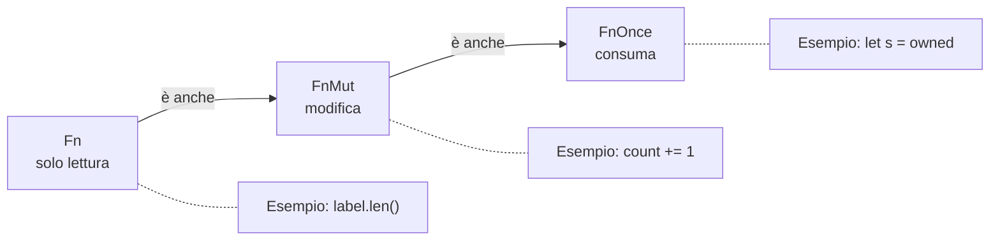
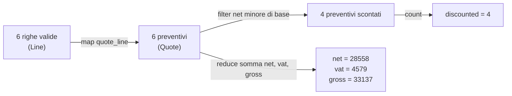
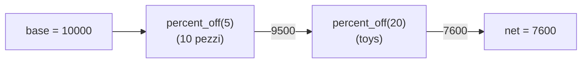

## L04.2 — Closure e funzioni first-class (T3)

### Concetto

In tutti e quattro i linguaggi una funzione è un **valore** come un altro: si può assegnare a una variabile, passare come argomento, mettere in una lista, restituire da un'altra funzione. Si dice che le funzioni sono *first-class*. Una funzione senza nome, scritta nel punto in cui serve, è una *funzione anonima* (o *lambda*, o *func literal*).

Il passo successivo è la **closure**: una funzione che si porta dietro le variabili dell'ambiente in cui è stata creata. Un esempio nel dominio del problema. Servono le regole "togli il 5%", "togli il 20%", "togli il 10%". Scrivere tre funzioni quasi uguali non ha senso; meglio una funzione `percent_off(p)` che **costruisce** la regola per la percentuale `p`:



La funzione `percent_off` è già terminata quando `promo` viene usata, ma `p = 20` esiste ancora: la closure l'ha **catturato**. Una closure è quindi *codice + ambiente*. Senza l'ambiente sarebbe una normale funzione che non saprebbe quale percentuale applicare.

### Implementazione — T3: le regole come valori

`percent_off` restituisce una funzione `cents -> cents`. Nel programma ogni regola ha lo stesso tipo `Rule` (un alias di tipo per "funzione da intero a intero"), che permetterà di trattarle tutte allo stesso modo nella L04.3.

**Python**

```python
# A pricing rule is a pure function: amount in cents -> amount in cents
Rule = Callable[[int], int]

DEFAULT_VAT = 22  # percent
VAT_BY_CATEGORY = {"books": 4, "food": 10}
PROMO_BY_CATEGORY = {"toys": 20}  # extra percent off for a whole category
DEFAULT_TIERS = ((50, 10), (10, 5))  # (min_qty, percent), highest first


@dataclass(frozen=True)
class Line:
    sku: str
    qty: int
    unit_cents: int
    category: str


@dataclass(frozen=True)
class Quote:
    sku: str
    base: int
    net: int
    vat: int
    gross: int

# T3 - a function that builds a function: `p` lives on inside `rule`
def percent_off(p: int) -> Rule:
    def rule(cents: int) -> int:
        return cents * (100 - p) // 100
    return rule
```

**PHP**

```php
const DEFAULT_VAT = 22; // percent
const VAT_BY_CATEGORY = ['books' => 4, 'food' => 10];
const PROMO_BY_CATEGORY = ['toys' => 20]; // extra percent off for a whole category
const DEFAULT_TIERS = [[50, 10], [10, 5]]; // [min_qty, percent], highest first

final class Line
{
    public function __construct(
        public readonly string $sku,
        public readonly int $qty,
        public readonly int $unitCents,
        public readonly string $category,
    ) {}
}

final class Quote
{
    public function __construct(
        public readonly string $sku,
        public readonly int $base,
        public readonly int $net,
        public readonly int $vat,
        public readonly int $gross,
    ) {}
}

// T3 - a function that builds a function: an arrow function captures $p BY VALUE
function percentOff(int $p): Closure
{
    return fn(int $cents): int => intdiv($cents * (100 - $p), 100);
}
```

**Rust**

```rust
// A pricing rule is a pure function: amount in cents -> amount in cents
type Rule = Box<dyn Fn(u64) -> u64>;

const DEFAULT_VAT: u64 = 22; // percent
const DEFAULT_TIERS: [(u64, u64); 2] = [(50, 10), (10, 5)]; // (min_qty, percent), highest first

struct Line {
    sku: String,
    qty: u64,
    unit_cents: u64,
    category: String,
}

struct Quote {
    sku: String,
    base: u64,
    net: u64,
    vat: u64,
    gross: u64,
}

// T3 - a function that builds a function: `move` copies `p` into the closure
fn percent_off(p: u64) -> Rule {
    Box::new(move |cents| cents * (100 - p) / 100)
}
```

**Go**

```go
// Rule is a pure function: amount in cents -> amount in cents
type Rule func(int) int

const defaultVAT = 22 // percent

// Tier: from MinQty pieces up, Percent off
type Tier struct{ MinQty, Percent int }

var defaultTiers = []Tier{{50, 10}, {10, 5}} // highest first

type Line struct {
	SKU       string
	Qty       int
	UnitCents int
	Category  string
}

type Quote struct {
	SKU                   string
	Base, Net, VAT, Gross int
}

// T3 - a function that builds a function: the literal captures `p` BY REFERENCE
func percentOff(p int) Rule {
	return func(cents int) int {
		return cents * (100 - p) / 100
	}
}
```


Osservazioni, linguaggio per linguaggio:

- **Python.** La funzione annidata `rule` legge `p` dalla funzione che la contiene. Python chiama quest'area *enclosing scope* e la rende accessibile in lettura; per **riassegnare** `p` servirebbe `nonlocal` (vedi L04.4). `Rule = Callable[[int], int]` dichiara il tipo "funzione da int a int" per mypy.
- **PHP.** `fn(int $cents): int => ...` è una *arrow function*: cattura **automaticamente** le variabili del contesto usate nel corpo, ma **per valore**, cioè ne fa una copia nel momento della creazione. La forma lunga `function (...) use ($p)` cattura per valore e `use (&$p)` cattura per riferimento. Il tipo di ritorno è `Closure`, la classe delle funzioni anonime.
- **Rust.** `|cents| cents * (100 - p) / 100` è una closure; la parola chiave `move` ordina di **portare dentro** la closure una copia di `p` (un `u64` è `Copy`). Senza `move`, la closure prenderebbe `p` in prestito e il compilatore rifiuterebbe di restituirla, perché `p` finirebbe con la funzione (esperimento sotto). Il tipo di ritorno è `Box<dyn Fn(u64) -> u64>`: una funzione allocata sullo heap e chiamata tramite un'interfaccia (C07 spiega `dyn`); è la scelta che permette di avere una lista di regole diverse dello stesso tipo.
- **Go.** Una *function literal* può usare le variabili esterne, e le cattura **per riferimento**: condivide la variabile, non ne copia il valore. Qui `p` non cambia, quindi non si nota; l'esperimento e2 mostra quando la differenza conta. Il tipo `Rule func(int) int` è un nome per un tipo funzione.

#### Closure con stato: raccogliere gli scarti

Le righe rifiutate vanno raccolte per stamparle in fondo. Si può passare una lista a ogni funzione, oppure creare due closure, una per **aggiungere** e una per **leggere**, che condividono la stessa lista nascosta. L'unico modo di toccare la lista è attraverso le due funzioni: è una forma di incapsulamento senza classi.

**Python**

```python
# T3 - two closures sharing the same hidden list
def make_collector() -> tuple[Callable[[int, str], None], Callable[[], list[str]]]:
    items: list[str] = []

    def add(n: int, msg: str) -> None:
        items.append(f"rejected line {n}: {msg}")

    def get() -> list[str]:
        return items

    return add, get
```

**PHP**

```php
/** T3 - two closures sharing the same list: `use (&$items)` captures BY REFERENCE
 *  @return array{0: Closure, 1: Closure} */
function makeCollector(): array
{
    $items = [];
    $add = function (int $n, string $msg) use (&$items): void {
        $items[] = "rejected line $n: $msg";
    };
    $get = function () use (&$items): array {
        return $items;
    };
    return [$add, $get];
}
```

**Rust**

```rust
// T3 - `reject` is an FnMut closure: it mutably borrows `rejected` while it is alive
let mut rejected = Vec::new();
let mut reject = |n: usize, msg: String| rejected.push(format!("rejected line {n}: {msg}"));
```

**Go**

```go
// T3 - two closures sharing the same hidden slice
func newCollector() (add func(n int, msg string), get func() []string) {
	var items []string
	add = func(n int, msg string) {
		items = append(items, fmt.Sprintf("rejected line %d: %s", n, msg))
	}
	get = func() []string { return items }
	return add, get
}
```




Tracing a mano: dopo `add(6, "bad qty '0'")` e `add(7, "bad price 'abc'")`, `items` contiene due stringhe; `get()` le restituisce entrambe, nell'ordine di inserimento. Ogni chiamata di `make_collector()` crea una **lista nuova**: due collector sono indipendenti.

La cattura è diversa nei quattro linguaggi, e in PHP c'è una trappola reale:

- **Python**: `items` è una lista mutata con `append`; non serve `nonlocal`, perché non si riassegna il nome `items`.
- **PHP**: `use (&$items)` è obbligatorio. Con `fn() => $items` o `use ($items)` la closure prenderebbe una **copia** dell'array al momento della creazione, e `$get` restituirebbe sempre l'array vuoto. Nella prima stesura dell'esperimento e7, `makeFib` aveva `fn(): int => $calls` come lettore del contatore e l'output era `calls=0` invece di `calls=49`: nessun errore, solo un valore sbagliato. Un'arrow function *non vede* le modifiche successive alle variabili del contesto.
- **Rust**: in `load` (appendice) `reject` è una closure `FnMut` che prende in prestito `rejected` in modo mutabile; finché `reject` è viva, `rejected` non può essere letta altrove. Dopo l'ultimo utilizzo di `reject` il prestito termina e `rejected` può essere restituita: è il borrow checker (C10) applicato alle closure.
- **Go**: `items` è una variabile locale di `newCollector` che sopravvive alla funzione perché le due closure la referenziano: il compilatore la sposta sullo heap (*escape analysis*, C10). Si possono dare **nomi** ai risultati, `(add func(...), get func() []string)`, per documentarli.

### Modi di catturare l'ambiente

| Modo | Che cosa si porta dietro la closure | Vede le modifiche successive? | Dove |
|---|---|---|---|
| Per riferimento | La **variabile** stessa | Sì | Python (sempre), Go (sempre), PHP `use (&$x)` |
| Per valore | Una **copia** del valore al momento della creazione | No | PHP `fn` e `use ($x)`, Python con argomento predefinito `x=x` |
| Per move | Il valore **passa** alla closure (copia se `Copy`, trasferimento altrimenti) | No, e il chiamante non può più usarlo | Rust `move` |
| Per prestito | Un riferimento che non può sopravvivere alla variabile | Sì, ma con il vincolo di durata | Rust senza `move` |

Esperimento e2: tre closure create in un ciclo, ciascuna deve restituire l'indice del proprio giro. Anticipato in C03, qui si spiega: ciò che cambia è *chi possiede la variabile del ciclo* e *in che modo viene catturata*.

**Python** (`e2.py`)

```python
fs = []
for i in range(3):
    fs.append(lambda: i)
print("python late binding:", [f() for f in fs])

fs = []
for i in range(3):
    fs.append(lambda i=i: i)  # default argument is evaluated NOW
print("python default arg :", [f() for f in fs])
```

```text
python late binding: [2, 2, 2]
python default arg : [0, 1, 2]
```

Le tre lambda catturano per riferimento **la stessa variabile** `i`, che a fine ciclo vale 2. La correzione è il valore predefinito `i=i`, che copia il valore *al momento della definizione*.

**PHP** (`e2.php`)

```php
<?php
$fs = [];
for ($i = 0; $i < 3; $i++) { $fs[] = fn() => $i; }
echo "php arrow fn (by value) : ", json_encode(array_map(fn($f) => $f(), $fs)), "\n";
$fs = [];
for ($i = 0; $i < 3; $i++) { $fs[] = function () use (&$i) { return $i; }; }
echo "php use (&\$i) (by ref)   : ", json_encode(array_map(fn($f) => $f(), $fs)), "\n";
```

```text
php arrow fn (by value) : [0,1,2]
php use (&$i) (by ref)   : [3,3,3]
```

L'arrow function copia `$i` a ogni giro: `[0,1,2]`. Con `use (&$i)` tutte le closure puntano alla stessa variabile, che finisce il ciclo valendo 3 (l'ultimo incremento prima della condizione falsa): `[3,3,3]`.

**Rust** (`e2.rs`)

```rust
fn main() {
    let fs: Vec<Box<dyn Fn() -> i32>> = (0..3).map(|i| Box::new(move || i) as Box<dyn Fn() -> i32>).collect();
    let out: Vec<i32> = fs.iter().map(|f| f()).collect();
    println!("rust move: {out:?}");
}
```

```text
rust move: [0, 1, 2]
```

`move` copia `i` dentro ogni closure. Senza `move`, se la closure dovesse sopravvivere alla variabile, il compilatore rifiuta (`e2_nomove.rs`):

```rust
fn make() -> Box<dyn Fn() -> i32> {
    let i = 5;
    Box::new(|| i)
}

fn main() {
    println!("{}", make()());
}
```

```text
error[E0373]: closure may outlive the current function, but it borrows `i`, which is owned by the current function
 --> e2_nomove.rs:3:14
  |
3 |     Box::new(|| i)
  |              ^^ - `i` is borrowed here
  |              |
  |              may outlive borrowed value `i`
  |
note: closure is returned here
 --> e2_nomove.rs:3:5
  |
3 |     Box::new(|| i)
  |     ^^^^^^^^^^^^^^
help: to force the closure to take ownership of `i` (and any other referenced variables), use the `move` keyword
  |
3 |     Box::new(move || i)
  |              ++++
```

**Go** (`e2.go`)

```go
package main

import "fmt"

func main() {
	var fs []func() int
	for i := 0; i < 3; i++ {
		fs = append(fs, func() int { return i })
	}
	for _, f := range fs {
		fmt.Print(f(), " ")
	}
	fmt.Println()
}
```

Stesso file, due `go.mod`. Con `go 1.24` (variabile **per iterazione**, dal 1.22):

```text
0 1 2 
```

Con `go 1.21` (una sola variabile `i` per tutto il ciclo):

```text
3 3 3 
```

La versione di linguaggio è quella dichiarata in `go.mod`, non quella del compilatore installato: stesso compilatore, stesso sorgente, risultato diverso.

### Le tre famiglie di closure di Rust

Rust distingue le closure per **che cosa fanno** con ciò che catturano, e il compilatore deduce da solo quali famiglie la closure implementa:

- `Fn`: usa le variabili catturate solo in lettura; si può chiamare quante volte si vuole, anche da più parti insieme;
- `FnMut`: le modifica; si può chiamare più volte, ma una alla volta;
- `FnOnce`: ne consuma qualcuna (la sposta fuori dall'ambiente); si può chiamare **una sola volta**.



Esperimento e4: una funzione che chiede una closure `Fn` la chiama due volte; una che chiede `FnMut` pure.

```rust
fn call_twice(f: impl Fn() -> usize) -> usize { f() + f() }
fn call_mut_twice(mut f: impl FnMut() -> usize) -> usize { f() + f() }

fn main() {
    // Fn: only reads what it captured
    let label = String::from("abc");
    println!("Fn      -> {}", call_twice(|| label.len()));

    // FnMut: modifies what it captured
    let mut count = 0;
    println!("FnMut   -> {}", call_mut_twice(|| { count += 1; count }));
    println!("count after the call = {count}");
}
```

```text
Fn      -> 6
FnMut   -> 3
count after the call = 2
```

Con una closure `FnOnce` e una funzione che pretende `Fn`, il compilatore protegge dalla doppia chiamata (`e4_once.rs`):

```rust
fn call_twice(f: impl Fn() -> usize) -> usize { f() + f() }

fn main() {
    let owned = String::from("abc");
    // moves `owned` out of the closure when called: callable only once (FnOnce)
    let consume = move || { let s = owned; s.len() };
    println!("{}", call_twice(consume));
}
```

```text
error[E0525]: expected a closure that implements the `Fn` trait, but this closure only implements `FnOnce`
 --> e4_once.rs:6:19
  |
6 |     let consume = move || { let s = owned; s.len() };
  |                   ^^^^^^^           ----- closure is `FnOnce` because it moves the variable `owned` out of its environment
  |                   |
  |                   this closure implements `FnOnce`, not `Fn`
7 |     println!("{}", call_twice(consume));
  |                    ---------- ------- the requirement to implement `Fn` derives from here
  |                    |
  |                    required by a bound introduced by this call
  |
note: required by a bound in `call_twice`
 --> e4_once.rs:1:23
  |
1 | fn call_twice(f: impl Fn() -> usize) -> usize { f() + f() }
  |                       ^^^^^^^^^^^^^ required by this bound in `call_twice`
```

È la versione, nel mondo delle funzioni, dell'idea di C10: il compilatore verifica a chi appartiene ogni valore. Go, Python e PHP non hanno questa distinzione: ogni closure è chiamabile sempre.

### Focus comparativo

| Aspetto | PHP | Python | Rust | Go |
|---|---|---|---|---|
| Funzione anonima | `function () {}`, `fn () =>` | `lambda` (una sola espressione), `def` annidata | `\|x\| ...` | `func(x int) int { ... }` |
| Cattura predefinita | `fn`: per valore; `function`: nessuna senza `use` | Per riferimento (nome) | Per prestito; `move` per valore | Per riferimento |
| Controllo sulla cattura | `use ($x)` / `use (&$x)` | `nonlocal`; argomento predefinito per fissare il valore | `move`; famiglie `Fn`, `FnMut`, `FnOnce` | Nessuno (copia manuale `i := i`) |
| Tipo di una funzione | `Closure`, `callable` | `Callable[[int], int]` | `Fn(u64) -> u64`, `Box<dyn Fn>`, `impl Fn` | `func(int) int` |
| Lambda su più istruzioni | ● (`function`) | ○ (usare `def`) | ● | ● |

**Similitudini.** In tutti e quattro una funzione può essere creata a runtime, passata, restituita e conserva l'ambiente di creazione.
**Differenze.** Che cosa significa "conserva": una variabile condivisa (Python, Go), una copia (PHP arrow, Rust `move`) o un riferimento con una durata verificata (Rust). Quasi tutti i bug di closure sono un equivoco su questo punto.

**Esercizio Rosetta (4′).** Scrivere `make_counter(start)` che restituisce una funzione che a ogni chiamata restituisce `start`, `start + 1`, … Verificare che due contatori creati separatamente siano indipendenti. In quale linguaggio serve una parola chiave in più (`nonlocal`, `use (&$n)`, `mut`)? Perché?

---

## L04.3 — Funzioni di ordine superiore: map, filter, reduce, composizione (T4)

### Concetto

Una funzione di **ordine superiore** (*higher-order function*) è una funzione che prende altre funzioni come argomenti, le restituisce, o entrambe le cose. Il vantaggio: il **ciclo** si scrive una volta e la parte che cambia (che cosa fare per ogni elemento) arriva come argomento. Tre funzioni di ordine superiore coprono la maggior parte dei cicli:

| Operazione | Domanda | Entra | Esce |
|---|---|---|---|
| `map(f, xs)` | Che cosa ottengo applicando `f` a ciascun elemento? | lista di n elementi | lista di n elementi |
| `filter(pred, xs)` | Quali elementi soddisfano `pred`? | lista di n elementi | lista di al più n elementi |
| `reduce(f, xs, init)` (o *fold*) | Che cosa ottengo combinando tutti gli elementi in uno? | lista di n elementi | un solo valore |



Il diagramma mostra la **pipeline** del programma: dalle righe validate ai preventivi (map), da questi alle sole righe scontate (filter) e ai totali (reduce). Nessun ciclo esplicito, nessuna variabile accumulatore dichiarata a mano.

### Implementazione — T4: comporre le regole

Per una riga si applicano due regole in sequenza: prima lo sconto per quantità, poi la promozione di categoria. `compose` prende un numero variabile di regole e ne restituisce **una sola** che le applica in ordine. È una funzione che prende funzioni e restituisce una funzione.

**Python**

```python
# T4 - higher-order: takes functions (variadic) and returns a function
def compose(*rules: Rule) -> Rule:
    return lambda cents: reduce(lambda acc, rule: rule(acc), rules, cents)

def quote_line(line: Line) -> Quote:
    pricing = compose(
        percent_off(qty_discount(line.qty)),
        percent_off(PROMO_BY_CATEGORY.get(line.category, 0)),
    )
    base = line_total(line.qty, line.unit_cents)
    net = pricing(base)
    vat, gross = vat_split(net, rate=vat_rate(line.category))  # named argument
    return Quote(line.sku, base, net, vat, gross)
```

**PHP**

```php
// T4 - higher-order: takes functions (variadic) and returns a function
function compose(Closure ...$rules): Closure
{
    return fn(int $cents): int => array_reduce(
        $rules,
        fn(int $acc, Closure $rule): int => $rule($acc),
        $cents,
    );
}

function quoteLine(Line $line): Quote
{
    $pricing = compose(
        percentOff(qtyDiscount($line->qty)),
        percentOff(PROMO_BY_CATEGORY[$line->category] ?? 0),
    );
    $base = lineTotal($line->qty, $line->unitCents);
    $net = $pricing($base);
    [$vat, $gross] = vatSplit($net, rate: vatRate($line->category)); // named argument
    return new Quote($line->sku, $base, $net, $vat, $gross);
}
```

**Rust**

```rust
// T4 - higher-order: takes functions and returns a function
fn compose(rules: Vec<Rule>) -> Rule {
    Box::new(move |cents| rules.iter().fold(cents, |acc, rule| rule(acc)))
}

fn quote_line(line: &Line) -> Quote {
    let pricing = compose(vec![
        percent_off(qty_discount(line.qty, &DEFAULT_TIERS)),
        percent_off(promo(&line.category)),
    ]);
    let base = line_total(line.qty, line.unit_cents);
    let net = pricing(base);
    let (vat, gross) = vat_split(net, vat_rate(&line.category));
    Quote { sku: line.sku.clone(), base, net, vat, gross }
}
```

**Go**

```go
// T4 - higher-order: takes functions (variadic) and returns a function
func compose(rules ...Rule) Rule {
	return func(cents int) int {
		return Reduce(rules, cents, func(acc int, rule Rule) int { return rule(acc) })
	}
}

func quoteLine(line Line) Quote {
	pricing := compose(
		percentOff(qtyDiscount(line.Qty, defaultTiers)),
		percentOff(promo(line.Category)),
	)
	base := lineTotal(line.Qty, line.UnitCents)
	net := pricing(base)
	vat, gross := vatSplit(net, vatRate(line.Category))
	return Quote{line.SKU, base, net, vat, gross}
}
```




Tracing a mano per `J010`: `reduce` parte da `cents = 10000` e dalla lista `[percent_off(5), percent_off(20)]`. Primo passo: `acc = 10000`, `rule = percent_off(5)` → 10000 × 95 / 100 = 9500. Secondo passo: `acc = 9500`, `rule = percent_off(20)` → 9500 × 80 / 100 = 7600. Il risultato dell'ultimo passo è il valore di `compose`.

Una precisazione di nome: la `compose` della matematica applica prima la funzione di destra; questa applica prima la **prima** della lista, quindi in molti ambienti si chiamerebbe `pipe`. Contano due cose: la direzione va dichiarata e **l'ordine delle regole conta** quando c'è un arrotondamento. Con importo base 125 centesimi, −5% poi −20% dà 125 × 95 / 100 = 118 (troncato da 118,75) e poi 118 × 80 / 100 = 94; invertendo l'ordine, 125 × 80 / 100 = 100 e 100 × 95 / 100 = 95. Un centesimo di differenza, che in un preventivo è una contestazione.

Osservazioni, linguaggio per linguaggio:

- **Python.** `*rules` raccoglie gli argomenti posizionali in una tupla. `reduce` viene da `functools`: non è un builtin, perché la comunità Python preferisce un ciclo o una *comprehension* quando più leggibili. `lambda cents: ...` restituisce la funzione risultante.
- **PHP.** `Closure ...$rules` è il parametro variadico tipizzato; `array_reduce` ha l'accumulatore come primo argomento del callback. `compose` restituisce un'arrow function che cattura `$rules` per valore, e va bene, perché `$rules` non cambia più.
- **Rust.** `compose` riceve un `Vec<Rule>` (il linguaggio non ha variadiche), lo **sposta** nella closure con `move` e lo percorre con `fold`, il `reduce` degli iteratori. `quote_line` costruisce il vettore con la macro `vec![...]`.
- **Go.** `rules ...Rule` è la forma variadica; nella funzione `rules` è una slice. Il corpo usa `Reduce`, definita sotto, perché la libreria standard non ha `reduce` per le slice.

#### Pipeline sui preventivi

`summarize` applica il resto del discorso: `filter` per contare le righe scontate, `reduce` per sommare. Il `map` che produce i preventivi è in `main`.

**Python**

```python
# T4 - map / filter / reduce
def summarize(quotes: list[Quote]) -> tuple[int, int, int, int]:
    discounted = len(list(filter(lambda q: q.net < q.base, quotes)))
    net, vat, gross = reduce(
        lambda acc, q: (acc[0] + q.net, acc[1] + q.vat, acc[2] + q.gross),
        quotes,
        (0, 0, 0),
    )
    return discounted, net, vat, gross
```

**PHP**

```php
/** T4 - map / filter / reduce
 *  @param list<Quote> $quotes
 *  @return array{0: int, 1: int, 2: int, 3: int} */
function summarize(array $quotes): array
{
    $discounted = count(array_filter($quotes, fn(Quote $q): bool => $q->net < $q->base));
    [$net, $vat, $gross] = array_reduce(
        $quotes,
        fn(array $acc, Quote $q): array => [$acc[0] + $q->net, $acc[1] + $q->vat, $acc[2] + $q->gross],
        [0, 0, 0],
    );
    return [$discounted, $net, $vat, $gross];
}
```

**Rust**

```rust
// T4 - map / filter / fold are methods of the iterator
fn summarize(quotes: &[Quote]) -> (usize, u64, u64, u64) {
    let discounted = quotes.iter().filter(|q| q.net < q.base).count();
    let (net, vat, gross) = quotes
        .iter()
        .fold((0, 0, 0), |acc, q| (acc.0 + q.net, acc.1 + q.vat, acc.2 + q.gross));
    (discounted, net, vat, gross)
}
```

**Go**

```go
// T4 - map / filter / reduce
func summarize(quotes []Quote) (discounted, net, vat, gross int) {
	discounted = len(Filter(quotes, func(q Quote) bool { return q.Net < q.Base }))
	for _, q := range quotes {
		net, vat, gross = net+q.Net, vat+q.VAT, gross+q.Gross
	}
	return
}
```


In Go le tre funzioni di ordine superiore non esistono per le slice nella libreria standard. Si scrivono una volta con i **generics** (parametri di tipo, C08), e funzionano per qualsiasi tipo:

```go
// T4 - the standard library has no map/filter/reduce for slices: three small generic functions
func Map[T, U any](xs []T, f func(T) U) []U {
	out := make([]U, 0, len(xs))
	for _, x := range xs {
		out = append(out, f(x))
	}
	return out
}

func Filter[T any](xs []T, keep func(T) bool) []T {
	var out []T
	for _, x := range xs {
		if keep(x) {
			out = append(out, x)
		}
	}
	return out
}

func Reduce[T, A any](xs []T, init A, f func(A, T) A) A {
	acc := init
	for _, x := range xs {
		acc = f(acc, x)
	}
	return acc
}
```

Che cosa fa ciascun linguaggio con `map`, `filter` e `reduce`:

| | PHP | Python | Rust | Go |
|---|---|---|---|---|
| `map` | `array_map(f, $xs)` (eager, array) | `map(f, xs)` (iteratore lazy) o comprehension | `xs.iter().map(f)` (lazy, serve `collect`) | `Map(xs, f)` scritta a mano (o ciclo) |
| `filter` | `array_filter($xs, f)` (**conserva le chiavi**) | `filter(f, xs)` (lazy) | `.filter(\|x\| ...)` (lazy) | `Filter(xs, f)` scritta a mano |
| `reduce` | `array_reduce($xs, f, init)` | `functools.reduce(f, xs, init)` | `.fold(init, f)` | `Reduce(xs, init, f)` scritta a mano |
| Stile preferito | Cicli e funzioni `array_*` | Comprehension | Catene di iteratori | Cicli `for` |

Tre dettagli che fanno sbagliare:

- In Python `map` e `filter` restituiscono **iteratori pigri**: nulla viene calcolato finché non li si consuma (`list(...)`, un `for`, `len(list(...))`). Un iteratore consumato una volta è vuoto la seconda.
- In PHP `array_filter` **mantiene le chiavi originali**: dopo aver tolto un elemento da `[a, b, c]` le chiavi possono diventare `0` e `2`, con buchi. Se serve una lista contigua, `array_values(array_filter(...))`. Per `count()` non fa differenza.
- In Rust le catene di iteratori sono pigre come in Python e **non fanno nulla** finché un *consumatore* (`collect`, `count`, `fold`, `sum`) non le avvia. C05 ne mostra il modello.

Quando preferire un ciclo? Quando il corpo ha più di un effetto collaterale, quando serve `break`/`continue`, quando l'accumulo è più chiaro con una variabile con nome. In Go è la scelta normale; in Python una *comprehension* (`[quote_line(l) for l in lines]`) è più leggibile di `map` con una lambda. Le funzioni di ordine superiore brillano quando la funzione da applicare **esiste già con un nome** (`map(quote_line, lines)`), quando va passata lungo il codice (le regole di sconto) o quando il linguaggio rende la catena leggibile (Rust).

### Focus comparativo

| Aspetto | PHP | Python | Rust | Go |
|---|---|---|---|---|
| Funzione come argomento | ● `callable`, `Closure` | ● | ● `impl Fn`, `dyn Fn` | ● `func(...)` |
| `map`/`filter`/`reduce` | ● funzioni `array_*` | ● builtin e `functools` | ● metodi di iteratore | ○ (generics scritti a mano) |
| Comprehension | ○ | ● | ◐ catene + `collect` | ○ |
| Valutazione | Eager | Lazy (`map`, `filter`) | Lazy fino al consumatore | Eager (cicli espliciti) |
| Funzioni variadiche | ● `...` | ● `*args` | ◐ slice o `Vec` | ● `...T` |

**Similitudini.** L'idea è la stessa nei quattro linguaggi: separare *come si scorre* da *che cosa si fa*.
**Differenze.** Dove la libreria standard offre gli strumenti (Python, PHP, Rust) e dove no (Go). E la pigrizia: Python e Rust rimandano il lavoro al consumatore, PHP e Go lo fanno subito.

**Esercizio Rosetta (4′).** Costruire con `map` e `filter` l'elenco degli SKU delle righe che beneficiano di *entrambi* gli sconti (quantità e promozione). Con i dati di esempio il risultato è `["J010"]`. In quale linguaggio il risultato è già una lista e in quale è un iteratore da consumare?

---

