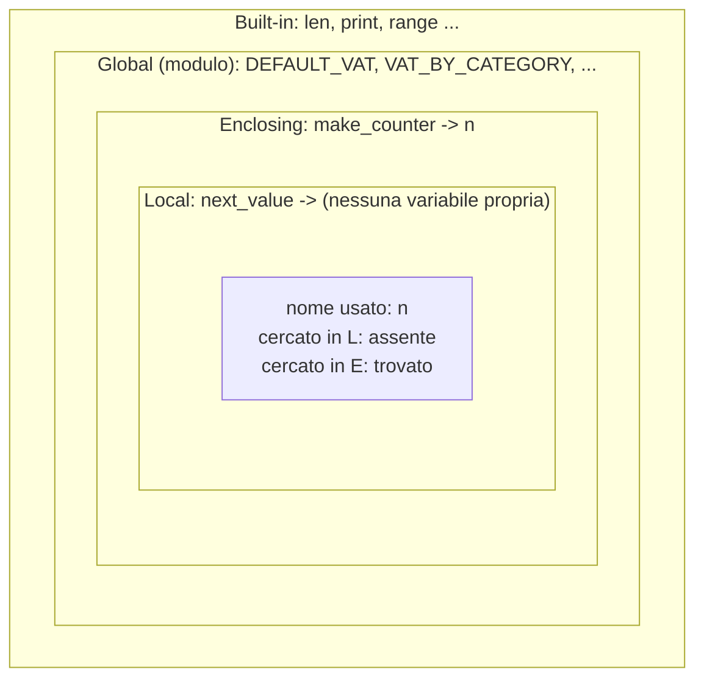
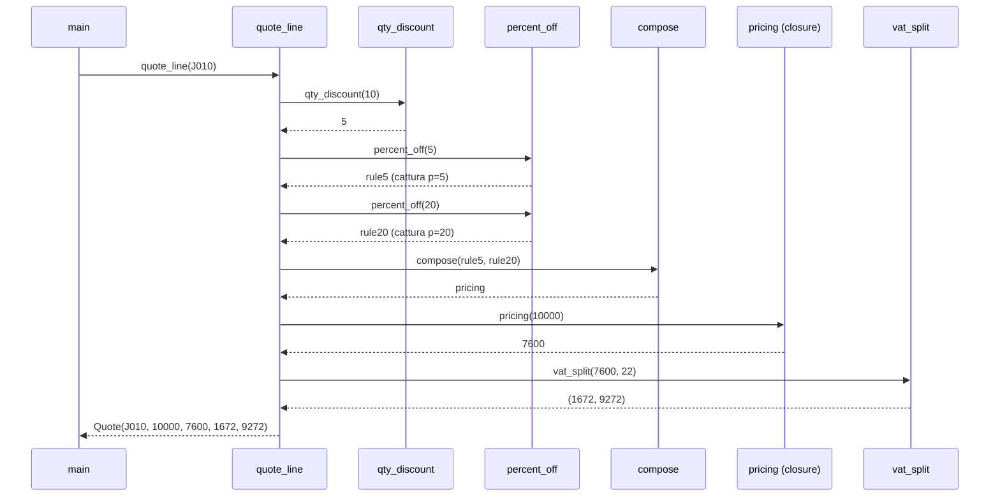
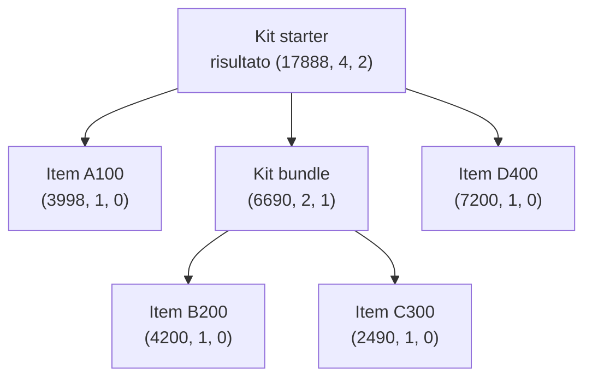
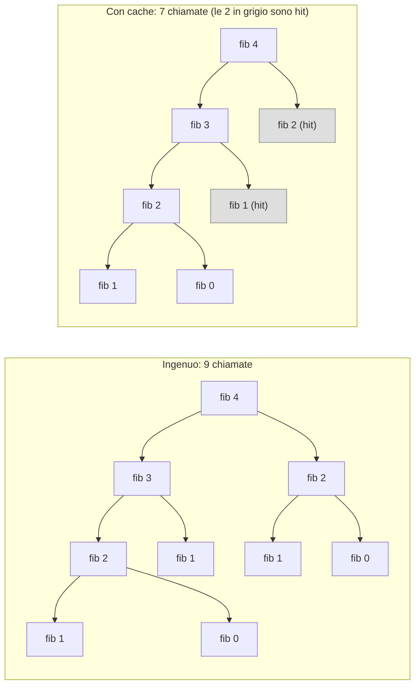
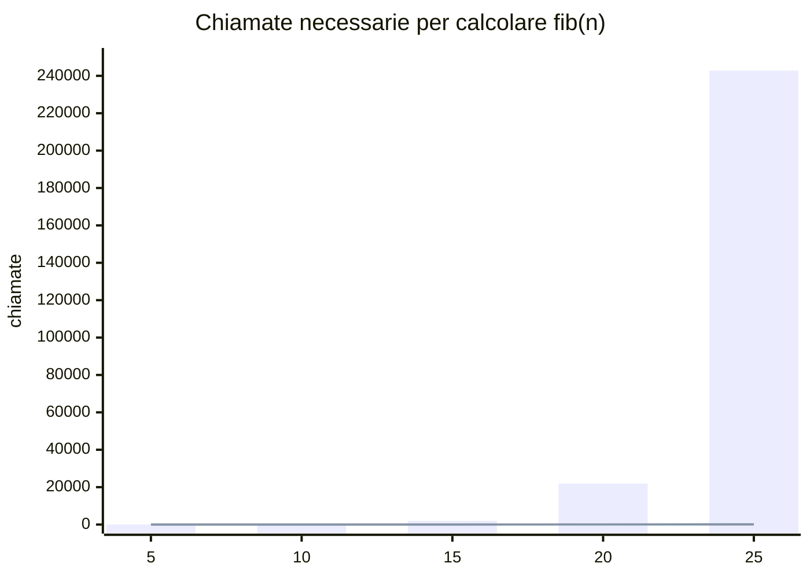
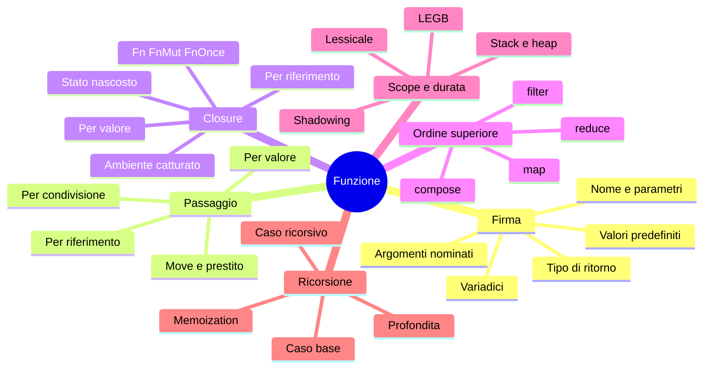

## L04.4 — Scope, durata delle variabili, ricorsione (T6)

### Concetto: dove vive un nome

Lo **scope** (ambito) di un nome è la parte di programma in cui quel nome è visibile. La **durata** (*lifetime*) di una variabile è il periodo in cui il suo valore esiste. Sono due cose diverse: una variabile locale è visibile solo nella sua funzione, ma una closure può tenerla in vita dopo che la funzione è terminata (come `p` in `percent_off`).

Tutti e quattro i linguaggi hanno scope **lessicale**: il significato di un nome si decide guardando il testo del programma, non l'ordine delle chiamate. Le regole però differiscono:

| | PHP | Python | Rust | Go |
|---|---|---|---|---|
| Unità di scope | Funzione | Funzione (e modulo, classe) | **Blocco** `{ }` | **Blocco** `{ }` |
| Una funzione vede le variabili esterne? | **No** (servono `global`, `use`, `$GLOBALS`) | Sì, in lettura (LEGB) | Solo se catturate da una closure; le `fn` non vedono nulla | Sì: variabili di pacchetto e, nelle closure, di funzione |
| Nuova variabile nello stesso scope | Assegnazione | Assegnazione | `let` (anche con lo stesso nome: *shadowing*) | `:=` (nuova) oppure `=` (assegna) |
| Ciclo/`if` creano uno scope? | No | No | Sì | Sì |



In Python la ricerca di un nome segue la regola **LEGB**: Local, Enclosing (funzioni che contengono), Global (modulo), Built-in. Il primo che lo trova vince. L'esperimento e5 mostra le trappole di ciascun linguaggio.

**Python** (`e5.py`)

```python
rate = 22

def broken():
    rate = rate + 1  # assignment makes `rate` local for the WHOLE function
    return rate

try:
    broken()
except UnboundLocalError as e:
    print("UnboundLocalError:", e)

def make_counter():
    n = 0
    def next_value():
        nonlocal n  # without this line: UnboundLocalError
        n += 1
        return n
    return next_value

c = make_counter()
print(c(), c(), c())
```

```text
UnboundLocalError: cannot access local variable 'rate' where it is not associated with a value
1 2 3
```

Il caso `broken` è sottile: l'assegnazione `rate = rate + 1` rende `rate` una variabile **locale in tutta la funzione**, anche nella riga di destra, che quindi legge una variabile non ancora assegnata. Senza `nonlocal`/`global`, in Python un'assegnazione crea sempre un nome locale. `nonlocal n` dichiara che `n` è quella della funzione che contiene; `global x` fa lo stesso con il livello del modulo.

**PHP** (`e5.php`)

```php
<?php
$rate = 22;
function read_global() { return $rate; }  // functions do NOT see outer variables
echo "without global: "; var_dump(read_global());
function with_global() { global $rate; return $rate; }
echo "with global   : ", with_global(), "\n";
$c = (function () { $n = 0; return function () use (&$n) { return ++$n; }; })();
echo "counter       : ", $c(), " ", $c(), " ", $c(), "\n";
```

```text
without global: PHP Warning:  Undefined variable $rate in e5.php on line 3
NULL
with global   : 22
counter       : 1 2 3
```

In PHP il contrario: la funzione **non vede nulla** dell'esterno. `$rate` dentro `read_global` è una variabile locale mai assegnata (Warning e `NULL`). Le vie esplicite sono `global $rate`, `use` nelle closure, o meglio ancora un parametro. Il Warning è un avviso, non un errore: il programma continua con un valore sbagliato, un motivo in più per tenere gli avvisi accesi e trattare i `Warning` come errori nei test.

**Rust** (`e5.rs`)

```rust
fn main() {
    let rate = 22;
    {
        let rate = rate + 1; // shadowing: a new variable in the inner block
        println!("inner  : {rate}");
    }
    println!("outer  : {rate}");
    let rate = "twenty-two"; // shadowing may even change the type
    println!("retyped: {rate}");
    let mut n = 0;
    let mut next = || { n += 1; n };
    println!("counter: {} {} {}", next(), next(), next());
}
```

```text
inner  : 23
outer  : 22
retyped: twenty-two
counter: 1 2 3
```

Lo *shadowing* (`let rate = ...` ripetuto) crea una **nuova** variabile con lo stesso nome; la vecchia esiste ancora, solo non è più raggiungibile col nome. Per questo `rate` può cambiare anche tipo. Nel blocco interno, `rate` vale 23 e al termine del blocco torna visibile quella esterna (22). La durata è verificata dal compilatore (`e5_life.rs`):

```rust
fn main() {
    let r;
    {
        let x = 5;
        r = &x;
    }
    println!("{r}");
}
```

```text
error[E0597]: `x` does not live long enough
 --> e5_life.rs:5:13
  |
4 |         let x = 5;
  |             - binding `x` declared here
5 |         r = &x;
  |             ^^ borrowed value does not live long enough
6 |     }
  |     - `x` dropped here while still borrowed
7 |     println!("{r}");
  |                - borrow later used here
```

Il compilatore vede che `r` sopravvive a `x`, e rifiuta di costruire un riferimento a qualcosa che non esisterà più. È la stessa regola che rifiuta di restituire una closure senza `move` (e2_nomove).

**Go** (`e5.go`)

```go
package main

import (
	"errors"
	"fmt"
)

func find() (int, error) { return 0, errors.New("not found") }

func main() {
	var err error
	if true {
		_, err := find() // := declares a NEW err inside the block
		_ = err
	}
	fmt.Println("outer err:", err)

	if _, err = find(); err != nil { // = assigns the outer one
		fmt.Println("assigned:", err)
	}
	n := 0
	next := func() int { n++; return n }
	fmt.Println("counter:", next(), next(), next())
}
```

```text
outer err: <nil>
assigned: not found
counter: 1 2 3
```

Il primo `err` stampato è `<nil>`: dentro l'`if`, `_, err := find()` ha dichiarato una variabile nuova che oscura quella esterna, e la funzione ha riempito quella; la variabile esterna è rimasta vuota. Con `=` invece (`if _, err = find(); ...`) si assegna alla variabile esistente. È uno dei bug più comuni in Go: un `:=` di troppo in un blocco annidato, soprattutto con `err`. Il compilatore non lo segnala; lo trova `go vet` con l'analisi `shadow` (non attiva di default) o la lettura attenta.

### Lo stack delle chiamate

Quando una funzione chiama un'altra, il programma tiene una **pila** (*call stack*) di *frame*: ognuno contiene i parametri e le variabili locali di una chiamata in corso. Una chiamata aggiunge un frame; il `return` lo toglie. È la durata delle variabili locali: nascono con il frame e muoiono con lui, salvo le variabili catturate da una closure, che il linguaggio mantiene altrove (heap).



Nel momento di massima profondità (dentro `pricing`) lo stack contiene `main` → `quote_line` → `pricing` → `rule5`/`rule20`. Dopo ogni `return` il frame scompare, ma `rule5` e `rule20`, create da `percent_off`, restano vive finché qualcuno le usa: il loro `p` non sta nello stack di `percent_off`.

### Concetto: la ricorsione

Una funzione è **ricorsiva** quando chiama se stessa. Funziona se ci sono due parti: un **caso base**, che dà la risposta senza ricorrere a se stessa, e un **caso ricorsivo**, che riduce il problema a uno più piccolo dello stesso tipo e combina il risultato. Senza caso base la ricorsione non finisce mai (finché lo stack non si esaurisce); senza riduzione ("più piccolo") nemmeno.

Il problema dei kit si presta alla ricorsione perché i dati hanno la stessa struttura: un kit contiene articoli *o altri kit*. Un `Node` è un `Item` (caso base: ha un prezzo) oppure un `Kit` (caso ricorsivo: contiene dei `Node`). Per un kit servono prezzo totale, numero di articoli e profondità di annidamento.



Ogni nodo mostra la terna (totale, articoli, profondità). Le foglie (`Item`) sono il caso base. Un `Kit` somma i totali e gli articoli dei figli e prende `1 +` la profondità massima.

**Python**

```python
@dataclass(frozen=True)
class Item:
    sku: str
    cents: int


@dataclass(frozen=True)
class Kit:
    name: str
    parts: tuple["Node", ...]


Node = Item | Kit


def kit_stats(node: Node) -> tuple[int, int, int]:
    """Return (total cents, number of items, depth). Base case: Item. Recursive case: Kit."""
    match node:
        case Item(cents=c):
            return c, 1, 0
        case Kit(parts=parts):
            stats = [kit_stats(p) for p in parts]
            return (
                sum(s[0] for s in stats),
                sum(s[1] for s in stats),
                1 + max(s[2] for s in stats),
            )
```

**PHP**

```php
interface Node {}
final class Item implements Node
{
    public function __construct(public readonly string $sku, public readonly int $cents) {}
}
final class Kit implements Node
{
    /** @param list<Node> $parts */
    public function __construct(public readonly string $name, public readonly array $parts) {}
}

/** Return [total cents, number of items, depth]. Base case: Item. Recursive case: Kit.
 *  @return array{0: int, 1: int, 2: int} */
function kitStats(Node $node): array
{
    if ($node instanceof Item) {
        return [$node->cents, 1, 0];
    }
    $stats = array_map(kitStats(...), $node->parts);
    return [
        array_sum(array_column($stats, 0)),
        array_sum(array_column($stats, 1)),
        1 + max(array_column($stats, 2)),
    ];
}
```

**Rust**

```rust
#[allow(dead_code)] // sku and name are kept for readability, not used here
enum Node {
    Item { sku: String, cents: u64 },
    Kit { name: String, parts: Vec<Node> },
}

/// Return (total cents, number of items, depth). Base case: Item. Recursive case: Kit.
fn kit_stats(node: &Node) -> (u64, u64, u64) {
    match node {
        Node::Item { cents, .. } => (*cents, 1, 0),
        Node::Kit { parts, .. } => {
            let stats: Vec<(u64, u64, u64)> = parts.iter().map(kit_stats).collect();
            (
                stats.iter().map(|s| s.0).sum(),
                stats.iter().map(|s| s.1).sum(),
                1 + stats.iter().map(|s| s.2).max().unwrap_or(0),
            )
        }
    }
}
```

**Go**

```go
type Node interface{ isNode() }

type Item struct {
	SKU   string
	Cents int
}

type Kit struct {
	Name  string
	Parts []Node
}

func (Item) isNode() {}
func (Kit) isNode()  {}

// kitStats returns (total cents, number of items, depth). Base case: Item. Recursive case: Kit.
func kitStats(node Node) (total, items, depth int) {
	switch n := node.(type) {
	case Item:
		return n.Cents, 1, 0
	case Kit:
		maxDepth := 0
		for _, p := range n.Parts {
			t, i, d := kitStats(p)
			total, items = total+t, items+i
			maxDepth = max(maxDepth, d)
		}
		return total, items, 1 + maxDepth
	}
	panic("unreachable")
}
```


Tracing a mano di `kit_stats(starter)`: la funzione costruisce la lista di statistiche dei tre figli. Il primo è un `Item`: restituisce `(3998, 1, 0)`. Il secondo è un `Kit`: chiama se stessa sui suoi due figli, ottiene `(4200, 1, 0)` e `(2490, 1, 0)` e restituisce `(6690, 2, 1)`. Il terzo è `(7200, 1, 0)`. Quindi: totale 3998 + 6690 + 7200 = 17888; articoli 1 + 2 + 1 = 4; profondità 1 + max(0, 1, 0) = 2. Output (identico nei quattro linguaggi, vedi sotto): `kit total=17888 items=4 depth=2`.

Si riconosce qui il pattern matching di C03: `match` su `Item`/`Kit` in Python e Rust, `instanceof` in PHP, type switch in Go. Come in C03 le differenze sono nella verifica: in Rust aggiungere una terza forma di `Node` obbliga a riscrivere `kit_stats`; in Go il `panic("unreachable")` finale è la rete di sicurezza.

### I limiti della ricorsione: la profondità

Ogni chiamata ricorsiva occupa un frame. Con strutture poco profonde (un kit di pochi livelli) non è un problema. Con una profondità proporzionale ai dati (sommare i numeri da 1 a n, o scorrere una lista con n elementi con una funzione ricorsiva) sì. Esperimento e6: `sum_to(n) = n + sum_to(n - 1)`, con `n` da 500 a 100 milioni.

**Python** (`e6.py`)

```python
import sys

def sum_to(n: int) -> int:
    return 0 if n == 0 else n + sum_to(n - 1)

print("recursion limit:", sys.getrecursionlimit())
for n in (500, 5_000, 1_000_000):
    try:
        print(n, "->", sum_to(n))
    except RecursionError as e:
        print(n, "-> RecursionError:", e)
```

```text
recursion limit: 1000
500 -> 125250
5000 -> RecursionError: maximum recursion depth exceeded
1000000 -> RecursionError: maximum recursion depth exceeded
```

**PHP** (`e6.php`)

```php
<?php
function sum_to(int $n): int { return $n === 0 ? 0 : $n + sum_to($n - 1); }
foreach ([500, 5000, 1000000] as $n) {
    echo "$n -> ", sum_to($n), "\n";
}
```

```text
500 -> 125250
5000 -> 12502500
1000000 -> 500000500000
```

**Rust** (`e6.rs`, compilato senza `-O`; ogni valore di `n` è un'esecuzione separata, perché l'overflow termina il processo)

```rust
fn sum_to(n: u64) -> u64 {
    if n == 0 { 0 } else { n + sum_to(n - 1) }
}

fn main() {
    let n: u64 = std::env::args().nth(1).unwrap().parse().unwrap();
    println!("{n} -> {}", sum_to(n));
}
```

```text
500 -> 125250
5000 -> 12502500
100000 -> 5000050000
thread 'main' (1938) has overflowed its stack
fatal runtime error: stack overflow, aborting
```

**Go** (`e6.go`, con `n` = 500, 5000, 1 milione, 100 milioni; qui sono mostrate le prime righe, il resto è il dump dello stack)

```go
package main

import "fmt"

func sumTo(n int) int {
	if n == 0 {
		return 0
	}
	return n + sumTo(n-1)
}

func main() {
	for _, n := range []int{500, 5000, 1000000, 100000000} {
		fmt.Println(n, "->", sumTo(n))
	}
}
```

```text
500 -> 125250
5000 -> 12502500
1000000 -> 500000500000
runtime: goroutine stack exceeds 1000000000-byte limit
runtime: sp=0xc0200e0388 stack=[0xc0200e0000, 0xc0400e0000]
```

| Linguaggio | Limite osservato | Come si manifesta | Recuperabile? |
|---|---|---|---|
| Python | 1000 frame (`sys.getrecursionlimit()`); già 5000 fallisce | `RecursionError` | Sì, è un'eccezione |
| PHP | Nessun limite imposto nel test (1 milione di livelli senza errore); oltre, lo limita la memoria disponibile (non provato) | Errore fatale per memoria | No |
| Rust | Stack del thread (8 MB per `main` in questo ambiente): 100000 livelli sì, 1 milione no (build senza `-O`) | `thread 'main' has overflowed its stack`, il processo si interrompe (SIGABRT) | No |
| Go | Lo stack **cresce** fino a 1 GB: 1 milione di livelli sì, 100 milioni no | `fatal error: stack overflow` | No: non è un `panic`, `recover` non lo intercetta |

I limiti sono scelte di progetto, e C10 e C11 ne spiegano le ragioni (stack di dimensione fissa del thread di sistema contro stack che cresce dei goroutine). La regola pratica: **la ricorsione va bene quando la profondità è limitata dalla struttura dei dati** (alberi bilanciati, kit, directory); quando dipende dalla quantità di dati (liste lunghe), un ciclo è più sicuro. Nessuno dei quattro linguaggi garantisce l'ottimizzazione della ricorsione in coda (*tail call optimization*): non si può contare su di essa.

### La ricorsione che si moltiplica, e la closure che la salva (esperimento e7)

Il calcolo ricorsivo dei numeri di Fibonacci, `fib(n) = fib(n-1) + fib(n-2)`, ricalcola gli stessi valori molte volte: `fib(25)` richiede 242785 chiamate. Un albero di chiamate per `fib(4)`, nel modo ingenuo, ne ha 9, con `fib(2)` calcolata due volte; con una **cache** ne bastano 7:



La **memoization** (ricordare i risultati già calcolati) è un uso classico delle closure: la cache e il contatore vivono nell'ambiente catturato, e la funzione restituita li usa a ogni chiamata.

**Python**

```python
def make_fib() -> tuple[Callable[[int], int], Callable[[], int]]:
    cache: dict[int, int] = {}
    calls = 0

    def fib(n: int) -> int:
        nonlocal calls
        calls += 1
        if n < 2:
            return n
        if n not in cache:
            cache[n] = fib(n - 1) + fib(n - 2)  # the closure calls itself by name
        return cache[n]

    return fib, lambda: calls
```

**PHP**

```php
/** @return array{0: Closure, 1: Closure} */
function makeFib(): array
{
    $cache = [];
    $calls = 0;
    $fib = function (int $n) use (&$fib, &$cache, &$calls): int { // `&$fib`: the closure must see itself
        $calls++;
        if ($n < 2) {
            return $n;
        }
        return $cache[$n] ??= $fib($n - 1) + $fib($n - 2);
    };
    return [$fib, function () use (&$calls): int { return $calls; }];
}
```

**Rust**

```rust
// A closure cannot call itself in Rust: the state and the recursion live in a struct
struct Fib {
    cache: HashMap<u64, u64>,
    calls: u64,
}

impl Fib {
    fn fib(&mut self, n: u64) -> u64 {
        self.calls += 1;
        if n < 2 {
            return n;
        }
        if let Some(&v) = self.cache.get(&n) {
            return v;
        }
        let v = self.fib(n - 1) + self.fib(n - 2);
        self.cache.insert(n, v);
        v
    }
}
```

**Go**

```go
func makeFib() (fib func(int) int, calls func() int) {
	cache := map[int]int{}
	n := 0
	fib = func(k int) int { // `fib` is declared first: the literal must be able to name itself
		n++
		if k < 2 {
			return k
		}
		if v, ok := cache[k]; ok {
			return v
		}
		cache[k] = fib(k-1) + fib(k-2)
		return cache[k]
	}
	return fib, func() int { return n }
}
```


Si noti un dettaglio che separa i linguaggi: in `fib` la closure **chiama se stessa**. In Python basta il nome (`fib` è nello scope di `make_fib`). In PHP la closure deve prendere se stessa per riferimento con `use (&$fib)`, perché al momento della creazione la variabile non è ancora assegnata. In Go si dichiara prima `fib` nel risultato (`fib func(int) int`) e poi la si assegna: dentro il literal il nome esiste già. In **Rust una closure non può chiamare se stessa**: non ha un nome nel proprio corpo e il suo tipo non è nominabile; per questo lo stato e la ricorsione vanno in una `struct` con un metodo (`self.fib(n - 1)`), e il prestito mutabile `&mut self` esprime ciò che le altre closure fanno catturando una variabile. Nessuna delle due soluzioni è migliore: sono due modi di mantenere uno stato fra una chiamata e l'altra.

Output dell'esperimento (uguale nei quattro linguaggi):

```text
fib_naive(25)=75025 calls=242785
fib_memo(25)=75025 calls=49
kit total=17888 items=4 depth=2
```



Il costo del metodo ingenuo cresce in modo esponenziale (le barre); con la cache cresce linearmente (la linea quasi appiattita sull'asse): 2n − 1 chiamate. La complessità, e come misurarla senza ingannarsi, tornano in C05 (L05.4) e C13 (L13.4).

### Focus comparativo

| Aspetto | PHP | Python | Rust | Go |
|---|---|---|---|---|
| Unità di scope | Funzione | Funzione, modulo | Blocco | Blocco |
| Variabili esterne in una funzione | Non visibili | Visibili in lettura | Non visibili (`fn`); catturate (closure) | Visibili |
| Shadowing | Non applicabile (assegnazione) | Non applicabile | ● `let` ripetuto, anche cambiando tipo | ● `:=` in un blocco interno (trappola) |
| Limite di ricorsione | Memoria | 1000 (configurabile) | Stack del thread (8 MB) | Stack che cresce, 1 GB |
| Ottimizzazione della ricorsione in coda | ○ | ○ | ○ (non garantita) | ○ |
| Closure ricorsiva | `use (&$f)` | Nome nello scope esterno | Non possibile: `struct` o funzione | Dichiarare prima `var f func(...)` |

**Similitudini.** Scope lessicale ovunque; ricorsione con caso base e caso ricorsivo, e profondità limitata dallo stack.
**Differenze.** Dove finisce lo scope (funzione contro blocco), come si accede a ciò che sta fuori (implicito in Python, esplicito in PHP, controllato dal compilatore in Rust), e che cosa succede quando lo stack finisce (eccezione, errore fatale, interruzione del processo).

**Esercizio Rosetta (4′).** Scrivere `depth(n)` ricorsiva che restituisce quante cifre ha `n` (per esempio 12345 → 5) dividendo per 10. Qual è il caso base? Riscriverla con un ciclo. Per quale ordine di grandezza di `n` la versione ricorsiva diventerebbe un problema in Python? (Suggerimento: quante cifre ha un intero di 1000 cifre? Python gestisce interi arbitrariamente grandi, C02.)

---

## Matrice degli approcci (riepilogo C04)

| Costrutto | PHP | Python | Rust | Go |
|---|---|---|---|---|
| Closure | ● `function () use`, `fn =>` | ● `lambda`, funzioni annidate | ● `Fn`, `FnMut`, `FnOnce` | ● func literal |
| Default e named arguments | ● | ● | ◐ builder, `Default` | ◐ functional options |
| Variadic | ● `...$args` | ● `*args`, `**kwargs` | ◐ macro, slice | ● `...T` |
| Ritorni multipli | ◐ array + destrutturazione | ● tuple | ● tuple | ● nativi |
| Passaggio per riferimento | ● `&$x` (oggetti per handle) | ◐ call by sharing | ● `&T`, `&mut T` | ● puntatori `*T` |
| Cattura dell'ambiente | Per valore (`fn`) o riferimento (`use &`) | Per riferimento | Prestito o `move` | Per riferimento |
| `map`/`filter`/`reduce` | ● `array_*` | ● builtin, `functools` | ● iteratori | ○ (scritti a mano con generics) |
| Scope | Funzione | Funzione (LEGB) | Blocco | Blocco |
| Limite di ricorsione | Memoria | 1000 frame (configurabile) | Stack del thread | Stack che cresce fino a 1 GB |

Legenda: ● nativo e idiomatico · ◐ approccio alternativo assimilabile · ○ assente o non idiomatico. La matrice è un indice, non una dichiarazione di equivalenza. Le righe "Cattura dell'ambiente", "`map`/`filter`/`reduce`", "Scope" e "Limite di ricorsione" estendono quelle del TOC e vanno riportate nella matrice completa dell'appendice D.

## Anti-pattern ricorrenti

| Anti-pattern | Dove capita | Perché è un problema | Alternativa |
|---|---|---|---|
| Valore predefinito mutabile (`tags=[]`) | Python | Un solo oggetto per tutte le chiamate | `None` come segnaposto, oggetto creato nella funzione |
| Funzione che modifica l'argomento senza dirlo | Python, PHP (oggetti), Go (slice) | Il chiamante non sa che il suo dato cambia | Restituire il nuovo valore; documentare; in Rust `&mut` lo rende visibile |
| `append` su una slice passata per valore | Go | La slice del chiamante non cresce | Restituire la slice o passare `*[]T` |
| Closure in un ciclo che cattura la variabile del ciclo | Python, PHP `&`, Go < 1.22 | Tutte vedono l'ultimo valore | `i=i`, arrow function, `move`, o `i := i` |
| `fn` per leggere un valore che cambierà | PHP | Cattura per valore: vede il valore di quando è stata creata | `function () use (&$x)` o un parametro |
| `:=` in un blocco annidato su `err` | Go | Crea una variabile nuova che oscura l'esterna | `=` per assegnare; attivare l'analisi `shadow` |
| Stato globale al posto di una closure o di un parametro | Tutti | Dipendenza nascosta, test difficili | Parametro, o closure che cattura il suo stato |
| Funzioni di cinque o più parametri dello stesso tipo | Tutti | Gli argomenti si scambiano senza che nessuno se ne accorga | Parametri nominati, una `struct` o un tipo per ciascuno |
| Ricorsione su una lista lunga | Python, Rust, Go | Stack overflow con `n` grande | Ciclo, iteratore |
| Ricorsione senza caso base chiaro | Tutti | Ricorsione infinita | Scrivere prima il caso base e dire *che cosa si riduce* |
| Lambda illeggibile al posto di una funzione con nome | Python, PHP, Rust | Il nome documenta l'intenzione | `def` / funzione nominata + `map(nome, xs)` |
| Dimenticare che `map` e `filter` sono pigri | Python, Rust | Nulla accade finché non si consuma l'iteratore | `list(...)`, `collect()`, o un ciclo `for` |

## Quiz di verifica

1. Qual è la differenza tra **parametro** e **argomento**?
2. In Go, perché `func appendInPlace(xs []int) { xs = append(xs, 99) }` non cambia la slice del chiamante, mentre `xs[0] = 100` sì?
3. Perché nell'esperimento e2 Python stampa `[2, 2, 2]` e PHP con l'arrow function `[0,1,2]`?
4. Che cosa cambia, in PHP, tra `fn() => $calls` e `function () use (&$calls) { return $calls; }` se `$calls` viene incrementata dopo la creazione della closure?
5. Che cosa fa `move` in una closure Rust e quando è obbligatorio?
6. Quando una closure Rust implementa solo `FnOnce`?
7. Perché `def add_tag(tag, tags=[])` è un bug in Python?
8. Qual è il caso base di `kit_stats` e che cosa succederebbe se mancasse?
9. Perché Python lancia `RecursionError` a 5000 livelli e Go no a 1 milione? Che differenza c'è tra l'errore di Python e quello di Rust?

**Risposte**

> 1. Il parametro è il nome nella definizione della funzione; l'argomento è il valore passato nella chiamata. 2. La slice è passata per valore: la funzione riceve una copia dei tre campi (puntatore, lunghezza, capacità). `xs[0] = 100` scrive nei dati condivisi, quindi si vede; `append` aggiorna la lunghezza della copia locale, e il chiamante continua a vedere la sua lunghezza. 3. La lambda Python cattura la variabile `i` (per riferimento), che a fine ciclo vale 2; l'arrow function PHP cattura una copia del valore di `$i` a ogni giro. 4. `fn` ha copiato `$calls` nel momento della creazione e restituisce sempre quel valore (0); `use (&$calls)` condivide la variabile e vede gli incrementi. 5. Sposta (o copia, se il tipo è `Copy`) nella closure i valori catturati invece di prenderli in prestito; è obbligatorio quando la closure sopravvive alla funzione che l'ha creata (per esempio quando viene restituita). 6. Quando consuma una variabile catturata, cioè la sposta fuori dall'ambiente (per esempio `let s = owned;`): una seconda chiamata non avrebbe più il valore. 7. La lista predefinita viene creata una sola volta, alla definizione, e viene riusata e modificata a ogni chiamata successiva. 8. Il caso base è `Item`: restituisce `(cents, 1, 0)` senza ricorsione. Se mancasse, un `Item` non avrebbe un modo di rispondere e la funzione non terminerebbe o fallirebbe su ogni foglia. 9. Python impone un limite di 1000 frame (modificabile); lo stack di Go parte piccolo e cresce fino a 1 GB. In Python l'errore è un'eccezione catturabile; in Rust lo stack overflow interrompe il processo e non si può recuperare.

## Esercizi

1. **(base)** Aggiungere una fascia di sconto: da 100 pezzi, 15%. Quanti punti del codice cambiano? In quale linguaggio devi toccare anche la chiamata?
2. **(base)** L'IVA sui prodotti `water` è il 10%. Che cosa cambia in `vat_rate`? Perché lo `switch`/`match`/dizionario è la scelta giusta e non una catena di `if`?
3. **(base)** Cambiare `percent_off` perché arrotondi al centesimo più vicino (metà verso l'alto) invece di troncare. Con base 125 e le regole −5% e −20% il risultato dipende ancora dall'ordine?
4. **(medio)** Che cosa restituisce `compose()` senza regole? Verificarlo nei quattro linguaggi e spiegare perché è il comportamento corretto (elemento neutro).
5. **(medio)** Riscrivere `load` senza closure: raccogliere gli scarti in una lista passata come parametro (mutabile) o restituita. Confrontare chiarezza e rischi di ciascuna soluzione nei quattro linguaggi.
6. **(medio)** Scrivere `memoize(f)` che accetta una funzione `int -> int` e ne restituisce una versione con cache. In Rust, perché la versione generica richiede di decidere il tipo di closure (`Fn` contro `FnMut`)?
7. **(avanzato)** Estendere `kit_stats` perché accetti una `Rule` e la applichi al totale di ogni `Kit` (sconto di kit). In quale ordine si applicano gli sconti dei kit annidati?
8. **(avanzato, statistica leggera)** Misurare `fib(30)` ingenuo e con cache, 20 ripetizioni ciascuno, in due linguaggi a scelta: mediana, minimo e dispersione. Si può dire che un linguaggio è "più veloce" dell'altro da questa misura? Quali ripetizioni vanno scartate e perché? (Anticipa L13.4.)

## Mappa mentale



Collegamenti: C05 (collezioni e iteratori: dietro `map`, `filter` e `for`), C06 (tipi composti: `Quote`, `Node` come tipo somma), C07 (interfacce: `Rule` come interfaccia con un solo metodo, `dyn Fn`), C08 (generics: `Map`, `Filter`, `Reduce` in Go), C10 (move, prestito, escape analysis: dove vivono le variabili catturate), C11 (closure passate a thread e goroutine: la cattura per riferimento diventa un data race), C13 (le funzioni pure sono le più facili da testare).

---

## Ponte

Verso **C05**: `map`, `filter` e `for` scorrono una sequenza, e C05 spiega che cos'è davvero (array, slice, `Vec`, lista), perché `append` in Go si comporta come in e1, e come scegliere tra `dict`, `HashMap`, `map` in base al costo delle operazioni. Verso **C06**: la `Quote` e il `Node` sono tipi composti; il capitolo mostra come modellarli in modo che gli stati illegali non si possano rappresentare. Verso **C09**: gli errori di `parse_positive` sono il primo contatto con le eccezioni contro gli errori come valori; C09 li svolge a fondo. Verso **C10**: `move`, `&mut`, le slice di Go e l'escape analysis sono il modello di memoria dietro e1 ed e2.

---

## Appendice C04.A — Programma completo: preventivo

Da eseguire con `cart.csv` nella stessa directory. Exit code: 0 tutto valido, 1 con righe scartate, 2 file non leggibile.

#### Dati di prova (cart.csv)

```csv
sku,qty,unit_cents,category
A100,2,1999,tools
B200,12,350,food
C300,1,2490,books
D400,60,120,food
E500,0,500,tools
F600,3,abc,tools
G700,5,1000,toys
H800,-1,100,tools
I900,2,300

J010,10,1000,toys
```

#### Python (main.py) — `python3 main.py cart.csv`

```python
import sys
from dataclasses import dataclass
from functools import reduce
from typing import Callable

# A pricing rule is a pure function: amount in cents -> amount in cents
Rule = Callable[[int], int]

DEFAULT_VAT = 22  # percent
VAT_BY_CATEGORY = {"books": 4, "food": 10}
PROMO_BY_CATEGORY = {"toys": 20}  # extra percent off for a whole category
DEFAULT_TIERS = ((50, 10), (10, 5))  # (min_qty, percent), highest first


@dataclass(frozen=True)
class Line:
    sku: str
    qty: int
    unit_cents: int
    category: str


@dataclass(frozen=True)
class Quote:
    sku: str
    base: int
    net: int
    vat: int
    gross: int


# T1 - a function with a signature: two inputs, one output, no side effects
def line_total(qty: int, unit_cents: int) -> int:
    return qty * unit_cents


# T1 - multiple return values (a tuple); rate has no default on purpose
def vat_split(net: int, rate: int) -> tuple[int, int]:
    vat = (net * rate + 50) // 100  # round half up
    return vat, net + vat


def vat_rate(category: str) -> int:
    return VAT_BY_CATEGORY.get(category, DEFAULT_VAT)


# T1 - default argument: callers that do not care get the standard tiers
def qty_discount(qty: int, tiers: tuple[tuple[int, int], ...] = DEFAULT_TIERS) -> int:
    for min_qty, percent in tiers:
        if qty >= min_qty:
            return percent
    return 0


def parse_positive(label: str, text: str) -> int:
    if not (text.isascii() and text.isdigit()) or int(text) <= 0:
        raise ValueError(f"bad {label} '{text}'")
    return int(text)


def parse_line(cols: list[str]) -> Line:
    qty = parse_positive("qty", cols[1])
    unit = parse_positive("price", cols[2])
    return Line(cols[0], qty, unit, cols[3])


# T3 - a function that builds a function: `p` lives on inside `rule`
def percent_off(p: int) -> Rule:
    def rule(cents: int) -> int:
        return cents * (100 - p) // 100
    return rule


# T3 - two closures sharing the same hidden list
def make_collector() -> tuple[Callable[[int, str], None], Callable[[], list[str]]]:
    items: list[str] = []

    def add(n: int, msg: str) -> None:
        items.append(f"rejected line {n}: {msg}")

    def get() -> list[str]:
        return items

    return add, get


# T4 - higher-order: takes functions (variadic) and returns a function
def compose(*rules: Rule) -> Rule:
    return lambda cents: reduce(lambda acc, rule: rule(acc), rules, cents)


def quote_line(line: Line) -> Quote:
    pricing = compose(
        percent_off(qty_discount(line.qty)),
        percent_off(PROMO_BY_CATEGORY.get(line.category, 0)),
    )
    base = line_total(line.qty, line.unit_cents)
    net = pricing(base)
    vat, gross = vat_split(net, rate=vat_rate(line.category))  # named argument
    return Quote(line.sku, base, net, vat, gross)


# T4 - map / filter / reduce
def summarize(quotes: list[Quote]) -> tuple[int, int, int, int]:
    discounted = len(list(filter(lambda q: q.net < q.base, quotes)))
    net, vat, gross = reduce(
        lambda acc, q: (acc[0] + q.net, acc[1] + q.vat, acc[2] + q.gross),
        quotes,
        (0, 0, 0),
    )
    return discounted, net, vat, gross


def load(text: str) -> tuple[list[Line], list[str]]:
    add_reject, get_rejected = make_collector()
    lines: list[Line] = []
    for n, raw in enumerate(text.splitlines(), start=1):
        if n == 1 or not raw.strip():
            continue  # header and blank lines
        cols = raw.split(",")
        if len(cols) != 4:
            add_reject(n, f"expected 4 columns, got {len(cols)}")
            continue
        try:
            lines.append(parse_line(cols))
        except ValueError as e:
            add_reject(n, str(e))
    return lines, get_rejected()


def main(path: str) -> int:
    try:
        with open(path, encoding="utf-8") as f:
            text = f.read()
    except OSError as e:
        print(f"fatal: {e}", file=sys.stderr)
        return 2
    lines, rejected = load(text)
    for msg in rejected:
        print(msg)
    quotes = list(map(quote_line, lines))
    for q in quotes:
        print(f"{q.sku} base={q.base} net={q.net} vat={q.vat} gross={q.gross}")
    discounted, net, vat, gross = summarize(quotes)
    print(f"summary lines={len(quotes)} rejected={len(rejected)} discounted={discounted} net={net} vat={vat} gross={gross}")
    return 1 if rejected else 0


if __name__ == "__main__":
    sys.exit(main(sys.argv[1]))
```

#### PHP (main.php) — `php main.php cart.csv`

```php
<?php
declare(strict_types=1);

const DEFAULT_VAT = 22; // percent
const VAT_BY_CATEGORY = ['books' => 4, 'food' => 10];
const PROMO_BY_CATEGORY = ['toys' => 20]; // extra percent off for a whole category
const DEFAULT_TIERS = [[50, 10], [10, 5]]; // [min_qty, percent], highest first

final class Line
{
    public function __construct(
        public readonly string $sku,
        public readonly int $qty,
        public readonly int $unitCents,
        public readonly string $category,
    ) {}
}

final class Quote
{
    public function __construct(
        public readonly string $sku,
        public readonly int $base,
        public readonly int $net,
        public readonly int $vat,
        public readonly int $gross,
    ) {}
}

// T1 - a function with a signature: two inputs, one output, no side effects
function lineTotal(int $qty, int $unitCents): int
{
    return $qty * $unitCents;
}

/** T1 - multiple return values: PHP returns one array, the caller destructures it
 *  @return array{0: int, 1: int} [vat, gross] */
function vatSplit(int $net, int $rate): array
{
    $vat = intdiv($net * $rate + 50, 100); // round half up
    return [$vat, $net + $vat];
}

function vatRate(string $category): int
{
    return VAT_BY_CATEGORY[$category] ?? DEFAULT_VAT;
}

/** T1 - default argument: callers that do not care get the standard tiers
 *  @param list<array{0: int, 1: int}> $tiers */
function qtyDiscount(int $qty, array $tiers = DEFAULT_TIERS): int
{
    foreach ($tiers as [$minQty, $percent]) {
        if ($qty >= $minQty) {
            return $percent;
        }
    }
    return 0;
}

function parsePositive(string $label, string $text): int
{
    $v = filter_var($text, FILTER_VALIDATE_INT);
    if ($v === false || $v <= 0) {
        throw new InvalidArgumentException("bad $label '$text'");
    }
    return $v;
}

/** @param list<string> $cols */
function parseLine(array $cols): Line
{
    $qty = parsePositive('qty', $cols[1]);
    $unit = parsePositive('price', $cols[2]);
    return new Line($cols[0], $qty, $unit, $cols[3]);
}

// T3 - a function that builds a function: an arrow function captures $p BY VALUE
function percentOff(int $p): Closure
{
    return fn(int $cents): int => intdiv($cents * (100 - $p), 100);
}

/** T3 - two closures sharing the same list: `use (&$items)` captures BY REFERENCE
 *  @return array{0: Closure, 1: Closure} */
function makeCollector(): array
{
    $items = [];
    $add = function (int $n, string $msg) use (&$items): void {
        $items[] = "rejected line $n: $msg";
    };
    $get = function () use (&$items): array {
        return $items;
    };
    return [$add, $get];
}

// T4 - higher-order: takes functions (variadic) and returns a function
function compose(Closure ...$rules): Closure
{
    return fn(int $cents): int => array_reduce(
        $rules,
        fn(int $acc, Closure $rule): int => $rule($acc),
        $cents,
    );
}

function quoteLine(Line $line): Quote
{
    $pricing = compose(
        percentOff(qtyDiscount($line->qty)),
        percentOff(PROMO_BY_CATEGORY[$line->category] ?? 0),
    );
    $base = lineTotal($line->qty, $line->unitCents);
    $net = $pricing($base);
    [$vat, $gross] = vatSplit($net, rate: vatRate($line->category)); // named argument
    return new Quote($line->sku, $base, $net, $vat, $gross);
}

/** T4 - map / filter / reduce
 *  @param list<Quote> $quotes
 *  @return array{0: int, 1: int, 2: int, 3: int} */
function summarize(array $quotes): array
{
    $discounted = count(array_filter($quotes, fn(Quote $q): bool => $q->net < $q->base));
    [$net, $vat, $gross] = array_reduce(
        $quotes,
        fn(array $acc, Quote $q): array => [$acc[0] + $q->net, $acc[1] + $q->vat, $acc[2] + $q->gross],
        [0, 0, 0],
    );
    return [$discounted, $net, $vat, $gross];
}

/** @return array{0: list<Line>, 1: list<string>} */
function load(string $text): array
{
    [$addReject, $getRejected] = makeCollector();
    $lines = [];
    foreach (explode("\n", $text) as $i => $raw) {
        $n = $i + 1;
        $raw = rtrim($raw, "\r");
        if ($n === 1 || trim($raw) === '') {
            continue; // header and blank lines
        }
        $cols = explode(',', $raw);
        if (count($cols) !== 4) {
            $addReject($n, 'expected 4 columns, got ' . count($cols));
            continue;
        }
        try {
            $lines[] = parseLine($cols);
        } catch (InvalidArgumentException $e) {
            $addReject($n, $e->getMessage());
        }
    }
    return [$lines, $getRejected()];
}

function main(string $path): int
{
    $text = @file_get_contents($path);
    if ($text === false) {
        fwrite(STDERR, "fatal: cannot read $path\n");
        return 2;
    }
    [$lines, $rejected] = load($text);
    foreach ($rejected as $msg) {
        echo $msg, "\n";
    }
    $quotes = array_map(quoteLine(...), $lines);
    foreach ($quotes as $q) {
        echo "{$q->sku} base={$q->base} net={$q->net} vat={$q->vat} gross={$q->gross}\n";
    }
    [$discounted, $net, $vat, $gross] = summarize($quotes);
    echo 'summary lines=', count($quotes), ' rejected=', count($rejected), " discounted=$discounted net=$net vat=$vat gross=$gross\n";
    return $rejected ? 1 : 0;
}

exit(main($argv[1]));
```

#### Rust (main.rs) — `rustc --edition 2024 -O main.rs && ./main cart.csv`

```rust
use std::process::ExitCode;

// A pricing rule is a pure function: amount in cents -> amount in cents
type Rule = Box<dyn Fn(u64) -> u64>;

const DEFAULT_VAT: u64 = 22; // percent
const DEFAULT_TIERS: [(u64, u64); 2] = [(50, 10), (10, 5)]; // (min_qty, percent), highest first

struct Line {
    sku: String,
    qty: u64,
    unit_cents: u64,
    category: String,
}

struct Quote {
    sku: String,
    base: u64,
    net: u64,
    vat: u64,
    gross: u64,
}

// T1 - a function with a signature: two inputs, one output, no side effects
fn line_total(qty: u64, unit_cents: u64) -> u64 {
    qty * unit_cents
}

// T1 - multiple return values: a tuple; Rust has no default or named arguments
fn vat_split(net: u64, rate: u64) -> (u64, u64) {
    let vat = (net * rate + 50) / 100; // round half up
    (vat, net + vat)
}

fn vat_rate(category: &str) -> u64 {
    match category {
        "books" => 4,
        "food" => 10,
        _ => DEFAULT_VAT,
    }
}

fn promo(category: &str) -> u64 {
    match category {
        "toys" => 20,
        _ => 0,
    }
}

// T1 - no default arguments: the caller passes the tiers explicitly
fn qty_discount(qty: u64, tiers: &[(u64, u64)]) -> u64 {
    for &(min_qty, percent) in tiers {
        if qty >= min_qty {
            return percent;
        }
    }
    0
}

fn parse_positive(label: &str, text: &str) -> Result<u64, String> {
    text.parse::<u64>()
        .ok()
        .filter(|v| *v > 0)
        .ok_or_else(|| format!("bad {label} '{text}'"))
}

fn parse_line(cols: &[&str]) -> Result<Line, String> {
    let qty = parse_positive("qty", cols[1])?;
    let unit = parse_positive("price", cols[2])?;
    Ok(Line { sku: cols[0].to_string(), qty, unit_cents: unit, category: cols[3].to_string() })
}

// T3 - a function that builds a function: `move` copies `p` into the closure
fn percent_off(p: u64) -> Rule {
    Box::new(move |cents| cents * (100 - p) / 100)
}

// T4 - higher-order: takes functions and returns a function
fn compose(rules: Vec<Rule>) -> Rule {
    Box::new(move |cents| rules.iter().fold(cents, |acc, rule| rule(acc)))
}

fn quote_line(line: &Line) -> Quote {
    let pricing = compose(vec![
        percent_off(qty_discount(line.qty, &DEFAULT_TIERS)),
        percent_off(promo(&line.category)),
    ]);
    let base = line_total(line.qty, line.unit_cents);
    let net = pricing(base);
    let (vat, gross) = vat_split(net, vat_rate(&line.category));
    Quote { sku: line.sku.clone(), base, net, vat, gross }
}

// T4 - map / filter / fold are methods of the iterator
fn summarize(quotes: &[Quote]) -> (usize, u64, u64, u64) {
    let discounted = quotes.iter().filter(|q| q.net < q.base).count();
    let (net, vat, gross) = quotes
        .iter()
        .fold((0, 0, 0), |acc, q| (acc.0 + q.net, acc.1 + q.vat, acc.2 + q.gross));
    (discounted, net, vat, gross)
}

fn load(text: &str) -> (Vec<Line>, Vec<String>) {
    let mut lines = Vec::new();
    // T3 - `reject` is an FnMut closure: it mutably borrows `rejected` while it is alive
    let mut rejected = Vec::new();
    let mut reject = |n: usize, msg: String| rejected.push(format!("rejected line {n}: {msg}"));
    for (i, raw) in text.lines().enumerate() {
        let n = i + 1;
        if n == 1 || raw.trim().is_empty() {
            continue; // header and blank lines
        }
        let cols: Vec<&str> = raw.split(',').collect();
        if cols.len() != 4 {
            reject(n, format!("expected 4 columns, got {}", cols.len()));
            continue;
        }
        match parse_line(&cols) {
            Ok(line) => lines.push(line),
            Err(msg) => reject(n, msg),
        }
    }
    (lines, rejected) // `reject` is no longer used: the borrow of `rejected` has ended
}

fn main() -> ExitCode {
    let path = std::env::args().nth(1).expect("usage: main <file>");
    let text = match std::fs::read_to_string(&path) {
        Ok(t) => t,
        Err(e) => {
            eprintln!("fatal: {e}");
            return ExitCode::from(2);
        }
    };
    let (lines, rejected) = load(&text);
    for msg in &rejected {
        println!("{msg}");
    }
    let quotes: Vec<Quote> = lines.iter().map(quote_line).collect();
    for q in &quotes {
        println!("{} base={} net={} vat={} gross={}", q.sku, q.base, q.net, q.vat, q.gross);
    }
    let (discounted, net, vat, gross) = summarize(&quotes);
    println!(
        "summary lines={} rejected={} discounted={discounted} net={net} vat={vat} gross={gross}",
        quotes.len(),
        rejected.len()
    );
    if rejected.is_empty() { ExitCode::SUCCESS } else { ExitCode::from(1) }
}
```

#### Go (main.go, go.mod con `module example.com/quote` e `go 1.24`) — `go run . cart.csv`

```go
package main

import (
	"fmt"
	"os"
	"strconv"
	"strings"
)

// Rule is a pure function: amount in cents -> amount in cents
type Rule func(int) int

const defaultVAT = 22 // percent

// Tier: from MinQty pieces up, Percent off
type Tier struct{ MinQty, Percent int }

var defaultTiers = []Tier{{50, 10}, {10, 5}} // highest first

type Line struct {
	SKU       string
	Qty       int
	UnitCents int
	Category  string
}

type Quote struct {
	SKU                   string
	Base, Net, VAT, Gross int
}

// T1 - a function with a signature: two inputs, one output, no side effects
func lineTotal(qty, unitCents int) int {
	return qty * unitCents
}

// T1 - multiple return values are native; the named results document the order
func vatSplit(net, rate int) (vat, gross int) {
	vat = (net*rate + 50) / 100 // round half up
	return vat, net + vat
}

func vatRate(category string) int {
	switch category {
	case "books":
		return 4
	case "food":
		return 10
	}
	return defaultVAT
}

func promo(category string) int {
	if category == "toys" {
		return 20
	}
	return 0
}

// T1 - no default arguments: the caller passes the tiers explicitly
func qtyDiscount(qty int, tiers []Tier) int {
	for _, t := range tiers {
		if qty >= t.MinQty {
			return t.Percent
		}
	}
	return 0
}

func parsePositive(label, text string) (int, error) {
	v, err := strconv.Atoi(text)
	if err != nil || v <= 0 {
		return 0, fmt.Errorf("bad %s '%s'", label, text)
	}
	return v, nil
}

func parseLine(cols []string) (Line, error) {
	qty, err := parsePositive("qty", cols[1])
	if err != nil {
		return Line{}, err
	}
	unit, err := parsePositive("price", cols[2])
	if err != nil {
		return Line{}, err
	}
	return Line{cols[0], qty, unit, cols[3]}, nil
}

// T3 - a function that builds a function: the literal captures `p` BY REFERENCE
func percentOff(p int) Rule {
	return func(cents int) int {
		return cents * (100 - p) / 100
	}
}

// T3 - two closures sharing the same hidden slice
func newCollector() (add func(n int, msg string), get func() []string) {
	var items []string
	add = func(n int, msg string) {
		items = append(items, fmt.Sprintf("rejected line %d: %s", n, msg))
	}
	get = func() []string { return items }
	return add, get
}

// T4 - higher-order: takes functions (variadic) and returns a function
func compose(rules ...Rule) Rule {
	return func(cents int) int {
		return Reduce(rules, cents, func(acc int, rule Rule) int { return rule(acc) })
	}
}

// T4 - the standard library has no map/filter/reduce for slices: three small generic functions
func Map[T, U any](xs []T, f func(T) U) []U {
	out := make([]U, 0, len(xs))
	for _, x := range xs {
		out = append(out, f(x))
	}
	return out
}

func Filter[T any](xs []T, keep func(T) bool) []T {
	var out []T
	for _, x := range xs {
		if keep(x) {
			out = append(out, x)
		}
	}
	return out
}

func Reduce[T, A any](xs []T, init A, f func(A, T) A) A {
	acc := init
	for _, x := range xs {
		acc = f(acc, x)
	}
	return acc
}

func quoteLine(line Line) Quote {
	pricing := compose(
		percentOff(qtyDiscount(line.Qty, defaultTiers)),
		percentOff(promo(line.Category)),
	)
	base := lineTotal(line.Qty, line.UnitCents)
	net := pricing(base)
	vat, gross := vatSplit(net, vatRate(line.Category))
	return Quote{line.SKU, base, net, vat, gross}
}

// T4 - map / filter / reduce
func summarize(quotes []Quote) (discounted, net, vat, gross int) {
	discounted = len(Filter(quotes, func(q Quote) bool { return q.Net < q.Base }))
	for _, q := range quotes {
		net, vat, gross = net+q.Net, vat+q.VAT, gross+q.Gross
	}
	return
}

func load(text string) ([]Line, []string) {
	addReject, getRejected := newCollector()
	var lines []Line
	for i, raw := range strings.Split(text, "\n") {
		n := i + 1
		raw = strings.TrimRight(raw, "\r")
		if n == 1 || strings.TrimSpace(raw) == "" {
			continue // header and blank lines
		}
		cols := strings.Split(raw, ",")
		if len(cols) != 4 {
			addReject(n, fmt.Sprintf("expected 4 columns, got %d", len(cols)))
			continue
		}
		line, err := parseLine(cols)
		if err != nil {
			addReject(n, err.Error())
			continue
		}
		lines = append(lines, line)
	}
	return lines, getRejected()
}

func run(path string) int {
	data, err := os.ReadFile(path)
	if err != nil {
		fmt.Fprintln(os.Stderr, "fatal:", err)
		return 2
	}
	lines, rejected := load(string(data))
	for _, msg := range rejected {
		fmt.Println(msg)
	}
	quotes := Map(lines, quoteLine)
	for _, q := range quotes {
		fmt.Printf("%s base=%d net=%d vat=%d gross=%d\n", q.SKU, q.Base, q.Net, q.VAT, q.Gross)
	}
	discounted, net, vat, gross := summarize(quotes)
	fmt.Printf("summary lines=%d rejected=%d discounted=%d net=%d vat=%d gross=%d\n", len(quotes), len(rejected), discounted, net, vat, gross)
	if len(rejected) > 0 {
		return 1
	}
	return 0
}

func main() { os.Exit(run(os.Args[1])) }
```
