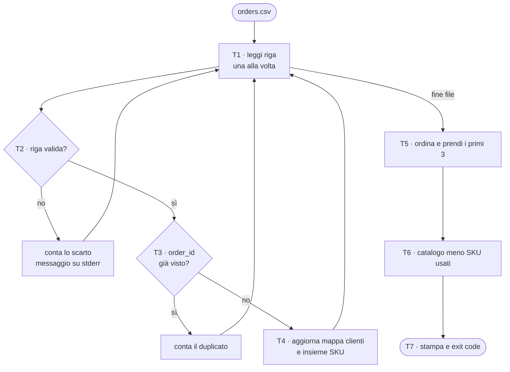
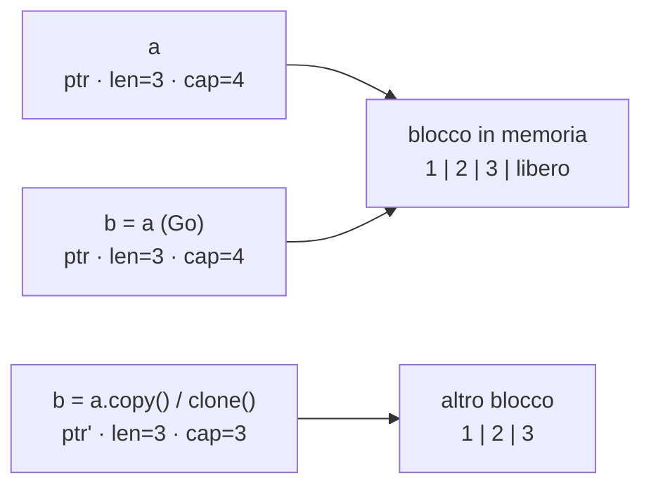
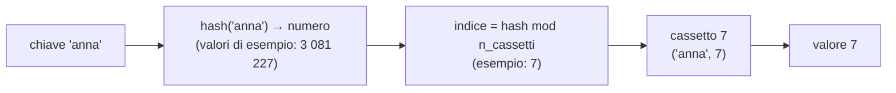
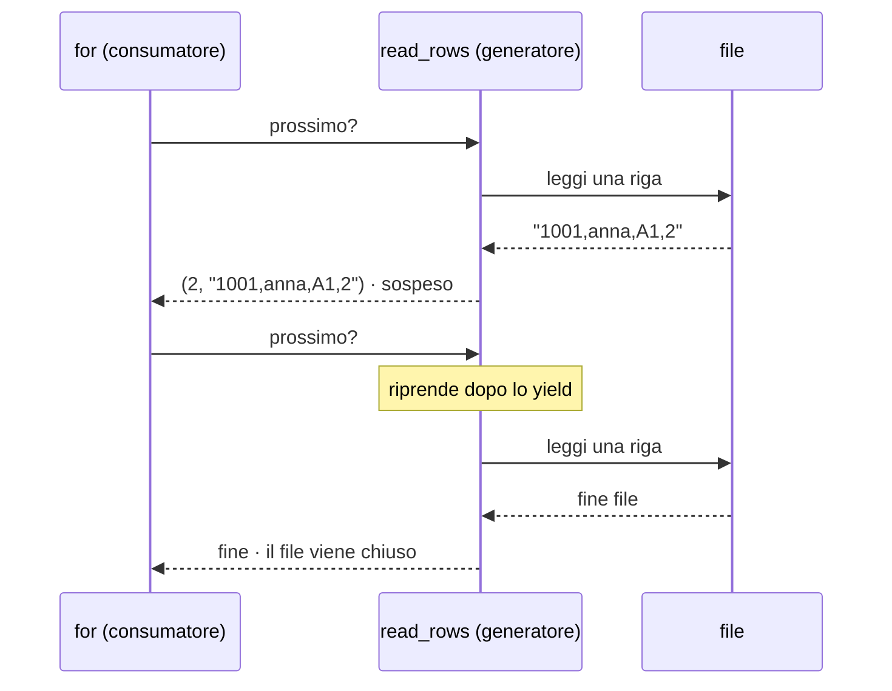
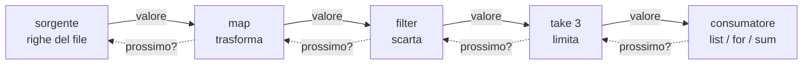
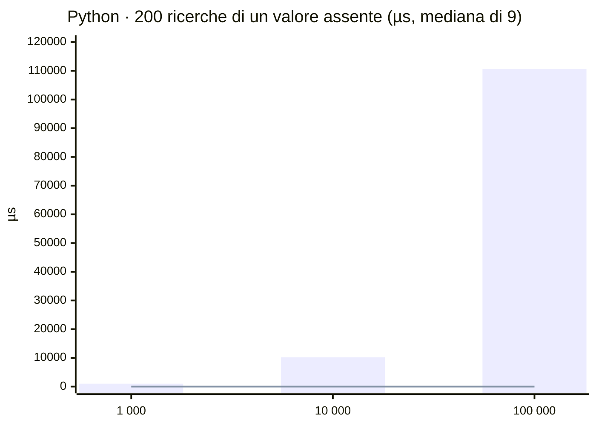
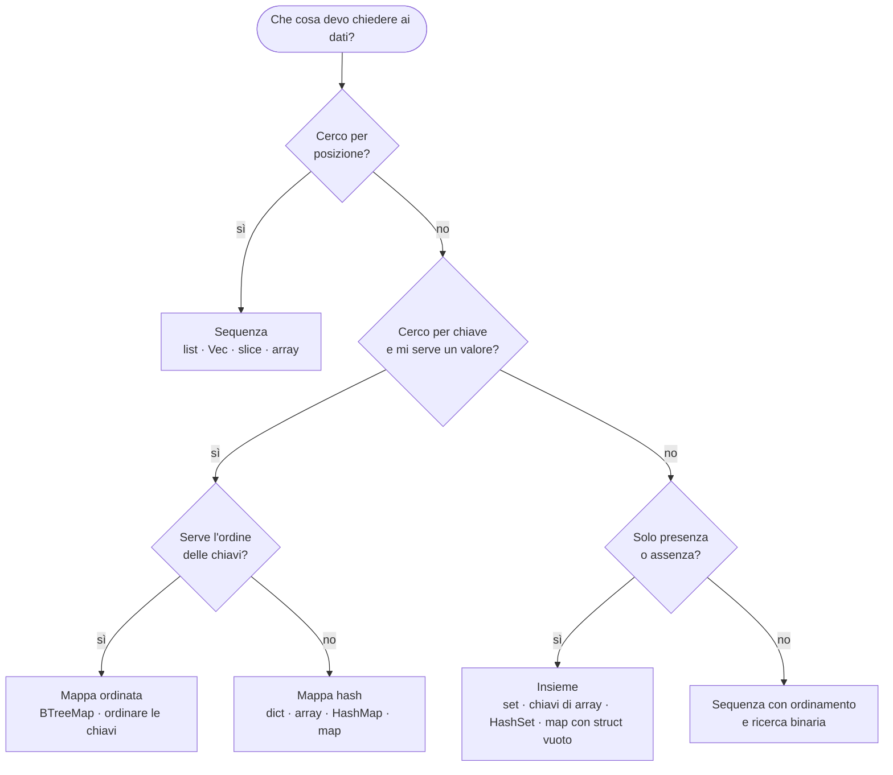
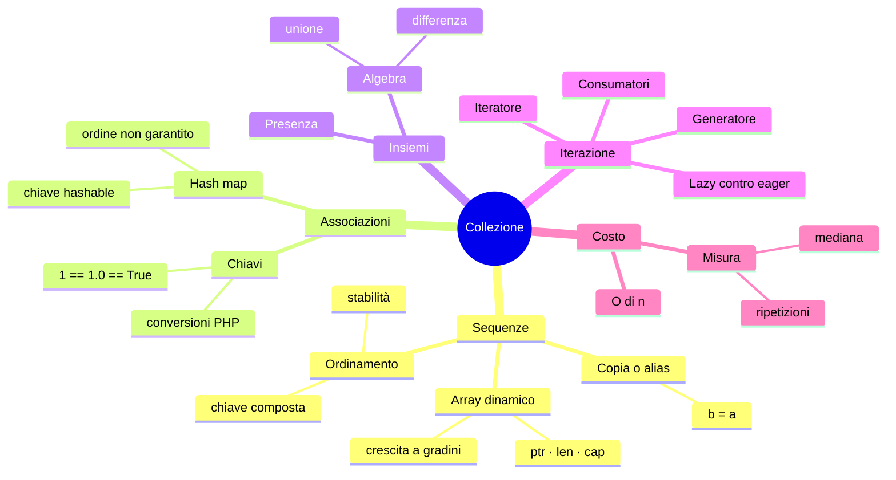

# C05 — Collezioni e iterazione

> **Parte I — Basi del linguaggio** · 4 lezioni (L05.1–L05.4) · 3 ore · capitolo senza addendum
> **Stato:** bozza 1 (2026-10-14). Codice eseguito e verificato su PHP 8.3.6, Python 3.13.16, Rust 1.97.0 (`rustc --edition 2024`), Go 1.24.7 (baseline del corso: PHP 8.4+, Go 1.25+: il codice non usa nulla di specifico delle versioni più recenti, da riverificare a stesura finale). Le misure della L05.4 sono state fatte in un container cloud condiviso: valgono per l'**andamento** (come cresce il tempo al crescere dei dati), non per i valori assoluti.

## Obiettivi

Al termine del capitolo si sa:

1. scegliere tra **sequenza**, **mappa** e **insieme** partendo dalla domanda che il programma deve porre ai dati, non dal nome del tipo;
2. spiegare che cosa c'è *dentro* un array dinamico (puntatore, lunghezza, capacità) e perché `b = a` significa cose diverse nei quattro linguaggi;
3. prevedere l'**ordine di iterazione** di una mappa e che cosa può fare da chiave;
4. usare **iteratori e generatori** per elaborare dati uno alla volta, e riconoscere quando una pipeline è *lazy* (pigra) e quando *eager* (immediata);
5. **misurare** invece di indovinare: leggere una complessità asintotica, confrontarla con tempi misurati e scegliere la struttura dati con un criterio.

Prerequisiti: C02 (valori e tipi), C03 (cicli, pattern matching), C04 (funzioni e closure: qui riusate come argomenti di `map`/`sorted`). Per chi viene dalla Parte P: CP2 (tabella di tracing) e CP4 (primo programma).

**Percorso per l'ingresso A (formato «primario + lettura»).** Si scrive il programma nel linguaggio primario; gli altri tre si leggono con le tabelle di confronto. Gli esperimenti e1–e7 sono brevi: riproducili uno alla volta e confronta l'output con quello riportato.

## Il problema reale

> Un negozio online riceve ogni notte un file `orders.csv`: una riga per ordine, con numero d'ordine, cliente, codice articolo (SKU) e quantità. Il file ha problemi: a volte la stessa riga arriva **due volte**, a volte la quantità è «x» o zero, a volte il cliente manca o lo SKU non esiste a catalogo. Il responsabile vuole sapere **quanti ordini sono validi**, quanti sono duplicati e quanti scartati (con il motivo, senza fermarsi), **quanti pezzi ha ordinato ciascun cliente**, quali sono i **tre clienti migliori** (a parità di pezzi, ordine alfabetico) e **quali articoli del catalogo non sono stati ordinati da nessuno**.

Il file di prova, usato in tutto il capitolo (15 righe di dati, di cui una duplicata e cinque da scartare):

```csv
order_id,customer,sku,qty
1001,anna,A1,2
1002,bruno,B2,1
1003,anna,C3,4
1004,carla,A1,3
1002,bruno,B2,1
1005,dario,B2,x
1006,bruno,E5,5
1007,,A1,1
1008,elena,Z9,2
1009,carla,C3,3
1010,anna,A1,1
1011,franco,B2,6
1012,bruno,A1
1013,elena,A1,0
1014,elena,E5,4
```

### Scomposizione

| Task | Che cosa fa | Collezione protagonista | Lezione |
|---|---|---|---|
| T1 | Legge le righe una alla volta, saltando l'intestazione e le righe vuote | iteratore / generatore | L05.3 |
| T2 | Spezza la riga nei campi e li valida; restituisce un ordine o un motivo di scarto | sequenza (i campi) | L05.1 |
| T3 | Riconosce gli ordini già visti (duplicati) | insieme di `order_id` | L05.2 |
| T4 | Somma i pezzi per cliente e raccoglie gli SKU distinti | mappa cliente → totale; insieme di SKU | L05.2 |
| T5 | Ordina i clienti (pezzi decrescenti, poi nome) e prende i primi tre | sequenza ordinata | L05.1 |
| T6 | Calcola gli articoli di catalogo mai ordinati | differenza tra insiemi | L05.2 |
| T7 | Stampa il riepilogo e fissa l'exit code (0 = tutto valido, 1 = ci sono scarti, 2 = file mancante) | — | — |



Il ciclo T1→T4 vede ogni riga **una volta sola** e tiene in memoria soltanto ciò che serve (id già visti, totali per cliente, SKU usati): non l'intero file. Questa è la ragione per cui T1 è un iteratore e non una lista di righe.

### Il programma, in anteprima

Output atteso (stdout, dopo i messaggi di scarto su stderr) ed exit code. È **identico nei quattro linguaggi**; il codice completo è nell'appendice.

```text
reject line=7 reason=qty
reject line=9 reason=empty
reject line=10 reason=sku
reject line=14 reason=fields
reject line=15 reason=qty
rows=15 valid=9 duplicates=1 rejected=5
customers=5 skus=4
top=anna:7,bruno:6,carla:6
unused_skus=D4,F6
[exit 1]
```

La lettura è lazy (T1), l'unico ordinamento (T5) lavora sui soli clienti, non sulle righe. Il resto del capitolo spiega le scelte, una collezione alla volta.

---

## L05.1 — Sequenze: array, list, Vec, slice

### Concetto

Una **sequenza** è una collezione di elementi **ordinati per posizione**: si chiede «qual è il terzo?» (indice), «quanti sono?» (lunghezza), «aggiungi in fondo». Il modo più comune di realizzarla è l'**array dinamico**: un blocco contiguo di memoria con un po' di spazio libero in fondo.

Un array dinamico ha tre informazioni: dove comincia il blocco (**puntatore**), quanti elementi contiene (**lunghezza**, *len*) e quanti ne potrebbe contenere prima di dover cambiare blocco (**capacità**, *cap*). Quando `len` raggiunge `cap`, l'aggiunta alloca un blocco più grande (di solito il doppio), copia gli elementi e rilascia il vecchio. Le singole copie sono costose, ma capitano sempre più di rado: per questo l'aggiunta in fondo è detta **O(1) ammortizzato**.



La domanda che separa i quattro linguaggi è: **che cosa succede quando scrivo `b = a`?** Si copia il blocco, si copia soltanto l'intestazione (puntatore, len, cap), oppure si «sposta» la proprietà?

### Implementazione

**e1 — `b = a` e poi modifico `b[0]`.** Python:

```python
a = [1, 2, 3]
b = a            # same list, two names
b[0] = 99
print("a =", a, " b =", b, " same object:", a is b)
c = a.copy()     # shallow copy: a new list
c[0] = 7
print("a =", a, " c =", c)
```

PHP:

```php
<?php
$a = [1, 2, 3];
$b = $a;         // by value (copy-on-write)
$b[0] = 99;
echo "a=", json_encode($a), " b=", json_encode($b), "\n";
```

Rust (con `clone`, la copia esplicita):

```rust
fn main() {
    let a = vec![1, 2, 3];
    let mut b = a.clone(); // `let mut b = a;` would MOVE a
    b[0] = 99;
    println!("a={:?} b={:?}", a, b);
}
```

Go (slice, array e `append` su capacità residua):

```go
package main

import "fmt"

func main() {
	a := []int{1, 2, 3}
	b := a // copies the slice header (ptr, len, cap), not the elements
	b[0] = 99
	fmt.Println("slice a =", a, " b =", b)

	x := [3]int{1, 2, 3}
	y := x // an ARRAY is copied entirely
	y[0] = 99
	fmt.Println("array x =", x, " y =", y)

	s := make([]int, 3, 4) // len 3, cap 4: room for one more
	t := append(s, 10)
	u := append(s, 20)
	fmt.Println("t[3] =", t[3], " u[3] =", u[3])
}
```

Output reale, nell'ordine Python, PHP, Rust, Go (e, per Rust, cosa succede senza `clone`):

```text
### e1.py
a = [99, 2, 3]  b = [99, 2, 3]  same object: True
a = [99, 2, 3]  c = [7, 2, 3]
[exit 0]
### e1.php
a=[1,2,3] b=[99,2,3]
[exit 0]
### e1.rs
a=[1, 2, 3] b=[99, 2, 3]
[exit 0]
### e1b.rs
error[E0382]: borrow of moved value: `a`
 --> e1b.rs:5:31
  |
2 |     let a = vec![1, 2, 3];
  |         - move occurs because `a` has type `Vec<i32>`, which does not implement the `Copy` trait
3 |     let mut b = a; // move
  |                 - value moved here
4 |     b[0] = 99;
5 |     println!("a={:?} b={:?}", a, b);
  |                               ^ value borrowed here after move
  |
help: consider cloning the value if the performance cost is acceptable
  |
3 |     let mut b = a.clone(); // move
  |                  ++++++++

error: aborting due to 1 previous error

For more information about this error, try `rustc --explain E0382`.
[exit 1]
### e1.go
slice a = [99 2 3]  b = [99 2 3]
array x = [1 2 3]  y = [99 2 3]
t[3] = 20  u[3] = 20
[exit 0]
```

Il risultato, riassunto:

| Linguaggio | `b = a` su una sequenza | Dopo `b[0] = 99`, `a[0]` è… |
|---|---|---|
| Python | `b` è un **secondo nome** per la stessa lista | 99 |
| PHP | copia **per valore** (in realtà *copy-on-write*: la copia vera avviene alla prima scrittura) | invariato |
| Rust | il valore è **spostato** in `b`; `a` non è più utilizzabile (errore E0382). Con `clone()` si ottiene una copia | invariato (con `clone`) |
| Go slice | si copia l'**intestazione**; il blocco è condiviso | 99 |
| Go array | si copia **tutto**: un array `[3]int` è un valore | invariato |

L'ultima riga dell'output Go mostra il caso più insidioso: `s` ha `len=3, cap=4`, quindi due `append` successivi su `s` scrivono **nella stessa cella libera**: `t[3]` e `u[3]` valgono entrambi 20. La regola pratica è assegnare sempre il risultato di `append` alla stessa variabile (`s = append(s, x)`) e non riusare la slice di partenza.

**e2 — la capacità cresce a gradini.** Python (`sys.getsizeof`, byte dell'oggetto lista), Rust (`capacity()`), Go (`cap()`):

```python
import sys
xs, last = [], -1
for i in range(40):
    xs.append(i)
    size = sys.getsizeof(xs)
    if size != last:
        print(f"len={len(xs):2d} bytes={size}")
        last = size
```

```rust
fn main() {
    let mut v: Vec<u64> = Vec::new();
    let mut last = usize::MAX;
    for i in 0..40 {
        v.push(i);
        if v.capacity() != last {
            println!("len={:2} cap={}", v.len(), v.capacity());
            last = v.capacity();
        }
    }
}
```

```go
package main

import "fmt"

func main() {
	var s []int
	last := -1
	for i := 0; i < 40; i++ {
		s = append(s, i)
		if cap(s) != last {
			fmt.Printf("len=%2d cap=%d\n", len(s), cap(s))
			last = cap(s)
		}
	}
}
```

```text
### e2.py
len= 1 bytes=88
len= 5 bytes=120
len= 9 bytes=184
len=17 bytes=248
len=25 bytes=312
len=33 bytes=376
[exit 0]
### e2.rs
len= 1 cap=4
len= 5 cap=8
len= 9 cap=16
len=17 cap=32
len=33 cap=64
[exit 0]
### e2.go
len= 1 cap=1
len= 2 cap=2
len= 3 cap=4
len= 5 cap=8
len= 9 cap=16
len=17 cap=32
len=33 cap=64
[exit 0]
```

Si vedono i gradini: Rust parte da 4 e raddoppia; Go parte da 1 e raddoppia (la crescita diventa meno aggressiva solo per slice molto grandi); Python sovralloca a piccoli passi (la lista passa da 88 a 120 byte al 5° elemento, poi a 184 al 9°). PHP non espone la capacità: il suo `array` è una **tabella hash ordinata** che, se le chiavi sono 0, 1, 2… senza buchi, viene tenuta in una forma compatta («packed») invisibile al programmatore.

**T2 e T5 nel programma.** In T2 la sequenza è il risultato di `split(",")`: quattro campi o motivo di scarto. In T5 serve una sequenza *ordinata*. Si ordina una coppia (cliente, totale) con **chiave composta**: prima il totale decrescente, poi il nome crescente.

**Python**

```python
def parse(line):
    """T2 - return (record, "") or (None, reason)."""
    parts = [p.strip() for p in line.split(",")]
    if len(parts) != 4:
        return None, "fields"
    oid, customer, sku, qty = parts
    if not oid or not customer:
        return None, "empty"
    if sku not in CATALOG:
        return None, "sku"
    if not (qty.isascii() and qty.isdigit()) or int(qty) == 0:
        return None, "qty"
    return (oid, customer, sku, int(qty)), ""

# T5 - top 3: more pieces first, then alphabetical
top = sorted(qty_by_customer.items(), key=lambda kv: (-kv[1], kv[0]))[:3]
# T6 - catalog minus used, sorted
unused = sorted(set(CATALOG) - used_skus)
```

**PHP**

```php
/** T2 - return [record, ''] or [null, reason]. */
function parse(string $line): array
{
    $parts = array_map('trim', explode(',', $line));
    if (count($parts) !== 4) {
        return [null, 'fields'];
    }
    [$oid, $customer, $sku, $qty] = $parts;
    if ($oid === '' || $customer === '') {
        return [null, 'empty'];
    }
    if (!in_array($sku, CATALOG, true)) {
        return [null, 'sku'];
    }
    if (!ctype_digit($qty) || (int)$qty === 0) {
        return [null, 'qty'];
    }
    return [[$oid, $customer, $sku, (int)$qty], ''];
}

// T5 - top 3: more pieces first, then alphabetical
$items = [];
foreach ($qtyByCustomer as $c => $q) {
    $items[] = [(string)$c, $q];
}
usort($items, fn(array $a, array $b) => [$b[1], $a[0]] <=> [$a[1], $b[0]]);
$top = array_slice($items, 0, 3);
// T6 - catalog minus used, sorted
$unused = array_diff(CATALOG, array_keys($usedSkus));
sort($unused);
```

**Rust**

```rust
/// T2 - Ok(order) or Err(reason).
fn parse(line: &str) -> Result<Order, &'static str> {
    let p: Vec<&str> = line.split(',').map(str::trim).collect();
    if p.len() != 4 {
        return Err("fields");
    }
    if p[0].is_empty() || p[1].is_empty() {
        return Err("empty");
    }
    if !CATALOG.contains(&p[2]) {
        return Err("sku");
    }
    if p[3].is_empty() || !p[3].bytes().all(|b| b.is_ascii_digit()) {
        return Err("qty");
    }
    let qty: u32 = p[3].parse().map_err(|_| "qty")?;
    if qty == 0 {
        return Err("qty");
    }
    Ok(Order { id: p[0].into(), customer: p[1].into(), sku: p[2].into(), qty })
}

// T5 - top 3: more pieces first, then alphabetical
let mut items: Vec<(&String, &u32)> = qty_by_customer.iter().collect();
items.sort_by(|a, b| b.1.cmp(a.1).then(a.0.cmp(b.0)));
let top: Vec<String> = items.iter().take(3).map(|(c, q)| format!("{c}:{q}")).collect();
// T6 - catalog minus used, sorted
let mut unused: Vec<&str> = CATALOG.iter().copied().filter(|s| !used_skus.contains(*s)).collect();
unused.sort();
```

**Go**

```go
// parse is T2 - returns the order or a rejection reason.
func parse(line string) (order, string) {
	p := strings.Split(line, ",")
	for i := range p {
		p[i] = strings.TrimSpace(p[i])
	}
	if len(p) != 4 {
		return order{}, "fields"
	}
	if p[0] == "" || p[1] == "" {
		return order{}, "empty"
	}
	known := false
	for _, s := range catalog {
		known = known || s == p[2]
	}
	if !known {
		return order{}, "sku"
	}
	if p[3] == "" || strings.Trim(p[3], "0123456789") != "" {
		return order{}, "qty"
	}
	qty, err := strconv.Atoi(p[3])
	if err != nil || qty == 0 {
		return order{}, "qty"
	}
	return order{p[0], p[1], p[2], qty}, ""
}

// T5 - top 3: more pieces first, then alphabetical
type kv struct {
	name string
	qty  int
}
items := make([]kv, 0, len(qtyByCustomer))
for c, q := range qtyByCustomer {
	items = append(items, kv{c, q})
}
sort.Slice(items, func(i, j int) bool {
	if items[i].qty != items[j].qty {
		return items[i].qty > items[j].qty
	}
	return items[i].name < items[j].name
})
if len(items) > 3 {
	items = items[:3]
}
top := make([]string, 0, 3)
for _, it := range items {
	top = append(top, fmt.Sprintf("%s:%d", it.name, it.qty))
}
// T6 - catalog minus used, sorted
var unused []string
for _, s := range catalog {
	if _, ok := usedSkus[s]; !ok {
		unused = append(unused, s)
	}
}
sort.Strings(unused)
```

Osservazioni:

- Python e Rust ordinano con una **chiave** (`key=lambda…` ) o un **comparatore** (`sort_by`), Go con `sort.Slice` (funzione «minore di» su indici), PHP con `usort` e l'operatore *spaceship* `<=>` applicato a due array `[totale decrescente, nome crescente]`. È una closure di C04 passata come argomento.
- `sorted` (Python) restituisce una **nuova** lista; `.sort()`, `sort_by`, `sort.Slice`, `usort` ordinano **sul posto**. Il PHP `usort` modifica la variabile passata (è per riferimento).
- Gli ordinamenti dei quattro linguaggi sono **stabili** o meno? Python: sì (garantito). Rust: `sort_by` stabile, `sort_unstable_by` no. Go: `sort.Slice` **non** è stabile (esiste `sort.SliceStable`). PHP ≥ 8.0: stabile. Qui non conta, perché la chiave (totale, nome) è unica per cliente: è un esempio del perché conviene sempre una chiave che renda l'ordine **totale**.

### Focus comparativo

| Aspetto | PHP | Python | Rust | Go |
|---|---|---|---|---|
| Tipo di base | `array` (hash ordinata) | `list` | `Vec<T>` (e `[T; N]` a dimensione fissa) | slice `[]T` (e array `[N]T`) |
| Elementi omogenei? | No | No | **Sì** (un solo `T`) | **Sì** |
| `b = a` | copia (COW) | alias | move | copia dell'intestazione (slice) |
| Indice fuori limite | Warning + `null` | `IndexError` | **panic** (o `get()` → `Option`) | **panic** |
| Aggiunta in fondo | `$a[] = x` | `a.append(x)` | `v.push(x)` | `s = append(s, x)` |

### Esercizio Rosetta (4′)

Scrivi, nel tuo linguaggio primario, una funzione che riceve una lista di interi e ne restituisce **una copia** con il primo elemento sostituito da 0, **senza modificare l'originale**. Poi verifica con un `print` prima e dopo. (Attenzione: in Python e in Go la scorciatoia `b = a` non funziona.)

---

## L05.2 — Mappe e set

### Concetto

Una **mappa** (dizionario, *hash map*) associa una **chiave** a un **valore** e risponde a «dammi il valore di questa chiave» in tempo medio costante. Un **insieme** (*set*) ricorda soltanto **se** un elemento è presente: è una mappa senza valori. Entrambi si basano su una **tabella hash**: la chiave viene trasformata da una funzione di *hash* in un numero, che indica in quale «cassetto» cercare.



Due conseguenze guidano tutto il resto:

1. **La chiave deve avere un hash stabile**, quindi non può cambiare dopo l'inserimento: per questo una lista Python non può essere chiave (`unhashable type`).
2. **L'ordine dei cassetti non ha relazione con l'ordine di inserimento**, a meno che la struttura non tenga una lista a parte per ricordarlo: lo fanno Python (dal 3.7 come garanzia del linguaggio) e PHP; non lo fanno Go e la `HashMap` di Rust.

Nel programma, tre domande diverse usano tre collezioni diverse:

| Domanda | Collezione | Operazione chiave |
|---|---|---|
| «Ho già visto questo `order_id`?» (T3) | insieme | inserisci e verifica presenza |
| «Quanti pezzi ha ordinato questo cliente?» (T4) | mappa cliente → intero | leggi-o-zero, somma, riscrivi |
| «Quali SKU del catalogo non compaiono tra quelli usati?» (T6) | differenza tra insiemi | catalogo − usati |

### Implementazione

T3 e T4 sono il cuore del ciclo; T6 è una sola riga di algebra tra insiemi.

**Python**

```python
seen = set()           # T3 - order ids already counted
qty_by_customer = {}   # T4 - customer -> total pieces
used_skus = set()      # T4 - distinct SKUs ordered
rows = valid = dup = rejected = 0
for n, line in read_rows(path):
    rows += 1
    rec, reason = parse(line)
    if rec is None:
        rejected += 1
        print(f"reject line={n} reason={reason}", file=sys.stderr)
        continue
    oid, customer, sku, qty = rec
    if oid in seen:
        dup += 1
        continue
    seen.add(oid)
    valid += 1
    qty_by_customer[customer] = qty_by_customer.get(customer, 0) + qty
    used_skus.add(sku)
```

**PHP**

```php
$seen = [];          // T3 - order ids already counted (keys used as a set)
$qtyByCustomer = []; // T4 - customer => total pieces
$usedSkus = [];      // T4 - distinct SKUs ordered (keys used as a set)
$rows = $valid = $dup = $rejected = 0;
foreach (readRows($path) as $n => $line) {
    $rows++;
    [$rec, $reason] = parse($line);
    if ($rec === null) {
        $rejected++;
        fwrite(STDERR, "reject line=$n reason=$reason\n");
        continue;
    }
    [$oid, $customer, $sku, $qty] = $rec;
    if (isset($seen[$oid])) {
        $dup++;
        continue;
    }
    $seen[$oid] = true;
    $valid++;
    $qtyByCustomer[$customer] = ($qtyByCustomer[$customer] ?? 0) + $qty;
    $usedSkus[$sku] = true;
}
```

**Rust**

```rust
let mut seen: HashSet<String> = HashSet::new(); // T3 - order ids already counted
let mut qty_by_customer: HashMap<String, u32> = HashMap::new(); // T4
let mut used_skus: HashSet<String> = HashSet::new(); // T4
let (mut rows, mut valid, mut dup, mut rejected) = (0, 0, 0, 0);
for (n, line) in read_rows(path)? {
    rows += 1;
    let o = match parse(&line) {
        Ok(o) => o,
        Err(reason) => {
            rejected += 1;
            eprintln!("reject line={n} reason={reason}");
            continue;
        }
    };
    if !seen.insert(o.id) {
        dup += 1;
        continue;
    }
    valid += 1;
    *qty_by_customer.entry(o.customer).or_insert(0) += o.qty;
    used_skus.insert(o.sku);
}
```

**Go**

```go
seen := map[string]struct{}{}     // T3 - order ids already counted
qtyByCustomer := map[string]int{} // T4 - customer -> total pieces
usedSkus := map[string]struct{}{} // T4 - distinct SKUs ordered
var nRows, valid, dup, rejected int
for n, line := range rows {
	nRows++
	o, reason := parse(line)
	if reason != "" {
		rejected++
		fmt.Fprintf(os.Stderr, "reject line=%d reason=%s\n", n, reason)
		continue
	}
	if _, ok := seen[o.id]; ok {
		dup++
		continue
	}
	seen[o.id] = struct{}{}
	valid++
	qtyByCustomer[o.customer] += o.qty
	usedSkus[o.sku] = struct{}{}
}
```

Si noti come ciascun linguaggio esprime **«somma al totale, partendo da zero se il cliente è nuovo»**:

- Python: `d.get(k, 0) + qty` e riscrittura; esiste anche `collections.defaultdict(int)` e `Counter`.
- PHP: `($d[$k] ?? 0) + $qty` (l'operatore `??` evita il warning sulla chiave assente).
- Rust: `*map.entry(k).or_insert(0) += qty` — l'API `entry` fa **una sola ricerca** e restituisce un riferimento al valore da modificare.
- Go: `m[k] += qty` — grazie agli **zero values** (C02) la chiave assente vale già 0; nessun codice speciale.

Per gli insiemi: Python ha il tipo `set`; Rust `HashSet` (con `insert` che restituisce `bool`, usato in T3 per riconoscere i duplicati in un colpo solo); Go non ha un tipo set e usa `map[T]struct{}` (`struct{}` occupa zero byte); PHP usa le **chiavi** di un array come insieme (`$seen[$oid] = true`, `isset`).

Per T6:

| Linguaggio | Differenza tra insiemi |
|---|---|
| Python | `set(CATALOG) - used_skus` |
| PHP | `array_diff(CATALOG, array_keys($usedSkus))` |
| Rust | `CATALOG.iter().filter(\|s\| !used_skus.contains(*s))` |
| Go | ciclo sul catalogo con `if _, ok := usedSkus[s]; !ok` |

Python e PHP hanno l'operazione pronta; Rust e Go chiedono di scrivere il filtro. Una differenza di *libreria standard*, non di concetto.

### Tre esperimenti sulle mappe

**e3 — in che ordine escono le chiavi?** Inserisco `b, a, c, z` (con una cancellazione e reinserimento di `b` in Python e PHP) e stampo le chiavi.

```python
d = {"b": 1, "a": 2, "c": 3}
d["z"] = 4
del d["b"]
d["b"] = 5
print(list(d))
```

```php
<?php
$d = ['b' => 1, 'a' => 2, 'c' => 3];
$d['z'] = 4;
unset($d['b']);
$d['b'] = 5;
echo implode(',', array_keys($d)), "\n";
```

```rust
use std::collections::HashMap;
fn main() {
    let mut d = HashMap::new();
    for (k, v) in [("b", 1), ("a", 2), ("c", 3), ("z", 4)] {
        d.insert(k, v);
    }
    let keys: Vec<_> = d.keys().collect();
    println!("{:?}", keys);
}
```

```go
package main

import "fmt"

func main() {
	d := map[string]int{"b": 1, "a": 2, "c": 3, "z": 4}
	for k := range d {
		fmt.Print(k, " ")
	}
	fmt.Println()
}
```

```text
### e3.py
['a', 'c', 'z', 'b']
[exit 0]
### e3.php
a,c,z,b
[exit 0]
# rust x3
["a", "c", "b", "z"]
["a", "b", "z", "c"]
["c", "b", "z", "a"]
# go x3
b a c z 
b a c z 
b a c z 
```

Python e PHP restituiscono l'ordine di inserimento (la chiave cancellata e reinserita finisce in fondo). Rust ha prodotto **tre ordini diversi in tre esecuzioni** dello stesso programma: la `HashMap` standard usa un seme casuale per processo (difesa contro attacchi basati su collisioni). Go ha stampato lo stesso ordine nelle prime tre esecuzioni; ripetendo il programma dodici volte sono comparsi **quattro ordini diversi** (`b a c z` otto volte, poi `a c z b`, `c z b a`, `z b a c`). Conclusione operativa: **mai** basarsi sull'ordine di una mappa in Go e Rust; se serve un ordine, si ordina (come in T5) oppure si usa `BTreeMap` in Rust (ordinata per chiave). Go non ha mappe ordinate nella libreria standard.

**e4 — che cosa può fare da chiave, e che cosa succede quando due chiavi «sembrano» uguali.**

```python
d = {}
d[1] = "int"
d[1.0] = "float"
d[True] = "bool"
print(d, len(d))
try:
    d[[1, 2]] = "list"
except TypeError as e:
    print("TypeError:", e)
```

```php
<?php
$d = [];
$d["1"] = "string 1";
$d[1] = "int 1";
$d[1.7] = "float 1.7";
$d[true] = "bool";
$d["01"] = "string 01";
var_dump($d);
```

```rust
use std::collections::HashMap;
fn main() {
    let mut d: HashMap<i64, &str> = HashMap::new();
    d.insert(1, "int");
    d.insert(1.0, "float");
    println!("{}", d.len());
}
```

```go
package main

import "fmt"

func main() {
	d := map[any]string{}
	d[1] = "int"
	d[1.0] = "float64"
	d[true] = "bool"
	fmt.Println(len(d))
	d[[]int{1, 2}] = "slice"
}
```

Python:

```text
{1: 'bool'} 1
TypeError: unhashable type: 'list'
```

PHP (`var_dump`):

```text
array(2) {
  [1]=>
  string(4) "bool"
  ["01"]=>
  string(9) "string 01"
}
```

Rust (a compilazione):

```text
error[E0308]: mismatched types
 --> e4.rs:5:14
  |
5 |     d.insert(1.0, "float");
  |       ------ ^^^ expected `i64`, found floating-point number
  |       |
  |       arguments to this method are incorrect
  |
note: method defined here
```

Go:

```text
3
panic: runtime error: hash of unhashable type []int
```

Quattro filosofie in quattro righe:

- **Python:** `1`, `1.0` e `True` sono **uguali** (e hanno lo stesso hash), quindi sono la stessa chiave: la mappa ne contiene una sola, con la chiave originale `1` e l'ultimo valore. Una lista non è «hashable».
- **PHP:** le chiavi possono essere solo `int` o `string`. `"1"`, `1`, `1.7` e `true` vengono tutti **convertiti** nell'intero `1` (stessa chiave, ultimo valore: `"bool"`), mentre `"01"` resta stringa. È la *type juggling* di C02 applicata alle chiavi: nei programmi con identificatori numerici, `"1001"` diventa la chiave intera `1001`. Il comportamento dei decimali (`1.7`) può produrre un avviso di deprecazione a seconda del livello di `error_reporting`; nella prova non è comparso.
- **Rust:** la mappa è tipata (`HashMap<i64, &str>`): una chiave `f64` è un **errore di compilazione**. Nemmeno `f64` può essere chiave in generale, perché non implementa `Eq` e `Hash` (NaN ≠ NaN).
- **Go:** `map[any]string` accetta chiavi di tipo diverso (`1` int, `1.0` float64, `true` bool: **3** chiavi, perché confronta anche il tipo), ma una slice come chiave **compila e va in panic a runtime** (`hash of unhashable type`). Con una chiave tipata, `map[string]int`, la slice sarebbe un errore di compilazione.

**e6 — modificare una collezione mentre la si percorre.**

```python
d = {"a": 1, "b": 2, "c": 3}
try:
    for k in d:
        if d[k] == 2:
            del d[k]
except RuntimeError as e:
    print("RuntimeError:", e)
d = {k: v for k, v in d.items() if v != 2}
print(d)
```

```php
<?php
$a = ['a' => 1, 'b' => 2, 'c' => 3];
foreach ($a as $k => $v) {
    if ($v === 2) { unset($a[$k]); }
}
echo json_encode($a), "\n";
$b = [1, 2, 3];
foreach ($b as $v) { if ($v === 1) { $b[] = 99; } }
echo json_encode($b), "\n";
```

```rust
fn main() {
    let mut v = vec![1, 2, 3];
    for x in &v {
        if *x == 2 {
            v.push(99);
        }
    }
    println!("{:?}", v);
}
```

```rust
fn main() {
    let mut v = vec![1, 2, 3];
    v.retain(|&x| x != 2);
    println!("{:?}", v);
}
```

```go
package main

import "fmt"

func main() {
	m := map[string]int{"a": 1, "b": 2, "c": 3}
	for k, v := range m {
		if v == 2 {
			delete(m, k)
		}
	}
	fmt.Println(m)
	s := []int{1, 2, 3}
	for i, x := range s {
		if x == 1 {
			s = append(s, 99)
		}
		_ = i
	}
	fmt.Println(s)
}
```

```text
### e6.py
RuntimeError: dictionary changed size during iteration
{'a': 1, 'c': 3}
[exit 0]
### e6.php
{"a":1,"c":3}
[1,2,3,99]
[exit 0]
### e6.rs
error[E0502]: cannot borrow `v` as mutable because it is also borrowed as immutable
 --> e6.rs:5:13
  |
3 |     for x in &v {
  |              --
  |              |
  |              immutable borrow occurs here
  |              immutable borrow later used here
4 |         if *x == 2 {
5 |             v.push(99);
  |             ^^^^^^^^^^ mutable borrow occurs here

error: aborting due to 1 previous error

For more information about this error, try `rustc --explain E0502`.
[exit 1]
### e6ok.rs
[1, 3]
[exit 0]
### e6.go
map[a:1 c:3]
[1 2 3 99]
[exit 0]
```

| Linguaggio | Cancellare/aggiungere durante il ciclo | Quando lo scopre |
|---|---|---|
| Python | `RuntimeError: dictionary changed size during iteration` (per le liste: nessun errore, ma salta elementi) | runtime |
| PHP | `foreach` lavora su una **copia** (COW): niente errore, il ciclo non vede le modifiche | mai (comportamento definito) |
| Rust | errore **E0502**: non si può prendere un prestito mutabile mentre esiste uno immutabile; si usa `retain` | **compilazione** |
| Go | cancellare da una mappa durante `range` è ammesso; `range` su slice valuta la lunghezza una volta sola | mai (comportamento definito) |

La regola didattica è la stessa in tutti: **non si modifica ciò che si sta percorrendo**; si costruisce una nuova collezione (comprehension, `filter`, `retain`) oppure si raccolgono le chiavi da togliere e le si toglie dopo. Solo Rust trasforma la regola in un errore del compilatore (C10 spiega il perché).

### Focus comparativo

| Aspetto | PHP | Python | Rust | Go |
|---|---|---|---|---|
| Mappa | `array` | `dict` | `HashMap`, `BTreeMap` (ordinata) | `map` |
| Insieme | chiavi di array | `set`, `frozenset` | `HashSet`, `BTreeSet` | `map[T]struct{}` |
| Ordine di iterazione | inserimento | inserimento (garantito) | **non definito** (`HashMap`); per chiave (`BTreeMap`) | **volutamente casuale** |
| Chiavi ammesse | solo `int` e `string` (con conversioni) | qualsiasi oggetto hashable | qualsiasi `T: Eq + Hash` | tipi confrontabili (no slice, map, funzioni) |
| Chiave assente | `null` + warning (o `??`) | `KeyError` (o `.get`) | `Option` (`get`) | valore zero (o `v, ok :=`) |
| Operazioni su insiemi | `array_diff`, `array_intersect` | `-`, `&`, `\|`, `^` | `difference`, `intersection`, `union` | da scrivere |

### Esercizio Rosetta (4′)

Dato l'elenco `["anna", "bruno", "anna", "carla", "bruno", "anna"]`, stampa **quante volte compare ciascun nome**, in ordine alfabetico (`anna:3`, `bruno:2`, `carla:1`). Il risultato deve essere lo stesso in tutti i linguaggi: ricorda e3.

---

## L05.3 — Iteratori, generatori, lazy evaluation

### Concetto

Un **iteratore** è un oggetto che sa rispondere a una sola domanda: «dammi il prossimo elemento, se c'è». Non conosce i successivi, non ricorda i precedenti. Il ciclo `for` non fa altro che chiedere «prossimo?» finché la risposta non è «finito».

Questo modello ha due vantaggi che T1 sfrutta:

1. **Memoria costante.** Un file di dieci milioni di righe si elabora tenendo in memoria una riga alla volta.
2. **Calcolo su richiesta (*lazy*).** Una catena `map → filter → take` fa il lavoro solo per gli elementi che il consumatore finale chiede davvero; con `take(1)` basta un solo elemento della sorgente.

Un **generatore** è il modo più comodo di scrivere un iteratore: una funzione che, invece di `return`, usa `yield` e **sospende** la propria esecuzione, ricordando dove era arrivata, fino alla richiesta successiva.



Un ciclo `for` su una **collezione** (lista, mappa) e uno su un **iteratore** hanno lo stesso aspetto ma costi diversi: la collezione esiste tutta in memoria, l'iteratore produce un elemento per volta e, di norma, si può percorrere **una volta sola**.

### Implementazione

Questo è T1: la lettura lazy del file. In tutti i linguaggi la riga di intestazione e le righe vuote sono saltate, e il numero di riga è prodotto insieme al testo.

**Python**

```python
def read_rows(path):
    """T1 - lazy: yield (line_number, text) one row at a time, header skipped."""
    with open(path, encoding="utf-8") as f:
        next(f, None)
        for n, line in enumerate(f, start=2):
            line = line.strip()
            if line:
                yield n, line
```

**PHP**

```php
/** T1 - lazy: yield line_number => text one row at a time, header skipped. */
function readRows(string $path): Generator
{
    $f = @fopen($path, 'rb');
    if ($f === false) {
        throw new RuntimeException("cannot open $path");
    }
    try {
        fgets($f); // header
        $n = 1;
        while (($line = fgets($f)) !== false) {
            $n++;
            $line = trim($line);
            if ($line !== '') {
                yield $n => $line;
            }
        }
    } finally {
        fclose($f);
    }
}
```

**Rust**

```rust
/// T1 - lazy: an iterator of (line_number, text), header skipped.
fn read_rows(path: &str) -> std::io::Result<impl Iterator<Item = (usize, String)>> {
    let f = File::open(path)?;
    Ok(BufReader::new(f)
        .lines()
        .enumerate()
        .skip(1)
        .filter_map(|(i, l)| {
            let t = l.ok()?.trim().to_string();
            if t.is_empty() { None } else { Some((i + 1, t)) }
        }))
}
```

**Go**

```go
// readRows is T1 - lazy: an iter.Seq2 of (line_number, text), header skipped.
func readRows(path string) (iter.Seq2[int, string], error) {
	f, err := os.Open(path)
	if err != nil {
		return nil, err
	}
	return func(yield func(int, string) bool) {
		defer f.Close()
		sc := bufio.NewScanner(f)
		for n := 1; sc.Scan(); n++ {
			t := strings.TrimSpace(sc.Text())
			if n == 1 || t == "" {
				continue
			}
			if !yield(n, t) {
				return
			}
		}
	}, nil
}
```

Come ciascun linguaggio realizza l'idea:

- **Python:** funzione con `yield` (generatore). Il `with` chiude il file anche se il consumatore si ferma prima.
- **PHP:** funzione con `yield` (`Generator`), con chiave e valore (`yield $n => $line`); la chiusura del file è in un `finally`.
- **Rust:** nessuna sintassi `yield` stabile: si restituisce un `impl Iterator` componendo adattatori (`lines().enumerate().skip(1).filter_map(…)`). La chiusura del file avviene quando l'iteratore viene rilasciato (*drop*, C10).
- **Go:** dalla 1.23 le funzioni «iteratore» (`iter.Seq`, `iter.Seq2`) sono funzioni che ricevono una callback `yield`; `for n, line := range rows` ne consuma i valori. Se il ciclo esce con `break`, `yield` restituisce `false` e la funzione termina (e con `defer` chiude il file).

Nota sul file mancante: in Python e PHP il generatore parte solo alla prima richiesta, quindi l'errore di apertura si manifesta *dentro* il ciclo e va intercettato fuori da esso (`FileNotFoundError`, `RuntimeException`); in Rust e Go la funzione restituisce l'errore subito (`io::Result`, `error`). Tutti e quattro finiscono con exit code 2.

### Un esperimento: chi è davvero lazy?

**e5 — `map` con un effetto collaterale visibile** (una `print` dentro la funzione). Se l'effetto compare subito, il `map` è eager; se compare solo quando chiedo il primo elemento, è lazy.

```python
def noisy(x):
    print("map saw", x)
    return x * 2

xs = [1, 2, 3]
m = map(noisy, xs)
print("map created, nothing printed yet")
first = next(m)
print("first =", first)
rest = list(m)
print("rest =", rest)
```

```php
<?php
function noisy(int $x): int { echo "saw $x\n"; return $x * 2; }
$xs = [1, 2, 3];
$eager = array_map('noisy', $xs);
echo "array_map done\n";

function lazy(iterable $it): Generator { foreach ($it as $x) yield noisy($x); }
$g = lazy($xs);
echo "generator created\n";
echo "first = ", $g->current(), "\n";
```

```rust
fn noisy(x: i32) -> i32 {
    println!("saw {x}");
    x * 2
}
fn main() {
    let xs = [1, 2, 3];
    let m = xs.iter().map(|&x| noisy(x));
    println!("map created");
    let v: Vec<i32> = m.take(1).collect();
    println!("first = {:?}", v);
}
```

```go
package main

import (
	"fmt"
	"iter"
)

func noisy(x int) int { fmt.Println("saw", x); return x * 2 }

func Map(xs []int, f func(int) int) iter.Seq[int] {
	return func(yield func(int) bool) {
		for _, x := range xs {
			if !yield(f(x)) {
				return
			}
		}
	}
}

func main() {
	m := Map([]int{1, 2, 3}, noisy)
	fmt.Println("Seq created")
	for v := range m {
		fmt.Println("first =", v)
		break
	}
}
```

```text
### e5.py
map created, nothing printed yet
map saw 1
first = 2
map saw 2
map saw 3
rest = [4, 6]
[exit 0]
### e5.php
saw 1
saw 2
saw 3
array_map done
generator created
first = saw 1
2
[exit 0]
### e5.rs
map created
saw 1
first = [2]
[exit 0]
### e5unused.rs
warning: unused `Map` that must be used
 --> e5unused.rs:3:5
  |
3 |     xs.iter().map(|x| println!("saw {x}"));
  |     ^^^^^^^^^^^^^^^^^^^^^^^^^^^^^^^^^^^^^^
  |
  = note: iterators are lazy and do nothing unless consumed
  = note: `#[warn(unused_must_use)]` (part of `#[warn(unused)]`) on by default
help: use `let _ = ...` to ignore the resulting value
  |
3 |     let _ = xs.iter().map(|x| println!("saw {x}"));
  |     +++++++

warning: `Iterator::map` call that discard the iterator's values
 --> e5unused.rs:3:15
  |
3 |     xs.iter().map(|x| println!("saw {x}"));
  |               ^^^^-----------------------^
  |               |   |
  |               |   this function returns `()`, which is likely not what you wanted
  |               |   called `Iterator::map` with callable that returns `()`
  |               after this call to map, the resulting iterator is `impl Iterator<Item = ()>`, which means the only information carried by the iterator is the number of items
  |
  = note: `Iterator::map`, like many of the methods on `Iterator`, gets executed lazily, meaning that its effects won't be visible until it is iterated
  = note: `#[warn(map_unit_fn)]` (part of `#[warn(unused)]`) on by default
help: you might have meant to use `Iterator::for_each`
  |
3 -     xs.iter().map(|x| println!("saw {x}"));
3 +     xs.iter().for_each(|x| println!("saw {x}"));
  |

warning: 2 warnings emitted

[exit 0]
### e5.go
Seq created
saw 1
first = 2
[exit 0]
```

Risultato, in sintesi:

| Linguaggio | Costrutto | Eager o lazy |
|---|---|---|
| Python | `map(f, xs)` | **lazy**: nessuna stampa fino a `next()`; poi una per volta |
| PHP | `array_map` | **eager**: tre stampe prima di tornare. Il generatore `lazy()` invece è lazy |
| Rust | `iter().map(…)` | **lazy**, e il compilatore avvisa se non lo si consuma (vedi sotto) |
| Go | `iter.Seq` costruito a mano | **lazy**: dopo il primo valore il `break` interrompe tutto |

Rust segnala con un *warning* il caso tipico di errore, cioè costruire una catena e non consumarla mai:

```text
warning: unused `Map` that must be used
 --> e5unused.rs:3:5
  |
3 |     xs.iter().map(|x| println!("saw {x}"));
  |     ^^^^^^^^^^^^^^^^^^^^^^^^^^^^^^^^^^^^^^
  |
  = note: iterators are lazy and do nothing unless consumed
  = note: `#[warn(unused_must_use)]` (part of `#[warn(unused)]`) on by default
help: use `let _ = ...` to ignore the resulting value
  |
```

(Il messaggio originale continua suggerendo `for_each`.) Il tipo `Map` «deve essere usato»: senza un consumatore (`collect`, `sum`, `for`…) non succede nulla.

### Pipeline lazy e consumatori

Un'altra immagine utile: una pipeline lazy è una **catena di richieste che risalgono**. Il consumatore chiede al penultimo anello, questo al precedente, fino alla sorgente; poi i valori ridiscendono.



Gli adattatori (`map`, `filter`, `take`, `enumerate`, `zip`, `skip`…) non fanno nulla da soli: i **consumatori** (`list`, `sum`, `collect`, `for`, `min`, `sorted`…) avviano il flusso. Due precauzioni:

- Un iteratore si **esaurisce**: in Python, `list(m)` una seconda volta restituisce `[]`. Se servono più passate, si materializza una lista.
- Un generatore tiene aperte le sue risorse finché non è finito o scartato: per questo il `with`/`finally`/`defer` dentro `read_rows`.

### Focus comparativo

| Aspetto | PHP | Python | Rust | Go |
|---|---|---|---|---|
| Generatore con `yield` | ● | ● | ○ (stabile: adattatori; i blocchi `gen` non erano stabili alla stesura) | ◐ `iter.Seq` + callback |
| Protocollo | `Iterator`, `IteratorAggregate`, `Traversable` | `__iter__` / `__next__` | trait `Iterator` (`next() -> Option<T>`) | `func(yield func(T) bool)` |
| Comprehension | ○ (`array_map`, `array_filter`: eager) | ● `[x for …]`, generator expression | ◐ catena + `collect` | ○ |
| `map`/`filter` di libreria | eager su array | lazy | lazy | non nella stdlib per iteratori |
| Iteratore riusabile? | generatore: no | generatore: no | dipende (`iter()` ne crea uno nuovo) | dipende: la `Seq` di `readRows` no (chiude il file); una `Seq` su una slice sì |

### Esercizio Rosetta (4′)

Scrivi un generatore (o l'equivalente) `numeri_pari(limite)` che produce i numeri pari fino a `limite` **senza costruire una lista**, e stampa i primi 5 con un consumatore che si ferma da solo. Poi sostituisci il generatore con una funzione che costruisce la lista completa per `limite = 10 000 000` e confronta l'uso di memoria (in Python: `sys.getsizeof` della lista contro l'oggetto generatore).

---

## L05.4 — Complessità e scelta della struttura dati

### Concetto

La **complessità** descrive come cresce il lavoro al crescere di *n*, il numero di elementi. Si scrive con la notazione **O grande**: `O(1)` costante, `O(log n)` logaritmica, `O(n)` lineare, `O(n log n)`, `O(n²)`. È un'idea di *andamento*: dice che cosa succede quando i dati diventano dieci volte più grandi, non quanti millisecondi servono.

| Operazione | Sequenza (array dinamico) | Mappa / set hash | Mappa ordinata (`BTreeMap`) |
|---|---|---|---|
| Accesso per indice | O(1) | — | — |
| Ricerca di un valore / chiave | **O(n)** (scansione) | **O(1)** medio | O(log n) |
| Aggiunta in fondo | O(1) ammortizzato | O(1) medio | O(log n) |
| Inserimento in testa o in mezzo | O(n) (sposta gli altri) | — | — |
| Cancellazione di un valore | O(n) | O(1) medio | O(log n) |
| Percorrere tutto | O(n) | O(n) | O(n), in ordine di chiave |
| Ordinare | O(n log n) | — | già ordinata |

«Medio» è importante: una tabella hash degrada a O(n) nel caso peggiore, con molte collisioni; per questo i linguaggi usano funzioni di hash robuste (e Rust un seme casuale, come visto in e3).

Un'altra precisazione: **O(1) non significa veloce**, significa che non dipende da *n*. Una ricerca in hash costa il calcolo dell'hash e un accesso casuale in memoria; per sequenze molto piccole una scansione lineare può essere più rapida. La complessità serve per capire chi *vince al crescere dei dati*; la misura serve per sapere *da quanto*.

### Un esperimento misurato

**e7 — 200 ricerche di un valore assente** (il caso peggiore per la scansione: la lista va percorsa tutta) in una lista e in un insieme, con *n* = 1 000, 10 000, 100 000. Per ogni configurazione: 9 ripetizioni, si riporta la **mediana** in microsecondi per le 200 ricerche. Rust compilato con `-O` (senza ottimizzazioni il codice Rust è molto più lento: in C00, su un altro programma, circa 9 volte) e con `black_box`, che impedisce al compilatore di eliminare le ricerche perché il risultato non è usato.

```python
import statistics, time

LOOKUPS = 200
for n in (1_000, 10_000, 100_000):
    as_list = list(range(n))
    as_set = set(as_list)
    absent = [-1 - i for i in range(LOOKUPS)]   # worst case: never found
    res = {}
    for name, coll in (("list", as_list), ("set", as_set)):
        runs = []
        for _ in range(9):
            t0 = time.perf_counter()
            for x in absent:
                _ = x in coll
            runs.append((time.perf_counter() - t0) * 1e6)
        res[name] = statistics.median(runs)
    print(f"n={n:>6} list_us={res['list']:.1f} set_us={res['set']:.1f}")
```

```php
<?php
foreach ([1000, 10000, 100000] as $n) {
    $list = range(0, $n - 1);
    $set = array_flip($list);
    $res = [];
    foreach (['list', 'set'] as $name) {
        $runs = [];
        for ($r = 0; $r < 9; $r++) {
            $t0 = hrtime(true);
            for ($i = 0; $i < 200; $i++) {
                $x = -1 - $i;
                $name === 'list' ? in_array($x, $list, true) : isset($set[$x]);
            }
            $runs[] = (hrtime(true) - $t0) / 1000;
        }
        sort($runs);
        $res[$name] = $runs[4];
    }
    printf("n=%6d list_us=%.1f set_us=%.1f\n", $n, $res['list'], $res['set']);
}
```

```rust
use std::collections::HashSet;
use std::hint::black_box;
use std::time::Instant;

fn median(mut v: Vec<f64>) -> f64 {
    v.sort_by(|a, b| a.partial_cmp(b).unwrap());
    v[v.len() / 2]
}

fn main() {
    for n in [1_000i64, 10_000, 100_000] {
        let list: Vec<i64> = (0..n).collect();
        let set: HashSet<i64> = list.iter().copied().collect();
        let (mut tl, mut ts) = (vec![], vec![]);
        for _ in 0..9 {
            let t0 = Instant::now();
            for i in 0..200i64 {
                black_box(list.contains(&black_box(-1 - i)));
            }
            tl.push(t0.elapsed().as_secs_f64() * 1e6);
            let t0 = Instant::now();
            for i in 0..200i64 {
                black_box(set.contains(&black_box(-1 - i)));
            }
            ts.push(t0.elapsed().as_secs_f64() * 1e6);
        }
        println!("n={n:>6} list_us={:.1} set_us={:.1}", median(tl), median(ts));
    }
}
```

```go
package main

import (
	"fmt"
	"slices"
	"sort"
	"time"
)

var sink bool

func median(v []float64) float64 {
	sort.Float64s(v)
	return v[len(v)/2]
}

func main() {
	for _, n := range []int{1000, 10000, 100000} {
		list := make([]int, n)
		set := make(map[int]struct{}, n)
		for i := range list {
			list[i] = i
			set[i] = struct{}{}
		}
		var tl, ts []float64
		for r := 0; r < 9; r++ {
			t0 := time.Now()
			for i := 0; i < 200; i++ {
				sink = slices.Contains(list, -1-i)
			}
			tl = append(tl, float64(time.Since(t0).Nanoseconds())/1e3)
			t0 = time.Now()
			for i := 0; i < 200; i++ {
				_, sink = set[-1-i]
			}
			ts = append(ts, float64(time.Since(t0).Nanoseconds())/1e3)
		}
		fmt.Printf("n=%6d list_us=%.1f set_us=%.1f\n", n, median(tl), median(ts))
	}
}
```

```text
### python
n=  1000 list_us=1013.3 set_us=11.9
n= 10000 list_us=10229.7 set_us=9.7
n=100000 list_us=110619.6 set_us=10.9
### php
n=  1000 list_us=215.1 set_us=3.6
n= 10000 list_us=2708.8 set_us=3.6
n=100000 list_us=25923.4 set_us=3.6
### rust -O
n=  1000 list_us=39.0 set_us=2.1
n= 10000 list_us=480.4 set_us=2.3
n=100000 list_us=4811.4 set_us=3.5
### go
n=  1000 list_us=72.2 set_us=1.6
n= 10000 list_us=709.7 set_us=1.8
n=100000 list_us=7203.9 set_us=8.4
```

Lettura dei numeri (Python):

| n | lista (µs) | insieme (µs) | rapporto lista / insieme |
|---|---|---|---|
| 1 000 | 1 013 | 11,9 | circa 85 |
| 10 000 | 10 230 | 9,7 | circa 1 050 |
| 100 000 | 110 620 | 10,9 | circa 10 100 |

Ogni volta che *n* cresce di **10 volte**, il tempo della lista cresce di circa **10 volte** (1 013 → 10 230 → 110 620): è l'andamento lineare O(n). Il tempo dell'insieme resta intorno a 10–12 µs, cioè circa 55 ns per ricerca, **indipendente da n**: O(1). Lo stesso andamento si vede in PHP (`in_array` contro `isset`), Rust e Go. In Go l'insieme passa da 1,6 a 8,4 µs a 100 000 elementi: la tabella non sta più nella cache della CPU (spiegazione plausibile, non verificata con un profiler). Anche questo è un monito: O(1) è un andamento *medio*, non una garanzia sul tempo.



Barre: lista. Linea: insieme (praticamente piatta sull'asse). I confronti **tra linguaggi** su queste cifre non sono significativi: cambiano implementazione, ottimizzazioni e (per Rust) il fatto di compilare con `-O`. Ha senso confrontare *dentro* ciascun linguaggio.

### Misurare con un minimo di rigore

Quattro regole che l'esperimento applica e che valgono per ogni misura (C13 le riprenderà):

1. **Ripeti** la misura più volte: un'esecuzione singola include il rumore del sistema (altri processi, cache fredde, frequenza della CPU).
2. **Riporta la mediana, non la media**: la media è trascinata dalle poche esecuzioni anomale molto lente; la mediana è il valore «di mezzo» e non ne risente. Se serve la variabilità, si aggiunge l'intervallo tra primo e terzo quartile.
3. **Misura la cosa giusta**: in Rust, senza `black_box` e `-O`, il compilatore può eliminare il lavoro il cui risultato non serve; in Python la costruzione della lista va **fuori** dal tempo misurato (qui lo è).
4. **Cambia una variabile per volta**: qui solo *n* e la struttura. E ricorda dove si è misurato: un container cloud condiviso introduce rumore, quindi i numeri sono indicativi.

### Come scegliere la struttura: un criterio



Nel programma: `seen` risponde a «presente?» → **insieme**; `qty_by_customer` risponde a «valore di questa chiave» → **mappa**; la classifica di T5 risponde a «i primi tre per un criterio» → **sequenza ordinata**; il catalogo, 6 elementi in sola lettura e confrontato con un insieme, può restare una sequenza (con 6 elementi la scansione costa quanto un hash). Un errore tipico è usare una lista per i duplicati: con 100 000 ordini T3 diventerebbe quadratico (100 000 × 100 000 / 2 confronti, stima, non misurata: nell'ordine di decine di secondi in Python).

### Focus comparativo

| Aspetto | PHP | Python | Rust | Go |
|---|---|---|---|---|
| Ricerca in sequenza | `in_array` O(n) | `x in lista` O(n) | `contains` O(n) | `slices.Contains` O(n) |
| Ricerca in insieme | `isset` O(1) | `x in set` O(1) | `HashSet::contains` O(1) | `_, ok := m[x]` O(1) |
| Ricerca binaria su ordinata | manuale | `bisect` | `binary_search` | `slices.BinarySearch` |
| Profilare / misurare | `hrtime`, PHPBench | `perf_counter`, `timeit` | `Instant`, criterion | `testing.B` |

### Esercizio Rosetta (4′)

Riscrivi T3 con una **lista** al posto dell'insieme (`seen` come sequenza, `oid in seen` come ricerca lineare), poi genera un file di 50 000 ordini distinti e misura il tempo con 5 ripetizioni. Verifica che il tempo quadruplichi (non raddoppi) passando a 100 000 righe.

---

## Il programma completo e il collaudo

Il codice completo dei quattro programmi è in appendice. Sono costruiti sulla stessa scomposizione: i commenti `T1 … T6` nel codice coincidono con la tabella iniziale. Per il collaudo sono stati eseguiti, su tutti e quattro i linguaggi, cinque file; per ciascuno si è confrontato l'output completo (stdout, stderr ed exit code).

| File | Cosa verifica | Esito atteso | Identico nei 4? |
|---|---|---|---|
| `orders.csv` | caso normale: duplicato, qty `x` e `0`, cliente vuoto, SKU ignoto, campo mancante | `rows=15 valid=9 duplicates=1 rejected=5`, `top=anna:7,bruno:6,carla:6`, exit 1 | sì |
| `t_empty.csv` | solo intestazione | `rows=0 …`, `top=` vuoto, tutti e 6 gli SKU inutilizzati, exit 0 | sì |
| `t_dups.csv` | tre righe con lo stesso `order_id` | `valid=1 duplicates=2`, `top=zed:1`, exit 0 | sì |
| `t_crlf.csv` | fine riga Windows e riga vuota | `rows=3 valid=3`, `top=ugo:5,ada:3`, exit 0 | sì |
| `t_odd.csv` | quantità `+5`, ` 3 ` con spazi, `1_0`, cifre arabe `٣`, `99999999999` | vedi sotto | **no** |
| (file inesistente) | errore di apertura | messaggio su stderr, exit 2 | sì |

**Dove i quattro divergono (`t_odd.csv`).** Python, PHP e Go accettano la quantità `99999999999` (interi a 64 bit o a precisione arbitraria); la versione Rust, che dichiara `qty: u32`, la **scarta** con `reject … reason=qty` perché supera 4 294 967 295 (`valid=1 rejected=4` invece di `valid=2 rejected=3`). Nessuno dei due comportamenti è «sbagliato»: il programma Rust ha un contratto più stretto, imposto dal tipo. È l'argomento di C02 (interi e overflow) visto da un altro lato: **il tipo della quantità è una decisione di dominio**. Per le altre quantità anomale l'accordo è totale: `+5` e `1_0` sono scartati dalla verifica «solo cifre ASCII» scritta esplicitamente in tutti e quattro, perché `int("1_0")` in Python vale 10 e `Atoi("+5")` in Go vale 5: senza quel controllo i linguaggi avrebbero accettato righe diverse. Gli spazi attorno a ` 3 ` sono eliminati da `trim`/`strip` prima della verifica.

## Matrice degli approcci (riassunto del capitolo)

| Costrutto | PHP | Python | Rust | Go |
|---|---|---|---|---|
| Array dinamico | ◐ `array` (hash ordinata) | ● `list` | ● `Vec<T>` | ● slice |
| Mappa | ● `array` | ● `dict` | ● `HashMap`, `BTreeMap` | ● `map` |
| Set | ◐ chiavi di array, `Ds\Set` | ● `set` | ● `HashSet` | ◐ `map[T]struct{}` |
| Generatori / iteratori lazy | ● `yield` | ● `yield`, generator expression | ● trait `Iterator` | ◐ `iter.Seq`, range-over-func |
| Comprehension | ○ (`array_map`) | ● | ◐ catene + `collect` | ○ (cicli, package `slices`) |

Come ricordato nel TOC, le celle con lo stesso simbolo possono nascondere semantiche diverse: e1 (che cosa è `b = a`) ed e3 (che ordine hanno le chiavi) lo mostrano su costrutti segnati entrambi con ●.

## Anti-pattern

| Anti-pattern | Dove | Conseguenza | Rimedio |
|---|---|---|---|
| Lista per i duplicati o per «già visto» | tutti | O(n²) | insieme / mappa |
| Contare l'ordine di una mappa | Go, Rust | risultato diverso a ogni esecuzione | ordinare le chiavi; `BTreeMap` |
| `b = a` per «copiare» una lista | Python, slice Go | modifica involontaria dell'originale | `copy()`, `clone()`, `slices.Clone` |
| Riusare la slice dopo `append` | Go | scritture nella stessa cella (e1) | `s = append(s, …)` |
| Costruire una lista intermedia per scorrere una volta | tutti | memoria proporzionale ai dati | generatore / iteratore |
| `map` lazy senza consumatore | Python, Rust | non succede nulla (e5) | `list`, `collect`, `for` |
| Modificare mentre si percorre | Python, PHP, Go | errore o dati saltati (e6) | nuova collezione, `retain` |
| Chiavi numeriche come stringhe in PHP | PHP | `"1001"` diventa `1001` (e4) | tenerne conto, non confrontare con `===` sulle chiavi |
| Misurare una volta sola | tutti | numeri non riproducibili | ripetere e usare la mediana |

## Quiz di verifica

1. In Python, `a = [1, 2]; b = a; b.append(3)`: quanti elementi ha `a`? E se `a` fosse un array PHP?
2. Perché in Go `t := append(s, 10); u := append(s, 20)` con `cap(s) = 4` e `len(s) = 3` produce `t[3] == u[3]`?
3. Un `HashMap` Rust e una `map` Go contengono le stesse tre chiavi. Il programma le stampa: ottiene sempre lo stesso ordine?
4. Che cosa vale `len(d)` dopo `d[1]=…; d[1.0]=…; d[True]=…` in Python? E in Go con `map[any]string`?
5. Una pipeline `map → filter → take(3)` su un file di un milione di righe: quante righe legge, al massimo, la sorgente se i primi tre elementi che passano il filtro sono nelle prime 10 righe?
6. Una ricerca in lista costa 1 ms con 1 000 elementi. Quanto ci si aspetta con 100 000? E in un insieme?
7. Perché si riporta la mediana e non la media?
8. Quale struttura useresti per «i 10 prodotti più venduti» e perché non una mappa ordinata?

**Risposte**

> 1. Tre elementi; in PHP `a` resterebbe a due (copia per valore, COW). 2. Perché `append` scrive nella cella libera dello stesso blocco e `t`, `u` condividono il blocco. 3. No: Rust cambia a ogni esecuzione, Go randomizza la partenza dell'iterazione (e3). 4. In Python 1; in Go 3. 5. Al massimo 10 (la pipeline è lazy e si ferma al terzo elemento valido). 6. Circa 100 ms (andamento lineare); l'insieme resta quasi costante. 7. La media è influenzata dalle esecuzioni anomale; la mediana no. 8. Una sequenza ordinata per quantità (o un heap): l'ordine per chiave della mappa è sul nome, non sul totale.

## Esercizi

1. **Duplicati con chiave composta.** Considera duplicato un ordine che ripete la stessa coppia (`customer`, `sku`) e non solo l'`order_id`. Quale collezione usi come chiave? (In Python una tupla, in Go uno `struct`, in PHP una stringa concatenata, in Rust una tupla `(String, String)`.)
2. **Top-N senza ordinare tutto.** Riscrivi T5 in modo da non ordinare tutta la lista dei clienti ma solo tenere i 3 migliori. Quando conviene?
3. **Classifica lazy.** Trasforma T2+T3 in una pipeline di generatori (`parse_all`, `unique`) e mostra che la memoria resta costante su un file da un milione di righe.
4. **Ordine stabile.** Ordina i clienti solo per totale decrescente. Il risultato per `bruno` e `carla` (6 e 6) dipende dal linguaggio? Verifica con `sort.SliceStable` in Go e con un `sort_unstable_by` in Rust.
5. **Misura.** Ripeti e7 per *n* = 1 000 000 e aggiungi il tempo di **costruzione** dell'insieme: da quale numero di ricerche conviene costruirlo?

## Mappa mentale



## Ponte ai capitoli successivi

- **C06** riprende i dati modellati con record e `enum`: la riga validata di T2 (una tupla in Python, un `struct` in Go, `Order` in Rust) diventa un tipo composto e T2 un costruttore che può fallire.
- **C07 e C08** riusano le closure e i comparatori di T5; i *generics* spiegano perché `Vec<T>` è omogeneo e `HashMap<K, V>` richiede `K: Eq + Hash`.
- **C09** ha già mostrato come propagare gli errori di T2; qui si sono usati motivi di scarto come stringhe, che C06 sostituisce con un `enum`.
- **C10** spiega perché e1 è diverso nei quattro linguaggi (alias, copy-on-write, move, header copiato) e perché e6 è un errore di compilazione in Rust.
- **C11** riutilizza gli iteratori come base di canali e stream asincroni; **C13** riprende le regole di misura della L05.4 con `testing.B` e criterion; **C21** le estende a percentili e profiling.

---

> L'appendice con i quattro programmi completi è nel file `C05-collezioni-e-iterazione-appendice.md`.
