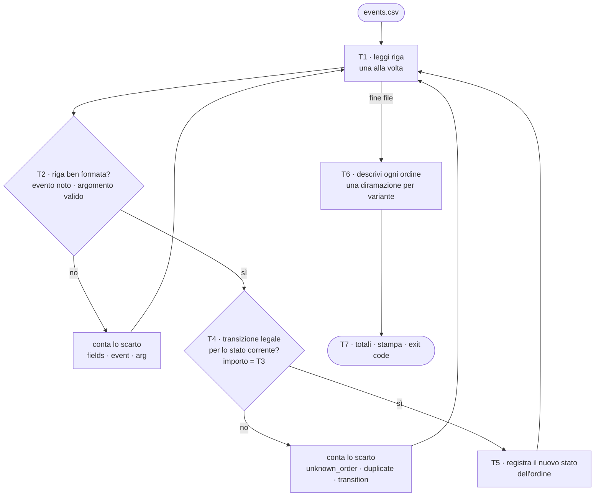
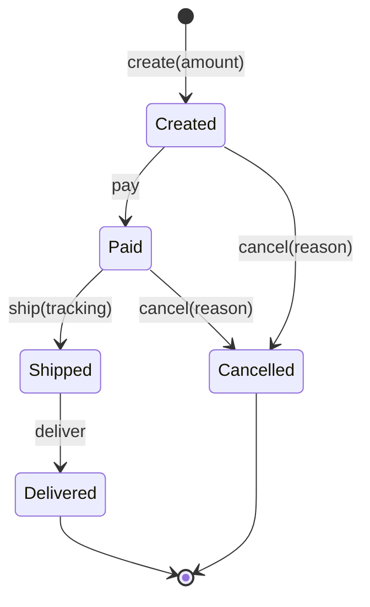
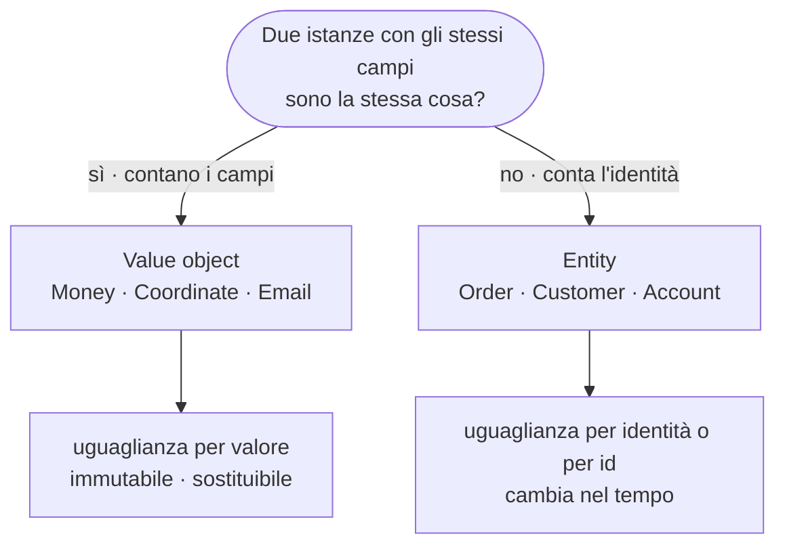

# C06 — Tipi composti e modellazione dei dati (parte 1 di 5: introduzione, problema, scomposizione, L06.1)

*Il capitolo è diviso in 5 file (parte1 → parte5), nel Project è intero in `capitoli/C06-tipi-composti-e-modellazione-dei-dati.md`.*

> **Parte II — Modellare e astrarre** · 3 lezioni (L06.1–L06.3) · 2,25 ore · capitolo con addendum «Il perché della scelta»
> **Stato:** bozza 1 (2026-10-15). Codice eseguito e verificato su PHP 8.3.6, Python 3.13.16 (mypy 2.4.0 per l'esperimento e4), Rust 1.97.0 (`rustc --edition 2024`), Go 1.24.7 (baseline del corso: PHP 8.4+, Go 1.25+: il codice non usa nulla di specifico delle versioni più recenti, da riverificare a stesura finale). Solo libreria standard: nessun pacchetto esterno.

## Obiettivi

Al termine del capitolo si sa:

1. distinguere un **tipo prodotto** (un valore ha *tutti* i campi: «e») da un **tipo somma** (un valore è *una sola* tra più varianti: «oppure») e **contare** quanti valori ciascuno può assumere;
2. scegliere tra tupla, record, struct e class chiedendosi se due istanze con gli stessi campi sono *la stessa cosa* (**valore**) o no (**entità**);
3. modellare il ciclo di vita di un oggetto con un **enum con dati** (sum type), o emularlo dove il linguaggio non lo ha, e sapere chi controlla che nessuna variante sia dimenticata;
4. applicare il principio **«rendere irrappresentabili gli stati illegali»**: progettare i tipi in modo che il dato sbagliato non si possa nemmeno scrivere;
5. costruire **value object** immutabili con invarianti garantite dal costruttore e distinguere tre livelli di immutabilità: del *binding*, del *campo*, *in profondità*.

Prerequisiti: C02 (tipi, mutabilità, zero values), C03 (pattern matching ed esaustività), C04 (closure), C05 (collezioni: la riga validata di T2 era una tupla, qui diventa un tipo). Per chi viene dalla Parte P: CP2 (tracing) e CP4 (primo programma).

**Percorso per l'ingresso A (formato «primario + lettura»).** Scrivi il programma nel linguaggio primario e leggi gli altri tre con le tabelle di confronto. Gli esperimenti e1–e7 sono brevi: riproducili uno alla volta e confronta l'output con quello riportato.

## Il problema reale

> Un negozio online vuole ricostruire il **ciclo di vita degli ordini** da un registro di eventi, `events.csv`: una riga per evento, con numero d'ordine, tipo di evento e un argomento. Un ordine **nasce** con `create` (argomento: importo in centesimi), si **paga** (`pay`), si **spedisce** (`ship`, argomento: numero di tracking), si **consegna** (`deliver`). Può essere **annullato** (`cancel`, argomento: motivo) solo prima della spedizione. Le regole sono rigide: non si paga un ordine che non esiste, non si spedisce un ordine non pagato, non si annulla un ordine già spedito, non si crea due volte lo stesso ordine. Le righe malformate o illegali vanno **scartate con il motivo**, senza fermare l'elaborazione. A fine file il responsabile vuole: quanti ordini ci sono per stato, il **valore consegnato**, il **valore ancora aperto** e lo **stato finale di ciascun ordine**.

Il file di prova usato in tutto il capitolo (22 righe di dati, di cui 13 applicabili e 9 da scartare):

```csv
order_id,event,arg
1001,create,12000
1002,create,4550
1001,pay,
1003,create,9990
1002,pay,
1002,ship,TRK-77
1001,ship,TRK-11
1003,cancel,out_of_stock
1001,deliver,
1004,pay,
1002,cancel,changed_mind
1005,create,abc
1003,pay,
1006,create,0
1001,refund,
1007,create,2500
1007,pay,
1007,ship,
1007,create,100
1002,deliver,
1008,create
1009,create,800
```

### Scomposizione

| Task | Che cosa fa | Tipo protagonista | Lezione |
|---|---|---|---|
| T1 | Legge le righe una alla volta, saltando intestazione e righe vuote (come in C05) | — | — |
| T2 | Spezza la riga e la trasforma in un **evento** (`create`, `pay`, `ship`, `deliver`, `cancel`) oppure in un motivo di scarto: `fields`, `event`, `arg` | sum type `Event` | L06.2 |
| T3 | Rappresenta l'importo come **valore**: centesimi interi, somma, formattazione | value object `Money` | L06.1, L06.3 |
| T4 | Dato lo stato corrente dell'ordine e un evento, calcola il **nuovo stato** oppure il motivo per cui la transizione è illegale: `unknown_order`, `duplicate`, `transition` | sum type `State` | L06.2 |
| T5 | Tiene il registro «numero d'ordine → stato corrente» | mappa (C05) di `State` | — |
| T6 | Descrive ogni ordine per il report: **una diramazione per variante** | `State` | L06.2 |
| T7 | Somma i totali (consegnato, aperto), stampa il riepilogo e fissa l'exit code (0 = tutto applicato, 1 = ci sono scarti, 2 = file mancante) | `Money` | L06.3 |



Il ciclo T1→T5 non modifica mai uno stato esistente: calcola un **nuovo valore** e lo sostituisce nel registro. Questa scelta (L06.3) è ciò che rende il programma facile da ragionare e identico nei quattro linguaggi.

Il ciclo di vita, come macchina a stati. Ogni freccia è una transizione legale; tutto ciò che non è disegnato è `transition` (scartato):



Ogni stato porta con sé **dati diversi**: è il punto da cui parte tutto il capitolo.

| Stato | Dati che porta | Come ci si arriva |
|---|---|---|
| `Created` | `amount` | evento `create` su un ordine inesistente |
| `Paid` | `amount` | `pay` da `Created` |
| `Shipped` | `amount`, `tracking` | `ship` da `Paid` |
| `Delivered` | `amount` | `deliver` da `Shipped` |
| `Cancelled` | `reason` | `cancel` da `Created` o `Paid` |

### Il programma, in anteprima

Output atteso (stdout, dopo i messaggi di scarto su stderr) ed exit code. È **identico nei quattro linguaggi**; il codice completo è nell'appendice (parte 5).

```text
reject line=11 reason=unknown_order
reject line=12 reason=transition
reject line=13 reason=arg
reject line=14 reason=transition
reject line=15 reason=arg
reject line=16 reason=event
reject line=19 reason=arg
reject line=20 reason=duplicate
reject line=22 reason=fields
events=22 applied=13 rejected=9
orders=5 created=1 paid=1 shipped=0 delivered=2 cancelled=1
delivered_total=165.50 open_total=33.00
order=1001 state=delivered amount=120.00
order=1002 state=delivered amount=45.50
order=1003 state=cancelled reason=out_of_stock
order=1007 state=paid amount=25.00
order=1009 state=created amount=8.00
[exit 1]
```

---

## L06.1 — Struct, class e record

### Concetto

Un **tipo composto** mette insieme più valori in un'unica cosa con un nome. La forma più comune è il **tipo prodotto**: un valore del tipo contiene *tutti* i suoi campi insieme. Si chiama «prodotto» perché i valori possibili si moltiplicano: una coppia `(bool, bool)` ha 2 × 2 = **4** valori; un record con un `bool` e un intero a 8 bit ne ha 2 × 256 = 512.

Esistono tre gradi di «struttura», dal più povero al più ricco:

| Forma | Come si accede ai campi | Esempio | Quando |
|---|---|---|---|
| **Tupla** | per posizione (`rec[3]`) | `(oid, customer, sku, qty)` di C05 | valore temporaneo, 2–3 elementi, vita breve |
| **Record / struct** | per nome (`rec.qty`) | `Money { cents }` | dati con significato di dominio |
| **Class** | per nome, **più comportamento** (metodi) e di solito **identità** | `Order` in PHP/Python | oggetti che cambiano nel tempo |

La differenza che pesa di più non è sintattica ma semantica: **due istanze con gli stessi campi sono la stessa cosa?**

- Per `Money(100)` e `Money(100)` sì: contano i valori, non «quale» oggetto sia. Si parla di **value object**, o di semantica *per valore*.
- Per due ordini con lo stesso importo no: ciascuno ha una vita propria e un numero d'ordine che lo distingue. Si parla di **entità**, o di semantica *per identità*.



I quattro linguaggi hanno risposte diverse a «che cosa fa `==` su due istanze di un tipo composto?». Lo scopriamo con un esperimento.

### Implementazione: `Money`, il nostro primo value object (T3)

Il programma rappresenta un importo come **centesimi interi** (C02: mai `float` per il denaro) dentro un tipo dedicato. Perché non lasciare un semplice intero? Perché `int` non dice di che cosa è fatto: si può sommare per sbaglio a un numero d'ordine. Un tipo `Money` dà un nome al concetto, limita le operazioni (somma sì, moltiplicazione tra importi no) e concentra in un punto la formattazione.

**Python**

```python
@dataclass(frozen=True)
class Money:
    """T3 - value object: an amount in euro cents. Immutable, compared by value."""
    cents: int

    def __add__(self, other: "Money") -> "Money":
        return Money(self.cents + other.cents)

    def __str__(self) -> str:
        return f"{self.cents // 100}.{self.cents % 100:02d}"
```

**PHP**

```php
/** T3 - value object: an amount in euro cents. Immutable, compared by value. */
final readonly class Money
{
    public function __construct(public int $cents)
    {
    }

    public function add(Money $other): Money
    {
        return new Money($this->cents + $other->cents);
    }

    public function __toString(): string
    {
        return intdiv($this->cents, 100) . '.' . sprintf('%02d', $this->cents % 100);
    }
}
```

**Rust**

```rust
/// T3 - value object: an amount in euro cents. Immutable, compared by value.
#[derive(Debug, Clone, Copy, PartialEq, Eq)]
struct Money {
    cents: i64,
}

impl Money {
    fn add(self, other: Money) -> Money {
        Money { cents: self.cents + other.cents }
    }
}

impl fmt::Display for Money {
    fn fmt(&self, f: &mut fmt::Formatter) -> fmt::Result {
        write!(f, "{}.{:02}", self.cents / 100, self.cents % 100)
    }
}
```

**Go**

```go
// Money is T3 - a value object: an amount in euro cents. Copied by value, compared with ==.
type Money struct{ cents int64 }

func (m Money) Add(o Money) Money { return Money{m.cents + o.cents} }

func (m Money) String() string { return fmt.Sprintf("%d.%02d", m.cents/100, m.cents%100) }
```

Che cosa fa ciascun linguaggio, riga per riga:

- **Python:** `@dataclass(frozen=True)` genera da sola costruttore, `__eq__`, `__hash__` e `__repr__` a partire dai campi annotati; `frozen=True` vieta di assegnarli dopo (L06.3). L'operatore `+` si ottiene definendo `__add__`.
- **PHP:** `final readonly class` (PHP ≥ 8.2) dichiara che la classe non si estende e che *tutte* le proprietà sono assegnabili una sola volta. Il **constructor promotion** (`public int $cents` nel costruttore) dichiara e inizializza la proprietà in un colpo solo. `__toString` fa funzionare l'interpolazione in stringa.
- **Rust:** `struct` con un campo; `#[derive(Debug, Clone, Copy, PartialEq, Eq)]` chiede al compilatore di *generare* stampa di debug, copia bit a bit, uguaglianza. Nulla è automatico: senza `derive`, `==` non compila (e1). `impl fmt::Display` definisce la stampa leggibile.
- **Go:** `struct` con un campo non esportato (minuscola, C02/C12). I metodi usano il ricevitore **per valore** (`m Money`): il metodo lavora su una copia e non può alterare l'originale. `String()` fa funzionare `%s`/`%v`.

### Esperimento e1 — `==` su due istanze con gli stessi campi

Creo due istanze di `Money(100)` e le confronto. Per Python aggiungo una classe «normale» senza `dataclass` e per Rust e Go un secondo file con il caso che non compila.

```python
from dataclasses import dataclass


class Plain:
    def __init__(self, cents):
        self.cents = cents


@dataclass(frozen=True)
class Money:
    cents: int


print("plain  ==:", Plain(100) == Plain(100))
print("record ==:", Money(100) == Money(100), " is:", Money(100) is Money(100))
print("repr     :", Money(100))
print("hash eq  :", hash(Money(100)) == hash(Money(100)))
```

```php
<?php
final class Money
{
    public function __construct(public int $cents)
    {
    }
}
$a = new Money(100);
$b = new Money(100);
$c = $a;
var_dump($a == $b, $a === $b, $a === $c);
echo json_encode($a), "\n";
```

```rust
#[derive(Debug, PartialEq)]
struct Money {
    cents: i64,
}

fn main() {
    let a = Money { cents: 100 };
    let b = Money { cents: 100 };
    println!("{} {:?}", a == b, a);
}
```

```go
package main

import "fmt"

type Money struct{ Cents int64 }

func main() {
	a, b := Money{100}, Money{100}
	pa, pb := &Money{100}, &Money{100}
	fmt.Println("value ==:", a == b)
	fmt.Println("pointer ==:", pa == pb, " pointee ==:", *pa == *pb)
	fmt.Printf("%v %+v\n", a, a)
}
```

```rust
struct Money {
    cents: i64,
}

fn main() {
    let a = Money { cents: 100 };
    let b = Money { cents: 100 };
    println!("{}", a == b);
}
```

```go
package main

import "fmt"

type Bag struct{ Items []int }

func main() {
	a, b := Bag{}, Bag{}
	fmt.Println(a == b)
}
```

```text
### e1.py
plain  ==: False
record ==: True  is: False
repr     : Money(cents=100)
hash eq  : True
[exit 0]
### e1.php
bool(true)
bool(false)
bool(true)
{"cents":100}
[exit 0]
### e1.rs
true Money { cents: 100 }
[exit 0]
### e1b.rs
error[E0369]: binary operation `==` cannot be applied to type `Money`
 --> e1b.rs:8:22
  |
8 |     println!("{}", a == b);
  |                    - ^^ - Money
  |                    |
  |                    Money
  |
note: an implementation of `PartialEq` might be missing for `Money`
 --> e1b.rs:1:1
  |
1 | struct Money {
  | ^^^^^^^^^^^^ must implement `PartialEq`
help: consider annotating `Money` with `#[derive(PartialEq)]`
  |
1 + #[derive(PartialEq)]
2 | struct Money {
  |

error: aborting due to 1 previous error

For more information about this error, try `rustc --explain E0369`.
[exit 1]
### e1.go
value ==: true
pointer ==: false  pointee ==: true
{100} {Cents:100}
[exit 0]
### e1b.go
# command-line-arguments
./e1b.go:9:14: invalid operation: a == b (struct containing []int cannot be compared)
[exit 1]
```

Lettura dei risultati:

| Linguaggio | `==` su due istanze con gli stessi campi | Perché |
|---|---|---|
| Python, classe normale | **False** | senza `__eq__` il confronto è per identità (stesso oggetto in memoria) |
| Python, `dataclass` | **True** (`is` resta False) | `__eq__` generato confronta i campi; `hash` coerente, quindi usabile come chiave |
| PHP, oggetti | `==` **true**, `===` **false** | `==` confronta tipo e proprietà; `===` chiede se è *lo stesso oggetto* (`$a === $c` è true: due nomi, un oggetto) |
| Rust | **non compila** senza `derive(PartialEq)` (E0369); con `derive` è `true` | l'uguaglianza è un *trait* da implementare, mai implicita |
| Go, `struct` | **true** per valore; `&Money{}` contro `&Money{}` è **false** (puntatori) | la struct è un valore comparabile; il puntatore è un indirizzo |
| Go, struct con slice | **non compila**: «struct containing []int cannot be compared» | un campo non comparabile rende non comparabile tutta la struct |

PHP ha quindi **due** operatori per le due semantiche; Python le separa tra `==` e `is`; Rust costringe a dichiarare l'uguaglianza; Go la deriva dal tipo. Quando si progetta un tipo, la prima decisione è dunque: *voglio che sia un valore?* Se sì, in Python si usa `dataclass`, in Rust il `derive`, in Go una struct senza campi non comparabili, in PHP si accetta che `==` faccia il lavoro e `===` no.

### Dalla tupla al record

In C05 la riga validata di T2 era una tupla Python `(oid, customer, sku, qty)`. Funziona, ma `rec[3]` non dice che cosa sia, e scambiare per errore due campi dello stesso tipo non genera alcun errore. Con un record il compilatore (o almeno il lettore) vede il nome:

| Accesso | Tupla | Record |
|---|---|---|
| Python | `rec[3]` | `rec.qty` |
| Rust | `rec.3` | `rec.qty` |
| Go | non esiste una tupla (si usa una struct, o più valori di ritorno) | `rec.qty` |
| PHP | `$rec[3]` (array) | `$rec->qty` |

La regola pratica: **la tupla va bene finché non esce dalla funzione**; appena un dato attraversa più funzioni o file, serve un nome.

### Focus comparativo

| Aspetto | PHP | Python | Rust | Go |
|---|---|---|---|---|
| Tipo record | `class` (con constructor promotion), `readonly class` | `dataclass`, `NamedTuple`, `class` | `struct` | `struct` |
| Costruzione | `new Money(100)` | `Money(100)` | `Money { cents: 100 }` | `Money{100}` o `Money{Cents: 100}` |
| `==` di default | `==` per proprietà, `===` per identità | per identità (per valore con `dataclass`) | non esiste (`derive(PartialEq)`) | per valore, se i campi lo sono |
| Stampa di debug | `var_dump`, `print_r` | `repr` | `{:?}` con `derive(Debug)` | `%v`, `%+v` |
| Copia | per handle (oggetti), per valore (array) | per riferimento | move, `Clone` / `Copy` | per valore |
| Metodi | nella `class` | nella `class` | in `impl` separato | funzioni con ricevitore |

### Esercizio Rosetta (4′)

Definisci `Coordinate(lat, lon)` come value object. Costruisci due coordinate con gli stessi valori, mettile in un **insieme** (C05) e stampa quanti elementi contiene. Quale linguaggio ti obbliga a fare qualcosa in più, e che cosa? (Suggerimento: guarda l'esperimento e7 più avanti.)

---
