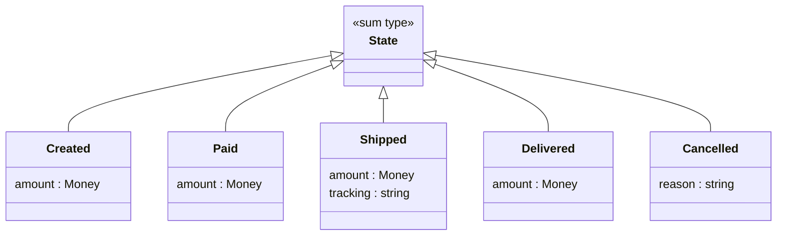
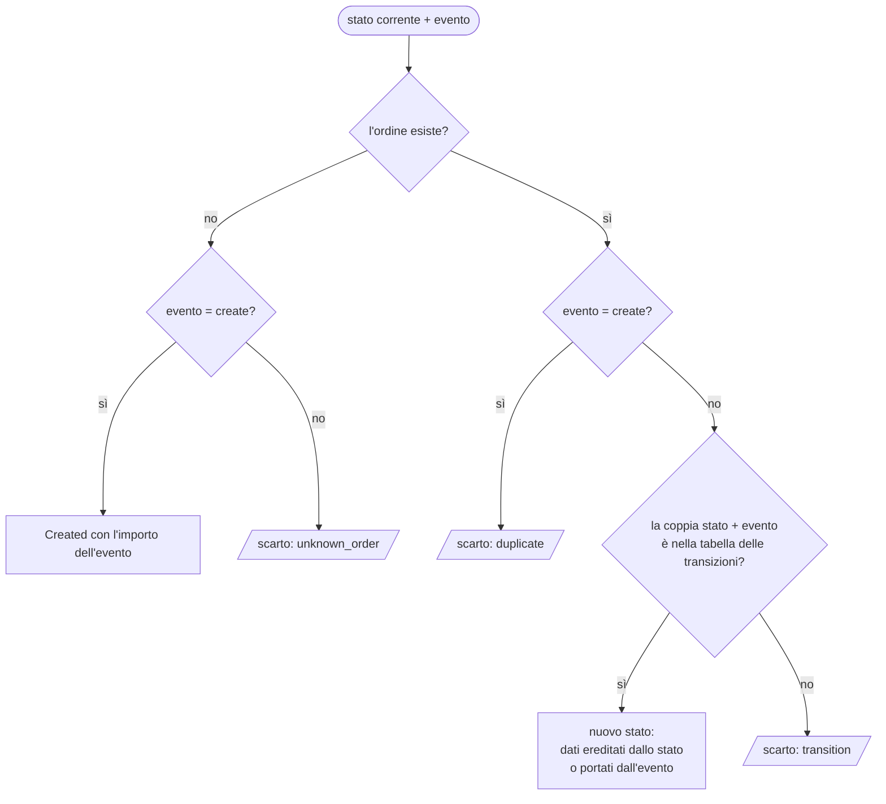
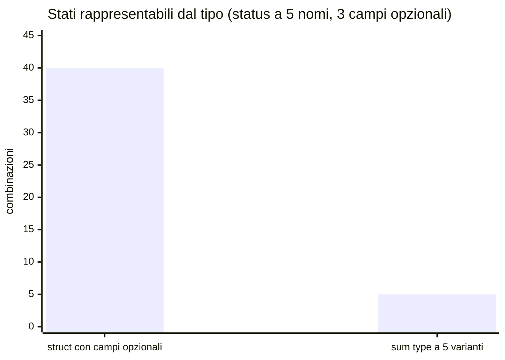

# C06 — Tipi composti e modellazione dei dati (parte 2 di 5: L06.2 Enum e sum types)

*Capitolo C06, file `C06-parte2-L06.2.md`: leggere in ordine parte1 → parte5.*

## L06.2 — Enum e sum types

### Concetto

Un **tipo somma** è il «duale» del prodotto: un valore è **una sola** tra più **varianti**, e ogni variante può portare dati propri. I valori possibili si **sommano**: se `A` ha 3 valori e `B` ne ha 2, il tipo `A | B` ne ha 3 + 2 = **5**. In letteratura si trova anche come *tagged union* o *discriminated union*: il valore è formato da una **etichetta** (la variante) più il **contenuto** di quella variante.

| | Tipo prodotto | Tipo somma |
|---|---|---|
| Domanda | «Ha *questo* e *questo* e *questo*» | «È *questo* oppure *quest'altro*» |
| Valori possibili | prodotto dei valori dei campi | somma dei valori delle varianti |
| Esempio | `Money { cents, currency }` | `State = Created \| Paid \| Shipped \| Delivered \| Cancelled` |
| Si legge con | accesso ai campi | **pattern matching** (C03) |
| Estendere | aggiungere un campo cambia *tutti* i valori | aggiungere una variante obbliga a rivedere *tutti i match* |

Si distinguono due livelli, che nei linguaggi hanno nomi e costi diversi:

1. **Enum semplice**: insieme chiuso di nomi senza dati (`Created`, `Paid`…). Serve a sostituire stringhe o interi «magici».
2. **Sum type con dati** (*algebraic data type*, ADT): ogni variante ha campi propri. È ciò che serve per `Shipped { amount, tracking }` e `Cancelled { reason }`.

### Enum semplici: quanto è «chiuso» l'insieme?

Un enum è utile solo se il valore *non può essere altro* che una delle varianti. Verifichiamo che cosa succede quando si prova a creare un valore fuori dall'insieme.

```python
from enum import Enum


class Status(Enum):
    CREATED = "created"
    PAID = "paid"


print(list(Status), Status("paid"), Status.PAID.value)
try:
    Status("refunded")
except ValueError as e:
    print("ValueError:", e)
```

```php
<?php
enum Status: string
{
    case Created = 'created';
    case Paid = 'paid';
}
echo count(Status::cases()), ' ', Status::from('paid')->name, "\n";
var_dump(Status::tryFrom('refunded'));
try {
    Status::from('refunded');
} catch (ValueError $e) {
    echo 'ValueError: ', $e->getMessage(), "\n";
}
```

```rust
#[derive(Debug, Clone, Copy)]
enum Status {
    Created,
    Paid,
}

fn main() {
    println!("{:?} {}", Status::Paid, Status::Paid as i32);
    let s: Status = 7 as Status;
    println!("{:?}", s);
}
```

```go
package main

import "fmt"

type Status int

const (
	Created Status = iota
	Paid
)

func (s Status) String() string {
	switch s {
	case Created:
		return "created"
	case Paid:
		return "paid"
	}
	return fmt.Sprintf("Status(%d)", int(s))
}

func main() {
	fmt.Println(Created, Paid, Status(7))
	var s Status = 7 // compiles: any int converts
	fmt.Println(s == Created, s == Paid)
}
```

```text
### e3.py
[<Status.CREATED: 'created'>, <Status.PAID: 'paid'>] Status.PAID paid
ValueError: 'refunded' is not a valid Status
[exit 0]
### e3.php
2 Paid
NULL
ValueError: "refunded" is not a valid backing value for enum Status
[exit 0]
### e3.rs
error[E0605]: non-primitive cast: `i32` as `Status`
 --> e3.rs:9:21
  |
9 |     let s: Status = 7 as Status;
  |                     ^^^^^^^^^^^ an `as` expression can only be used to convert between primitive types or to coerce to a specific trait object

error: aborting due to 1 previous error

For more information about this error, try `rustc --explain E0605`.
[exit 1]
### e3.go
created paid Status(7)
false false
[exit 0]
```

| Linguaggio | Costrutto | Valore fuori dall'insieme | Quando lo scopre |
|---|---|---|---|
| Python | `enum.Enum` | `Status("refunded")` → `ValueError` | runtime, alla conversione |
| PHP | `enum` backed (8.1+) | `from()` → `ValueError`; `tryFrom()` → `null` | runtime, alla conversione |
| Rust | `enum` | impossibile: `7 as Status` non compila (E0605) | **compilazione** |
| Go | `type Status int` + `iota` | `Status(7)` **compila** e vale 7; non è né `Created` né `Paid` | mai: va controllato a mano |

Go non ha l'enum: ha costanti numeriche con un tipo. L'insieme è chiuso *per convenzione*, non per costruzione. Il tipo `Status(7)` è valido per il compilatore e il `String()` deve gestire il «resto» con un caso di riserva. Python e PHP chiudono l'insieme ma verificano al momento della conversione da stringa o intero (tipicamente quando si legge un file o un JSON). Rust non consente la conversione da intero senza scriverla esplicitamente (`TryFrom`), e quindi sposta il controllo nel punto in cui si traduce il dato esterno.

### Sum type con dati: gli stati dell'ordine

Per modellare gli stati del nostro ordine un enum semplice non basta, perché `Shipped` porta un `tracking` che `Created` non ha. Le due alternative «povere» sono: una struct con tutti i campi possibili e uno `status` testuale (e5 mostra perché è un errore), oppure una gerarchia di classi senza controllo di completezza.

Il modello giusto è un'unione di varianti, ciascuna con i suoi campi:



Nei quattro linguaggi lo stesso modello si scrive in modi molto diversi. Una sola riga di Rust esprime ciò che altrove richiede cinque classi.

**Python**

```python
@dataclass(frozen=True)
class Created:
    amount: Money


@dataclass(frozen=True)
class Paid:
    amount: Money


@dataclass(frozen=True)
class Shipped:
    amount: Money
    tracking: str


@dataclass(frozen=True)
class Delivered:
    amount: Money


@dataclass(frozen=True)
class Cancelled:
    reason: str


State = Created | Paid | Shipped | Delivered | Cancelled  # sum type: exactly one of these
```

**PHP**

```php
interface State
{
}

final readonly class Created implements State
{
    public function __construct(public Money $amount)
    {
    }
}

final readonly class Paid implements State
{
    public function __construct(public Money $amount)
    {
    }
}

final readonly class Shipped implements State
{
    public function __construct(public Money $amount, public string $tracking)
    {
    }
}

final readonly class Delivered implements State
{
    public function __construct(public Money $amount)
    {
    }
}

final readonly class Cancelled implements State
{
    public function __construct(public string $reason)
    {
    }
}
```

**Rust**

```rust
/// Sum type: exactly one variant, each with its own data.
enum State {
    Created { amount: Money },
    Paid { amount: Money },
    Shipped { amount: Money, tracking: String },
    Delivered { amount: Money },
    Cancelled { reason: String },
}
```

**Go**

```go
// State is a closed set of variants emulated with an interface: only types in
// this package can implement the unexported method.
type State interface{ isState() }

type Created struct{ Amount Money }
type Paid struct{ Amount Money }
type Shipped struct {
	Amount   Money
	Tracking string
}
type Delivered struct{ Amount Money }
type Cancelled struct{ Reason string }

func (Created) isState()   {}
func (Paid) isState()      {}
func (Shipped) isState()   {}
func (Delivered) isState() {}
func (Cancelled) isState() {}
```

- **Rust:** è il caso nativo. `enum State` ha cinque varianti, ciascuna con i **propri campi**. Il valore occupa lo spazio della variante più grande più l'etichetta.
- **Python:** cinque classi `frozen` e un'**unione di tipi** `Created | Paid | …` (sintassi 3.10+). L'unione serve ai type checker (mypy, pyright); a runtime il linguaggio non verifica nulla.
- **PHP:** un'`interface` vuota (*marker*) e cinque `final readonly class` che la implementano. Gli `enum` di PHP 8.1 **non** possono portare dati diversi per istanza: ogni `case` è un singleton. Per i dati servono le classi.
- **Go:** un'`interface` con un metodo **non esportato** (`isState`) e cinque struct che lo implementano. Il metodo non esportato impedisce ad altri package di aggiungere varianti: l'insieme resta chiuso *fuori* dal package. È un'emulazione: nulla obbliga il resto del codice a gestire tutte le varianti.

Gli **eventi** hanno la stessa forma: `Create` porta un importo, `Ship` un tracking, `Cancel` un motivo, `Pay` e `Deliver` nessun dato.

**Python**

```python
@dataclass(frozen=True)
class Create:
    amount: Money


@dataclass(frozen=True)
class Pay:
    pass


@dataclass(frozen=True)
class Ship:
    tracking: str


@dataclass(frozen=True)
class Deliver:
    pass


@dataclass(frozen=True)
class Cancel:
    reason: str


Event = Create | Pay | Ship | Deliver | Cancel
```

**PHP**

```php
interface Event
{
}

final readonly class Create implements Event
{
    public function __construct(public Money $amount)
    {
    }
}

final readonly class Pay implements Event
{
}

final readonly class Ship implements Event
{
    public function __construct(public string $tracking)
    {
    }
}

final readonly class Deliver implements Event
{
}

final readonly class Cancel implements Event
{
    public function __construct(public string $reason)
    {
    }
}
```

**Rust**

```rust
enum Event {
    Create(Money),
    Pay,
    Ship(String),
    Deliver,
    Cancel(String),
}
```

**Go**

```go
type Event interface{ isEvent() }

type Create struct{ Amount Money }
type Pay struct{}
type Ship struct{ Tracking string }
type Deliver struct{}
type Cancel struct{ Reason string }

func (Create) isEvent()  {}
func (Pay) isEvent()     {}
func (Ship) isEvent()    {}
func (Deliver) isEvent() {}
func (Cancel) isEvent()  {}
```

### T2 — dal testo all'evento

`parse` trasforma una riga di testo in un evento già tipizzato, oppure in un motivo di scarto. Il punto da notare è che dopo `parse` **nessun altro codice rilegge stringhe**: l'argomento di `create` è già un `Money`, il tracking di `ship` è già non vuoto. La validazione avviene una sola volta, al confine tra mondo esterno e programma (idea che l'addendum riprende).

**Python**

```python
def parse(line):
    """T2 - return ((order_id, event), "") or (None, reason)."""
    parts = [p.strip() for p in line.split(",")]
    if len(parts) != 3:
        return None, "fields"
    oid, name, arg = parts
    if not oid:
        return None, "fields"
    if name == "create":
        if not (arg.isascii() and arg.isdigit()) or int(arg) == 0:
            return None, "arg"
        return (oid, Create(Money(int(arg)))), ""
    if name == "pay":
        return (oid, Pay()), ""
    if name == "ship":
        return ((oid, Ship(arg)), "") if arg else (None, "arg")
    if name == "deliver":
        return (oid, Deliver()), ""
    if name == "cancel":
        return ((oid, Cancel(arg)), "") if arg else (None, "arg")
    return None, "event"
```

**PHP**

```php
/** T2 - return [[order_id, event], ''] or [null, reason]. */
function parse(string $line): array
{
    $parts = array_map('trim', explode(',', $line));
    if (count($parts) !== 3 || $parts[0] === '') {
        return [null, 'fields'];
    }
    [$oid, $name, $arg] = $parts;
    switch ($name) {
        case 'create':
            if (!ctype_digit($arg) || (int)$arg === 0) {
                return [null, 'arg'];
            }
            return [[$oid, new Create(new Money((int)$arg))], ''];
        case 'pay':
            return [[$oid, new Pay()], ''];
        case 'ship':
            return $arg !== '' ? [[$oid, new Ship($arg)], ''] : [null, 'arg'];
        case 'deliver':
            return [[$oid, new Deliver()], ''];
        case 'cancel':
            return $arg !== '' ? [[$oid, new Cancel($arg)], ''] : [null, 'arg'];
    }
    return [null, 'event'];
}
```

**Rust**

```rust
/// T2 - Ok((order_id, event)) or Err(reason).
fn parse(line: &str) -> Result<(String, Event), &'static str> {
    let p: Vec<&str> = line.split(',').map(str::trim).collect();
    if p.len() != 3 || p[0].is_empty() {
        return Err("fields");
    }
    let (oid, arg) = (p[0].to_string(), p[2]);
    let ev = match p[1] {
        "create" => {
            if arg.is_empty() || !arg.bytes().all(|b| b.is_ascii_digit()) {
                return Err("arg");
            }
            match arg.parse::<i64>() {
                Ok(c) if c > 0 => Event::Create(Money { cents: c }),
                _ => return Err("arg"),
            }
        }
        "pay" => Event::Pay,
        "ship" if !arg.is_empty() => Event::Ship(arg.to_string()),
        "ship" => return Err("arg"),
        "deliver" => Event::Deliver,
        "cancel" if !arg.is_empty() => Event::Cancel(arg.to_string()),
        "cancel" => return Err("arg"),
        _ => return Err("event"),
    };
    Ok((oid, ev))
}
```

**Go**

```go
// parse is T2 - returns the order id, the event, or a rejection reason.
func parse(line string) (string, Event, string) {
	p := strings.Split(line, ",")
	for i := range p {
		p[i] = strings.TrimSpace(p[i])
	}
	if len(p) != 3 || p[0] == "" {
		return "", nil, "fields"
	}
	oid, arg := p[0], p[2]
	switch p[1] {
	case "create":
		if arg == "" || strings.Trim(arg, "0123456789") != "" {
			return "", nil, "arg"
		}
		c, err := strconv.ParseInt(arg, 10, 64)
		if err != nil || c == 0 {
			return "", nil, "arg"
		}
		return oid, Create{Money{c}}, ""
	case "pay":
		return oid, Pay{}, ""
	case "ship":
		if arg == "" {
			return "", nil, "arg"
		}
		return oid, Ship{arg}, ""
	case "deliver":
		return oid, Deliver{}, ""
	case "cancel":
		if arg == "" {
			return "", nil, "arg"
		}
		return oid, Cancel{arg}, ""
	}
	return "", nil, "event"
}
```

Annotazioni sui quattro stili:

- Python e PHP usano una catena di `if` / `switch` sul nome dell'evento; Rust un `match` sulla stringa con **guardie** (`"ship" if !arg.is_empty()`); Go uno `switch`.
- Per i numeri: `isdigit()` accetta anche cifre non ASCII (`٣`), perciò Python controlla prima `isascii()`; PHP usa `ctype_digit`; Rust e Go verificano le cifre una per una. Lo stesso criterio di C05, e lo stesso risultato: `+5`, `1_0` e `٣` scartati ovunque.
- In Rust e Go l'overflow di un importo enorme è un errore di conversione (`parse::<i64>`, `ParseInt`); in Python non esiste overflow; in PHP il cast silenziosamente *satura*. Il caso è nel collaudo di fine capitolo.

### T4 — la transizione: pattern matching sulla coppia (stato, evento)

Il cuore del programma è una funzione pura: `apply(stato corrente o niente, evento) → nuovo stato oppure motivo`. Non modifica nulla.



La «tabella delle transizioni» è l'unica fonte delle regole di business:

| Stato corrente | Evento | Nuovo stato | Da dove vengono i dati |
|---|---|---|---|
| (nessuno) | `Create(amount)` | `Created(amount)` | dall'evento |
| `Created(a)` | `Pay` | `Paid(a)` | dallo stato |
| `Paid(a)` | `Ship(t)` | `Shipped(a, t)` | `a` dallo stato, `t` dall'evento |
| `Shipped(a, _)` | `Deliver` | `Delivered(a)` | dallo stato |
| `Created` o `Paid` | `Cancel(r)` | `Cancelled(r)` | dall'evento |
| qualunque altra coppia | | scarto `transition` | |

**Python**

```python
def apply(state, ev):
    """T4 - (state or None, event) -> (new state, "") or (None, reason)."""
    match state, ev:
        case None, Create(amount):
            return Created(amount), ""
        case None, _:
            return None, "unknown_order"
        case _, Create():
            return None, "duplicate"
        case Created(a), Pay():
            return Paid(a), ""
        case Paid(a), Ship(t):
            return Shipped(a, t), ""
        case Shipped(a, _), Deliver():
            return Delivered(a), ""
        case Created() | Paid(), Cancel(r):
            return Cancelled(r), ""
        case _:
            return None, "transition"
```

**PHP**

```php
/** T4 - (state or null, event) -> [new state, ''] or [null, reason]. */
function apply(?State $s, Event $ev): array
{
    if ($s === null) {
        return $ev instanceof Create ? [new Created($ev->amount), ''] : [null, 'unknown_order'];
    }
    if ($ev instanceof Create) {
        return [null, 'duplicate'];
    }
    return match (true) {
        $s instanceof Created && $ev instanceof Pay => [new Paid($s->amount), ''],
        $s instanceof Paid && $ev instanceof Ship => [new Shipped($s->amount, $ev->tracking), ''],
        $s instanceof Shipped && $ev instanceof Deliver => [new Delivered($s->amount), ''],
        ($s instanceof Created || $s instanceof Paid) && $ev instanceof Cancel => [new Cancelled($ev->reason), ''],
        default => [null, 'transition'],
    };
}
```

**Rust**

```rust
/// T4 - (current state or None, event) -> new state or the reason it is illegal.
fn apply(state: Option<&State>, ev: Event) -> Result<State, &'static str> {
    match (state, ev) {
        (None, Event::Create(amount)) => Ok(State::Created { amount }),
        (None, _) => Err("unknown_order"),
        (Some(_), Event::Create(_)) => Err("duplicate"),
        (Some(State::Created { amount }), Event::Pay) => Ok(State::Paid { amount: *amount }),
        (Some(State::Paid { amount }), Event::Ship(tracking)) => {
            Ok(State::Shipped { amount: *amount, tracking })
        }
        (Some(State::Shipped { amount, .. }), Event::Deliver) => {
            Ok(State::Delivered { amount: *amount })
        }
        (Some(State::Created { .. } | State::Paid { .. }), Event::Cancel(reason)) => {
            Ok(State::Cancelled { reason })
        }
        _ => Err("transition"),
    }
}
```

**Go**

```go
// apply is T4 - (current state or nil, event) -> new state or the reason it is illegal.
func apply(s State, ev Event) (State, string) {
	if s == nil {
		if c, ok := ev.(Create); ok {
			return Created{c.Amount}, ""
		}
		return nil, "unknown_order"
	}
	if _, ok := ev.(Create); ok {
		return nil, "duplicate"
	}
	switch st := s.(type) {
	case Created:
		switch e := ev.(type) {
		case Pay:
			return Paid{st.Amount}, ""
		case Cancel:
			return Cancelled{e.Reason}, ""
		}
	case Paid:
		switch e := ev.(type) {
		case Ship:
			return Shipped{st.Amount, e.Tracking}, ""
		case Cancel:
			return Cancelled{e.Reason}, ""
		}
	case Shipped:
		if _, ok := ev.(Deliver); ok {
			return Delivered{st.Amount}, ""
		}
	}
	return nil, "transition"
}
```

Il confronto più istruttivo di tutto il capitolo è tra le quattro realizzazioni della stessa tabella:

| Linguaggio | Come si esprime «coppia (stato, evento)» | Controllo che ogni caso sia gestito |
|---|---|---|
| Python | `match state, ev:` con pattern di classe `Paid(a), Ship(t)` | nessuno a runtime; mypy lo fa con `assert_never` (e4) |
| PHP | `match (true)` con condizioni `instanceof`; nessun pattern strutturale | `default` esplicito; senza di esso `UnhandledMatchError` |
| Rust | `match (state, ev)` su una tupla di enum, con pattern annidati e bind dei campi | **il compilatore** (E0004) |
| Go | `switch st := s.(type)` annidato: non esiste il match su due valori insieme | nessuno |

Due dettagli di Rust che si riprendono in L06.3: `apply` riceve `Option<&State>` (un **prestito**, C10: legge lo stato senza prenderne la proprietà) e restituisce un `State` **nuovo**; `*amount` copia l'importo perché `Money` è `Copy`.

### T6 — descrivere ogni variante

`describe` è il caso d'uso classico del pattern matching: un ramo per variante, con accesso ai soli campi di quella variante.

**Python**

```python
def describe(state):
    """T6 - (name, detail) for the report; one branch per variant."""
    match state:
        case Created(a):
            return "created", f"amount={a}"
        case Paid(a):
            return "paid", f"amount={a}"
        case Shipped(a, t):
            return "shipped", f"amount={a} tracking={t}"
        case Delivered(a):
            return "delivered", f"amount={a}"
        case Cancelled(r):
            return "cancelled", f"reason={r}"
```

**PHP**

```php
/** T6 - [name, detail] for the report; one branch per variant. */
function describe(State $s): array
{
    return match (true) {
        $s instanceof Created => ['created', "amount=$s->amount"],
        $s instanceof Paid => ['paid', "amount=$s->amount"],
        $s instanceof Shipped => ['shipped', "amount=$s->amount tracking=$s->tracking"],
        $s instanceof Delivered => ['delivered', "amount=$s->amount"],
        $s instanceof Cancelled => ['cancelled', "reason=$s->reason"],
    };
}
```

**Rust**

```rust
/// T6 - (name, detail) for the report; the compiler demands one arm per variant.
fn describe(s: &State) -> (&'static str, String) {
    match s {
        State::Created { amount } => ("created", format!("amount={amount}")),
        State::Paid { amount } => ("paid", format!("amount={amount}")),
        State::Shipped { amount, tracking } => ("shipped", format!("amount={amount} tracking={tracking}")),
        State::Delivered { amount } => ("delivered", format!("amount={amount}")),
        State::Cancelled { reason } => ("cancelled", format!("reason={reason}")),
    }
}
```

**Go**

```go
// describe is T6 - (name, detail) for the report. Nothing forces one case per variant.
func describe(s State) (string, string) {
	switch st := s.(type) {
	case Created:
		return "created", fmt.Sprintf("amount=%s", st.Amount)
	case Paid:
		return "paid", fmt.Sprintf("amount=%s", st.Amount)
	case Shipped:
		return "shipped", fmt.Sprintf("amount=%s tracking=%s", st.Amount, st.Tracking)
	case Delivered:
		return "delivered", fmt.Sprintf("amount=%s", st.Amount)
	case Cancelled:
		return "cancelled", fmt.Sprintf("reason=%s", st.Reason)
	}
	panic("unreachable: unknown State variant")
}
```

Qui l'unica differenza tra i linguaggi è *che cosa succede se si dimentica una variante*. Lo verifichiamo.

### Esperimento e4 — aggiungo una variante e non aggiorno `describe`

Aggiungo `Refunded` all'insieme degli stati e **non** tocco `describe`: simulo ciò che accade a un team quando il modello cresce.

```python
from dataclasses import dataclass
from typing import assert_never


@dataclass(frozen=True)
class Created:
    amount: int


@dataclass(frozen=True)
class Cancelled:
    reason: str


@dataclass(frozen=True)
class Refunded:  # NEW variant
    amount: int


State = Created | Cancelled | Refunded


def describe(s: State) -> str:
    match s:
        case Created(a):
            return f"created {a}"
        case Cancelled(r):
            return f"cancelled {r}"
        case _:
            assert_never(s)


print(describe(Created(5)))
print(describe(Refunded(5)))
```

```php
<?php
interface State {}
final readonly class Created implements State { public function __construct(public int $amount) {} }
final readonly class Cancelled implements State { public function __construct(public string $reason) {} }
final readonly class Refunded implements State { public function __construct(public int $amount) {} } // NEW

function describe(State $s): string
{
    return match (true) {
        $s instanceof Created => "created $s->amount",
        $s instanceof Cancelled => "cancelled $s->reason",
    };
}

echo describe(new Created(5)), "\n";
echo describe(new Refunded(5)), "\n";
```

```rust
enum State {
    Created { amount: i64 },
    Cancelled { reason: String },
    Refunded { amount: i64 }, // NEW variant
}

fn describe(s: &State) -> String {
    match s {
        State::Created { amount } => format!("created {amount}"),
        State::Cancelled { reason } => format!("cancelled {reason}"),
    }
}

fn main() {
    println!("{}", describe(&State::Created { amount: 5 }));
    println!("{}", describe(&State::Refunded { amount: 5 }));
}
```

```go
package main

import "fmt"

type State interface{ isState() }
type Created struct{ Amount int64 }
type Cancelled struct{ Reason string }
type Refunded struct{ Amount int64 } // NEW variant

func (Created) isState()   {}
func (Cancelled) isState() {}
func (Refunded) isState()  {}

func describe(s State) string {
	switch st := s.(type) {
	case Created:
		return fmt.Sprintf("created %d", st.Amount)
	case Cancelled:
		return "cancelled " + st.Reason
	}
	return "?"
}

func main() {
	fmt.Println(describe(Created{5}))
	fmt.Println(describe(Refunded{5}))
}
```

```text
### e4.py
created 5
Traceback (most recent call last):
  File "e4.py", line 34, in <module>
    print(describe(Refunded(5)))
          ~~~~~~~~^^^^^^^^^^^^^
  File "e4.py", line 30, in describe
    assert_never(s)
    ~~~~~~~~~~~~^^^
  File "/usr/lib/python3.13/typing.py", line 2654, in assert_never
    raise AssertionError(f"Expected code to be unreachable, but got: {value}")
AssertionError: Expected code to be unreachable, but got: Refunded(amount=5)
[exit 1]
### e4.py+mypy
e4.py:30: error: Argument 1 to "assert_never" has incompatible type "Refunded"; expected "Never"  [arg-type]
Found 1 error in 1 file (checked 1 source file)
[exit 1]
### e4.php
created 5
PHP Fatal error:  Uncaught UnhandledMatchError: Unhandled match case true in e4.php:11
Stack trace:
#0 e4.php(16): describe()
#1 {main}
  thrown in e4.php on line 11
[exit 255]
### e4.rs
error[E0004]: non-exhaustive patterns: `&State::Refunded { .. }` not covered
  --> e4.rs:8:11
   |
 8 |     match s {
   |           ^ pattern `&State::Refunded { .. }` not covered
   |
note: `State` defined here
  --> e4.rs:1:6
   |
 1 | enum State {
   |      ^^^^^
...
 4 |     Refunded { amount: i64 }, // NEW variant
   |     -------- not covered
   = note: the matched value is of type `&State`
help: ensure that all possible cases are being handled by adding a match arm with a wildcard pattern or an explicit pattern as shown
   |
10 ~         State::Cancelled { reason } => format!("cancelled {reason}"),
11 ~         &State::Refunded { .. } => todo!(),
   |

error: aborting due to 1 previous error

For more information about this error, try `rustc --explain E0004`.
[exit 1]
### e4.go
created 5
?
[exit 0]
### e4.go+vet
vet-clean
[exit 0]
```

| Linguaggio | Rileva la variante dimenticata | Quando | Come |
|---|---|---|---|
| Rust | sì | **compilazione** | errore E0004: «pattern `&State::Refunded { .. }` not covered» |
| Python | solo con un type checker | pre-esecuzione, con mypy `--strict` | `assert_never(s)` ha tipo `Never`; se resta una variante l'argomento non è `Never` |
| Python senza checker | no, fino all'esecuzione | runtime | `AssertionError` solo se il ramo viene percorso |
| PHP | no | runtime | `UnhandledMatchError`, ma solo quando arriva quel valore |
| Go | **no, nemmeno a runtime** | mai | `return "?"` produce un risultato sbagliato in silenzio; `go vet` non protesta |

Per il programma è la differenza tra scoprire il problema mentre si scrive e scoprirlo la notte, quando arriva il primo ordine rimborsato. In Go si ricorre a un `panic("unreachable")` come rete di sicurezza, come fa `describe` nel nostro programma: trasforma il silenzio in un fallimento rumoroso. Esistono linter esterni che controllano l'esaustività dei type switch, ma non fanno parte della toolchain standard (non provati qui).

### Rendere irrappresentabili gli stati illegali

L'alternativa a un sum type è una **struct con tutti i campi opzionali** e un campo `status` testuale. È il modello che molti scrivono per primo:

```text
OrderBag { status: string, amount?: int, tracking?: string, reason?: string }
```

Quanti valori può assumere? Se `status` ammette 5 nomi e ciascuno dei tre campi opzionali può essere presente o assente: 5 × 2 × 2 × 2 = **40** combinazioni. Quelle legali sono **5** (le cinque varianti del sum type, ciascuna con i soli campi suoi). Le altre 35 sono stati senza senso, come «consegnato, con un motivo di annullamento e senza importo». Ogni funzione che tocca l'ordine deve ricordarsi di non produrli e di non fidarsi quando li legge.



**Rendere irrappresentabili gli stati illegali** significa scegliere il tipo in modo che le combinazioni senza senso *non si possano scrivere*. Nel sum type `Created` non ha il campo `tracking`: non esiste codice, nemmeno sbagliato, che lo valorizzi. L'esperimento e5 confronta i due modelli.

```python
from dataclasses import dataclass


@dataclass
class OrderBag:
    status: str
    amount: int | None = None
    tracking: str | None = None
    reason: str | None = None


# delivered, with a cancellation reason and no amount: nothing stops it
print(OrderBag(status="delivered", reason="changed_mind"))


@dataclass(frozen=True)
class Created:
    amount: int


try:
    Created(5, tracking="TRK-1")
except TypeError as e:
    print("TypeError:", e)
```

```php
<?php
final class OrderBag
{
    public function __construct(
        public string $status,
        public ?int $amount = null,
        public ?string $tracking = null,
        public ?string $reason = null,
    ) {
    }
}
echo json_encode(new OrderBag(status: 'delivered', reason: 'changed_mind')), "\n";

final readonly class Created
{
    public function __construct(public int $amount)
    {
    }
}
try {
    new Created(5, tracking: 'TRK-1');
} catch (Error $e) {
    echo get_class($e), ': ', $e->getMessage(), "\n";
}
```

```rust
#![allow(dead_code)]
#[derive(Debug)]
struct OrderBag {
    status: String,
    amount: Option<i64>,
    tracking: Option<String>,
    reason: Option<String>,
}

fn main() {
    let o = OrderBag {
        status: "delivered".into(),
        amount: None,
        tracking: None,
        reason: Some("changed_mind".into()),
    };
    println!("{:?}", o);
}
```

```rust
#[allow(dead_code)]
enum State {
    Created { amount: i64 },
    Shipped { amount: i64, tracking: String },
}

fn main() {
    let _s = State::Created { amount: 5, tracking: "TRK-1".into() };
}
```

```go
package main

import "fmt"

type OrderBag struct {
	Status   string
	Amount   int64
	Tracking string
	Reason   string
}

func main() {
	// delivered, with a cancellation reason and no amount: nothing stops it
	fmt.Printf("%+v\n", OrderBag{Status: "delivered", Reason: "changed_mind"})
}
```

```go
package main

type Created struct{ Amount int64 }

func main() {
	_ = Created{Amount: 5, Tracking: "TRK-1"}
}
```

```go
package main

import "fmt"

type State interface{ isState() }

type Created struct{ Amount int64 }

func (Created) isState() {}

func describe(s State) string {
	switch s.(type) {
	case Created:
		return "created"
	}
	panic("unreachable")
}

func main() {
	var s State // the zero value of an interface is nil: a state that is no state
	fmt.Println(s == nil)
	fmt.Println(describe(s))
}
```

```text
### e5.py
OrderBag(status='delivered', amount=None, tracking=None, reason='changed_mind')
TypeError: Created.__init__() got an unexpected keyword argument 'tracking'
[exit 0]
### e5.php
{"status":"delivered","amount":null,"tracking":null,"reason":"changed_mind"}
Error: Unknown named parameter $tracking
[exit 0]
### e5.rs
OrderBag { status: "delivered", amount: None, tracking: None, reason: Some("changed_mind") }
[exit 0]
### e5b.rs
error[E0559]: variant `State::Created` has no field named `tracking`
 --> e5b.rs:8:42
  |
8 |     let _s = State::Created { amount: 5, tracking: "TRK-1".into() };
  |                                          ^^^^^^^^ `State::Created` does not have this field
  |
  = note: all struct fields are already assigned

error: aborting due to 1 previous error

For more information about this error, try `rustc --explain E0559`.
[exit 1]
### e5.go
{Status:delivered Amount:0 Tracking: Reason:changed_mind}
[exit 0]
### e5b.go
# command-line-arguments
./e5b.go:6:25: unknown field Tracking in struct literal of type Created
[exit 1]
### e5c.go
true
panic: unreachable

goroutine 1 [running]:
main.describe(...)
	e5c.go:16
main.main()
	e5c.go:22 +0x5a
exit status 2
[exit 1]
```

Il modello a campi opzionali **passa in tutti e quattro** i linguaggi (la riga `delivered` con motivo di annullamento e senza importo viene stampata senza proteste). Con il modello a varianti:

- **Rust:** `State::Created { amount: 5, tracking: … }` non compila (E0559).
- **Go:** `Created{Amount: 5, Tracking: …}` non compila («unknown field»), perché `Created` è un tipo a sé. Ma l'interfaccia `State` ha un buco che Rust non ha: il suo valore zero è `nil`, cioè *uno stato che non è nessuno stato*; `describe(nil)` va in panic (e5c). Il sum type emulato chiude le varianti, non il «niente».
- **Python:** `Created(5, tracking=…)` solleva `TypeError` **a runtime** (e mypy lo rifiuterebbe prima).
- **PHP:** `new Created(5, tracking: …)` solleva `Error: Unknown named parameter` a runtime.

La distanza non è nel *modello*, ma nel *momento* in cui l'errore diventa visibile.

### Focus comparativo

| Aspetto | PHP | Python | Rust | Go |
|---|---|---|---|---|
| Enum semplice | `enum` (8.1+), pure o backed | `enum.Enum` | `enum` | `const` + `iota` |
| Varianti con dati | classi che implementano un'`interface` | classi + `Union` / `\|` | `enum` con campi | struct che implementano un'`interface` |
| Insieme chiuso | `final` + convenzione | convenzione (`Literal`, `Union`) | **sì, garantito** | metodo non esportato (chiuso fuori dal package) |
| Pattern matching | `match` su condizioni | `match` / `case` strutturale | `match` strutturale | `switch` sul tipo (un valore alla volta) |
| Esaustività | runtime (`UnhandledMatchError`) | solo type checker | compilatore | nessuna (linter esterni) |
| Valore «niente» | `null` | `None` | `Option<T>` | `nil` (anche per interface) |

### Esercizio Rosetta (4′)

Aggiungi lo stato `Refunded { amount }`, raggiungibile da `Delivered` con un nuovo evento `refund`. Prima di eseguire qualunque cosa, scrivi su carta **in quanti punti del programma** dovrai intervenire e quali linguaggi te lo diranno al posto tuo. Poi verifica: Rust ti segnala `describe` e il `match` dei totali; gli altri no. Aggiungi anche una riga di prova a `events.csv`.

---
