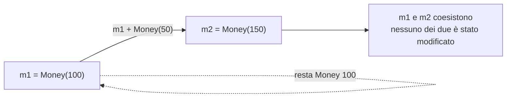
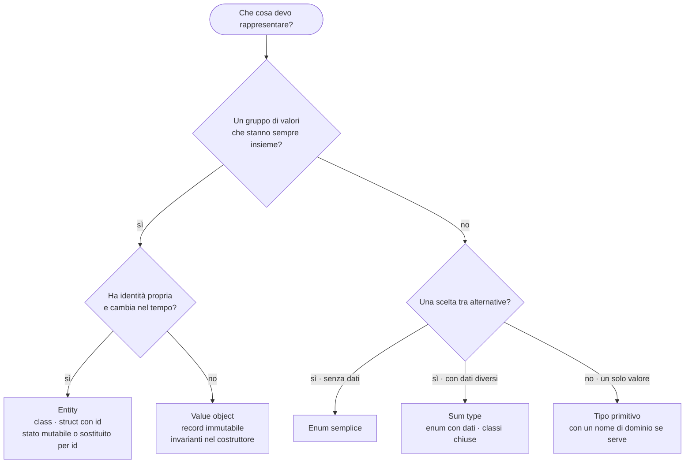

# C06 — Tipi composti e modellazione dei dati (parte 3 di 5: L06.3 Immutabilità e value objects)

*Capitolo C06, file `C06-parte3-L06.3.md`: leggere in ordine parte1 → parte5.*

## L06.3 — Immutabilità e value objects

### Concetto

Un valore è **immutabile** se, una volta creato, non cambia mai. Al posto di modificarlo se ne crea uno nuovo. In C05 (e1) si è visto il rischio opposto: `b = a` su una lista Python produce due nomi per lo stesso oggetto, e una modifica passa dall'uno all'altro. Con valori immutabili questo problema **non esiste**: se nessuno può modificare l'oggetto, non importa quanti lo condividano.

Immutabile, però, può voler dire tre cose diverse. Conviene tenerle distinte:

| Livello | Che cosa non può cambiare | Esempio |
|---|---|---|
| **Binding** | il legame nome → valore | `let x = 5` in Rust; `const` |
| **Campo** | i campi dell'oggetto, una volta assegnati | `readonly` in PHP, `frozen=True` in Python |
| **Profondità** | anche gli oggetti *raggiungibili* dai campi | un campo `readonly` che contiene una lista: la lista resta modificabile? |

Un **value object** è un tipo che mette insieme quattro proprietà:

1. è definito **solo dai suoi valori** (L06.1: uguaglianza per valore);
2. è **immutabile**: le operazioni restituiscono un valore nuovo;
3. protegge le sue **invarianti** nel costruttore: non si può creare un `Money` negativo, quindi nessuna funzione deve controllarlo di nuovo;
4. non ha identità: due `Money(100)` sono intercambiabili.



Il costo è l'allocazione di un valore nuovo a ogni modifica; il guadagno è che l'oggetto può essere condiviso, messo in una cache, usato come chiave di una mappa e passato tra thread senza sincronizzazione (C11).

Nel programma l'immutabilità è già usata: `apply` non modifica mai lo stato, ne costruisce uno nuovo (`Created(a)` → `Paid(a)`), e l'importo totale è una sequenza di valori nuovi (`delivered_total = delivered_total + a`).

### Esperimento e2 — provo a modificare un campo dopo la creazione

Per Python e PHP aggiungo un secondo oggetto con un **campo contenitore** (lista/array) per misurare il livello «profondità». Per Rust provo prima con `let`, poi con `let mut`. Per Go servono due package (`money` e `main`): la visibilità dei campi è per package (C12).

```python
from dataclasses import dataclass, FrozenInstanceError


@dataclass(frozen=True)
class Money:
    cents: int


@dataclass(frozen=True)
class Box:
    items: list


m = Money(100)
try:
    m.cents = 5
except FrozenInstanceError as e:
    print("FrozenInstanceError:", e)

b = Box([1, 2])
b.items.append(3)  # the field is frozen, the list it points to is not
print("shallow:", b)
```

```php
<?php
final readonly class Money
{
    public function __construct(public int $cents)
    {
    }
}
final class Box
{
    public function __construct(public readonly array $items)
    {
    }
}
$m = new Money(100);
try {
    $m->cents = 5;
} catch (Error $e) {
    echo get_class($e), ': ', $e->getMessage(), "\n";
}
$b = new Box([1, 2]);
try {
    $b->items[] = 3;
} catch (Error $e) {
    echo get_class($e), ': ', $e->getMessage(), "\n";
}
```

```rust
struct Money {
    cents: i64,
}

fn main() {
    let m = Money { cents: 100 };
    m.cents = 5;
    println!("{}", m.cents);
}
```

```rust
struct Money {
    cents: i64,
}

fn main() {
    let mut m = Money { cents: 100 };
    m.cents = 5;
    println!("{}", m.cents);
}
```

```go
package money

type Money struct {
	Cents int64 // exported: anyone can write it
	cents int64 // unexported: only this package can
}

func New(c int64) Money { return Money{Cents: c, cents: c} }

func (m Money) Value() int64 { return m.cents }
```

```go
package main

import (
	"fmt"

	"example.com/e2/money"
)

func main() {
	m := money.New(100)
	m.Cents = 5 // allowed
	fmt.Println(m.Cents, m.Value())
	m.cents = 5 // not allowed from another package
}
```

```text
### e2.py
FrozenInstanceError: cannot assign to field 'cents'
shallow: Box(items=[1, 2, 3])
[exit 0]
### e2.php
Error: Cannot modify readonly property Money::$cents
Error: Cannot modify readonly property Box::$items
[exit 0]
### e2.rs
error[E0594]: cannot assign to `m.cents`, as `m` is not declared as mutable
 --> e2.rs:7:5
  |
7 |     m.cents = 5;
  |     ^^^^^^^^^^^ cannot assign
  |
help: consider changing this to be mutable
  |
6 |     let mut m = Money { cents: 100 };
  |         +++

error: aborting due to 1 previous error

For more information about this error, try `rustc --explain E0594`.
[exit 1]
### e2ok.rs
5
[exit 0]
### e2go
# example.com/e2
./main.go:13:4: m.cents undefined (type money.Money has no field or method cents)
[exit 1]
```

| Linguaggio | Campo immutabile | In profondità? | Che cosa protegge davvero |
|---|---|---|---|
| Python `frozen=True` | sì: `FrozenInstanceError` | **no**: la `list` dentro `Box` è stata modificata (`shallow: Box(items=[1, 2, 3])`) | l'*assegnazione* ai campi, non gli oggetti che i campi contengono |
| PHP `readonly` | sì: «Cannot modify readonly property» | **parziale**: un `array` è un valore, e `$b->items[] = 3` è rifiutato; un **oggetto** contenuto resterebbe modificabile al suo interno | la proprietà; gli array sono per valore (copy-on-write, C05) |
| Rust | **dipende dal binding**: `let m` → E0594; `let mut m` → modificabile | sì per i dati posseduti | l'immutabilità appartiene al *binding*, non al tipo: per un value object si espongono solo metodi `&self` |
| Go | **per convenzione di visibilità**: dall'esterno del package `m.cents` non è accessibile; un campo esportato (`Cents`) è scrivibile da chiunque | no (slice e mappe sono condivise) | l'incapsulamento, non l'immutabilità |

In Go l'unico modo di avere un tipo non modificabile da fuori è nascondere i campi (minuscola) ed esporre il valore tramite metodi; dentro il package stesso nulla impedisce di scriverli. In Python un oggetto realmente immutabile in profondità richiede di usare anche collezioni immutabili (`tuple`, `frozenset`). In Rust l'assenza di `mut` è la norma: *il default è l'immutabilità*, e `mut` è l'eccezione esplicita (C02).

### Invarianti nel costruttore: «parse, don't validate»

Il `Money` del programma è volutamente semplice: non vieta importi negativi, perché il controllo `> 0` è fatto da `parse` (T2). Funziona, ma l'invariante vive nel posto sbagliato: chiunque costruisca un `Money` da un'altra strada (un test, una funzione di rimborso) può violarla.

Un value object serio fa rispettare la regola **nel costruttore**, così che *esistere* equivalga a *essere valido*. È la formula «parse, don't validate»: invece di controllare un dato grezzo ogni volta che lo si usa, lo si trasforma una volta in un tipo che può esistere solo se è valido. L'esperimento e6 costruisce un `Money` con valuta e due invarianti: importo non negativo, e la somma richiede la stessa valuta. L'output è identico nei quattro linguaggi per costruzione.

```python
from dataclasses import dataclass


@dataclass(frozen=True)
class Money:
    cents: int
    currency: str = "EUR"

    def __post_init__(self):
        if self.cents < 0:
            raise ValueError("negative amount")

    def __add__(self, other):
        if self.currency != other.currency:
            raise ValueError(f"currency mismatch {self.currency} {other.currency}")
        return Money(self.cents + other.cents, self.currency)


def show(f):
    try:
        m = f()
        print(f"ok {m.cents // 100}.{m.cents % 100:02d} {m.currency}")
    except ValueError as e:
        print("err", e)


show(lambda: Money(100) + Money(50))
show(lambda: Money(-5))
show(lambda: Money(100) + Money(50, "USD"))
```

```php
<?php
final readonly class Money
{
    public function __construct(public int $cents, public string $currency = 'EUR')
    {
        if ($cents < 0) {
            throw new InvalidArgumentException('negative amount');
        }
    }

    public function add(Money $o): Money
    {
        if ($this->currency !== $o->currency) {
            throw new InvalidArgumentException("currency mismatch $this->currency $o->currency");
        }
        return new Money($this->cents + $o->cents, $this->currency);
    }
}

function show(callable $f): void
{
    try {
        $m = $f();
        printf("ok %d.%02d %s\n", intdiv($m->cents, 100), $m->cents % 100, $m->currency);
    } catch (InvalidArgumentException $e) {
        echo 'err ', $e->getMessage(), "\n";
    }
}

show(fn() => (new Money(100))->add(new Money(50)));
show(fn() => new Money(-5));
show(fn() => (new Money(100))->add(new Money(50, 'USD')));
```

```rust
mod money {
    #[derive(Debug, Clone, PartialEq)]
    pub struct Money {
        cents: i64, // private: the only way in is `new`
        currency: &'static str,
    }

    impl Money {
        pub fn new(cents: i64, currency: &'static str) -> Result<Money, String> {
            if cents < 0 {
                return Err("negative amount".into());
            }
            Ok(Money { cents, currency })
        }

        pub fn add(&self, o: &Money) -> Result<Money, String> {
            if self.currency != o.currency {
                return Err(format!("currency mismatch {} {}", self.currency, o.currency));
            }
            Money::new(self.cents + o.cents, self.currency)
        }

        pub fn show(&self) -> String {
            format!("{}.{:02} {}", self.cents / 100, self.cents % 100, self.currency)
        }
    }
}

use money::Money;

fn show(r: Result<Money, String>) {
    match r {
        Ok(m) => println!("ok {}", m.show()),
        Err(e) => println!("err {e}"),
    }
}

fn main() {
    show(Money::new(100, "EUR").and_then(|a| a.add(&Money::new(50, "EUR")?)));
    show(Money::new(-5, "EUR"));
    show(Money::new(100, "EUR").and_then(|a| a.add(&Money::new(50, "USD")?)));
}
```

```rust
#![allow(dead_code)]
mod money {
    pub struct Money {
        cents: i64,
    }

    impl Money {
        pub fn new(cents: i64) -> Option<Money> {
            if cents < 0 { None } else { Some(Money { cents }) }
        }
        pub fn cents(&self) -> i64 {
            self.cents
        }
    }
}

fn main() {
    let m = money::Money { cents: -5 }; // bypasses `new`
    println!("{}", m.cents());
}
```

```go
package money

import (
	"errors"
	"fmt"
)

type Money struct {
	cents    int64
	currency string
}

func New(cents int64, currency string) (Money, error) {
	if cents < 0 {
		return Money{}, errors.New("negative amount")
	}
	return Money{cents, currency}, nil
}

func (m Money) Add(o Money) (Money, error) {
	if m.currency != o.currency {
		return Money{}, fmt.Errorf("currency mismatch %s %s", m.currency, o.currency)
	}
	return New(m.cents+o.cents, m.currency)
}

func (m Money) String() string {
	return fmt.Sprintf("%d.%02d %s", m.cents/100, m.cents%100, m.currency)
}
```

```go
package main

import (
	"fmt"

	"example.com/e6/money"
)

func show(m money.Money, err error) {
	if err != nil {
		fmt.Println("err", err)
		return
	}
	fmt.Println("ok", m)
}

func main() {
	a, _ := money.New(100, "EUR")
	b, _ := money.New(50, "EUR")
	u, _ := money.New(50, "USD")
	show(a.Add(b))
	show(money.New(-5, "EUR"))
	show(a.Add(u))
	var zero money.Money // the zero value skips the constructor
	fmt.Println("zero value:", zero)
}
```

```text
### e6.py
ok 1.50 EUR
err negative amount
err currency mismatch EUR USD
[exit 0]
### e6.php
ok 1.50 EUR
err negative amount
err currency mismatch EUR USD
[exit 0]
### e6.rs
ok 1.50 EUR
err negative amount
err currency mismatch EUR USD
[exit 0]
### e6b.rs
error[E0451]: field `cents` of struct `Money` is private
  --> e6b.rs:18:28
   |
18 |     let m = money::Money { cents: -5 }; // bypasses `new`
   |                            ^^^^^ private field

error: aborting due to 1 previous error

For more information about this error, try `rustc --explain E0451`.
[exit 1]
### e6go
ok 1.50 EUR
err negative amount
err currency mismatch EUR USD
zero value: 0.00 
[exit 0]
```

Quattro modi di far rispettare lo stesso contratto:

| Linguaggio | Dove vive il controllo | Può essere aggirato? |
|---|---|---|
| Python | `__post_init__` solleva `ValueError` | sì, con `object.__setattr__` (convenzione: non farlo) |
| PHP | il costruttore solleva `InvalidArgumentException` | solo con reflection / `unserialize` (C22) |
| Rust | `Money::new` restituisce `Result`; campi **privati** nel modulo | **no**: `Money { cents: -5 }` fuori dal modulo è un errore di compilazione (E0451) |
| Go | `New` restituisce `(Money, error)`; campi non esportati | **in parte**: il valore zero `var zero money.Money` esiste senza passare dal costruttore («zero value: 0.00 » con valuta vuota) |

Si ritrova la tesi di C02: il valore zero di Go è una scelta di design che rende ogni tipo utilizzabile subito, ma impedisce di garantire che *ogni* valore sia passato dal costruttore. In Rust invece il tipo può essere progettato in modo che esistano **solo** valori validi. In Python e PHP la garanzia è nella disciplina e nei test.

### Valori come chiavi: `Eq` e `Hash`

Un value object ben fatto si può usare come **chiave** di una mappa o elemento di un insieme (C05). Perché funzioni servono due cose coerenti tra loro: un'uguaglianza per valore e un hash calcolato sugli stessi campi.

```python
from dataclasses import dataclass


@dataclass(frozen=True)
class Money:
    cents: int


print(len({Money(100), Money(100)}))
```

```php
<?php
final class Money
{
    public function __construct(public int $cents)
    {
    }
}
try {
    $d = [new Money(100) => 1];
} catch (TypeError $e) {
    echo 'TypeError: ', $e->getMessage(), "\n";
}
$s = new SplObjectStorage();
$s->attach(new Money(100));
$s->attach(new Money(100));
echo count($s), "\n";
$m = [];
$m[(new Money(100))->cents] = true;
$m[(new Money(100))->cents] = true;
echo count($m), "\n";
```

```rust
use std::collections::HashSet;

#[derive(PartialEq, Eq, Hash)]
struct Money {
    cents: i64,
}

fn main() {
    let mut s = HashSet::new();
    s.insert(Money { cents: 100 });
    s.insert(Money { cents: 100 });
    println!("{}", s.len());
}
```

```rust
use std::collections::HashSet;

#[derive(PartialEq, Eq)]
struct Money {
    cents: i64,
}

fn main() {
    let mut s = HashSet::new();
    s.insert(Money { cents: 100 });
    println!("{}", s.len());
}
```

```go
package main

import "fmt"

type Money struct{ Cents int64 }

func main() {
	s := map[Money]struct{}{}
	s[Money{100}] = struct{}{}
	s[Money{100}] = struct{}{}
	fmt.Println(len(s))
}
```

```text
### e7.py
1
[exit 0]
### e7.php
TypeError: Cannot access offset of type Money on array
2
1
[exit 0]
### e7.rs
1
[exit 0]
### e7b.rs
error[E0277]: the trait bound `Money: Hash` is not satisfied
  --> e7b.rs:10:7
   |
10 |     s.insert(Money { cents: 100 });
   |       ^^^^^^ the trait `Hash` is not implemented for `Money`
   |
note: required by a bound in `HashSet::<T, S, A>::insert`
  --> /rustc/2d8144b7880597b6e6d3dfd63a9a9efae3f533d3/library/std/src/collections/hash/set.rs:1034:4
help: consider annotating `Money` with `#[derive(Hash)]`
   |
 4 + #[derive(Hash)]
 5 | struct Money {
   |

error: aborting due to 1 previous error

For more information about this error, try `rustc --explain E0277`.
[exit 1]
### e7.go
1
[exit 0]
```

- **Python:** la dataclass `frozen=True` è `hashable`, quindi l'insieme contiene **1** elemento. Una dataclass *non* frozen con `eq=True` imposta `__hash__` a `None` e non può essere chiave (verificato: `TypeError: unhashable type: 'M'`): la mutabilità e l'hash sono incompatibili.
- **PHP:** un oggetto **non può essere chiave** di un array («Cannot access offset of type Money on array»). `SplObjectStorage` usa l'**identità**, e conta **2** elementi; l'array con la proprietà scalare come chiave ne conta 1. Il linguaggio, di fatto, non ha value object nelle collezioni: si deriva una chiave stringa o intera.
- **Rust:** serve `derive(Hash)`; senza di esso compare l'errore E0277 «the trait `Hash` is not implemented». Il compilatore ti obbliga a dichiarare che il tipo è un valore.
- **Go:** una struct di campi comparabili è direttamente usabile come chiave: 1 elemento.

### Come scegliere: un criterio



Applicato al programma: `Money` è un value object (nessuna identità, immutabile, sommabile); `State` ed `Event` sono sum type (alternative con dati diversi); l'**ordine** non è un tipo a sé, ma una chiave (`order_id`) che punta a uno `State`: l'identità è nella chiave, il valore è lo stato corrente.

### T7 — i totali, una diramazione per variante

L'ultimo task combina value object e sum type: somma gli importi per variante e prepara le righe del report. Il `match` su `State` (o la sua emulazione) è il punto in cui il lavoro fatto nei tipi ripaga.

**Python**

```python
# T7 - totals per variant and the final report
counts = dict.fromkeys(NAMES, 0)
delivered_total, open_total = Money(0), Money(0)
lines = []
for oid in sorted(orders):
    st = orders[oid]
    name, detail = describe(st)
    counts[name] += 1
    match st:
        case Delivered(a):
            delivered_total += a
        case Created(a) | Paid(a) | Shipped(a, _):
            open_total += a
    lines.append(f"order={oid} state={name} {detail}")
```

**PHP**

```php
// T7 - totals per variant and the final report
$counts = ['created' => 0, 'paid' => 0, 'shipped' => 0, 'delivered' => 0, 'cancelled' => 0];
$deliveredTotal = new Money(0);
$openTotal = new Money(0);
$lines = [];
$ids = array_map('strval', array_keys($orders)); // numeric keys become int in PHP
sort($ids, SORT_STRING);
foreach ($ids as $oid) {
    $st = $orders[$oid];
    [$name, $detail] = describe($st);
    $counts[$name]++;
    if ($st instanceof Delivered) {
        $deliveredTotal = $deliveredTotal->add($st->amount);
    } elseif ($st instanceof Created || $st instanceof Paid || $st instanceof Shipped) {
        $openTotal = $openTotal->add($st->amount);
    }
    $lines[] = "order=$oid state=$name $detail";
}
```

**Rust**

```rust
// T7 - totals per variant and the final report
let mut counts = [0usize; 5];
let (mut delivered_total, mut open_total) = (Money { cents: 0 }, Money { cents: 0 });
let mut ids: Vec<&String> = orders.keys().collect();
ids.sort();
let mut lines = Vec::new();
for oid in ids {
    let st = &orders[oid];
    let (name, detail) = describe(st);
    counts[NAMES.iter().position(|n| *n == name).unwrap()] += 1;
    match st {
        State::Delivered { amount } => delivered_total = delivered_total.add(*amount),
        State::Created { amount } | State::Paid { amount } | State::Shipped { amount, .. } => {
            open_total = open_total.add(*amount)
        }
        State::Cancelled { .. } => {}
    }
    lines.push(format!("order={oid} state={name} {detail}"));
}
```

**Go**

```go
// T7 - totals per variant and the final report
counts := map[string]int{}
var deliveredTotal, openTotal Money
ids := make([]string, 0, len(orders))
for oid := range orders {
	ids = append(ids, oid)
}
sort.Strings(ids)
var lines []string
for _, oid := range ids {
	st := orders[oid]
	name, detail := describe(st)
	counts[name]++
	switch s := st.(type) {
	case Delivered:
		deliveredTotal = deliveredTotal.Add(s.Amount)
	case Created:
		openTotal = openTotal.Add(s.Amount)
	case Paid:
		openTotal = openTotal.Add(s.Amount)
	case Shipped:
		openTotal = openTotal.Add(s.Amount)
	}
	lines = append(lines, fmt.Sprintf("order=%s state=%s %s", oid, name, detail))
}
```

Si noti in Rust l'arm `State::Cancelled { .. } => {}`: scrivere esplicitamente «non fare niente» è ciò che permette al compilatore di sapere che la variante è stata considerata. Python e PHP esprimono lo stesso con la semplice assenza di un ramo; Go con uno `switch` senza `default`. Il comportamento è lo stesso, la garanzia no (e4).

### Focus comparativo

| Aspetto | PHP | Python | Rust | Go |
|---|---|---|---|---|
| Campo non riassegnabile | `readonly` (8.1) | `frozen=True` | default (senza `mut`) | convenzione: campo non esportato |
| Classe intera immutabile | `readonly class` (8.2) | `frozen=True` | nessun metodo `&mut self` | nessun costrutto |
| «Modifica» = copia con un campo diverso | `new Money(...)` / `clone` | `dataclasses.replace(m, cents=…)` | `Money { cents: x, ..m }` (struct update) | copia e assegnazione sul campo |
| Invarianti | nel costruttore | `__post_init__` | `new` + campi privati | `New` + campi non esportati (il valore zero resta) |
| Usabile come chiave | no (si deriva una chiave scalare) | sì, se `frozen` | sì, con `Eq + Hash` | sì, se i campi sono comparabili |
| Immutabilità in profondità | parziale (array sì, oggetti no) | no | sì, per dati posseduti | no |

### Esercizio Rosetta (4′)

Aggiungi a `Money` l'operazione `mul(n)` (moltiplicazione per un intero) e un metodo `split(n)` che divide un importo in `n` parti intere **senza perdere centesimi** (10,00 diviso 3 → 3,34 + 3,33 + 3,33). Il risultato deve essere un elenco di `Money` e la somma deve restituire l'importo originale. Verifica con `Money(1000).split(3)` in tutti i linguaggi.

---
