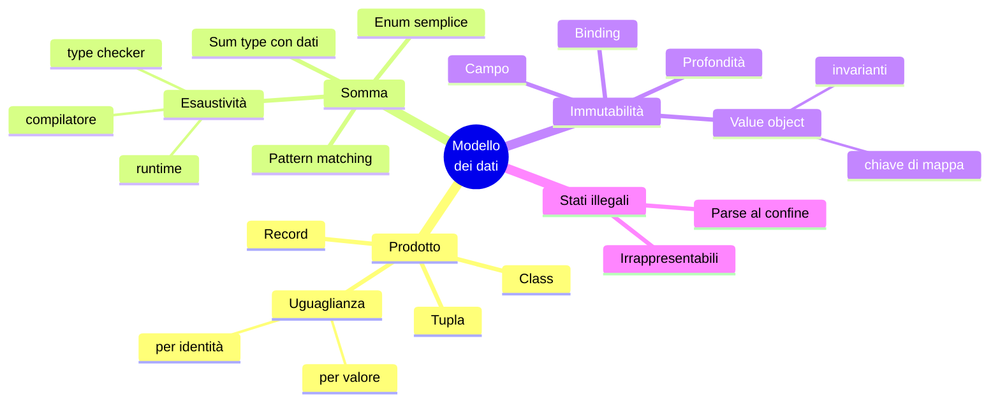

# C06 — Tipi composti e modellazione dei dati (parte 4 di 5: collaudo, matrice, addendum, anti-pattern, quiz, esercizi, mappa, ponte)

*Capitolo C06, file `C06-parte4-collaudo-addendum-chiusura.md`: leggere in ordine parte1 → parte5.*

## Il programma completo e il collaudo

Il codice completo dei quattro programmi è in appendice. Sono costruiti sulla stessa scomposizione: i commenti `T1 … T7` nel codice coincidono con la tabella iniziale. Per il collaudo sono stati eseguiti, su tutti e quattro i linguaggi, cinque casi; per ciascuno si è confrontato l'output completo (stdout, stderr ed exit code).

| File | Cosa verifica | Esito atteso | Identico nei 4? |
|---|---|---|---|
| `events.csv` | caso normale: 9 scarti che coprono tutti e sei i motivi (`fields`, `event`, `arg`, `unknown_order`, `duplicate`, `transition`) | `events=22 applied=13 rejected=9`, `delivered_total=165.50 open_total=33.00`, exit 1 | sì |
| `t_empty.csv` | solo intestazione | `events=0`, tutti i contatori a zero, `delivered_total=0.00`, exit 0 | sì |
| `t_crlf.csv` | fine riga Windows e riga vuota | `events=3 applied=3`, `open_total=3.50`, ordini 7 (`paid`) e 8 (`created`), exit 0 | sì |
| `t_odd.csv` | importi anomali: `99999999999999999999`, `+5`, ` 7 `, `1_0`, `٣` | vedi sotto | **no** |
| (file inesistente) | errore di apertura | `cannot open …` su stderr, exit 2 | sì |

**Dove i quattro divergono (`t_odd.csv`).** Quattro rappresentazioni dell'intero, tre comportamenti diversi sull'importo `99999999999999999999` (20 cifre, oltre i 64 bit):

```text
### python
reject line=3 reason=arg
reject line=5 reason=arg
reject line=6 reason=arg
events=5 applied=2 rejected=3
orders=2 created=2 paid=0 shipped=0 delivered=0 cancelled=0
delivered_total=0.00 open_total=1000000000000000000.06
order=1 state=created amount=999999999999999999.99
order=3 state=created amount=0.07
[exit 1]
### php
reject line=3 reason=arg
reject line=5 reason=arg
reject line=6 reason=arg
PHP Fatal error:  Uncaught TypeError: Money::__construct(): Argument #1 ($cents) must be of type int, float given, called in main.php on line 14 and defined in main.php:8
[exit 255]
### rust
reject line=2 reason=arg
reject line=3 reason=arg
reject line=5 reason=arg
reject line=6 reason=arg
events=5 applied=1 rejected=4
orders=1 created=1 paid=0 shipped=0 delivered=0 cancelled=0
delivered_total=0.00 open_total=0.07
order=3 state=created amount=0.07
[exit 1]
### go
reject line=2 reason=arg
reject line=3 reason=arg
reject line=5 reason=arg
reject line=6 reason=arg
events=5 applied=1 rejected=4
orders=1 created=1 paid=0 shipped=0 delivered=0 cancelled=0
delivered_total=0.00 open_total=0.07
order=3 state=created amount=0.07
[exit 1]
```

| Linguaggio | Che cosa succede | Dove si manifesta |
|---|---|---|
| Python | accetta: gli interi hanno precisione arbitraria. L'ordine vale `999999999999999999.99` | mai: nessun errore |
| PHP | `(int)"99999999999999999999"` **satura** a `PHP_INT_MAX` senza avvisi; l'ordine viene accettato. L'errore arriva più tardi: la somma di due importi esce dai 64 bit, diventa `float` e il tipo `int $cents` di `Money` lancia `TypeError` | **in un altro punto** del programma, a runtime, con exit 255 |
| Rust | `parse::<i64>` fallisce → scarto `arg` | alla lettura |
| Go | `ParseInt` fallisce → scarto `arg` | alla lettura |

Nessun comportamento è «sbagliato», ma tre sono **prevedibili**: quello di Python (nessun limite) e quello di Rust e Go (rifiuto netto, al confine). Quello di PHP è il più pericoloso: l'errore compare lontano dalla causa, e se `Money` non avesse avuto un tipo `int` il valore saturato sarebbe stato sommato in silenzio. È la ragione per cui conviene validare *al confine* (T2) e per cui l'importo ha un tipo (T3): il `TypeError` di `Money` ha fatto da rete di sicurezza. Per le altre quantità anomale l'accordo è totale: `+5` e `1_0` sono scartati dal controllo «solo cifre ASCII» scritto esplicitamente in tutti e quattro (senza di esso `int("1_0")` varrebbe 10 in Python e `Atoi("+5")` 5 in Go), mentre ` 7 ` viene ripulito da `strip`/`trim` e diventa l'ordine 3 da `0.07`.

## Matrice degli approcci (riassunto del capitolo)

| Costrutto | PHP | Python | Rust | Go |
|---|---|---|---|---|
| Record / struct | ◐ `class` con constructor promotion, `readonly class` | ● `dataclass`, `NamedTuple` | ● `struct` | ● `struct` |
| Enum semplice | ● pure e backed | ● `enum.Enum` | ● `enum` | ◐ `const` + `iota` |
| Sum type con dati | ◐ `interface` + classi | ◐ `Union` + `match` | ● `enum` | ◐ `interface` + type switch |
| Immutabilità del campo | ● `readonly` | ◐ `frozen=True` (superficiale) | ● default | ○ (campi non esportati) |
| Esaustività verificata | ○ (runtime) | ◐ solo con type checker | ● compilatore | ○ (linter esterni) |
| Invarianti garantite dal tipo | ◐ costruttore | ◐ `__post_init__` | ● campi privati + `new` | ◐ `New` (il valore zero resta) |
| Value object come chiave | ○ (si deriva una chiave scalare) | ● se `frozen` | ● con `Eq + Hash` | ● se comparabile |

Come ricordato nel TOC, le celle con lo stesso simbolo possono nascondere semantiche diverse: e1 (che cosa fa `==`) ed e2 (che cosa significa «immutabile») lo mostrano su costrutti segnati entrambi con ●.

## Addendum — Il perché della scelta

*Facoltativo. Non serve a scrivere codice, serve a ricordarlo.*

Ogni linguaggio risponde in modo diverso alla stessa domanda: **quanto del significato del dominio deve stare nei tipi, e quanto nella disciplina di chi scrive?**

**Rust: se il tipo non può esprimere l'errore, l'errore non può esistere.** La sequenza e4 → e5 → e6 → e7 mostra lo stesso gesto ripetuto: ogni vincolo che altrove vive in un controllo a runtime o in un commento (la variante dimenticata, il tracking su un ordine non spedito, l'importo negativo) in Rust è spostato nel sistema dei tipi, dove il compilatore lo verifica una volta per tutte. Il costo è reale: più cerimonia (`derive`, `Option<&State>`, prestiti, `*amount`) e una curva di apprendimento più ripida. Il guadagno è una classe intera di bug che non arriva mai in produzione. È l'idea di «rendere irrappresentabili gli stati illegali», e la sua versione operativa: *parse, don't validate*.

**Go: un linguaggio piccolo vale più di un linguaggio espressivo.** Go rinuncia di proposito ai sum type, agli enum con dati e al pattern matching. Non è una dimenticanza: ogni costrutto in più è qualcosa da imparare, da leggere nel codice altrui e da mantenere nel compilatore. Il prezzo lo abbiamo misurato: l'emulazione con `interface` non rileva la variante dimenticata (e4) e ammette un valore `nil` che non è nessuno stato (e5c). Go lo accetta in cambio di uniformità: chi legge un programma Go non incontra mai un costrutto che non conosce.

**PHP e Python: pragmatismo con correzioni successive.** Nati senza tipi composti ricchi, li hanno aggiunti nel tempo: `dataclass` (Python 3.7), `match` (3.10), `enum` e proprietà `readonly` (PHP 8.1), `readonly class` (8.2). Il risultato è un linguaggio in cui il codice vecchio e il nuovo convivono, e le garanzie sono *opt-in*: `frozen=True`, `readonly`, `final`, `assert_never` esistono, ma ognuno si attiva scegliendolo. Un type checker (mypy, PHPStan) è il modo di ottenere a pre-esecuzione ciò che Rust impone a compilazione.

Una tabella del *momento* in cui l'errore del modello diventa visibile riassume il capitolo:

| Errore di modello | PHP | Python | Rust | Go |
|---|---|---|---|---|
| Variante dimenticata in un `match` | runtime, solo se arriva il caso | pre-esecuzione con mypy; altrimenti runtime | **compilazione** | mai (resta silenzioso) |
| Campo di una variante usato su un'altra | runtime (`Error`) | runtime (`TypeError`), mypy prima | **compilazione** | **compilazione** |
| Modifica di un campo «immutabile» | runtime (`Error`) | runtime (`FrozenInstanceError`) | **compilazione** | compilazione, solo fuori dal package |
| Valore fuori dall'enum | runtime (`ValueError`) | runtime (`ValueError`) | **compilazione** | mai |
| Invariante violata alla creazione | runtime (eccezione) | runtime (`ValueError`) | compilazione (campi privati) | solo con la disciplina; il valore zero resta |

La domanda guida del corso, applicata ai tipi composti: *che cosa questo linguaggio rende facile, e che cosa rende difficile di proposito?* PHP e Python rendono facile iniziare e difficile (ma possibile) garantire; Rust rende difficile iniziare e facile garantire; Go rende facile leggere e difficile garantire con i soli tipi.

## Anti-pattern

| Anti-pattern | Dove | Conseguenza | Rimedio |
|---|---|---|---|
| Struct con `status` testuale e campi opzionali per tutto | tutti | 35 combinazioni su 40 senza senso (e5), controlli sparsi | sum type: una variante per stato |
| Stringhe o interi «magici» al posto di un enum | tutti | refusi non rilevati; `Status(7)` in Go | enum, o costanti con un tipo |
| `match` con ramo `_` / `default` che «ingoia» le varianti nuove | Python, Rust, PHP | la variante dimenticata finisce nel caso generico (e4) | elencare le varianti; il ramo generico solo dove la logica lo prevede (`transition` in `apply`) |
| Importo in `float` | tutti | errori di arrotondamento (C02) | centesimi interi dentro un `Money` |
| Intero nudo dove serve un concetto di dominio | tutti | si somma un importo a un numero d'ordine | value object con un nome |
| Value object mutabile | Python, Go | alias e hash incoerente (C05 e1) | `frozen`, `readonly`, campi non esportati |
| Invariante controllata «dopo», in ogni funzione | tutti | prima o poi una funzione se ne dimentica | costruttore che rifiuta i valori invalidi |
| Aspettarsi che `frozen` sia immutabilità profonda | Python | la lista dentro l'oggetto si modifica (e2) | `tuple`, `frozenset`, copie difensive |
| Affidarsi al valore zero come valore valido | Go | `var m money.Money` salta il costruttore (e6) | trattare lo zero value come stato valido, o documentare |
| Oggetto come chiave di un array | PHP | `TypeError` (e7) | derivare una chiave scalare dai campi |

## Quiz di verifica

1. Un record ha un campo `bool` e un campo che può essere solo `A`, `B` o `C`. Quanti valori distinti può assumere? E un tipo somma con una variante `bool` e una variante con il solo `C`?
2. Perché in PHP `$a == $b` è `true` e `$a === $b` è `false` per due `new Money(100)`?
3. Che cosa succede in Rust se si scrive `a == b` su una struct senza `derive(PartialEq)`?
4. In Go, `Status(7)` con `type Status int` compila? Chi controlla che il valore sia valido?
5. Aggiungo una variante a un sum type e dimentico di aggiornare un `match`/type switch. Quale linguaggio me lo segnala prima di eseguire? Quale non me lo segnala nemmeno a runtime?
6. `@dataclass(frozen=True) class Box: items: list`. È legale `box.items.append(3)`? E `box.items = []`?
7. Perché un `Money` che valida l'importo nel costruttore è meglio di un controllo in `parse`?
8. In Go il valore zero di `Money` (con campi non esportati) è un problema per le invarianti. Perché?

**Risposte**

> 1. Prodotto: 2 × 3 = 6. Somma: 2 + 1 = 3. 2. `==` confronta tipo e proprietà; `===` chiede se sono lo stesso oggetto. 3. Non compila: E0369, manca l'implementazione del trait `PartialEq`. 4. Sì, compila: nessuno controlla; occorre un `String()` con un caso di riserva o una validazione esplicita. 5. Rust (E0004) prima; Go non lo segnala neanche a runtime (restituisce un valore di riserva). Python lo segnala con mypy e `assert_never`; PHP solo a runtime. 6. `append` sì (frozen è superficiale); `box.items = []` no (`FrozenInstanceError`). 7. Perché vale per ogni strada di creazione (test, rimborsi, import) e il tipo diventa una prova di validità. 8. Perché `var m Money` esiste senza passare da `New`: l'invariante non è garantita.

## Esercizi

1. **Stato di rimborso.** Aggiungi `Refunded { amount }`, raggiungibile da `Delivered` con l'evento `refund,<centesimi>`; l'importo rimborsato non deve superare quello consegnato. Quale struttura di dati porta il controllo, lo stato o l'evento?
2. **Chiave composta.** Considera duplicato un `create` che ripete la stessa coppia (cliente, importo), non solo il numero d'ordine. Quale value object usi come chiave?
3. **Money con valuta.** Porta nel programma il `Money` con valuta di e6 e accetta `create,100,USD`. Dove cambia il parsing? Dove cambiano i totali (una somma per valuta)?
4. **Storico.** Fai in modo che il registro tenga *tutte* le transizioni di un ordine (non solo l'ultima). Come cambia il tipo del registro? Perché l'immutabilità rende l'operazione facile?
5. **Macchina a stati dichiarativa.** Scrivi la tabella delle transizioni come **dati** (una mappa `(variante, evento) → variante`) invece che come `match`. Che cosa si guadagna, e che cosa si perde in termini di controllo dei tipi?

## Mappa mentale



## Ponte ai capitoli successivi

- **C07** riprende `State` ed `Event` come *interfacce*: in PHP e Go la somma è stata emulata proprio con `interface`; C07 spiega nominale contro strutturale, e perché il metodo non esportato di Go chiude l'insieme.
- **C08** porta i *generics*: `Option<T>`, `Result<T, E>` e le collezioni di value object (`Vec<Money>`) sono tipi parametrici; spiega anche perché mypy riesce a verificare `assert_never`.
- **C09** sostituisce i motivi di scarto come stringhe (`"transition"`, `"arg"`) con **errori tipizzati**: un `enum` di errori, con `Result` in Rust, eccezioni in PHP e Python, `error` in Go.
- **C10** spiega perché `apply` prende `Option<&State>` in Rust, perché `Money` è `Copy`, e che cosa è davvero la copia di una struct in Go.
- **C14** usa i value object come confine con il mondo esterno (JSON, validazione, `Money` che esce da un'API); **C19** li usa come mapping tra riga SQL e tipo.

---
