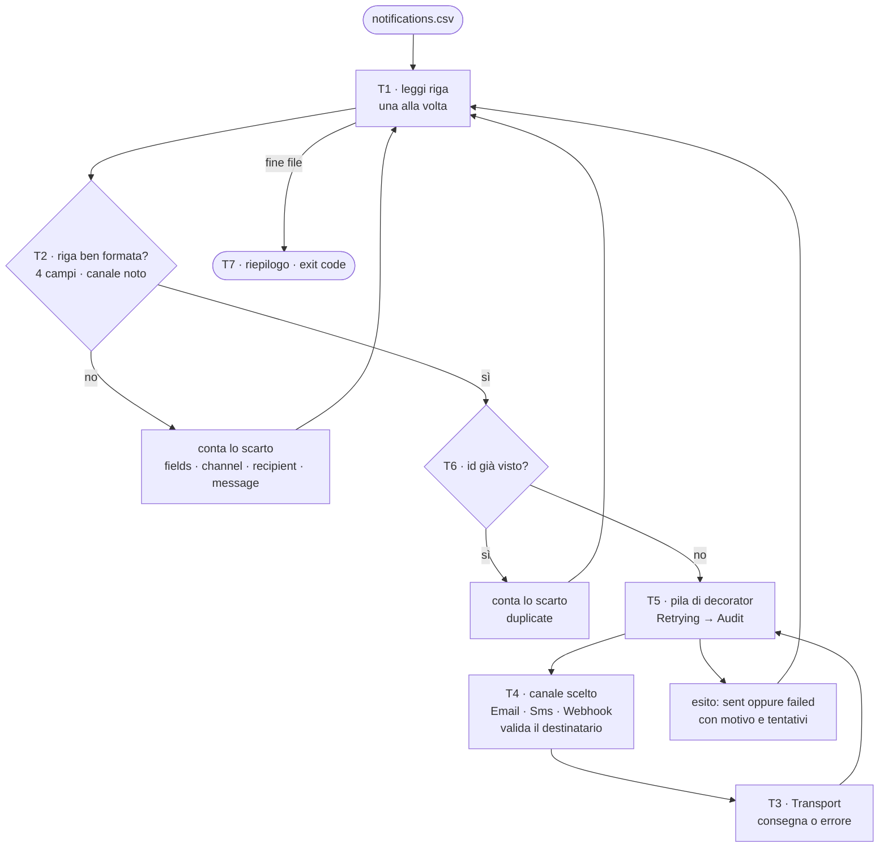
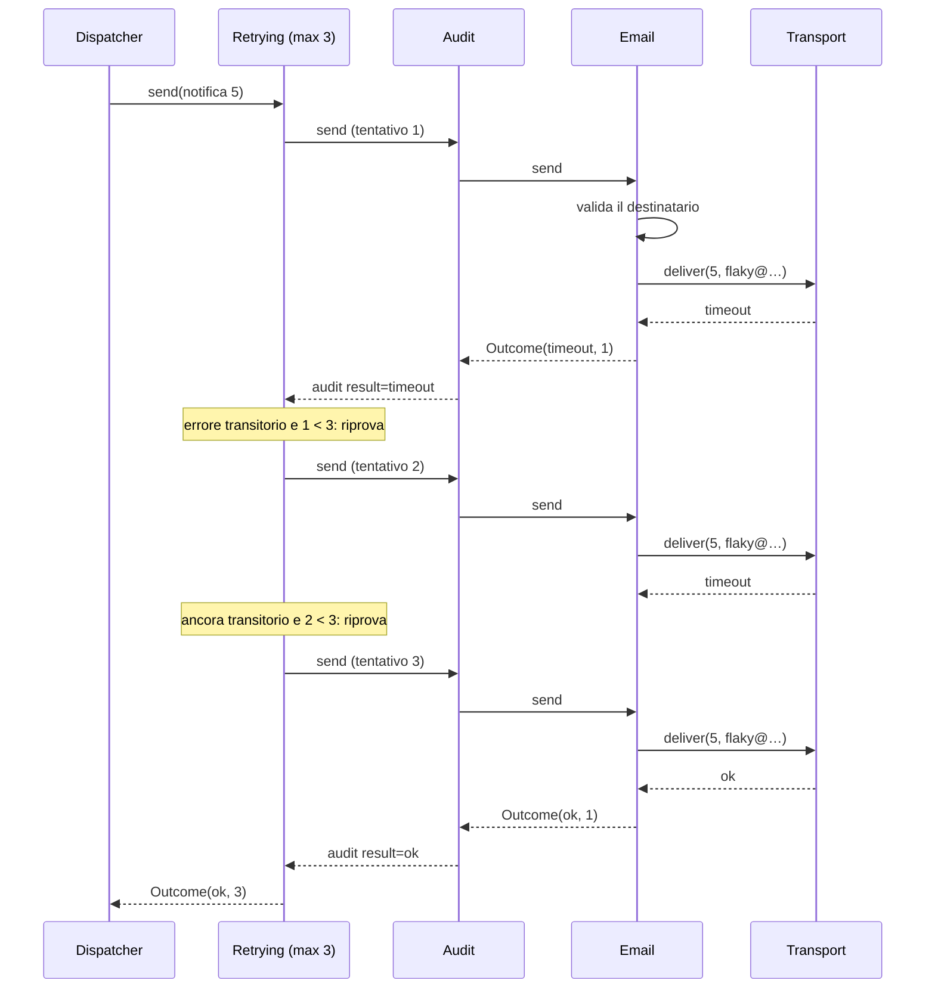
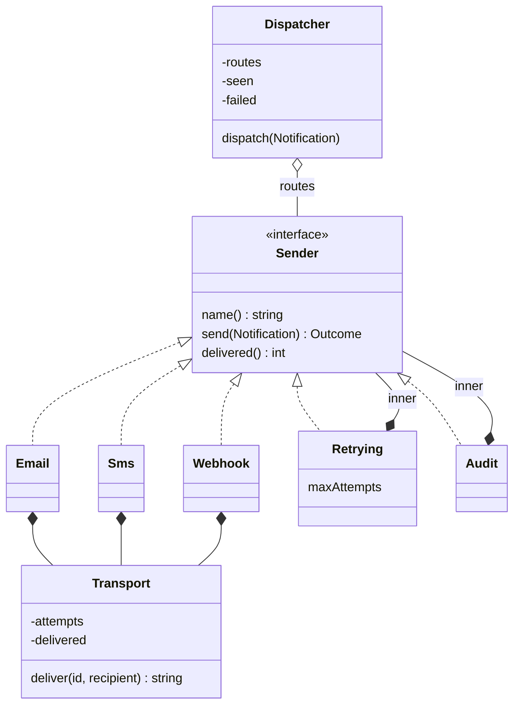

(parte 1 di 7: intestazione, obiettivi, problema e scomposizione) — file originale: capitoli/C07-oggetti-interfacce-trait-composizione.md

# C07 — Oggetti, interfacce, trait e composizione

> **Parte II — Modellare e astrarre** · 4 lezioni (L07.1–L07.4) · 3 ore · capitolo con addendum «Il perché della scelta»
> **Stato:** bozza 1 (2026-10-16). Codice eseguito e verificato su PHP 8.3.6, Python 3.13.16 (`mypy --strict` pulito sul programma intero, mypy 2.3.1), Rust 1.97.0 (`rustc --edition 2024`), Go 1.24.7 (`gofmt -l` vuoto, `go vet` pulito). Baseline del corso: PHP 8.4+, Go 1.25+ (il codice non usa nulla di specifico delle versioni più recenti; da riverificare a stesura finale). Solo libreria standard: nessun pacchetto esterno. La «rete» è simulata: nessun programma di questo capitolo apre un socket.

## Obiettivi

Al termine del capitolo si sa:

1. spiegare che cos'è un **oggetto** (dati + comportamento legati insieme), che cosa fa un **metodo** rispetto a una funzione libera e come ciascun linguaggio chiama e passa il «destinatario» della chiamata (`$this`, `self`, `&self`/`&mut self`, receiver per valore o per puntatore);
2. proteggere lo stato con l'**incapsulamento** e distinguere dove passa il confine della visibilità nei quattro linguaggi: classe, convenzione, modulo, package;
3. scegliere tra **ereditarietà** («è un») e **composizione** («ha un») con un criterio esplicito, e riconoscere i guasti tipici dell'ereditarietà: classe base fragile, esplosione delle combinazioni, diamante;
4. distinguere un'interfaccia **nominale** («dichiaro di essere un X») da una **strutturale** («ho i metodi di un X»), e sapere in quale momento (esecuzione, type checker, compilazione) ciascun linguaggio verifica il contratto;
5. non confondere **trait di PHP** e **trait di Rust**, che condividono il nome e quasi nient'altro;
6. scegliere tra **dispatch statico** (generics, monomorphization) e **dispatch dinamico** (vtable, interface), sapendo che cosa costa ciascuno, e tra interfaccia aperta e sum type chiuso (C06).

Prerequisiti: C04 (closure: una closure è già un oggetto con un solo metodo), C06 (record, sum type, value object: `Notification` e `Outcome` sono value object), C05 (mappe). Per chi viene dalla Parte P: CP4 (primo programma) e CP3 (lettura degli errori del compilatore).

**Percorso per l'ingresso A (formato «primario + lettura»).** Scrivi il programma nel linguaggio primario e leggi gli altri tre con le tabelle di confronto. Gli esperimenti e1–e11 sono brevi: riproducili uno alla volta e confronta l'output con quello riportato. Se all'inizio il termine «interfaccia» ti sembra astratto, leggi prima il diagramma delle classi del problema e la sezione «Concetto» di L07.3: il resto del capitolo ne è l'applicazione.

## Il problema reale

> Un'applicazione deve **avvisare i suoi utenti** su tre canali: **e-mail**, **SMS** e **webhook**. Le richieste arrivano in un file, `notifications.csv`: una riga per notifica, con numero identificativo, canale, destinatario e testo del messaggio (il testo può contenere virgole). Ogni canale ha le sue regole: l'e-mail vuole un indirizzo con una sola `@` e un dominio con un punto; l'SMS un numero internazionale (`+` e 8–15 cifre) e un testo di **al massimo 40 caratteri**; il webhook un URL `https://`. La rete è inaffidabile: alcuni errori sono **transitori** (un *timeout* può risolversi riprovando) e altri **permanenti** (un destinatario irraggiungibile, un indirizzo malformato, un SMS troppo lungo non migliorano riprovando). L'e-mail e il webhook si ritentano fino a **3 tentativi** in tutto, gli SMS fino a **2** (costano). Ogni chiamata al canale deve lasciare una traccia di **audit**. Un identificativo già visto non va spedito due volte. Le righe malformate vanno scartate con il motivo, senza fermare l'elaborazione. A fine file il responsabile vuole l'esito di ogni notifica, quante sono andate a buon fine o no, e per ciascun canale quante consegne e quanti fallimenti.

Come negli altri capitoli, il problema è un pretesto: serve a far nascere **tre bisogni di astrazione** che si presentano in qualunque sistema reale.

| Bisogno | Domanda | Dove nel capitolo |
|---|---|---|
| Tenere insieme dati e comportamento, nascondendo i dettagli | «Chi può toccare il contatore dei tentativi?» | L07.1 |
| Aggiungere comportamento (ritentare, registrare) senza riscrivere i canali | «Come combino *retry* e *audit* con tre canali senza dodici classi?» | L07.2 |
| Trattare tre canali diversi come «una cosa sola» | «Come scrivo il codice che spedisce senza sapere *come*?» | L07.3 e L07.4 |

Il file di prova usato in tutto il capitolo (20 righe di dati: 15 arrivano a un canale, 5 sono scartate prima o dopo il routing). Gli indirizzi sono tutti `example.com` e i numeri sono fittizi; gli «indirizzi difettosi» (`flaky`, `down`, le cifre `1111…` e `2222…`) servono a simulare la rete, come spiegato più sotto.

```csv
id,channel,recipient,message
1,email,anna@example.com,Welcome aboard
2,sms,+393331234567,Your code is 4821
3,webhook,https://example.com/hook,order shipped
4,email,bruno@example.com,Invoice ready, see attachment
5,email,flaky@example.com,Password reset requested
6,sms,+391111111111,Delivery tomorrow
7,webhook,https://example.com/flaky,stock low
8,email,down@example.com,Newsletter
9,sms,+392222222222,Ping
10,sms,+393331234567,This message is definitely longer than forty characters
11,email,not-an-address,Hello
12,push,device-77,Hello
13,webhook,http://example.com/hook,insecure
14,email,carla@example.com,
1,email,anna@example.com,Welcome again
16,sms,+393331234567
17,sms, +393339876543 ,Ciao
,email,x@example.com,Hi
19,webhook,https://example.com/down,alert
20,email,dario@example.com,Ping
```

### Una rete finta, ma con memoria

Per avere risultati riproducibili il programma non spedisce nulla: ogni canale consegna a un oggetto `Transport` che **simula** l'altra parte. Il suo comportamento è dato da una piccola tabella di guasti, `recipient → numero di timeout prima del successo`:

| Destinatario | Guasto simulato | Effetto |
|---|---|---|
| `flaky@example.com`, `https://example.com/flaky`, `+391111111111` | 2 timeout, poi successo | riesce al 3° tentativo |
| `+392222222222` | 4 timeout, poi successo | non riesce entro 3 tentativi |
| `down@example.com`, `https://example.com/down` | irraggiungibile (−1) | errore permanente |
| tutti gli altri | nessuno | consegna al 1° tentativo |

La tabella da sola non basterebbe: per sapere «è il secondo o il terzo tentativo?» il `Transport` deve **ricordare** quante volte è stato chiamato per ciascuna notifica. È lo **stato interno** di un oggetto, e il suo nascondimento è il tema di L07.1.

### Scomposizione

| Task | Che cosa fa | Concetto protagonista | Lezione |
|---|---|---|---|
| T1 | Legge le righe una alla volta, saltando intestazione e righe vuote (come in C05) | — | — |
| T2 | Spezza la riga in 4 campi (il quarto può contenere virgole) e costruisce una `Notification`, oppure scarta con motivo: `fields`, `channel`, `recipient`, `message` | value object (C06) | — |
| T3 | `Transport`: simula la rete e **ricorda** i tentativi per ciascun id; l'unico modo di usarlo è `deliver` | oggetto con stato privato | L07.1 |
| T4 | Contratto `Sender` (`name`, `send`, `delivered`) e tre canali che lo rispettano: validano il destinatario, poi chiamano il loro `Transport` | interfaccia / trait / protocol | L07.3 |
| T5 | `Retrying` e `Audit`: due *decorator* che **sono** un `Sender` e **hanno** un `Sender` | composizione | L07.2 |
| T6 | `Dispatcher`: sceglie il `Sender` dal nome del canale, scarta i duplicati, conta i fallimenti. Non sa nulla di e-mail né di SMS | polimorfismo | L07.4 |
| T7 | Stampa l'esito di ogni notifica, il riepilogo e il riepilogo per canale; fissa l'exit code (0 = tutto ok, 1 = ci sono fallimenti o scarti, 2 = file mancante) | — | — |



Il percorso di una singola notifica attraversa **cinque oggetti** prima di raggiungere la rete simulata, e ciascuno si occupa di una cosa sola. Lo si vede meglio come sequenza, per la notifica 5 (`flaky@example.com`: due timeout, poi successo):



La stessa struttura, vista come **tipi** e relazioni. Le frecce piene sono *composizione* (un oggetto contiene un altro); le tratteggiate sono *rispetto del contratto*. Si noti che `Retrying` e `Audit` stanno da entrambe le parti: rispettano il contratto `Sender` **e** ne contengono uno.



### Il programma, in anteprima

Output atteso (stdout, poi stderr) ed exit code. Su stderr vanno le righe di **audit** (una per tentativo) e gli scarti; su stdout l'esito di ogni notifica e il riepilogo. È **identico nei quattro linguaggi**; il codice completo è nell'appendice.

```text
id=1 channel=email status=sent attempts=1
id=2 channel=sms status=sent attempts=1
id=3 channel=webhook status=sent attempts=1
id=4 channel=email status=sent attempts=1
id=5 channel=email status=sent attempts=3
id=6 channel=sms status=failed reason=timeout attempts=2
id=7 channel=webhook status=sent attempts=3
id=8 channel=email status=failed reason=unreachable attempts=1
id=9 channel=sms status=failed reason=timeout attempts=2
id=10 channel=sms status=failed reason=too_long attempts=1
id=11 channel=email status=failed reason=invalid_recipient attempts=1
id=13 channel=webhook status=failed reason=invalid_recipient attempts=1
id=17 channel=sms status=sent attempts=1
id=19 channel=webhook status=failed reason=unreachable attempts=1
id=20 channel=email status=sent attempts=1
rows=20 sent=8 failed=7 rejected=5
channel=email delivered=4 failed=2
channel=sms delivered=2 failed=3
channel=webhook delivered=2 failed=2
[exit 1]
```

Su stderr, nell'ordine in cui avvengono (21 righe di audit e 5 scarti):

```text
audit channel=email id=1 result=ok
audit channel=sms id=2 result=ok
audit channel=webhook id=3 result=ok
audit channel=email id=4 result=ok
audit channel=email id=5 result=timeout
audit channel=email id=5 result=timeout
audit channel=email id=5 result=ok
audit channel=sms id=6 result=timeout
audit channel=sms id=6 result=timeout
audit channel=webhook id=7 result=timeout
audit channel=webhook id=7 result=timeout
audit channel=webhook id=7 result=ok
audit channel=email id=8 result=unreachable
audit channel=sms id=9 result=timeout
audit channel=sms id=9 result=timeout
audit channel=sms id=10 result=too_long
audit channel=email id=11 result=invalid_recipient
reject line=13 reason=channel
audit channel=webhook id=13 result=invalid_recipient
reject line=15 reason=message
reject line=16 reason=duplicate
reject line=17 reason=fields
audit channel=sms id=17 result=ok
reject line=19 reason=fields
audit channel=webhook id=19 result=unreachable
audit channel=email id=20 result=ok
```

Righe di audit: 21, non 15, perché ogni tentativo di ogni notifica passa per `Audit` (le notifiche 5 e 7 ne generano tre ciascuna, le 6 e 9 due ciascuna). Il numero 21 serve più avanti: cambierà quando invertiremo l'ordine dei decorator (e5).

---

