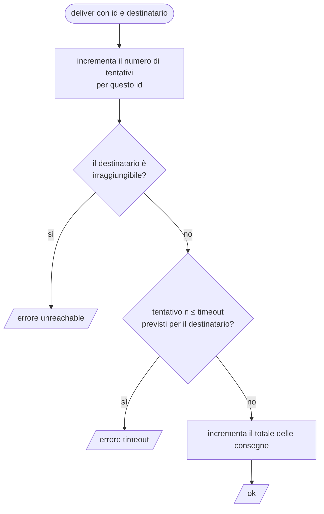

(parte 2 di 7: L07.1 Metodi, incapsulamento, visibilità) — file originale: capitoli/C07-oggetti-interfacce-trait-composizione.md

## L07.1 — Metodi, incapsulamento, visibilità

### Concetto

Fino a C06 i dati (record, enum, value object) e le funzioni che li usano erano due mondi separati: una `struct` descrive *com'è fatto* un valore, una funzione dice *che cosa si fa* con esso. Un **oggetto** li riunisce: è un valore che porta con sé le operazioni che lo riguardano. Un **metodo** è una funzione il cui primo argomento, il **destinatario** (*receiver*), è l'oggetto su cui si opera:

```text
transport.deliver(id, recipient)     ≈     deliver(transport, id, recipient)
```

Le due scritture sono equivalenti per la macchina. La prima ha un vantaggio per chi legge e per chi progetta: il destinatario compare **prima**, quindi l'editor può suggerire le operazioni disponibili, e il tipo del destinatario decide *quale* `deliver` viene chiamato (L07.4).

Quasi tutta la differenza tra i linguaggi sta in come questo destinatario viene nominato e passato:

| Linguaggio | Come si scrive il metodo | Come si nomina il destinatario | Può modificarlo? |
|---|---|---|---|
| PHP | `public function deliver(...)` dentro `class` | `$this`, implicito | sì, se la proprietà non è `readonly` |
| Python | `def deliver(self, ...)` dentro `class` | `self`, **primo parametro esplicito** | sì |
| Rust | `fn deliver(&mut self, ...)` dentro `impl` | `self`, `&self` o `&mut self`: **il tipo dice se può modificare** | solo con `&mut self` |
| Go | `func (t *Transport) Deliver(...)` fuori dalla `struct` | il *receiver*, **per valore o per puntatore** | solo con receiver puntatore |

Il secondo concetto è l'**incapsulamento**: l'oggetto espone un'*interfaccia pubblica* (poche operazioni) e nasconde la *rappresentazione* (i campi). Lo scopo non è il segreto fine a sé stesso, ma la **protezione delle invarianti**: se il contatore dei tentativi è accessibile a tutti, chiunque può azzerarlo o decrementarlo, e nessuno può più fidarsi del suo valore. Se solo `deliver` lo modifica, e lo fa solo incrementandolo, la proprietà «i tentativi per una notifica non diminuiscono mai» è garantita **in un punto solo**.

Chi è «dentro» e chi è «fuori» dipende dal linguaggio: il confine non è lo stesso.

| Aspetto | PHP | Python | Rust | Go |
|---|---|---|---|---|
| **Unità** di incapsulamento | la classe | nessuna: convenzione | il **modulo** (`mod`) | il **package** |
| Come si dichiara nascosto | `private` (solo la classe), `protected` (classe e sottoclassi) | `_x` (convenzione), `__x` (name mangling) | di default tutto è privato al modulo; `pub` apre | nome con **iniziale minuscola** |
| Chi lo può leggere | solo codice della classe | chiunque, volendo | solo codice del modulo e dei suoi figli | solo codice dello stesso package |
| Si può aggirare? | sì: Reflection | sì: basta ignorare la convenzione | praticamente no (solo `unsafe`) | no con le regole del linguaggio (solo `unsafe`) |

### Implementazione: `Transport` (T3)

`Transport` è l'oggetto con stato del programma. Ha due informazioni private (i tentativi per id e il totale delle consegne) e due soli modi di usarlo: `deliver`, che modifica lo stato, e la lettura del totale.



**Python**

```python
class Transport:
    """T3 - simulated remote endpoint. The state is private: callers can only deliver() and read delivered."""

    def __init__(self) -> None:
        self._attempts: dict[str, int] = {}   # notification id -> calls so far
        self._delivered = 0

    @property
    def delivered(self) -> int:
        return self._delivered

    def deliver(self, nid: str, recipient: str) -> str:
        n = self._attempts.get(nid, 0) + 1
        self._attempts[nid] = n
        fault = FAULTS.get(recipient, 0)
        if fault < 0:
            return "unreachable"
        if n <= fault:
            return "timeout"
        self._delivered += 1
        return ""
```

**PHP**

```php
/** T3 - simulated remote endpoint. The state is private: callers can only deliver() and read delivered(). */
final class Transport
{
    /** @var array<string,int> notification id => calls so far */
    private array $attempts = [];
    private int $delivered = 0;

    public function delivered(): int
    {
        return $this->delivered;
    }

    public function deliver(string $id, string $recipient): string
    {
        $n = ($this->attempts[$id] ?? 0) + 1;
        $this->attempts[$id] = $n;
        $fault = FAULTS[$recipient] ?? 0;
        if ($fault < 0) {
            return 'unreachable';
        }
        if ($n <= $fault) {
            return 'timeout';
        }
        $this->delivered++;
        return '';
    }
}
```

**Rust**

```rust
/// T3 - simulated remote endpoint. The fields are private to the module.
mod remote {
    use super::FAULTS;
    use std::collections::HashMap;

    pub struct Transport {
        attempts: HashMap<String, i32>, // notification id -> calls so far
        delivered: u32,
    }

    impl Transport {
        pub fn new() -> Transport {
            Transport { attempts: HashMap::new(), delivered: 0 }
        }

        pub fn delivered(&self) -> u32 {
            self.delivered
        }

        pub fn deliver(&mut self, id: &str, recipient: &str) -> Option<&'static str> {
            let n = self.attempts.entry(id.to_string()).or_insert(0);
            *n += 1;
            let fault = FAULTS.iter().find(|(r, _)| *r == recipient).map_or(0, |(_, f)| *f);
            if fault < 0 {
                return Some("unreachable");
            }
            if *n <= fault {
                return Some("timeout");
            }
            self.delivered += 1;
            None
        }
    }
}
use remote::Transport;
```

**Go**

```go
// Transport is T3 - a simulated remote endpoint. The fields are unexported: only this package can touch them.
type Transport struct {
	attempts  map[string]int // notification id -> calls so far
	delivered int
}

func NewTransport() *Transport { return &Transport{attempts: map[string]int{}} }

func (t *Transport) Delivered() int { return t.delivered }

// Deliver needs a pointer receiver: it modifies the Transport (e2).
func (t *Transport) Deliver(id, recipient string) string {
	t.attempts[id]++
	n := t.attempts[id]
	fault := faults[recipient]
	if fault < 0 {
		return "unreachable"
	}
	if n <= fault {
		return "timeout"
	}
	t.delivered++
	return ""
}
```


Che cosa fa ciascun linguaggio, riga per riga:

- **Python:** `_attempts` e `_delivered` iniziano con un trattino basso: *convenzione* per dire «non toccare». `delivered` è una `@property`: si legge come un attributo (`t.delivered`), ma non esiste un setter, quindi `t.delivered = 5` solleva `AttributeError`. L'istanza porta `self` esplicito.
- **PHP:** le proprietà sono `private`: il motore rifiuta l'accesso dall'esterno con un `Error`. I tipi (`array`, `int`) sono dichiarati; `deliver` e `delivered` sono `public`. `$this->attempts[$id] ?? 0` usa l'operatore *null coalescing*: «il valore, oppure 0 se la chiave non esiste».
- **Rust:** il `Transport` vive in un **modulo** `remote`; i suoi campi non hanno `pub`, quindi sono visibili solo dentro `remote`. `new`, `deliver` e `delivered` sono `pub`. Il metodo `deliver` prende `&mut self`: il **tipo** del destinatario dichiara che modifica lo stato, mentre `delivered` prende `&self` (sola lettura). `entry(...).or_insert(0)` legge il contatore creandolo a zero se manca.
- **Go:** i campi hanno l'iniziale minuscola (`attempts`, `delivered`), quindi sono visibili solo nel package. Il metodo `Deliver` ha un receiver **puntatore** `*Transport` perché modifica lo stato (e2 mostra perché è indispensabile). `NewTransport` è la funzione-costruttore per convenzione: Go non ha costruttori.

Il punto progettuale comune: nessun codice fuori da `Transport` può sapere *come* si contano i tentativi. Se domani il conteggio passasse a un database, i canali non cambierebbero.

### Esperimento e1 — provo a leggere lo stato privato dall'esterno

Creo un oggetto con un campo «privato» e provo a leggerlo (e, dove il linguaggio lo consente, a scriverlo) dall'esterno.

```python
class Counter:
    def __init__(self):
        self._n = 0        # one underscore: a convention, nothing more
        self.__secret = 7  # two underscores: the name is mangled


c = Counter()
print(c._n)
try:
    print(c.__secret)
except AttributeError as e:
    print("AttributeError:", e)
print(c._Counter__secret)
c._n = 99
print(c._n)
```

```php
<?php
final class Counter
{
    private int $n = 0;

    public function get(): int
    {
        return $this->n;
    }
}
$c = new Counter();
try {
    echo $c->n, "\n";
} catch (Error $e) {
    echo get_class($e), ': ', $e->getMessage(), "\n";
}
$p = new ReflectionProperty(Counter::class, 'n');
$p->setValue($c, 99); // Reflection ignores visibility
echo $c->get(), "\n";
```

```rust
mod counter {
    pub struct Counter {
        n: u32,
    }
    impl Counter {
        pub fn new() -> Counter {
            Counter { n: 0 }
        }
        pub fn get(&self) -> u32 {
            self.n
        }
    }
}

fn main() {
    let c = counter::Counter::new();
    println!("{}", c.get());
    println!("{}", c.n);
}
```

Per Go servono due package, perché il confine è il package (struttura `counter/counter.go` e `main.go`, modulo `example.com/e1`):

```go
package counter

type Counter struct {
	n int
}

func New() *Counter { return &Counter{} }

func (c *Counter) Get() int { return c.n }
```

```go
package main

import (
	"fmt"

	"example.com/e1/counter"
)

func main() {
	c := counter.New()
	fmt.Println(c.Get())
	fmt.Println(c.n)
}
```

```text
### e1.py
0
AttributeError: 'Counter' object has no attribute '__secret'
7
99
[exit 0]
### e1.php
Error: Cannot access private property Counter::$n
99
[exit 0]
### e1.rs
error[E0616]: field `n` of struct `Counter` is private
  --> e1.rs:18:22
   |
18 |     println!("{}", c.n);
   |                      ^ private field

error: aborting due to 1 previous error

For more information about this error, try `rustc --explain E0616`.
[exit 1]
### e1.go
# example.com/e1
./main.go:12:16: c.n undefined (cannot refer to unexported field n)
[exit 1]
```

| Linguaggio | Che cosa succede | Quando |
|---|---|---|
| Python | `c._n` si legge e si **scrive** senza proteste; `c.__secret` fallisce (`AttributeError`), ma solo perché il nome è stato *mutilato* in `_Counter__secret`, che resta raggiungibile | mai, è una convenzione |
| PHP | `Error: Cannot access private property`; ma `ReflectionProperty` scrive comunque il valore (`99`) | esecuzione; la Reflection è un'eccezione deliberata |
| Rust | `error[E0616]: field n of struct Counter is private` | **compilazione** |
| Go | `c.n undefined (cannot refer to unexported field n)` | **compilazione** |

Quattro risposte alla stessa domanda: *quanto dobbiamo fidarci di chi usa l'oggetto?* Python si fida («siamo adulti consenzienti»); PHP controlla a runtime ma lascia la porta della Reflection (utile per i framework di serializzazione, pericolosa per le invarianti: C22); Rust e Go rifiutano il programma prima che esista. Si noti anche la differenza di **unità**: in PHP e in Python il confine è la classe (o niente), in Rust e Go è un'unità più grande, il modulo o il package. In Rust, due `struct` nello stesso modulo vedono i campi l'una dell'altra; in Go, due tipi nello stesso package pure. Per questo in Go si dice che «il package è la classe».

### Esperimento e2 — il destinatario: modifica o copia?

Una classe tiene un contatore e un metodo `inc` lo incrementa. Che cosa succede, nei quattro linguaggi, se il metodo non ha il permesso di modificare, o se lavora su una copia?

```python
class Counter:
    def __init__(self):
        self.n = 0

    def inc(self):
        self.n += 1


c = Counter()
c.inc()
Counter.inc(c)  # the same call, with `self` passed by hand
f = c.inc       # a bound method: it carries `c` with it
f()
print(c.n, type(f).__name__, f.__self__ is c)
```

```php
<?php
final class Counter
{
    public int $n = 0;

    public function inc(): void
    {
        $this->n++;
    }
}
$c = new Counter();
$c->inc();
$f = $c->inc(...); // first-class callable: it carries $c with it
$f();
echo $c->n, ' ', get_class($f), "\n";
```

```rust
struct Counter {
    n: u32,
}

impl Counter {
    fn inc(&self) {
        self.n += 1;
    }
}

fn main() {
    let c = Counter { n: 0 };
    c.inc();
    println!("{}", c.n);
}
```

```rust
struct Counter {
    n: u32,
}

impl Counter {
    fn inc(&mut self) {
        self.n += 1;
    }
}

fn main() {
    let c = Counter { n: 0 };
    c.inc();
    println!("{}", c.n);
}
```

```go
package main

import "fmt"

type Counter struct{ n int }

func (c Counter) IncByValue()    { c.n++ } // works on a copy
func (c *Counter) IncByPointer() { c.n++ } // works on the original

func main() {
	var c Counter
	c.IncByValue()
	fmt.Println("after value receiver:  ", c.n)
	c.IncByPointer()
	fmt.Println("after pointer receiver:", c.n)
}
```

```text
### e2.py
3 method True
[exit 0]
### e2.php
2 Closure
[exit 0]
### e2.rs
error[E0594]: cannot assign to `self.n`, which is behind a `&` reference
 --> e2.rs:7:9
  |
7 |         self.n += 1;
  |         ^^^^^^^^^^^ `self` is a `&` reference, so it cannot be written to
  |
help: consider changing this to be a mutable reference
  |
6 |     fn inc(&mut self) {
  |             +++

error: aborting due to 1 previous error

For more information about this error, try `rustc --explain E0594`.
[exit 1]
### e2b.rs
error[E0596]: cannot borrow `c` as mutable, as it is not declared as mutable
  --> e2b.rs:13:5
   |
13 |     c.inc();
   |     ^ cannot borrow as mutable
   |
help: consider changing this to be mutable
   |
12 |     let mut c = Counter { n: 0 };
   |         +++

error: aborting due to 1 previous error

For more information about this error, try `rustc --explain E0596`.
[exit 1]
### e2.go
after value receiver:   0
after pointer receiver: 1
[exit 0]
```

Lettura:

- **Python:** `Counter.inc(c)` e `c.inc()` sono la stessa chiamata: il punto non è magia, è la forma abbreviata di «passa `c` come primo argomento». `c.inc` senza parentesi è un **bound method**: un oggetto che porta con sé `c` (`f.__self__ is c`). Le tre chiamate hanno incrementato lo stesso `c` (risultato 3).
- **PHP:** `$c->inc(...)` (sintassi 8.1 *first-class callable*) produce un `Closure` che ricorda `$c`; due incrementi, risultato 2.
- **Rust:** il metodo con `&self` **non può** assegnare ai campi (E0594); chiamare un metodo `&mut self` su un binding non `mut` è un secondo errore (E0596). Il compilatore verifica che *chi modifica lo dichiari due volte*: nella firma del metodo e nel binding del chiamante.
- **Go:** `IncByValue` ha il receiver `Counter` per valore: il metodo lavora su una **copia** e il chiamante non vede nulla (`n` resta 0); `IncByPointer` lavora sull'originale. Nessun errore, nessun avviso: è il bug più comune dei principianti Go, e `go vet` non lo segnala perché il codice è lecito. Regola pratica: se **un solo** metodo del tipo deve modificare lo stato (come `Deliver`), tutti i metodi del tipo usano il receiver puntatore, per coerenza.

### Focus comparativo

| Aspetto | PHP | Python | Rust | Go |
|---|---|---|---|---|
| Destinatario | `$this` implicito | `self` esplicito | `self`, `&self`, `&mut self` | receiver nominato, valore o puntatore |
| Dove si definiscono i metodi | dentro `class` | dentro `class` | in blocchi `impl` separati dalla `struct` | funzioni a parte con il receiver |
| «Modifica» dichiarata nella firma | no | no | **sì** (`&mut self`) | **sì** (receiver `*T`), ma non verificata dal chiamante |
| Confine di visibilità | classe | convenzione | modulo | package |
| Costruttore | `__construct` | `__init__` | funzione associata (`new`) per convenzione | funzione `NewT` per convenzione |
| Proprietà calcolate | metodi `get...` o `__get` | `@property` | metodi | metodi |

### Esercizio Rosetta (4′)

Scrivi un `Counter` con un metodo `inc()` che incrementa e un metodo `value()` che restituisce il valore, e fai in modo che `value()` **non possa mai diminuire** anche se il chiamante prova a impostarlo a mano. In quale linguaggio devi rinunciare alla garanzia, e perché? (Suggerimento: guarda e1.)

---

