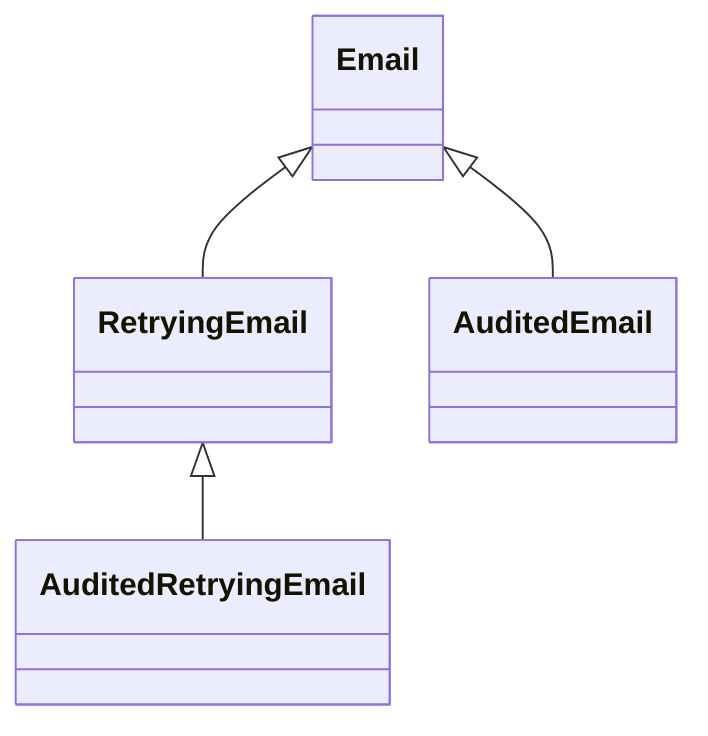
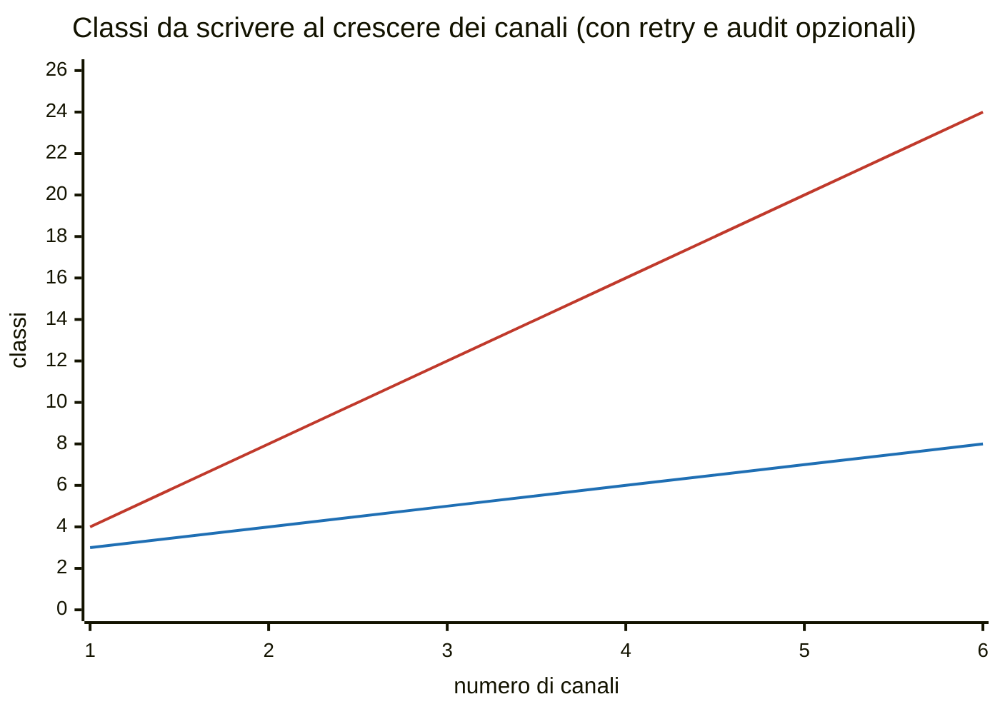
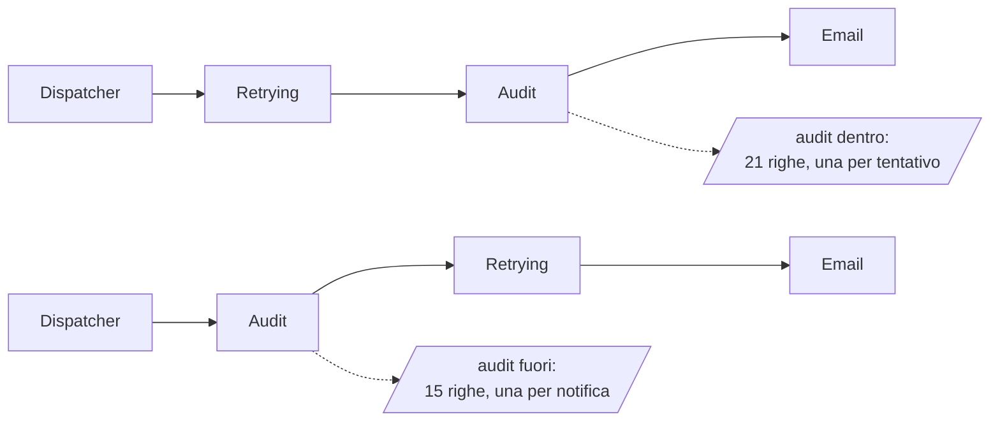
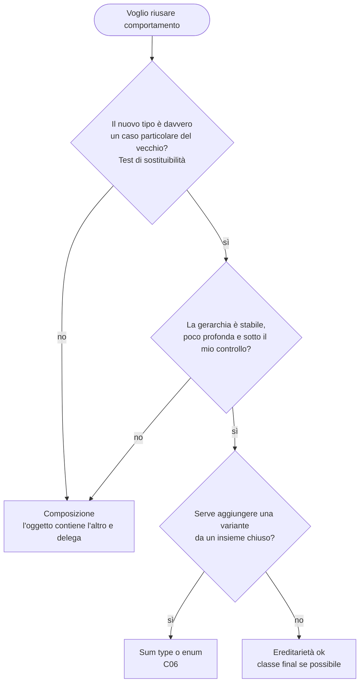

(parte 3 di 7: L07.2 Ereditarietà contro composizione) — file originale: capitoli/C07-oggetti-interfacce-trait-composizione.md

## L07.2 — Ereditarietà contro composizione

### Concetto

Quando due tipi hanno qualcosa in comune, il codice comune va scritto una volta sola. I linguaggi a oggetti offrono due strumenti, con due idee di relazione tra i tipi:

| | Ereditarietà | Composizione |
|---|---|---|
| Relazione | **«è un»** (*is-a*): `Email` *è un* `Sender` | **«ha un»** (*has-a*): `Retrying` *ha un* `Sender` |
| Come si riusa | la sottoclasse **acquisisce** campi e metodi della classe base e può ridefinirli (*override*) | l'oggetto **contiene** un altro oggetto e gli **delega** il lavoro |
| Accoppiamento | alto: la sottoclasse dipende dai *dettagli* della base | basso: dipende solo dall'interfaccia pubblica dell'oggetto contenuto |
| Quando si decide | al momento di scrivere la classe | anche a **runtime** (si può sostituire l'oggetto contenuto) |
| Combinazioni | una nuova classe per ogni combinazione | si impilano oggetti esistenti |
| Rischio tipico | classe base fragile, gerarchie profonde, diamante | più codice di inoltro (*boilerplate*) |

Il principio che il corso adotta, noto come «favorisci la composizione sull'ereditarietà», non dice che l'ereditarietà sia sbagliata. Dice che è **lo strumento più forte** (crea una dipendenza stretta e visibile a tutti) e quindi va usato quando serve davvero, e non per risparmiare qualche riga. La verifica pratica è il **test di sostituibilità**: *dove il programma si aspetta un X, posso metterci un Y senza che nessuno se ne accorga?* Se la risposta è «sì, sempre», `Y` è davvero un `X`. Se dipende, è una composizione travestita da ereditarietà.

I quattro linguaggi hanno fatto scelte diverse, e questa è la differenza più grande del capitolo:

| | PHP | Python | Rust | Go |
|---|---|---|---|---|
| Ereditarietà di classi | **singola** (`extends`), con `abstract` e `final` | **multipla**, risolta dall'ordine MRO | **assente** per scelta | **assente**: c'è l'*embedding* |
| Riuso orizzontale | `trait` (copia di metodi nella classe) | mixin (classi pensate per essere ereditate insieme) | metodi di default nei `trait` | embedding di struct e interface |
| Chiudere l'ereditarietà | `final class` | convenzione (nessuna parola chiave) | n/a | n/a |
| Override | `parent::metodo()` | `super().metodo()` | n/a (si implementa il trait) | si ridefinisce il metodo nell'esterno |

### Il caso del programma: `Email` *ha un* `Transport`

Nel programma ogni canale ha bisogno di un `Transport` (T3). Si poteva scrivere `class Email extends Transport`: «un'e-mail è un trasporto». Non regge il test di sostituibilità: un'`Email` non è un `Transport` in nessun senso del dominio; erediterebbe un `deliver` pubblico che nessuno dovrebbe chiamare, e il tipo `Transport` sarebbe **fissato** al momento della scrittura (in un test non potremmo sostituirlo con uno finto). La composizione risolve tutto: `Email` ha un campo privato `transport`, lo costruisce, lo usa, e solo `Email` lo conosce. Lo si vede nel codice di T4 (L07.3): ogni canale ha una riga `self._transport = Transport()` e una chiamata `self._transport.deliver(...)`.

### Implementazione: `Retrying` e `Audit` (T5)

Il requisito è «ritentare gli errori transitori» e «registrare ogni chiamata». Sono comportamenti **trasversali**: valgono per qualunque canale e non c'entrano con le regole dell'e-mail o dell'SMS. Con l'ereditarietà si scriverebbe una classe per ogni combinazione:



…e poi la stessa cosa per `Sms` e `Webhook`. Con tre canali e due comportamenti opzionali le combinazioni sono 2 × 2 = 4 per canale, quindi **12 classi**; con la composizione bastano **3 canali + 2 decorator = 5 classi**. Il divario cresce con i canali (e con i comportamenti: un terzo comportamento raddoppia ancora le combinazioni):



(La linea rossa, che sale in fretta, è l'ereditarietà: 4 × canali; quella blu è la composizione: canali + 2.) Il **decorator** è il nome del pattern: un oggetto che *rispetta lo stesso contratto* dell'oggetto che contiene e aggiunge un comportamento prima o dopo averlo chiamato. Dall'esterno, `Retrying(Audit(Email))` si usa esattamente come un `Email`.

**Retrying**

**Python**

```python
class Retrying:
    """T5 - decorator: it is a Sender and it HAS a Sender. Retries only transient errors."""
    TRANSIENT = ("timeout",)

    def __init__(self, inner: Sender, max_attempts: int):
        self._inner = inner
        self._max = max_attempts

    def name(self) -> str:
        return self._inner.name()

    def delivered(self) -> int:
        return self._inner.delivered()

    def send(self, n: Notification) -> Outcome:
        total = 0
        while True:
            o = self._inner.send(n)
            total += o.attempts
            if o.err not in self.TRANSIENT or total >= self._max:
                return Outcome(o.err, total)
```

**PHP**

```php
/** T5 - decorator: it is a Sender and it HAS a Sender. Retries only transient errors. */
final class Retrying implements Sender
{
    private const TRANSIENT = ['timeout'];

    public function __construct(private readonly Sender $inner, private readonly int $maxAttempts)
    {
    }

    public function name(): string
    {
        return $this->inner->name();
    }

    public function delivered(): int
    {
        return $this->inner->delivered();
    }

    public function send(Notification $n): Outcome
    {
        $total = 0;
        while (true) {
            $o = $this->inner->send($n);
            $total += $o->attempts;
            if (!in_array($o->err, self::TRANSIENT, true) || $total >= $this->maxAttempts) {
                return new Outcome($o->err, $total);
            }
        }
    }
}
```

**Rust**

```rust
/// T5 - decorator: it is a Sender and it HAS a Sender (static dispatch: S is known at compile time).
struct Retrying<S: Sender> {
    inner: S,
    max_attempts: u32,
}

impl<S: Sender> Sender for Retrying<S> {
    fn name(&self) -> &'static str {
        self.inner.name()
    }

    fn delivered(&self) -> u32 {
        self.inner.delivered()
    }

    fn send(&mut self, n: &Notification) -> Outcome {
        let mut total = 0;
        loop {
            let o = self.inner.send(n);
            total += o.attempts;
            let transient = o.err == Some("timeout");
            if !transient || total >= self.max_attempts {
                return Outcome { err: o.err, attempts: total };
            }
        }
    }
}
```

**Go**

```go
// Retrying is T5 - a decorator. It EMBEDS a Sender: Name and Delivered are promoted
// from the embedded value, and only Send is overridden.
type Retrying struct {
	Sender
	maxAttempts int
}

func (r Retrying) Send(n Notification) Outcome {
	total := 0
	for {
		o := r.Sender.Send(n)
		total += o.Attempts
		if o.Err != "timeout" || total >= r.maxAttempts {
			return Outcome{o.Err, total}
		}
	}
}
```


**Audit**

**Python**

```python
class Audit:
    """T5 - decorator: logs every call to the wrapped Sender on stderr."""

    def __init__(self, inner: Sender):
        self._inner = inner

    def name(self) -> str:
        return self._inner.name()

    def delivered(self) -> int:
        return self._inner.delivered()

    def send(self, n: Notification) -> Outcome:
        o = self._inner.send(n)
        print(f"audit channel={self.name()} id={n.id} result={o.err or 'ok'}", file=sys.stderr)
        return o
```

**PHP**

```php
/** T5 - decorator: logs every call to the wrapped Sender on stderr. */
final class Audit implements Sender
{
    public function __construct(private readonly Sender $inner)
    {
    }

    public function name(): string
    {
        return $this->inner->name();
    }

    public function delivered(): int
    {
        return $this->inner->delivered();
    }

    public function send(Notification $n): Outcome
    {
        $o = $this->inner->send($n);
        fwrite(STDERR, "audit channel={$this->name()} id=$n->id result=" . ($o->err ?: 'ok') . "\n");
        return $o;
    }
}
```

**Rust**

```rust
/// T5 - decorator: logs every call to the wrapped Sender on stderr.
struct Audit<S: Sender> {
    inner: S,
}

impl<S: Sender> Sender for Audit<S> {
    fn name(&self) -> &'static str {
        self.inner.name()
    }

    fn delivered(&self) -> u32 {
        self.inner.delivered()
    }

    fn send(&mut self, n: &Notification) -> Outcome {
        let o = self.inner.send(n);
        eprintln!("audit channel={} id={} result={}", self.name(), n.id, o.err.unwrap_or("ok"));
        o
    }
}
```

**Go**

```go
// Audit is T5 - a decorator: logs every call to the wrapped Sender on stderr.
type Audit struct{ Sender }

func (a Audit) Send(n Notification) Outcome {
	o := a.Sender.Send(n)
	res := o.Err
	if res == "" {
		res = "ok"
	}
	fmt.Fprintf(os.Stderr, "audit channel=%s id=%s result=%s\n", a.Name(), n.ID, res)
	return o
}
```


Che cosa fa ciascun linguaggio:

- **Python:** `Retrying` ha un attributo privato `_inner` ed espone gli stessi tre metodi del contratto. `name` e `delivered` si limitano a inoltrare la chiamata. Il ciclo `while True` chiama l'oggetto interno, somma i tentativi e si ferma se l'errore non è transitorio **o** se ha esaurito il budget. Python non dichiara che `Retrying` è un `Sender`: lo è perché ha i metodi (L07.3), e `mypy --strict` lo conferma.
- **PHP:** `Retrying` e `Audit` dichiarano `implements Sender` e ricevono il `Sender` interno nel costruttore, con **constructor promotion** e `private readonly`: l'oggetto interno non cambia dopo la costruzione. `in_array(..., true)` usa il confronto stretto.
- **Rust:** `Retrying<S: Sender>` è una `struct` **generica**: contiene un `S` qualunque purché sia un `Sender`. Il tipo completo di `Retrying { inner: Audit { inner: Email::new() } }` è `Retrying<Audit<Email>>`, noto a compile time (L07.4).
- **Go:** `Retrying` **incorpora** (embedding) l'interfaccia `Sender` come campo senza nome: `Name()` e `Delivered()` sono *promossi* e non vanno riscritti. Si ridefinisce solo `Send`, e l'originale si raggiunge con `r.Sender.Send(n)`. Questo è il caso in cui l'embedding dà un vantaggio concreto: i decorator di Go sono più brevi di quelli degli altri tre linguaggi.

### Esperimento e3 — se la base chiama un metodo, chi risponde?

Il classico guaio dell'ereditarietà. La classe base ha un metodo `run` che chiama un altro suo metodo `name`; la sottoclasse ridefinisce `name`. Chi viene chiamato da `run`? Per Rust uso un trait con metodo di default (la cosa più vicina); per Go, l'embedding.

```python
class Base:
    def name(self):
        return "base"

    def run(self):
        return f"running {self.name()}"


class Derived(Base):
    def name(self):
        return "derived"


print(Derived().run())
```

```php
<?php
class Base
{
    public function name(): string
    {
        return 'base';
    }

    public function run(): string
    {
        return 'running ' . $this->name();
    }
}
class Derived extends Base
{
    public function name(): string
    {
        return 'derived';
    }
}
echo (new Derived())->run(), "\n";
```

```rust
trait Job {
    fn name(&self) -> String;
    fn run(&self) -> String {
        format!("running {}", self.name()) // default method: calls the implementor's name()
    }
}

struct Derived;

impl Job for Derived {
    fn name(&self) -> String {
        "derived".to_string()
    }
}

fn main() {
    println!("{}", Derived.run());
}
```

```go
package main

import "fmt"

type Base struct{}

func (Base) Name() string { return "base" }
func (b Base) Run() string { return "running " + b.Name() }

// Derived embeds Base and redefines Name.
type Derived struct{ Base }

func (Derived) Name() string { return "derived" }

// Namer + a function: the Go way to get the "template method".
type Namer interface{ Name() string }

func Run(n Namer) string { return "running " + n.Name() }

func main() {
	d := Derived{}
	fmt.Println("d.Name():", d.Name())
	fmt.Println("d.Run()  :", d.Run())
	fmt.Println("Run(d)   :", Run(d))
}
```

```text
### e3.py
running derived
[exit 0]
### e3.php
running derived
[exit 0]
### e3.rs
running derived
[exit 0]
### e3.go
d.Name(): derived
d.Run()  : running base
Run(d)   : running derived
[exit 0]
```

In Python, PHP e Rust il metodo `run` della base «vede» la ridefinizione: si dice che il dispatch è **virtuale** (la chiamata a `self.name()` si risolve guardando il tipo *effettivo* dell'oggetto). In Go **no**: `Derived{}.Run()` stampa `running base`. L'embedding è composizione con una scorciatoia di sintassi, non ereditarietà: `Base.Run` non sa di essere dentro un `Derived`, quindi chiama il *proprio* `Name`. Per ottenere il comportamento «polimorfico» in Go si passa dall'interfaccia (`Run(n Namer)`): è la forma idiomatica, e dice qualcosa sulla filosofia del linguaggio.

Dal lato dei rischi, è la stessa proprietà a rendere l'ereditarietà **fragile**: la sottoclasse funziona solo perché `Base.run` chiama proprio `self.name()`. Se un domani la base smette di farlo (o comincia a farlo con un'altra sequenza di chiamate), la sottoclasse si rompe senza che nessun test o compilatore protesti. Si dice che la sottoclasse dipende dai *dettagli di implementazione* della base, non solo dal suo contratto.

### Esperimento e4 — il diamante

Due classi ereditano dalla stessa base e una quarta eredita da entrambe. Se la base e le due classi definiscono lo stesso metodo, quale vince? Python risolve con l'ordine MRO; per gli altri tre uso quello che c'è: trait di PHP, trait di Rust, embedding di Go. In tutti i casi `B` e `C` hanno un metodo `hello` e `D` li ha entrambi.

```python
class A:
    def hello(self):
        return "A"


class B(A):
    def hello(self):
        return "B>" + super().hello()


class C(A):
    def hello(self):
        return "C>" + super().hello()


class D(B, C):
    def hello(self):
        return "D>" + super().hello()


print(D().hello())
print([k.__name__ for k in D.__mro__])
```

```php
<?php
trait B
{
    public function hello(): string
    {
        return 'B';
    }
}
trait C
{
    public function hello(): string
    {
        return 'C';
    }
}
class D
{
    use B, C;
}
echo (new D())->hello(), "\n";
```

```php
<?php
trait B
{
    public function hello(): string
    {
        return 'B';
    }
}
trait C
{
    public function hello(): string
    {
        return 'C';
    }
}
class D
{
    use B, C {
        B::hello insteadof C;
        C::hello as helloC;
    }
}
$d = new D();
echo $d->hello(), ' ', $d->helloC(), "\n";
```

```rust
trait B {
    fn hello(&self) -> &'static str;
}
trait C {
    fn hello(&self) -> &'static str;
}
struct D;
impl B for D {
    fn hello(&self) -> &'static str {
        "B"
    }
}
impl C for D {
    fn hello(&self) -> &'static str {
        "C"
    }
}

fn main() {
    let d = D;
    println!("{}", d.hello());
}
```

```rust
trait B {
    fn hello(&self) -> &'static str;
}
trait C {
    fn hello(&self) -> &'static str;
}
struct D;
impl B for D {
    fn hello(&self) -> &'static str {
        "B"
    }
}
impl C for D {
    fn hello(&self) -> &'static str {
        "C"
    }
}

fn main() {
    let d = D;
    println!("{} {}", B::hello(&d), <D as C>::hello(&d));
}
```

```go
package main

import "fmt"

type B struct{}
type C struct{}

func (B) Hello() string { return "B" }
func (C) Hello() string { return "C" }

type D struct {
	B
	C
}

func main() {
	d := D{}
	fmt.Println(d.Hello())
}
```

```go
package main

import "fmt"

type B struct{}
type C struct{}

func (B) Hello() string { return "B" }
func (C) Hello() string { return "C" }

type D struct {
	B
	C
}

func main() {
	d := D{}
	fmt.Println(d.B.Hello(), d.C.Hello())
}
```

```text
### e4.py
D>B>C>A
['D', 'B', 'C', 'A', 'object']
[exit 0]
### e4.php
PHP Fatal error:  Trait method C::hello has not been applied as D::hello, because of collision with B::hello in e4.php on line 16
[exit 255]
### e4ok.php
B C
[exit 0]
### e4.rs
error[E0034]: multiple applicable items in scope
  --> e4.rs:21:22
   |
21 |     println!("{}", d.hello());
   |                      ^^^^^ multiple `hello` found
   |
note: candidate #1 is defined in an impl of the trait `B` for the type `D`
  --> e4.rs:9:5
   |
 9 |     fn hello(&self) -> &'static str {
   |     ^^^^^^^^^^^^^^^^^^^^^^^^^^^^^^^
note: candidate #2 is defined in an impl of the trait `C` for the type `D`
  --> e4.rs:14:5
   |
14 |     fn hello(&self) -> &'static str {
   |     ^^^^^^^^^^^^^^^^^^^^^^^^^^^^^^^
help: disambiguate the method for candidate #1
   |
21 -     println!("{}", d.hello());
21 +     println!("{}", B::hello(&d));
   |
help: disambiguate the method for candidate #2
   |
21 -     println!("{}", d.hello());
21 +     println!("{}", C::hello(&d));
   |

error: aborting due to 1 previous error

For more information about this error, try `rustc --explain E0034`.
[exit 1]
### e4ok.rs
B C
[exit 0]
### e4.go
# command-line-arguments
./e4.go:18:16: ambiguous selector d.Hello
[exit 1]
### e4ok.go
B C
[exit 0]
```

| Linguaggio | Che cosa succede | Chi decide |
|---|---|---|
| Python | `D>B>C>A`: ogni `super()` passa al successivo nell'**MRO** (`D, B, C, A, object`), quindi `A` è chiamata una volta sola | l'algoritmo C3, **in silenzio** |
| PHP | `Fatal error: Trait method C::hello has not been applied as D::hello, because of collision with B::hello`; si risolve con `insteadof` e `as` | **il programmatore**, esplicitamente |
| Rust | `error[E0034]: multiple applicable items in scope`; si risolve con `B::hello(&d)` o `<D as C>::hello(&d)` | il programmatore, a **compilazione** |
| Go | `ambiguous selector d.Hello`; si risolve con `d.B.Hello()` | il programmatore, a compilazione (e solo se si usa il nome ambiguo) |

Python è l'unico che decide *da solo*: l'ordine in cui si scrivono le basi (`D(B, C)` contro `D(C, B)`) cambia il comportamento, e nessun errore lo segnala. È anche ciò che permette di costruire i **mixin** cooperativi dell'esperimento successivo. Gli altri tre preferiscono rifiutare l'ambiguità e chiedere una scelta: lo stesso atteggiamento che si ritrova nel resto del corso (Rust e Go: il compilatore non indovina).

### Esperimento e5 — l'ordine conta: mixin e decorator

Se l'ereditarietà multipla di Python permette di scrivere `RetryMixin` e `AuditMixin` come ingredienti da mescolare, la differenza con i decorator è nel **dove si vede l'ordine**. Nel codice che segue la base `Email` fallisce due volte e poi riesce; i due mixin si combinano nei due ordini possibili.

```python
class Email:
    def __init__(self):
        self.calls = 0

    def send(self, msg):
        self.calls += 1
        return "timeout" if self.calls < 3 else "ok"   # fails twice, then succeeds


class RetryMixin:
    def send(self, msg):
        for _ in range(3):
            r = super().send(msg)
            if r != "timeout":
                break
        return r


class AuditMixin:
    def send(self, msg):
        r = super().send(msg)
        print("  audit:", r)
        return r


class RetryOverAudit(RetryMixin, AuditMixin, Email):
    pass


class AuditOverRetry(AuditMixin, RetryMixin, Email):
    pass


for cls in (RetryOverAudit, AuditOverRetry):
    print(cls.__name__, [k.__name__ for k in cls.__mro__][:4])
    print("  result:", cls().send("hi"))
```

Con i decorator del programma lo stesso scambio si scrive a mano: `Retrying(Audit(x))` (l'audit è **dentro**: vede ogni tentativo) contro `Audit(Retrying(x))` (l'audit è **fuori**: vede solo il risultato finale). Ho cambiato solo le righe di `build_routes` nei quattro programmi e ho contato le righe di audit su stderr:

```text
### e5m.py
RetryOverAudit ['RetryOverAudit', 'RetryMixin', 'AuditMixin', 'Email']
  audit: timeout
  audit: timeout
  audit: ok
  result: ok
AuditOverRetry ['AuditOverRetry', 'AuditMixin', 'RetryMixin', 'Email']
  audit: ok
  result: ok
[exit 0]
### e5 programma, decorator in ordine Retrying(Audit(x))  [originale]
audit_lines=21
### e5 programma, ordine invertito Audit(Retrying(x)) in PHP/Python/Rust/Go
py audit_lines=15 stdout_identical_to_original=yes
php audit_lines=15 stdout_identical_to_original=yes
rs audit_lines=15 stdout_identical_to_original=yes
go audit_lines=15 stdout_identical_to_original=yes
```



L'esito su stdout (le righe `status=sent/failed`) **non cambia**: cambia solo il *log*. È una proprietà comune ai decorator di questo tipo: l'ordine è una scelta di progetto, non un dettaglio. Il confronto con i mixin è questo: nella versione a mixin l'ordine dipende da una lista di basi (`class A(RetryMixin, AuditMixin, Email)`) e dall'algoritmo MRO; nella composizione è **visibile come annidamento** nel punto in cui si costruisce la pila (`build_routes`, il «bordo» del programma), e ogni oggetto resta testabile da solo. Non è un caso che il programma costruisca le pile in **una sola funzione**: il posto dove si decide la composizione deve essere uno e leggibile.

### Quando l'ereditarietà è la scelta giusta



Casi in cui l'ereditarietà ha senso: un *punto di estensione* previsto da un framework (una `Exception` da specializzare; una classe base astratta del framework che dichiara «ridefinisci questo metodo»); una gerarchia chiusa e piccola, sotto il proprio controllo; una vera relazione «è un caso particolare di». In tutti gli altri casi, un oggetto contenuto e un'interfaccia piccola sono più semplici da cambiare.

### Focus comparativo

| Aspetto | PHP | Python | Rust | Go |
|---|---|---|---|---|
| Ereditarietà di classi | singola | multipla (MRO) | no | no |
| Riuso "orizzontale" | `trait` | mixin | default nei `trait`, generics | embedding |
| Override verso la base | `parent::` | `super()` | n/a | `r.Sender.Send(n)` |
| La base vede l'override? | sì | sì | sì (default methods) | **no** (e3) |
| Diamante | errore, si risolve a mano | risolto da MRO | errore, si risolve a mano | errore se si usa il nome |
| Chiudere una classe | `final` | convenzione | n/a (non ereditabile) | n/a |
| Decorator con il minimo codice | inoltro esplicito | inoltro esplicito | inoltro esplicito | **embedding** promuove i metodi |

### Esercizio Rosetta (4′)

Aggiungi un decorator `RateLimited(max)` che lascia passare al massimo `max` chiamate e rifiuta le successive con l'errore permanente `rate_limited`. Dove ne conservi il contatore? Perché in Go il decorator deve avere un receiver puntatore, mentre `Retrying` e `Audit` possono avere il receiver per valore?

---

