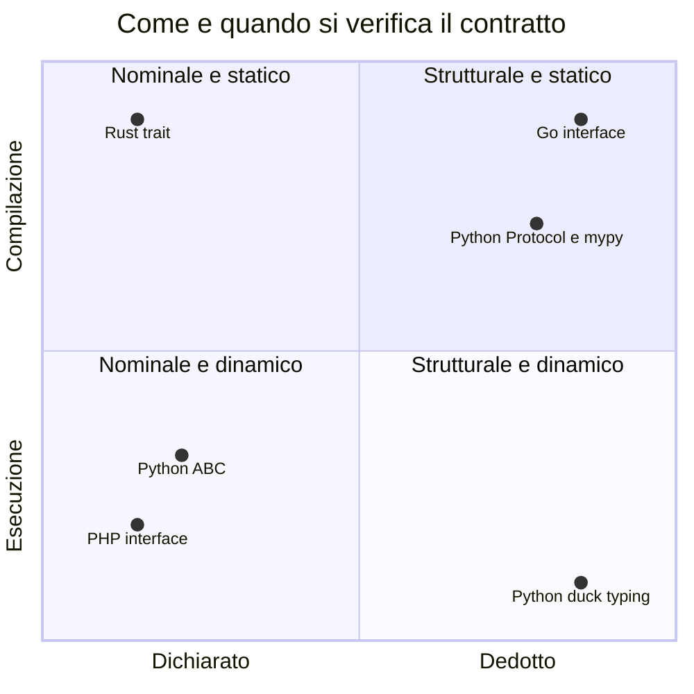

(parte 4 di 7: L07.3 Interfacce, trait, protocol) — file originale: capitoli/C07-oggetti-interfacce-trait-composizione.md

## L07.3 — Interfacce, trait, protocol: tipizzazione nominale e strutturale

### Concetto

Un'**interfaccia** è un **contratto**: un elenco di operazioni (nome, argomenti, tipo del risultato) senza il codice che le realizza. Chi *usa* l'interfaccia sa solo quello che il contratto promette; chi la *realizza* si impegna a mantenerlo. È il meccanismo che permette a `Dispatcher` (T6) di chiamare `send` senza sapere se dietro c'è un'e-mail, un SMS o un decorator.

La domanda importante non è «come si scrive un'interfaccia» (ogni linguaggio ha la sua sintassi), ma: **come si stabilisce che un tipo rispetta il contratto?** Ci sono due risposte, e dividono i linguaggi.

| | Tipizzazione **nominale** | Tipizzazione **strutturale** |
|---|---|---|
| Idea | «È un `Sender` perché **l'ha dichiarato**» | «È un `Sender` perché **ha i metodi** di un `Sender`» |
| Identità | essenza dichiarata | comportamento osservato |
| Chi deve conoscere chi | il tipo deve conoscere l'interfaccia (per nominarla) | il tipo **non sa nulla** dell'interfaccia |
| Pregio | intenzione esplicita; nessun «falso positivo» per coincidenza di nomi | si può rendere compatibile un tipo **dopo il fatto**, senza modificarlo |
| Costo | accoppiamento; non si può adattare un tipo altrui | un tipo può rispettare un contratto *per caso* |

E c'è una seconda dimensione, indipendente: **quando** si verifica.



I quattro linguaggi occupano quattro posizioni diverse, e Python ne copre tre:

| | PHP | Python | Rust | Go |
|---|---|---|---|---|
| Costrutto | `interface` | `ABC` (nominale), `Protocol` (strutturale), duck typing (nessun contratto scritto) | `trait` | `interface` |
| Conformità | **nominale**: `implements` | ABC: nominale; `Protocol` e duck typing: **strutturale** | **nominale**: `impl Trait for Type` | **strutturale**: automatica |
| Verifica | esecuzione (type declarations) | esecuzione (ABC, `isinstance`), type checker (`Protocol`) | **compilazione** | **compilazione** |

### Implementazione: il contratto `Sender` e i tre canali (T4)

Il contratto ha tre operazioni: `name` (come si chiama il canale, per i log), `send` (spedisce una notifica e restituisce l'esito) e `delivered` (quante consegne ha fatto, per il riepilogo).

**Python**

```python
class Sender(Protocol):
    """T4 - the contract: anything with these three methods is a Sender."""

    def name(self) -> str: ...
    def send(self, n: Notification) -> Outcome: ...
    def delivered(self) -> int: ...
```

**PHP**

```php
/** T4 - the contract: a class is a Sender only if it declares `implements Sender`. */
interface Sender
{
    public function name(): string;

    public function send(Notification $n): Outcome;

    public function delivered(): int;
}
```

**Rust**

```rust
/// T4 - the contract. A type is a Sender only through an explicit `impl Sender for ...`.
trait Sender {
    fn name(&self) -> &'static str;
    fn send(&mut self, n: &Notification) -> Outcome;
    fn delivered(&self) -> u32;
}
```

**Go**

```go
// Sender is T4 - the contract. Any type with these three methods satisfies it: no "implements" needed.
type Sender interface {
	Name() string
	Send(n Notification) Outcome
	Delivered() int
}
```


- **Python:** `Sender` è un `Protocol`: una classe i cui metodi hanno corpo `...` e che descrive la **forma** richiesta. Nessuna classe del programma la nomina nelle proprie basi: `Email` non scrive `class Email(Sender)`. È il type checker (mypy) a verificare, nei punti in cui una funzione si aspetta un `Sender`, che il tipo passato ne abbia i metodi con le firme giuste. A runtime Python non controlla nulla.
- **PHP:** `interface Sender` elenca le firme. Una classe è un `Sender` solo se scrive `implements Sender`; chi non lo scrive e viene passato dove si aspetta un `Sender` provoca un `TypeError` a runtime (e6).
- **Rust:** `trait Sender` definisce le firme. `send` prende `&mut self` perché la consegna modifica il `Transport` (L07.1). Il tipo deve fare `impl Sender for Email`: l'implementazione è un blocco **separato** dalla `struct`, e il compilatore verifica che ci siano tutti i metodi con le firme giuste.
- **Go:** `interface` con tre metodi. Nessuna parola chiave `implements`: qualunque tipo con quei tre metodi è un `Sender`, anche uno scritto prima che l'interfaccia esistesse.

I tre canali. Ciascuno **valida** il destinatario con regole sue e poi delega la consegna al proprio `Transport`. Il valore restituito, `Outcome`, è un value object (C06): un campo `err` (stringa vuota in Python, PHP e Go; `None` in Rust, quando l'invio è riuscito) e il numero di `attempts`. Un canale restituisce sempre `attempts = 1`: sono i decorator a sommare.

**E-mail**

**Python**

```python
class Email:
    def __init__(self) -> None:
        self._transport = Transport()

    def name(self) -> str:
        return "email"

    def delivered(self) -> int:
        return self._transport.delivered

    def send(self, n: Notification) -> Outcome:
        parts = n.recipient.split("@")
        if len(parts) != 2 or not parts[0] or "." not in parts[1] or " " in n.recipient:
            return Outcome("invalid_recipient", 1)
        return Outcome(self._transport.deliver(n.id, n.recipient), 1)
```

**PHP**

```php
final class Email implements Sender
{
    private Transport $transport;

    public function __construct()
    {
        $this->transport = new Transport();
    }

    public function name(): string
    {
        return 'email';
    }

    public function delivered(): int
    {
        return $this->transport->delivered();
    }

    public function send(Notification $n): Outcome
    {
        $parts = explode('@', $n->recipient);
        if (count($parts) !== 2 || $parts[0] === '' || !str_contains($parts[1], '.') || str_contains($n->recipient, ' ')) {
            return new Outcome('invalid_recipient', 1);
        }
        return new Outcome($this->transport->deliver($n->id, $n->recipient), 1);
    }
}
```

**Rust**

```rust
struct Email {
    transport: Transport,
}

impl Email {
    fn new() -> Email {
        Email { transport: Transport::new() }
    }
}

impl Sender for Email {
    fn name(&self) -> &'static str {
        "email"
    }

    fn delivered(&self) -> u32 {
        self.transport.delivered()
    }

    fn send(&mut self, n: &Notification) -> Outcome {
        let parts: Vec<&str> = n.recipient.split('@').collect();
        if parts.len() != 2 || parts[0].is_empty() || !parts[1].contains('.') || n.recipient.contains(' ') {
            return Outcome { err: Some("invalid_recipient"), attempts: 1 };
        }
        Outcome { err: self.transport.deliver(&n.id, &n.recipient), attempts: 1 }
    }
}
```

**Go**

```go
type Email struct{ transport *Transport }

func NewEmail() *Email { return &Email{transport: NewTransport()} }

func (e *Email) Name() string   { return "email" }
func (e *Email) Delivered() int { return e.transport.Delivered() }

func (e *Email) Send(n Notification) Outcome {
	parts := strings.Split(n.Recipient, "@")
	if len(parts) != 2 || parts[0] == "" || !strings.Contains(parts[1], ".") || strings.Contains(n.Recipient, " ") {
		return Outcome{"invalid_recipient", 1}
	}
	return Outcome{e.transport.Deliver(n.ID, n.Recipient), 1}
}
```


**SMS**

**Python**

```python
class Sms:
    MAX_LEN = 40

    def __init__(self) -> None:
        self._transport = Transport()

    def name(self) -> str:
        return "sms"

    def delivered(self) -> int:
        return self._transport.delivered

    def send(self, n: Notification) -> Outcome:
        digits = n.recipient[1:]
        if not (n.recipient.startswith("+") and 8 <= len(digits) <= 15
                and digits.isascii() and digits.isdigit()):
            return Outcome("invalid_recipient", 1)
        if len(n.message) > self.MAX_LEN:
            return Outcome("too_long", 1)
        return Outcome(self._transport.deliver(n.id, n.recipient), 1)
```

**PHP**

```php
final class Sms implements Sender
{
    private const MAX_LEN = 40;
    private Transport $transport;

    public function __construct()
    {
        $this->transport = new Transport();
    }

    public function name(): string
    {
        return 'sms';
    }

    public function delivered(): int
    {
        return $this->transport->delivered();
    }

    public function send(Notification $n): Outcome
    {
        if (preg_match('/^\+[0-9]{8,15}\z/', $n->recipient) !== 1) {
            return new Outcome('invalid_recipient', 1);
        }
        if (mb_strlen($n->message) > self::MAX_LEN) {
            return new Outcome('too_long', 1);
        }
        return new Outcome($this->transport->deliver($n->id, $n->recipient), 1);
    }
}
```

**Rust**

```rust
struct Sms {
    transport: Transport,
}

impl Sms {
    const MAX_LEN: usize = 40;

    fn new() -> Sms {
        Sms { transport: Transport::new() }
    }
}

impl Sender for Sms {
    fn name(&self) -> &'static str {
        "sms"
    }

    fn delivered(&self) -> u32 {
        self.transport.delivered()
    }

    fn send(&mut self, n: &Notification) -> Outcome {
        let digits = n.recipient.strip_prefix('+').unwrap_or("");
        if !(8..=15).contains(&digits.len()) || !digits.bytes().all(|b| b.is_ascii_digit()) {
            return Outcome { err: Some("invalid_recipient"), attempts: 1 };
        }
        if n.message.chars().count() > Self::MAX_LEN {
            return Outcome { err: Some("too_long"), attempts: 1 };
        }
        Outcome { err: self.transport.deliver(&n.id, &n.recipient), attempts: 1 }
    }
}
```

**Go**

```go
type Sms struct{ transport *Transport }

const smsMaxLen = 40

func NewSms() *Sms { return &Sms{transport: NewTransport()} }

func (s *Sms) Name() string   { return "sms" }
func (s *Sms) Delivered() int { return s.transport.Delivered() }

func (s *Sms) Send(n Notification) Outcome {
	digits := strings.TrimPrefix(n.Recipient, "+")
	if digits == n.Recipient || len(digits) < 8 || len(digits) > 15 || strings.Trim(digits, "0123456789") != "" {
		return Outcome{"invalid_recipient", 1}
	}
	if utf8.RuneCountInString(n.Message) > smsMaxLen {
		return Outcome{"too_long", 1}
	}
	return Outcome{s.transport.Deliver(n.ID, n.Recipient), 1}
}
```


**Webhook**

**Python**

```python
class Webhook:
    def __init__(self) -> None:
        self._transport = Transport()

    def name(self) -> str:
        return "webhook"

    def delivered(self) -> int:
        return self._transport.delivered

    def send(self, n: Notification) -> Outcome:
        r = n.recipient
        if not r.startswith("https://") or len(r) == len("https://") or " " in r:
            return Outcome("invalid_recipient", 1)
        return Outcome(self._transport.deliver(n.id, r), 1)
```

**PHP**

```php
final class Webhook implements Sender
{
    private Transport $transport;

    public function __construct()
    {
        $this->transport = new Transport();
    }

    public function name(): string
    {
        return 'webhook';
    }

    public function delivered(): int
    {
        return $this->transport->delivered();
    }

    public function send(Notification $n): Outcome
    {
        $r = $n->recipient;
        if (!str_starts_with($r, 'https://') || strlen($r) === strlen('https://') || str_contains($r, ' ')) {
            return new Outcome('invalid_recipient', 1);
        }
        return new Outcome($this->transport->deliver($n->id, $r), 1);
    }
}
```

**Rust**

```rust
struct Webhook {
    transport: Transport,
}

impl Webhook {
    fn new() -> Webhook {
        Webhook { transport: Transport::new() }
    }
}

impl Sender for Webhook {
    fn name(&self) -> &'static str {
        "webhook"
    }

    fn delivered(&self) -> u32 {
        self.transport.delivered()
    }

    fn send(&mut self, n: &Notification) -> Outcome {
        let r = &n.recipient;
        if !r.starts_with("https://") || r.len() == "https://".len() || r.contains(' ') {
            return Outcome { err: Some("invalid_recipient"), attempts: 1 };
        }
        Outcome { err: self.transport.deliver(&n.id, r), attempts: 1 }
    }
}
```

**Go**

```go
type Webhook struct{ transport *Transport }

func NewWebhook() *Webhook { return &Webhook{transport: NewTransport()} }

func (w *Webhook) Name() string   { return "webhook" }
func (w *Webhook) Delivered() int { return w.transport.Delivered() }

func (w *Webhook) Send(n Notification) Outcome {
	r := n.Recipient
	if !strings.HasPrefix(r, "https://") || len(r) == len("https://") || strings.Contains(r, " ") {
		return Outcome{"invalid_recipient", 1}
	}
	return Outcome{w.transport.Deliver(n.ID, r), 1}
}
```


Alcune osservazioni, valide per tutti e quattro:

- Tre classi quasi uguali: stessa struttura, regole di validazione diverse. È **polimorfismo di sottotipo**: lo stesso messaggio (`send`) a oggetti diversi, che rispondono in modo diverso. Il codice duplicato (costruttore, `name`, `delivered`) è il prezzo di non avere una classe base; in L07.2 si è visto perché non la vogliamo.
- La lunghezza dell'SMS si misura in **caratteri**, non in byte: Python `len`, PHP `mb_strlen`, Rust `chars().count()`, Go `utf8.RuneCountInString`. Con `len` di Go, `strlen` di PHP o `.len()` di Rust il messaggio `"è" × 40` risulterebbe di 80 «caratteri» e verrebbe respinto (e11, qui sotto). È lo stesso tema di C02 (L02.3).
- La validazione dell'indirizzo è volutamente semplice (`split("@")`, un punto nel dominio, niente spazi): validare davvero un indirizzo e-mail è un problema molto più grande, e la scelta qui è di **non** provarci con un'espressione regolare complessa. L'effetto è comunque netto: `not-an-address`, `a@b@c.com`, `@x.com`, `a@b` sono respinti con `invalid_recipient` in tutti e quattro (verificato in `t_odd`).
- In Go, i metodi hanno il receiver puntatore (`*Email`): la funzione `NewEmail()` restituisce un `*Email`, e **solo il puntatore** soddisfa `Sender`. Il motivo è nell'esperimento seguente.

### Esperimento e11 — caratteri o byte?

```python
s = "è" * 40
print(len(s), len(s.encode("utf-8")))
```

```php
<?php
$s = str_repeat('è', 40);
echo mb_strlen($s), ' ', strlen($s), "\n";
```

```rust
fn main() {
    let s = "è".repeat(40);
    println!("{} {}", s.chars().count(), s.len());
}
```

```go
package main

import (
	"fmt"
	"strings"
	"unicode/utf8"
)

func main() {
	s := strings.Repeat("è", 40)
	fmt.Println(utf8.RuneCountInString(s), len(s))
}
```

```text
### e11.py
40 80
[exit 0]
### e11.php
40 80
[exit 0]
### e11.rs
40 80
[exit 0]
### e11.go
40 80
[exit 0]
```

Il primo numero è il conteggio di caratteri (code point); il secondo i byte UTF-8. `è` occupa 2 byte. Il limite di 40 è sui caratteri, e tutti e quattro i programmi lo misurano così (riga 1 di `t_odd`: 40 `è` accettati; riga 2: 41 `è` respinti con `too_long`).

### Esperimento e6 — nominale o strutturale: che cosa succede a un tipo che «ha i metodi» ma non lo dichiara?

Scrivo una classe `Duck` con un metodo `send` identico a quello del contratto, **senza** dichiarare nulla, e la passo dove si aspetta un `Sender`. Per Python provo i tre approcci (ABC, Protocol, assenza di contratto), con mypy `--strict` a controllare.

```python
from abc import ABC, abstractmethod
from typing import Protocol, runtime_checkable


class SenderABC(ABC):          # nominal: you must inherit
    @abstractmethod
    def send(self, m: str) -> str: ...


@runtime_checkable
class SenderP(Protocol):       # structural: having the method is enough
    def send(self, m: str) -> str: ...


class Duck:                    # declares nothing
    def send(self, m: str) -> str:
        return f"duck:{m}"


class Real(SenderABC):
    def send(self, m: str) -> str:
        return f"real:{m}"


def use_nominal(s: SenderABC) -> str:
    return s.send("x")


def use_structural(s: SenderP) -> str:
    return s.send("x")


print("Duck is SenderABC:", isinstance(Duck(), SenderABC))
print("Duck is SenderP  :", isinstance(Duck(), SenderP))
print(use_nominal(Duck()))      # runs: Python does not check at runtime
print(use_structural(Duck()))
try:
    SenderABC()
except TypeError as e:
    print("TypeError:", e)
```

```php
<?php
declare(strict_types=1);

interface Sender
{
    public function send(string $m): string;
}
final class Duck
{
    public function send(string $m): string
    {
        return "duck:$m";
    }
}
final class Real implements Sender
{
    public function send(string $m): string
    {
        return "real:$m";
    }
}
function useIt(Sender $s): string
{
    return $s->send('x');
}
var_dump(new Duck() instanceof Sender);
echo useIt(new Real()), "\n";
try {
    echo useIt(new Duck()), "\n";
} catch (TypeError $e) {
    echo 'TypeError: ', $e->getMessage(), "\n";
}
```

```rust
trait Sender {
    fn send(&self, m: &str) -> String;
}

struct Duck;

impl Duck {
    // same name, same signature, but not a Sender: it is an inherent method
    fn send(&self, m: &str) -> String {
        format!("duck:{m}")
    }
}

fn use_it<S: Sender>(s: &S) -> String {
    s.send("x")
}

fn main() {
    println!("{}", use_it(&Duck));
}
```

```go
package main

import "fmt"

type Sender interface{ Send(m string) string }

type Duck struct{}

func (Duck) Send(m string) string { return "duck:" + m }

type PtrOnly struct{}

func (*PtrOnly) Send(m string) string { return "ptr:" + m }

func use(s Sender) string { return s.Send("x") }

var _ Sender = Duck{} // compile-time assertion: Duck must satisfy Sender

func main() {
	fmt.Println(use(Duck{}))
	fmt.Println(use(&PtrOnly{}))
}
```

```go
package main

import "fmt"

type Sender interface{ Send(m string) string }

type Duck struct{}

func (Duck) Send(m string) string { return "duck:" + m }

type PtrOnly struct{}

func (*PtrOnly) Send(m string) string { return "ptr:" + m }

func use(s Sender) string { return s.Send("x") }

var _ Sender = Duck{} // compile-time assertion: Duck must satisfy Sender

func main() {
	fmt.Println(use(Duck{}))
	fmt.Println(use(PtrOnly{}))
}
```

```go
package main

import "fmt"

type Sender interface{ Send(m string) string }

type Duck struct{}

func (Duck) Send(m string) string { return "duck:" + m }

type Wrong struct{}

func (Wrong) Send(m string, extra int) string { return "wrong" }

var _ Sender = Duck{}
var _ Sender = Wrong{} // fails: the signature differs

func main() { fmt.Println("unreachable") }
```

```text
### e6.py
Duck is SenderABC: False
Duck is SenderP  : True
duck:x
duck:x
TypeError: Can't instantiate abstract class SenderABC without an implementation for abstract method 'send'
[exit 0]
### e6.py+mypy
e6.py:35: error: Argument 1 to "use_nominal" has incompatible type "Duck"; expected "SenderABC"  [arg-type]
e6.py:38: error: Cannot instantiate abstract class "SenderABC" with abstract attribute "send"  [abstract]
Found 2 errors in 1 file (checked 1 source file)
[exit 1]
### e6.php
bool(false)
real:x
TypeError: useIt(): Argument #1 ($s) must be of type Sender, Duck given, called in e6.php on line 29
[exit 0]
### e6.rs
error[E0277]: the trait bound `Duck: Sender` is not satisfied
  --> e6.rs:19:27
   |
19 |     println!("{}", use_it(&Duck));
   |                    ------ ^^^^^ unsatisfied trait bound
   |                    |
   |                    required by a bound introduced by this call
   |
help: the trait `Sender` is not implemented for `Duck`
  --> e6.rs:5:1
   |
 5 | struct Duck;
   | ^^^^^^^^^^^
help: this trait has no implementations, consider adding one
  --> e6.rs:1:1
   |
 1 | trait Sender {
   | ^^^^^^^^^^^^
note: required by a bound in `use_it`
  --> e6.rs:14:14
   |
14 | fn use_it<S: Sender>(s: &S) -> String {
   |              ^^^^^^ required by this bound in `use_it`

error: aborting due to 1 previous error

For more information about this error, try `rustc --explain E0277`.
[exit 1]
### e6.go
duck:x
ptr:x
[exit 0]
### e6c.go
# command-line-arguments
./e6c.go:21:18: cannot use PtrOnly{} (value of struct type PtrOnly) as Sender value in argument to use: PtrOnly does not implement Sender (method Send has pointer receiver)
[exit 1]
### e6b.go
# command-line-arguments
./e6b.go:16:16: cannot use Wrong{} (value of struct type Wrong) as Sender value in variable declaration: Wrong does not implement Sender (wrong type for method Send)
		have Send(string, int) string
		want Send(string) string
[exit 1]
```

| Linguaggio | `Duck` dove si aspetta un `Sender` | Quando lo scopre |
|---|---|---|
| Python, `ABC` | `isinstance(Duck(), SenderABC)` è `False`; il codice **gira lo stesso** (`duck:x`), ma mypy segnala `incompatible type "Duck"; expected "SenderABC"` | type checker (non a runtime) |
| Python, `Protocol` | `isinstance(..., SenderP)` è `True` (con `@runtime_checkable`); mypy accetta | type checker |
| PHP | `instanceof Sender` è `false`; `TypeError: ... must be of type Sender, Duck given` | **esecuzione**, al momento della chiamata |
| Rust | `error[E0277]: the trait bound Duck: Sender is not satisfied`; il metodo `send` inerente non basta | **compilazione** |
| Go | compila ed esegue: ha il metodo giusto, quindi è un `Sender` | compilazione |
| Go, receiver puntatore | `PtrOnly{}` per valore: `does not implement Sender (method Send has pointer receiver)`; `&PtrOnly{}` va bene | compilazione |
| Go, firma diversa | `Wrong does not implement Sender (wrong type for method Send)`, con `have`/`want` | compilazione |

Osservazioni:

- In **Rust** un metodo di nome e firma identici non basta: `Duck` ha un `send` *inerente*, ma il compilatore pretende `impl Sender for Duck`. Il contratto è un atto esplicito, e questo ha un vantaggio: non c'è il rischio che due metodi con lo stesso nome ma significati diversi vengano scambiati.
- In **Go** la stessa libertà ha un lato opposto: la verifica scatta nel punto in cui il tipo viene *usato* come `Sender`, non nel punto in cui viene *definito*. Se ci si dimentica di una firma, l'errore compare lontano dal tipo che l'ha causato. L'idioma per anticiparlo è un'**asserzione a compile time**: `var _ Sender = Duck{}` (o `var _ Sender = (*Email)(nil)`) subito sotto la definizione; non crea nessuna variabile, ma fa fallire la compilazione se il tipo smette di essere un `Sender` (e6b).
- La regola Go del **method set**: per un tipo `T` i metodi con receiver `T` appartengono sia a `T` sia a `*T`; quelli con receiver `*T` appartengono **solo** a `*T`. Quindi `&PtrOnly{}` è un `Sender` e `PtrOnly{}` no. Nel programma, gli oggetti con stato (i canali) si usano sempre per puntatore.
- Il duck typing «puro» di Python non ha alcun contratto scritto: `use_nominal(Duck())` gira e basta. Il `Protocol` è il modo di **scrivere** quel contratto senza imporre l'ereditarietà: dà la verifica statica di Rust/Go con la libertà di Python.

### Riquadro: «trait» è un falso amico (PHP contro Rust)

Lo stesso nome indica due cose diverse. Chi conosce uno dei due rischia di leggere male l'altro.

| | `trait` di **PHP** | `trait` di **Rust** |
|---|---|---|
| Che cos'è | un **pezzo di codice** da copiare dentro una classe (`use Loggable;`) | un **contratto** di comportamento, come un'interface |
| Può avere campi (stato)? | **sì** (le proprietà vengono copiate nella classe) | **no** (solo firme e metodi) |
| È un tipo? | **no**: `$x instanceof Loggable` è sempre `false` e non si può usare come tipo di un argomento | **sì**: `&dyn Loggable`, `impl Loggable`, `T: Loggable` |
| Può essere applicato a un tipo non mio? | no, solo alle classi che scrivo io | **sì**: `impl Shout for str` (con la regola dell'orfano) |
| Conflitti di nomi | `insteadof` / `as` (e4) | disambiguazione `Trait::metodo(&x)` (e4) |
| Equivalente in Python | un mixin | un `Protocol` |

Lo verifico con due esperimenti. Primo, PHP: una classe che usa un trait **non** è un'istanza del trait, e un argomento tipizzato con il nome del trait fallisce sempre.

```php
<?php
trait Loggable
{
    private array $log = [];

    public function log(string $m): void
    {
        $this->log[] = $m;
    }

    public function dump(): string
    {
        return implode(',', $this->log);
    }
}
final class Mailer
{
    use Loggable;
}
function audit(Loggable $x): string
{
    return $x->dump();
}
$m = new Mailer();
$m->log('a');
$m->log('b');
echo $m->dump(), "\n";
var_dump($m instanceof Loggable);
print_r(class_uses($m));
try {
    echo audit($m), "\n";
} catch (TypeError $e) {
    echo 'TypeError: ', $e->getMessage(), "\n";
}
```

Secondo, Rust: il trait come contratto, passato come `&dyn Loggable`, e implementato su `str`, un tipo della libreria standard. Poi provo a metterci dentro un campo.

```rust
trait Loggable {
    fn log(&mut self, m: &str);
    fn dump(&self) -> String;
}

struct Mailer {
    lines: Vec<String>,
}

impl Loggable for Mailer {
    fn log(&mut self, m: &str) {
        self.lines.push(m.to_string());
    }
    fn dump(&self) -> String {
        self.lines.join(",")
    }
}

// A trait is a TYPE-level contract: it can be implemented for types you do not own.
trait Shout {
    fn shout(&self) -> String;
}

impl Shout for str {
    fn shout(&self) -> String {
        self.to_uppercase() + "!"
    }
}

fn audit(x: &dyn Loggable) -> String {
    x.dump()
}

fn main() {
    let mut m = Mailer { lines: vec![] };
    m.log("a");
    m.log("b");
    println!("{}", audit(&m));
    println!("{}", "hello".shout());
}
```

```rust
trait Loggable {
    lines: Vec<String>,
    fn dump(&self) -> String;
}

fn main() {}
```

```text
### e7.php
a,b
bool(false)
Array
(
    [Loggable] => Loggable
)
TypeError: audit(): Argument #1 ($x) must be of type Loggable, Mailer given, called in e7.php on line 31
[exit 0]
### e7.rs
a,b
HELLO!
[exit 0]
### e7b.rs
error: expected one of `!` or `::`, found `:`
 --> e7b.rs:2:10
  |
1 | trait Loggable {
  |                - while parsing this item list starting here
2 |     lines: Vec<String>,
  |          ^ expected one of `!` or `::`
3 |     fn dump(&self) -> String;
4 | }
  | - the item list ends here

error: aborting due to 1 previous error

[exit 1]
```

In PHP il trait è **riuso di codice** (la proprietà privata `$log` è finita *dentro* `Mailer`, e `class_uses` elenca il trait, ma a `audit(Loggable $x)` nessun oggetto va bene: il trait non è un tipo). In Rust il trait è **astrazione**: `audit(&m)` accetta qualunque `Loggable`, e `"hello".shout()` aggiunge un metodo a un tipo che non ho scritto. Il tentativo di dichiarare un campo nel trait è un errore di sintassi: lo stato resta nella `struct`. Per ottenere in PHP l'effetto «contratto» si scrive un'`interface`; per ottenere in Rust l'effetto «riuso di codice» si usano i metodi di default del trait (e3) o la composizione.

### Esperimento e8 — il `nil` che non è `nil` (Go)

Un'interfaccia in Go è fatta di due parti: *tipo* e *valore*. È `nil` soltanto se **entrambe** sono vuote. Una funzione che restituisce un puntatore `nil` come interfaccia produce un'interfaccia **non** nil.

```go
package main

import "fmt"

type Sender interface{ Send() string }

type Email struct{}

func (e *Email) Send() string {
	if e == nil {
		return "Send called on a nil *Email"
	}
	return "email"
}

func find(ok bool) Sender {
	var e *Email // nil pointer of type *Email
	if ok {
		e = &Email{}
	}
	return e // wraps the pointer into an interface: the interface is NOT nil
}

func main() {
	s := find(false)
	fmt.Printf("typed nil : s == nil is %v, %%T is %T\n", s == nil, s)
	fmt.Println("            ", s.Send())

	var z Sender // a truly nil interface
	fmt.Printf("nil iface : z == nil is %v\n", z == nil)
	defer func() { fmt.Println("recovered:", recover()) }()
	z.Send()
}
```

```text
### e8.go
typed nil : s == nil is false, %T is *main.Email
             Send called on a nil *Email
nil iface : z == nil is true
recovered: runtime error: invalid memory address or nil pointer dereference
[exit 0]
```

`find(false)` restituisce un `*Email` nil dentro un'interfaccia `Sender`: `s == nil` è `false`, il tipo dinamico è `*main.Email`, e la chiamata funziona perché il metodo gestisce il receiver nil. Una interfaccia davvero nil (`var z Sender`) fa invece andare in panic la chiamata. È un'insidia che gli altri tre linguaggi non hanno nella stessa forma: in Python e PHP `None`/`null` è un valore solo; in Rust l'assenza è `Option<Box<dyn Sender>>`, che il compilatore obbliga a trattare (C02, C06). In Go si evita con una regola: **una funzione che restituisce un'interfaccia deve restituire un `nil` letterale, mai una variabile puntatore che potrebbe essere nil**.

### Interfacce piccole, definite da chi le usa

Nei linguaggi strutturali l'interfaccia può essere scritta **da chi la consuma**, dopo che i tipi esistono. Nel programma, `Dispatcher` ha bisogno solo di `Send` (e il riepilogo di `Delivered`): potrebbe definire un'interfaccia con quei due metodi, e qualunque tipo che li abbia (anche di una libreria che non conosce il programma) sarebbe accettato senza modifiche. Nei linguaggi nominali (PHP, Rust) vale il contrario: il tipo deve **importare** l'interfaccia per nominarla, quindi l'interfaccia vive "a monte" e i tipi dipendono da essa. In Rust la regola dell'*orfano* permette l'adattamento solo in un verso: si può implementare un proprio trait per un tipo altrui (come `Shout` per `str`), o un trait altrui per un proprio tipo, ma non un trait altrui per un tipo altrui.

Il corollario, nei proverbi di Go, è «più grande è l'interfaccia, più debole è l'astrazione»: con un solo metodo (`io.Reader`) quasi tutto è compatibile; con dieci, quasi niente. Il programma ne ha tre e già li sente (`name` e `delivered` sono inoltri puri nei decorator).

### Focus comparativo

| Aspetto | PHP | Python | Rust | Go |
|---|---|---|---|---|
| Come si scrive il contratto | `interface` | `Protocol` / `ABC` | `trait` | `interface` |
| Come un tipo lo rispetta | `implements` | niente (Protocol) / eredita (ABC) | `impl Trait for T` | implicitamente |
| Può aggiungere il contratto a un tipo altrui | no | sì (Protocol, duck typing) | sì, con la regola dell'orfano | sì |
| Verifica | runtime | type checker / runtime | compilazione | compilazione |
| Stato nel contratto | interface: no; trait: sì | ABC: sì | no | no |
| Metodi di default | `abstract class` / trait | ABC, mixin | **sì** nel trait | no (solo con embedding) |
| `nil` dentro l'interfaccia | `null` semplice | `None` semplice | `Option<Box<dyn T>>` | **tipo + valore** (e8) |

### Esercizio Rosetta (4′)

Aggiungi un quarto canale, `Push`, con destinatario `device-` seguito da 4–8 cifre. Prima di scrivere codice elenca **i file e i punti** che devi toccare in ciascun linguaggio: `Dispatcher`? `build_routes`? il contratto? Poi verifica. Quali linguaggi ti obbligano a toccare anche la lista `CHANNELS`, e perché non ti accorgeresti di averla dimenticata?

---
