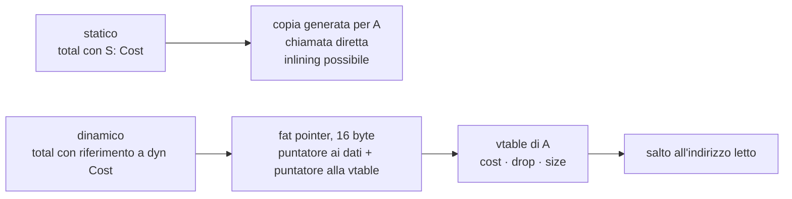
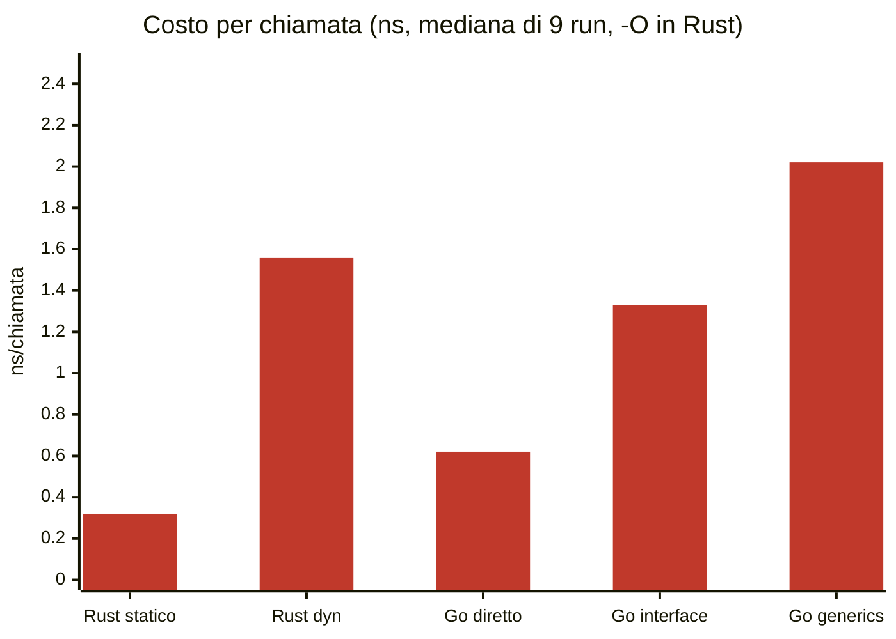
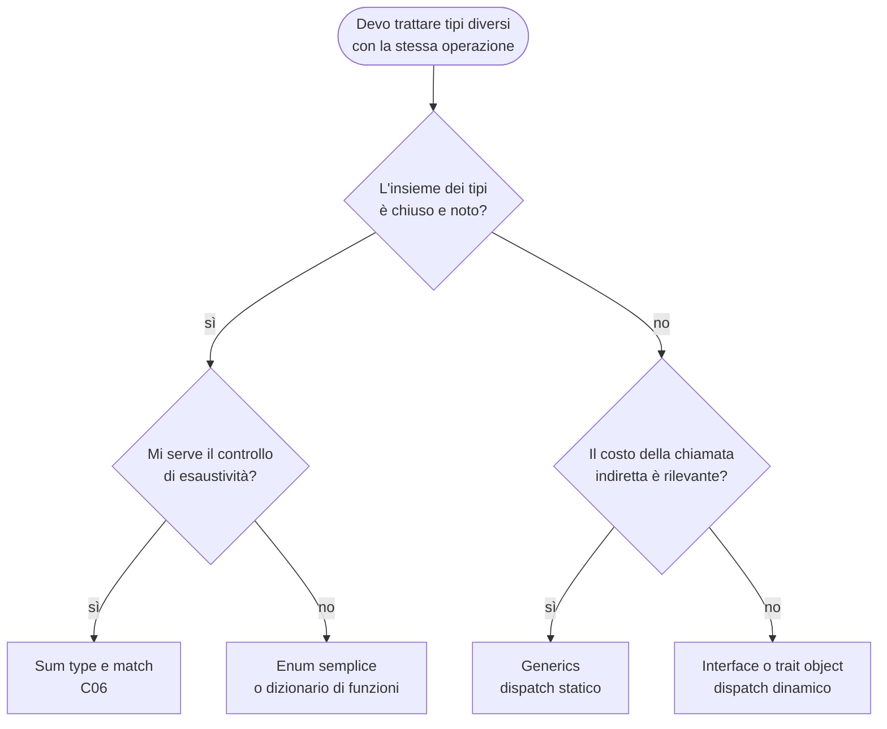

(parte 5 di 7: L07.4 Polimorfismo: dispatch statico e dinamico) — file originale: capitoli/C07-oggetti-interfacce-trait-composizione.md

## L07.4 — Polimorfismo: dispatch statico e dinamico

### Concetto

**Polimorfismo** significa «molte forme»: la stessa scrittura di codice vale per tipi diversi. In questo capitolo ne compaiono tre, e conviene separarli.

| Forma | Idea | Esempio nel programma | Dove |
|---|---|---|---|
| **Di sottotipo** | un'operazione con tante realizzazioni dietro un'interfaccia | `Dispatcher` chiama `send` su un `Sender` qualunque | questa lezione |
| **Parametrica** | codice scritto una volta per «un tipo qualunque che soddisfi un vincolo» | `Retrying<S: Sender>` in Rust; `Protocol` in Python | C08 |
| **Per varianti chiuse** | un `match` che sceglie in base alla variante | `apply` e `describe` di C06 | C06 |

Per il polimorfismo di sottotipo c'è una domanda tecnica decisiva: **quando si decide quale codice eseguire?** Alla riga `route.send(n)` esistono tre implementazioni possibili (`Email`, `Sms`, `Webhook`, più i decorator). Chi sceglie, e quando?

| | **Dispatch statico** | **Dispatch dinamico** |
|---|---|---|
| Quando si sceglie | **compilazione** | **esecuzione**, in base al tipo effettivo dell'oggetto |
| Come | il compilatore genera una copia del codice per ogni tipo concreto (*monomorphization*) e chiama la funzione giusta direttamente | l'oggetto porta un riferimento a una tabella di funzioni (**vtable**); la chiamata legge l'indirizzo e salta |
| Costo | nessuno per la chiamata; il compilatore può **inlinare** e ottimizzare oltre il confine | una chiamata indiretta; di solito niente inlining |
| Dimensione del codice | cresce con il numero di tipi (una copia ciascuno) | una sola copia |
| Insiemi eterogenei | **non** si può avere una lista di tipi diversi | si può (`Vec<Box<dyn Sender>>`) |



Come lo realizza ciascun linguaggio:

| | PHP | Python | Rust | Go |
|---|---|---|---|---|
| Chiamata di metodo su un'interfaccia | **sempre dinamica**: ricerca del metodo sulla classe dell'oggetto (con cache di opcache) | **sempre dinamica**: ricerca dell'attributo sul tipo (con cache) | `dyn Trait` → vtable; `T: Trait` o `impl Trait` → statica | interface → **itab** (tabella dei metodi); chiamata diretta se il tipo è noto |
| Generics | assenti nel linguaggio (solo `@template` per gli analyzer) | sintassi nativa, nessun effetto a runtime (C08) | **monomorphization** | stenciling per «GC shape», con dizionari (C08) |
| Puntatore a un'interfaccia | l'handle dell'oggetto | il riferimento all'oggetto | **fat pointer** (16 byte) | coppia (tabella, dato): 16 byte |
| Il programmatore sceglie? | no | no | **sì**, a ogni firma | no (può solo scegliere tra interface e generics) |

### Implementazione: `Dispatcher` (T6) e il «bordo» del programma

`Dispatcher` è il cliente del contratto. Il suo codice non nomina `Email`, `Sms` né `Webhook`: ha una mappa `nome del canale → Sender`, un insieme degli id già visti e un contatore dei fallimenti per canale. Per ogni notifica: scarta i duplicati, sceglie il `Sender` dal nome, chiama `send` e registra l'esito.

**Python**

```python
class Dispatcher:
    """T6 - routes a Notification to the Sender of its channel. It knows only the Sender contract."""

    def __init__(self, routes: dict[str, Sender]) -> None:
        self._routes = routes
        self._seen: set[str] = set()
        self._failed = dict.fromkeys(routes, 0)

    def failed(self, channel: str) -> int:
        return self._failed[channel]

    def dispatch(self, n: Notification) -> tuple[Outcome | None, str]:
        """Return (Outcome, "") or (None, reason)."""
        if n.id in self._seen:
            return None, "duplicate"
        self._seen.add(n.id)
        out = self._routes[n.channel].send(n)
        if out.err:
            self._failed[n.channel] += 1
        return out, ""
```

**PHP**

```php
/** T6 - routes a Notification to the Sender of its channel. It knows only the Sender contract. */
final class Dispatcher
{
    /** @var array<string,true> */
    private array $seen = [];
    /** @var array<string,int> */
    private array $failed;

    /** @param array<string,Sender> $routes */
    public function __construct(private readonly array $routes)
    {
        $this->failed = array_fill_keys(array_keys($routes), 0);
    }

    public function failed(string $channel): int
    {
        return $this->failed[$channel];
    }

    /** @return array{0: ?Outcome, 1: string} */
    public function dispatch(Notification $n): array
    {
        if (isset($this->seen[$n->id])) {
            return [null, 'duplicate'];
        }
        $this->seen[$n->id] = true;
        $out = $this->routes[$n->channel]->send($n);
        if ($out->err !== '') {
            $this->failed[$n->channel]++;
        }
        return [$out, ''];
    }
}
```

**Rust**

```rust
/// T6 - routes a Notification to the Sender of its channel. It knows only the Sender contract
/// (dynamic dispatch: each route is a `Box<dyn Sender>`, a fat pointer to data + vtable).
struct Dispatcher {
    routes: HashMap<&'static str, Box<dyn Sender>>,
    seen: HashSet<String>,
    failed: HashMap<&'static str, u32>,
}

impl Dispatcher {
    fn new(routes: HashMap<&'static str, Box<dyn Sender>>) -> Dispatcher {
        let failed = routes.keys().map(|k| (*k, 0)).collect();
        Dispatcher { routes, seen: HashSet::new(), failed }
    }

    fn failed(&self, channel: &str) -> u32 {
        self.failed[channel]
    }

    fn delivered(&self, channel: &str) -> u32 {
        self.routes[channel].delivered()
    }

    fn dispatch(&mut self, n: &Notification) -> Result<Outcome, &'static str> {
        if !self.seen.insert(n.id.clone()) {
            return Err("duplicate");
        }
        let route = self.routes.get_mut(n.channel.as_str()).expect("channel validated by parse");
        let out = route.send(n);
        if out.err.is_some() {
            *self.failed.get_mut(n.channel.as_str()).unwrap() += 1;
        }
        Ok(out)
    }
}
```

**Go**

```go
// Dispatcher is T6 - routes a Notification to the Sender of its channel. It knows only the Sender contract.
type Dispatcher struct {
	routes map[string]Sender
	seen   map[string]bool
	failed map[string]int
}

func NewDispatcher(routes map[string]Sender) *Dispatcher {
	return &Dispatcher{routes: routes, seen: map[string]bool{}, failed: map[string]int{}}
}

func (d *Dispatcher) Failed(channel string) int { return d.failed[channel] }

// Dispatch returns the outcome, or a rejection reason.
func (d *Dispatcher) Dispatch(n Notification) (out Outcome, reason string) {
	if d.seen[n.ID] {
		return Outcome{}, "duplicate"
	}
	d.seen[n.ID] = true
	out = d.routes[n.Channel].Send(n)
	if out.Err != "" {
		d.failed[n.Channel]++
	}
	return out, ""
}
```


- **Python:** `routes: dict[str, Sender]` tipizzato con il `Protocol`. `dispatch` restituisce la coppia `(Outcome, "")` oppure `(None, motivo)`, la convenzione già usata in C06 per `apply`.
- **PHP:** il costruttore riceve `array $routes` (documentato con `@param array<string,Sender>`); `dispatch` restituisce `[Outcome, '']` o `[null, motivo]`. `isset($this->seen[$n->id])` è il test «già visto» su una mappa usata come insieme.
- **Rust:** `routes: HashMap<&'static str, Box<dyn Sender>>`. Il `Box<dyn Sender>` è un **fat pointer** a un oggetto sullo heap più la sua vtable: è l'unico modo di avere nella stessa mappa un `Retrying<Audit<Email>>` e un `Retrying<Audit<Sms>>`, che sono tipi diversi. `get_mut` perché `send` richiede `&mut self`.
- **Go:** `routes map[string]Sender`. `Dispatch` restituisce l'esito e il motivo come due valori; la stringa vuota significa «nessuno scarto».

Come le pile vengono costruite, e quindi **dove il programma decide la composizione**:

**Python**

```python
def build_routes() -> dict[str, Sender]:
    """Composition at the edge: each channel gets its own stack of wrappers."""
    return {
        "email": Retrying(Audit(Email()), 3),
        "sms": Retrying(Audit(Sms()), 2),
        "webhook": Retrying(Audit(Webhook()), 3),
    }
```

**PHP**

```php
/** Composition at the edge: each channel gets its own stack of wrappers. */
function buildRoutes(): array
{
    return [
        'email' => new Retrying(new Audit(new Email()), 3),
        'sms' => new Retrying(new Audit(new Sms()), 2),
        'webhook' => new Retrying(new Audit(new Webhook()), 3),
    ];
}
```

**Rust**

```rust
/// Composition at the edge: each channel gets its own stack of wrappers.
fn build_routes() -> HashMap<&'static str, Box<dyn Sender>> {
    let mut routes: HashMap<&'static str, Box<dyn Sender>> = HashMap::new();
    routes.insert("email", Box::new(Retrying { inner: Audit { inner: Email::new() }, max_attempts: 3 }));
    routes.insert("sms", Box::new(Retrying { inner: Audit { inner: Sms::new() }, max_attempts: 2 }));
    routes.insert("webhook", Box::new(Retrying { inner: Audit { inner: Webhook::new() }, max_attempts: 3 }));
    routes
}
```

**Go**

```go
// buildRoutes: composition at the edge - each channel gets its own stack of wrappers.
func buildRoutes() map[string]Sender {
	return map[string]Sender{
		"email":   Retrying{Audit{NewEmail()}, 3},
		"sms":     Retrying{Audit{NewSms()}, 2},
		"webhook": Retrying{Audit{NewWebhook()}, 3},
	}
}
```


Questo è il «bordo» del programma: l'unico punto in cui compaiono insieme i nomi concreti (`Email`, `Retrying`, `Audit`) e le configurazioni (3 tentativi per e-mail e webhook, 2 per SMS). Tutto il resto del codice conosce solo il contratto. Per cambiare una politica (portare l'SMS a 3 tentativi, togliere l'audit al webhook) si cambia una riga qui, e nessuna classe.

In Rust c'è un dettaglio che riassume il capitolo: dentro, la pila è **statica**: `Retrying<Audit<Email>>` è un tipo concreto, il compilatore sa esattamente quale `send` chiama ciascun livello e può inlinare. Al confine, `Box::new(...)` la trasforma in `Box<dyn Sender>`, **dinamica**, perché la mappa deve contenere pile di tipi diversi. Si paga la chiamata indiretta una volta, all'entrata, non a ogni livello.

### Esperimento e9 — che cosa porta un riferimento a un'interfaccia?

Misuro la dimensione di un puntatore normale e di un puntatore a interfaccia/trait object.

```rust
use std::mem::size_of;

trait Sender {
    fn send(&self) -> u32;
}
struct Email {
    n: u32,
}
impl Sender for Email {
    fn send(&self) -> u32 {
        1
    }
}

fn main() {
    println!("&Email          : {} bytes", size_of::<&Email>());
    println!("&dyn Sender     : {} bytes", size_of::<&dyn Sender>());
    println!("Box<Email>      : {} bytes", size_of::<Box<Email>>());
    println!("Box<dyn Sender> : {} bytes", size_of::<Box<dyn Sender>>());
    println!("Email (value)   : {} bytes", size_of::<Email>());
    let e = Email { n: 7 };
    println!("e.send() = {}, n = {}", e.send(), e.n);
}
```

```go
package main

import (
	"fmt"
	"unsafe"
)

type Sender interface{ Send() int }

type Email struct{ n uint32 }

func (e *Email) Send() int { return 1 }

func main() {
	var e Email
	var s Sender = &e
	fmt.Println("*Email          :", unsafe.Sizeof(&e), "bytes")
	fmt.Println("Sender interface:", unsafe.Sizeof(s), "bytes")
	fmt.Println("Email (value)   :", unsafe.Sizeof(e), "bytes")
}
```

Poi provo a mettere in un `Box<dyn ...>` un trait con un metodo **generico** (`fn map<T: Default>(&self) -> T`): la vtable dovrebbe avere una voce per ogni `T`, cioè infinite.

```rust
trait Mapper {
    fn map<T: Default>(&self) -> T; // generic method: needs one copy per T
}
struct A;
impl Mapper for A {
    fn map<T: Default>(&self) -> T {
        T::default()
    }
}

fn main() {
    let v: Vec<Box<dyn Mapper>> = vec![Box::new(A)];
    println!("{}", v.len());
}
```

```text
### e9b.rs
error[E0038]: the trait `Mapper` is not dyn compatible
  --> e9b.rs:12:24
   |
12 |     let v: Vec<Box<dyn Mapper>> = vec![Box::new(A)];
   |                        ^^^^^^ `Mapper` is not dyn compatible
   |
note: for a trait to be dyn compatible it needs to allow building a vtable
      for more information, visit <https://doc.rust-lang.org/reference/items/traits.html#dyn-compatibility>
  --> e9b.rs:2:8
   |
 1 | trait Mapper {
   |       ------ this trait is not dyn compatible...
 2 |     fn map<T: Default>(&self) -> T; // generic method: needs one copy per T
   |        ^^^ ...because method `map` has generic type parameters
   = help: consider moving `map` to another trait
   = help: only type `A` implements `Mapper`; consider using it directly instead.

error: aborting due to 1 previous error

For more information about this error, try `rustc --explain E0038`.
[exit 1]
### e9.go
*Email          : 8 bytes
Sender interface: 16 bytes
Email (value)   : 4 bytes
[exit 0]
### e9.rs
&Email          : 8 bytes
&dyn Sender     : 16 bytes
Box<Email>      : 8 bytes
Box<dyn Sender> : 16 bytes
Email (value)   : 4 bytes
e.send() = 1, n = 7
[exit 0]
```

| | Puntatore semplice | Puntatore a interfaccia | Che cosa c'è in più |
|---|---|---|---|
| Rust | `&Email` = 8 byte | `&dyn Sender` = **16** byte | puntatore alla vtable |
| Go | `*Email` = 8 byte | `Sender` = **16** byte | puntatore alla tabella dei metodi (itab) |

Dimensione raddoppiata, nei due linguaggi, per la stessa ragione. In Rust il compilatore proibisce anche, con **E0038** («the trait Mapper is not dyn compatible… because method map has generic type parameters»), i trait i cui metodi non possono essere messi in una vtable: è la regola di *dyn compatibility* (un tempo chiamata *object safety*). Il dispatch dinamico ha dei limiti di espressività che il dispatch statico non ha.

### Esperimento e10 — quanto costa una chiamata indiretta?

Misuro il costo di chiamare un metodo piccolo (`(x ^ k) * 3`) duecento milioni di volte in tre modi: chiamata diretta o generica (statica) e tramite interfaccia (dinamica). In Rust uso `black_box` per impedire al compilatore di vedere il tipo concreto e di sostituire la chiamata indiretta. In Go l'interfaccia viene scelta da una funzione `//go:noinline` per lo stesso motivo. Per Python e PHP, dove il dispatch è sempre dinamico, riporto l'ordine di grandezza con tre milioni di chiamate. **Mediana di 9 ripetizioni.** L'ambiente è condiviso e non isolato: i numeri sono indicativi dell'ordine di grandezza, non una misura rigorosa (C13 e C21 trattano il metodo corretto).

```rust
use std::hint::black_box;
use std::time::Instant;

trait Cost {
    fn cost(&self, x: u64) -> u64;
}
struct A {
    k: u64,
}
impl Cost for A {
    fn cost(&self, x: u64) -> u64 {
        (x ^ self.k).wrapping_mul(3)
    }
}

fn total_static<S: Cost>(s: &S, n: u64) -> u64 {
    let mut acc = 0u64;
    for i in 0..n {
        acc = acc.wrapping_add(s.cost(i));
    }
    acc
}

fn total_dyn(s: &dyn Cost, n: u64) -> u64 {
    let mut acc = 0u64;
    for i in 0..n {
        acc = acc.wrapping_add(s.cost(i));
    }
    acc
}

fn main() {
    let n = 200_000_000u64;
    let a = A { k: 5 };
    let d: &dyn Cost = black_box(&a); // the compiler cannot see the concrete type
    let mut st = Vec::new();
    let mut dy = Vec::new();
    for _ in 0..9 {
        let t = Instant::now();
        let r = total_static(black_box(&a), black_box(n));
        st.push((t.elapsed().as_nanos() as f64 / n as f64, r));
        let t = Instant::now();
        let r = total_dyn(d, black_box(n));
        dy.push((t.elapsed().as_nanos() as f64 / n as f64, r));
    }
    st.sort_by(|a, b| a.0.partial_cmp(&b.0).unwrap());
    dy.sort_by(|a, b| a.0.partial_cmp(&b.0).unwrap());
    println!("rust static  (generic) : median {:.2} ns/call  check={}", st[4].0, st[4].1);
    println!("rust dynamic (dyn)     : median {:.2} ns/call  check={}", dy[4].0, dy[4].1);
}
```

```go
package main

import (
	"fmt"
	"os"
	"sort"
	"time"
)

type Coster interface{ Cost(x uint64) uint64 }

type A struct{ k uint64 }

func (a *A) Cost(x uint64) uint64 { return (x ^ a.k) * 3 }

type B struct{ k uint64 }

func (b *B) Cost(x uint64) uint64 { return (x ^ b.k) * 5 }

//go:noinline
func pick(useA bool) Coster { // the concrete type is decided at run time
	if useA {
		return &A{k: 5}
	}
	return &B{k: 5}
}

func direct(a *A, n uint64) (acc uint64) {
	for i := uint64(0); i < n; i++ {
		acc += a.Cost(i)
	}
	return
}

func viaInterface(c Coster, n uint64) (acc uint64) {
	for i := uint64(0); i < n; i++ {
		acc += c.Cost(i)
	}
	return
}

func viaGeneric[T Coster](c T, n uint64) (acc uint64) {
	for i := uint64(0); i < n; i++ {
		acc += c.Cost(i)
	}
	return
}

func median(f func() (float64, uint64)) (float64, uint64) {
	var ts []float64
	var chk uint64
	for r := 0; r < 9; r++ {
		t, c := f()
		ts = append(ts, t)
		chk = c
	}
	sort.Float64s(ts)
	return ts[4], chk
}

func main() {
	const n = 200_000_000
	a := &A{k: 5}
	c := pick(len(os.Args) > 0) // always A, but the compiler cannot know it
	run := func(f func() uint64) func() (float64, uint64) {
		return func() (float64, uint64) {
			t := time.Now()
			r := f()
			return float64(time.Since(t).Nanoseconds()) / n, r
		}
	}
	m, c1 := median(run(func() uint64 { return direct(a, n) }))
	fmt.Printf("go direct (concrete type): median %.2f ns/call  check=%d\n", m, c1)
	m, c2 := median(run(func() uint64 { return viaInterface(c, n) }))
	fmt.Printf("go interface             : median %.2f ns/call  check=%d\n", m, c2)
	m, c3 := median(run(func() uint64 { return viaGeneric(a, n) }))
	fmt.Printf("go generic [T Coster]    : median %.2f ns/call  check=%d\n", m, c3)
}
```

```python
import statistics
import time


class A:
    def __init__(self):
        self.k = 5

    def cost(self, x):
        return (x ^ self.k) * 3


def total(s, n):
    acc = 0
    for i in range(n):
        acc += s.cost(i)
    return acc


n = 3_000_000
a = A()
ts = []
for _ in range(9):
    t = time.perf_counter()
    r = total(a, n)
    ts.append((time.perf_counter() - t) / n * 1e9)
print(f"python method call: median {statistics.median(ts):.1f} ns/call  check={r}")
```

```php
<?php
final class A
{
    public function __construct(private int $k = 5)
    {
    }

    public function cost(int $x): int
    {
        return ($x ^ $this->k) * 3;
    }
}
function total(A $s, int $n): int
{
    $acc = 0;
    for ($i = 0; $i < $n; $i++) {
        $acc += $s->cost($i);
    }
    return $acc;
}
$n = 3000000;
$a = new A();
$ts = [];
for ($r = 0; $r < 9; $r++) {
    $t = hrtime(true);
    $res = total($a, $n);
    $ts[] = (hrtime(true) - $t) / $n;
}
sort($ts);
printf("php method call: median %.1f ns/call  check=%d\n", $ts[4], $res);
```

```text
### e10.rs
rust static  (generic) : median 0.32 ns/call  check=59999999700000000
rust dynamic (dyn)     : median 1.56 ns/call  check=59999999700000000
[exit 0]
### e10.go
go direct (concrete type): median 0.62 ns/call  check=59999999700000000
go interface             : median 1.33 ns/call  check=59999999700000000
go generic [T Coster]    : median 2.02 ns/call  check=59999999700000000
[exit 0]
### e10.py
python method call: median 96.1 ns/call  check=13499995500000
[exit 0]
### e10.php
php method call: median 29.4 ns/call  check=13499995500000
[exit 0]
```



Lettura, con cautela:

- **Rust:** la chiamata statica costa circa **5 volte meno** di quella `dyn` (0,32 contro 1,56 ns) perché il compilatore inlina e può anche vettorizzare il ciclo; la chiamata indiretta no. Con una funzione che fa lavoro vero la differenza si schiaccia.
- **Go:** la chiamata tramite interface costa circa il doppio di quella diretta (1,33 contro 0,62 ns). I **generics** non sono stati più veloci dell'interface: 2,02 ns. Con un tipo puntatore come argomento, Go usa una sola versione del codice per tutti i puntatori (*GC shape stenciling*) e passa per un dizionario: nel Go 1.24 usato qui, il costo è paragonabile a quello di una chiamata indiretta. Il risultato dipende dalla versione del compilatore.
- **Python e PHP:** 96 e 29 ns per chiamata: due ordini di grandezza sopra la chiamata statica di Rust. Il numero comprende anche il ciclo e l'aritmetica, non solo il dispatch. Il dispatch dinamico non è il costo dominante in un linguaggio interpretato; lo è l'interprete.
- Nel programma di questo capitolo il costo del dispatch è irrilevante (una chiamata per notifica). Il punto di una misura come questa è sapere **quando** diventa rilevante: un ciclo interno che chiama milioni di volte un metodo di un'interfaccia.

### Aperto o chiuso: interfaccia contro sum type

C06 e C07 offrono due modi di rappresentare «una cosa che può essere di più tipi». Sono **duali**: ciascuno rende facile ciò che l'altro rende difficile. In letteratura si chiama *expression problem*.

| Voglio aggiungere… | Con un'**interfaccia** (insieme di tipi *aperto*) | Con un **sum type** e `match` (insieme di varianti *chiuso*) |
|---|---|---|
| un **nuovo tipo** (canale `Push`) | **facile**: una classe nuova; nessun codice esistente cambia | **difficile**: ogni `match` va aggiornato (Rust ti avverte: E0004) |
| una **nuova operazione** (ad es. `estimate_cost`) | **difficile**: va aggiunta a ogni classe e al contratto | **facile**: una funzione nuova con un `match` |
| Esaustività | n/a | verificata (Rust), non verificata (Go, PHP) |
| Chi può aggiungere varianti | chiunque implementi il contratto (anche fuori dal progetto) | solo chi modifica la definizione |

Regola operativa: se l'insieme dei **tipi** cresce nel tempo e a opera di altri (canali, plugin, driver di database), si usa un'interfaccia; se l'insieme dei **tipi** è fisso per natura (gli stati di un ordine in C06) e a crescere sono le **operazioni**, si usa un sum type. Il programma di questo capitolo usa l'interfaccia per i canali perché li immagina «aperti»; `Outcome.err` e i motivi di scarto sono stringhe, che C09 trasformerà in un tipo somma di errori.



### Focus comparativo

| Aspetto | PHP | Python | Rust | Go |
|---|---|---|---|---|
| Dispatch di default | dinamico | dinamico | **statico** con generics, dinamico con `dyn` | dinamico con interface |
| Chi sceglie | il linguaggio | il linguaggio | **il programmatore**, per firma | il programmatore (interface contro generics) |
| Raccolta eterogenea | `array<string,Sender>` | `dict[str, Sender]` | `HashMap<_, Box<dyn Sender>>` | `map[string]Sender` |
| Riferimento a interfaccia | handle | riferimento | fat pointer, 16 byte | coppia, 16 byte |
| Limiti del dispatch dinamico | nessuno | nessuno | *dyn compatibility* (E0038) | nessuno |
| Overloading di funzioni | no | `functools.singledispatch` (per il primo argomento) | no (si usano i trait) | no |
| Valore «niente» dentro l'interfaccia | `null` | `None` | `Option<Box<dyn T>>` | tipo + valore (e8) |

### Esercizio Rosetta (4′)

Scrivi la funzione `total_cost` dell'esperimento e10 sia in forma statica sia in forma dinamica per due tipi diversi (`A` con `k = 5` e un `B` che moltiplica per 5). In Rust, quale delle due forme accetta una lista `[A, B]` mista? Perché? Quale costo paghi?

---
