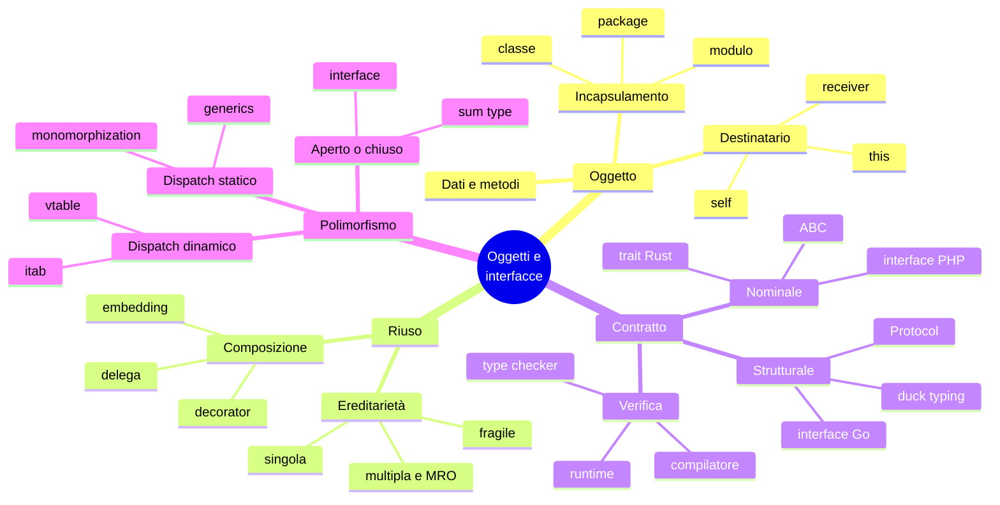

(parte 6 di 7: collaudo, matrice, addendum, quiz, esercizi, mappa, ponte) — file originale: capitoli/C07-oggetti-interfacce-trait-composizione.md

## Il programma completo e il collaudo

Il codice completo dei quattro programmi è in appendice. Sono costruiti sulla stessa scomposizione: i commenti `T1 … T7` nel codice coincidono con la tabella iniziale. Per il collaudo sono stati eseguiti, su tutti e quattro i linguaggi, cinque casi; per ciascuno si è confrontato l'output completo (stdout, stderr ed exit code).

| File | Cosa verifica | Esito atteso | Identico nei 4? |
|---|---|---|---|
| `notifications.csv` | caso normale: 20 righe, 5 scarti (`channel`, `message`, `duplicate`, `fields` ×2), errori permanenti e transitori, retry riusciti (5, 7) e falliti (6, 9), virgole nel messaggio, spazi attorno al campo | `rows=20 sent=8 failed=7 rejected=5`, exit 1 | sì |
| `t_empty.csv` | solo intestazione | `rows=0`, contatori a zero, exit 0 | sì |
| `t_crlf.csv` | fine riga Windows e riga vuota | 3 notifiche inviate al 1° tentativo, exit 0 | sì |
| `t_odd.csv` | destinatari anomali: `+` senza cifre, 7 e 16 cifre, cifre non ASCII, `a@b@c.com`, `@x.com`, `a@b`, spazi, `https://` da solo, SMS di 40 e 41 caratteri `è`, virgole nel testo, canale `EMAIL`, destinatario vuoto | vedi sotto | **no** (una riga) |
| (file inesistente) | errore di apertura | `cannot open …` su stderr, exit 2 | sì |

I casi `t_empty` e `t_crlf`, per esteso (stdout, poi `--- stderr`):

```text
rows=0 sent=0 failed=0 rejected=0
channel=email delivered=0 failed=0
channel=sms delivered=0 failed=0
channel=webhook delivered=0 failed=0
--- stderr
[exit 0]
```

```text
id=1 channel=email status=sent attempts=1
id=2 channel=sms status=sent attempts=1
id=3 channel=webhook status=sent attempts=1
rows=3 sent=3 failed=0 rejected=0
channel=email delivered=1 failed=0
channel=sms delivered=1 failed=0
channel=webhook delivered=1 failed=0
--- stderr
audit channel=email id=1 result=ok
audit channel=sms id=2 result=ok
audit channel=webhook id=3 result=ok
[exit 0]
```

**Dove i quattro divergono (`t_odd.csv`, riga con id 16).** L'ultima riga di `t_odd.csv` contiene un destinatario circondato da **spazi non separabili** (U+00A0, *non-breaking space*): ` flaky@example.com `. Per Python (`str.strip`), Rust (`str::trim`) e Go (`strings.TrimSpace`) sono spazi bianchi Unicode e vengono eliminati, quindi il destinatario diventa `flaky@example.com`, il canale simulato lo riconosce e servono 3 tentativi. Per PHP `trim()` toglie **solo** gli spazi ASCII (spazio, tab, `\n`, `\r`, `\0`, `\v`): il destinatario resta con i due byte `C2 A0` ai lati, non è nella tabella dei guasti, e la consegna riesce al primo tentativo.

```text
### python / rust / go (identici)
id=16 channel=email status=sent attempts=3
rows=17 sent=4 failed=11 rejected=2
channel=email delivered=2 failed=4
audit channel=email id=16 result=timeout
audit channel=email id=16 result=timeout
audit channel=email id=16 result=ok
### php
id=16 channel=email status=sent attempts=1
rows=17 sent=4 failed=11 rejected=2
channel=email delivered=2 failed=4
audit channel=email id=16 result=ok
```

Il PHP non ha sbagliato rispetto alle sue regole: ha fatto ciò che `trim()` promette. Il risultato è che la stessa riga ha **esiti diversi** nei linguaggi, e nessuno dei quattro avvisa. È il tipo di divergenza che nasce al confine con i dati esterni, e la ragione per cui la normalizzazione dell'input (C14) è una decisione esplicita, non un dettaglio: in PHP si scrive `trim($s, " \t\n\r\0\x0B\u{00A0}")` oppure `preg_replace('/^\p{Z}+|\p{Z}+$/u', '', $s)` (entrambe verificate: tolgono i byte `C2 A0`), ma bisogna volerlo. Per tutte le altre righe di `t_odd` l'output è identico nei quattro linguaggi; gli scarti sono `channel` (canale `EMAIL`, perché il confronto è sensibile alle maiuscole) e `recipient` (destinatario vuoto).

## Matrice degli approcci (riassunto del capitolo)

| Costrutto | PHP | Python | Rust | Go |
|---|---|---|---|---|
| Classi ed ereditarietà | ● singola (`extends`, `final`) | ● multipla (MRO) | ○ | ○ (embedding) |
| Interfaccia | ● nominale (`interface`) | ◐ `ABC` nominale, `Protocol` strutturale | ● `trait`, `impl` esplicito | ● strutturale implicita |
| Riuso orizzontale | ● `trait` (copia di codice) | ● mixin | ◐ metodi di default nei `trait` | ◐ embedding |
| Visibilità | ● `public` / `protected` / `private` (classe) | ◐ convenzione `_x` | ● `pub`, per modulo | ● maiuscola/minuscola, per package |
| Receiver esplicito | ○ (`$this` implicito) | ● `self` | ● `self`, `&self`, `&mut self` | ● receiver per valore o puntatore |
| Dispatch statico | ○ | ○ | ● generics, `impl Trait` | ◐ generics (con dizionari) |
| Dispatch dinamico | ● sempre | ● sempre | ● `dyn Trait` | ● interface |
| Verifica del contratto | ○ runtime | ◐ type checker | ● compilatore | ● compilatore |
| Contratto aggiungibile a un tipo altrui | ○ | ● `Protocol` | ◐ regola dell'orfano | ● |
| Tipi senza `nil` dentro l'interfaccia | ○ | ○ | ● `Option` | ○ (e8) |

Le matrici sono un indice, non una dichiarazione di equivalenza: `trait` è ● in PHP **e** ● in Rust nella riga «riuso orizzontale»/«interfaccia» per due cose diverse (e7).

## Addendum — Il perché della scelta

*Facoltativo. Non serve a scrivere codice, serve a ricordarlo.*

Due domande attraversano tutto il capitolo, e ogni linguaggio le risolve a modo suo.

**«Che cos'è un X?» — essenza dichiarata o comportamento osservato.** La tipizzazione **nominale** (PHP, i `trait` di Rust, le `ABC` di Python) dice che una cosa è un `Sender` perché lo ha **dichiarato**: c'è un atto esplicito, un'intenzione scritta. La tipizzazione **strutturale** (le interface di Go, i `Protocol` e il duck typing di Python) dice che è un `Sender` perché **si comporta** da `Sender`: «se cammina come un'anatra e fa il verso dell'anatra…». Sono due idee diverse di identità. La prima è più prudente (un metodo di nome `send` che non c'entra nulla con le notifiche non viene scambiato per un canale) e più rigida (non posso rendere un tipo altrui un `Sender` senza il suo consenso, salvo l'`impl` della regola dell'orfano). La seconda è più flessibile (il tipo non deve sapere nulla dell'interfaccia, che può essere scritta dopo e da chi la usa) e più rischiosa (compatibile per caso). Go la sceglie perché vuole interfacce **piccole e scritte dal consumatore**; Rust sceglie il contrario perché vuole che l'intenzione sia verificabile e che il compilatore sappia quale implementazione chiamare; PHP e Python sono nati dinamici e hanno aggiunto il nominale (`interface`, `ABC`) e lo strutturale (`Protocol`) nel tempo, con la verifica delegata all'esecuzione o a un tool esterno.

**«Come si riusa?» — la tassonomia invecchia, la composizione no.** L'ereditarietà è una **tassonomia**: ordina i tipi in un albero di generi e specie (un `RetryingEmail` è un'`Email` è un `Sender`). Le tassonomie funzionano finché il dominio non cambia: quando nasce un terzo comportamento trasversale (limitare la frequenza, cifrare) l'albero non ha più un posto per lui, e si moltiplicano i rami (e5). Il caso Python è istruttivo: l'ereditarietà multipla e l'MRO sono un modo di *mescolare* ingredienti, ma l'ordine delle basi diventa una proprietà nascosta del comportamento. **Rust e Go la escludono di proposito**: la composizione fa la stessa cosa con una dipendenza che si vede. Go lo dice nel proverbio più noto del linguaggio: *«a little copying is better than a little dependency»* e nella sua versione per le interfacce, *«the bigger the interface, the weaker the abstraction»*. PHP e Python la mantengono per compatibilità e pragmatismo, e consigliano nei loro stili correnti (`final class`, classi astratte rare, composizione) di non abusarne.

| Scelta del linguaggio | Che cosa rende facile | Che cosa rende difficile di proposito |
|---|---|---|
| **PHP**: `interface` nominale, ereditarietà singola, `trait` come copia di codice | descrivere un'applicazione web in classi, riusare con i trait | adattare un tipo altrui; avere tipi generici veri |
| **Python**: tutto, con `Protocol` per disciplinare | prototipare con il duck typing, passare al tipo statico gradualmente | garantire il contratto senza un type checker |
| **Rust**: `trait` nominali, nessuna ereditarietà, dispatch scelto dal programmatore | sapere cosa viene chiamato e quando, e pagare solo ciò che si usa | scrivere codice orientato agli oggetti «classico»; mescolare tipi diversi in una lista senza `Box<dyn>` |
| **Go**: interface strutturali piccole, embedding, nessuna ereditarietà | scrivere e leggere codice uniforme, adattare tipi senza modificarli | esprimere una gerarchia con comportamento condiviso; garantire che un tipo rispetti il contratto fino al suo uso |

La domanda guida del corso, applicata a oggetti e interfacce: *che cosa questo linguaggio rende facile, e che cosa rende difficile di proposito?* PHP e Python rendono facile iniziare e permettono tutto; Rust rende esplicita ogni scelta e la verifica; Go rende facile adattarsi e difficile organizzare una tassonomia.

## Anti-pattern

| Anti-pattern | Dove | Conseguenza | Rimedio |
|---|---|---|---|
| Ereditare per riusare, senza «è un» | PHP, Python | accoppiamento con i dettagli della base; classe fragile (e3) | composizione: tenere l'oggetto come campo privato |
| Gerarchia che esplode per combinazioni (`AuditedRetryingEmail`) | PHP, Python | 4 × canali classi (e5) | decorator impilati nel punto di costruzione |
| Contare sull'ordine delle basi (MRO) | Python | comportamento che cambia scambiando due righe | evitare l'ereditarietà multipla se non cooperativa; mixin brevi e senza stato |
| Oggetto con tutti i campi pubblici | Python, Go | invarianti rotte da chiunque (e1) | campi privati/non esportati, metodi per l'accesso |
| Receiver per valore dove serve la modifica | Go | il metodo lavora su una copia in silenzio (e2) | receiver puntatore, uniforme per tutti i metodi del tipo |
| Aspettarsi che l'embedding sia «ereditarietà con override» | Go | `Run()` della base non vede l'override (e3) | passare per un'interfaccia, o per una funzione |
| Interfaccia grande con molti metodi | tutti | implementazioni piene di metodi vuoti, decorator pieni di inoltri | interfacce piccole, definite da chi le usa |
| Restituire un puntatore nil come interfaccia | Go | `err != nil` o `s != nil` vero con un valore nil (e8) | restituire `nil` letterale |
| Usare un `trait` PHP come se fosse un'interfaccia | PHP | non è un tipo: `TypeError` (e7) | un'`interface` per il contratto, il trait solo per riusare codice |
| Un `trait` con stato condiviso tra molte classi | PHP | stato copiato in ogni classe, difficile da cambiare | composizione |
| Mettere in un `Box<dyn T>` un trait pensato per i generics | Rust | E0038: metodi generici incompatibili con la vtable (e9) | separare in due trait, o usare i generics |
| Decidere la composizione ovunque | tutti | impossibile sapere quale pila di decorator è attiva | costruire le pile **in un solo punto** (`build_routes`) |
| Test del contratto affidato al caso | Go | tipo che smette di essere un `Sender` e se ne accorge un altro file | asserzione `var _ Sender = (*Email)(nil)` |
| Normalizzare l'input a metà | PHP | `trim` ASCII contro Unicode: esiti diversi (collaudo) | decidere la normalizzazione al confine (C14) |

## Quiz di verifica

1. Nel programma, `Email` ha un `Transport` invece di ereditarlo. Quale test di sostituibilità non passerebbe `class Email extends Transport`?
2. Quante classi servono con la composizione per avere `Email`, `Sms` e `Webhook` ciascuno con retry e audit opzionali? E con l'ereditarietà?
3. In Go, perché `Derived{}.Run()` stampa `running base` mentre in Python stampa `running derived`?
4. Che differenza c'è tra `Retrying(Audit(x))` e `Audit(Retrying(x))`? Quale produce 21 righe di audit nel nostro file?
5. Un tipo ha un metodo `send` con la firma giusta ma non dichiara nulla. Dimmi, per i quattro linguaggi, se è accettato dove si aspetta un `Sender` e quando lo scopri.
6. Perché `PtrOnly{}` non è un `Sender` in Go, mentre `&PtrOnly{}` sì?
7. Dai due definizioni di «trait» (PHP e Rust) e una frase che le distingua.
8. Che cosa contiene un `&dyn Sender` che un `&Email` non contiene? Quanti byte occupa?
9. Quando conviene un'interfaccia e quando un sum type con `match`?
10. Perché `Retrying<S: Sender>` in Rust è generico mentre in Python basta `Sender`?

**Risposte**

> 1. Un'`Email` non è un `Transport` in nessun senso del dominio e, ereditando, esporrebbe `deliver` pubblicamente; non può nemmeno essere testata con un trasporto finto. 2. Composizione: 5 classi (3 canali + 2 decorator); ereditarietà: 12 (4 combinazioni per canale). 3. In Go l'embedding non è ereditarietà: `Base.Run` chiama il `Name` di `Base`, che non sa di essere dentro un `Derived`. In Python `self.name()` si risolve sul tipo effettivo. 4. Nel primo l'audit è dentro il retry e vede ogni tentativo (21 righe); nel secondo vede solo il risultato finale (15 righe). L'esito su stdout non cambia. 5. PHP: no, `TypeError` a runtime; Python: dipende (ABC no per il type checker; `Protocol` sì); Rust: no, E0277 a compilazione; Go: sì, accettato a compilazione. 6. Perché il method set di `T` contiene solo i metodi con receiver `T`; quelli con receiver `*T` sono solo di `*T`. 7. PHP: pezzo di codice (con stato) copiato in una classe, non è un tipo; Rust: contratto di comportamento, è un tipo. 8. Un puntatore alla vtable oltre al puntatore ai dati; 16 byte contro 8. 9. Interfaccia se i tipi sono aperti e le operazioni fisse; sum type se i tipi sono chiusi e le operazioni crescono. 10. Perché Rust vuole sapere a compile time il tipo concreto per generare la chiamata diretta; in Python il dispatch è sempre dinamico.

## Esercizi

1. **`Fallback`.** Scrivi un decorator `Fallback(primary, secondary)` che, se il primo canale restituisce un errore permanente, riprova con il secondo (per esempio SMS poi e-mail). Che cosa significa «`name()`» per questo oggetto? Che cosa significa `delivered()`?
2. **`RateLimited`.** Implementa il decorator dell'esercizio Rosetta di L07.2 e collocalo nella pila in due posizioni diverse. Come cambiano audit e conteggio dei tentativi? Dove in Go serve un puntatore?
3. **Quinto canale.** Aggiungi `Push` seguendo l'esercizio di L07.3. Quanti file hai toccato? In quale linguaggio hai dimenticato qualcosa senza un errore (suggerimento: `CHANNELS`)?
4. **Test con trasporto finto.** Rendi il `Transport` sostituibile: ogni canale lo riceve nel costruttore come interfaccia. Come cambia `build_routes`? Quale linguaggio rende questa modifica più economica?
5. **Enum o interface.** Riscrivi il `Sender` di Rust come `enum Channel { Email(Email), Sms(Sms), Webhook(Webhook) }` con un `match`. Che cosa guadagni (esaustività, nessun `Box`)? Che cosa perdi (aprire ai plugin, i decorator)?
6. **Backoff.** Aggiungi a `Retrying` una pausa crescente tra i tentativi, **senza** chiamare `sleep` nei test. Che cosa devi iniettare (un orologio? una funzione?) e in quale linguaggio è più facile?

## Mappa mentale



## Ponte ai capitoli successivi

- **C08** porta i *generics*: `Retrying<S: Sender>` è già un tipo parametrico, e `Protocol` di Python è il suo corrispondente; spiega la monomorphization di Rust, lo stenciling di Go e il motivo per cui in e10 i generics di Go non erano più veloci dell'interface.
- **C09** trasforma `Outcome.err` e i motivi di scarto (stringhe: `"timeout"`, `"unreachable"`, `"fields"`) in **errori tipizzati**: un enum di errori con una proprietà `is_transient` che sostituisca il confronto con `"timeout"` dentro `Retrying`.
- **C10** spiega perché `send` in Rust prende `&mut self`, che cosa è una copia di receiver in Go (e2) e che cosa succede alla memoria di un `Box<dyn Sender>`.
- **C11** riprende il `Transport` con stato privato: due thread che chiamano `deliver` insieme sono una *data race*. Rust la rifiuta a compile time (`Send`/`Sync`), Go la rileva a runtime con `-race`, Python e PHP la evitano con il GIL e con il modello per richiesta.
- **C13** usa le interfacce per sostituire il `Transport` con un finto nei test (esercizio 4) e riprende le regole della misura per il benchmark di e10.
- **C17** usa lo stesso schema nei middleware web: un middleware è un decorator di un handler.
- **C24** rilegge i pattern: *Strategy* (qui, il `Sender`), *Decorator* (qui, `Retrying` e `Audit`) e la costruzione in un solo punto (*composition root*) ricompaiono nell'architettura esagonale.

---
