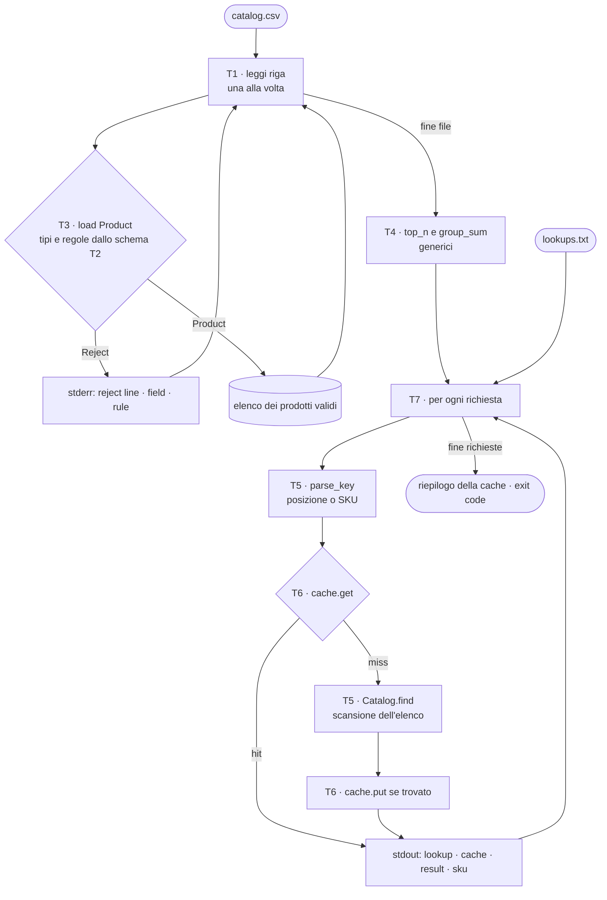
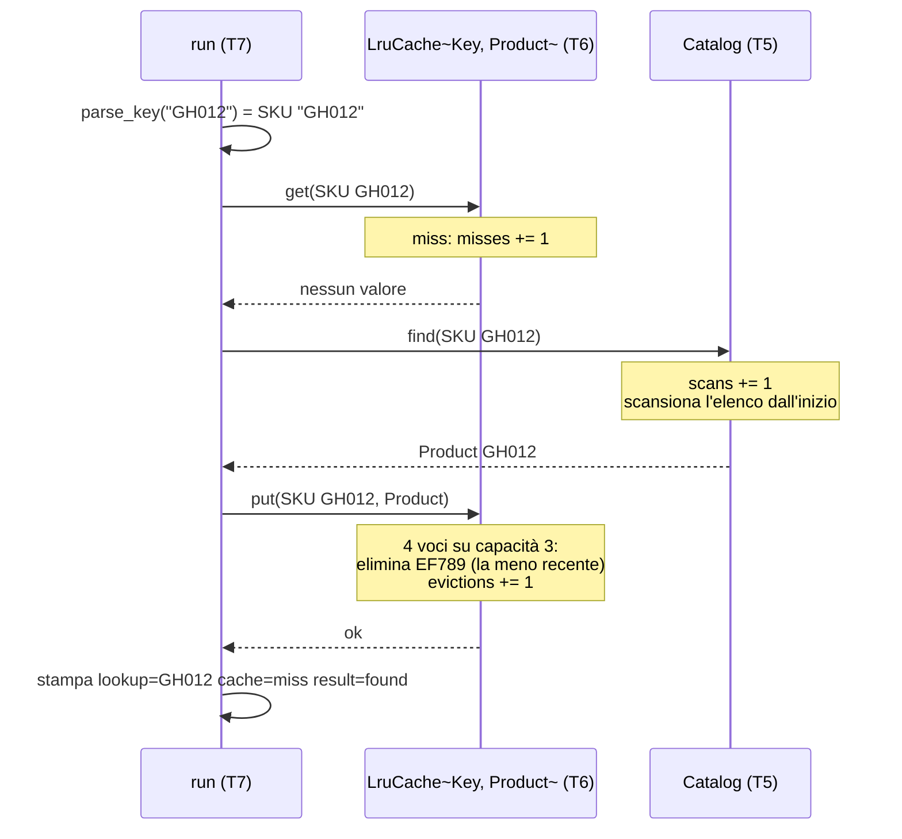
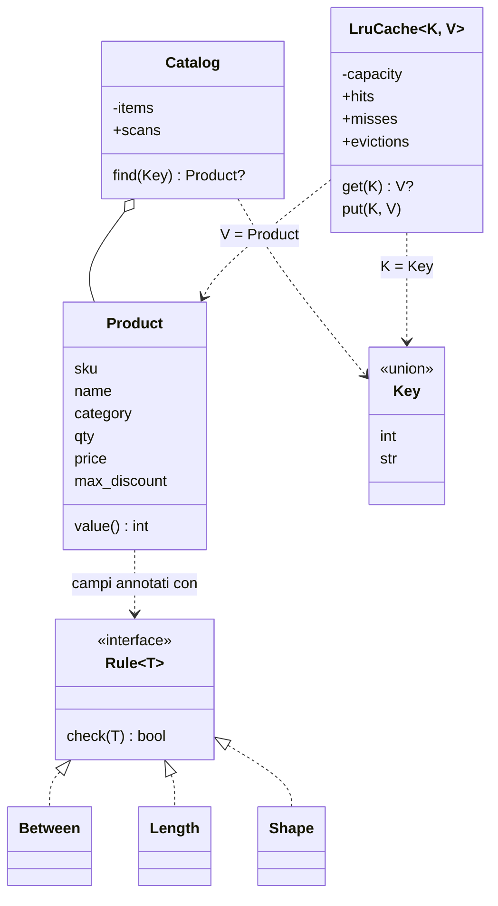

(parte 1 di 8: Introduzione, obiettivi e problema — file C08-parte1-intro.md)

# C08 — Generics, type system avanzato, metaprogrammazione

> **Parte II — Modellare e astrarre** · 3 lezioni (L08.1–L08.3) · 2 ore e 15 minuti · capitolo senza addendum (la scelta di fondo sui tipi è già discussa in C02 e C07)
> **Stato:** bozza 1 (2026-10-16). Codice eseguito e verificato su PHP 8.3.6, Python 3.13.16 (`mypy --strict` pulito sul programma intero, mypy 2.4.0), Rust 1.97.0 (`rustc --edition 2024`), Go 1.24.7 (`gofmt -l` vuoto, `go vet` pulito). Baseline del corso: PHP 8.4+, Go 1.25+ (il codice non usa nulla di specifico delle versioni più recenti; da riverificare a stesura finale). Solo libreria standard: nessun pacchetto esterno, nessuna rete. Python richiede la **sintassi dei generics di Python 3.12** (`class Cache[K, V]`, `type Key = ...`): con Python 3.11 o precedente il programma non parte.

## Obiettivi

Al termine del capitolo si sa:

1. spiegare **perché servono i generics** e distinguere le tre strategie per scrivere codice che valga per tipi diversi: copiarlo, usare un tipo che accetta tutto (`Any`, `mixed`, `any`), oppure dichiarare **parametri di tipo**;
2. scrivere funzioni e tipi generici con **vincoli** (*bound*, *constraint*), sapendo che cosa chiede ciascun linguaggio per «ordinabile», «usabile come chiave» e «sommabile»;
3. descrivere come i quattro linguaggi **realizzano** i generics e quanto costano: *monomorphization* (Rust), *stenciling per GC shape* (Go), *type erasure* (Python), nessun supporto a runtime (PHP);
4. spiegare il **gradual typing**: annotazioni che l'interprete ignora (Python), dichiarazioni controllate a runtime solo al momento della chiamata (PHP), tipi verificati prima dell'esecuzione (Rust e Go); usare un **type checker** esterno e capire dove smette di proteggere (`Any`);
5. usare **union types**, *narrowing*, **intersection types** e sum type, e sapere che cosa significa **invarianza**;
6. distinguere i **quattro momenti** della metaprogrammazione (sviluppo, compilazione, definizione, esecuzione) e riconoscere i meccanismi: *reflection*, *attributes*, *struct tags*, *decorator*, *macro*, *code generation*;
7. leggere un **loader generico guidato da uno schema dichiarativo** e valutare quando conviene (e quanto costa) rispetto al codice scritto a mano.

Prerequisiti: C04 (funzioni di ordine superiore: `top_n` riceve una funzione `key`), C05 (mappe, ordinamento, chiavi hashable, costo delle strutture), C06 (record, sum type, `Option`), C07 (interfacce e trait: **un vincolo è un'interfaccia sui tipi**; `Retrying<S: Sender>` era già generico). Per chi viene dalla Parte P: CP4 e CP3 (lettura degli errori del compilatore); i messaggi di errore riportati qui sono reali.

**Percorso per l'ingresso A (formato «primario + lettura»).** Scrivi il programma nel linguaggio primario e leggi gli altri tre con le tabelle di confronto. Gli esperimenti e1–e15 sono brevi e indipendenti: riproducine uno alla volta e confronta l'output con quello riportato. Se «generics» ti suona astratto, parti dall'esperimento e1 (una funzione che confronta due valori) e dal diagramma di L08.1; il resto del capitolo ne è l'applicazione.

## Il problema reale

> Un negozio riceve ogni giorno un file `catalog.csv` con i prodotti in vendita: **codice (SKU)**, **nome**, **categoria**, **quantità** in magazzino, **prezzo** in centesimi e **sconto massimo** consentito in percentuale (facoltativo: se la colonna è vuota, nessuno sconto previsto). Il responsabile del magazzino vuole tre cose. **Primo**: importare il file **scartando le righe che violano le regole**, sapendo per ciascuna *quale campo* e *quale regola* hanno fallito; le regole cambiano spesso, e il negozio ha già altri file con altri tipi di record, quindi non vuole scrivere un `if` per ogni campo di ogni record, ma **dichiarare le regole accanto ai campi**. **Secondo**: un riepilogo con i **tre prodotti di maggior valore a magazzino** (quantità × prezzo) e il valore **totale per categoria**; il codice del riepilogo deve servire anche per altri tipi di record, non solo per i prodotti. **Terzo**: una **ricerca** che, dato uno SKU oppure una posizione nel catalogo, restituisca il prodotto. La ricerca è lenta (scansiona tutto l'elenco), quindi i risultati recenti vanno tenuti in una **cache con capacità limitata a 3 voci**: quando è piena, si elimina la voce usata meno di recente. Le richieste stanno in `lookups.txt`, una per riga: un numero è una posizione (1 = primo prodotto valido), qualsiasi altro testo è uno SKU.

Come negli altri capitoli, il problema è un pretesto: serve a far nascere **tre bisogni di astrazione** che si presentano in qualunque sistema reale.

| Bisogno | Domanda | Dove nel capitolo |
|---|---|---|
| Scrivere una volta sola codice che valga per tipi diversi | «Come scrivo `top_n` e una cache che funzionino per prodotti, ordini e clienti, senza copiarli e senza perdere i controlli sui tipi?» | L08.1 |
| Dire — e far verificare — **che cosa può essere** un valore: un intero *oppure* un testo, anche assente | «Come dichiaro che la chiave di ricerca è una posizione o uno SKU, e chi mi impedisce di sbagliare?» | L08.2 |
| Far leggere al programma la **descrizione** dei dati | «Come costruisco un `Product` da una riga di testo usando soltanto le regole dichiarate sui suoi campi?» | L08.3 |

Le regole delle colonne, in forma neutra (indipendente dal linguaggio):

| Colonna | Tipo | Assente? | Regola |
|---|---|---|---|
| `sku` | testo | no | **forma** `AA999`: due lettere maiuscole ASCII e tre cifre ASCII |
| `name` | testo | no | lunghezza da 1 a 30 **caratteri** |
| `category` | testo | no | lunghezza da 1 a 12 caratteri |
| `qty` | intero | no | da 0 a 9999 |
| `price` | intero (centesimi) | no | da 1 a 999999 |
| `max_discount` | intero (percentuale) | **sì** (testo vuoto) | da 0 a 90, solo se presente |

I file di prova usati in tutto il capitolo. `catalog.csv` ha 19 righe di dati (più l'intestazione e una riga vuota, che viene saltata): 11 valide e 8 da scartare, ciascuna per una ragione diversa tra quelle sopra. Il valore a magazzino di `GH012` e di `PQ111` è lo stesso (175000), apposta: serve a verificare che i pari merito restino nell'ordine del file.

```csv
sku,name,category,qty,price,max_discount
AB123,Espresso machine,kitchen,12,24900,10
CD456,Milk frother,kitchen,40,1990,
EF789,Desk lamp,office,25,3450,15
GH012,Notebook A5,office,500,350,
IJ345,Standing desk,office,6,45900,5
KL678,Water bottle,outdoor,80,1250,20
MN901,Camping tent,outdoor,9,18900,10
OP234,Headlamp,outdoor,33,2790,
PQ111,Gift card,office,350,500,
QR567,Toaster,kitchen,15,3990,10
ab123,Lowercase sku,kitchen,1,100,
ST890,,office,3,500,
UV123,Name that is definitely longer than thirty chars,office,3,500,
WX456,Negative stock,kitchen,-4,500,
YZ789,Free item,outdoor,5,0,
AB124,Discount too high,office,5,500,95
CD457,Bad quantity,kitchen,many,500,
EF790,Too few fields,office,5

GH013,Pen set,office,200,245,
```

```csv
AB123
CD456
EF789
AB123
CD456
GH012
2
ZZ999
0
1
AB123
2
```

Le 8 righe scartate (i numeri di riga sono quelli del file, intestazione compresa):

| Riga | SKU | Campo | Regola | Perché |
|---|---|---|---|---|
| 12 | `ab123` | `sku` | `shape` | minuscole |
| 13 | `ST890` | `name` | `length` | nome vuoto |
| 14 | `UV123` | `name` | `length` | 48 caratteri, il limite è 30 |
| 15 | `WX456` | `qty` | `between` | −4 |
| 16 | `YZ789` | `price` | `between` | 0, il minimo è 1 |
| 17 | `AB124` | `max_discount` | `between` | 95, il massimo è 90 |
| 18 | `CD457` | `qty` | `type` | `many` non è un intero |
| 19 | `EF790` | `-` | `fields` | 5 campi invece di 6 |

Le 12 richieste di `lookups.txt` sono scelte per mettere alla prova la cache: ripetizioni (`AB123`, `CD456`), uno SKU inesistente (`ZZ999`), una posizione fuori intervallo (`0`) e — il caso interessante — la richiesta `2`, che identifica **lo stesso prodotto** di `CD456` con una chiave di tipo diverso. La cache la tratterà come una voce distinta: lo vedremo in L08.2.

### Scomposizione

| Task | Che cosa fa | Concetto protagonista | Lezione |
|---|---|---|---|
| T1 | Legge le righe una alla volta, saltando intestazione e righe vuote (come in C05) | — | — |
| T2 | **Schema**: dichiara tipo e regole di ogni colonna accanto al campo di `Product` | metadati, attributes, tag, macro | L08.3 |
| T3 | **Loader generico**: da una riga di testo a `Product` oppure a `Reject(campo, regola)`, usando solo lo schema | reflection, generics | L08.3 (e L08.1) |
| T4 | **Riepiloghi generici**: `top_n` e `group_sum`, validi per qualunque tipo di record | generics con vincoli | L08.1 |
| T5 | **Chiave di ricerca** (posizione *o* SKU) e `Catalog.find`, la sorgente lenta, che conta le scansioni | union type, narrowing | L08.2 |
| T6 | **Cache LRU generica** `LruCache<K, V>` con statistiche | generics con vincoli | L08.1 |
| T7 | Smista le richieste attraverso la cache, stampa il riepilogo e fissa l'exit code (0 = tutto ok, 1 = ci sono scarti, 2 = file mancante) | — | — |



Il percorso di una richiesta che **non** trova nulla in cache, per `GH012` (la sesta richiesta; la cache contiene `EF789`, `AB123`, `CD456`, dalla meno alla più recente):



I tipi in gioco. `Rule` è un'interfaccia **su un tipo** (giudica un `T`); `LruCache` è parametrica su due tipi; `Key` è un'unione. Le frecce tratteggiate sono «rispetta il contratto», quella piena è «contiene»:



### Il programma, in anteprima

Output atteso (stdout, poi stderr) ed exit code. Su stderr vanno gli scarti, su stdout il riepilogo e l'esito di ogni richiesta. È **identico nei quattro linguaggi** (confrontato con `diff` su stdout, stderr ed exit code); il codice completo è nell'appendice. Si eseguono con `main catalog.csv lookups.txt`.

```text
rows=19 valid=11 rejected=8
top rank=1 sku=AB123 value=298800
top rank=2 sku=IJ345 value=275400
top rank=3 sku=GH012 value=175000
category=kitchen value=438250
category=office value=760650
category=outdoor value=362170
lookup=AB123 cache=miss result=found sku=AB123
lookup=CD456 cache=miss result=found sku=CD456
lookup=EF789 cache=miss result=found sku=EF789
lookup=AB123 cache=hit result=found sku=AB123
lookup=CD456 cache=hit result=found sku=CD456
lookup=GH012 cache=miss result=found sku=GH012
lookup=2 cache=miss result=found sku=CD456
lookup=ZZ999 cache=miss result=unknown sku=-
lookup=0 cache=miss result=unknown sku=-
lookup=1 cache=miss result=found sku=AB123
lookup=AB123 cache=miss result=found sku=AB123
lookup=2 cache=hit result=found sku=CD456
cache capacity=3 hits=3 misses=9 evictions=4 scans=9
[exit 1]
```

Su stderr (8 scarti, nell'ordine del file):

```text
reject line=12 field=sku rule=shape
reject line=13 field=name rule=length
reject line=14 field=name rule=length
reject line=15 field=qty rule=between
reject line=16 field=price rule=between
reject line=17 field=max_discount rule=between
reject line=18 field=qty rule=type
reject line=19 field=- rule=fields
```

Alcune letture da fare subito, perché guidano il capitolo. Il terzo posto della classifica è `GH012`, non `PQ111`: a pari valore resta il primo del file (l'ordinamento è **stabile**). La richiesta `2` è un `miss` anche se `CD456` era già stato cercato: la chiave `2` e la chiave `"CD456"` sono due chiavi diverse, quindi la cache tiene due copie dello stesso prodotto. Infine `scans=9` coincide con `misses=9`: ogni mancata risposta della cache costa una scansione, anche quando il risultato è `unknown`.

---

