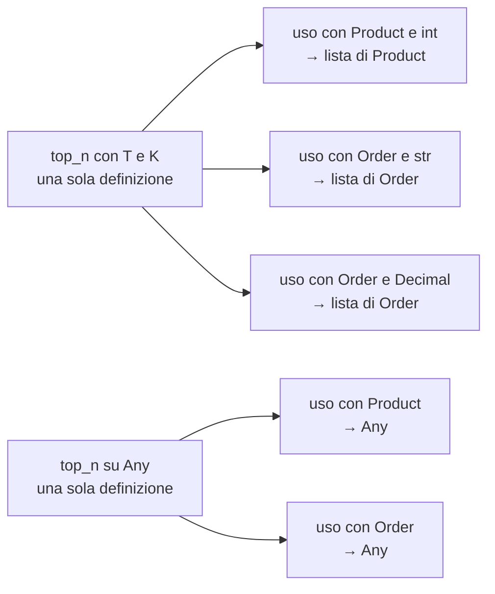
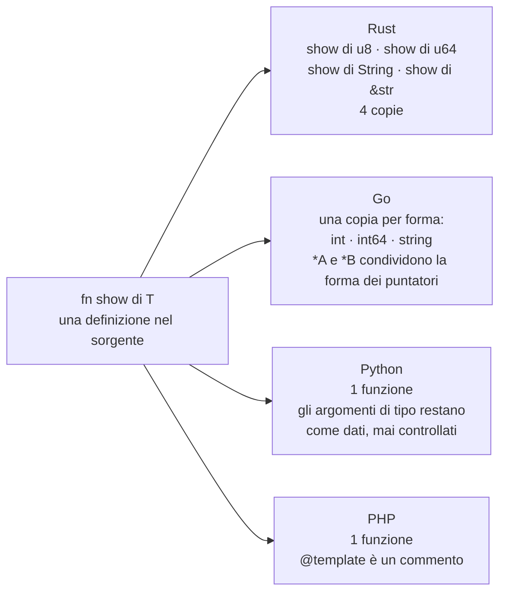
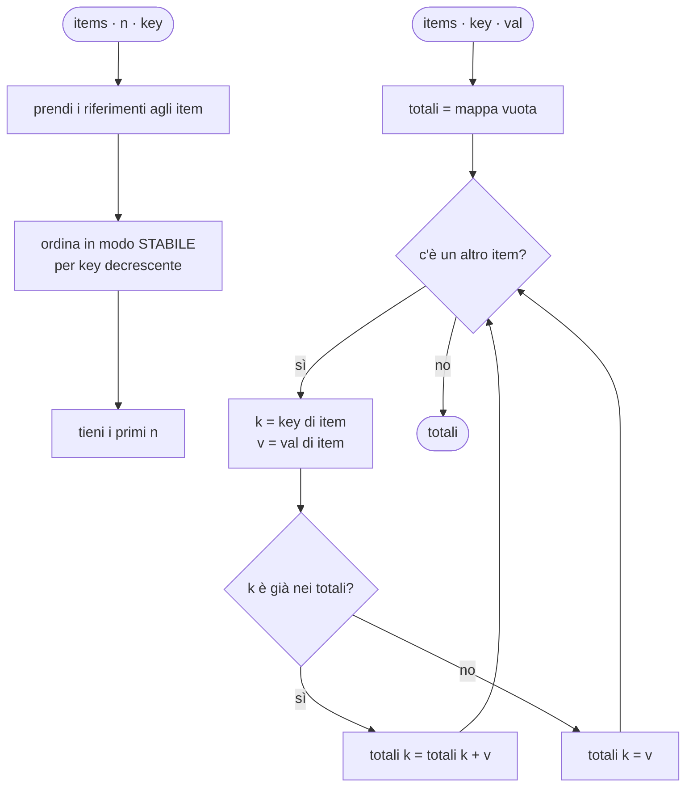
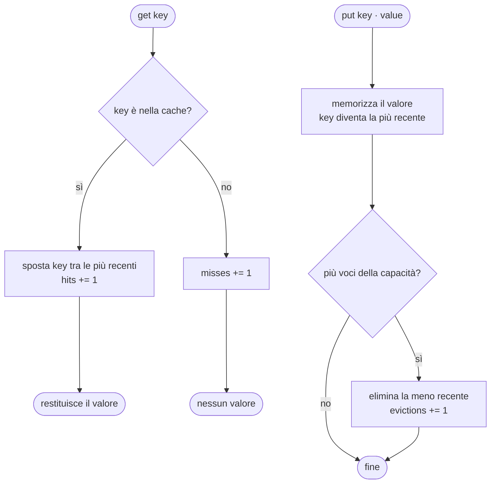

(parte 2 di 8: L08.1 — Generics e vincoli — file C08-parte2-l08-1.md)

## L08.1 — Generics e vincoli

### Concetto

Nel programma servono due utilità che non c'entrano nulla con i prodotti: «i primi *n* elementi di una lista secondo un criterio» e «una cache che tiene gli ultimi *n* risultati». Domani serviranno identiche per gli ordini, i clienti, i log. Come si scrive codice che valga per tipi diversi? Ci sono tre strade.

| Strada | Come | Che cosa si guadagna | Che cosa si perde |
|---|---|---|---|
| **Copiare** | `top_n_products`, `top_n_orders`, `top_n_customers` | ogni copia è tipizzata e veloce | ogni correzione va ripetuta N volte |
| **Tipo che accetta tutto** | un'unica `top_n` su `Any` / `mixed` / `any` / `Object` | una sola funzione | il compilatore non sa più nulla: la funzione restituisce «qualcosa», e un errore di tipo emerge a runtime |
| **Parametri di tipo** (*generics*) | un'unica `top_n[T, K]`, dove `T` e `K` sono segnaposto per i tipi | una sola funzione **e** il controllo dei tipi a ogni uso | il linguaggio deve poter esprimere i segnaposto e verificarli |

Un **generico** è quindi una funzione, una classe o una struttura che ha, oltre ai parametri normali, **parametri di tipo**. Si legge come «per qualunque tipo `T` e qualunque tipo `K`, tali che…». Al momento dell'uso i segnaposto vengono sostituiti da tipi concreti, di solito *dedotti* dal compilatore (o dal type checker) a partire dagli argomenti: `top_n(products, 3, Product.value)` significa `T = Product`, `K = int`, e il risultato è una lista di `Product`, non di «qualcosa».



Il segnaposto da solo non basta. Dentro `top_n` bisogna **confrontare** due chiavi, dentro `group_sum` bisogna **sommare** due valori e usare una chiave **come indice** di una mappa. Ma `K` potrebbe essere un tipo qualunque, anche uno che non si confronta, e `N` anche una stringa. La funzione deve quindi dichiarare che cosa **pretende** dai tipi: è il **vincolo** (*bound*, *constraint*). Un vincolo è un contratto minimo, della stessa famiglia dell'interfaccia di C07: là descriveva che cosa sa fare un *oggetto*, qui che cosa sa fare un *tipo*. Senza vincolo, dentro la funzione si può fare soltanto ciò che si può fare con *qualunque* valore: passarlo in giro, restituirlo, metterlo in una lista (e1 lo mostra).

I vincoli che usa questo capitolo, nei quattro linguaggi:

| Che cosa chiedo al tipo | Python | PHP | Rust | Go |
|---|---|---|---|---|
| nulla (qualunque tipo) | `T` | `@template T` | `T` | `T any` |
| ordinabile | `K: Ordered` (un `Protocol` con `__lt__`) | `@template K of int\|float\|string` | `K: Ord` | `K cmp.Ordered` |
| usabile come chiave di mappa | `K: Hashable` | `K of int\|string` (chiavi di array) | `K: Eq + Hash` | `K comparable` |
| sommabile | `N: (int, float)` | `N of int\|float` | `N: Add<Output = N> + Copy` | `N Number` (un *type set*) |
| duplicabile | — (sempre riferimenti) | — | `K: Clone` | — (sempre per valore) |

Una differenza di fondo è già visibile: in **Rust** il vincolo è un *trait* (lo stesso meccanismo di C07, `Ord`, `Add`, `Hash`); in **Go** è un'*interfaccia* di un tipo speciale, che può elencare **insiemi di tipi** (`~int | ~int64 | ~float64`: il `~` significa «qualunque tipo il cui tipo sottostante sia `int`»); in **Python** è un `Protocol` oppure una lista di tipi ammessi; in **PHP** non esiste a livello di linguaggio: il `@template ... of ...` è un **commento** che legge soltanto un analizzatore esterno (PHPStan, Psalm), mentre l'interprete lo ignora.

#### Che cosa resta a runtime: quattro modelli

Il generico è una promessa fatta al compilatore. Che cosa ne fa il compilatore, e che cosa arriva al programma in esecuzione?

| Modello | Chi lo usa | Che cosa fa | Costo |
|---|---|---|---|
| **Monomorphization** | Rust | genera **una copia del codice per ogni combinazione di tipi concreti**; ogni copia è specializzata e può essere ottimizzata e inlinata | codice veloce; binario più grande, compilazione più lenta |
| **Stenciling per GC shape + dizionari** | Go | genera una copia per ogni *forma* di tipo (tutti i puntatori hanno la stessa forma); le operazioni specifiche del tipo arrivano da un **dizionario** passato come argomento nascosto | un compromesso: meno copie, qualche indirezione |
| **Type erasure** | Python | il type checker usa gli argomenti di tipo; a runtime restano **come dati** (`__orig_class__`), ma nessun controllo | zero, ma nessuna garanzia a runtime |
| **Nessuno** | PHP | il linguaggio non ha generics; l'analizzatore legge il commento | zero |



L'esperimento e2 lo verifica nei binari reali. È anche la ragione per cui in C07 e10 i generics di Go non erano più veloci di una chiamata tramite interfaccia (2,02 ns contro 1,33 ns, Go 1.24.7): con lo stenciling per forma, il dizionario reintroduce una chiamata indiretta. Non l'ho rimisurato per questo capitolo; il risultato dipende dalla versione del compilatore ed è da riverificare con Go 1.25+.

### Implementazione: i riepiloghi generici (T4)



`top_n` chiede una cosa sola alla chiave (che sia **ordinabile**); `group_sum` ne chiede tre: che la chiave sia **usabile come indice** di mappa, che il valore sia **sommabile**, e che la somma di due valori sia dello stesso tipo. Si noti anche che nessuna delle due funzioni nomina `Product`: lo conoscono soltanto i punti di chiamata in `run` (T7).

**Python**

```python
class Ordered(Protocol):
    def __lt__(self, other: Any, /) -> bool: ...


def top_n[T, K: Ordered](items: Sequence[T], n: int, key: Callable[[T], K]) -> list[T]:
    """T4 - the n items with the largest key; ties keep the input order (the sort is stable)."""
    return sorted(items, key=key, reverse=True)[:n]


def group_sum[T, K: Hashable, N: (int, float)](
    items: Iterable[T], key: Callable[[T], K], val: Callable[[T], N]
) -> dict[K, N]:
    """T4 - sum val(item) for each key(item)."""
    totals: dict[K, N] = {}
    for item in items:
        k, v = key(item), val(item)
        totals[k] = totals[k] + v if k in totals else v
    return totals
```

**PHP**

```php
/**
 * T4 - the n items with the largest key; ties keep the input order (usort is stable since PHP 8.0).
 *
 * @template T
 * @template K of int|float|string
 * @param list<T> $items
 * @param callable(T): K $key
 * @return list<T>
 */
function topN(array $items, int $n, callable $key): array
{
    usort($items, fn($a, $b) => $key($b) <=> $key($a));
    return array_slice($items, 0, $n);
}

/**
 * T4 - sum val(item) for each key(item).
 *
 * @template T
 * @template K of int|string
 * @template N of int|float
 * @param iterable<T> $items
 * @param callable(T): K $key
 * @param callable(T): N $val
 * @return array<K,N>
 */
function groupSum(iterable $items, callable $key, callable $val): array
{
    $totals = [];
    foreach ($items as $item) {
        $k = $key($item);
        $totals[$k] = ($totals[$k] ?? 0) + $val($item);
    }
    return $totals;
}
```

**Rust**

```rust
/// T4 - the n items with the largest key; ties keep the input order (the sort is stable).
fn top_n<T, K: Ord>(items: &[T], n: usize, key: impl Fn(&T) -> K) -> Vec<&T> {
    let mut refs: Vec<&T> = items.iter().collect();
    refs.sort_by(|a, b| key(b).cmp(&key(a)));
    refs.truncate(n);
    refs
}

/// T4 - sum val(item) for each key(item); BTreeMap keeps the keys sorted.
fn group_sum<T, K: Ord, N: Add<Output = N> + Copy>(
    items: &[T],
    key: impl Fn(&T) -> K,
    val: impl Fn(&T) -> N,
) -> BTreeMap<K, N> {
    let mut totals = BTreeMap::new();
    for item in items {
        let v = val(item);
        totals.entry(key(item)).and_modify(|t| *t = *t + v).or_insert(v);
    }
    totals
}
```

**Go**

```go
// TopN is T4 - the n items with the largest key; ties keep the input order (the sort is stable).
func TopN[T any, K cmp.Ordered](items []T, n int, key func(T) K) []T {
	out := slices.Clone(items)
	slices.SortStableFunc(out, func(a, b T) int { return cmp.Compare(key(b), key(a)) })
	return out[:min(n, len(out))]
}

// Number is the constraint of the values we can add up: a TYPE SET, not a type.
type Number interface {
	~int | ~int64 | ~float64
}

// GroupSum is T4 - sum val(item) for each key(item).
func GroupSum[T any, K comparable, N Number](items []T, key func(T) K, val func(T) N) map[K]N {
	totals := map[K]N{}
	for _, item := range items {
		totals[key(item)] += val(item)
	}
	return totals
}
```


Che cosa fa ciascun linguaggio, riga per riga:

- **Python:** la sintassi `def top_n[T, K: Ordered](...)` (PEP 695, Python 3.12) dichiara i parametri di tipo dentro la firma; la forma precedente era `T = TypeVar("T")` fuori dalla funzione, ed è ancora valida. `Ordered` è un `Protocol` (C07): chiede soltanto un metodo `__lt__`. In `group_sum`, `N: (int, float)` è un **type variable vincolato**: `N` è `int` oppure `float`, e il type checker verifica entrambi i casi sul corpo (`totals[k] + v`). Il risultato è `dict[str, int]` quando `val` restituisce `int`. `sorted(..., reverse=True)` è **stabile**: i pari merito restano nell'ordine di ingresso.
- **PHP:** i tipi nella firma sono `array`, `callable`, `int`; i segnaposto vivono nel docblock (`@template T`, `@param callable(T): K $key`, `@return list<T>`). L'interprete non li legge; **li legge PHPStan/Psalm** (non eseguiti per questo capitolo). `usort` è stabile da PHP 8.0 e `<=>` confronta interi, float e stringhe: è l'operatore che e1 mostra comportarsi in modo diverso a seconda dei valori.
- **Rust:** `top_n<T, K: Ord>(items: &[T], n: usize, key: impl Fn(&T) -> K) -> Vec<&T>` ha **due** parametri di tipo espliciti e uno implicito (`impl Fn`, cioè «un tipo qualunque che sia una funzione»). Restituisce **riferimenti** agli elementi, non copie. In `group_sum`, `N: Add<Output = N> + Copy` dice: «si può sommare e il risultato è ancora `N`», e «si può copiare» (serve per riusare `v` dopo la somma). Il `BTreeMap` mantiene le chiavi ordinate; la `entry(...).and_modify(...).or_insert(...)` è l'idioma «aggiorna se c'è, altrimenti inserisci».
- **Go:** `TopN[T any, K cmp.Ordered]` ha i parametri di tipo tra parentesi quadre prima degli argomenti. `cmp.Ordered` è nella libreria standard (interi, float, stringhe). `Number` è un **type set** dichiarato da noi: `~int | ~int64 | ~float64`. `GroupSum` restituisce una mappa, che in Go non ha ordine: chi stampa ordina le chiavi (`slices.Sorted`), come in C05. `min` è una funzione predefinita dal Go 1.21.

Le chiamate, in `run`, mostrano la conseguenza pratica: nessuna annotazione esplicita dei tipi, perché sono **dedotti** dagli argomenti. In Python `top_n(products, 3, Product.value)` è tipizzato come `list[Product]`; in Rust come `Vec<&Product>`; in Go come `[]Product`.

### Implementazione: la cache LRU generica (T6)

Una cache LRU (*Least Recently Used*) tiene al massimo *n* voci. Ogni lettura riuscita fa diventare la voce «la più recente»; quando un inserimento supera la capacità, si elimina la voce meno recente.



I tipi sono due: `K` (chiave) e `V` (valore). La cache pretende qualcosa soltanto da `K`: deve potersi usare come indice di una mappa. Dal valore non pretende nulla.

**Python**

```python
class LruCache[K: Hashable, V]:
    """T6 - a bounded cache that evicts the Least Recently Used entry. K must be hashable."""

    def __init__(self, capacity: int) -> None:
        self._cap = capacity
        self._data: OrderedDict[K, V] = OrderedDict()
        self.hits = self.misses = self.evictions = 0

    def get(self, key: K) -> V | None:
        if key in self._data:
            self._data.move_to_end(key)
            self.hits += 1
            return self._data[key]
        self.misses += 1
        return None

    def put(self, key: K, value: V) -> None:
        self._data[key] = value
        self._data.move_to_end(key)
        if len(self._data) > self._cap:
            self._data.popitem(last=False)
            self.evictions += 1
```

**PHP**

```php
/**
 * T6 - a bounded cache that evicts the Least Recently Used entry. K must be usable as an array key.
 *
 * @template K of int|string
 * @template V
 */
final class LruCache
{
    /** @var array<K,V> oldest first */
    private array $data = [];
    public int $hits = 0;
    public int $misses = 0;
    public int $evictions = 0;

    public function __construct(private readonly int $capacity)
    {
    }

    /**
     * @param K $key
     * @return V|null
     */
    public function get(int|string $key): mixed
    {
        if (array_key_exists($key, $this->data)) {
            $value = $this->data[$key];
            unset($this->data[$key]);
            $this->data[$key] = $value; // re-insert: now the newest
            $this->hits++;
            return $value;
        }
        $this->misses++;
        return null;
    }

    /**
     * @param K $key
     * @param V $value
     */
    public function put(int|string $key, mixed $value): void
    {
        unset($this->data[$key]);
        $this->data[$key] = $value;
        if (count($this->data) > $this->capacity) {
            unset($this->data[array_key_first($this->data)]);
            $this->evictions++;
        }
    }
}
```

**Rust**

```rust
/// T6 - a bounded cache that evicts the Least Recently Used entry. K needs Eq + Hash (map key) and Clone.
struct LruCache<K: Eq + Hash + Clone, V> {
    capacity: usize,
    data: HashMap<K, V>,
    order: VecDeque<K>, // oldest first
    hits: u32,
    misses: u32,
    evictions: u32,
}

impl<K: Eq + Hash + Clone, V> LruCache<K, V> {
    fn new(capacity: usize) -> Self {
        LruCache { capacity, data: HashMap::new(), order: VecDeque::new(), hits: 0, misses: 0, evictions: 0 }
    }

    fn touch(&mut self, key: &K) {
        if let Some(i) = self.order.iter().position(|k| k == key) {
            let k = self.order.remove(i).expect("position is valid");
            self.order.push_back(k);
        }
    }

    fn get(&mut self, key: &K) -> Option<&V> {
        if self.data.contains_key(key) {
            self.touch(key);
            self.hits += 1;
            self.data.get(key)
        } else {
            self.misses += 1;
            None
        }
    }

    fn put(&mut self, key: K, value: V) {
        if self.data.insert(key.clone(), value).is_some() {
            self.touch(&key);
            return;
        }
        self.order.push_back(key);
        if self.order.len() > self.capacity {
            let oldest = self.order.pop_front().expect("not empty");
            self.data.remove(&oldest);
            self.evictions += 1;
        }
    }
}
```

**Go**

```go
// LruCache is T6 - a bounded cache that evicts the Least Recently Used entry. K must be comparable (a map key).
type LruCache[K comparable, V any] struct {
	capacity  int
	data      map[K]V
	order     []K // oldest first
	Hits      int
	Misses    int
	Evictions int
}

func NewLruCache[K comparable, V any](capacity int) *LruCache[K, V] {
	return &LruCache[K, V]{capacity: capacity, data: map[K]V{}}
}

func (c *LruCache[K, V]) touch(key K) {
	if i := slices.Index(c.order, key); i >= 0 {
		c.order = append(slices.Delete(c.order, i, i+1), key)
	}
}

func (c *LruCache[K, V]) Get(key K) (V, bool) {
	v, ok := c.data[key]
	if ok {
		c.touch(key)
		c.Hits++
	} else {
		c.Misses++
	}
	return v, ok
}

func (c *LruCache[K, V]) Put(key K, value V) {
	if _, exists := c.data[key]; exists {
		c.data[key] = value
		c.touch(key)
		return
	}
	c.data[key] = value
	c.order = append(c.order, key)
	if len(c.order) > c.capacity {
		delete(c.data, c.order[0])
		c.order = c.order[1:]
		c.Evictions++
	}
}
```


- **Python:** `class LruCache[K: Hashable, V]` dichiara due parametri di tipo, il primo con vincolo. `OrderedDict` ricorda l'ordine di inserimento, e `move_to_end` / `popitem(last=False)` fanno il resto. Attenzione: `get` restituisce `V | None`; se `V` potesse essere `None`, un *hit* sarebbe indistinguibile da un *miss*. Qui `V` è `Product` e il problema non c'è.
- **PHP:** non esistono parametri di tipo: `@template K of int|string` e `@template V` stanno nel docblock della classe, e `get`/`put` usano `mixed`. L'ordine si ottiene con la proprietà degli array PHP di ricordare l'ordine d'inserimento: per «rendere recente» una chiave si fa `unset` e la si reinserisce. `K of int|string` non è un vezzo: le chiavi degli array PHP possono essere **solo** interi o stringhe (e3).
- **Rust:** `struct LruCache<K: Eq + Hash + Clone, V>`. Il vincolo ha **tre** parti: `Eq + Hash` per l'indice (`HashMap`), `Clone` perché la chiave sta in due posti (nella mappa e nella coda dell'ordine). `V` non ha vincoli. `get` prende `&mut self` anche se sembra una lettura, perché rimette in ordine la coda, e restituisce `Option<&V>`: un **riferimento dentro la cache**, che il chiamante non può tenere mentre modifica la cache; per questo nel punto di chiamata si fa `.cloned()` (e `Product` deriva `Clone`). Questo è un assaggio di C10.
- **Go:** `LruCache[K comparable, V any]`. `comparable` è il vincolo predefinito per «si può usare con `==`, quindi come chiave di mappa». `Get` restituisce la coppia `(V, bool)`: se la chiave manca, il valore è lo **zero value** di `V` e il `bool` dice se c'era; è l'idioma «comma ok» di C02, che in Go sostituisce `Option`.

La struttura dati è volutamente semplice: `touch` cerca la chiave in un elenco (costo lineare). Con capacità 3 è irrilevante; una cache vera usa una mappa più una lista doppiamente concatenata per avere costo costante (C05, L05.4).

### Esperimento e1 — una funzione generica senza vincoli: che cosa si può fare?

`biggest(a, b)` restituisce il maggiore dei due. L'unico dato è «due valori dello stesso tipo `T`»; non si dice nulla di `T`.

```python
def biggest[T](a: T, b: T) -> T:
    return a if a > b else b  # nothing says that T can be compared


print(biggest(3, 7), biggest("a", "b"), biggest([1], [2]))
```

```php
<?php
/**
 * @template T
 * @param T $a
 * @param T $b
 * @return T
 */
function biggest(mixed $a, mixed $b): mixed
{
    return $a > $b ? $a : $b;
}
var_dump(biggest(3, 7), biggest('a', 'b'), biggest([1], [2]));
var_dump(biggest('9', '10'), biggest('9a', '10a')); // the same operator, two meanings
```

```rust
fn biggest<T>(a: T, b: T) -> T {
    if a > b { a } else { b }
}

fn main() {
    println!("{}", biggest(3, 7));
}
```

```go
package main

import "fmt"

func Biggest[T any](a, b T) T {
	if a > b {
		return a
	}
	return b
}

func main() { fmt.Println(Biggest(3, 7)) }
```

Poi con il vincolo giusto (Rust: `T: PartialOrd`; Go: `cmp.Ordered`), e con un tipo che il vincolo non ammette (`Money` senza `PartialOrd`; una slice):

```rust
#[derive(Debug)]
struct Money(i64); // no PartialOrd

fn biggest<T: PartialOrd>(a: T, b: T) -> T {
    if a > b { a } else { b }
}

fn main() {
    println!("{} {} {}", biggest(3, 7), biggest("a", "b"), biggest(1.5, 0.5));
    println!("{:?}", biggest(Money(1), Money(2)));
}
```

```go
package main

import (
	"cmp"
	"fmt"
)

func Biggest[T cmp.Ordered](a, b T) T {
	if a > b {
		return a
	}
	return b
}

func main() {
	fmt.Println(Biggest(3, 7), Biggest("a", "b"), Biggest(1.5, 0.5))
	fmt.Println(Biggest([]int{1}, []int{2}))
}
```

```text
### e1.py
7 b [2]
[exit 0]
### e1.py+mypy
e1.py:2: error: Unsupported left operand type for > ("T")  [operator]
Found 1 error in 1 file (checked 1 source file)
[exit 1]
### e1.php
int(7)
string(1) "b"
array(1) {
  [0]=>
  int(2)
}
string(2) "10"
string(2) "9a"
[exit 0]
### e1.rs
error[E0369]: binary operation `>` cannot be applied to type `T`
 --> e1.rs:2:10
  |
2 |     if a > b { a } else { b }
  |        - ^ - T
  |        |
  |        T
  |
help: consider restricting type parameter `T` with trait `PartialOrd`
  |
1 | fn biggest<T: std::cmp::PartialOrd>(a: T, b: T) -> T {
  |             ++++++++++++++++++++++

error: aborting due to 1 previous error

For more information about this error, try `rustc --explain E0369`.
[exit 1]
### e1ok.rs
error[E0277]: can't compare `Money` with `Money`
  --> e1ok.rs:10:22
   |
10 |     println!("{:?}", biggest(Money(1), Money(2)));
   |                      ^^^^^^^ no implementation for `Money < Money` and `Money > Money`
   |
   = help: the trait `PartialOrd` is not implemented for `Money`
note: required by a bound in `biggest`
  --> e1ok.rs:4:15
   |
 4 | fn biggest<T: PartialOrd>(a: T, b: T) -> T {
   |               ^^^^^^^^^^ required by this bound in `biggest`
help: consider annotating `Money` with `#[derive(PartialOrd)]`
   |
 2 + #[derive(PartialOrd)]
 3 | struct Money(i64); // no PartialOrd
   |

error: aborting due to 1 previous error

For more information about this error, try `rustc --explain E0277`.
[exit 1]
### e1.go
# example.com/e1
./main.go:6:5: invalid operation: a > b (type parameter T cannot use operator >)
[exit 1]
### e1ok.go
# example.com/e1ok
./main.go:17:21: []int does not satisfy cmp.Ordered ([]int missing in ~int | ~int8 | ~int16 | ~int32 | ~int64 | ~uint | ~uint8 | ~uint16 | ~uint32 | ~uint64 | ~uintptr | ~float32 | ~float64 | ~string)
[exit 1]
```

| Linguaggio | Che cosa succede | Quando |
|---|---|---|
| Python | gira e dà `7 b [2]`; mypy rifiuta il confronto: `Unsupported left operand type for > ("T")` | type checker, non a runtime |
| PHP | gira con qualunque valore; `>` ha **significati diversi**: `'9'` contro `'10'` sono stringhe numeriche e si confrontano come numeri (vince `'10'`), `'9a'` contro `'10a'` come testo (vince `'9a'`) | mai: nessuna verifica |
| Rust | `error[E0369]: binary operation > cannot be applied to type T`, con il suggerimento esatto: `T: std::cmp::PartialOrd` | **compilazione**, nella definizione |
| Rust, con vincolo | `Money` non ammesso: `E0277 can't compare Money with Money`, nel punto di **chiamata** | compilazione |
| Go | `invalid operation: a > b (type parameter T cannot use operator >)` | compilazione, nella definizione |
| Go, con vincolo | `[]int does not satisfy cmp.Ordered`, nel punto di chiamata | compilazione |

Due controlli distinti, in Rust e in Go: uno **nella definizione** (la funzione non può usare nulla che il vincolo non prometta) e uno **nella chiamata** (il tipo concreto deve rispettare il vincolo). Python fa lo stesso lavoro, ma nel type checker. In PHP nessuno dei due esiste, e la conseguenza non è un errore: è che lo stesso operatore cambia significato in silenzio.

### Esperimento e2 — che cosa resta del tipo a runtime?

Python: quali tracce lasciano i parametri di tipo? PHP: che cosa vede il programma di un `@template`? Rust: quante copie di una funzione generica contiene il binario (`nm -C`, compilato con `-O`, con `#[inline(never)]` per impedire all'ottimizzatore di eliminarle)? Go: lo stesso con `go tool nm`, per cinque chiamate con cinque tipi diversi.

```python
class Box[T]:
    def __init__(self, v: T) -> None:
        self.v = v


b = Box[int](1)
print(type(b), type(b) is Box)
print("__orig_class__:", b.__orig_class__)  # type: ignore[attr-defined]
print("type parameters:", Box.__type_params__)
print(Box[int] == Box[int], Box[int] == Box[str])
try:
    isinstance(b, Box[int])
except TypeError as e:
    print("TypeError:", e)
```

```php
<?php
/**
 * @template T
 */
final class Box
{
    /** @param T $v */
    public function __construct(public mixed $v)
    {
    }
}
$a = new Box(1);
$b = new Box('one');
echo get_class($a), ' ', get_class($b), ' ', var_export(get_class($a) === get_class($b), true), "\n";
echo (new ReflectionClass(Box::class))->getDocComment(), "\n";
```

```rust
use std::any::type_name;
use std::fmt::Display;
use std::hint::black_box;
use std::mem::size_of;

struct Wrapper<T>(T);

#[inline(never)]
fn show<T: Display>(x: T) -> String {
    format!("<{x}>")
}

fn main() {
    println!("{}", type_name::<Wrapper<u8>>());
    println!("size_of Wrapper<u8>  = {}", size_of::<Wrapper<u8>>());
    println!("size_of Wrapper<u64> = {}", size_of::<Wrapper<u64>>());
    black_box(show(black_box(1u8)));
    black_box(show(black_box(2u64)));
    black_box(show(black_box(String::from("x"))));
    black_box(show(black_box("y")));
}
```

```go
package main

import "fmt"

type Box[T any] struct{ v T }
type A struct{}
type B struct{}

//go:noinline
func identity[T any](x T) T { return x }

func main() {
	fmt.Printf("%T %T\n", Box[int]{}, Box[string]{})
	fmt.Println(identity(1), identity("x"), identity(int64(2)), identity(&A{}) != nil, identity(&B{}) != nil)
}
```

```text
### e2.py
<class '__main__.Box'> True
__orig_class__: __main__.Box[int]
type parameters: (T,)
True False
TypeError: Subscripted generics cannot be used with class and instance checks
[exit 0]
### e2.php
Box Box true
/**
 * @template T
 */
[exit 0]
### e2.rs
main::Wrapper<u8>
size_of Wrapper<u8>  = 1
size_of Wrapper<u64> = 8
--- nm -C
t main::show::<alloc::string::String>
t main::show::<&str>
t main::show::<u8>
t main::show::<u64>
[exit 0]
### e2.go
main.Box[int] main.Box[string]
1 x 2 true true
--- go tool nm
T main.identity[go.shape.*uint8]
T main.identity[go.shape.int64]
T main.identity[go.shape.int]
T main.identity[go.shape.string]
[exit 0]
```

Letture:

- **Python:** a runtime `type(b)` è `Box`, non `Box[int]`: la classe è una sola. Gli argomenti di tipo non sono spariti del tutto: `Box[int](1)` registra `__orig_class__` e la classe espone `__type_params__`. Ma non si possono usare per controllare nulla: `isinstance(b, Box[int])` è un errore (`Subscripted generics cannot be used with class and instance checks`).
- **PHP:** `Box` con un intero e `Box` con una stringa hanno la **stessa classe**. Del `@template` resta solo il testo del commento, raggiungibile con `getDocComment()`: è dato, non è controllo.
- **Rust:** `nm -C` elenca **quattro** funzioni distinte: `show::<u8>`, `show::<u64>`, `show::<String>`, `show::<&str>`. Una definizione nel sorgente, quattro nel binario: è la monomorphization. Anche i tipi cambiano dimensione: `Wrapper<u8>` pesa 1 byte, `Wrapper<u64>` 8.
- **Go:** cinque chiamate (con `int`, `string`, `int64`, `*A` e `*B`) producono **quattro** istanze: `[go.shape.int]`, `[go.shape.int64]`, `[go.shape.string]` e una sola `[go.shape.*uint8]` condivisa dai due tipi puntatore `*A` e `*B`. Il tipo resta visibile in `%T` (`main.Box[int]`) perché Go conserva le informazioni sui tipi per la reflection (L08.3).

### Esperimento e3 — il vincolo sulla chiave: dove si scopre che un tipo non va?

Una cache con chiave `K` che dev'essere usabile come indice di mappa. Provo una chiave valida (una tupla, un array) e una non valida (una lista, una slice, un `f64`, un array PHP).

```python
from collections.abc import Hashable


class Cache[K: Hashable, V]:
    def __init__(self) -> None:
        self.data: dict[K, V] = {}

    def put(self, key: K, value: V) -> None:
        self.data[key] = value


ok: Cache[tuple[int, int], str] = Cache()
ok.put((1, 2), "tuple key")
bad: Cache[list[int], str] = Cache()
bad.put([1, 2], "list key")
```

```php
<?php
/**
 * @template K of int|string
 * @template V
 */
final class Cache
{
    /** @var array<K,V> */
    private array $data = [];

    /** @param K $key @param V $value */
    public function put(mixed $key, mixed $value): void
    {
        $this->data[$key] = $value;
    }

    public function keys(): array
    {
        return array_keys($this->data);
    }
}
$c = new Cache();
$c->put('sku', 1);
$c->put(1.7, 2);       // a float: the docblock says K is int|string, PHP does not read it
$c->put(true, 3);
$c->put('007', 4);
$c->put('7', 5);
var_dump($c->keys());
try {
    $c->put([1, 2], 6);
} catch (TypeError $e) {
    echo 'TypeError: ', $e->getMessage(), "\n";
}
```

```rust
use std::collections::HashMap;
use std::hash::Hash;

struct Cache<K: Eq + Hash, V> {
    data: HashMap<K, V>,
}

impl<K: Eq + Hash, V> Cache<K, V> {
    fn put(&mut self, key: K, value: V) {
        self.data.insert(key, value);
    }
}

fn main() {
    let mut ok: Cache<(i32, i32), &str> = Cache { data: HashMap::new() };
    ok.put((1, 2), "tuple key");
    let mut bad: Cache<f64, &str> = Cache { data: HashMap::new() };
    bad.put(1.5, "float key");
}
```

```go
package main

import "fmt"

type Cache[K comparable, V any] struct{ data map[K]V }

func (c *Cache[K, V]) Put(k K, v V) { c.data[k] = v }

func main() {
	ok := Cache[[2]int, string]{data: map[[2]int]string{}}
	ok.Put([2]int{1, 2}, "array key")
	bad := Cache[[]int, string]{data: map[[]int]string{}}
	fmt.Println(ok, bad)
}
```

Go ha anche una via di fuga: `any` soddisfa `comparable` (dal Go 1.20), e la verifica diventa dinamica:

```go
package main

import "fmt"

type Cache[K comparable, V any] struct{ data map[K]V }

func (c *Cache[K, V]) Put(k K, v V) { c.data[k] = v }

func main() {
	c := Cache[any, string]{data: map[any]string{}} // `any` satisfies comparable since Go 1.20
	c.Put("sku", "ok")
	fmt.Println(len(c.data))
	c.Put([]int{1, 2}, "slice key")
	fmt.Println("unreachable")
}
```

```text
### e3.py
Traceback (most recent call last):
  File "e3.py", line 15, in <module>
    bad.put([1, 2], "list key")
    ~~~~~~~^^^^^^^^^^^^^^^^^^^^
  File "e3.py", line 9, in put
    self.data[key] = value
    ~~~~~~~~~^^^^^
TypeError: unhashable type: 'list'
[exit 1]
### e3.py+mypy
e3.py:14: error: Type argument "list[int]" of "Cache" must be a subtype of "Hashable"  [type-var]
Found 1 error in 1 file (checked 1 source file)
[exit 1]
### e3.php
array(4) {
  [0]=>
  string(3) "sku"
  [1]=>
  int(1)
  [2]=>
  string(3) "007"
  [3]=>
  int(7)
}
TypeError: Cannot access offset of type array on array
[exit 0]
### e3.rs
e3.rs:17:18: error[E0277]: the trait bound `f64: Eq` is not satisfied: the trait `Eq` is not implemented for `f64`
e3.rs:17:18: error[E0277]: the trait bound `f64: Hash` is not satisfied: the trait `Hash` is not implemented for `f64`
e3.rs:17:51: error[E0277]: the trait bound `f64: Eq` is not satisfied: the trait `Eq` is not implemented for `f64`
e3.rs:17:51: error[E0277]: the trait bound `f64: Hash` is not satisfied: the trait `Hash` is not implemented for `f64`
e3.rs:18:9: error[E0599]: the method `put` exists for struct `Cache<f64, &str>`, but its trait bounds were not satisfied: method cannot be called on `Cache<f64, &str>` due to unsatisfied trait bounds
error: aborting due to 5 previous errors
[exit 1]
### e3.go
# example.com/e3go
./main.go:12:15: []int does not satisfy comparable
./main.go:12:40: invalid map key type []int
[exit 1]
### e3b.go
1
panic: runtime error: hash of unhashable type []int

[exit 2]
```

| Linguaggio | Chiave non valida | Quando lo scopre |
|---|---|---|
| Python | `TypeError: unhashable type: 'list'`; mypy lo anticipa: `Type argument "list[int]" of "Cache" must be a subtype of "Hashable"` | runtime, o type checker |
| PHP | l'array come chiave dà `TypeError: Cannot access offset of type array on array`; ma **un float e un booleano passano** e vengono trasformati: `1.7` e `true` diventano la chiave `1`, `'7'` diventa l'intero `7`, `'007'` resta stringa | runtime (e solo per alcuni tipi) |
| Rust | `E0277: the trait bound f64: Eq is not satisfied` (e `Hash`), poi `E0599` sul metodo `put` | compilazione, già alla dichiarazione di `Cache<f64, _>` |
| Go | `[]int does not satisfy comparable` e `invalid map key type []int` | compilazione |
| Go, con `any` | compila; `panic: runtime error: hash of unhashable type []int` | **runtime**: aver scelto `any` come `K` ha spento il controllo |

Le righe PHP meritano una pausa: il vincolo `K of int|string` è documentato nel commento, ma il linguaggio non lo applica, e il risultato non è un errore ma una **conversione silenziosa** delle chiavi (la stessa di C05, e4). In una cache significa che due richieste diverse possono finire sulla stessa voce.

### Esperimento e4 — un metodo può avere parametri di tipo propri?

`Stack<T>` ha un metodo `map` che trasforma gli elementi in un tipo `R` nuovo, introdotto dal metodo stesso (non dalla struttura).

```python
from collections.abc import Callable


class Stack[T]:
    def __init__(self, items: list[T]) -> None:
        self.items = items

    def map[R](self, f: Callable[[T], R]) -> "Stack[R]":  # a method with its own type parameter
        return Stack([f(x) for x in self.items])


print(Stack([1, 2, 3]).map(str).items)
```

```rust
struct Stack<T> {
    items: Vec<T>,
}

impl<T> Stack<T> {
    fn map<R>(&self, f: impl Fn(&T) -> R) -> Stack<R> {
        Stack { items: self.items.iter().map(f).collect() }
    }
}

fn main() {
    let s = Stack { items: vec![1, 2, 3] };
    println!("{:?}", s.map(|x| x.to_string()).items);
}
```

```go
package main

import "fmt"

type Stack[T any] struct{ items []T }

func (s Stack[T]) Map[R any](f func(T) R) Stack[R] {
	out := make([]R, 0, len(s.items))
	for _, x := range s.items {
		out = append(out, f(x))
	}
	return Stack[R]{out}
}

func main() { fmt.Println(Stack[int]{[]int{1, 2, 3}}) }
```

```go
package main

import (
	"fmt"
	"strconv"
)

type Stack[T any] struct{ items []T }

// A function, not a method: functions may introduce new type parameters.
func Map[T, R any](s Stack[T], f func(T) R) Stack[R] {
	out := make([]R, 0, len(s.items))
	for _, x := range s.items {
		out = append(out, f(x))
	}
	return Stack[R]{out}
}

func main() {
	fmt.Printf("%q\n", Map(Stack[int]{[]int{1, 2, 3}}, strconv.Itoa).items)
}
```

```text
### e4.py
['1', '2', '3']
[exit 0]
### e4.rs
["1", "2", "3"]
[exit 0]
### e4.go
# example.com/e4go
./main.go:7:22: syntax error: method must have no type parameters
[exit 1]
### e4ok.go
["1" "2" "3"]
[exit 0]
```

Python (`def map[R](...)`) e Rust (`fn map<R>(...)`) lo permettono. **Go no**: `method must have no type parameters`. È una limitazione dichiarata del linguaggio, non un difetto del compilatore, e la conseguenza è che le operazioni «che cambiano il tipo» (`Map`, `Reduce` con un tipo di accumulo diverso) in Go si scrivono come **funzioni libere**, non come metodi. È lo stesso schema già visto in C04 per `Map`/`Filter`/`Reduce`.

### Focus comparativo

| Aspetto | PHP | Python | Rust | Go |
|---|---|---|---|---|
| Generics nel linguaggio | no (commento `@template`) | sì, sintassi nativa dal 3.12 | sì | sì, dal 1.18 |
| Chi verifica | PHPStan/Psalm | mypy, pyright | compilatore | compilatore |
| Vincolo | `of` nel docblock | `Protocol`, `Hashable`, tipi ammessi | trait (`Ord`, `Hash`, `Add`) | interfaccia e type set (`cmp.Ordered`, `comparable`) |
| Realizzazione | — | type erasure | monomorphization | stenciling per GC shape + dizionari |
| Argomenti di tipo a runtime | solo come testo | come dati (`__orig_class__`), mai controllati | no (solo `type_name`) | sì, nei nomi di tipo (`%T`) e nella reflection |
| Metodi con parametri di tipo propri | n/a | sì | sì | **no** |
| Vincolo violato | nessun errore | type checker | compilazione, alla chiamata | compilazione, alla chiamata |
| Via di fuga | `mixed` | `Any` | `dyn Any` | `any` |

### Esercizio Rosetta (4′)

Scrivi `min_by(items, key)` che restituisce l'elemento con la chiave più piccola. Che vincolo serve a `K`? Che cosa restituisci se la lista è vuota — e come lo esprime il tipo di ritorno in ciascun linguaggio (`T | None`, `?T`, `Option<&T>`, `(T, bool)`)? Quale linguaggio ti obbliga a decidere prima di compilare?

---

