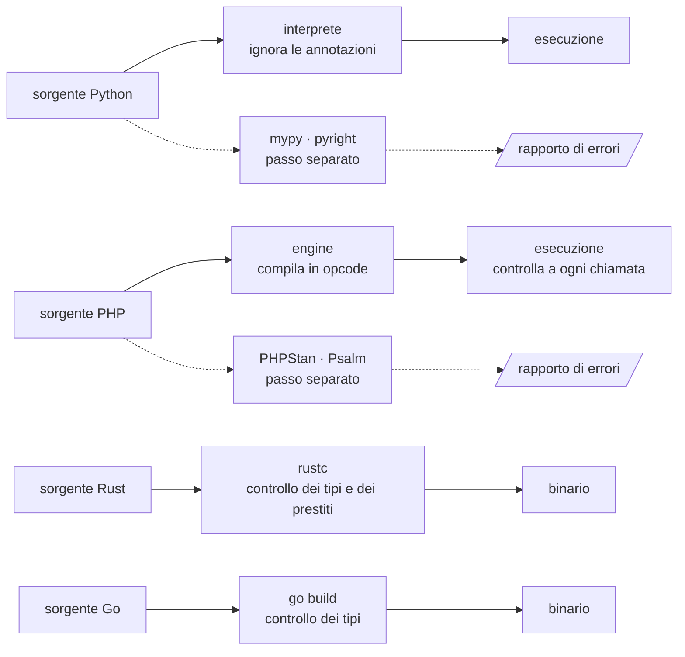
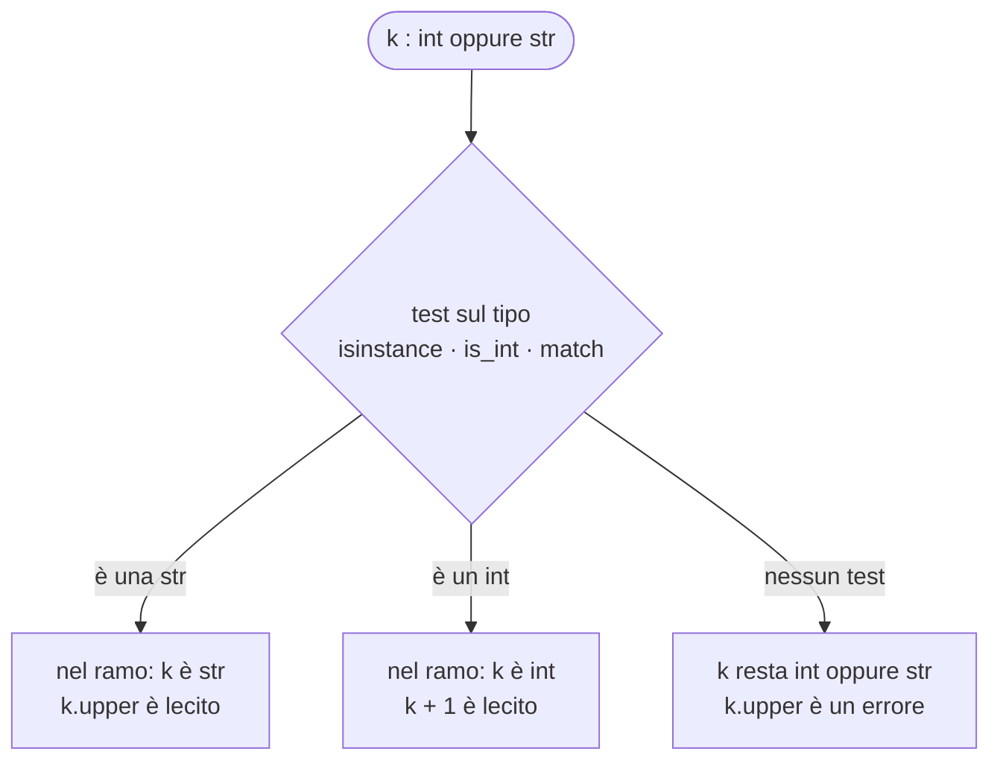
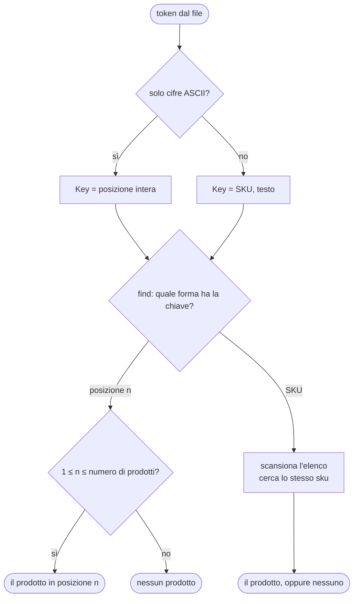

(parte 3 di 8: L08.2 — Gradual typing — file C08-parte3-l08-2.md)

## L08.2 — Gradual typing: type hints, union, intersection, type checker

### Concetto

Un'annotazione di tipo è una **promessa** sul valore: «questa variabile è un intero», «questa funzione restituisce un prodotto o niente». Una promessa vale quanto chi la controlla, quindi tre domande contano più di qualunque sintassi: **chi** controlla, **quando** lo fa, **che cosa succede** se la promessa è falsa.

I quattro linguaggi rispondono in quattro modi, e due di essi sono **graduali**: il programmatore può annotare *una parte* del programma e lasciare il resto senza tipi. Il **gradual typing** è questo: un sistema di tipi in cui il codice annotato e quello non annotato convivono, collegati da un tipo speciale che significa «non controllare» (`Any` in Python, `mixed` in PHP). Dove compare, la protezione si interrompe: lo si vede in e8.

| | PHP | Python | Rust | Go |
|---|---|---|---|---|
| Chi controlla | l'**engine**, a ogni chiamata, su parametri, ritorni e proprietà tipizzate | **nessuno a runtime**; un type checker esterno (mypy, pyright) | il **compilatore** | il **compilatore** |
| Quando | esecuzione, al momento della chiamata | prima dell'esecuzione, *se* si lancia il checker | compilazione | compilazione |
| Conversioni implicite | sì in modalità debole (`"5"` diventa `5`); no con `declare(strict_types=1)` | non applicabile (il valore non viene toccato) | mai | mai (solo le costanti senza tipo) |
| Via di fuga | `mixed`, nessun tipo | `Any`, nessuna annotazione, `cast`, `# type: ignore` | `dyn Any`, `unsafe` | `any`, `unsafe` |
| Strumento esterno tipico | PHPStan, Psalm | mypy, pyright | clippy (non è un type checker) | `go vet`, staticcheck |



Le frecce tratteggiate sono passi che **si possono saltare**: è il motivo per cui un programma Python può essere pieno di annotazioni e comunque sbagliato (e5).

#### Union, intersection, narrowing

Un **union type** `A | B` è l'insieme dei valori che sono `A` *oppure* `B`. Serve quando un dato ha davvero più forme: la chiave di ricerca di questo programma è un numero *o* un testo; un campo facoltativo è un intero *o* niente. Il prezzo è che, per usare il valore, bisogna prima sapere quale forma ha: il controllo che lo stabilisce si chiama **narrowing** (restringimento). Dopo `isinstance(k, str)`, dentro il ramo, un type checker sa che `k` è una `str`.



L'unione di tipi *esistenti* (`int | str`) è diversa dal **sum type** di C06 (`enum Key { Pos(usize), Sku(String) }`), che definisce *varianti nuove con un nome*. Nell'unione il «tag» è il tipo stesso e il test è sul tipo; nel sum type il tag è esplicito e il `match` è obbligato (e verificato) a coprire tutte le varianti. L'unione è più leggera da scrivere; il sum type è più sicuro quando le varianti sono molte o portano dati diversi.

Un **intersection type** `A & B` è l'opposto: il valore deve rispettare **entrambi** i contratti. Non è un insieme di valori più grande, ma più piccolo.

| | PHP | Python | Rust | Go |
|---|---|---|---|---|
| Unione di tipi esistenti | `int\|string` (8.0) | `int \| str`; alias con `type Key = ...` (3.12) | **non esiste**: si dichiara un `enum` | **non esiste** come tipo di valore; i *type set* esistono solo nei vincoli |
| «Può mancare» | `?int`, `int\|null` | `int \| None` | `Option<i64>` | puntatore `*int` o coppia `(v, ok)` |
| Narrowing | `is_int()`, `instanceof`, `match` | `isinstance`, `match` | `match`, `if let` | type switch, asserzione di tipo |
| Esaustività | no | sì, con `assert_never` nel checker | **sì**, nel compilatore (E0004) | no |
| Intersezione | `A&B` (8.1), solo per tipi di classe | `Protocol` che eredita da entrambi | `T: A + B` | interfaccia che incorpora due interfacce |

#### Invarianza

Se `Dog` è un `Animal`, è anche vero che una *lista di `Dog`* è una *lista di `Animal`*? Dipende da che cosa si fa con la lista. Se si può soltanto **leggere**, sì (si dice che la lettura è *covariante*). Se si può anche **scrivere**, no: assegnando la lista di cani a una variabile «lista di animali» si potrebbe inserirvi un gatto, e la lista di cani conterrebbe un gatto. I tipi che si possono scrivere sono quindi **invarianti**: `list[int]` non è `list[float]`, `[]Dog` non è `[]Animal`. Il tipo di sola lettura (`Sequence[float]` in Python) è invece covariante. È un'altra faccia dei vincoli: un generico deve dichiarare non solo *quali* tipi accetta, ma anche *come si comportano rispetto al sottotipo* (e9).

### Implementazione: la chiave di ricerca e `Catalog.find` (T5)

La chiave è un numero (posizione, 1 = primo prodotto valido) oppure un testo (SKU). `Catalog.find` è la sorgente lenta: ogni chiamata scorre l'elenco e incrementa un contatore, in modo che si possa vedere quante volte la cache ha davvero risparmiato lavoro.



**Python**

```python
# T5 - a lookup key is a position (int) OR a SKU (str): a union type.
type Key = int | str


def parse_key(token: str) -> Key:
    return int(token) if token.isascii() and token.isdigit() else token


class Catalog:
    """T5 - the slow source: every find() is a full scan, and is counted."""

    def __init__(self, items: list[Product]) -> None:
        self._items = items
        self.scans = 0

    def find(self, key: Key) -> Product | None:
        self.scans += 1
        match key:
            case int():
                return self._items[key - 1] if 1 <= key <= len(self._items) else None
            case str():
                return next((p for p in self._items if p.sku == key), None)
```

**PHP**

```php
// T5 - a lookup key is a position (int) OR a SKU (string): a union type, `int|string`.
function parseKey(string $token): int|string
{
    return ctype_digit($token) ? (int) $token : $token;
}

final class Catalog
{
    public int $scans = 0;

    /** @param list<Product> $items */
    public function __construct(private readonly array $items)
    {
    }

    /** T5 - the slow source: every find() is a full scan, and is counted. */
    public function find(int|string $key): ?Product
    {
        $this->scans++;
        if (is_int($key)) {
            return $this->items[$key - 1] ?? null;
        }
        foreach ($this->items as $p) {
            if ($p->sku === $key) {
                return $p;
            }
        }
        return null;
    }
}
```

**Rust**

```rust
/// T5 - a lookup key is a position OR a SKU: a sum type (enum).
#[derive(Debug, Clone, PartialEq, Eq, Hash)]
enum Key {
    Pos(usize),
    Sku(String),
}

fn parse_key(token: &str) -> Key {
    match token.parse::<usize>() {
        Ok(n) if token.bytes().all(|b| b.is_ascii_digit()) => Key::Pos(n),
        _ => Key::Sku(token.to_string()),
    }
}

/// T5 - the slow source: every find() is a full scan, and is counted.
struct Catalog {
    items: Vec<Product>,
    scans: u32,
}

impl Catalog {
    fn find(&mut self, key: &Key) -> Option<&Product> {
        self.scans += 1;
        match key {
            Key::Pos(n) => n.checked_sub(1).and_then(|i| self.items.get(i)),
            Key::Sku(s) => self.items.iter().find(|p| &p.sku == s),
        }
    }
}
```

**Go**

```go
// Key is T5 - a lookup key is a position OR a SKU. Go has no union types: a sealed interface plays the role.
type Key interface{ isKey() }

type Pos int
type Sku string

func (Pos) isKey() {}
func (Sku) isKey() {}

func parseKey(token string) Key {
	if n, err := strconv.Atoi(token); err == nil && !strings.HasPrefix(token, "+") && !strings.HasPrefix(token, "-") {
		return Pos(n)
	}
	return Sku(token)
}

// Catalog is T5 - the slow source: every Find is a full scan, and is counted.
type Catalog struct {
	items []Product
	scans int
}

func (c *Catalog) Find(key Key) (Product, bool) {
	c.scans++
	switch k := key.(type) {
	case Pos:
		if i := int(k); i >= 1 && i <= len(c.items) {
			return c.items[i-1], true
		}
	case Sku:
		for _, p := range c.items {
			if p.SKU == string(k) {
				return p, true
			}
		}
	}
	return Product{}, false
}
```


- **Python:** `type Key = int | str` (istruzione `type`, Python 3.12) definisce un alias di tipo. `parse_key` restituisce `Key`: o un `int` o una `str`. In `find`, il `match` con `case int():` e `case str():` è il narrowing; mypy verifica che i due casi esauriscano l'unione (la funzione non ha un `return` finale e mypy non protesta; se si aggiungesse `float` all'alias, lo segnalerebbe). In `parse_key`, `isascii()` è necessario: in Python `"３".isdigit()` è `True` (cifre Unicode), mentre `int("３")` funzionerebbe ma non è ciò che si vuole per una posizione.
- **PHP:** `int|string` nella firma è un union type nativo (PHP 8.0), **controllato a runtime a ogni chiamata**: passare un `float` darebbe `TypeError`. Il narrowing è `is_int($key)`; nessuno verifica che il secondo ramo copra «il resto». `$this->items[$key - 1] ?? null` sfrutta `??` per tradurre «posizione inesistente» (anche 0, cioè indice −1) in `null`.
- **Rust:** `enum Key { Pos(usize), Sku(String) }` non è un'unione di `usize` e `String`: è un **tipo nuovo** con due varianti con nome. Il `derive(Hash, Eq, Clone)` basta a soddisfare il vincolo `K: Eq + Hash + Clone` della cache (T6). Il `match` in `find` è obbligatorio ed esaustivo. `n.checked_sub(1)` restituisce `None` per la posizione 0, invece di andare in underflow. In `parse_key` il guard `if token.bytes().all(...)` esclude `"+3"`, che `parse::<usize>()` accetterebbe.
- **Go:** non ci sono unioni: si usa un'**interfaccia sigillata**, cioè con un metodo non esportato (`isKey`) che nessun altro package può implementare. `Pos` e `Sku` sono tipi definiti su `int` e `string`. `switch k := key.(type)` è il type switch; il compilatore non controlla l'esaustività (C06 e4). `Key`, essendo un'interfaccia i cui valori dinamici sono confrontabili, soddisfa `comparable` e quindi si può usare come `K` della cache. `Atoi` accetta anche `"+3"` e `"-3"`: i prefissi vanno esclusi a mano.

#### Una cache con chiave «unione»: il prodotto compare due volte

Nell'output di riferimento la richiesta `2` è un `miss` anche se `CD456` era già stato cercato, e `scans=9` coincide con `misses=9`. La causa è la chiave: `Pos(2)` e `Sku("CD456")` sono valori diversi, quindi due voci della cache per lo stesso prodotto. Una chiave che ammette più rappresentazioni dello stesso dato obbliga a **normalizzarla** prima di usarla come indice (per esempio risolvendo sempre in SKU): è un'insidia generale delle chiavi composte, non di un linguaggio, ed è l'esercizio 3 del capitolo.

### Esperimento e5 — un'annotazione è una regola o un'etichetta?

La stessa funzione `double(x: int) -> int`, chiamata con valori che non sono interi. In Python il programma gira; in PHP dipende dalla modalità (`declare(strict_types=1)` è un'opzione **per file**); in Rust e Go non si compila. Per PHP riporto i risultati con `error_reporting` al massimo, per vedere anche gli avvisi.

```python
def double(x: int) -> int:
    return x * 2


print(double("ab"))
print(double.__annotations__)
```

```php
<?php
function double(int $x): int
{
    return $x * 2;
}
foreach (['5', '5.0', '5 apples', 'ab', 5.0, 5.7, true, null] as $v) {
    $label = str_pad(var_export($v, true), 12) . '=> ';
    try {
        $r = double($v);
        echo $label, $r, "\n";
    } catch (TypeError $e) {
        echo $label, 'TypeError: ', substr($e->getMessage(), 0, 60), "\n";
    }
}
```

Per la modalità rigorosa basta aggiungere `declare(strict_types=1);` come prima istruzione (file `e5s.php`). Poi un union type `int|float` in modalità debole (`e5u.php`):

```php
<?php
function kind(int|float $x): string
{
    return get_debug_type($x) . ' ' . var_export($x, true);
}
foreach (['15', '1.5', '1e2', ' 15', '15 ', '0x1A', 'ab', true] as $v) {
    $label = str_pad(var_export($v, true), 8) . '=> ';
    try {
        $r = kind($v);
        echo $label, $r, "\n";
    } catch (TypeError $e) {
        echo $label, "TypeError\n";
    }
}
```

```rust
fn double(x: i32) -> i32 {
    x * 2
}

fn main() {
    println!("{}", double("ab"));
}
```

```go
package main

import "fmt"

func double(x int) int { return x * 2 }

func main() { fmt.Println(double("ab")) }
```

```text
### e5.py
abab
{'x': <class 'int'>, 'return': <class 'int'>}
[exit 0]
### e5.py+mypy
e5.py:5: error: Argument 1 to "double" has incompatible type "str"; expected "int"  [arg-type]
Found 1 error in 1 file (checked 1 source file)
[exit 1]
### e5.rs
error[E0308]: mismatched types
 --> e5.rs:6:27
  |
6 |     println!("{}", double("ab"));
  |                    ------ ^^^^ expected `i32`, found `&str`
  |                    |
  |                    arguments to this function are incorrect
  |
note: function defined here
 --> e5.rs:1:4
  |
1 | fn double(x: i32) -> i32 {
  |    ^^^^^^ ------

error: aborting due to 1 previous error

For more information about this error, try `rustc --explain E0308`.
[exit 1]
### e5.go
# example.com/e5
./main.go:7:34: cannot use "ab" (untyped string constant) as int value in argument to double
[exit 1]
### e5s.php
'5'         => TypeError: double(): Argument #1 ($x) must be of type int, string given
'5.0'       => TypeError: double(): Argument #1 ($x) must be of type int, string given
'5 apples'  => TypeError: double(): Argument #1 ($x) must be of type int, string given
'ab'        => TypeError: double(): Argument #1 ($x) must be of type int, string given
5.0         => TypeError: double(): Argument #1 ($x) must be of type int, float given,
5.7         => TypeError: double(): Argument #1 ($x) must be of type int, float given,
true        => TypeError: double(): Argument #1 ($x) must be of type int, true given, 
NULL        => TypeError: double(): Argument #1 ($x) must be of type int, null given, 
[exit 0]
### e5u.php
'15'    => int 15
'1.5'   => float 1.5
'1e2'   => float 100.0
' 15'   => int 15
'15 '   => int 15
'0x1A'  => TypeError
'ab'    => TypeError
true    => int 1
[exit 0]
### e5.php
'5'         => 10
'5.0'       => 10
'5 apples'  => TypeError: double(): Argument #1 ($x) must be of type int, string given
'ab'        => TypeError: double(): Argument #1 ($x) must be of type int, string given
5.0         => 10

Deprecated: Implicit conversion from float 5.7 to int loses precision in e5.php on line 2
5.7         => 10
true        => 2
NULL        => TypeError: double(): Argument #1 ($x) must be of type int, null given, 
[exit 0]
```

| Linguaggio | `double("ab")` | Altri valori |
|---|---|---|
| Python | **gira**: `abab` (la stringa si ripete); `__annotations__` è un dizionario di dati. mypy: `Argument 1 to "double" has incompatible type "str"; expected "int"` | — |
| PHP, debole | `TypeError` | `'5'`, `'5.0'`, `5.0` diventano `10`; `5.7` diventa `10` con un `Deprecated` (troncato a 5); `true` diventa `2`; `'5 apples'` e `null` → `TypeError` |
| PHP, `strict_types` | `TypeError` | **tutto** è `TypeError`, anche `'5'` e `5.0` |
| PHP, `int\|float` debole | — | `'15'` → `int 15`; `'1.5'` → `float 1.5`; `'1e2'` → `float 100.0`; anche `' 15'` e `'15 '` (spazi) → `int 15`; `'0x1A'` → `TypeError`; `true` → `int 1` |
| Rust | `E0308: mismatched types` | — |
| Go | `cannot use "ab" (untyped string constant) as int value in argument to double` | — |

In PHP la dichiarazione di tipo è un **controllo con conversione**: più indulgente di quanto sembri in modalità debole, e il confine tra «valore accettato» e «valore convertito» passa per regole da conoscere. Con `strict_types` diventa una regola vera, ma solo per le chiamate fatte *da quel file*. In Python è un'etichetta che una persona o un tool possono leggere. In Rust e Go è una regola verificata prima che il programma esista.

### Esperimento e6 — narrowing e controllo di esaustività

Un'unione `int | str` su cui si chiama un metodo che esiste solo per le stringhe, poi una `match` esaustiva con `assert_never`; infine si aggiunge `float` all'unione.

```python
from typing import assert_never

type Key = int | str


def shout(k: Key) -> str:
    return k.upper()  # fine for str, not for int


def label(k: Key) -> str:
    if isinstance(k, str):  # narrowing: inside this branch k is a str
        return k.upper()
    return f"#{k}"  # here the checker knows k is an int


def kind(k: Key) -> str:
    match k:
        case int():
            return "position"
        case str():
            return "sku"
        case _:
            assert_never(k)  # compiles only if every variant was handled
```

Per la seconda prova si cambia soltanto la riga dell'alias: `type Key = int | str | float`.

```php
<?php
function shout(int|string $k): string
{
    return $k->upper();
}

function kind(int|string|float $k): string
{
    return match (true) {
        is_int($k) => 'position',
        is_string($k) => 'sku',
    };
}
foreach ([fn() => shout(7), fn() => kind(1.5)] as $f) {
    try {
        $f();
    } catch (Throwable $e) {
        echo get_class($e), ': ', $e->getMessage(), "\n";
    }
}
```

```rust
enum Key {
    Pos(usize),
    Sku(String),
}

fn shout(k: Key) -> String {
    k.to_uppercase()
}

fn main() {
    println!("{}", shout(Key::Pos(1)));
}
```

```go
package main

import "fmt"

type Number interface{ ~int | ~float64 }

func main() {
	var n Number = 3
	fmt.Println(n)
}
```

```text
### e6.py+mypy
e6.py:7: error: Item "int" of "int | str" has no attribute "upper"  [union-attr]
Found 1 error in 1 file (checked 1 source file)
[exit 1]
### e6b.py+mypy
e6b.py:7: error: Item "int" of "int | str | float" has no attribute "upper"  [union-attr]
e6b.py:7: error: Item "float" of "int | str | float" has no attribute "upper"  [union-attr]
e6b.py:23: error: Argument 1 to "assert_never" has incompatible type "float"; expected "Never"  [arg-type]
Found 3 errors in 1 file (checked 1 source file)
[exit 1]
### e6.php
Error: Call to a member function upper() on int
UnhandledMatchError: Unhandled match case true
[exit 0]
### e6.rs
error[E0599]: no method named `to_uppercase` found for enum `Key` in the current scope
 --> e6.rs:7:7
  |
1 | enum Key {
  | -------- method `to_uppercase` not found for this enum
...
7 |     k.to_uppercase()
  |       ^^^^^^^^^^^^ method not found in `Key`
  |
note: the method `to_uppercase` exists on the type `String`
 --> /rustc/2d8144b7880597b6e6d3dfd63a9a9efae3f533d3/library/alloc/src/str.rs:640:4

error: aborting due to 1 previous error

For more information about this error, try `rustc --explain E0599`.
[exit 1]
### e6.go
# example.com/e6
./main.go:8:8: cannot use type Number outside a type constraint: interface contains type constraints
[exit 1]
```

- **Python:** mypy rifiuta `k.upper()` (`Item "int" of "int | str" has no attribute "upper"`) e **accetta** `label` e `kind`. Con `float` nell'unione, `shout` ha due errori e `kind` ne ha uno nuovo: `assert_never` riceve un `float`, mentre vuole `Never`. È il meccanismo che trasforma «ho dimenticato una variante» in un errore del checker.
- **PHP:** `Error: Call to a member function upper() on int` e `UnhandledMatchError` sono errori **a runtime**, al primo input sbagliato. Sapere che `kind` dimentica i `float` richiede PHPStan/Psalm.
- **Rust:** non si può «usare un `Key` come una stringa»: il metodo non esiste (`E0599`). Per usare il contenuto bisogna fare `match`, e il `match` deve coprire tutte le varianti (C06 e4).
- **Go:** `Number` è un *type set* (`~int | ~float64`); come tipo di una **variabile** non è ammesso: `cannot use type Number outside a type constraint: interface contains type constraints`. In Go l'unione di tipi esiste soltanto come vincolo per i generics, non come tipo di valore.

### Esperimento e7 — l'intersezione: «deve rispettare entrambi»

PHP 8.1 ha `A&B` nella firma. Python non ha l'operatore: si definisce un `Protocol` che eredita da entrambi. In Rust e Go l'intersezione è già la forma normale dei vincoli (`T: Display + Clone`; interfaccia che incorpora due interfacce).

```php
<?php
final class OnlyCountable implements Countable
{
    public function count(): int
    {
        return 3;
    }
}

function size(Countable&Traversable $x): int
{
    return count($x);
}
foreach ([new ArrayObject([1, 2]), new OnlyCountable(), [1, 2]] as $v) {
    try {
        $r = size($v);
        echo get_debug_type($v), ' => ', $r, "\n";
    } catch (TypeError $e) {
        echo get_debug_type($v), ' => TypeError: ', substr($e->getMessage(), 0, 70), "\n";
    }
}
```

```python
from collections.abc import Iterable, Sized
from typing import Protocol


class SizedIterable[T](Sized, Iterable[T], Protocol):
    """No `&` operator in Python typing: the intersection is a Protocol that inherits from both."""


def total(x: SizedIterable[int]) -> int:
    return len(x) + sum(x)


print(total([1, 2, 3]), total({4, 5}))
print(total(iter([1, 2])))  # an iterator has no len()
```

```rust
use std::fmt::Display;

struct P;

fn show<T: Display + Clone>(x: &T) -> String {
    format!("{}", x.clone())
}

fn main() {
    println!("{}", show(&5));
    println!("{}", show(&P));
}
```

```go
package main

import (
	"fmt"
	"io"
)

type StringerWriter interface {
	fmt.Stringer
	io.Writer
}

type S struct{}

func (S) String() string { return "s" }

func use(x StringerWriter) { fmt.Println(x.String()) }

func main() { use(S{}) }
```

```text
### e7.py
9 11
Traceback (most recent call last):
  File "e7.py", line 14, in <module>
    print(total(iter([1, 2])))  # an iterator has no len()
          ~~~~~^^^^^^^^^^^^^^
  File "e7.py", line 10, in total
    return len(x) + sum(x)
           ~~~^^^
TypeError: object of type 'list_iterator' has no len()
[exit 1]
### e7.py+mypy
e7.py:14: error: Argument 1 to "total" has incompatible type "Iterator[int]"; expected "SizedIterable[int]"  [arg-type]
e7.py:14: note: "Iterator" is missing following "SizedIterable" protocol member:
e7.py:14: note:     __len__
Found 1 error in 1 file (checked 1 source file)
[exit 1]
### e7.go
# example.com/e7
./main.go:19:19: cannot use S{} (value of struct type S) as StringerWriter value in argument to use: S does not implement StringerWriter (missing method Write)
[exit 1]
### e7.php
ArrayObject => 2
OnlyCountable => TypeError: size(): Argument #1 ($x) must be of type Countable&Traversable, OnlyCo
array => TypeError: size(): Argument #1 ($x) must be of type Countable&Traversable, array 
[exit 0]
### e7.rs
e7.rs:11:25: error[E0277]: `P` doesn't implement `std::fmt::Display`: unsatisfied trait bound
e7.rs:11:25: error[E0277]: the trait bound `P: Clone` is not satisfied: the trait `Clone` is not implemented for `P`
error: aborting due to 2 previous errors
[exit 1]
```

PHP controlla a runtime (`OnlyCountable` non è `Traversable`, un array non è un oggetto); Python lo fa con il checker (`"Iterator" is missing following "SizedIterable" protocol member: __len__`), ma a runtime il programma fallisce comunque con `TypeError: object of type 'list_iterator' has no len()`; Rust elenca **entrambi** i vincoli mancanti (`Display` e `Clone`); Go dice quale metodo manca (`missing method Write`). La stessa idea, quattro momenti diversi.

### Esperimento e8 — il confine dei tipi: `Any` e dati esterni

`json.loads` restituisce `Any`. Una funzione che si aspetta `list[int]` riceve una lista di stringhe senza che il checker possa accorgersene. Poi la stessa situazione negli altri linguaggi.

```python
import json


def total(prices: list[int]) -> int:
    return sum(prices)


def untyped(x):
    return x * 2


data = json.loads('["1", "2"]')  # json.loads returns Any: the checker stops here
print(untyped("ab"))
print(total(data))
```

```php
<?php
declare(strict_types=1);

/** @param list<int> $prices */
function total(array $prices): int
{
    return array_sum($prices);
}
$data = json_decode('["1", "2"]', true);
var_dump(total($data)); // `array` is checked, the element type in the docblock is not
```

```go
package main

import (
	"encoding/json"
	"fmt"
)

func total(prices []int) (t int) {
	for _, p := range prices {
		t += p
	}
	return
}

func main() {
	var typed []int
	err := json.Unmarshal([]byte(`["1","2"]`), &typed)
	fmt.Println("typed target:", err)

	var anything any
	_ = json.Unmarshal([]byte(`["1","2"]`), &anything)
	fmt.Printf("any target  : %T %v\n", anything, anything)
	fmt.Println(total(anything.([]int)))
}
```

```rust
use std::any::Any;

fn main() {
    let boxed: Box<dyn Any> = Box::new("1");
    match boxed.downcast::<i64>() {
        Ok(n) => println!("an i64: {n}"),
        Err(_) => println!("not an i64: the downcast returns a value, not a crash"),
    }
}
```

```text
### e8.py
abab
Traceback (most recent call last):
  File "e8.py", line 14, in <module>
    print(total(data))
          ~~~~~^^^^^^
  File "e8.py", line 5, in total
    return sum(prices)
TypeError: unsupported operand type(s) for +: 'int' and 'str'
[exit 1]
### e8.py+mypy-default
Success: no issues found in 1 source file
[exit 0]
### e8.py+mypy-strict
e8.py:8: error: Function is missing a type annotation  [no-untyped-def]
e8.py:13: error: Call to untyped function "untyped" in typed context  [no-untyped-call]
Found 2 errors in 1 file (checked 1 source file)
[exit 1]
### e8.php
int(3)
[exit 0]
### e8.go
typed target: json: cannot unmarshal string into Go value of type int
any target  : []interface {} [1 2]
panic: interface conversion: interface {} is []interface {}, not []int

goroutine 1 [running]:
main.main()
[exit 2]
### e8.rs
not an i64: the downcast returns a value, not a crash
[exit 0]
```

- **Python:** `mypy` normale dice `Success`; la funzione `untyped` non è controllata, e `total(data)` riceve un `Any`, compatibile con tutto. `mypy --strict` protesta per la funzione non annotata e per la sua chiamata, **ma non per `total(data)`**: il vuoto di protezione sta nel punto in cui un dato esterno entra nel programma. A runtime: `TypeError: unsupported operand type(s) for +: 'int' and 'str'`, dentro `sum`, lontano dalla causa.
- **PHP:** `array` è controllato, il suo contenuto no (`@param list<int>` è un commento): `array_sum(["1", "2"])` somma le stringhe numeriche e restituisce `int(3)`, senza errore.
- **Go:** deserializzando in un tipo concreto (`[]int`), l'errore è esplicito: `json: cannot unmarshal string into Go value of type int`. Deserializzando in `any` il programma ottiene `[]interface {}` e un'asserzione sbagliata (`anything.([]int)`) va in **panic**.
- **Rust:** `Box<dyn Any>::downcast::<i64>()` restituisce un `Result`: il fallimento è un valore da gestire, non un'eccezione.

La conclusione pratica è che i tipi proteggono **dentro** il programma e finiscono al suo confine con i dati esterni. È il tema di C14 (validazione: dal dato grezzo al tipo), ed è esattamente ciò che il loader di L08.3 fa per le righe del file.

### Esperimento e9 — invarianza: perché `list[int]` non è `list[float]`

```python
from collections.abc import Sequence


def mean_list(xs: list[float]) -> float:
    xs.append(0.5)  # a list can be written to: list[float] must really hold floats
    return sum(xs) / len(xs)


def mean_seq(xs: Sequence[float]) -> float:  # read-only: Sequence is covariant
    return sum(xs) / len(xs)


ints: list[int] = [1, 2, 3]
print(mean_seq(ints))
print(mean_list(ints))
```

```go
package main

import "fmt"

type Animal interface{ Name() string }
type Dog struct{}

func (Dog) Name() string { return "dog" }

func names(as []Animal) {
	for _, a := range as {
		fmt.Println(a.Name())
	}
}

func main() {
	dogs := []Dog{{}, {}}
	names(dogs)
}
```

```rust
trait Animal {
    fn name(&self) -> String;
}
struct Dog;
impl Animal for Dog {
    fn name(&self) -> String {
        "dog".to_string()
    }
}

fn names(xs: &[Box<dyn Animal>]) {
    for a in xs {
        println!("{}", a.name());
    }
}

fn main() {
    let dogs: Vec<Box<Dog>> = vec![Box::new(Dog), Box::new(Dog)];
    names(&dogs);
}
```

```text
### e9.py+mypy
e9.py:15: error: Argument 1 to "mean_list" has incompatible type "list[int]"; expected "list[float]"  [arg-type]
e9.py:15: note: "list" is invariant -- see https://mypy.readthedocs.io/en/stable/common_issues.html#variance
e9.py:15: note: Consider using "Sequence" instead, which is covariant
Found 1 error in 1 file (checked 1 source file)
[exit 1]
### e9.go
# example.com/e9go
./main.go:18:8: cannot use dogs (variable of type []Dog) as []Animal value in argument to names
[exit 1]
### e9.rs
e9.rs:19:11: error[E0308]: mismatched types: expected `&[Box<dyn Animal>]`, found `&Vec<Box<Dog>>`
error: aborting due to 1 previous error
[exit 1]
```

mypy accetta la funzione di sola lettura (`Sequence[float]`) e rifiuta quella che scrive (`list[float]`), spiegando il perché (`"list" is invariant`) e suggerendo `Sequence`. Go e Rust rifiutano la conversione da `[]Dog` a `[]Animal` e da `&Vec<Box<Dog>>` a `&[Box<dyn Animal>]`: anche lì i contenitori non si convertono in blocco, e la conversione elemento per elemento è esplicita. In PHP non c'è nulla da rifiutare, perché i tipi degli elementi di un array non esistono per il linguaggio.

### Focus comparativo

| Aspetto | PHP | Python | Rust | Go |
|---|---|---|---|---|
| Annotazioni | controllate a runtime alla chiamata | etichette, verificate da un tool | regole del compilatore | regole del compilatore |
| Conversioni implicite | sì (modalità debole) | — | no | no |
| Unione di tipi | `int\|string` nativa | `int \| str`, `type Key = ...` | `enum` dichiarato | interfaccia sigillata |
| Intersezione | `A&B` | `Protocol` che eredita | `T: A + B` | interfaccia incorporata |
| Narrowing | `is_*`, `instanceof` | `isinstance`, `match` | `match` | type switch |
| Esaustività | no | `assert_never` (checker) | sì (compilatore) | no |
| Invarianza dei contenitori | non applicabile | `list` invariante, `Sequence` covariante | sì | sì |
| Dove si «perdono» i tipi | `mixed`, contenuto di array | `Any`, funzioni non annotate, dati esterni | `dyn Any`, `unsafe` | `any`, dati esterni |
| Strumento esterno | PHPStan, Psalm (non eseguiti) | mypy, pyright | — | `go vet` |

### Esercizio Rosetta (4′)

Scrivi `describe(x)` che accetta «un intero, una stringa oppure niente» e restituisce `"int"`, `"str"` o `"none"`. Poi aggiungi i `float` al tipo di ingresso. In quali linguaggi qualcuno ti avvisa **prima dell'esecuzione** di aver dimenticato il nuovo caso? In Rust, che cosa scegli per rappresentare l'unione, e perché `Option<Key>` è più onesto di «`Key` con una variante `None`»?

---

