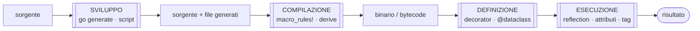
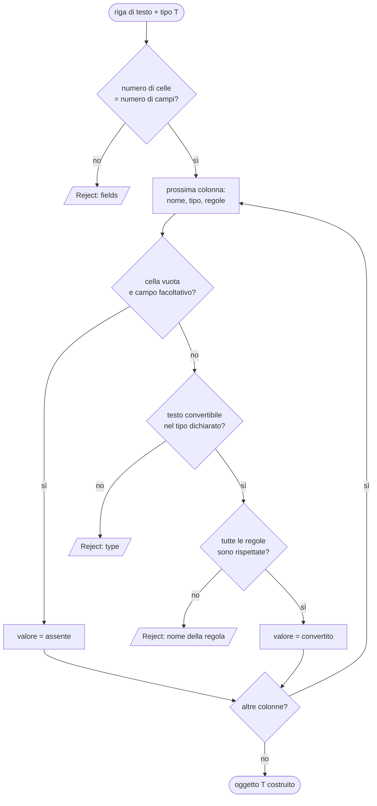

(parte 4 di 8: L08.3 — Metaprogrammazione (concetto, schema, loader) — file C08-parte4-l08-3a.md)

## L08.3 — Metaprogrammazione: reflection, attributi, decorator, macro, code generation

### Concetto

Finora il programma ha un difetto di fondo: per ogni tipo di record bisognerebbe scrivere a mano il codice che trasforma una riga di testo in un oggetto e ne verifica le regole. Con `Product` sono sei colonne; con dieci tipi sono sessanta colonne, e ogni regola cambiata va cercata in due posti (nella dichiarazione del tipo e nel codice che lo carica).

La **metaprogrammazione** è la soluzione generale: *scrivere programmi che leggono o producono altri programmi*. Qui serve a una cosa precisa: dichiarare **una volta sola** il tipo e le sue regole (T2), e avere un'unica funzione `load` (T3) che funziona per *qualunque* tipo dichiarato così. Il punto di partenza è sempre lo stesso: i dati *sul* programma (i nomi dei campi, i loro tipi, le regole) devono essere accessibili a un altro programma. Il vero criterio che distingue le tecniche è **quando** questo accade.

| Momento | Chi lavora | Tecnica | Python | PHP | Rust | Go |
|---|---|---|---|---|---|---|
| **Sviluppo** | un programma di supporto, prima della compilazione | **code generation** | script che scrive file `.py` | script che scrive file `.php` | `build.rs`, crate esterni | `go generate` + `go/ast` |
| **Compilazione** | il compilatore | **macro** | — | — | `macro_rules!`, macro procedurali, `derive` | — |
| **Definizione / import** | l'interprete, quando esegue `def` o `class` | **decorator**, metaclassi | `@decorator`, `@dataclass`, `__init_subclass__` | — | — | — |
| **Esecuzione** | il programma stesso | **reflection** | `get_type_hints`, `inspect`, `Annotated` | `Reflection*`, attributi `#[...]` | quasi assente (`TypeId`, `type_name`) | package `reflect`, struct tag |



Più si va a sinistra, più il lavoro è fatto **prima** che il programma giri: gli errori compaiono prima e il costo a runtime sparisce, ma il codice deve essere noto in anticipo. Più si va a destra, più tutto è dinamico: si può reagire a dati che non si conoscevano in fase di scrittura, ma gli errori compaiono tardi e ogni operazione costa di più. I quattro linguaggi occupano **posizioni diverse** su questo asse, ed è la differenza che il capitolo mette in luce:

- **Rust** sta quasi tutto a sinistra: non può interrogare i propri tipi a runtime, quindi usa le macro per far scrivere al compilatore il codice specifico di ogni tipo.
- **Go** sta a sinistra e a destra, ma non nel mezzo: `go generate` per la generazione, `reflect` per l'esecuzione, nessuna macro.
- **Python** sta a destra: tutto è un oggetto che si può ispezionare; il momento di *definizione* (i decorator) è un'invenzione sua.
- **PHP** sta a destra: Reflection è completa, e dal 8.0 gli **attributi** permettono di appendere metadati strutturati a classi, parametri e metodi.

Un **metadato** è un'informazione *su* un elemento del codice (un campo, un parametro) che non cambia come l'elemento si comporta, ma che un altro programma può leggere. È il concetto che torna in tutti e quattro i casi, con nomi diversi: `Annotated` in Python, attributo in PHP, struct tag in Go. In Rust lo stesso ruolo lo ha l'argomento della macro.

### Implementazione: schema e regole (T2)

La dichiarazione dello schema è il cuore del capitolo. Ogni linguaggio la risolve con il proprio meccanismo, ma l'idea è identica: *per ogni colonna, un tipo e zero o più regole*.

**Python**

```python
# T2 - the rules: small objects with a check() method. They are only DATA attached to the fields.
def _shape_ok(mask_char: str, c: str) -> bool:
    if mask_char == "A":
        return "A" <= c <= "Z"
    if mask_char == "9":
        return "0" <= c <= "9"
    return mask_char == c


@dataclass(frozen=True)
class Between:
    lo: int
    hi: int

    def check(self, value: object) -> bool:
        return isinstance(value, int) and self.lo <= value <= self.hi


@dataclass(frozen=True)
class Length:
    lo: int
    hi: int

    def check(self, value: object) -> bool:
        return isinstance(value, str) and self.lo <= len(value) <= self.hi


@dataclass(frozen=True)
class Shape:
    mask: str  # "A" = uppercase ASCII letter, "9" = ASCII digit, anything else = literal

    def check(self, value: object) -> bool:
        return (isinstance(value, str) and len(value) == len(self.mask)
                and all(_shape_ok(m, c) for m, c in zip(self.mask, value)))


# T2 - the schema: ONE declaration holds the type and the rules of every column.
@dataclass(frozen=True)
class Product:
    sku: Annotated[str, Shape("AA999")]
    name: Annotated[str, Length(1, 30)]
    category: Annotated[str, Length(1, 12)]
    qty: Annotated[int, Between(0, 9999)]
    price: Annotated[int, Between(1, 999_999)]
    max_discount: Annotated[int | None, Between(0, 90)]

    def value(self) -> int:
        return self.qty * self.price
```

**PHP**

```php
// T2 - the rules: attribute classes with a check() method. An attribute is inert DATA until Reflection reads it.
interface Rule
{
    public function check(mixed $value): bool;
}

function shapeOk(string $maskChar, string $c): bool
{
    return match ($maskChar) {
        'A' => $c >= 'A' && $c <= 'Z',
        '9' => $c >= '0' && $c <= '9',
        default => $maskChar === $c,
    };
}

#[Attribute(Attribute::TARGET_PARAMETER)]
final class Between implements Rule
{
    public function __construct(private int $lo, private int $hi)
    {
    }

    public function check(mixed $value): bool
    {
        return is_int($value) && $this->lo <= $value && $value <= $this->hi;
    }
}

#[Attribute(Attribute::TARGET_PARAMETER)]
final class Length implements Rule
{
    public function __construct(private int $lo, private int $hi)
    {
    }

    public function check(mixed $value): bool
    {
        return is_string($value) && $this->lo <= mb_strlen($value) && mb_strlen($value) <= $this->hi;
    }
}

#[Attribute(Attribute::TARGET_PARAMETER)]
final class Shape implements Rule
{
    /** @param string $mask "A" = uppercase ASCII letter, "9" = ASCII digit, anything else = literal */
    public function __construct(private string $mask)
    {
    }

    public function check(mixed $value): bool
    {
        if (!is_string($value) || strlen($value) !== strlen($this->mask)) {
            return false;
        }
        for ($i = 0; $i < strlen($value); $i++) {
            if (!shapeOk($this->mask[$i], $value[$i])) {
                return false;
            }
        }
        return true;
    }
}

// T2 - the schema: ONE declaration holds the type and the rules of every column.
final readonly class Product
{
    public function __construct(
        #[Shape('AA999')] public string $sku,
        #[Length(1, 30)] public string $name,
        #[Length(1, 12)] public string $category,
        #[Between(0, 9999)] public int $qty,
        #[Between(1, 999999)] public int $price,
        #[Between(0, 90)] public ?int $max_discount,
    ) {
    }

    public function value(): int
    {
        return $this->qty * $this->price;
    }
}
```

**Rust**

```rust
/// T2 - why a row was refused: the column and the rule.
#[derive(Debug, Clone, PartialEq, Eq)]
struct Reject {
    field: &'static str,
    rule: &'static str,
}

/// T2 - a rule that can judge values of type T. `Between` judges i64, `Length` judges String: the
/// pairing is checked by the compiler.
trait Rule<T> {
    fn check(&self, v: &T) -> bool;
    fn name(&self) -> &'static str;
}

struct Between(i64, i64);
struct Length(usize, usize);
struct Shape(&'static str); // "A" = uppercase ASCII letter, "9" = ASCII digit, anything else = literal

impl Rule<i64> for Between {
    fn check(&self, v: &i64) -> bool {
        self.0 <= *v && *v <= self.1
    }
    fn name(&self) -> &'static str {
        "between"
    }
}

impl Rule<String> for Length {
    fn check(&self, v: &String) -> bool {
        (self.0..=self.1).contains(&v.chars().count())
    }
    fn name(&self) -> &'static str {
        "length"
    }
}

impl Rule<String> for Shape {
    fn check(&self, v: &String) -> bool {
        v.len() == self.0.len()
            && self.0.bytes().zip(v.bytes()).all(|(m, c)| match m {
                b'A' => c.is_ascii_uppercase(),
                b'9' => c.is_ascii_digit(),
                _ => m == c,
            })
    }
    fn name(&self) -> &'static str {
        "shape"
    }
}

/// A rule for T also judges Option<T>: an absent value passes (blanket implementation).
impl<T, R: Rule<T>> Rule<Option<T>> for R {
    fn check(&self, v: &Option<T>) -> bool {
        v.as_ref().is_none_or(|x| Rule::<T>::check(self, x))
    }
    fn name(&self) -> &'static str {
        Rule::<T>::name(self)
    }
}

/// T2 - the macro writes the struct AND its `from_row` from one declaration: type and rule per column.
macro_rules! schema {
    (struct $name:ident { $( $field:ident : $ty:ty => $rule:expr ),+ $(,)? }) => {
        #[derive(Debug, Clone, PartialEq, Eq)]
        struct $name { $( $field: $ty ),+ }

        impl Schema for $name {
            const COLUMNS: usize = [$( stringify!($field) ),+].len();

            fn from_row(row: &[&str]) -> Result<Self, Reject> {
                if row.len() != Self::COLUMNS {
                    return Err(Reject { field: "-", rule: "fields" });
                }
                let mut cells = row.iter();
                Ok($name { $(
                    $field: {
                        let raw = cells.next().expect("length checked above");
                        let v = <$ty as FieldType>::parse(raw)
                            .ok_or(Reject { field: stringify!($field), rule: "type" })?;
                        let rule = $rule;
                        if !Rule::<$ty>::check(&rule, &v) {
                            return Err(Reject { field: stringify!($field), rule: Rule::<$ty>::name(&rule) });
                        }
                        v
                    }
                ),+ })
            }
        }
    };
}

schema! {
    struct Product {
        sku: String => Shape("AA999"),
        name: String => Length(1, 30),
        category: String => Length(1, 12),
        qty: i64 => Between(0, 9999),
        price: i64 => Between(1, 999_999),
        max_discount: Option<i64> => Between(0, 90),
    }
}

impl Product {
    fn value(&self) -> i64 {
        self.qty * self.price
    }
}
```

**Go**

```go
// T2 - the rules: a name and arguments in a tag string, interpreted at run time.
func shapeOK(mask, s string) bool {
	if len(s) != len(mask) {
		return false
	}
	for i := 0; i < len(mask); i++ {
		switch m, c := mask[i], s[i]; m {
		case 'A':
			if c < 'A' || c > 'Z' {
				return false
			}
		case '9':
			if c < '0' || c > '9' {
				return false
			}
		default:
			if m != c {
				return false
			}
		}
	}
	return true
}

func twoInts(args string) (lo, hi int64) {
	a, b, _ := strings.Cut(args, ":")
	lo, _ = strconv.ParseInt(a, 10, 64)
	hi, _ = strconv.ParseInt(b, 10, 64)
	return
}

// checkRule applies one tag rule to a value and returns whether it holds, plus the rule name.
func checkRule(spec string, v reflect.Value) (bool, string) {
	name, args, _ := strings.Cut(spec, "=")
	switch name {
	case "between":
		lo, hi := twoInts(args)
		n := v.Int()
		return lo <= n && n <= hi, name
	case "length":
		lo, hi := twoInts(args)
		n := int64(utf8.RuneCountInString(v.String()))
		return lo <= n && n <= hi, name
	case "shape":
		return shapeOK(args, v.String()), name
	}
	panic("unknown rule " + name)
}

// Product is T2 - the schema: ONE declaration holds the type and, in the struct tags, the rules of every column.
// The fields are exported because package reflect can only write to exported fields (e12).
type Product struct {
	SKU         string `col:"sku" rule:"shape=AA999"`
	Name        string `col:"name" rule:"length=1:30"`
	Category    string `col:"category" rule:"length=1:12"`
	Qty         int    `col:"qty" rule:"between=0:9999"`
	Price       int    `col:"price" rule:"between=1:999999"`
	MaxDiscount *int   `col:"max_discount" rule:"between=0:90"` // a nil pointer is "absent"
}

func (p Product) Value() int { return p.Qty * p.Price }
```


- **Python** — `Annotated[int, Between(0, 9999)]` è un tipo `int` a cui è stato **allegato** un oggetto qualsiasi. Per l'interprete `Annotated[int, x]` è quasi equivalente a `int`; i metadati restano disponibili in `get_type_hints(cls, include_extras=True)`. Le regole sono semplici dataclass con un metodo `check`.
- **PHP** — `#[Between(0, 9999)]` davanti a un parametro del costruttore. Un attributo è **inerte**: finché nessuno chiama `getAttributes()`, il codice dell'attributo non viene nemmeno caricato. La classe `Between` è una classe normale, marcata con `#[Attribute]`.
- **Go** — la regola è una **stringa** dentro il *struct tag* (`rule:"between=0:9999"`). Il compilatore non la guarda: per lui è testo. Chi la interpreta è `checkRule`, a runtime; il nome della regola e i suoi argomenti si leggono a mano con `strings.Cut`. I campi sono **maiuscoli** perché `reflect` può scrivere solo in campi esportati (e12).
- **Rust** — la macro `schema!` prende la dichiarazione `campo: tipo => regola` e **scrive due cose**: la `struct` e l'implementazione di `from_row`. Le regole sono espressioni Rust vere (`Between(0, 9999)`), quindi il compilatore le controlla; il vincolo `Rule<$ty>` verifica anche che la regola sappia giudicare *quel* tipo (e12).

### Implementazione: il caricatore generico (T3)

La funzione `load` riceve il *tipo* e una riga di testo, e restituisce un oggetto oppure un `Reject` con il nome della colonna e della regola violata. Ha tre passi per ogni colonna: leggere la dichiarazione, **convertire** il testo nel tipo dichiarato, applicare le regole. Una colonna facoltativa lasciata vuota salta tutto e vale «assente».



**Python**

```python
@dataclass(frozen=True)
class Reject:
    field: str
    rule: str


def convert(raw: str, declared: object) -> object:
    """T3 - raw text -> declared type. Raises ValueError. For `int | None`, empty text means absent."""
    if get_origin(declared) is types.UnionType:
        if raw == "":
            return None
        inner = [a for a in get_args(declared) if a is not type(None)]
        return convert(raw, inner[0])
    if declared is int:
        return int(raw)
    if declared is str:
        return raw
    raise TypeError(f"unsupported type {declared!r}")


def load[T](cls: type[T], row: list[str]) -> T | Reject:
    """T3 - build a `cls` from a row, knowing nothing about `cls` except its annotations."""
    hints = get_type_hints(cls, include_extras=True)
    if len(row) != len(hints):
        return Reject("-", "fields")
    values: list[object] = []
    for (name, hint), raw in zip(hints.items(), row):
        declared, *rules = get_args(hint)  # Annotated[declared, rule, rule, ...]
        try:
            value = convert(raw, declared)
        except ValueError:
            return Reject(name, "type")
        for rule in rules:
            if value is not None and not rule.check(value):  # an absent optional value skips the rules
                return Reject(name, type(rule).__name__.lower())
        values.append(value)
    return cls(*values)
```

**PHP**

```php
final readonly class Reject
{
    public function __construct(public string $field, public string $rule)
    {
    }
}

/** T3 - text to int, strictly: optional sign, digits, no overflow (filter_var refuses leading zeros, so strip them). */
function parseInt(string $raw): ?int
{
    if (preg_match('/^([+-]?)0*([0-9]+)\z/', $raw, $m) !== 1) {
        return null;
    }
    $n = filter_var(($m[1] === '-' ? '-' : '') . $m[2], FILTER_VALIDATE_INT);
    return $n === false ? null : $n;
}

/**
 * T3 - build a $class from a row, knowing nothing about $class except its constructor and attributes.
 *
 * @template T of object
 * @param class-string<T> $class
 * @param list<string> $row
 * @return T|Reject
 */
function load(string $class, array $row): object
{
    $params = (new ReflectionClass($class))->getConstructor()?->getParameters() ?? [];
    if (count($row) !== count($params)) {
        return new Reject('-', 'fields');
    }
    $args = [];
    foreach ($params as $i => $param) {
        $type = $param->getType();
        assert($type instanceof ReflectionNamedType);
        $raw = $row[$i];
        if ($raw === '' && $type->allowsNull()) {
            $args[] = null; // an absent optional value skips the rules
            continue;
        }
        $value = match ($type->getName()) {
            'int' => parseInt($raw),
            'string' => $raw,
            default => throw new LogicException('unsupported type ' . $type->getName()),
        };
        if ($value === null) {
            return new Reject($param->getName(), 'type');
        }
        foreach ($param->getAttributes(Rule::class, ReflectionAttribute::IS_INSTANCEOF) as $attr) {
            $rule = $attr->newInstance();
            if (!$rule->check($value)) {
                return new Reject($param->getName(), strtolower($attr->getName()));
            }
        }
        $args[] = $value;
    }
    return new $class(...$args);
}
```

**Rust**

```rust
/// T3 - raw text to a declared type. `None` means the text is not valid for that type.
trait FieldType: Sized {
    fn parse(raw: &str) -> Option<Self>;
}

impl FieldType for String {
    fn parse(raw: &str) -> Option<Self> {
        Some(raw.to_string())
    }
}

impl FieldType for i64 {
    fn parse(raw: &str) -> Option<Self> {
        raw.parse().ok()
    }
}

/// For Option<T>, empty text means absent.
impl<T: FieldType> FieldType for Option<T> {
    fn parse(raw: &str) -> Option<Self> {
        if raw.is_empty() { Some(None) } else { T::parse(raw).map(Some) }
    }
}

/// T3 - what the generic loader needs from a type: it can be built from a row.
trait Schema: Sized {
    const COLUMNS: usize;
    fn from_row(row: &[&str]) -> Result<Self, Reject>;
}

/// T3 - generic over any type that has a schema.
fn load<T: Schema>(row: &[&str]) -> Result<T, Reject> {
    T::from_row(row)
}
```

**Go**

```go
type Reject struct{ Field, Rule string }

// setFrom converts raw text to the kind of dst (string or integer). It reports whether the text was valid.
func setFrom(dst reflect.Value, raw string) bool {
	switch dst.Kind() {
	case reflect.String:
		dst.SetString(raw)
	case reflect.Int:
		n, err := strconv.ParseInt(raw, 10, 64)
		if err != nil {
			return false
		}
		dst.SetInt(n)
	default:
		panic("unsupported kind " + dst.Kind().String())
	}
	return true
}

// Load is T3 - build a T from a row, knowing nothing about T except its fields and tags.
func Load[T any](row []string) (T, *Reject) {
	var out T
	v := reflect.ValueOf(&out).Elem()
	t := v.Type()
	if len(row) != t.NumField() {
		return out, &Reject{"-", "fields"}
	}
	for i := 0; i < t.NumField(); i++ {
		f, fv, raw := t.Field(i), v.Field(i), row[i]
		col := f.Tag.Get("col")
		target := fv
		if f.Type.Kind() == reflect.Pointer { // optional column: empty text leaves the pointer nil
			if raw == "" {
				continue
			}
			target = reflect.New(f.Type.Elem()).Elem()
		}
		if !setFrom(target, raw) {
			return out, &Reject{col, "type"}
		}
		for _, spec := range strings.Fields(f.Tag.Get("rule")) {
			if ok, name := checkRule(spec, target); !ok {
				return out, &Reject{col, name}
			}
		}
		if f.Type.Kind() == reflect.Pointer {
			fv.Set(target.Addr())
		}
	}
	return out, nil
}
```


- **Python** — `get_type_hints` restituisce i tipi **con** i metadati; `get_args(hint)` separa il tipo dichiarato dalle regole. `convert` riconosce `int | None` con `get_origin(...) is types.UnionType`. Il ciclo non sa nulla di `Product`.
- **PHP** — `ReflectionClass` ottiene il costruttore e i suoi parametri; per ognuno `getType()` dà il tipo e `getAttributes(Rule::class, IS_INSTANCEOF)` le regole, che `newInstance()` trasforma in oggetti. Il tipo `?int` si riconosce con `allowsNull()`.
- **Go** — `reflect.ValueOf(&out).Elem()` ottiene un valore **scrivibile** del tipo `T`; `t.Field(i)` descrive il campo, `f.Tag.Get("rule")` ne legge il tag, `SetString`/`SetInt` lo scrivono. Un puntatore (`*int`) è il modo di Go per dire «facoltativo»: se la cella è vuota, il puntatore resta `nil`.
- **Rust** — non c'è nessun ciclo a runtime: `load<T: Schema>` chiama semplicemente `T::from_row`, cioè il codice che la macro ha già scritto **per `Product`** durante la compilazione. Il «ciclo sulle colonne» esiste solo nell'espansione della macro.

#### Un bug vero, trovato dal collaudo

La prima versione del loader Python applicava **tutte** le regole anche ai valori assenti. Per una colonna `max_discount` vuota, il valore era `None` e `Between(0, 90).check(None)` rispondeva `False`: ogni riga senza sconto veniva scartata. Con i dati di riferimento il risultato era questo (sono le uscite della versione sbagliata, lasciata in `exp/bugpy`):

```text
rows=19 valid=6 rejected=13
top rank=1 sku=AB123 value=298800
top rank=2 sku=IJ345 value=275400
top rank=3 sku=MN901 value=170100
category=kitchen value=358650
category=office value=361650
category=outdoor value=270100
lookup=AB123 cache=miss result=found sku=AB123
lookup=CD456 cache=miss result=unknown sku=-
lookup=EF789 cache=miss result=found sku=EF789
lookup=AB123 cache=hit result=found sku=AB123
lookup=CD456 cache=miss result=unknown sku=-
lookup=GH012 cache=miss result=unknown sku=-
lookup=2 cache=miss result=found sku=EF789
lookup=ZZ999 cache=miss result=unknown sku=-
lookup=0 cache=miss result=unknown sku=-
lookup=1 cache=miss result=found sku=AB123
lookup=AB123 cache=hit result=found sku=AB123
lookup=2 cache=hit result=found sku=EF789
cache capacity=3 hits=3 misses=9 evictions=1 scans=9
[exit 1]
```

```text
reject line=3 field=max_discount rule=between
reject line=5 field=max_discount rule=between
reject line=9 field=max_discount rule=between
reject line=10 field=max_discount rule=between
reject line=12 field=sku rule=shape
reject line=13 field=name rule=length
reject line=14 field=name rule=length
reject line=15 field=qty rule=between
reject line=16 field=price rule=between
reject line=17 field=max_discount rule=between
reject line=18 field=qty rule=type
reject line=19 field=- rule=fields
reject line=21 field=max_discount rule=between
```

`valid=6 rejected=13` invece di `valid=11 rejected=8`. Il sintomo era *credibile*: non un'eccezione, ma un rapporto con numeri plausibili e molti scarti con la stessa colonna. Gli altri tre linguaggi avevano un risultato diverso, ed è stata proprio la **divergenza** a rivelare il difetto. Questo è il valore pratico di scrivere lo stesso programma quattro volte, e di confrontare le uscite riga per riga (T7). La correzione è una riga: `if value is not None and not rule.check(value)`.

