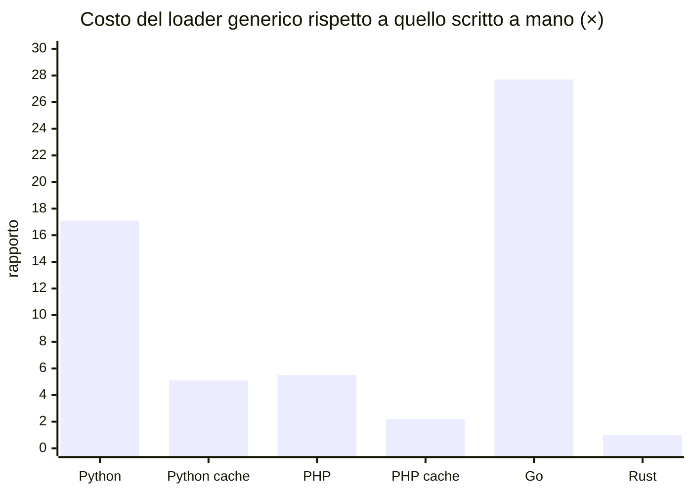

(parte 6 di 8: L08.3 — Metaprogrammazione (esperimenti e13–e15, confronto) — file C08-parte6-l08-3c.md)

### Esperimento e13 — decorator, macro e che cosa vedono davvero

Due domande: *quando* esegue un decorator Python, e *che cosa* scrive una macro Rust.

```python
import functools
import inspect
import sys
import types
from dataclasses import dataclass
from typing import Annotated, get_args, get_type_hints

sys.path.insert(0, "../prog")
from main import Between, Length, Shape  # the rules of the program

# 1) A decorator runs when the function is DEFINED; the wrapper runs at every call.
def traced(f):  # type: ignore[no-untyped-def]
    print(f"  decorating {f.__name__}")

    @functools.wraps(f)
    def wrapper(*args, **kwargs):  # type: ignore[no-untyped-def]
        print(f"  calling {f.__name__}")
        return f(*args, **kwargs)

    return wrapper


@traced
def add(a: int, b: int) -> int:
    """Add two integers."""
    return a + b


print("1) after the definition")
print("  ", add(1, 2), add.__name__, "-", add.__doc__)

# 2) A class decorator can check the schema at DEFINITION time instead of at the first use.
COMPAT = {Between: int, Length: str, Shape: str}


def checked_schema[C](cls: type[C]) -> type[C]:
    for name, hint in get_type_hints(cls, include_extras=True).items():
        declared, *rules = get_args(hint)
        if isinstance(declared, types.UnionType):
            declared = next(a for a in get_args(declared) if a is not type(None))
        for rule in rules:
            if COMPAT[type(rule)] is not declared:
                raise TypeError(f"{cls.__name__}.{name}: {type(rule).__name__} cannot judge {declared.__name__}")
    return cls


@checked_schema
@dataclass(frozen=True)
class Good:
    qty: Annotated[int, Between(0, 9)]


print("2) Good defined")
try:

    @checked_schema
    @dataclass(frozen=True)
    class Bad:
        name: Annotated[str, Between(1, 30)]

except TypeError as e:
    print("   TypeError at definition:", e)

# 3) @dataclass itself is code generation: it writes __init__, __eq__, __repr__ ... at definition time.
print("3)", inspect.signature(Good))
print("  ", Good(3), Good(3) == Good(3), sorted(n for n in vars(Good) if n.startswith("__") and n.endswith("__") and n in ("__init__", "__eq__", "__repr__", "__hash__")))
```

```rust
trait Rule<T> {
    fn check(&self, v: &T) -> bool;
}
struct Between(i64, i64);
impl Rule<i64> for Between {
    fn check(&self, v: &i64) -> bool {
        self.0 <= *v && *v <= self.1
    }
}

macro_rules! schema {
    (struct $name:ident { $( $field:ident : $ty:ty => $rule:expr ),+ $(,)? }) => {
        #[derive(Debug)]
        struct $name { $( $field: $ty ),+ }
        impl $name {
            fn valid(&self) -> bool {
                true $( && Rule::<$ty>::check(&$rule, &self.$field) )+
            }
        }
    };
}

schema! {
    struct Mini {
        qty: i64 => Between(0, 9999),
        price: i64 => Between(1, 999_999),
    }
}

fn main() {
    println!("{:?} {}", Mini { qty: 1, price: 2 }, Mini { qty: 1, price: 0 }.valid());
}
```

```text
### e13.py
  decorating add
1) after the definition
  calling add
   3 add - Add two integers.
2) Good defined
   TypeError at definition: Bad.name: Between cannot judge str
3) (qty: Annotated[int, Between(lo=0, hi=9)]) -> None
   Good(qty=3) True ['__eq__', '__hash__', '__init__', '__repr__']
[exit 0]
### e13.rs-expanded
struct Mini {
    qty: 
    i64,
    price: i64,
}
#[automatically_derived]
impl ::core::fmt::Debug for Mini {
    #[inline]
    fn fmt(&self, f: &mut ::core::fmt::Formatter) -> ::core::fmt::Result {
        ::core::fmt::Formatter::debug_struct_field2_finish(f, "Mini", "qty",
            &self.qty, "price", &&self.price)
    }
}
impl Mini {
    fn valid(&self) -> bool {
        true && Rule::<i64>::check(&Between(0, 9999), &self.qty) &&
            Rule::<i64>::check(&Between(1, 999_999), &self.price)
    }
}

fn main() {
[exit 0]
```

1. In Python un decorator è una funzione che riceve la funzione (o la classe) appena definita e la **sostituisce**. Viene eseguito **una volta**, alla definizione (`decorating add` appare prima di qualunque chiamata); il *wrapper* che restituisce viene eseguito a ogni chiamata. `functools.wraps` copia nome e docstring.
2. Un *class decorator* come `checked_schema` fa lo stesso per le classi, e permette di spostare il controllo **dall'uso alla definizione**: `Bad` non viene nemmeno creata, e l'errore (`Between cannot judge str`) compare nel momento in cui si scrive la classe, non al primo `load`. Anche questo si può fare solo in un linguaggio dove la definizione è codice eseguito.
3. `@dataclass` è a sua volta un metaprogramma: scrive `__init__`, `__eq__`, `__repr__`, `__hash__` come funzioni vere nella classe, e la firma ricostruita da `inspect.signature` ne è la prova.
4. L'espansione della macro Rust (`cargo expand`) mostra che `schema!` ha prodotto una `struct` normale e un metodo `valid` che è una catena di chiamate dirette: `true && Rule::<i64>::check(&Between(0, 9999), &self.qty) && …`. Non c'è alcun ciclo, nessuna reflection, nessuna ricerca per nome.

### Esperimento e14 — code generation con `go generate`

Go non ha macro e il suo `reflect` è lento (e15). La via d'uscita è generare il codice **prima** della compilazione: un programma piccolo legge il sorgente, trova la struct e scrive un file `.go`.

```go
package main

import "fmt"

//go:generate go run ./gen Product

type Product struct {
	SKU   string `col:"sku"`
	Name  string `col:"name"`
	Qty   int    `col:"qty"`
	Price int    `col:"price"`
}

func main() {
	fmt.Println(ProductColumns)
}
```

```go
// Command gen reads $GOFILE, finds the struct named in os.Args[1] and writes <struct>_gen.go
// with the list of its `col` tags. It runs at DEVELOPMENT time, never in the final program.
package main

import (
	"fmt"
	"go/ast"
	"go/parser"
	"go/token"
	"os"
	"reflect"
	"strconv"
	"strings"
)

func main() {
	name, file := os.Args[1], os.Getenv("GOFILE")
	f, err := parser.ParseFile(token.NewFileSet(), file, nil, 0)
	if err != nil {
		panic(err)
	}
	var cols []string
	ast.Inspect(f, func(n ast.Node) bool {
		ts, ok := n.(*ast.TypeSpec)
		if !ok || ts.Name.Name != name {
			return true
		}
		for _, fld := range ts.Type.(*ast.StructType).Fields.List {
			tag, _ := strconv.Unquote(fld.Tag.Value)
			cols = append(cols, strconv.Quote(reflect.StructTag(tag).Get("col")))
		}
		return false
	})
	out := fmt.Sprintf("// Code generated by gen; DO NOT EDIT.\n\npackage main\n\nvar %sColumns = []string{%s}\n", name, strings.Join(cols, ", "))
	if err := os.WriteFile(strings.ToLower(name)+"_gen.go", []byte(out), 0o644); err != nil {
		panic(err)
	}
}
```

```text
### e14.go (before generate)
# example.com/e14
./main.go:15:14: undefined: ProductColumns
gen
go.mod
main.go
[exit 0]
### e14.go (go generate, then run)
// Code generated by gen; DO NOT EDIT.

package main

var ProductColumns = []string{"sku", "name", "qty", "price"}
[sku name qty price]
[exit 0]
```

La direttiva `//go:generate go run ./gen Product` è un commento speciale: `go generate` lo esegue **a mano**, mai durante `go build`. Prima di eseguirlo il programma non compila (`undefined: ProductColumns`); dopo, esiste `product_gen.go` con l'intestazione `// Code generated … DO NOT EDIT.` che la convenzione di Go riserva ai file generati. La generazione usa **gli stessi tag** della reflection, ma li legge una volta, in fase di sviluppo, tramite `go/parser`.

Il costo è un passo in più nel flusso di lavoro, e un file generato da tenere sincronizzato (si versiona, o si genera in CI). Il guadagno è codice **ordinario** — leggibile, debuggabile, veloce.

### Esperimento e15 — quanto costa la reflection

Stesso lavoro (trasformare una riga in un `Product` con tutte le regole), tre modi: generico con reflection a ogni riga, generico con il «piano» calcolato una volta per classe, scritto a mano.

```python
import statistics
import sys
import time
from functools import cache
from typing import get_args, get_type_hints

sys.path.insert(0, "../prog")
from main import Product, Reject, convert, load

ROWS = [
    ["AB123", "Espresso machine", "kitchen", "12", "24900", "10"],
    ["CD456", "Milk frother", "kitchen", "40", "1990", ""],
    ["EF789", "Desk lamp", "office", "25", "3450", "15"],
    ["GH012", "Notebook A5", "office", "500", "350", ""],
]
N = 20_000


@cache
def plan(cls: type) -> list[tuple[str, object, list[object]]]:
    """Reflect ONCE per class: (name, declared type, rules) for every field."""
    out = []
    for name, hint in get_type_hints(cls, include_extras=True).items():
        declared, *rules = get_args(hint)
        out.append((name, declared, rules))
    return out


def load_cached(cls: type, row: list[str]) -> object:
    values: list[object] = []
    for (name, declared, rules), raw in zip(plan(cls), row):
        try:
            value = convert(raw, declared)
        except ValueError:
            return Reject(name, "type")
        for rule in rules:
            if value is not None and not rule.check(value):  # type: ignore[attr-defined]
                return Reject(name, type(rule).__name__.lower())
        values.append(value)
    return cls(*values)


def hand(row: list[str]) -> Product | Reject:
    sku, name, category, qty_s, price_s, disc_s = row
    if len(sku) != 5 or not ("A" <= sku[0] <= "Z" and "A" <= sku[1] <= "Z" and sku[2:].isascii() and sku[2:].isdigit()):
        return Reject("sku", "shape")
    if not 1 <= len(name) <= 30:
        return Reject("name", "length")
    if not 1 <= len(category) <= 12:
        return Reject("category", "length")
    try:
        qty = int(qty_s)
    except ValueError:
        return Reject("qty", "type")
    if not 0 <= qty <= 9999:
        return Reject("qty", "between")
    try:
        price = int(price_s)
    except ValueError:
        return Reject("price", "type")
    if not 1 <= price <= 999_999:
        return Reject("price", "between")
    disc = None
    if disc_s != "":
        try:
            disc = int(disc_s)
        except ValueError:
            return Reject("max_discount", "type")
        if not 0 <= disc <= 90:
            return Reject("max_discount", "between")
    return Product(sku, name, category, qty, price, disc)


def bench(f) -> float:  # type: ignore[no-untyped-def]
    ts = []
    for _ in range(9):
        t = time.perf_counter()
        for i in range(N):
            f(ROWS[i & 3])
        ts.append((time.perf_counter() - t) / N * 1e9)
    return statistics.median(ts)


assert [load(Product, r) for r in ROWS] == [hand(r) for r in ROWS] == [load_cached(Product, r) for r in ROWS]
print(f"python generic load, reflecting at every row : {bench(lambda r: load(Product, r)):8.0f} ns/row")
print(f"python generic load, plan cached per class   : {bench(lambda r: load_cached(Product, r)):8.0f} ns/row")
print(f"python hand-written loader                   : {bench(hand):8.0f} ns/row")
```

```go
package main

import (
	"fmt"
	"reflect"
	"slices"
	"strconv"
	"strings"
	"time"
	"unicode/utf8"
)

// Product is T2 - the schema: ONE declaration holds the type and, in the struct tags, the rules of every column.
// The fields are exported because package reflect can only write to exported fields (e12).
type Product struct {
	SKU         string `col:"sku" rule:"shape=AA999"`
	Name        string `col:"name" rule:"length=1:30"`
	Category    string `col:"category" rule:"length=1:12"`
	Qty         int    `col:"qty" rule:"between=0:9999"`
	Price       int    `col:"price" rule:"between=1:999999"`
	MaxDiscount *int   `col:"max_discount" rule:"between=0:90"` // a nil pointer is "absent"
}

func (p Product) Value() int { return p.Qty * p.Price }

// T2 - the rules: a name and arguments in a tag string, interpreted at run time.
func shapeOK(mask, s string) bool {
	if len(s) != len(mask) {
		return false
	}
	for i := 0; i < len(mask); i++ {
		switch m, c := mask[i], s[i]; m {
		case 'A':
			if c < 'A' || c > 'Z' {
				return false
			}
		case '9':
			if c < '0' || c > '9' {
				return false
			}
		default:
			if m != c {
				return false
			}
		}
	}
	return true
}

func twoInts(args string) (lo, hi int64) {
	a, b, _ := strings.Cut(args, ":")
	lo, _ = strconv.ParseInt(a, 10, 64)
	hi, _ = strconv.ParseInt(b, 10, 64)
	return
}

// checkRule applies one tag rule to a value and returns whether it holds, plus the rule name.
func checkRule(spec string, v reflect.Value) (bool, string) {
	name, args, _ := strings.Cut(spec, "=")
	switch name {
	case "between":
		lo, hi := twoInts(args)
		n := v.Int()
		return lo <= n && n <= hi, name
	case "length":
		lo, hi := twoInts(args)
		n := int64(utf8.RuneCountInString(v.String()))
		return lo <= n && n <= hi, name
	case "shape":
		return shapeOK(args, v.String()), name
	}
	panic("unknown rule " + name)
}

type Reject struct{ Field, Rule string }

// setFrom converts raw text to the kind of dst (string or integer). It reports whether the text was valid.
func setFrom(dst reflect.Value, raw string) bool {
	switch dst.Kind() {
	case reflect.String:
		dst.SetString(raw)
	case reflect.Int:
		n, err := strconv.ParseInt(raw, 10, 64)
		if err != nil {
			return false
		}
		dst.SetInt(n)
	default:
		panic("unsupported kind " + dst.Kind().String())
	}
	return true
}

// Load is T3 - build a T from a row, knowing nothing about T except its fields and tags.
func Load[T any](row []string) (T, *Reject) {
	var out T
	v := reflect.ValueOf(&out).Elem()
	t := v.Type()
	if len(row) != t.NumField() {
		return out, &Reject{"-", "fields"}
	}
	for i := 0; i < t.NumField(); i++ {
		f, fv, raw := t.Field(i), v.Field(i), row[i]
		col := f.Tag.Get("col")
		target := fv
		if f.Type.Kind() == reflect.Pointer { // optional column: empty text leaves the pointer nil
			if raw == "" {
				continue
			}
			target = reflect.New(f.Type.Elem()).Elem()
		}
		if !setFrom(target, raw) {
			return out, &Reject{col, "type"}
		}
		for _, spec := range strings.Fields(f.Tag.Get("rule")) {
			if ok, name := checkRule(spec, target); !ok {
				return out, &Reject{col, name}
			}
		}
		if f.Type.Kind() == reflect.Pointer {
			fv.Set(target.Addr())
		}
	}
	return out, nil
}

var rows = [][]string{
	{"AB123", "Espresso machine", "kitchen", "12", "24900", "10"},
	{"CD456", "Milk frother", "kitchen", "40", "1990", ""},
	{"EF789", "Desk lamp", "office", "25", "3450", ""},
	{"GH012", "Notebook A5", "office", "500", "350", ""},
}

func atoiRange(s string, lo, hi int64) (int, string) {
	n, err := strconv.ParseInt(s, 10, 64)
	if err != nil {
		return 0, "type"
	}
	if n < lo || n > hi {
		return 0, "between"
	}
	return int(n), ""
}

func hand(row []string) (Product, *Reject) {
	var p Product
	if !shapeOK("AA999", row[0]) {
		return p, &Reject{"sku", "shape"}
	}
	if n := utf8.RuneCountInString(row[1]); n < 1 || n > 30 {
		return p, &Reject{"name", "length"}
	}
	if n := utf8.RuneCountInString(row[2]); n < 1 || n > 12 {
		return p, &Reject{"category", "length"}
	}
	var why string
	if p.Qty, why = atoiRange(row[3], 0, 9999); why != "" {
		return p, &Reject{"qty", why}
	}
	if p.Price, why = atoiRange(row[4], 1, 999999); why != "" {
		return p, &Reject{"price", why}
	}
	if row[5] != "" {
		d, why := atoiRange(row[5], 0, 90)
		if why != "" {
			return p, &Reject{"max_discount", why}
		}
		p.MaxDiscount = &d
	}
	p.SKU, p.Name, p.Category = row[0], row[1], row[2]
	return p, nil
}

func bench(f func(row []string)) float64 {
	const n = 300_000
	var ts []float64
	for r := 0; r < 9; r++ {
		t := time.Now()
		for i := 0; i < n; i++ {
			f(rows[i&3])
		}
		ts = append(ts, float64(time.Since(t).Nanoseconds())/n)
	}
	slices.Sort(ts)
	return ts[4]
}

var sink Product

func main() {
	for _, r := range rows {
		a, _ := Load[Product](r)
		b, _ := hand(r)
		if a.SKU != b.SKU || a.Qty != b.Qty || (a.MaxDiscount == nil) != (b.MaxDiscount == nil) {
			panic("loaders disagree")
		}
	}
	fmt.Printf("go generic Load[T], reflecting at every row : %8.0f ns/row\n", bench(func(r []string) { sink, _ = Load[Product](r) }))
	fmt.Printf("go hand-written loader                      : %8.0f ns/row\n", bench(func(r []string) { sink, _ = hand(r) }))
}
```

```text
### e15.py
python generic load, reflecting at every row :    24075 ns/row
python generic load, plan cached per class   :     7136 ns/row
python hand-written loader                   :     1410 ns/row
[exit 0]
### e15.php
php generic load, reflecting at every row :     7051 ns/row
php generic load, plan cached per class   :     2872 ns/row
php hand-written loader                   :     1290 ns/row
[exit 0]
### e15.go
go generic Load[T], reflecting at every row :     1799 ns/row
go hand-written loader                      :       65 ns/row
[exit 0]
### e15.rs
rust macro-generated from_row :   72.7 ns/row
rust hand-written from_row    :   72.2 ns/row
[exit 0]
```

| | Generico, reflection a ogni riga | Generico, piano in cache | Scritto a mano | Rapporto (reflection / mano) | Rapporto (cache / mano) |
|---|---|---|---|---|---|
| Python | 24075 ns | 7136 ns | 1410 ns | **17×** | 5× |
| PHP | 7051 ns | 2872 ns | 1290 ns | 5,5× | 2,2× |
| Go | 1799 ns | — | 65 ns | **28×** | — |
| Rust (macro) | 72,7 ns | — | 72,2 ns | **1,0×** | — |



Tre lezioni, con la prudenza dovuta a una misura fatta su una sola macchina:

1. **La macro costa zero.** Il codice generato è *lo stesso* che si sarebbe scritto a mano: la differenza (72,7 contro 72,2 ns) è rumore. È il significato concreto di «astrazione a costo zero».
2. **Il costo della reflection è soprattutto nelle domande ripetute.** In Python e PHP, chiedere a ogni riga «che tipo ha questo campo?» vale più della metà del tempo; fare la domanda **una volta per classe** (`@cache`) riporta il costo da 17× a 5× e da 5,5× a 2,2×. Il piano è il *concetto* da ricordare: *riflettere una volta, applicare molte volte*.
3. **In Go la reflection è la più cara** (28×), probabilmente perché a ogni riga rilegge campi e tag con `Field(i)` e `Tag.Get`, che scorrono stringhe (l'esperimento misura il totale, non isola la causa). È il motivo per cui l'ecosistema Go preferisce generare codice (e14).

I numeri sono ordini di grandezza, non classifiche: dipendono dalla macchina, dalla versione e dal carico. La regola operativa è: *prima si scrive il loader generico, poi si misura; se il caricamento è il collo di bottiglia, si passa alla generazione o a un piano in cache*. Se il file è di 19 righe, nessuno lo noterà.

### Focus comparativo

| | PHP | Python | Rust | Go |
|---|---|---|---|---|
| Metadato accanto al campo | attributo `#[Rule(...)]` | `Annotated[T, Rule(...)]` | argomento della macro | stringa nel **tag** |
| Il metadato è… | una classe vera, controllata | un'espressione Python, valutata alla definizione | un'espressione Rust, controllata dal compilatore | **testo**, non controllato da nessuno |
| Chi lo legge | `Reflection*`, a runtime | `get_type_hints`, a runtime | la macro, a compile time | `reflect`, a runtime |
| Errore di battitura nel nome | **silenzioso** (filtro) | `NameError` all'import | errore di compilazione | `panic` a runtime |
| Regola sbagliata per il tipo | tutto scartato | tutto scartato | **non compila** | `panic` a runtime |
| Costo a runtime (rispetto al codice a mano) | 5,5× (2,2× in cache) | 17× (5× in cache) | **1×** | 28× |
| Alternativa «a monte» | generare il codice | decorator di classe | `derive` / macro procedurali | `go generate` |
| Prezzo | errori tardivi | errori tardivi, costo CPU | errori di macro difficili da leggere; tempi di compilazione | strumento in più, file generati |

La regola di sintesi è una sola: **più si anticipa, più si guadagna in sicurezza e velocità, più si perde in flessibilità**. La metaprogrammazione a runtime serve quando lo schema è un *dato* (una configurazione, un file, una tabella di database) e non è noto al momento della scrittura; la generazione o le macro servono quando lo schema è *codice*.

### Esercizio Rosetta (4′)

Aggiungere una regola nuova, `Choice("kitchen", "office", "outdoor")`, per la colonna `category`. Per ogni linguaggio: (a) dove si dichiara la regola? (b) dove viene letta? (c) che cosa succede se la si assegna per errore a un campo numerico? Si ricostruisca la risposta confrontando e11 ed e12, poi la si provi.
