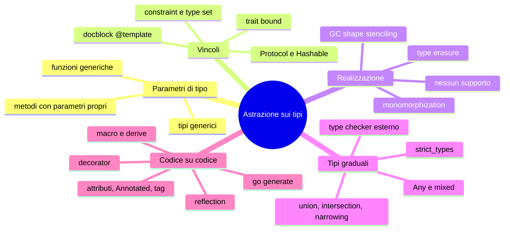

(parte 7 di 8: Collaudo, matrice, anti-pattern, quiz, esercizi, ponte — file C08-parte7-collaudo.md)

## Il programma completo e il collaudo

Il programma finale (circa 240–360 righe per linguaggio, per intero in Appendice) assembla T1–T7: legge il catalogo, carica ogni riga con il loader generico, scarta e racconta gli scarti su *stderr*, calcola i riepiloghi con le funzioni generiche, e fa passare le richieste per la cache LRU. Si lancia con due argomenti:

```bash
python3 main.py catalog.csv lookups.txt
php main.php catalog.csv lookups.txt
./main_rs catalog.csv lookups.txt      # rustc --edition 2024 -O main.rs -o main_rs
./main_go catalog.csv lookups.txt      # go build -o main_go
```

Il collaudo ha **cinque casi**, ciascuno eseguito nei quattro linguaggi con confronto byte per byte di *stdout*, *stderr* ed exit code.

| # | Caso | Che cosa verifica | Esito atteso | I quattro concordano? |
|---|---|---|---|---|
| 1 | `catalog.csv` di riferimento (19 righe: 11 valide, 8 con un difetto) | tutto il flusso T1–T7; pareggio al terzo posto; cache piena | `valid=11 rejected=8`, exit 1 | sì |
| 2 | file con la sola intestazione | zero righe: nessuna divisione per zero, nessun elenco vuoto fatale | `rows=0`, exit 0 | sì |
| 3 | terminatori di riga `\r\n`, riga vuota intermedia | `trim` prima di dividere | 2 valide, exit 0 | sì |
| 4 | file inesistente | errore di input, non un'eccezione non gestita | `cannot open …`, exit 2 | sì |
| 5 | valori «ai limiti» (`t_odd.csv`) | che cosa significa davvero «un intero» | vedi sotto | **no: Python diverge** |

L'uscita del caso 1 (*stdout*, poi *stderr*):

```text
rows=19 valid=11 rejected=8
top rank=1 sku=AB123 value=298800
top rank=2 sku=IJ345 value=275400
top rank=3 sku=GH012 value=175000
category=kitchen value=438250
category=office value=760650
category=outdoor value=362170
lookup=AB123 cache=miss result=found sku=AB123
lookup=CD456 cache=miss result=found sku=CD456
lookup=EF789 cache=miss result=found sku=EF789
lookup=AB123 cache=hit result=found sku=AB123
lookup=CD456 cache=hit result=found sku=CD456
lookup=GH012 cache=miss result=found sku=GH012
lookup=2 cache=miss result=found sku=CD456
lookup=ZZ999 cache=miss result=unknown sku=-
lookup=0 cache=miss result=unknown sku=-
lookup=1 cache=miss result=found sku=AB123
lookup=AB123 cache=miss result=found sku=AB123
lookup=2 cache=hit result=found sku=CD456
cache capacity=3 hits=3 misses=9 evictions=4 scans=9
[exit 1]
```

```text
reject line=12 field=sku rule=shape
reject line=13 field=name rule=length
reject line=14 field=name rule=length
reject line=15 field=qty rule=between
reject line=16 field=price rule=between
reject line=17 field=max_discount rule=between
reject line=18 field=qty rule=type
reject line=19 field=- rule=fields
```

Casi 2 e 3:

```text
rows=0 valid=0 rejected=0
cache capacity=3 hits=0 misses=0 evictions=0 scans=0
--- stderr
[exit 0]
```

```text
rows=2 valid=2 rejected=0
top rank=1 sku=CD200 value=400
top rank=2 sku=AB100 value=100
category=kitchen value=100
category=office value=400
lookup=AB100 cache=miss result=found sku=AB100
lookup=2 cache=miss result=found sku=CD200
lookup=ZZ000 cache=miss result=unknown sku=-
cache capacity=3 hits=0 misses=3 evictions=0 scans=3
--- stderr
[exit 0]
```

### Il caso 5: dove Python diverge

`t_odd.csv` contiene quantità e prezzi scritti in modi insoliti: `+7`, `007`, `1_000`, cifre a larghezza piena (`１２`), `1e3`, un intero di venti cifre, spazi attorno ai campi. PHP, Rust e Go concordano riga per riga. **Python no**, e la ragione è nella conversione `int(raw)` del loader:

| Valore | PHP, Rust, Go | Python |
|---|---|---|
| `1_000` | non è un intero (`type`) | **accettato**: `int("1_000")` vale 1000 (separatore di cifre, PEP 515) |
| cifre a larghezza piena | non sono cifre ASCII (`type`) | **accettate**: `int()` riconosce ogni cifra Unicode |
| `99999999999999999999` | `type` (non entra in 64 bit) | **accettato** come intero senza limite; scartato solo dalla regola `between` |

Le uscite dei due gruppi:

```text
rows=17 valid=8 rejected=9
top rank=1 sku=AB102 value=100000
top rank=2 sku=AB103 value=1200
top rank=3 sku=AB100 value=700
category=abcdefghijkl value=1
category=kitchen value=102613
lookup=007 cache=miss result=found sku=AB112
lookup=+3 cache=miss result=unknown sku=-
lookup=３ cache=miss result=unknown sku=-
lookup=AB100 cache=miss result=found sku=AB100
lookup=AB101 cache=miss result=found sku=AB101
lookup=AB100 cache=hit result=found sku=AB100
lookup=AB101 cache=hit result=found sku=AB101
lookup=AB107 cache=miss result=found sku=AB107
lookup=99999999999999999999 cache=miss result=unknown sku=-
cache capacity=3 hits=2 misses=7 evictions=1 scans=7
--- stderr
reject line=6 field=price rule=type
reject line=7 field=qty rule=between
reject line=8 field=max_discount rule=between
reject line=10 field=name rule=length
reject line=12 field=category rule=length
reject line=13 field=sku rule=shape
reject line=14 field=sku rule=shape
reject line=17 field=qty rule=type
reject line=18 field=- rule=fields
[exit 1]
```

```text
rows=17 valid=6 rejected=11
top rank=1 sku=AB100 value=700
top rank=2 sku=AB101 value=700
top rank=3 sku=AB113 value=12
category=abcdefghijkl value=1
category=kitchen value=1413
lookup=007 cache=miss result=unknown sku=-
lookup=+3 cache=miss result=unknown sku=-
lookup=３ cache=miss result=unknown sku=-
lookup=AB100 cache=miss result=found sku=AB100
lookup=AB101 cache=miss result=found sku=AB101
lookup=AB100 cache=hit result=found sku=AB100
lookup=AB101 cache=hit result=found sku=AB101
lookup=AB107 cache=miss result=found sku=AB107
lookup=99999999999999999999 cache=miss result=unknown sku=-
cache capacity=3 hits=2 misses=7 evictions=0 scans=7
--- stderr
reject line=4 field=qty rule=type
reject line=5 field=qty rule=type
reject line=6 field=price rule=type
reject line=7 field=qty rule=type
reject line=8 field=max_discount rule=between
reject line=10 field=name rule=length
reject line=12 field=category rule=length
reject line=13 field=sku rule=shape
reject line=14 field=sku rule=shape
reject line=17 field=qty rule=type
reject line=18 field=- rule=fields
[exit 1]
```

Anche le richieste divergono (`007` trova `AB112` in Python, che ha 8 prodotti validi, e nulla negli altri, che ne hanno 6) e di conseguenza il numero di `evictions`. Non è un errore di un linguaggio: è la differenza tra **`int` di Python** (precisione arbitraria, parser permissivo) e un intero a 64 bit con parser stretto. Il loader generico eredita la conversione dal linguaggio; chi vuole lo stesso comportamento ovunque deve scrivere la conversione a mano (come ha fatto `parseInt` in PHP, con un'espressione regolare) o validare il testo prima. È una conferma di L08.3: il loader generico è un **contratto** che dipende da funzioni di conversione, e quelle funzioni non sono uguali tra linguaggi.

## Matrice degli approcci

Legenda: ● nativo e idiomatico · ◐ alternativa assimilabile (libreria, convenzione) · ○ assente o non idiomatico. È un indice, non una dichiarazione di equivalenza.

| Costrutto | PHP | Python | Rust | Go |
|---|---|---|---|---|
| Generics | ◐ `@template` + PHPStan/Psalm (commento) | ◐ sintassi nativa (3.12), verifica esterna, type erasure | ● monomorphization, trait bound | ● type parameter, stenciling per GC shape |
| Vincoli sui parametri | ◐ `of` nel docblock | ◐ `K: Hashable`, `Protocol` | ● trait bound, `where` | ● constraint, type set |
| Metodi con parametri di tipo propri | ○ | ● | ● | ○ (errore di compilazione) |
| Union types | ● `int\|string` | ● `int \| str` | ◐ `enum` | ◐ type set solo nei vincoli; interfaccia sigillata |
| Intersection types | ● `A&B` | ◐ `Protocol` con più basi | ● `T: A + B` | ◐ interfacce incorporate |
| Esaustività del narrowing | ○ | ◐ `assert_never` (checker) | ● compilatore | ○ |
| Gradual typing | ● controllo a runtime, `strict_types` | ● solo type checker | ○ (tutto statico) | ○ (tutto statico) |
| Reflection a runtime | ● Reflection API | ● introspezione | ○ | ● `reflect` |
| Metadati sul campo | ● attributes | ● `Annotated` | ◐ argomenti della macro | ◐ struct tag (testo) |
| Decorator | ○ | ● | ○ | ○ |
| Macro | ○ | ○ | ● `macro_rules!`, `derive`, procedurali | ○ |
| Code generation | ◐ script esterni | ◐ script esterni | ◐ `build.rs` | ● `go generate` |

## Anti-pattern

| Anti-pattern | Dove si vede | Perché è un problema | Alternativa |
|---|---|---|---|
| `Any` / `mixed` / `any` per «far passare» il tipo | tutti | spegne la protezione proprio dove serve; il tipo sbagliato esplode lontano | parametro di tipo con vincolo; `object` + narrowing solo ai confini |
| Annotazioni senza type checker | Python | etichette che nessuno verifica; e5: `double("ab")` gira | `mypy --strict` o pyright in CI |
| `@template` come garanzia | PHP | è un commento: se PHPStan/Psalm non girano, non c'è controllo | analyzer in CI, oppure classi concrete |
| Reflection a ogni chiamata | Python, PHP, Go | e15: da 5× a 28× il costo del codice a mano | piano calcolato una volta (`@cache`), o generazione |
| Regola come stringa | Go (tag), anche Python/PHP se si passano nomi | l'errore di battitura emerge a runtime (e11) | tipi per le regole; test che leggano ogni tag |
| `getAttributes(X::class, IS_INSTANCEOF)` senza controllo | PHP | gli attributi sconosciuti spariscono in silenzio | istanziare tutti, o analyzer che conosca gli attributi |
| Macro per ciò che una funzione generica può fare | Rust | errori più oscuri, compilazione più lenta | prima funzione/trait; macro solo per dichiarazioni nuove |
| File generato modificato a mano | Go | alla prossima `go generate` la modifica sparisce | non toccarlo; correggere il generatore |
| Generico con tanti parametri senza nome chiaro | tutti | `T`, `U`, `V`, `W` illeggibili | nomi significativi (`K`, `V`, `Item`, `Key`) |

## Quiz

1. Perché in Rust `top_n<T, K: Ord>` non accetta una chiave `f64`? Che tipo di errore dà il compilatore e come si risolve?
2. In che senso `Annotated[int, Between(0, 9999)]` «è» un `int` e allo stesso tempo contiene una regola?
3. In Go un metodo non può avere parametri di tipo propri. Quale errore dà il compilatore? Come si aggira?
4. Perché in e2 Go ha 4 istanze per 5 chiamate, mentre Rust ne ha 4 per 4 tipi?
5. Qual è la differenza tra `A | B` e un `enum` con due varianti? Quando conviene l'uno e quando l'altro?
6. In PHP, `#[Betwen(0, 9999)]` non dà errore. Perché? Come lo si renderebbe visibile?
7. Perché il loader Rust non ha un ciclo sulle colonne?
8. Quanto costa, in ordine di grandezza, la reflection rispetto al codice scritto a mano nei quattro linguaggi? Che cosa fa scendere il costo?
9. Perché `1_000` è una quantità valida per il loader Python e non per gli altri?
10. Un bug del loader Python scartava ogni riga con sconto assente. Come lo si è scoperto?

**Risposte**

1. `f64` implementa solo `PartialOrd` (`NaN` non è confrontabile), non `Ord`: il compilatore dà un errore `E0277` sul vincolo non soddisfatto, dello stesso tipo di e3. Si risolve scegliendo una chiave intera (per esempio centesimi), oppure un wrapper ordinabile.
2. A runtime l'annotazione non cambia il valore; resta però salvata nell'oggetto-tipo, e `get_type_hints(include_extras=True)` la restituisce. È un metadato.
3. `method must have no type parameters`. Si aggira con una funzione libera generica, oppure spostando il parametro di tipo sul tipo che contiene il metodo.
4. Go condivide un'istanza tra tutti i tipi con la stessa *GC shape* (`*A` e `*B` sono entrambi puntatori); Rust fa una copia per ogni tipo concreto.
5. `A | B` unisce tipi esistenti, il discriminante è il tipo stesso e non c'è esaustività imposta (in Python solo con il checker); l'`enum` introduce varianti con nome ed esaustività obbligata. L'unione è più leggera per poche forme semplici; l'`enum` quando le varianti portano dati diversi o sono molte.
6. Il filtro `IS_INSTANCEOF` di `getAttributes(Rule::class, …)` esclude ciò che non risulta un'istanza di `Rule`: una classe inesistente non lo è, e sparisce senza errore (e11b: 1 attributo dichiarato, 0 dopo il filtro). Si rende visibile istanziando tutti gli attributi, o con PHPStan/Psalm.
7. Perché il ciclo è stato eseguito dalla macro in fase di compilazione: l'espansione è una catena di istruzioni sui singoli campi.
8. Python 17× (5× con piano in cache), PHP 5,5× (2,2×), Go 28×, Rust 1×. Il costo scende calcolando il piano una volta per classe, o generando il codice.
9. `int()` di Python accetta il separatore di cifre (PEP 515); gli altri parser accettano solo cifre ASCII.
10. Dalla divergenza: gli altri tre linguaggi davano `valid=11 rejected=8`, Python `valid=6 rejected=13`.

## Esercizi

| # | Livello | Consegna |
|---|---|---|
| 1 | base | Scrivere `min_by` generico (funzione che restituisce l'elemento con la chiave minima) nei quattro linguaggi. Che cosa succede su una lista vuota? Come lo esprimono i quattro tipi di ritorno? |
| 2 | base | Aggiungere la colonna `weight` (intero, tra 1 e 50000) allo schema. Quante righe di codice si cambiano in ciascun linguaggio, e quante in più se non ci fosse stata la metaprogrammazione? |
| 3 | medio | Aggiungere la regola `Choice("kitchen", "office", "outdoor")` a `category` (esercizio Rosetta di L08.3) e verificare che l'errore di battitura sul nome emerga nel modo previsto da e11. |
| 4 | medio | In Python, aggiungere un class decorator `@checked_schema` al loader reale che rifiuti a definizione le regole incompatibili con il tipo (e13); confrontare con quello che fa Rust a compile time. |
| 5 | medio | Implementare `MinMax[T]` (tipo generico con `update(x)`, `min`, `max`) in modo che un `T` non ordinabile sia un errore al più presto possibile in ciascun linguaggio. Dove viene segnalato? |
| 6 | avanzato | Trasformare il loader Go da reflection a codice generato (e14): scrivere un generatore che emetta `LoadProduct(row []string) (Product, *Reject)` con le regole inline. Misurare con il benchmark di e15. |
| 7 | avanzato | Scrivere in Rust una macro `schema!` che accetti anche un campo `Option<T>` senza regola. Controllare con `cargo expand` o `rustc -Zunpretty=expanded` quello che produce. |
| 8 | avanzato | Rendere il loader PHP capace di segnalare un attributo sconosciuto (e11) senza PHPStan: quali opzioni di `getAttributes` servono? |

## Mappa mentale



## Ponte ai capitoli successivi

Il `Reject` che il loader produce (colonna e regola) è un **errore come valore**: in C09 diventa un tipo di errore con contesto, `Result` in Rust e Go, eccezione tipizzata in PHP e Python. I vincoli tornano in C10 (dimensione e layout dei tipi generici, effetto della monomorphization) e in C11 (i tipi inviati tra thread devono essere `Send`, che è un vincolo). C13 userà la metaprogrammazione per i test parametrici e per le asserzioni. C14 la riprende per la serializzazione (`derive(Serialize)`, tag `json:"…"`, attributi). C24 la riprende tra gli idiomi: dove il linguaggio non ha un costrutto, la comunità inventa una convenzione.

## Limiti dichiarati

- **PHPStan e Psalm non sono stati eseguiti**: i commenti `@template` sono leggibili da loro ma il loro rapporto non è riportato. Le affermazioni sul comportamento in presenza di `@template` si basano sulla documentazione, non su prove.
- **`staticcheck` per Go non è stato eseguito**: solo `gofmt` e `go vet`.
- **Le misure di e15** sono ordini di grandezza su una sola macchina, con Go 1.24.7: le prestazioni dei generics di Go vanno riverificate con 1.25+.
- **mypy non controlla il contenuto di `Annotated`** (e11); nessun altro strumento è stato provato su quei metadati.
- Il messaggio `Deprecated` della conversione `5.7` → `5` in PHP compare solo con `error_reporting` esplicito (e5).
- Le versioni dichiarate nell'intestazione sono quelle usate per i test; il codice non usa funzioni più recenti.

