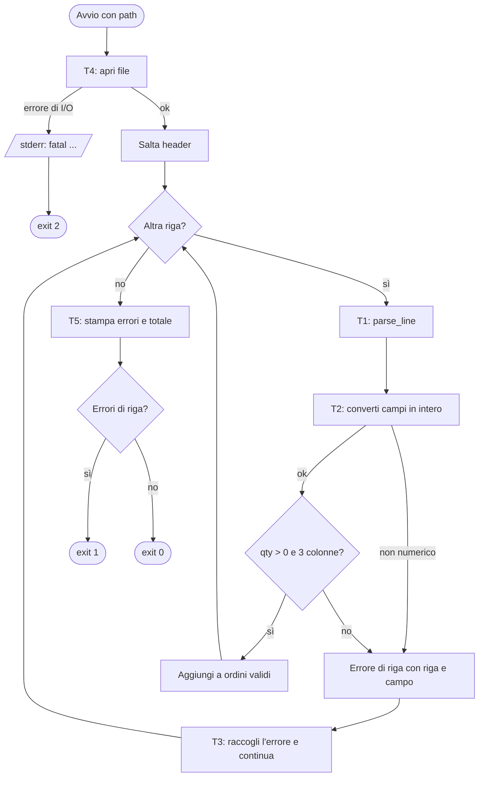
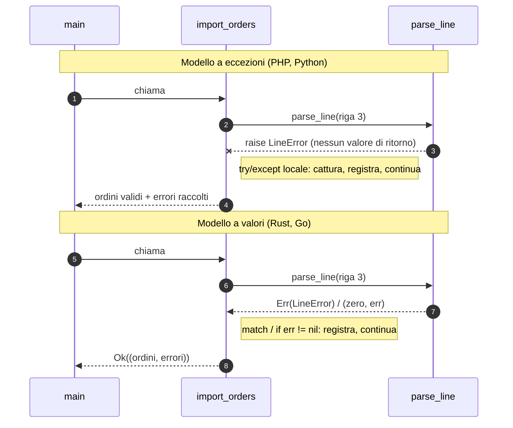
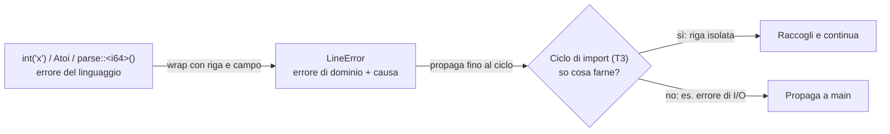
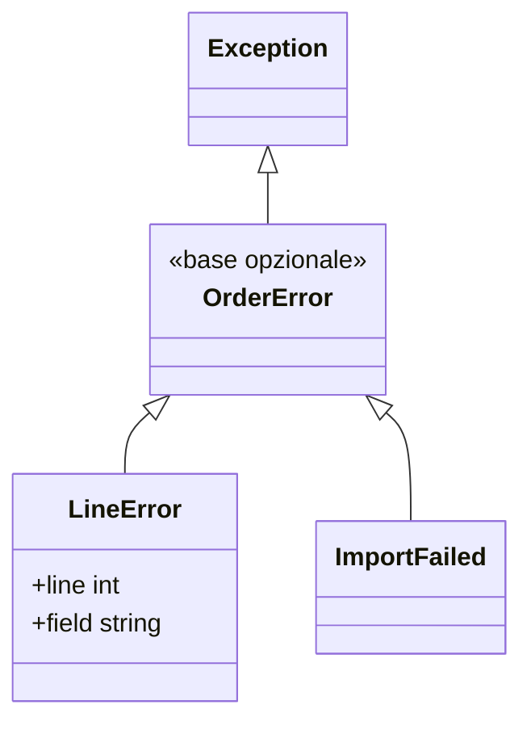
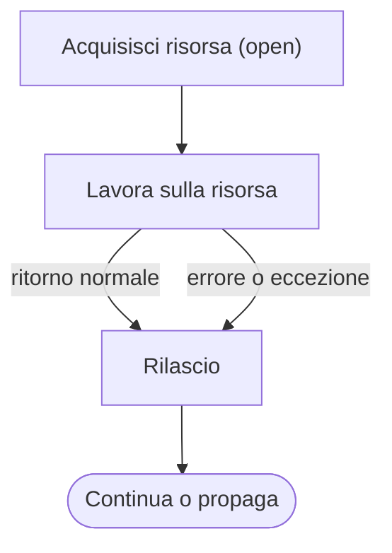
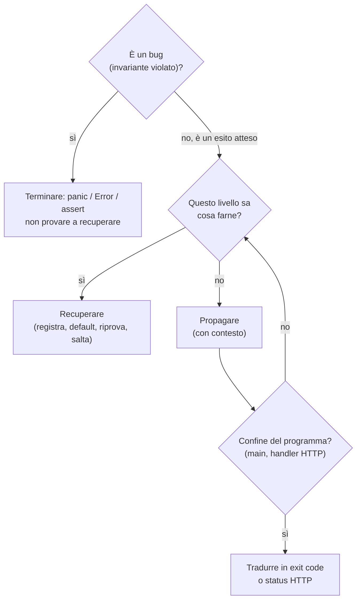
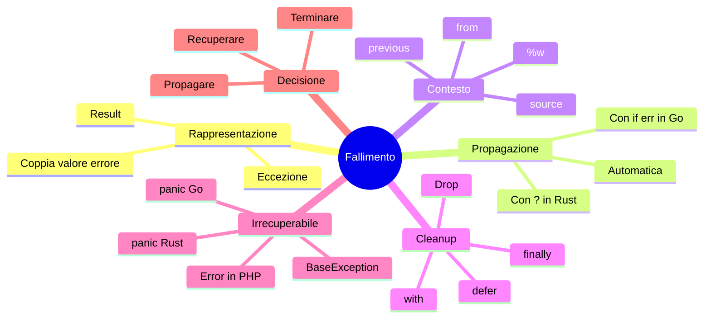

# C09 — Gestione degli errori

> **Parte II — Modellare e astrarre** · 4 lezioni (L09.1–L09.4) · 3 ore · capitolo con addendum ◆
> **Stato:** bozza 1 (2026-10-11) — capitolo pilota per l'ingresso B. Codice eseguito e verificato su PHP 8.3.6, Python 3.13.16, Rust 1.97.0, Go 1.24.7 (baseline del corso: PHP 8.4+, Go 1.25+; il codice non usa nulla di specifico delle versioni più recenti, da riverificare a stesura finale).

## Obiettivi

Al termine del capitolo si sa: (1) riconoscere i due modelli di gestione degli errori, eccezioni ed errori come valori; (2) decidere per ogni errore se **recuperare, propagare o terminare**; (3) arricchire un errore con contesto senza perdere la causa originale; (4) garantire il rilascio delle risorse su ogni percorso di uscita; (5) distinguere un errore atteso da un invariante violato (panic).

## Il problema reale

> Un negozio online riceve ogni notte da un partner un file `orders.csv` con le righe d'ordine: codice articolo, quantità e prezzo unitario in centesimi. Il file è scritto a mano da un fornitore e **contiene errori**: quantità non numeriche, quantità negative, righe con colonne mancanti. Serve un programma che calcoli il totale delle righe valide, **elenchi** le righe scartate indicando riga e campo, e dica allo scheduler com'è andata tramite l'exit code. Se il file non esiste, non c'è nulla da elaborare: il programma deve fermarsi subito.

File di esempio usato in tutto il capitolo (`orders.csv`):

```csv
sku,qty,price_cents
A-100,2,990
B-200,x,500
C-300,-1,350
D-400,3,200
E-500,1
```

Risultato atteso (identico nei quattro linguaggi): totale `2*990 + 3*200 = 2580`, 2 righe valide, 3 scartate, exit code `1`.

### Scomposizione in attività

| # | Attività | Domanda sugli errori | Lezione |
|---|---|---|---|
| T1 | Leggere una riga e trasformarla in un `Order` | Come si **segnala** che la riga è sbagliata? | L09.1 |
| T2 | Convertire un campo in intero | Come si **aggiunge contesto** (riga, campo) senza perdere la causa? | L09.2 |
| T3 | Scorrere il file raccogliendo gli errori di riga | Quale errore si **recupera** e quale si **propaga**? | L09.2 |
| T4 | Aprire e chiudere il file | Come si **rilascia** la risorsa su ogni percorso? | L09.3 |
| T5 | Decidere exit code e messaggi al confine del programma | Quando è **fatale** un errore? E un bug? | L09.4 |



Il flowchart contiene già la tesi del capitolo: ci sono **due classi di errore** con destini opposti. L'errore di riga è *atteso, locale, recuperabile*: si annota e si prosegue. L'errore di I/O sul file è *globale e fatale*: si interrompe tutto. Come si esprimono queste due classi è ciò che separa i quattro linguaggi.

---

## L09.1 — Eccezioni contro errori come valori (T1)

### Concetto

Una funzione può non riuscire. Ci sono due modi per dirlo al chiamante:

- **Eccezione (PHP, Python).** La funzione *non ritorna*: interrompe il flusso, e il controllo risale lo stack (*unwinding*) fino al primo `catch` compatibile. La firma non dice che cosa può fallire.
- **Errore come valore (Rust, Go).** La funzione *ritorna sempre*, e l'esito fallimentare è parte del valore restituito: `Result<T, E>` in Rust, la coppia `(T, error)` in Go. Il chiamante deve occuparsene esplicitamente.



### Implementazione — T1 e il tipo di errore

Prima il tipo che rappresenta "una riga è sbagliata", poi `parse_line`.

**Python**

```python
class LineError(Exception):
    """A single malformed row: recoverable, reported and skipped."""

    def __init__(self, line: int, field: str, msg: str):
        super().__init__(f"line {line}: field {field}: {msg}")
```

**PHP**

```php
final class LineException extends RuntimeException
{
    public function __construct(int $line, string $field, string $msg, ?Throwable $previous = null)
    {
        parent::__construct("line $line: field $field: $msg", 0, $previous);
    }
}

final class ImportFailed extends RuntimeException {}
```

**Rust**

```rust
#[derive(Debug)]
enum LineError {
    Columns { line: usize, got: usize },
    NotInt { line: usize, field: &'static str, raw: String, source: ParseIntError },
    NonPositive { line: usize, got: i64 },
}

impl fmt::Display for LineError {
    fn fmt(&self, f: &mut fmt::Formatter) -> fmt::Result {
        match self {
            LineError::Columns { line, got } => {
                write!(f, "line {line}: field row: expected 3 columns, got {got}")
            }
            LineError::NotInt { line, field, raw, .. } => {
                write!(f, "line {line}: field {field}: \"{raw}\" is not an integer")
            }
            LineError::NonPositive { line, got } => {
                write!(f, "line {line}: field qty: must be > 0, got {got}")
            }
        }
    }
}

impl Error for LineError {
    // the wrapped cause stays reachable through source()
    fn source(&self) -> Option<&(dyn Error + 'static)> {
        match self {
            LineError::NotInt { source, .. } => Some(source),
            _ => None,
        }
    }
}
```

**Go**

```go
// LineError is a single malformed row: recoverable, reported and skipped.
type LineError struct {
	Line  int
	Field string
	Msg   string
	Err   error // wrapped cause, may be nil
}

func (e *LineError) Error() string {
	return fmt.Sprintf("line %d: field %s: %s", e.Line, e.Field, e.Msg)
}

func (e *LineError) Unwrap() error { return e.Err }
```

Ora la funzione che produce l'errore (T1; il dettaglio di `to_int` è in L09.2):

**Python**

```python
def to_int(line: int, field: str, raw: str) -> int:
    try:
        return int(raw)
    except ValueError as e:
        # wrap: new domain error, original kept as __cause__
        raise LineError(line, field, f'"{raw}" is not an integer') from e


def parse_line(n: int, raw: str) -> Order:
    cols = raw.split(",")
    if len(cols) != 3:
        raise LineError(n, "row", f"expected 3 columns, got {len(cols)}")
    sku, qty_s, price_s = cols
    qty = to_int(n, "qty", qty_s)
    price = to_int(n, "price_cents", price_s)
    if qty <= 0:
        raise LineError(n, "qty", f"must be > 0, got {qty}")
    return Order(sku, qty, price)
```

**PHP**

```php
function toInt(int $line, string $field, string $raw): int
{
    $v = filter_var($raw, FILTER_VALIDATE_INT);
    if ($v === false) {
        throw new LineException($line, $field, "\"$raw\" is not an integer");
    }
    return $v;
}

function parseLine(int $n, string $raw): Order
{
    $cols = explode(',', $raw);
    if (count($cols) !== 3) {
        throw new LineException($n, 'row', 'expected 3 columns, got ' . count($cols));
    }
    [$sku, $qtyS, $priceS] = $cols;
    $qty = toInt($n, 'qty', $qtyS);
    $price = toInt($n, 'price_cents', $priceS);
    if ($qty <= 0) {
        throw new LineException($n, 'qty', "must be > 0, got $qty");
    }
    return new Order($sku, $qty, $price);
}
```

**Rust**

```rust
fn to_int(line: usize, field: &'static str, raw: &str) -> Result<i64, LineError> {
    raw.parse().map_err(|source| LineError::NotInt { line, field, raw: raw.to_string(), source })
}

fn parse_line(n: usize, raw: &str) -> Result<Order, LineError> {
    let cols: Vec<&str> = raw.split(',').collect();
    if cols.len() != 3 {
        return Err(LineError::Columns { line: n, got: cols.len() });
    }
    let qty = to_int(n, "qty", cols[1])?; // `?` = propagate the Err to the caller
    let price_cents = to_int(n, "price_cents", cols[2])?;
    if qty <= 0 {
        return Err(LineError::NonPositive { line: n, got: qty });
    }
    Ok(Order { qty, price_cents })
}
```

**Go**

```go
func toInt(line int, field, raw string) (int, error) {
	v, err := strconv.Atoi(raw)
	if err != nil {
		return 0, &LineError{line, field, fmt.Sprintf("%q is not an integer", raw), err}
	}
	return v, nil
}

func parseLine(n int, raw string) (Order, error) {
	cols := strings.Split(raw, ",")
	if len(cols) != 3 {
		return Order{}, &LineError{n, "row", fmt.Sprintf("expected 3 columns, got %d", len(cols)), nil}
	}
	qty, err := toInt(n, "qty", cols[1])
	if err != nil {
		return Order{}, err // explicit propagation
	}
	price, err := toInt(n, "price_cents", cols[2])
	if err != nil {
		return Order{}, err
	}
	if qty <= 0 {
		return Order{}, &LineError{n, "qty", fmt.Sprintf("must be > 0, got %d", qty), nil}
	}
	return Order{cols[0], qty, price}, nil
}
```

### Focus comparativo

| Aspetto | PHP | Python | Rust | Go |
|---|---|---|---|---|
| Come si segnala | `throw` | `raise` | `return Err(..)` | `return zero, err` |
| Il fallimento è nella firma? | No (solo `@throws` nei docblock) | No | **Sì**: `Result<Order, LineError>` | **Sì**: ultimo valore `error` |
| Si può ignorare l'errore? | Sì: l'eccezione risale da sola | Sì | No: `Result` è `#[must_use]`, il compilatore avvisa | Sì: `_ =` o dimenticare il controllo (lo intercettano i linter) |
| Tipo dell'errore | Classe che estende `Exception` | Classe che estende `Exception` | `enum` (somma di casi, ne parla C06) | Tipo qualsiasi con metodo `Error()` |

**Similitudini.** Tutti e quattro permettono un tipo di errore *del dominio* con campi strutturati (riga, campo): il messaggio è prodotto una sola volta, nel tipo.
**Differenze.** In Rust l'enum elenca *tutti* i modi di fallire: il `match` che li gestisce è controllato per esaustività. In Go e nelle eccezioni l'insieme dei casi è aperto.

**Esercizio Rosetta (4′).** Aggiungere una quarta regola: `price_cents` negativo è un errore. Dove si interviene in ciascun linguaggio, e il compilatore/interprete aiuta a non dimenticare un ramo?

---

## L09.2 — Propagazione, wrapping e gerarchie (T2, T3)

### Concetto

Tre operazioni distinguono un errore usabile da un errore inutile:

1. **Propagare**: passare l'errore al chiamante senza gestirlo. Nelle eccezioni è automatico; con i valori è esplicito (`?` in Rust, `if err != nil { return err }` in Go).
2. **Arricchire (wrapping)**: aggiungere contesto ("riga 3, campo qty") **conservando la causa** (`ValueError` di `int("x")`). La causa serve a chi deve decidere *che cosa fare* (`errors.Is`, `except`/`catch` per tipo); il contesto serve a chi deve *leggere il log*.
3. **Recuperare**: catturare e continuare. Regola pratica: si recupera solo dove si sa cosa fare dell'errore. Qui lo si sa nel ciclo di import (T3): una riga cattiva non invalida le altre.



### Implementazione — T2: wrapping

Nei sorgenti già visti, la funzione `to_int` (Python), `toInt` (PHP/Go) e `to_int` (Rust) trasformano l'errore di conversione in un `LineError`. Il punto chiave è **come la causa originale resta attaccata**:

| | Meccanismo | Dove si legge la causa |
|---|---|---|
| Python | `raise LineError(...) from e` | `err.__cause__` |
| PHP | terzo argomento del costruttore `previous` | `$e->getPrevious()` |
| Rust | campo `source` + `impl Error::source()` | `err.source()` |
| Go | `fmt.Errorf("...: %w", err)` o campo con `Unwrap()` | `errors.Unwrap`, `errors.Is`, `errors.As` |

Nota su Go: il file di esempio usa entrambe le forme. `LineError` implementa `Unwrap()` per esporre `strconv.ErrSyntax`; `importOrders` usa `%w` per aggiungere "import orders:" davanti all'errore del sistema operativo, e in `run` la domanda `errors.Is(err, fs.ErrNotExist)` funziona **attraverso** il wrapping, perché la catena è intatta.

### Implementazione — T3: il ciclo che recupera

**Python**

```python
def import_orders(path: str) -> tuple[list[Order], list[LineError]]:
    orders, errors = [], []
    with open(path, encoding="utf-8") as f:  # closed on any exit path
        next(f, None)  # skip header
        for n, raw in enumerate(f, start=2):
            try:
                orders.append(parse_line(n, raw.rstrip("\n")))
            except LineError as e:  # recover: collect and continue
                errors.append(e)
    return orders, errors
```

**PHP**

```php
/** @return array{0: list<Order>, 1: list<LineException>} */
function importOrders(string $path): array
{
    // PHP legacy: fopen() emits a warning and returns false; turn warnings into exceptions
    set_error_handler(static function (int $no, string $msg): never {
        throw new ErrorException($msg, 0, $no);
    });
    try {
        $f = fopen($path, 'r');
    } catch (ErrorException $e) {
        throw new ImportFailed("cannot open $path", 0, $e); // wrap, keep cause in previous
    } finally {
        restore_error_handler();
    }

    $orders = [];
    $errors = [];
    try {
        fgets($f); // skip header
        $n = 1;
        while (($raw = fgets($f)) !== false) {
            $n++;
            try {
                $orders[] = parseLine($n, rtrim($raw, "\n"));
            } catch (LineException $e) { // recover: collect and continue
                $errors[] = $e;
            }
        }
    } finally {
        fclose($f); // runs on any exit path
    }
    return [$orders, $errors];
}
```

**Rust**

```rust
fn import_orders(path: &str) -> io::Result<(Vec<Order>, Vec<LineError>)> {
    let file = File::open(path)?; // io::Error is fatal: propagate
    let mut orders = Vec::new();
    let mut errors = Vec::new();
    for (i, raw) in BufReader::new(file).lines().enumerate().skip(1) {
        match parse_line(i + 1, &raw?) {
            Ok(o) => orders.push(o),
            Err(e) => errors.push(e), // recover: collect and continue
        }
    }
    Ok((orders, errors)) // `file` is closed here by Drop (RAII)
}
```

**Go**

```go
func importOrders(path string) ([]Order, []error, error) {
	f, err := os.Open(path)
	if err != nil {
		return nil, nil, fmt.Errorf("import orders: %w", err) // wrap with context
	}
	defer f.Close() // runs on any return path

	var orders []Order
	var lineErrs []error
	sc := bufio.NewScanner(f)
	sc.Scan() // skip header
	for n := 2; sc.Scan(); n++ {
		o, err := parseLine(n, sc.Text())
		if err != nil {
			lineErrs = append(lineErrs, err) // recover: collect and continue
			continue
		}
		orders = append(orders, o)
	}
	return orders, lineErrs, sc.Err()
}
```

Osservare la differenza di forma nel punto "recupera e continua":

- Python e PHP: un blocco `try/except` (`try/catch`) **dentro** il ciclo, solo attorno a `parse_line`. Il resto della funzione non è coperto: se l'I/O fallisce, l'eccezione risale.
- Rust: un `match` sul `Result`; il `?` su `raw?` (errore di lettura) propaga, il ramo `Err(e)` raccoglie. Due tipi di errore diversi (`io::Error`, `LineError`), due destini diversi, **distinti dal compilatore**.
- Go: `err != nil` con `continue`. Qui `lineErrs` è `[]error`: il tipo statico è perso, ma `errors.As` lo recupera quando serve.

### Gerarchie



In PHP e Python una gerarchia permette di catturare "qualsiasi errore di import" con un solo `catch`. In Rust lo stesso scopo lo ha un `enum` più grande (o `Box<dyn Error>` ai confini); in Go lo ha un'interfaccia o un *sentinel error* confrontato con `errors.Is`. Regola comune: **gerarchie piccole**; un tipo per ogni decisione diversa che il chiamante deve poter prendere, non uno per ogni messaggio.

### Focus comparativo

| Aspetto | PHP | Python | Rust | Go |
|---|---|---|---|---|
| Propagazione | Automatica | Automatica | `?` esplicito | `return err` esplicito |
| Wrapping | `previous` | `raise ... from` | `source()`, o crate `thiserror`/`anyhow` | `%w`, `Unwrap()` |
| Test del tipo di causa | `instanceof` / `catch (T)` | `except T` / `isinstance` | `match`, `downcast_ref` | `errors.Is`, `errors.As` |
| Costo nel codice del caso felice | Nullo | Nullo | Basso (`?`) | Medio (3 righe per chiamata) |

**Esercizio Rosetta (4′).** Far sì che il messaggio di `fatal` mostri l'intera catena delle cause (es. `import orders: open nofile.csv: no such file`). Dove si ottiene "gratis" e dove va costruita a mano?

---

## L09.3 — Rilascio delle risorse (T4)

### Concetto

Un file aperto è una risorsa limitata (file descriptor). Va rilasciato **su ogni percorso di uscita**: ritorno normale, errore, eccezione. Le quattro soluzioni sono variazioni dello stesso principio: legare il rilascio a un *punto sintattico* e non a una chiamata da ricordare.



| Linguaggio | Costrutto | Quando scatta | Caveat |
|---|---|---|---|
| Python | `with open(...) as f:` | Uscita dal blocco | Context manager: vale per ogni oggetto che lo implementa |
| PHP | `try { ... } finally { fclose($f); }` | Uscita dal blocco `try` | Va scritto a mano: nessun costrutto dedicato; dimenticarlo non è un errore del linguaggio |
| Rust | `Drop`, a fine scope della variabile | Quando il proprietario esce di scope (RAII) | Nessuna sintassi: è l'ownership (C10) |
| Go | `defer f.Close()` | Quando la **funzione** ritorna, non il blocco | Un `defer` in un ciclo si accumula fino a fine funzione |

Nel codice di T3 sopra: Python usa `with`, PHP `finally`, Rust non scrive nulla (il `File` viene chiuso all'uscita da `import_orders`), Go `defer f.Close()` subito dopo il controllo dell'errore di `os.Open`. L'ordine in Go è importante: `defer` va **dopo** `if err != nil`, perché se `Open` fallisce `f` non è valido.

### Caso limite: aprire può fallire

PHP merita un'attenzione particolare. `fopen` su un file inesistente non lancia un'eccezione: emette un *warning* e restituisce `false`. È l'eredità di un'epoca precedente alle eccezioni. Il programma di esempio converte i warning in `ErrorException` con `set_error_handler`, poi ripristina il gestore in un `finally`, e **avvolge** l'errore in `ImportFailed` conservando l'originale in `previous`. In PHP moderno è un pattern comune quando si usano funzioni del core con la vecchia convenzione.

### Focus comparativo

**Similitudini.** Tutti i meccanismi sono deterministici: il rilascio avviene a un punto prevedibile, non "quando passa il garbage collector".
**Differenze.** In Python e PHP il rilascio è nel *flusso* (blocco); in Rust è nel *tipo* (chi possiede il valore lo rilascia); in Go è nella *funzione* (`defer`). Rust è l'unico dove **non si può scrivere codice che lo dimentichi** per le risorse che implementano `Drop`.

**Esercizio Rosetta (4′).** Cosa succede se in Go si sposta `defer f.Close()` prima del controllo di `err`? E se in PHP si dimentica `fclose`? Quando il file viene davvero chiuso?

---

## L09.4 — Panic, errori fatali e progettazione per il fallimento (T5)

### Concetto: tre destini di un errore

Non tutti gli errori sono uguali. Tre domande, in ordine:



- **Recuperare**: l'errore di riga di T3.
- **Propagare**: l'errore di I/O di T4 sale fino a `main`.
- **Terminare**: un indice fuori range in una funzione che non dovrebbe mai riceverlo è un *bug*, non un input sbagliato.

### Il confine: exit code

`main` è il solo punto che traduce errori in exit code (qui `0` ok, `1` righe scartate, `2` fatale). Tutta la logica sotto di esso ritorna valori o lancia eccezioni; **non chiama `exit` in profondità**.

**Python**

```python
def main(path: str) -> int:
    try:
        orders, errors = import_orders(path)
    except OSError as e:  # fatal: nothing to process
        print(f"fatal: {e}", file=sys.stderr)
        return 2
    for e in errors:
        print(e)
    total = sum(o.qty * o.price_cents for o in orders)
    print(f"total={total} valid={len(orders)} rejected={len(errors)}")
    return 1 if errors else 0
```

**PHP**

```php
function main(string $path): int
{
    try {
        [$orders, $errors] = importOrders($path);
    } catch (ImportFailed $e) { // fatal: nothing to process
        fwrite(STDERR, 'fatal: ' . $e->getMessage() . ' (' . $e->getPrevious()?->getMessage() . ")\n");
        return 2;
    }
    foreach ($errors as $e) {
        echo $e->getMessage(), "\n";
    }
    $total = array_sum(array_map(fn(Order $o) => $o->qty * $o->priceCents, $orders));
    echo "total=$total valid=" . count($orders) . ' rejected=' . count($errors) . "\n";
    return $errors ? 1 : 0;
}
```

**Rust**

```rust
fn main() -> ExitCode {
    let path = std::env::args().nth(1).expect("usage: main <file>");
    let (orders, errors) = match import_orders(&path) {
        Ok(r) => r,
        Err(e) => {
            eprintln!("fatal: {e}");
            return ExitCode::from(2);
        }
    };
    for e in &errors {
        println!("{e}");
    }
    let total: i64 = orders.iter().map(|o| o.qty * o.price_cents).sum();
    println!("total={total} valid={} rejected={}", orders.len(), errors.len());
    if errors.is_empty() { ExitCode::SUCCESS } else { ExitCode::from(1) }
}
```

**Go**

```go
func run(path string) int {
	orders, lineErrs, err := importOrders(path)
	if err != nil { // fatal: nothing to process
		if errors.Is(err, fs.ErrNotExist) {
			fmt.Fprintln(os.Stderr, "fatal: file does not exist:", err)
		} else {
			fmt.Fprintln(os.Stderr, "fatal:", err)
		}
		return 2
	}
	for _, e := range lineErrs {
		fmt.Println(e)
	}
	total := 0
	for _, o := range orders {
		total += o.Qty * o.PriceCents
	}
	fmt.Printf("total=%d valid=%d rejected=%d\n", total, len(orders), len(lineErrs))
	if len(lineErrs) > 0 {
		return 1
	}
	return 0
}

func main() { os.Exit(run(os.Args[1])) }
```

Go e Rust mostrano un dettaglio utile: `run(path) int` (Go) e `main() -> ExitCode` (Rust) fanno ritornare il codice invece di chiamare `os.Exit`/`process::exit` a metà, così i `defer` e i `Drop` si eseguono.

### Errori non recuperabili nei quattro linguaggi

Lo stesso bug (accesso a indice 10 in una lista di 3 elementi) o simile, e che cosa permette il linguaggio:

| | Cosa succede | Recuperabile? | Idiomatico? |
|---|---|---|---|
| Python | `IndexError` (è un'eccezione ordinaria) | Sì, `except IndexError` | Sì, ma di solito indica un bug |
| PHP | `Error` (es. `DivisionByZeroError`, `TypeError`), distinto da `Exception` | Sì, `catch (Error)` | Sconsigliato: si lascia salire al gestore globale che logga e risponde 500 |
| Rust | `panic!`: unwinding (o abort), messaggio con posizione | Tecnicamente `catch_unwind` | **No**: serve ai confini (thread, FFI, framework); il codice applicativo usa `Result` |
| Go | `panic`, recuperabile con `recover()` in un `defer` | Sì | Solo ai confini (es. il middleware di un server HTTP che evita il crollo del processo) |

Verificato con quattro programmi minimi:

```text
python : recovered: list index out of range
php    : recovered: Division by zero
rust   : recovered: true      (catch_unwind)
go     : recovered: runtime error: index out of range [10] with length 3
```

### Focus comparativo

| Domanda | PHP | Python | Rust | Go |
|---|---|---|---|---|
| Bug e errore atteso hanno lo stesso meccanismo? | Quasi: `Error` vs `Exception` | Sì: tutto `Exception` | **No**: `panic!` vs `Result` | **No**: `panic` vs `error` |
| Il processo muore se nessuno cattura? | Sì (fatal error) | Sì (traceback, exit 1) | Sì (thread; exit 101 sul main) | Sì (stack trace, exit 2) |
| Dove si ferma il panic? | Gestore globale | `sys.excepthook` | Hook / `catch_unwind` / confine del thread | `recover` in `defer` |

**Esercizio Rosetta (4′).** Scrivere in ciascun linguaggio un piccolo `safe_call(f)` che esegue `f` e converte un panic/un'eccezione inattesa in un errore ordinario. Quanto è naturale in ciascuno? In quali casi è una cattiva idea?

---

## Matrice degli approcci (riepilogo C09)

| Costrutto | PHP | Python | Rust | Go |
|---|---|---|---|---|
| Eccezioni | ● `try/catch` | ● `try/except` | ○ | ○ |
| Errori come valori | ◐ non idiomatico | ◐ non idiomatico | ● `Result<T, E>` | ● `(T, error)` |
| Propagazione | Automatica (unwinding) | Automatica (unwinding) | Esplicita con `?` | Esplicita con `if err != nil` |
| Wrapping del contesto | ● `previous` | ● `raise ... from` | ◐ `source()`, `thiserror`, `anyhow` | ● `%w`, `errors.Is/As` |
| Cleanup deterministico | ◐ `finally` | ● `with` | ● `Drop` (RAII) | ● `defer` |
| Non recuperabile | `Error`, fatal | `BaseException` | `panic!` | `panic` / `recover` |

Legenda: ● nativo e idiomatico · ◐ approccio alternativo assimilabile · ○ assente o non idiomatico. La matrice è un indice, non una dichiarazione di equivalenza.

## Anti-pattern ricorrenti

| Anti-pattern | Dove capita | Perché è un problema | Alternativa |
|---|---|---|---|
| `except Exception: pass` / `catch (\Throwable) {}` | Python, PHP | Inghiotte anche i bug | Catturare il tipo specifico; loggare se si ignora |
| `unwrap()` / `expect()` su input esterno | Rust | Trasforma un input sbagliato in un panic | `?` o `match` |
| `_ = f()` o `err` non controllato | Go | L'errore sparisce | Controllare sempre; lo segnalano `errcheck`/`go vet` |
| Errore senza contesto (`return err` ovunque) | Tutti | Il log dice "no such file" senza dire quale | Wrapping con operazione e parametri |
| `exit()` in una funzione di libreria | Tutti | Impedisce cleanup e test | Ritornare l'errore e decidere in `main` |
| Usare le eccezioni per il flusso normale | PHP, Python | Costo e leggibilità | Valore di ritorno esplicito per esiti attesi frequenti |

## Quiz di verifica

1. In quale dei quattro linguaggi il compilatore avvisa se si ignora il risultato fallibile di una funzione, e in quale invece solo un linter?
2. Perché in Go `defer f.Close()` si scrive **dopo** il controllo `err != nil` di `os.Open`?
3. Che cosa conserva `raise ... from e` che andrebbe perso con `raise LineError(...)` senza `from`?
4. L'errore "file inesistente" è fatale e "quantità negativa" no. Chi prende questa decisione nel codice, e dove?
5. Quando `panic!` o `recover()` sono appropriati, e quando indicano un errore di progetto?

**Risposte**

> 1. Rust (`Result` è `#[must_use]`); in Go lo fanno `go vet`/`errcheck`/`staticcheck`. 2. Se `Open` fallisce `f` è `nil`: il `defer` chiamerebbe `Close` su un valore non valido. 3. L'eccezione originale (`__cause__`), quindi tipo e traceback della causa. 4. Il livello che sa cosa farne: il ciclo di import per la riga, `main` per il file. 5. Per invarianti violati e ai confini (thread, handler); se serve per gestire input esterni, è un errore di progetto.

## Esercizi

1. **(base)** Aggiungere la regola "`price_cents` negativo è errore" in tutti e quattro i programmi. Verificare che il totale resti 2580 e le righe scartate diventino 3 con il file di esempio invariato.
2. **(base)** Aggiungere un exit code `3` se **tutte** le righe sono scartate.
3. **(medio)** Cambiare la politica: al **primo** errore di riga il programma si ferma (fail-fast). Quali righe cambiano in ciascun linguaggio? Quale è la modifica più piccola?
4. **(medio)** Stampare, per ogni riga scartata, anche la causa originale (`__cause__`, `getPrevious()`, `source()`, `errors.Unwrap`).
5. **(avanzato)** In Rust sostituire `LineError` con `thiserror` e `main` con `anyhow::Result`. Cosa si guadagna, cosa si perde in esplicitezza?
6. **(avanzato, statistica leggera)** Misurare il costo del percorso d'errore: lo stesso file con 0%, 10% e 50% di righe sbagliate, 1 milione di righe. Il costo delle eccezioni è davvero alto? (Anticipa L13.4.)

## Mappa mentale



Collegamenti: C06 (enum come tipo di errore), C10 (Drop e ownership), C11 (errori tra thread e goroutine, cancellation), C17 (errori HTTP), C21 (log e metriche degli errori).

---

## Addendum — Il perché della scelta

Le eccezioni trattano l'errore come **evento eccezionale**, da tenere fuori dal percorso principale: il codice del caso felice resta pulito, ma dalla firma non si vede che cosa può fallire. Gli errori come valori lo trattano come **esito ordinario**: il fallimento è visibile e va gestito sul posto, al prezzo della verbosità. Go considera quella verbosità una virtù ("errors are values": si programma con gli errori come con qualunque altro valore); Rust la riduce con `?` ma lascia al compilatore il compito di impedire che un errore venga ignorato. Dietro c'è una differenza di atteggiamento: **ottimismo sul percorso normale** (eccezioni) contro **fallibilismo dichiarato** (valori).

Il caso di PHP aggiunge una nota storica: nato con funzioni che restituiscono `false` ed emettono warning, ha adottato le eccezioni in seguito e oggi convive con entrambe le convenzioni. Per questo `fopen` richiede ancora l'adattamento visto in L09.3. Pragmatismo prima della purezza.

Domanda guida del corso, applicata qui: *che cosa questo linguaggio rende facile, e che cosa rende difficile di proposito?* Rust rende difficile ignorare un errore. Go rende difficile nasconderlo. Python rende facile non pensarci. PHP rende facile mescolare i due stili.

## Ponte

Verso C17 (gli errori di dominio diventano risposte HTTP con status e corpo coerenti), C11 (come un errore in un task si propaga ai fratelli e alla cancellation), C21 (gli errori diventano log strutturati e metriche), manuale 2 (retry, circuit breaker, saga: tutte conseguenze di "l'altro servizio può fallire").

---

## Appendice C09.A — Programmi completi

Da eseguire con `orders.csv` nella stessa directory. Exit code: 0 tutto valido, 1 con righe scartate, 2 file non leggibile.

#### Python (main.py) — `python3 main.py orders.csv`

```python
import sys
from dataclasses import dataclass

@dataclass(frozen=True)
class Order:
    sku: str
    qty: int
    price_cents: int

class LineError(Exception):
    """A single malformed row: recoverable, reported and skipped."""

    def __init__(self, line: int, field: str, msg: str):
        super().__init__(f"line {line}: field {field}: {msg}")

def to_int(line: int, field: str, raw: str) -> int:
    try:
        return int(raw)
    except ValueError as e:
        # wrap: new domain error, original kept as __cause__
        raise LineError(line, field, f'"{raw}" is not an integer') from e

def parse_line(n: int, raw: str) -> Order:
    cols = raw.split(",")
    if len(cols) != 3:
        raise LineError(n, "row", f"expected 3 columns, got {len(cols)}")
    sku, qty_s, price_s = cols
    qty = to_int(n, "qty", qty_s)
    price = to_int(n, "price_cents", price_s)
    if qty <= 0:
        raise LineError(n, "qty", f"must be > 0, got {qty}")
    return Order(sku, qty, price)

def import_orders(path: str) -> tuple[list[Order], list[LineError]]:
    orders, errors = [], []
    with open(path, encoding="utf-8") as f:  # closed on any exit path
        next(f, None)  # skip header
        for n, raw in enumerate(f, start=2):
            try:
                orders.append(parse_line(n, raw.rstrip("\n")))
            except LineError as e:  # recover: collect and continue
                errors.append(e)
    return orders, errors

def main(path: str) -> int:
    try:
        orders, errors = import_orders(path)
    except OSError as e:  # fatal: nothing to process
        print(f"fatal: {e}", file=sys.stderr)
        return 2
    for e in errors:
        print(e)
    total = sum(o.qty * o.price_cents for o in orders)
    print(f"total={total} valid={len(orders)} rejected={len(errors)}")
    return 1 if errors else 0

if __name__ == "__main__":
    sys.exit(main(sys.argv[1]))
```

#### PHP (main.php) — `php main.php orders.csv`

```php
<?php
declare(strict_types=1);

final class Order
{
    public function __construct(
        public readonly string $sku,
        public readonly int $qty,
        public readonly int $priceCents,
    ) {}
}

final class LineException extends RuntimeException
{
    public function __construct(int $line, string $field, string $msg, ?Throwable $previous = null)
    {
        parent::__construct("line $line: field $field: $msg", 0, $previous);
    }
}

final class ImportFailed extends RuntimeException {}

function toInt(int $line, string $field, string $raw): int
{
    $v = filter_var($raw, FILTER_VALIDATE_INT);
    if ($v === false) {
        throw new LineException($line, $field, "\"$raw\" is not an integer");
    }
    return $v;
}

function parseLine(int $n, string $raw): Order
{
    $cols = explode(',', $raw);
    if (count($cols) !== 3) {
        throw new LineException($n, 'row', 'expected 3 columns, got ' . count($cols));
    }
    [$sku, $qtyS, $priceS] = $cols;
    $qty = toInt($n, 'qty', $qtyS);
    $price = toInt($n, 'price_cents', $priceS);
    if ($qty <= 0) {
        throw new LineException($n, 'qty', "must be > 0, got $qty");
    }
    return new Order($sku, $qty, $price);
}

/** @return array{0: list<Order>, 1: list<LineException>} */
function importOrders(string $path): array
{
    // PHP legacy: fopen() emits a warning and returns false; turn warnings into exceptions
    set_error_handler(static function (int $no, string $msg): never {
        throw new ErrorException($msg, 0, $no);
    });
    try {
        $f = fopen($path, 'r');
    } catch (ErrorException $e) {
        throw new ImportFailed("cannot open $path", 0, $e); // wrap, keep cause in previous
    } finally {
        restore_error_handler();
    }

    $orders = [];
    $errors = [];
    try {
        fgets($f); // skip header
        $n = 1;
        while (($raw = fgets($f)) !== false) {
            $n++;
            try {
                $orders[] = parseLine($n, rtrim($raw, "\n"));
            } catch (LineException $e) { // recover: collect and continue
                $errors[] = $e;
            }
        }
    } finally {
        fclose($f); // runs on any exit path
    }
    return [$orders, $errors];
}

function main(string $path): int
{
    try {
        [$orders, $errors] = importOrders($path);
    } catch (ImportFailed $e) { // fatal: nothing to process
        fwrite(STDERR, 'fatal: ' . $e->getMessage() . ' (' . $e->getPrevious()?->getMessage() . ")\n");
        return 2;
    }
    foreach ($errors as $e) {
        echo $e->getMessage(), "\n";
    }
    $total = array_sum(array_map(fn(Order $o) => $o->qty * $o->priceCents, $orders));
    echo "total=$total valid=" . count($orders) . ' rejected=' . count($errors) . "\n";
    return $errors ? 1 : 0;
}

exit(main($argv[1]));
```

#### Rust (main.rs) — `rustc --edition 2024 -O main.rs && ./main orders.csv`

```rust
use std::error::Error;
use std::fmt;
use std::fs::File;
use std::io::{self, BufRead, BufReader};
use std::num::ParseIntError;
use std::process::ExitCode;

struct Order {
    qty: i64,
    price_cents: i64,
}

#[derive(Debug)]
enum LineError {
    Columns { line: usize, got: usize },
    NotInt { line: usize, field: &'static str, raw: String, source: ParseIntError },
    NonPositive { line: usize, got: i64 },
}

impl fmt::Display for LineError {
    fn fmt(&self, f: &mut fmt::Formatter) -> fmt::Result {
        match self {
            LineError::Columns { line, got } => {
                write!(f, "line {line}: field row: expected 3 columns, got {got}")
            }
            LineError::NotInt { line, field, raw, .. } => {
                write!(f, "line {line}: field {field}: \"{raw}\" is not an integer")
            }
            LineError::NonPositive { line, got } => {
                write!(f, "line {line}: field qty: must be > 0, got {got}")
            }
        }
    }
}

impl Error for LineError {
    // the wrapped cause stays reachable through source()
    fn source(&self) -> Option<&(dyn Error + 'static)> {
        match self {
            LineError::NotInt { source, .. } => Some(source),
            _ => None,
        }
    }
}

fn to_int(line: usize, field: &'static str, raw: &str) -> Result<i64, LineError> {
    raw.parse().map_err(|source| LineError::NotInt { line, field, raw: raw.to_string(), source })
}

fn parse_line(n: usize, raw: &str) -> Result<Order, LineError> {
    let cols: Vec<&str> = raw.split(',').collect();
    if cols.len() != 3 {
        return Err(LineError::Columns { line: n, got: cols.len() });
    }
    let qty = to_int(n, "qty", cols[1])?; // `?` = propagate the Err to the caller
    let price_cents = to_int(n, "price_cents", cols[2])?;
    if qty <= 0 {
        return Err(LineError::NonPositive { line: n, got: qty });
    }
    Ok(Order { qty, price_cents })
}

fn import_orders(path: &str) -> io::Result<(Vec<Order>, Vec<LineError>)> {
    let file = File::open(path)?; // io::Error is fatal: propagate
    let mut orders = Vec::new();
    let mut errors = Vec::new();
    for (i, raw) in BufReader::new(file).lines().enumerate().skip(1) {
        match parse_line(i + 1, &raw?) {
            Ok(o) => orders.push(o),
            Err(e) => errors.push(e), // recover: collect and continue
        }
    }
    Ok((orders, errors)) // `file` is closed here by Drop (RAII)
}

fn main() -> ExitCode {
    let path = std::env::args().nth(1).expect("usage: main <file>");
    let (orders, errors) = match import_orders(&path) {
        Ok(r) => r,
        Err(e) => {
            eprintln!("fatal: {e}");
            return ExitCode::from(2);
        }
    };
    for e in &errors {
        println!("{e}");
    }
    let total: i64 = orders.iter().map(|o| o.qty * o.price_cents).sum();
    println!("total={total} valid={} rejected={}", orders.len(), errors.len());
    if errors.is_empty() { ExitCode::SUCCESS } else { ExitCode::from(1) }
}
```

#### Go (main.go, go.mod con `module example.com/orders`) — `go run . orders.csv`

```go
package main

import (
	"bufio"
	"errors"
	"fmt"
	"io/fs"
	"os"
	"strconv"
	"strings"
)

type Order struct {
	SKU        string
	Qty        int
	PriceCents int
}

// LineError is a single malformed row: recoverable, reported and skipped.
type LineError struct {
	Line  int
	Field string
	Msg   string
	Err   error // wrapped cause, may be nil
}

func (e *LineError) Error() string {
	return fmt.Sprintf("line %d: field %s: %s", e.Line, e.Field, e.Msg)
}

func (e *LineError) Unwrap() error { return e.Err }

func toInt(line int, field, raw string) (int, error) {
	v, err := strconv.Atoi(raw)
	if err != nil {
		return 0, &LineError{line, field, fmt.Sprintf("%q is not an integer", raw), err}
	}
	return v, nil
}

func parseLine(n int, raw string) (Order, error) {
	cols := strings.Split(raw, ",")
	if len(cols) != 3 {
		return Order{}, &LineError{n, "row", fmt.Sprintf("expected 3 columns, got %d", len(cols)), nil}
	}
	qty, err := toInt(n, "qty", cols[1])
	if err != nil {
		return Order{}, err // explicit propagation
	}
	price, err := toInt(n, "price_cents", cols[2])
	if err != nil {
		return Order{}, err
	}
	if qty <= 0 {
		return Order{}, &LineError{n, "qty", fmt.Sprintf("must be > 0, got %d", qty), nil}
	}
	return Order{cols[0], qty, price}, nil
}

func importOrders(path string) ([]Order, []error, error) {
	f, err := os.Open(path)
	if err != nil {
		return nil, nil, fmt.Errorf("import orders: %w", err) // wrap with context
	}
	defer f.Close() // runs on any return path

	var orders []Order
	var lineErrs []error
	sc := bufio.NewScanner(f)
	sc.Scan() // skip header
	for n := 2; sc.Scan(); n++ {
		o, err := parseLine(n, sc.Text())
		if err != nil {
			lineErrs = append(lineErrs, err) // recover: collect and continue
			continue
		}
		orders = append(orders, o)
	}
	return orders, lineErrs, sc.Err()
}

func run(path string) int {
	orders, lineErrs, err := importOrders(path)
	if err != nil { // fatal: nothing to process
		if errors.Is(err, fs.ErrNotExist) {
			fmt.Fprintln(os.Stderr, "fatal: file does not exist:", err)
		} else {
			fmt.Fprintln(os.Stderr, "fatal:", err)
		}
		return 2
	}
	for _, e := range lineErrs {
		fmt.Println(e)
	}
	total := 0
	for _, o := range orders {
		total += o.Qty * o.PriceCents
	}
	fmt.Printf("total=%d valid=%d rejected=%d\n", total, len(orders), len(lineErrs))
	if len(lineErrs) > 0 {
		return 1
	}
	return 0
}

func main() { os.Exit(run(os.Args[1])) }

```
