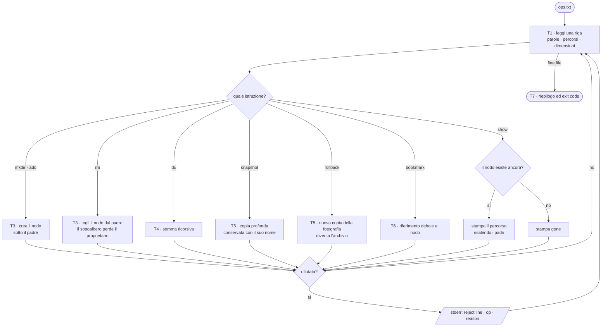
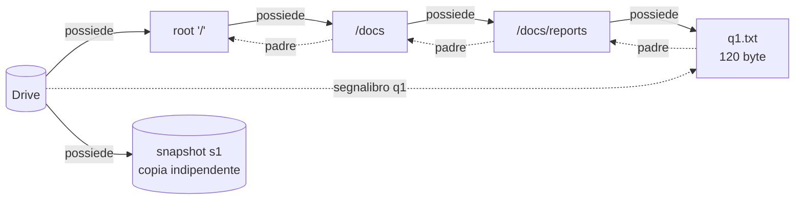
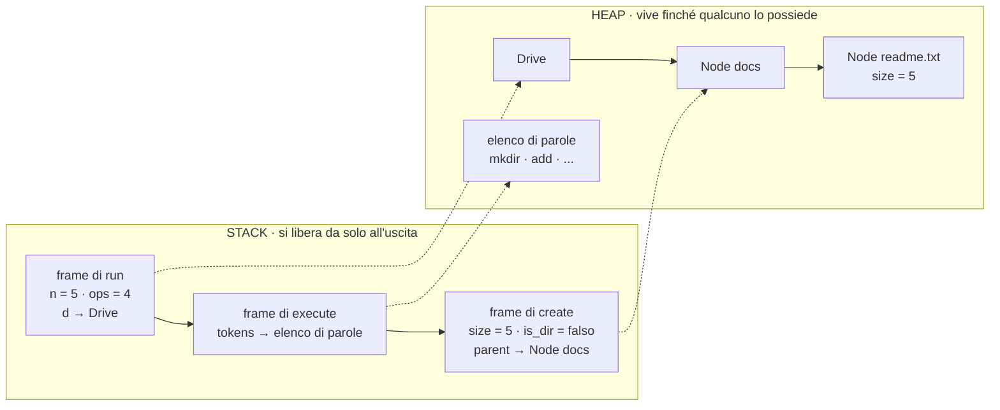
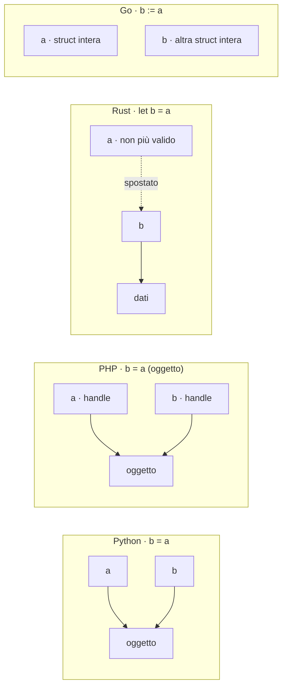

> File C10-parte1.md (parte 1 di 7) — Capitolo C10, Modelli di memoria

# C10 — Modelli di memoria

> **Parte III — Memoria e concorrenza** · 5 lezioni (L10.1–L10.5) · 3 ore e 45 minuti · capitolo con addendum «Il perché della scelta»
> **Stato:** bozza 1 (2026-10-16). Codice eseguito e verificato su PHP 8.3.6, Python 3.13.16, Rust 1.97.0 (`rustc --edition 2024`), Go 1.24.7 (`gofmt -l` vuoto, `go vet` pulito). Baseline del corso: PHP 8.4+, Go 1.25+ (il codice non usa nulla di specifico delle versioni più recenti; da riverificare a stesura finale). Solo libreria standard: nessun pacchetto esterno, nessuna rete. Go richiede il package `weak`, **disponibile dal Go 1.24**: con una versione precedente il programma non compila. Le misure (e9, e12) sono fatte in un ambiente condiviso a 2 core: sono ordini di grandezza, non classifiche.

## Obiettivi

Al termine del capitolo si sa:

1. disegnare **che cosa sta nello stack e che cosa nell'heap** per un frammento di codice, e spiegare perché «valore» e «riferimento» sono due modi di assegnare, non due categorie di dati;
2. distinguere una **copia** da un **secondo nome** per lo stesso oggetto, nei quattro linguaggi, e riconoscere quale copia è superficiale (*shallow*) e quale profonda (*deep*);
3. spiegare i due modi di recuperare la memoria — **reference counting** (PHP, CPython) e **tracing garbage collector** (Go, il GC ciclico di Python) — con i loro punti deboli: cicli, pause, non determinismo;
4. spiegare **ownership**, **move**, **borrowing** e le regole del *borrow checker* di Rust, e leggere i suoi messaggi d'errore come regole di progettazione, non come ostacoli;
5. scegliere con criterio tra `Box`, `Rc`, `Arc`, `RefCell`, `Weak` e i loro equivalenti (riferimenti deboli di Python, PHP e Go), sapendo che cosa costa ciascuno;
6. leggere i **lifetime** (`'a`) come la dichiarazione di *quanto a lungo vale un riferimento*, e capire quando il compilatore li deduce da solo;
7. usare l'**escape analysis** di Go (`-gcflags=-m`), il **copy-on-write** e le **reference** di PHP, e la **mutabilità condivisa** di Python con i loro trabocchetti reali;
8. stimare il **costo in memoria** di un record nei quattro linguaggi e il costo di un garbage collector su un carico che alloca molto.

Prerequisiti: C02 (valori, tipi, assenza di valore), C04 (passaggio degli argomenti, closure che catturano l'ambiente, profondità di ricorsione, e6), C05 (alias e copia di collezioni, crescita della capacità, e1/e2), C06 (record e invarianti), C07 (interfacce, `Box<dyn Trait>`, receiver per valore e per puntatore in Go), C09 (rilascio deterministico delle risorse: `finally`, `with`, `defer`, `Drop`: qui se ne vede la causa). Per chi viene dalla Parte P: CP3 (leggere un errore del compilatore) e CP2 (tracing manuale dello stato); gli esperimenti sono brevi e riportano l'output reale.

**Percorso per l'ingresso A (formato «primario + lettura»).** Scrivi il programma nel linguaggio primario e leggi gli altri tre con le tabelle di confronto. Il tema è astratto, ma tutti gli esperimenti si riducono a una domanda: «chi tiene in vita questo oggetto, e quando smette?». Se parti da zero, esegui prima e1 (copia o secondo nome?), e2 (il contatore dei riferimenti) ed e4 (l'ordine in cui le cose vengono chiuse); poi leggi L10.1 e L10.2 e lascia L10.3–L10.4 al secondo giro: la parte su Rust è la più ripida del corso.

## Il problema reale

> Un'agenzia condivide con i clienti un piccolo archivio di documenti: cartelle e file, dei quali conta soltanto la dimensione in byte. Un addetto scrive un file di istruzioni, `ops.txt`, una per riga. Può **creare** cartelle e file, **rimuovere** un file o una cartella con tutto ciò che contiene, chiedere **quanto spazio occupa** una cartella (dimensione totale e numero di elementi). Prima di una modifica rischiosa può **fotografare** l'archivio (*snapshot*) con un nome, e **tornare indietro** a quella fotografia (*rollback*) se la modifica va male; la fotografia resta valida e si può riusare. Può infine mettere un **segnalibro** su un file o una cartella, per ritrovarlo senza ricordarne il percorso. Un segnalibro però **non deve tenere in vita** ciò che indica: se l'elemento viene rimosso, o se l'archivio viene riportato a una fotografia che non lo contiene più, il segnalibro deve rispondere «scomparso», non mostrare un file che non esiste più. Per un segnalibro ancora valido il programma stampa il **percorso completo** dell'elemento.

Come negli altri capitoli il problema è un pretesto: contiene, in piccolo, i quattro problemi di memoria che si incontrano in qualunque sistema reale.

| Bisogno | Domanda | Dove nel capitolo |
|---|---|---|
| Ogni elemento ha un **proprietario** | «Chi tiene in vita la cartella `/docs`? Che cosa succede ai suoi figli quando la rimuovo?» | L10.1, L10.3 |
| Una fotografia è una **copia vera**, non un secondo nome | «Come faccio a modificare l'archivio senza alterare la fotografia? Che cosa copia davvero `b = a`?» | L10.1, L10.3 |
| Un riferimento che **non possiede** | «Come faccio a ritrovare un nodo (segnalibro) o a risalire al padre senza impedirne la liberazione? Che cosa succede con un riferimento circolare?» | L10.2, L10.4 |
| **Quando** e **da chi** viene liberata la memoria | «Il nodo rimosso è già sparito, o sparirà «prima o poi»? Chi lo decide: io, il compilatore, il runtime?» | L10.2, L10.5 |

### Le istruzioni

Le istruzioni sono parole separate da spazi; le righe vuote e quelle che iniziano con `#` sono saltate. Un percorso è `/` oppure `/` seguito da nomi separati da `/`; sono rifiutati i nomi vuoti, `.` e `..`. Una dimensione è fatta di sole cifre ASCII (al massimo 12). Ogni istruzione rifiutata ha un **motivo**, scritto su *stderr*.

| Istruzione | Effetto | Motivi di rifiuto |
|---|---|---|
| `mkdir PERCORSO` | crea una cartella; il padre deve esistere ed essere una cartella | `path`, `exists`, `no_parent`, `not_dir` |
| `add PERCORSO DIMENSIONE` | crea un file con quella dimensione | `path`, `size`, `exists`, `no_parent`, `not_dir` |
| `rm PERCORSO` | rimuove un file o una cartella **con tutto il suo contenuto** | `path`, `root`, `no_such` |
| `du PERCORSO` | stampa dimensione totale e numero di nodi del sottoalbero | `path`, `no_such` |
| `snapshot NOME` | salva una **copia indipendente** dell'archivio | `dup_snapshot` |
| `rollback NOME` | sostituisce l'archivio con una **copia** della fotografia | `no_snapshot` |
| `bookmark NOME PERCORSO` | memorizza un riferimento **debole** al nodo | `path`, `no_such` |
| `show NOME` | stampa `alive path=…` oppure `gone` | `no_bookmark` |
| qualunque altra cosa | — | `syntax` |

Il file di prova `ops.txt` (37 righe, 35 istruzioni): le righe 2–25 raccontano una sessione normale (creazione, snapshot, segnalibri, rimozione, rollback), con una sola istruzione sbagliata a metà (riga 20, aggiunta in una cartella appena rimossa); le righe 26–37 sono dodici istruzioni sbagliate in modi diversi, apposta, perché ogni motivo di rifiuto compaia almeno una volta.

```text
# drive operations: one per line; '#' lines and blank lines are skipped
mkdir /docs
mkdir /docs/reports
add /docs/reports/q1.txt 120
add /docs/readme.txt 5
du /docs

snapshot s1
bookmark q1 /docs/reports/q1.txt
bookmark rep /docs/reports
add /docs/reports/q2.txt 300
mkdir /tmp
add /tmp/big.bin 900
du /
show q1
rm /docs/reports
show q1
show rep
du /
add /docs/reports/q3.txt 7
rollback s1
du /
show q1
bookmark q1 /docs/reports/q1.txt
show q1
snapshot s1
rollback s9
add /docs/readme.txt 9
add /docs/x.txt -4
add /docs/y.txt many
mkdir /docs/readme.txt/sub
rm /
rm /nope
frobnicate /x
add docs/z.txt 1
show zzz
du /nope
```

### Scomposizione

| Task | Che cosa fa | Concetto protagonista | Lezione |
|---|---|---|---|
| T1 | Legge una riga, la divide in parole, riconosce l'istruzione e valida percorsi e dimensioni | — | — |
| T2 | **Modello**: il nodo (file o cartella) con i figli che *possiede* e il collegamento al padre che *non* possiede | proprietà, riferimento forte e debole | L10.1, L10.4 |
| T3 | **Creare e rimuovere** nodi; la rimozione libera un intero sottoalbero | rilascio, distruzione | L10.2, L10.3 |
| T4 | **Dimensione totale** di un sottoalbero (ricorsione) | stack, profondità | L10.1 |
| T5 | **Snapshot e rollback**: copia profonda dell'albero | copia contro alias, ownership | L10.1, L10.3 |
| T6 | **Segnalibri**: riferimento debole a un nodo; il percorso si ricostruisce risalendo i collegamenti al padre | weak reference, vita di un oggetto | L10.2, L10.4, L10.5 |
| T7 | Riepilogo finale (operazioni, nodi, segnalibri vivi e scomparsi) ed exit code (0 = tutto ok, 1 = ci sono rifiuti, 2 = file mancante) | — | — |



Il **grafo degli oggetti** dopo `mkdir /docs`, `mkdir /docs/reports`, `add /docs/reports/q1.txt 120` e `bookmark q1 /docs/reports/q1.txt`. La freccia piena è «possiede» (tiene in vita), quella tratteggiata è «sa dove si trova, ma non lo tiene in vita». Questo disegno è la chiave di tutto il capitolo: ogni linguaggio realizza le frecce piene e tratteggiate con un meccanismo diverso.



### Il programma, in anteprima

Output atteso (stdout, poi stderr) ed exit code. È **identico nei quattro linguaggi** (confrontato con `diff` su stdout, stderr ed exit code); il codice completo è nell'appendice. Si eseguono con `main ops.txt`.

```text
du /docs size=125 nodes=4
du / size=1325 nodes=8
show q1 alive path=/docs/reports/q1.txt
show q1 gone
show rep gone
du / size=905 nodes=5
du / size=125 nodes=5
show q1 gone
show q1 alive path=/docs/reports/q1.txt
ops=35 applied=22 rejected=13 nodes=5 snapshots=1 bookmarks_alive=1 bookmarks_gone=1
[exit 1]
```

Su stderr (13 rifiuti, nell'ordine del file):

```text
reject line=20 op=add reason=no_parent
reject line=26 op=snapshot reason=dup_snapshot
reject line=27 op=rollback reason=no_snapshot
reject line=28 op=add reason=exists
reject line=29 op=add reason=size
reject line=30 op=add reason=size
reject line=31 op=mkdir reason=not_dir
reject line=32 op=rm reason=root
reject line=33 op=rm reason=no_such
reject line=34 op=frobnicate reason=syntax
reject line=35 op=add reason=path
reject line=36 op=show reason=no_bookmark
reject line=37 op=du reason=no_such
```

Alcune letture da fare subito. Dopo `rm /docs/reports` entrambi i segnalibri (`q1` e `rep`) rispondono `gone`: il sottoalbero è sparito e nessuno lo tiene in vita. Dopo `rollback s1`, `q1` è ancora `gone` anche se `/docs/reports/q1.txt` **esiste di nuovo**: il segnalibro puntava al *vecchio* nodo, non al percorso; la fotografia contiene una copia, un nodo diverso. Il nuovo `bookmark q1` ci porta di nuovo a `alive`. Infine l'ultima riga mostra `bookmarks_alive=1 bookmarks_gone=1`: i segnalibri tengono un riferimento che *non pesa* sulla vita dei nodi.

---
## L10.1 — Stack, heap, valori e riferimenti

### Concetto

Un programma in esecuzione usa due zone di memoria con regole opposte.

| | **Stack** | **Heap** |
|---|---|---|
| Che cosa contiene | i **frame di chiamata**: variabili locali e parametri di ogni funzione attiva, indirizzi di ritorno | blocchi richiesti **dinamicamente** (`new`, `Box::new`, `make`, ogni oggetto Python) |
| Dimensione dei dati | nota a tempo di compilazione (o almeno al momento della chiamata) | qualunque, anche crescente (una lista che si allunga) |
| Quando nasce e muore | entra con la chiamata, **esce con la chiamata**, in ordine inverso (LIFO) | nasce quando lo si chiede; muore quando **qualcuno** lo libera |
| Chi libera | nessuno: basta spostare un puntatore | il programmatore (C), il compilatore (Rust), il runtime (PHP, Python, Go) |
| Costo | quasi zero | più alto: serve un allocatore che cerchi un blocco libero, e poi un modo di sapere quando restituirlo |
| Limite | piccolo e fisso (qualche MB per thread): lo si supera con la ricorsione profonda | la memoria della macchina |

La domanda che attraversa tutto il capitolo è una sola: **un dato nell'heap, chi lo tiene in vita, e quando smette?** Sullo stack la risposta è automatica (quando la funzione ritorna); nell'heap è una scelta di progetto del linguaggio, ed è la cosa che più distingue PHP, Python, Rust e Go.

Il disegno qui sotto mostra, per il comando `add /docs/readme.txt 5`, che cosa c'è nello stack e che cosa nell'heap in un'esecuzione tipica. I nomi dei frame sono quelli del programma del capitolo; i valori sono di esempio.



Le frecce tratteggiate sono **riferimenti**: valori sullo stack che contengono l'indirizzo di un blocco nell'heap. Quando `create` ritorna, il suo frame sparisce, ma `Node readme.txt` resta: è stato inserito tra i figli di `Node docs`, che è nel `Drive`. Il padrone del nodo non è la funzione che l'ha creato, è il suo padre.

#### Valore e riferimento: che cosa copia un'assegnazione?

Il punto di partenza di ogni confusione sulla memoria è una riga banale: `b = a`. Che cosa succede? Dipende dal linguaggio **e dal tipo di dato**. Le due politiche estreme sono:

- **semantica di valore** (*value semantics*): `b = a` duplica il contenuto; `a` e `b` sono indipendenti. È la regola degli interi, degli array e delle struct in Go, dei tipi `Copy` in Rust;
- **semantica di riferimento** (*reference semantics*): `b = a` duplica soltanto l'**indirizzo**; `a` e `b` sono due nomi dello stesso oggetto. È la regola di Python per tutto, degli oggetti in PHP, delle struct in Go se si usa un puntatore.

Rust aggiunge una terza via, che occupa tutta L10.3: `b = a` **sposta** (*move*) il contenuto, e `a` non si può più usare.

| `b = a` quando `a` è… | PHP | Python | Rust | Go |
|---|---|---|---|---|
| un intero | copia | secondo nome (ma l'intero è immutabile: non si nota) | copia (`Copy`) | copia |
| una struct / un oggetto | **handle** copiato: due nomi, un oggetto | secondo nome | **move** (se non è `Copy`); `clone()` per duplicare | **copia** dell'intera struct |
| un array / una lista | **copia logica** (copy-on-write: copia fisica alla prima scrittura) | secondo nome | move; `clone()` per duplicare | array: copia; slice: copia dell'intestazione, **memoria condivisa** (C05) |
| per condividere esplicitamente | `&` (reference), oggetti | — (già così) | `&T`, `&mut T`, `Rc<T>` | `*T`, slice, map |
| per duplicare esplicitamente | `clone`, `unserialize(serialize())` | `copy.copy`, `copy.deepcopy` | `.clone()` | assegnazione, `slices.Clone`, copia a mano |



Un riepilogo per la memoria: in **Python** e PHP-oggetti si copia l'indirizzo; in **Go** si copia il contenuto (e l'indirizzo si copia solo se lo si scrive: `&a`); in **Rust** il contenuto viene spostato e il vecchio nome smette di esistere. Tre risposte alla stessa riga di codice. L'esperimento e1 le fa vedere tutte, una accanto all'altra.

### Implementazione: il modello dei nodi (T2)

Il nodo ha un nome, una dimensione, un'etichetta file/cartella, i **figli** (una mappa nome → nodo) e un collegamento al **padre**. Le due direzioni hanno **semantica opposta**: dall'alto in basso il padre *possiede* i figli (se il padre sparisce, spariscono anche loro); dal basso in alto il figlio *conosce* il padre ma non lo possiede (altrimenti padre e figlio si terrebbero in vita a vicenda: è un ciclo, tema di L10.2). Il segnalibro, nel `Drive`, è un riferimento dello stesso tipo del collegamento al padre.

**Python**

```python
class Node:
    """T2 - a file or a directory. Children are OWNED (strong references); the parent link is WEAK."""

    __slots__ = ("name", "size", "is_dir", "children", "parent", "__weakref__")

    def __init__(self, name: str, is_dir: bool, size: int = 0, parent: "Node | None" = None) -> None:
        self.name = name
        self.size = size
        self.is_dir = is_dir
        self.children: dict[str, Node] = {}
        self.parent: weakref.ref[Node] | None = weakref.ref(parent) if parent is not None else None
```

**PHP**

```php
/** T2 - a file or a directory. Children are OWNED (array of strong references); the parent link is WEAK. */
final class Node
{
    /** @var array<string, Node> */
    public array $children = [];
    public ?WeakReference $parent;

    public function __construct(
        public readonly string $name,
        public readonly bool $isDir,
        public readonly int $size = 0,
        ?Node $parent = null,
    ) {
        $this->parent = $parent !== null ? WeakReference::create($parent) : null;
    }
}
```

**Rust**

```rust
type Link = Rc<RefCell<Node>>;

/// T2 - a file or a directory. Children are OWNED (Rc, strong); the parent link is WEAK.
struct Node {
    name: String,
    size: u64,
    is_dir: bool,
    children: BTreeMap<String, Link>,
    parent: Weak<RefCell<Node>>,
}

fn new_node(name: &str, is_dir: bool, size: u64, parent: Weak<RefCell<Node>>) -> Link {
    Rc::new(RefCell::new(Node { name: name.to_string(), size, is_dir, children: BTreeMap::new(), parent }))
}
```

**Go**

```go
// Node is T2 - a file or a directory. There is no "owner" in the type: the garbage collector keeps
// alive whatever is reachable. The parent link is an ordinary pointer: a cycle is not a problem for a tracing GC.
type Node struct {
	name     string
	size     int
	isDir    bool
	children map[string]*Node
	parent   *Node
}

func newNode(name string, isDir bool, size int, parent *Node) *Node {
	return &Node{name: name, size: size, isDir: isDir, children: map[string]*Node{}, parent: parent}
}
```


Che cosa fa ciascun linguaggio:

- **Python:** `children` è un `dict` di riferimenti **forti** ai nodi figli: finché un nodo compare lì dentro, resta vivo. `parent` è un `weakref.ref`, un oggetto che sa ritrovare il padre ma **non incrementa il suo contatore di riferimenti**; chiamarlo (`node.parent()`) restituisce il padre o `None` se non esiste più. `__slots__` toglie il dizionario interno dell'istanza (e9: circa 40 byte risparmiati per oggetto) ma, se si vuole poter creare riferimenti deboli, bisogna elencare `"__weakref__"` a mano.
- **PHP:** `children` è un array (valore con copy-on-write, ma gli oggetti che contiene sono handle); `parent` è un `WeakReference`, con `->get()` che restituisce il padre o `null`. `readonly` rende immutabili nome, dimensione e tipo del nodo (C06).
- **Rust:** `Rc<RefCell<Node>>` è il costrutto più denso del capitolo. `Rc` (*reference counted*) permette più proprietari dello stesso valore; `RefCell` permette di **modificarlo** pur avendo più proprietari, spostando il controllo delle regole di prestito da compile time a **runtime** (L10.4). `children` possiede i figli (`BTreeMap<String, Link>`); `parent` è un `Weak`, che non aumenta il contatore forte. `Weak::new()` è il «nessun padre» della radice.
- **Go:** `children` è `map[string]*Node`, `parent` è un normale `*Node`. Non c'è alcuna distinzione tra «possiede» e «conosce»: **in Go non esiste la nozione di proprietario**; il GC tiene vivo ciò che è raggiungibile da qualche radice, e un ciclo di puntatori non è un problema (e3). La distinzione tra forte e debole compare solo nei segnalibri, con `weak.Pointer`.

Nessuno dei quattro linguaggi mette questo nodo sullo stack: Python e PHP creano sempre oggetti nell'heap; `Rc::new` e `BTreeMap` allocano nell'heap; in Go è l'**escape analysis** a decidere (L10.5), e per un nodo che entra in una mappa la risposta è «heap».

### Implementazione: dimensione di un sottoalbero (T4) e la profondità dello stack

`du` somma la dimensione e conta i nodi di un sottoalbero. È naturalmente **ricorsiva**: la somma di un nodo è la sua dimensione più la somma dei figli. Ogni chiamata ricorsiva occupa un frame sullo stack; la profondità massima è l'altezza dell'albero.

**Python**

```python
def du(node: Node) -> tuple[int, int]:
    """T4 - (total size, number of nodes) of a subtree, by recursion."""
    size, count = node.size, 1
    for child in node.children.values():
        s, c = du(child)
        size += s
        count += c
    return size, count
```

**PHP**

```php
/** T4 - [total size, number of nodes] of a subtree, by recursion. */
function du(Node $node): array
{
    $size = $node->size;
    $count = 1;
    foreach ($node->children as $child) {
        [$s, $c] = du($child);
        $size += $s;
        $count += $c;
    }
    return [$size, $count];
}
```

**Rust**

```rust
/// T4 - (total size, number of nodes) of a subtree, by recursion.
fn du(node: &Link) -> (u64, u64) {
    let n = node.borrow();
    let (mut size, mut count) = (n.size, 1);
    for child in n.children.values() {
        let (s, c) = du(child);
        size += s;
        count += c;
    }
    (size, count)
}
```

**Go**

```go
// du is T4 - (total size, number of nodes) of a subtree, by recursion.
func du(node *Node) (size, count int) {
	size, count = node.size, 1
	for _, child := range node.children {
		s, c := du(child)
		size += s
		count += c
	}
	return
}
```


Le quattro versioni hanno la stessa forma. La differenza sta in ciò che succede quando l'albero è molto **profondo**: il caso di collaudo `t_deep.txt` crea una catena di 3000 cartelle annidate (`/d/d/d/…`) e chiede `du /`. Lo si vede nel collaudo (più avanti): PHP, Rust e Go rispondono `du / size=0 nodes=3001`; **Python no**, e termina con `RecursionError: maximum recursion depth exceeded`. Non è un difetto del programma: il limite predefinito di CPython è **1000 frame** (`sys.getrecursionlimit()`), un'impostazione dell'interprete che protegge dal *crash* dello stack C. Gli altri tre hanno limiti molto più alti, ma comunque finiti: C04 (e6) li ha misurati (Rust senza ottimizzazioni va in *stack overflow* tra 100 000 e 1 000 000 di livelli su 8 MB di stack; Go cresce lo stack del goroutine fino a 1 GB; PHP usa uno stack di VM nell'heap, quindi è limitato dalla memoria disponibile). La conclusione pratica: **la ricorsione consuma stack, e lo stack è una risorsa piccola**. Per dati la cui profondità non è sotto il tuo controllo (un albero letto da un file, un JSON annidato) si usa uno stack esplicito, cioè una lista nell'heap, oppure si pone un limite di profondità e si rifiuta il dato che lo supera (C14).

Esiste un secondo luogo dove la profondità conta, più subdolo: la **distruzione**. Liberare un albero profondo può richiedere ricorsione anche se nel tuo codice non ce n'è. Lo si vede in L10.4 (e11): in Rust distruggere una catena di un milione di nodi manda in overflow lo stack; in PHP la stessa operazione termina con un *segmentation fault*.

### Esperimento e1 — `b = a`: copia o secondo nome?

La stessa domanda a tutti e quattro i linguaggi: si assegna, si modifica una delle due variabili, si guarda l'altra.

```python
import copy
from dataclasses import dataclass


@dataclass
class Pt:
    x: int
    y: int


a = Pt(1, 2)
b = a  # no copy: a second NAME for the same object
b.x = 9
print("alias    :", a.x, a is b)
c = copy.copy(a)  # a new object
c.x = 5
print("copy     :", a.x, c.x, a is c)

nums = [1, 2]
more = nums
more.append(3)
print("list     :", nums, nums is more)
```

```php
<?php
final class Pt
{
    public function __construct(public int $x, public int $y)
    {
    }
}

$a = new Pt(1, 2);
$b = $a; // copies the HANDLE, not the object
$b->x = 9;
echo "handle   : {$a->x} ", var_export($a === $b, true), "\n";
$c = clone $a;
$c->x = 5;
echo "clone    : {$a->x} {$c->x} ", var_export($a === $c, true), "\n";

$nums = [1, 2];
$more = $nums; // arrays are VALUES: logically a copy
$more[] = 3;
echo 'array    : ', json_encode($nums), ' ', json_encode($more), "\n";

function grow(array $xs): array
{
    $xs[] = 99;
    return $xs;
}
$grown = grow($nums);
echo 'by value : ', json_encode($nums), ' ', json_encode($grown), "\n";
```

```rust
#[derive(Debug, Clone)]
struct Pt {
    x: i32,
    y: i32,
}

#[derive(Debug, Clone, Copy)]
struct Small {
    x: i32,
}

fn main() {
    let a = Pt { x: 1, y: 2 };
    let mut b = a.clone(); // explicit duplicate
    b.x = 9;
    println!("clone    : {} {} y={}", a.x, b.x, a.y);

    let s = Small { x: 1 };
    let mut t = s; // Copy: the bits are duplicated, s stays usable
    t.x = 5;
    println!("copy     : {} {}", s.x, t.x);

    let moved = a; // move: ownership goes to `moved`
    println!("moved    : {:?}", moved);
}
```

```rust
#[derive(Debug)]
struct Pt {
    x: i32,
    y: i32,
}

fn main() {
    let a = Pt { x: 1, y: 2 };
    let b = a; // move
    println!("{:?} {:?}", a, b);
}
```

```go
package main

import "fmt"

type Pt struct{ X, Y int }

func bump(p Pt)     { p.X = 100 }
func bumpPtr(p *Pt) { p.X = 100 }

func main() {
	a := Pt{1, 2}
	b := a // a copy of the whole struct
	b.X = 9
	fmt.Println("copy     :", a.X, b.X)

	p := &a // a pointer: the same struct
	p.X = 7
	fmt.Println("pointer  :", a.X, p == &a)

	bump(a)
	fmt.Println("by value :", a.X)
	bumpPtr(&a)
	fmt.Println("by ptr   :", a.X)

	arr := [3]int{1, 2, 3}
	brr := arr // arrays are values too
	brr[0] = 99
	fmt.Println("array    :", arr, brr)
}
```

```text
### e1.py
alias    : 9 True
copy     : 9 5 False
list     : [1, 2, 3] True
[exit 0]
### e1.php
handle   : 9 true
clone    : 9 5 false
array    : [1,2] [1,2,3]
by value : [1,2] [1,2,99]
[exit 0]
### e1.rs
clone    : 1 9 y=2
copy     : 1 5
moved    : Pt { x: 1, y: 2 }
[exit 0]
### e1bad.rs
e1bad.rs:10:27: error[E0382]: borrow of moved value: `a`: value borrowed here after move
error: aborting due to 1 previous error
[exit 1]
### e1.go
copy     : 1 9
pointer  : 7 true
by value : 7
by ptr   : 100
array    : [1 2 3] [99 2 3]
[exit 0]
```

| Linguaggio | Che cosa succede | Perché |
|---|---|---|
| Python | `b.x = 9` cambia anche `a.x` (`a is b` è `True`); `copy.copy` produce un oggetto nuovo; anche la lista `more` è la stessa lista | `b = a` copia l'**indirizzo**: due nomi, un oggetto |
| PHP | oggetto: `a === b`, la modifica si vede su entrambi; con `clone` no; array: `$more[] = 3` **non** tocca `$nums`, e una funzione che aggiunge un elemento a un array ricevuto non altera quello del chiamante | gli oggetti sono *handle* (l'indirizzo si copia); gli array sono **valori** |
| Rust | `a.clone()` è un duplicato indipendente (`1 9`); `Small` è `Copy`, `s` resta usabile; `let moved = a` sposta; l'uso di `a` dopo lo spostamento è `E0382: borrow of moved value: a` | il compilatore sa chi possiede il valore e vieta l'uso di un nome dopo che la proprietà è passata |
| Go | `b := a` copia la struct (`1 9`); `p := &a` condivide (`a.X` diventa 7); `bump(a)` non cambia nulla (`7`), `bumpPtr(&a)` sì (`100`); anche un **array** si copia (`arr` resta `[1 2 3]`) | Go passa e assegna **sempre per valore**; per condividere si scrive un puntatore |

Il risultato di Go sull'array è un'insidia per chi viene da Python o PHP: `brr := arr` duplica tutti gli elementi, mentre una *slice* (C05) duplica soltanto la sua intestazione di tre parole (puntatore, lunghezza, capacità) e condivide gli elementi. Lo stesso nome di struttura dati, due semantiche opposte.

### Focus comparativo

| Aspetto | PHP | Python | Rust | Go |
|---|---|---|---|---|
| Dove vivono gli oggetti | heap, sempre | heap, sempre | stack per default; heap con `Box`, `Rc`, `Vec`, `String`… | stack o heap, **deciso dal compilatore** (escape analysis) |
| `b = a` su un oggetto | handle copiato | secondo nome | **move** | copia del valore |
| Copia profonda | `clone` + `__clone` a mano | `copy.deepcopy` | `.clone()` (se il tipo lo implementa) | a mano |
| Riferimento debole nel linguaggio | `WeakReference` | `weakref` | `Weak<T>` | package `weak` (1.24) |
| Limite di ricorsione | memoria (VM stack nell'heap) | 1000 frame (configurabile) | stack del thread (8 MB sul thread principale) | stack del goroutine, fino a 1 GB |

### Esercizio Rosetta (4′)

Scrivi una funzione `rename(node, new_name)` che cambia il nome di un nodo, e una `renamed_copy(node, new_name)` che restituisce un **nuovo** nodo con un altro nome senza toccare l'originale. Per ciascun linguaggio rispondi: nella prima, quale tipo ricevi (copia, riferimento, `&mut`, puntatore)? Nella seconda, la copia dei figli è profonda o superficiale? In quale linguaggio il compilatore ti impedisce di usare il vecchio nodo dopo `renamed_copy`?

---
