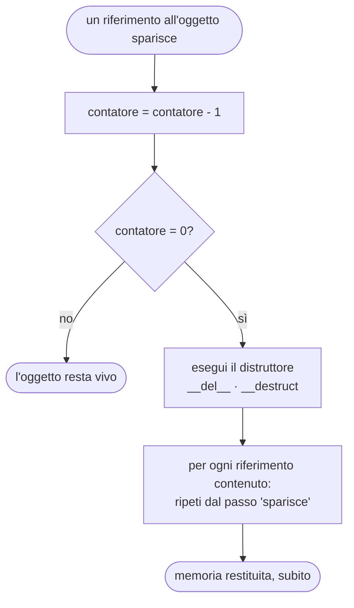
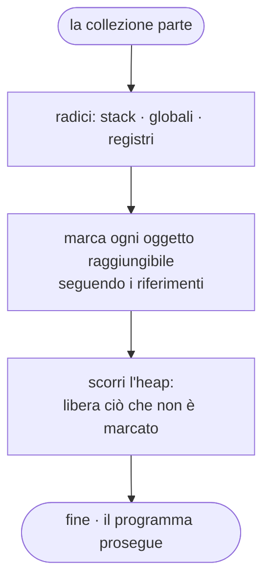
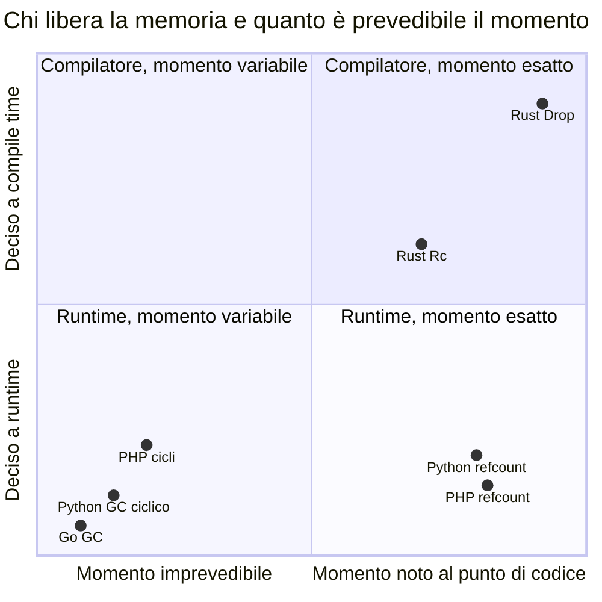

> File C10-parte2.md (parte 2 di 7) — Capitolo C10, Modelli di memoria

## L10.2 — Garbage collection: reference counting e tracing

### Concetto

Lo stack si libera da solo. L'heap no: un blocco allocato resta occupato finché qualcuno non lo restituisce, e le sole strade possibili per restituirlo sono tre.

| Strategia | Chi decide | Esempio | Rischio caratteristico |
|---|---|---|---|
| **Manuale** | il programmatore (`free`) | C | *use-after-free*, doppia liberazione, perdita (*leak*) |
| **Statica (ownership)** | il compilatore, a partire dalla struttura del programma | Rust | l'apprendimento: il compilatore rifiuta ciò che non sa dimostrare |
| **Automatica (garbage collection)** | il runtime, mentre il programma gira | PHP, Python, Go | costo a runtime, momento della liberazione non (sempre) prevedibile |

La terza strategia ha **due famiglie** con proprietà quasi opposte, e capire quale si sta usando spiega la maggior parte dei comportamenti sorprendenti.

#### Reference counting

Ogni oggetto porta un **contatore** di quanti riferimenti forti lo raggiungono. Assegnare un riferimento incrementa il contatore; perdere un nome (uscita dallo scope, riassegnazione, rimozione da una collezione) lo decrementa. Quando arriva a **zero**, nessuno può più raggiungere l'oggetto: lo si libera **subito**, e per ciascun riferimento che l'oggetto conteneva si ripete il ragionamento (cascata).



| Proprietà | Valutazione |
|---|---|
| **Determinismo** | la liberazione avviene *nel punto* in cui si perde l'ultimo riferimento: un distruttore (`__del__`, `__destruct`) gira in un momento prevedibile |
| **Latenza** | la memoria torna disponibile appena non serve; nessuna pausa «globale» |
| **Costo** | un incremento e un decremento a **ogni** copia di riferimento, anche quando non succede nulla; con più thread i contatori devono essere atomici (più lenti) |
| **Debolezza** | i **cicli**: due oggetti che si riferiscono a vicenda hanno ciascuno contatore ≥ 1 per sempre, anche se nessuno dall'esterno li raggiunge più |
| Altra debolezza | la cascata di liberazioni può essere lunga o profonda (e11) |

#### Tracing garbage collector

Invece di contare, **si cerca**. A intervalli il runtime parte dalle **radici** (*roots*: le variabili sullo stack, i globali, i registri), segue ogni riferimento e **marca** tutto ciò che raggiunge; ciò che non è marcato è irraggiungibile, quindi liberabile (*sweep*).



| Proprietà | Valutazione |
|---|---|
| **Determinismo** | nessuno: l'oggetto non è liberato quando diventa irraggiungibile, ma alla prossima collezione. Un distruttore non ha un momento garantito (Go non offre distruttori) |
| **Cicli** | non sono un problema: un ciclo irraggiungibile dalle radici non viene marcato, quindi viene liberato (e3) |
| **Costo** | assegnare un riferimento non costa nulla; il lavoro si concentra nella collezione, proporzionale agli oggetti **vivi** (si marcano solo quelli) |
| **Debolezza** | pause o lavoro concorrente che sottrae CPU al programma; la memoria usata è più grande di quella strettamente necessaria (serve margine fra una collezione e l'altra, e12) |

Le varianti reali combinano le idee. **Generazionale:** gli oggetti nuovi muoiono giovani, quindi si ispezionano più spesso quelli recenti (il GC ciclico di CPython ha tre generazioni; sulla 3.13 usata qui la soglia della prima è 2000 allocazioni nette, e3). **Concorrente:** gran parte del lavoro avviene mentre il programma continua a girare (Go: *mark-sweep* concorrente, senza compattazione né generazioni, con un parametro, `GOGC`, che dice di quanto può crescere l'heap tra una collezione e l'altra: il default è 100, cioè fino al doppio della memoria viva).

#### I quattro linguaggi

| | PHP | Python (CPython) | Rust | Go |
|---|---|---|---|---|
| Strategia di base | reference counting | reference counting | **nessun GC**: ownership; `Rc`/`Arc` sono refcount *opt-in* | tracing, concorrente |
| Cicli | *cycle collector* a parte, innescato da una soglia di radici possibili (`gc_status()['threshold']`: 10001) o da `gc_collect_cycles()` | GC ciclico generazionale, soglie `gc.get_threshold()` = (2000, 10, 10) | un ciclo di `Rc` **non viene mai liberato** (e3): si evita con `Weak` | automatico: i cicli non sono un problema |
| Quando gira un distruttore | subito, a contatore zero | subito, a contatore zero (dettaglio di **CPython**, non del linguaggio) | `Drop`, in un punto noto a compile time | **nessun distruttore**: `defer`, `Close`, e `runtime.AddCleanup` senza garanzie di momento |
| Riferimento debole | `WeakReference` | `weakref.ref` | `Weak<T>` | `weak.Pointer[T]` (Go 1.24) |
| Controllo del programmatore | `gc_disable()`, `gc_collect_cycles()` | `gc.disable()`, `gc.collect()` | — | `GOGC`, `runtime.GC()`, `debug.SetGCPercent` |



Il grafico non è una misura, è una mappa: l'asse orizzontale dice se, guardando una riga di codice, si può dire «qui l'oggetto muore»; quello verticale dice chi ha preso la decisione.

#### Riferimenti deboli

Un **riferimento debole** (*weak reference*) è un riferimento che *non conta*: non impedisce la liberazione dell'oggetto, e quando l'oggetto viene liberato il riferimento «si azzera» (`None`, `null`, `None`, `nil`). Servono dove si vuole **conoscere** un oggetto senza **possederlo**: il collegamento dal figlio al padre, un segnalibro, una cache che non deve trattenere nulla, un elenco di osservatori. In questo capitolo ne servono due usi: il padre (per evitare cicli nei linguaggi a refcount) e il segnalibro (perché il contratto dice che non deve tenere in vita ciò che indica).

La domanda sensata per ciascun linguaggio è **quando** il riferimento debole si azzera: in Python, PHP e Rust, subito dopo la perdita dell'ultimo riferimento forte (se non ci sono cicli); in Go, **alla collezione successiva**, ed è la ragione per cui il programma chiama `runtime.GC()` prima di rispondere a `show`.

### Implementazione: rimozione (T3) e segnalibri (T6)

`rm` toglie il nodo dalla mappa dei figli del padre. Da quel momento il sottoalbero non ha più un proprietario.

**Python**

```python
def remove(self, path: str) -> str | None:
    """T3 - remove a file or a whole subtree."""
    parts = split_path(path)
    if parts is None:
        return "path"
    if not parts:
        return "root"
    parent = lookup(self.root, parts[:-1])
    if parent is None or parts[-1] not in parent.children:
        return "no_such"
    del parent.children[parts[-1]]  # the subtree loses its owner: it is freed right here
    return None
```

**PHP**

```php
/** T3 - remove a file or a whole subtree. */
public function remove(string $path): ?string
{
    $parts = splitPath($path);
    if ($parts === null) {
        return 'path';
    }
    if ($parts === []) {
        return 'root';
    }
    $name = $parts[count($parts) - 1];
    $parent = lookup($this->root, array_slice($parts, 0, -1));
    if ($parent === null || !isset($parent->children[$name])) {
        return 'no_such';
    }
    unset($parent->children[$name]); // the subtree loses its owner: it is freed right here
    return null;
}
```

**Rust**

```rust
/// T3 - remove a file or a whole subtree.
fn remove(&mut self, path: &str) -> Option<&'static str> {
    let Some(parts) = split_path(path) else { return Some("path") };
    let Some((name, dir)) = parts.split_last() else { return Some("root") };
    let Some(parent) = lookup(&self.root, dir) else { return Some("no_such") };
    // `remove` hands the owner back; dropping it frees the whole subtree right here
    let removed = parent.borrow_mut().children.remove(*name);
    if removed.is_none() { Some("no_such") } else { None }
}
```

**Go**

```go
// remove is T3 - remove a file or a whole subtree.
func (d *Drive) remove(path string) string {
	parts, ok := splitPath(path)
	if !ok {
		return "path"
	}
	if len(parts) == 0 {
		return "root"
	}
	name := parts[len(parts)-1]
	parent := lookup(d.root, parts[:len(parts)-1])
	if parent == nil {
		return "no_such"
	}
	if _, found := parent.children[name]; !found {
		return "no_such"
	}
	delete(parent.children, name) // the subtree becomes unreachable: the GC will free it, but WHEN is not ours to say
	return ""
}
```


Che cosa succede, passo per passo, nei quattro linguaggi:

- **Python:** `del parent.children[name]` rimuove l'unico riferimento forte al nodo; il contatore va a zero, il nodo viene liberato **in quella riga**, con la cascata sui suoi figli. I figli avevano un riferimento debole al padre: nessun ciclo, nessun resto.
- **PHP:** `unset($parent->children[$name])` fa lo stesso con il contatore di Zend; il distruttore, se ci fosse, girerebbe in quel punto.
- **Rust:** `children.remove(*name)` **restituisce** il proprietario (`Option<Link>`); nel codice è assegnato a `removed`, che esce dallo scope subito dopo. Il `Drop` di `Rc` decrementa il contatore forte, che va a zero: il nodo e la sua mappa di figli vengono distrutti uno dopo l'altro. Qui è visibile nel *tipo* ciò che negli altri tre è implicito: `remove` consegna la proprietà al chiamante, che la lascia cadere.
- **Go:** `delete(parent.children, name)` elimina il riferimento dalla mappa; il sottoalbero diventa **irraggiungibile**, non «liberato». Quando verrà liberato lo decide il GC. Il commento nel codice lo dice: *«WHEN is not ours to say»*.

Il segnalibro è un riferimento debole. `show` lo interroga:

**Python**

```python
def bookmark(self, name: str, path: str) -> str | None:
    """T6 - a bookmark is a WEAK handle: it finds the node again without keeping it alive."""
    parts = split_path(path)
    if parts is None:
        return "path"
    node = lookup(self.root, parts)
    if node is None:
        return "no_such"
    self.bookmarks[name] = weakref.ref(node)  # a weak handle: it does not keep the node alive
    return None

def show(self, name: str) -> str | None:
    ref = self.bookmarks.get(name)
    if ref is None:
        return "no_bookmark"
    node = ref()
    print(f"show {name} alive path={full_path(node)}" if node is not None else f"show {name} gone")
    return None
```

**PHP**

```php
/** T6 - a bookmark is a WEAK handle: it finds the node again without keeping it alive. */
public function bookmark(string $name, string $path): ?string
{
    $parts = splitPath($path);
    if ($parts === null) {
        return 'path';
    }
    $node = lookup($this->root, $parts);
    if ($node === null) {
        return 'no_such';
    }
    $this->bookmarks[$name] = WeakReference::create($node); // a weak handle: it does not keep the node alive
    return null;
}

public function show(string $name): ?string
{
    $ref = $this->bookmarks[$name] ?? null;
    if ($ref === null) {
        return 'no_bookmark';
    }
    $node = $ref->get();
    echo $node !== null ? "show $name alive path=" . fullPath($node) . "\n" : "show $name gone\n";
    return null;
}
```

**Rust**

```rust
/// T6 - a bookmark is a WEAK handle: it finds the node again without keeping it alive.
fn bookmark(&mut self, name: &str, path: &str) -> Option<&'static str> {
    let Some(parts) = split_path(path) else { return Some("path") };
    let Some(node) = lookup(&self.root, &parts) else { return Some("no_such") };
    self.bookmarks.insert(name.to_string(), Rc::downgrade(&node)); // a weak handle: it does not keep the node alive
    None
}

fn show(&self, name: &str) -> Option<&'static str> {
    let Some(weak) = self.bookmarks.get(name) else { return Some("no_bookmark") };
    match weak.upgrade() {
        Some(node) => println!("show {name} alive path={}", full_path(&node)),
        None => println!("show {name} gone"),
    }
    None
}
```

**Go**

```go
// bookmark is T6 - a WEAK handle: it finds the node again without keeping it alive.
func (d *Drive) bookmark(name, path string) string {
	parts, ok := splitPath(path)
	if !ok {
		return "path"
	}
	node := lookup(d.root, parts)
	if node == nil {
		return "no_such"
	}
	d.bookmarks[name] = weak.Make(node) // a weak handle: it does not keep the node alive
	return ""
}

func (d *Drive) show(name string) string {
	ptr, ok := d.bookmarks[name]
	if !ok {
		return "no_bookmark"
	}
	runtime.GC() // a weak pointer is cleared only when a collection runs: force one so that the answer is deterministic
	if node := ptr.Value(); node != nil {
		fmt.Printf("show %s alive path=%s\n", name, fullPath(node))
	} else {
		fmt.Printf("show %s gone\n", name)
	}
	return ""
}
```


- **Python:** `weakref.ref(node)` crea l'oggetto riferimento; `ref()` restituisce il nodo o `None`. Per l'interprete è un oggetto vero, che occupa memoria propria (80 byte con `sys.getsizeof`), ma non incrementa il contatore del nodo; chiamare `weakref.ref` due volte sullo stesso oggetto restituisce lo **stesso** oggetto riferimento.
- **PHP:** `WeakReference::create($node)` e `$ref->get()`; stessa idea. (Provato: in PHP due chiamate a `WeakReference::create` sullo stesso oggetto restituiscono la stessa istanza.)
- **Rust:** `Rc::downgrade(&node)` produce un `Weak`; `weak.upgrade()` restituisce `Option<Rc<…>>`: **il tipo obbliga a gestire il caso «scomparso»**, perché `Some` e `None` sono entrambi valori da trattare (C02, C03). Un `Weak` mantiene viva l'*allocazione* (il blocco con i contatori) ma non il *valore*: dopo che il contatore forte è a zero, il valore è già stato distrutto.
- **Go:** `weak.Make(node)` crea un `weak.Pointer[Node]`; `ptr.Value()` restituisce `*Node` o `nil`. Il `runtime.GC()` prima di `Value()` forza una collezione, perché **un weak pointer si azzera soltanto quando un ciclo di GC trova l'oggetto irraggiungibile**. Senza quella riga il risultato sarebbe corretto *prima o poi*, ma non riproducibile: lo stesso programma a volte direbbe `alive` e a volte `gone`.

#### Perché il collegamento al padre è debole

Se il padre fosse un riferimento forte, ogni coppia padre-figlio sarebbe un ciclo: il padre possiede il figlio (mappa dei figli) e il figlio possiede il padre (collegamento). Conseguenze, per linguaggio:

| Linguaggio | Con `parent` **forte** | Con `parent` **debole** (il programma) |
|---|---|---|
| Python | dopo `rm`, il sottoalbero non sparisce subito: aspetta il GC ciclico. `show` direbbe `alive` per un nodo non più nell'archivio, finché una collezione non lo libera (e3, caso A) | liberazione immediata, `gone` deterministico (e3, caso B) |
| PHP | idem, con il *cycle collector* | immediata |
| Rust | **perdita permanente**: i contatori restano a 1, nessun `Drop`, la memoria non torna mai (e3, caso A) | `Drop` a catena (e3, caso B) |
| Go | nessun problema: il GC traccia, e il ciclo irraggiungibile viene liberato (e3, Go) | stessa cosa |

### Esperimento e2 — il contatore dei riferimenti, visibile

CPython ha `sys.getrefcount`; PHP ha `debug_zval_dump`; Rust ha `Rc::strong_count`. Go non ha nulla da mostrare: non conta.

```python
import sys

class Obj:
    pass

a = Obj()
print("one name        :", sys.getrefcount(a) - 1)  # -1: the argument of getrefcount is itself a reference
b = a
print("two names       :", sys.getrefcount(a) - 1)
holder = [a, a]
print("plus a list x2  :", sys.getrefcount(a) - 1)
del b, holder
print("names removed   :", sys.getrefcount(a) - 1)
print("small ints are shared (immortal in 3.12+):", sys.getrefcount(1) > 1000, "| refcount of 1:", sys.getrefcount(1))
```

```php
<?php
final class Obj
{
}

$a = new Obj();
debug_zval_dump($a);
$b = $a;
debug_zval_dump($a);
$list = [$a, $a];
debug_zval_dump($a);
unset($b, $list);
debug_zval_dump($a);
$s = str_repeat('x', 3) . (string) mt_rand(1, 1); // a runtime string, not an interned literal
$t = $s;
debug_zval_dump($s);
debug_zval_dump('literal');
```

```rust
use std::rc::Rc;

fn main() {
    let a = Rc::new(String::from("shared"));
    println!("one owner        : strong={} weak={}", Rc::strong_count(&a), Rc::weak_count(&a));
    let b = Rc::clone(&a); // NOT a deep copy: a second owner of the same allocation
    println!("two owners       : strong={} ptr_eq={}", Rc::strong_count(&a), Rc::ptr_eq(&a, &b));
    let w = Rc::downgrade(&a);
    println!("plus a weak      : strong={} weak={}", Rc::strong_count(&a), Rc::weak_count(&a));
    drop(b);
    println!("one owner left   : strong={}", Rc::strong_count(&a));
    drop(a);
    println!("all owners gone  : upgrade={:?}", w.upgrade());
}
```

```text
### e2.py
one name        : 1
two names       : 2
plus a list x2  : 4
names removed   : 1
small ints are shared (immortal in 3.12+): True | refcount of 1: 4294967295
[exit 0]
### e2.php
object(Obj)#1 (0) refcount(2){
}
object(Obj)#1 (0) refcount(3){
}
object(Obj)#1 (0) refcount(5){
}
object(Obj)#1 (0) refcount(2){
}
string(4) "xxx1" refcount(3)
string(7) "literal" interned
[exit 0]
### e2.rs
one owner        : strong=1 weak=0
two owners       : strong=2 ptr_eq=true
plus a weak      : strong=2 weak=1
one owner left   : strong=1
all owners gone  : upgrade=None
[exit 0]
```

Letture. In Python e PHP il numero stampato è **uno in più** del reale, perché passare l'oggetto alla funzione che lo conta crea un riferimento temporaneo (per questo il codice sottrae 1; la riga PHP `refcount(2)` con un solo nome significa «uno»). Si vede che una lista con due volte lo stesso oggetto lo conta due volte (`plus a list x2: 4` → 1 nome + `b` + 2 posti nella lista), e che togliere i nomi riporta a 1. Due dettagli: gli interi piccoli di CPython (da 3.12) sono **immortali**: il loro contatore è fissato a un valore enorme (4294967295) e non cambia mai; e in PHP i letterali stringa sono **interned**, condivisi da tutto il programma, senza contatore. In Rust il conteggio è un'operazione *esplicita*: lo si chiede con `Rc::clone` e lo si vede con `strong_count`; `Rc::downgrade` aumenta il contatore **debole** (`weak=1`), non quello forte; alla fine `w.upgrade()` restituisce `None`.

### Esperimento e3 — cicli: chi li libera?

Due oggetti che si riferiscono a vicenda (padre ↔ figlio). In ciascun linguaggio: si lasciano cadere tutti i nomi esterni e si guarda se gli oggetti vengono liberati (A: collegamento forte, B: collegamento debole). Per Python e PHP si **disattiva il collector ciclico** (`gc.disable()`, `gc_disable()`) per rendere l'esperimento deterministico; la collezione si invoca a mano.

```python
import gc
import weakref


class Node:
    def __init__(self, name: str, parent: "Node | weakref.ref[Node] | None" = None) -> None:
        self.name, self.parent = name, parent
        self.children: list[Node] = []

    def __del__(self) -> None:
        print(f"    freed {self.name}")


gc.disable()  # no surprise collections: the demo must be deterministic

print("A) strong parent link: root <-> child is a cycle")
root = Node("root")
child = Node("child", root)  # child -> root (strong)
root.children.append(child)  # root -> child (strong)
probe = weakref.ref(child)
del root, child  # drop every NAME; the two objects still reference each other
print("   alive after del      :", probe() is not None)
found = gc.collect()  # a full collection: it finds the unreachable cycle and runs the destructors
print("   after gc.collect()   : garbage found =", found > 0, "| alive:", probe() is not None)

print("B) weak parent link: no cycle")
root = Node("root")
child = Node("child", weakref.ref(root))  # child -> root (weak)
root.children.append(child)
probe = weakref.ref(child)
del root, child
print("   alive after del      :", probe() is not None)
print("   gc.get_threshold()   :", gc.get_threshold())
```

```php
<?php
final class Node
{
    public array $children = [];

    public function __construct(public string $name, public Node|WeakReference|null $parent = null)
    {
    }

    public function __destruct()
    {
        echo "    freed {$this->name}\n";
    }
}

gc_disable(); // no surprise collections: the demo must be deterministic

echo "A) strong parent link: root <-> child is a cycle\n";
$root = new Node('root');
$child = new Node('child', $root);
$root->children[] = $child;
$probe = WeakReference::create($child);
unset($root, $child);
echo '   alive after unset        : ', var_export($probe->get() !== null, true), "\n";
$freed = gc_collect_cycles(); // it counts freed VALUES (objects and arrays), not nodes
echo "   after gc_collect_cycles  : freed=$freed | alive: ", var_export($probe->get() !== null, true), "\n";

echo "B) weak parent link: no cycle\n";
$root = new Node('root');
$child = new Node('child', WeakReference::create($root));
$root->children[] = $child;
$probe = WeakReference::create($child);
unset($root, $child);
echo '   alive after unset        : ', var_export($probe->get() !== null, true), "\n";
echo '   gc_status root threshold : ', gc_status()['threshold'], "\n";
```

```rust
use std::cell::RefCell;
use std::rc::{Rc, Weak};

struct Strong {
    name: &'static str,
    other: RefCell<Option<Rc<Strong>>>,
}
impl Drop for Strong {
    fn drop(&mut self) {
        println!("    freed {}", self.name);
    }
}

struct Soft {
    name: &'static str,
    other: RefCell<Weak<Soft>>,
}
impl Drop for Soft {
    fn drop(&mut self) {
        println!("    freed {}", self.name);
    }
}

fn main() {
    println!("A) two Rc pointing at each other");
    {
        let a = Rc::new(Strong { name: "a", other: RefCell::new(None) });
        let b = Rc::new(Strong { name: "b", other: RefCell::new(Some(Rc::clone(&a))) });
        *a.other.borrow_mut() = Some(Rc::clone(&b));
        println!("   strong counts      : a={} b={}", Rc::strong_count(&a), Rc::strong_count(&b));
    } // a and b go out of scope here: each count drops from 2 to 1, never to 0
    println!("   scope closed: nothing freed (leaked)");

    println!("B) the back link is a Weak");
    {
        let a = Rc::new(Soft { name: "a", other: RefCell::new(Weak::new()) });
        let b = Rc::new(Soft { name: "b", other: RefCell::new(Rc::downgrade(&a)) });
        *a.other.borrow_mut() = Rc::downgrade(&b);
        println!("   strong counts      : a={} b={}", Rc::strong_count(&a), Rc::strong_count(&b));
    }
    println!("   scope closed");
}
```

```go
package main

import (
	"fmt"
	"runtime"
	"weak"
)

type Node struct {
	name     string
	parent   *Node
	children []*Node
	payload  [128]byte
}

func heapMB() float64 {
	runtime.GC()
	var m runtime.MemStats
	runtime.ReadMemStats(&m)
	return float64(m.HeapAlloc) / (1 << 20)
}

func build() (root, leaf *Node) {
	root = &Node{name: "root"}
	cur := root
	for i := 0; i < 100_000; i++ {
		n := &Node{name: "n", parent: cur}
		cur.children = append(cur.children, n)
		cur = n
	}
	return root, cur
}

func main() {
	fmt.Println("A) a cycle (parent <-> child) is collected: the GC traces from the roots")
	a := &Node{name: "a"}
	b := &Node{name: "b", parent: a}
	a.children = append(a.children, b)
	w := weak.Make(b)
	a, b = nil, nil
	runtime.GC()
	fmt.Println("   weak pointer still set:", w.Value() != nil)

	fmt.Println("B) what keeps memory alive is REACHABILITY, not the lack of a free()")
	base := heapMB()
	_, leaf := build()
	// the tree is no longer reachable from `root` (we never kept it), but `leaf.parent` leads up to every node
	fmt.Printf("   leaf still referenced : retained ~ %.0f MB\n", max(0, heapMB()-base))
	runtime.KeepAlive(leaf) // after this line `leaf` is never used again: for the GC it stops being a root
	fmt.Printf("   leaf no longer used   : retained ~ %.0f MB\n", max(0, heapMB()-base))
}
```

```text
### e3.py
A) strong parent link: root <-> child is a cycle
   alive after del      : True
    freed root
    freed child
   after gc.collect()   : garbage found = True | alive: False
B) weak parent link: no cycle
    freed root
    freed child
   alive after del      : False
   gc.get_threshold()   : (2000, 10, 10)
[exit 0]
### e3.php
A) strong parent link: root <-> child is a cycle
   alive after unset        : true
    freed root
    freed child
   after gc_collect_cycles  : freed=3 | alive: false
B) weak parent link: no cycle
    freed root
    freed child
   alive after unset        : false
   gc_status root threshold : 10001
[exit 0]
### e3.rs
A) two Rc pointing at each other
   strong counts      : a=2 b=2
   scope closed: nothing freed (leaked)
B) the back link is a Weak
   strong counts      : a=1 b=1
    freed b
    freed a
   scope closed
[exit 0]
### e3.go
A) a cycle (parent <-> child) is collected: the GC traces from the roots
   weak pointer still set: false
B) what keeps memory alive is REACHABILITY, not the lack of a free()
   leaf still referenced : retained ~ 18 MB
   leaf no longer used   : retained ~ 0 MB
[exit 0]
```

| Linguaggio | Caso A (ciclo forte) | Caso B (collegamento debole) |
|---|---|---|
| Python | `alive after del: True`: dopo `del` gli oggetti sono ancora vivi; `gc.collect()` li trova e **solo allora** giunge `freed root`, `freed child` | `freed root`, `freed child` compaiono **subito** al `del` (prima della riga che stampa `alive: False`) |
| PHP | idem: vivi dopo `unset`, liberati da `gc_collect_cycles()` (`freed=3`: il conteggio è di *valori* liberati, due oggetti e un array, non di nodi) | liberi subito |
| Rust | contatori `a=2 b=2`; all'uscita dallo scope **nessun `freed`**: perdita (*leak*) permanente | contatori `a=1 b=1`; `freed b`, `freed a` all'uscita dallo scope |
| Go | il ciclo `a ↔ b` viene raccolto: il weak pointer è azzerato (`weak pointer still set: false`) | — (non serve) |

La seconda metà dell'esperimento Go (parte B, `retained ~ 18 MB`) mostra l'altro lato dei GC a tracing: **una perdita di memoria in Go è sempre una raggiungibilità involontaria**. Dopo aver costruito una catena di 100 000 nodi, il solo `leaf` tiene in vita tutto, perché ogni nodo ha un puntatore `parent` verso l'alto: l'archivio trattenuto è di circa 18 MB. Quando `leaf` smette di essere usato, il GC libera tutto (`~ 0 MB`). Notare che la seconda misura si ottiene **senza assegnare `nil`**: Go calcola con precisione quali variabili sono ancora *vive* (cioè verranno ancora lette) e non considera radice una variabile dopo il suo ultimo uso; `runtime.KeepAlive(leaf)` serve proprio a dichiarare «fino a qui è viva».

### Esperimento e4 — quando viene chiuso ciò che si apre?

Una classe che stampa quando viene creata e quando viene distrutta. Tre oggetti in una funzione, poi la sostituzione di un nome, poi la fine del programma. Go non ha distruttori: usa `defer` (C09).

```python
class R:
    def __init__(self, name: str) -> None:
        self.name = name
        print(f"  open  {name}")

    def __del__(self) -> None:
        print(f"  close {self.name}")


def work() -> None:
    a = R("a")
    b = R("b")
    c = R("c")
    print("  end of function")


print("scope exit:")
work()
print("replace a name:")
x = R("x1")
x = R("x2")  # x1 loses its last reference here
print("  after the assignment")
print("end of program:")
```

```php
<?php
final class R
{
    public function __construct(public string $name)
    {
        echo "  open  $name\n";
    }

    public function __destruct()
    {
        echo "  close {$this->name}\n";
    }
}

function work(): void
{
    $a = new R('a');
    $b = new R('b');
    $c = new R('c');
    echo "  end of function\n";
}

echo "scope exit:\n";
work();
echo "replace a name:\n";
$x = new R('x1');
$x = new R('x2'); // x1 loses its last reference here
echo "  after the assignment\n";
echo "end of program:\n";
```

```rust
struct R(&'static str);

impl R {
    fn new(name: &'static str) -> R {
        println!("  open  {name}");
        R(name)
    }
}
impl Drop for R {
    fn drop(&mut self) {
        println!("  close {}", self.0);
    }
}

fn take(r: R) {
    println!("  take({}) ends", r.0);
}

fn work() {
    let _a = R::new("a");
    let _b = R::new("b");
    let c = R::new("c");
    take(c); // ownership moves into take: c is closed when take returns
    println!("  end of function");
}

#[allow(unused_assignments)]
fn main() {
    println!("scope exit:");
    work();
    println!("replace a name:");
    let mut x = R::new("x1");
    x = R::new("x2"); // the old value is dropped HERE
    println!("  after the assignment");
    println!("  holding {}", x.0);
    println!("end of program:");
}
```

```go
package main

import (
	"fmt"
	"os"
)

type R struct{ name string }

func open(name string) *R {
	fmt.Printf("  open  %s\n", name)
	return &R{name}
}

func (r *R) Close() { fmt.Printf("  close %s\n", r.name) }

func work() {
	a := open("a")
	defer a.Close()
	b := open("b")
	defer b.Close()
	c := open("c")
	defer c.Close()
	fmt.Println("  end of function")
}

func main() {
	fmt.Println("scope exit (defer runs last-in first-out):")
	work()
	fmt.Println("replace a name: nothing is called, the GC will reclaim the memory one day")
	x := open("x1")
	x = open("x2")
	fmt.Println("  after the assignment")
	_ = x
	fmt.Println("end of program:")
	os.Exit(0)
}
```

```text
### e4.py
scope exit:
  open  a
  open  b
  open  c
  end of function
  close a
  close b
  close c
replace a name:
  open  x1
  open  x2
  close x1
  after the assignment
end of program:
  close x2
[exit 0]
### e4.php
scope exit:
  open  a
  open  b
  open  c
  end of function
  close a
  close b
  close c
replace a name:
  open  x1
  open  x2
  close x1
  after the assignment
end of program:
  close x2
[exit 0]
### e4.rs
scope exit:
  open  a
  open  b
  open  c
  take(c) ends
  close c
  end of function
  close b
  close a
replace a name:
  open  x1
  open  x2
  close x1
  after the assignment
  holding x2
end of program:
  close x2
[exit 0]
### e4.go
scope exit (defer runs last-in first-out):
  open  a
  open  b
  open  c
  end of function
  close c
  close b
  close a
replace a name: nothing is called, the GC will reclaim the memory one day
  open  x1
  open  x2
  after the assignment
end of program:
[exit 0]
```

| Momento | Python | PHP | Rust | Go |
|---|---|---|---|---|
| Uscita dalla funzione | `close a`, `close b`, `close c` (ordine di dichiarazione) | `close a`, `close b`, `close c` (stesso) | `close c` quando `take(c)` ritorna (la proprietà era passata a `take`), poi `close b`, `close a`: **ordine inverso** di dichiarazione | `defer` esegue in ordine inverso: `close c`, `close b`, `close a` (ma solo perché ogni `Close` è stato richiesto a mano) |
| Sostituzione `x = open(x2)` | `close x1` **subito** | `close x1` **subito** | `close x1` **subito**, nel punto dell'assegnazione | **nulla**: nessun distruttore; la memoria sarà recuperata un giorno |
| Fine del programma | `close x2` all'uscita | `close x2` all'uscita | `close x2` alla fine di `main` | nulla |

L'ordine di Python e PHP **non è una garanzia del linguaggio** (è l'ordine osservato in CPython 3.13 e PHP 8.3, e dipende dall'implementazione); l'ordine inverso di Rust sì, è una regola precisa: i valori locali vengono distrutti in ordine inverso di dichiarazione, perché un valore dichiarato dopo può dipendere da uno dichiarato prima. È un'idea di C09 (RAII, `defer`, `with`, `finally`) vista dall'interno: tutti i meccanismi di rilascio deterministico si appoggiano a un punto in cui la vita dell'oggetto finisce *sicuramente*, e in Go quel punto è la `defer`, non l'oggetto.

### Focus comparativo

| Aspetto | PHP | Python | Rust | Go |
|---|---|---|---|---|
| Recupero della memoria | refcount + collector dei cicli | refcount + GC ciclico generazionale | ownership + `Drop`; `Rc` opt-in | tracing concorrente |
| Un ciclo di riferimenti | liberato dal collector (non subito) | liberato dal GC ciclico (non subito) | **perso** se i riferimenti sono `Rc` | liberato |
| Distruttore | `__destruct`, subito a contatore zero | `__del__`, subito (CPython) | `Drop`, in un punto noto | assente |
| Weak reference si azzera | alla perdita dell'ultimo riferimento forte | idem | idem (valore distrutto; allocazione resta finché esiste un `Weak`) | alla **collezione** successiva |
| Cosa fare per liberare ora | `unset`, `gc_collect_cycles()` | `del`, `gc.collect()` | `drop(x)` | `runtime.GC()` (solo diagnostica) |
| Perdita di memoria tipica | cicli con `__destruct`; cache che trattengono | cache e liste globali; cicli con `__del__` (prima di 3.4) | `Rc` ciclici, `mem::forget`, `Box::leak` | raggiungibilità involontaria: slice, cache, goroutine bloccate |

### Esercizio Rosetta (4′)

Aggiungi l'istruzione `ls PERCORSO`, che stampa i nomi dei figli ordinati. Quale struttura usi per i figli in ciascun linguaggio? In quale linguaggio la rimozione di un figlio durante la stampa è un errore di compilazione? Rispondi guardando e4 (che cosa succede alla cartella rimossa) ed e3 (che cosa succede se qualcuno ha tenuto un riferimento forte a un figlio rimosso).

---
