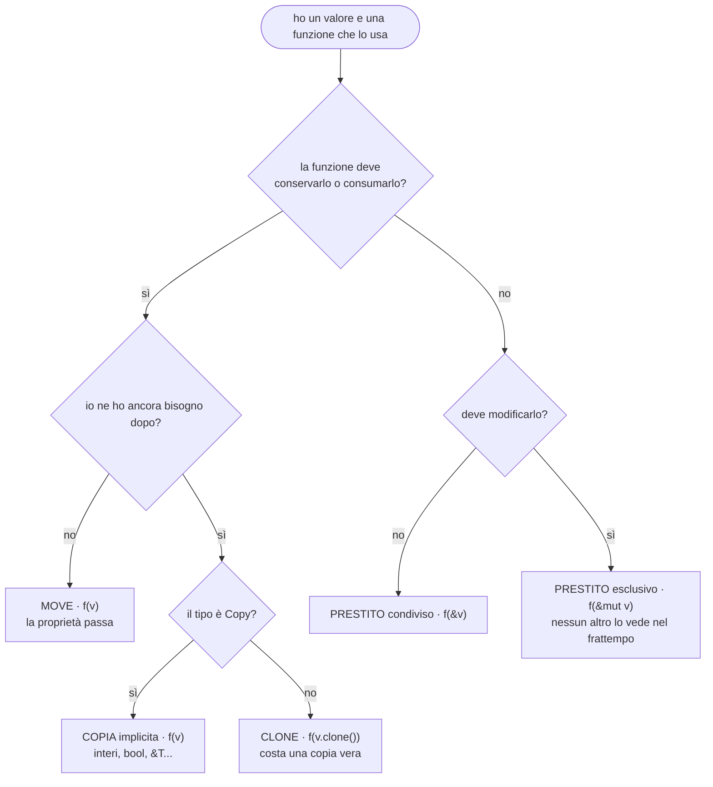
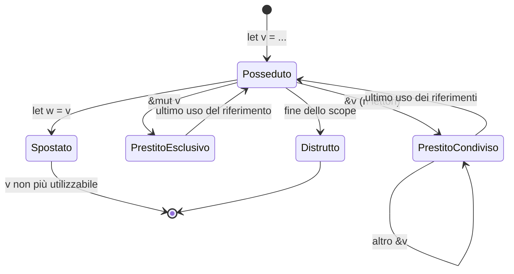

> File C10-parte3.md (parte 3 di 7) — Capitolo C10, Modelli di memoria

## L10.3 — Ownership e borrowing

### Concetto

Rust non ha garbage collector e non chiede di chiamare `free`. Risolve il problema dell'heap con **regole sulla struttura del programma** che il compilatore verifica. Sono poche, e vanno imparate come regole di progetto più che come ostacoli.

**Le tre regole dell'ownership**

1. Ogni valore ha **esattamente un proprietario** (*owner*): una variabile, un campo, un elemento di una collezione.
2. Quando il proprietario **esce dallo scope**, il valore viene **distrutto** (`Drop`) e la sua memoria restituita. Il punto è noto a compile time: è per questo che `Drop` è deterministico (e4).
3. La proprietà può **passare** da un proprietario a un altro (*move*). Dopo il passaggio il vecchio nome non è più utilizzabile.

**Borrowing.** Passare la proprietà a ogni funzione sarebbe scomodo: per leggere un valore non serve possederlo. Si **presta** (*borrow*) con un riferimento:

| Prestito | Sintassi | Quanti insieme | Che cosa permette |
|---|---|---|---|
| condiviso | `&T` | **quanti si vuole** | solo leggere |
| esclusivo | `&mut T` | **uno solo**, e nessun `&T` insieme | leggere e scrivere |

La regola, in una frase: **o molti lettori, o un solo scrittore, mai entrambi nello stesso momento** (*aliasing XOR mutability*). E un riferimento non può **sopravvivere** al proprietario: non può esistere un riferimento a qualcosa che è già stato distrutto. Un prestito dura fino all'**ultimo uso** del riferimento, non fino alla fine dello scope (si dice *non-lexical lifetimes*).

Perché proprio queste regole? Perché un'intera famiglia di errori nasce dalla combinazione «due puntatori allo stesso dato, di cui uno scrive»:

| Errore | Come nasce | Come lo impedisce la regola |
|---|---|---|
| **Use-after-free** | si usa un puntatore dopo che il blocco è stato liberato | un riferimento non può vivere più del proprietario (E0597, E0515) |
| **Double free** | due proprietari liberano lo stesso blocco | un solo proprietario (E0382) |
| **Invalidazione di iteratore** | si modifica una collezione mentre la si scorre; la crescita sposta gli elementi | `&` per scorrere impedisce `&mut` per modificare (E0502; è il caso di C05) |
| **Data race** | due thread, almeno uno scrive, nessuna sincronizzazione | stessa regola, estesa ai thread con `Send`/`Sync` (C11) |

Il costo di queste garanzie è **zero a runtime**: i controlli avvengono tutti in compilazione, e il programma generato non contiene nulla che li verifichi. Il prezzo lo paga chi scrive: esistono programmi corretti che il compilatore non riesce a dimostrare tali, e vanno riscritti in un'altra forma.

#### Che cosa fare di un valore

Davanti a un valore che serve a un'altra funzione, in Rust ci sono quattro scelte, e la firma della funzione dice quale:



Leggendo le firme del programma si vedono tutte e quattro: `lookup(root: &Link, parts: &[&str])` **presta** (condiviso) l'archivio e l'elenco dei nomi; `fn create(&mut self, …)` richiede l'accesso **esclusivo** al `Drive` (nessun altro può leggerlo mentre si modifica); `new_node(name: &str, …, parent: Weak<…>)` **consuma** il `Weak` (se ne vuole un altro, `Weak::clone`); `deep_copy(src: &Link, parent: Weak<…>)` presta `src` e consuma `parent`.

Il **ciclo di vita dei prestiti**, come macchina a stati di un valore:



Da `PrestitoCondiviso` non si può andare a `PrestitoEsclusivo`, né da `PrestitoEsclusivo` a un nuovo `&v`: non ci sono frecce, ed è esattamente ciò che il compilatore verifica.

### Implementazione: snapshot e rollback (T5)

Una fotografia è una **copia profonda**: ogni nodo è nuovo, e nessun nodo della copia condivide qualcosa con l'originale. Se fosse una copia *superficiale* (`b = a`), una modifica successiva all'archivio altererebbe anche la fotografia, che non servirebbe a nulla. La difficoltà qui non sono le figlie, ma i collegamenti **al padre**: nella copia devono puntare ai padri **copiati**, non a quelli originali.

**Python**

```python
def deep_copy(src: Node, parent: Node | None = None) -> Node:
    """T5 - an independent copy of a subtree: every node is new, every parent link is re-created."""
    copy = Node(src.name, src.is_dir, src.size, parent)
    for name, child in src.children.items():
        copy.children[name] = deep_copy(child, copy)
    return copy
```

**PHP**

```php
/** T5 - an independent copy of a subtree: every node is new, every parent link is re-created. */
function deepCopy(Node $src, ?Node $parent = null): Node
{
    $copy = new Node($src->name, $src->isDir, $src->size, $parent);
    foreach ($src->children as $name => $child) {
        $copy->children[$name] = deepCopy($child, $copy);
    }
    return $copy;
}
```

**Rust**

```rust
/// T5 - an independent copy of a subtree: every node is new, every parent link is re-created.
fn deep_copy(src: &Link, parent: Weak<RefCell<Node>>) -> Link {
    let s = src.borrow();
    let copy = new_node(&s.name, s.is_dir, s.size, parent);
    for (name, child) in &s.children {
        let c = deep_copy(child, Rc::downgrade(&copy));
        copy.borrow_mut().children.insert(name.clone(), c);
    }
    copy
}
```

**Go**

```go
// deepCopy is T5 - an independent copy of a subtree: every node is new, every parent link is re-created.
func deepCopy(src, parent *Node) *Node {
	cp := newNode(src.name, src.isDir, src.size, parent)
	for name, child := range src.children {
		cp.children[name] = deepCopy(child, cp)
	}
	return cp
}
```


- **Python:** crea un `Node` nuovo (con `parent` = la copia del padre, ricevuta come argomento) e ripete sui figli. `copy.deepcopy` **non va bene** qui, ed è un caso reale: tratta `weakref.ref` come valore atomico e lo copia così com'è, quindi il padre del nodo copiato resterebbe l'originale (e8, in L10.5).
- **PHP:** stessa struttura. `clone` produrrebbe una copia superficiale (i figli sarebbero gli stessi oggetti); per una copia profonda bisogna scrivere ricorsivamente la copia, o implementare `__clone`.
- **Rust:** `src: &Link` — la copia **presta** l'originale e non lo consuma, quindi la fotografia resta intatta e il programma può usarla ancora (`rollback` la copia ogni volta). `src.borrow()` apre un prestito condiviso **a runtime** (`RefCell`, L10.4); il padre della copia è un `Weak` ottenuto con `Rc::downgrade(&copy)` prima di inserire i figli; `copy.borrow_mut().children.insert(...)` è un prestito esclusivo breve. `Rc::clone` duplicherebbe soltanto il **puntatore**, mentre qui serve duplicare il nodo.
- **Go:** `*Node` copiati a mano, esattamente come in Python. Una copia di `Node` (`*src`) duplicherebbe la struct ma *non* la mappa `children`, che è un riferimento: i figli sarebbero condivisi, come nella copia superficiale.

Lo stesso concetto in una frase per linguaggio: la copia profonda è **sempre un'operazione esplicita** di cui ci si deve ricordare; Rust è l'unico dei quattro che, con `.clone()` esplicito e `Rc::clone` che non copia i dati, rende **visibile nel codice** quale delle due si sta facendo.

Il `rollback` merita una riga a parte. `d.root = deep_copy(&snap, Weak::new())` (Rust) fa due cose: crea il nuovo albero dalla fotografia, e **assegna** a `d.root`. L'assegnazione distrugge il valore precedente di `d.root`: l'intero archivio di prima perde il suo proprietario e viene liberato lì (in PHP e Python lo stesso, per contatore; in Go diventa irraggiungibile). È il motivo per cui i segnalibri creati prima del rollback rispondono `gone`: indicavano nodi del vecchio albero.

### Esperimento e5 — la galleria degli errori del borrow checker

Nove programmi minimi, ciascuno con un errore tipico. Ogni errore dice quale regola è violata; leggerlo così è più utile che leggerlo come un ostacolo. Qui i primi cinque, che riguardano le **regole di proprietà e prestito**; gli altri tre (con i lifetime e gli smart pointer) sono in L10.4.

**M1 — uso dopo un move.**

```rust
fn consume(v: Vec<i32>) -> usize {
    v.len()
}

fn main() {
    let v = vec![1, 2, 3];
    let n = consume(v);
    println!("{n} {}", v.len());
}
```

**M2 — due scrittori insieme.**

```rust
fn main() {
    let mut s = String::from("a");
    let r1 = &mut s;
    let r2 = &mut s;
    r1.push('b');
    r2.push('c');
}
```

**M3 — scrivere mentre un lettore è vivo.**

```rust
fn main() {
    let mut v = vec![1, 2, 3];
    let first = &v[0];
    v.push(4);
    println!("{first}");
}
```

**M7 — spostare mentre è prestato.**

```rust
fn main() {
    let s = String::from("moved out of a borrow");
    let r = &s;
    let t = s;
    println!("{r} {t}");
}
```

**M9 — modificare una collezione mentre la si scorre.**

```rust
fn main() {
    let mut v = vec![1, 2, 3];
    for x in &v {
        if *x == 2 {
            v.push(4);
        }
    }
}
```

I messaggi del compilatore (formato breve):

```text
### m1.rs
m1.rs:8:24: error[E0382]: borrow of moved value: `v`: value borrowed here after move
error: aborting due to 1 previous error
[exit 1]
```

```text
### m2.rs
m2.rs:4:14: error[E0499]: cannot borrow `s` as mutable more than once at a time: second mutable borrow occurs here
error: aborting due to 1 previous error
[exit 1]
```

```text
### m3.rs
m3.rs:4:5: error[E0502]: cannot borrow `v` as mutable because it is also borrowed as immutable: mutable borrow occurs here
error: aborting due to 1 previous error
[exit 1]
```

```text
### m7.rs
m7.rs:4:13: error[E0505]: cannot move out of `s` because it is borrowed: move out of `s` occurs here
error: aborting due to 1 previous error
[exit 1]
```

```text
### m9.rs
m9.rs:5:13: error[E0502]: cannot borrow `v` as mutable because it is also borrowed as immutable: mutable borrow occurs here
error: aborting due to 1 previous error
[exit 1]
```

| Codice | Che cosa dice | Regola violata | Come si risolve |
|---|---|---|---|
| **E0382** (m1) | `borrow of moved value: v` | un solo proprietario: dopo `consume(v)` il valore non è più di `main` | passare un prestito (`&v`), clonare (`v.clone()`), o far restituire il valore dalla funzione |
| **E0499** (m2) | `cannot borrow s as mutable more than once` | un solo scrittore alla volta | restringere la durata di `r1` (usarlo e finire prima di creare `r2`) |
| **E0502** (m3) | `cannot borrow v as mutable because it is also borrowed as immutable` | non si scrive finché un lettore è vivo (e `first` è usato dopo `push`) | usare `first` prima del `push`, oppure copiare il valore (`let first = v[0];`) |
| **E0505** (m7) | `cannot move out of s because it is borrowed` | non si sposta ciò che è prestato | finire di usare `r` prima del move, o clonare |
| **E0502** (m9) | `cannot borrow v as mutable because it is also borrowed as immutable` | il ciclo `for x in &v` tiene un prestito condiviso per tutta la durata del ciclo | raccogliere gli indici da modificare e applicarli dopo, oppure scorrere con indici/`retain` |

Nel caso m3 il punto interessante è **dove** sta l'errore: `v.push(4)` non è sbagliata di per sé; lo è perché `first` (un riferimento dentro il buffer di `v`) viene usato *dopo*. Un `push` può far crescere il vettore, cioè **spostare** tutti gli elementi in un nuovo blocco, e `first` punterebbe a memoria liberata: un *use-after-free* in C, un errore di compilazione in Rust. In C05 lo stesso schema produceva `RuntimeError` in Python (sui dict) e un errore di compilazione in Rust; e5b mostra che cosa succede negli altri.

### Esperimento e5b — gli stessi errori in Python, PHP e Go

Gli stessi schemi, riscritti negli altri linguaggi, **non producono alcun errore di compilazione**. Che cosa fanno?

```python
def consume(v: list[int]) -> int:
    return len(v)


v = [1, 2, 3]
print("consume(v) then v:", consume(v), v)  # nothing moved: v is still usable

s = "a"
r1, r2 = s, s  # two names of the same immutable str: nothing to forbid
print("r1 is r2:", r1 is r2)

first = v[0]
v.append(4)  # no reader is "alive": first is a plain int
print("first after append:", first)

seen = []
for x in v:  # modifying a list while iterating raises nothing, the loop simply follows the list
    seen.append(x)
    if x == 2:
        v.append(5)
print("visited:", seen)

d = {"a": 1}
try:
    for k in d:
        d["b"] = 2
except RuntimeError as e:
    print("dict:", e)
```

```php
<?php
function consume(array $v): int
{
    return count($v);
}

$v = [1, 2, 3];
echo 'consume($v) then $v: ', consume($v), ' ', json_encode($v), "\n";

$seen = [];
foreach ($v as $x) { // iterates over a (logical) copy of $v
    $seen[] = $x;
    if ($x === 2) {
        $v[] = 4;
    }
}
echo 'visited: ', json_encode($seen), ' | $v now: ', json_encode($v), "\n";
```

```go
package main

import "fmt"

func main() {
	v := make([]int, 3, 3) // len 3, cap 3: the next append must reallocate
	v[0], v[1], v[2] = 1, 2, 3
	first := &v[0] // a pointer into the current buffer
	v = append(v, 4)
	v[0] = 100 // written in the NEW buffer
	fmt.Println("v[0] =", v[0], "| *first =", *first, "| same buffer:", first == &v[0])

	w := make([]int, 3, 8) // spare capacity: append does not move anything
	w[0] = 1
	p := &w[0]
	w = append(w, 4)
	w[0] = 100
	fmt.Println("w[0] =", w[0], "| *p =", *p, "| same buffer:", p == &w[0])
}
```

```text
### e5b.py
consume(v) then v: 3 [1, 2, 3]
r1 is r2: True
first after append: 1
visited: [1, 2, 3, 4, 5]
dict: dictionary changed size during iteration
[exit 0]
### e5b.php
consume($v) then $v: 3 [1,2,3]
visited: [1,2,3] | $v now: [1,2,3,4]
[exit 0]
### e5b.go
v[0] = 100 | *first = 1 | same buffer: false
w[0] = 100 | *p = 100 | same buffer: true
[exit 0]
```

- **Python:** `consume(v)` non sposta nulla: `v` è ancora intera (`3 [1, 2, 3]`); `r1 is r2` è `True`, due nomi dello stesso `str` immutabile; `first` è un intero immutabile e non cambia dopo l'`append`. Modificare una **lista** mentre la si scorre non solleva nulla: il ciclo segue la lista e vede anche gli elementi aggiunti (`visited: [1, 2, 3, 4, 5]`, con il 5 aggiunto durante il ciclo); un **dict** invece solleva `RuntimeError: dictionary changed size during iteration` (lo stesso di C05).
- **PHP:** l'array è un valore: `foreach` itera su una copia logica e termina (`visited: [1,2,3]`), mentre `$v` vale `[1,2,3,4]` dopo il ciclo. Non c'è errore e non c'è sorpresa, ma solo perché la copia fisica viene fatta (e7).
- **Go:** con capacità piena, `append` **rialloca**: `first` punta al vecchio buffer, `v[0] = 100` scrive nel nuovo, e `*first` resta `1` (`same buffer: false`). Con capacità di riserva (`w`) `append` non sposta nulla e il puntatore vede la modifica (`*p = 100`). Lo stesso codice, due comportamenti, e il compilatore non dice niente: è l'aliasing nascosto di C05 (e1). Il *race detector* (`go test -race`, C11) vede solo accessi concorrenti, non questo.

La differenza di fondo è **quando** la regola viene applicata, non se esiste: in Rust è una regola del linguaggio, verificata prima dell'esecuzione; negli altri tre è una **convenzione** («non modificare una collezione mentre la scorri») che nessuno controlla.

### Focus comparativo

| Aspetto | PHP | Python | Rust | Go |
|---|---|---|---|---|
| Chi è il proprietario di un oggetto | nessuno (contatore) | nessuno (contatore) | **una variabile precisa** | nessuno (raggiungibilità) |
| Passare un argomento | handle/valore (CoW) | secondo nome | move, `&` o `&mut` | copia (puntatore se serve condividere) |
| Due scrittori sullo stesso dato | permesso | permesso | **errore di compilazione** (E0499) | permesso (race detector a runtime) |
| Modificare una collezione scorrendola | permesso (si itera su una copia) | permesso per le liste, errore per i dict | **errore di compilazione** (E0502) | permesso |
| Quando si sbaglia | a runtime, se mai | a runtime, se mai | prima dell'esecuzione | a runtime, se mai |
| Costo a runtime delle garanzie | contatori | contatori | **nessuno** | tracing |

### Esercizio Rosetta (4′)

Scrivi `merge(a, b)` che unisce due elenchi di nodi in un terzo. Decidi per ciascun linguaggio se `a` e `b` restano utilizzabili dopo la chiamata. In Rust, quali firme sono possibili (`Vec<Node>` per valore, `&[Node]`, `&mut Vec<Node>`), e che cosa comunica ciascuna a chi legge?

---
