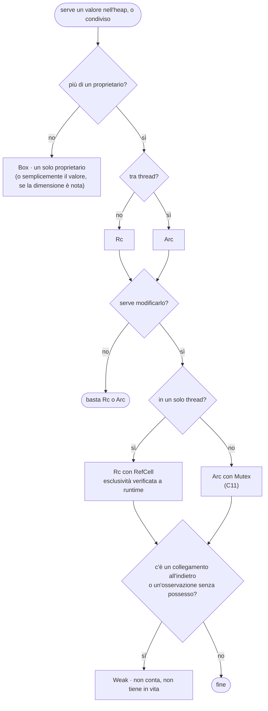

> File C10-parte4.md (parte 4 di 7) — Capitolo C10, Modelli di memoria

## L10.4 — Lifetimes, smart pointers e i loro equivalenti

### Concetto

#### I lifetime: per quanto tempo vale un riferimento

L10.3 ha stabilito che un riferimento non può sopravvivere al proprietario. Il compilatore deve poterlo **verificare**, e per farlo ha bisogno di sapere, per ogni riferimento, **da quale proprietario dipende**. Questa informazione è il **lifetime** (`'a`, si legge «tick a»): non una durata in secondi, ma il **tratto di codice** in cui il riferimento è valido.

Nella maggior parte dei casi il compilatore lo deduce da solo (regole di *elision*): in `fn lookup(root: &Link, parts: &[&str]) -> Option<Link>` non c'è un riferimento in uscita, quindi non c'è nulla da collegare. Serve scriverlo quando una funzione **restituisce un riferimento** e ha più di un riferimento in ingresso: da quale dei due dipende il risultato?

Tre errori mostrano tutta la logica.

**M4 — il riferimento sopravvive al dato.**

```rust
fn main() {
    let r;
    {
        let x = 5;
        r = &x;
    }
    println!("{r}");
}
```

**M6 — restituire un riferimento a una variabile locale.**

```rust
fn make() -> &'static str {
    let s = String::from("temp");
    &s
}

fn main() {
    println!("{}", make());
}
```

**M5 — il compilatore non sa da chi dipende il risultato.**

```rust
fn longest(a: &str, b: &str) -> &str {
    if a.len() > b.len() { a } else { b }
}

fn main() {
    println!("{}", longest("ab", "c"));
}
```

```text
### m4.rs
m4.rs:5:13: error[E0597]: `x` does not live long enough: borrowed value does not live long enough
error: aborting due to 1 previous error
[exit 1]
```

```text
### m6.rs
m6.rs:3:5: error[E0515]: cannot return reference to local variable `s`: returns a reference to data owned by the current function
error: aborting due to 1 previous error
[exit 1]
```

```text
### m5.rs
m5.rs:1:33: error[E0106]: missing lifetime specifier: expected named lifetime parameter
error: aborting due to 1 previous error
[exit 1]
```

| Codice | Che cosa dice | Lettura |
|---|---|---|
| **E0597** (m4) | `x does not live long enough` | `r` vive più di `x`: all'uscita dal blocco interno `x` è distrutto e `r` punterebbe al nulla (*dangling reference*, in C un classico *use-after-free*) |
| **E0515** (m6) | `cannot return reference to local variable s` | una funzione non può restituire un riferimento a ciò che possiede e che sta per distruggere: si restituisce il valore (`String`), cioè si **passa la proprietà** a chi chiama |
| **E0106** (m5) | `missing lifetime specifier` | `longest` restituisce un `&str`: da `a` o da `b`? Il compilatore non lo indovina; chi scrive deve dichiararlo |

La correzione di m5 è un'annotazione, e **non cambia ciò che il programma fa**: dice al compilatore come leggere i riferimenti.

```rust
fn longest<'a>(a: &'a str, b: &'a str) -> &'a str {
    if a.len() > b.len() { a } else { b }
}

fn main() {
    let s1 = String::from("long string");
    let s2 = String::from("xyz");
    let result = longest(&s1, &s2); // both outlive `result`: fine
    println!("{result}");
}
```

`<'a>` introduce un nome per «un lifetime qualunque» (è un parametro generico, come i `T` di C08); `&'a str` per entrambi gli argomenti e per il risultato significa: *il risultato non vive più del più corto fra `a` e `b`*. Un uso scorretto di questa funzione viene colto nel punto di chiamata:

```rust
// The lifetime 'a says: the result lives AT MOST as long as BOTH arguments.
fn longest<'a>(a: &'a str, b: &'a str) -> &'a str {
    if a.len() > b.len() { a } else { b }
}

fn main() {
    let s1 = String::from("long string");
    let result;
    {
        let s2 = String::from("xyz");
        result = longest(&s1, &s2);
    } // s2 is destroyed here, and `result` may point into it
    println!("{result}");
}
```

```text
### l1.rs
l1.rs:11:31: error[E0597]: `s2` does not live long enough: borrowed value does not live long enough
error: aborting due to 1 previous error
[exit 1]
```

Qui `result` è usato dopo la fine del blocco in cui `s2` è vivo, e il compilatore non può escludere che `longest` abbia restituito proprio un riferimento a `s2`: lo rifiuta con E0597. Il programma del capitolo **non ha bisogno di annotazioni di lifetime**: le firme restituiscono valori (`Link`, `Option<Link>`) o `&'static str` (le stringhe dei motivi di rifiuto, `Some("exists")`, che vivono per tutta l'esecuzione), mai riferimenti derivati da argomenti. È tipico: i lifetime espliciti servono nelle librerie e nelle strutture che *contengono* riferimenti; il codice applicativo scritto con proprietà e `clone` ne ha raramente bisogno.

Negli altri tre linguaggi i lifetime **non esistono nel linguaggio**: ogni riferimento mantiene vivo l'oggetto (Python, PHP, per contatore) o l'oggetto sopravvive finché è raggiungibile (Go). Restituire un riferimento a una variabile locale è sempre lecito: `def f(): s = "temp"; return s` e `func f() *string { s := "temp"; return &s }` funzionano (in Go è l'escape analysis a spostare `s` nell'heap, L10.5). Il vantaggio è l'assenza di questa categoria di errori; il prezzo, un oggetto può sopravvivere più di quanto serva (e3, parte Go) e il momento della liberazione non è visibile nel codice.

#### Smart pointer: la proprietà, a pezzi

Quando un solo proprietario non basta, Rust offre tipi che **cambiano la regola di proprietà** in modo esplicito. Si chiamano *smart pointer* perché si comportano come puntatori ma aggiungono un comportamento (contare, controllare, liberare).

| Tipo | Proprietari | Mutabilità | Thread | Costo | Quando |
|---|---|---|---|---|---|
| `Box<T>` | **uno** | quella del proprietario | `Send` se `T` lo è | un'allocazione; un puntatore (8 byte) | mettere un valore nell'heap; tipi ricorsivi (`Option<Box<Cell>>`); trait object (`Box<dyn Trait>`, 16 byte) |
| `Rc<T>` | **molti** (conteggio) | **nessuna** da sola | **no** (E0277 nel confronto con `thread::spawn`, e10c) | contatore non atomico | più proprietari in un solo thread (alberi con nodi condivisi, grafi) |
| `Arc<T>` | **molti** (conteggio atomico) | nessuna da sola | **sì** | operazioni atomiche, più lente | stessa cosa tra thread (C11) |
| `RefCell<T>` | uno | **sì, anche tramite `&T`** (*interior mutability*), controllata a **runtime** | `Send` ma non `Sync`: non condivisibile tra thread | un flag di prestito (16 byte contro 4 per `u32`, e10a) | mutare un valore raggiunto da più `Rc`; il compilatore non può dimostrare l'esclusività, la verifica la fa il programma |
| `Weak<T>` | **nessuno** (non conta) | — | segue il tipo forte | un secondo contatore | collegamento al padre, cache, osservatori: conoscere senza possedere |
| `Mutex<T>` | uno | sì, con blocco | sì | lock | stato condiviso tra thread (C11) |



Il programma usa quasi tutto il catalogo. `Rc<RefCell<Node>>` (alias `Link`) combina tre bisogni distinti: **`Rc`** perché un nodo è tenuto da più parti insieme (la mappa dei figli del padre, il risultato di `lookup`, i temporanei di `upgrade`); **`RefCell`** perché il nodo va modificato (aggiungere un figlio) pur essendo raggiunto da più `Rc`; **`Weak`** per il padre e per il segnalibro. In compilazione un solo `Rc` non avrebbe permesso di inserire un figlio: la regola di L10.3 vieta di scrivere in qualcosa che ha altri lettori. `RefCell` sposta quel controllo a **runtime**: e10b mostra che cosa succede se si sbaglia.

Le due viste complementari del percorso di un nodo: `lookup` scende dalla radice seguendo i **figli posseduti**, `full_path` risale seguendo i **padri non posseduti**:

**Python**

```python
def split_path(path: str) -> list[str] | None:
    """T1 - '/a/b' -> ['a', 'b'], '/' -> []; None if the path is not valid."""
    if not path.startswith("/"):
        return None
    if path == "/":
        return []
    parts = path[1:].split("/")
    if any(p in ("", ".", "..") for p in parts):
        return None
    return parts


def lookup(root: Node, parts: list[str]) -> Node | None:
    node = root
    for p in parts:
        nxt = node.children.get(p)
        if nxt is None:
            return None
        node = nxt
    return node


def full_path(node: Node) -> str:
    """T6 - walk the parent links up to the root."""
    names: list[str] = []
    cur: Node | None = node
    while cur is not None and cur.parent is not None:
        names.append(cur.name)
        cur = cur.parent()
    return "/" + "/".join(reversed(names))
```

**PHP**

```php
/** T1 - '/a/b' -> ['a', 'b'], '/' -> []; null if the path is not valid. */
function splitPath(string $path): ?array
{
    if (!str_starts_with($path, '/')) {
        return null;
    }
    if ($path === '/') {
        return [];
    }
    $parts = explode('/', substr($path, 1));
    foreach ($parts as $p) {
        if ($p === '' || $p === '.' || $p === '..') {
            return null;
        }
    }
    return $parts;
}

function lookup(Node $root, array $parts): ?Node
{
    $node = $root;
    foreach ($parts as $p) {
        $node = $node->children[$p] ?? null;
        if ($node === null) {
            return null;
        }
    }
    return $node;
}

/** T6 - walk the parent links up to the root. */
function fullPath(Node $node): string
{
    $names = [];
    $cur = $node;
    while ($cur !== null && $cur->parent !== null) {
        $names[] = $cur->name;
        $cur = $cur->parent->get();
    }
    return '/' . implode('/', array_reverse($names));
}
```

**Rust**

```rust
/// T1 - "/a/b" -> ["a", "b"], "/" -> []; None if the path is not valid.
fn split_path(path: &str) -> Option<Vec<&str>> {
    let rest = path.strip_prefix('/')?;
    if rest.is_empty() {
        return Some(vec![]);
    }
    let parts: Vec<&str> = rest.split('/').collect();
    if parts.iter().any(|p| matches!(*p, "" | "." | "..")) {
        return None;
    }
    Some(parts)
}

fn lookup(root: &Link, parts: &[&str]) -> Option<Link> {
    let mut node = Rc::clone(root);
    for p in parts {
        let next = node.borrow().children.get(*p).cloned()?;
        node = next;
    }
    Some(node)
}

/// T6 - walk the parent links up to the root.
fn full_path(node: &Link) -> String {
    let mut names: Vec<String> = Vec::new();
    let mut cur = Rc::clone(node);
    loop {
        let parent = cur.borrow().parent.upgrade();
        match parent {
            Some(p) => {
                names.push(cur.borrow().name.clone());
                cur = p;
            }
            None => break,
        }
    }
    names.reverse();
    format!("/{}", names.join("/"))
}
```

**Go**

```go
// splitPath is T1 - "/a/b" -> [a b], "/" -> []; ok is false if the path is not valid.
func splitPath(path string) (parts []string, ok bool) {
	if !strings.HasPrefix(path, "/") {
		return nil, false
	}
	if path == "/" {
		return nil, true
	}
	parts = strings.Split(path[1:], "/")
	for _, p := range parts {
		if p == "" || p == "." || p == ".." {
			return nil, false
		}
	}
	return parts, true
}

func lookup(root *Node, parts []string) *Node {
	node := root
	for _, p := range parts {
		next, ok := node.children[p]
		if !ok {
			return nil
		}
		node = next
	}
	return node
}

// fullPath is T6 - walk the parent links up to the root.
func fullPath(node *Node) string {
	var names []string
	for cur := node; cur.parent != nil; cur = cur.parent {
		names = append(names, cur.name)
	}
	for i, j := 0, len(names)-1; i < j; i, j = i+1, j-1 {
		names[i], names[j] = names[j], names[i]
	}
	return "/" + strings.Join(names, "/")
}
```


- **Rust:** `node.borrow().children.get(*p).cloned()?` apre un prestito condiviso del `RefCell`, cerca il figlio e ne **clona il puntatore** (`Rc::clone`, costo: un incremento di contatore; non copia il nodo); il prestito termina alla fine dell'espressione. In `full_path`, `cur.borrow().parent.upgrade()` restituisce `Option<Rc<…>>`: se il padre è stato distrutto, `None` ferma il ciclo.
- **Python e PHP:** il padre si ottiene chiamando il riferimento debole (`cur.parent()`, `$cur->parent->get()`); può restituire `None`/`null`.
- **Go:** `cur.parent` è un puntatore normale; non può «scomparire» finché il figlio è raggiungibile, perché il puntatore stesso lo tiene vivo. Per questo il padre in Go non ha bisogno di essere debole.

### Esperimento e5 (seconda parte) — modificare attraverso un `Rc`

**M8 — un `Rc` da solo non permette di scrivere.**

```rust
use std::rc::Rc;

fn main() {
    let a = Rc::new(String::from("shared"));
    let b = Rc::clone(&a);
    a.push('!');
    println!("{b}");
}
```

```text
### m8.rs
m8.rs:6:5: error[E0596]: cannot borrow data in an `Rc` as mutable: cannot borrow as mutable
error: aborting due to 1 previous error
[exit 1]
```

`E0596: cannot borrow data in an Rc as mutable`: `Rc` dà la **proprietà condivisa**, quindi non può dare anche l'accesso in scrittura (violerebbe «molti lettori o un solo scrittore»). Le uscite sono due: `Rc<RefCell<T>>` (esclusività controllata a runtime) oppure `Rc::get_mut` / `Rc::make_mut` (che modificano o copiano se il valore è condiviso).

### Esperimento e10 — dimensioni, null pointer optimization, `RefCell` e thread

**Parte a — quanto pesa ciascun tipo?**

```rust
use std::cell::{Cell, RefCell};
use std::mem::size_of;
use std::rc::{Rc, Weak};
use std::sync::Arc;

trait Shape {
    fn area(&self) -> f64;
}

#[allow(dead_code)]
struct Node {
    name: String,
    size: u64,
    is_dir: bool,
}

fn main() {
    println!("&u64={} Box<u64>={} Rc<u64>={} Arc<u64>={} Weak<u64>={}",
        size_of::<&u64>(), size_of::<Box<u64>>(), size_of::<Rc<u64>>(), size_of::<Arc<u64>>(), size_of::<Weak<u64>>());
    println!("&str={} String={} Vec<u8>={} &[u8]={}", size_of::<&str>(), size_of::<String>(), size_of::<Vec<u8>>(), size_of::<&[u8]>());
    println!("&dyn Shape={} Box<dyn Shape>={} (data pointer + vtable pointer)", size_of::<&dyn Shape>(), size_of::<Box<dyn Shape>>());
    println!("Option<Box<u64>>={} Option<Rc<u64>>={} Option<&u64>={} Option<u64>={} (the null pointer is the None)",
        size_of::<Option<Box<u64>>>(), size_of::<Option<Rc<u64>>>(), size_of::<Option<&u64>>(), size_of::<Option<u64>>());
    println!("Cell<u32>={} RefCell<u32>={} (the borrow flag is the price of runtime checking)", size_of::<Cell<u32>>(), size_of::<RefCell<u32>>());
    println!("Node={} Rc<RefCell<Node>>={}", size_of::<Node>(), size_of::<Rc<RefCell<Node>>>());
}
```

```text
### e10a.rs
&u64=8 Box<u64>=8 Rc<u64>=8 Arc<u64>=8 Weak<u64>=8
&str=16 String=24 Vec<u8>=24 &[u8]=16
&dyn Shape=16 Box<dyn Shape>=16 (data pointer + vtable pointer)
Option<Box<u64>>=8 Option<Rc<u64>>=8 Option<&u64>=8 Option<u64>=16 (the null pointer is the None)
Cell<u32>=4 RefCell<u32>=16 (the borrow flag is the price of runtime checking)
Node=40 Rc<RefCell<Node>>=8
[exit 0]
```

Letture. `Box`, `Rc`, `Arc`, `Weak` e `&T` pesano tutti 8 byte: sono puntatori. I **puntatori «grassi»** (*fat pointer*) pesano 16: `&str` e `&[u8]` portano puntatore e lunghezza, `&dyn Shape` e `Box<dyn Shape>` portano puntatore ai dati e puntatore alla *vtable* (C07, e9: stessa misura). `String` e `Vec` pesano 24: puntatore, capacità, lunghezza. La riga più interessante è la quarta: `Option<Box<u64>>` pesa **8**, come `Box<u64>`, mentre `Option<u64>` pesa 16. Il motivo è la **null pointer optimization** (*niche optimization*): un `Box` non può mai essere nullo, quindi il compilatore usa l'indirizzo zero per rappresentare `None`, e l'`Option` non costa nulla. Per questo `Option<Rc<…>>` e `Option<&T>` sono gratuiti e il tipo «può mancare» di C02 non ha costo a runtime. `RefCell<u32>` pesa 16 contro 4 di `Cell<u32>`: la differenza è il flag dei prestiti (un intero a 8 byte) più il padding di allineamento: il prezzo della verifica a runtime. Infine `Rc<RefCell<Node>>` pesa 8 byte, un puntatore: tutto il resto (il `RefCell`, il `Node`, i due contatori) sta nell'heap, dietro quel puntatore.

**Parte b — i prestiti verificati a runtime.**

```rust
use std::cell::RefCell;
use std::rc::Rc;

fn main() {
    let shared = Rc::new(RefCell::new(vec![1, 2, 3]));
    let other = Rc::clone(&shared);
    {
        let reader = shared.borrow(); // an immutable borrow, checked at RUN time
        println!("reading: {:?}", *reader);
        match other.try_borrow_mut() {
            Ok(_) => println!("try_borrow_mut: ok"),
            Err(e) => println!("try_borrow_mut while a reader exists: {e}"),
        }
    }
    other.borrow_mut().push(4);
    println!("after the reader is gone: {:?}", shared.borrow());
    let _w1 = shared.borrow_mut();
    let _w2 = other.borrow_mut(); // two writers: the compiler cannot see it, the program panics
}
```

```text
### e10b.rs
reading: [1, 2, 3]
try_borrow_mut while a reader exists: RefCell already borrowed
after the reader is gone: [1, 2, 3, 4]

thread 'main' panicked at e10b.rs:18:21:
RefCell already borrowed
note: run with `RUST_BACKTRACE=1` environment variable to display a backtrace
[exit 101]
```

`try_borrow_mut` **restituisce un errore** mentre un lettore esiste (`RefCell already borrowed`): è la regola di L10.3, applicata mentre il programma gira. `borrow_mut()` invece, se la regola è violata, fa **panic**, come mostra l'ultima riga. Con `RefCell` il compilatore *non* garantisce più l'assenza di questi errori: è il prezzo di poter mutare attraverso più proprietari. Nel programma del capitolo non può succedere, perché ogni prestito mutabile (`parent.borrow_mut().children.insert(...)`) dura una sola espressione e nessun prestito condiviso è aperto sullo stesso nodo in quel momento; `du` e `deep_copy` tengono aperti prestiti condivisi, ma di nodi **diversi** da quelli in cui scrivono.

**Parte c — `Rc` e thread.**

```rust
use std::rc::Rc;
use std::sync::Arc;
use std::thread;

fn main() {
    let a = Arc::new(5);
    let b = Arc::clone(&a);
    thread::spawn(move || println!("arc: {b}")).join().unwrap();

    let r = Rc::new(5);
    thread::spawn(move || println!("rc: {r}")).join().unwrap();
    println!("{a}");
}
```

```text
### e10c.rs
e10c.rs:11:19: error[E0277]: `Rc<i32>` cannot be sent between threads safely: `Rc<i32>` cannot be sent between threads safely
error: aborting due to 1 previous error
[exit 1]
```

`Rc<i32> cannot be sent between threads safely`: il contatore di `Rc` non è atomico, e due thread che lo modificano lo corromperebbero. Il compilatore lo impedisce attraverso un *trait* marcatore, `Send`, che `Rc` non implementa e `Arc` sì (C11). È uno dei casi in cui un vincolo di tipo (C08) esprime una proprietà di memoria.

### Esperimento e11 — distruggere un oggetto profondo

La liberazione di una struttura di dati non è mai «magica»: qualcuno deve visitare ogni elemento. Se la visita è ricorsiva e la struttura è profonda, **la liberazione può esaurire lo stack**, anche se nel tuo codice non c'è ricorsione. Una catena di *n* celle, ciascuna che possiede la successiva; si costruisce, poi si lascia cadere la testa.

```python
import sys


class Cell:
    __slots__ = ("next",)

    def __init__(self, next: "Cell | None") -> None:
        self.next = next


for n in (10_000, 1_000_000):
    head = None
    for _ in range(n):
        head = Cell(head)
    print(f"built a chain of {n:>9,} cells", flush=True)
    head = None  # the last reference goes: the whole chain must be destroyed
    print(f"released it: no crash (recursion limit is {sys.getrecursionlimit()}, but deallocation does not use it)")
```

```php
<?php
final class Cell
{
    public function __construct(public ?Cell $next)
    {
    }
}

foreach ([10_000, 1_000_000] as $n) {
    $head = null;
    for ($i = 0; $i < $n; $i++) {
        $head = new Cell($head);
    }
    echo 'built a chain of ', number_format($n), " cells\n";
    $head = null; // the last reference goes: the whole chain must be destroyed
    echo "released it: no crash\n";
}
```

```rust
struct Cell {
    _next: Option<Box<Cell>>,
}

fn main() {
    let n: usize = std::env::args().nth(1).unwrap().parse().unwrap();
    let mut head: Option<Box<Cell>> = None;
    for _ in 0..n {
        head = Some(Box::new(Cell { _next: head }));
    }
    println!("built a chain of {n} cells");
    drop(head); // drop() of a Box calls drop() of the next Box, which calls the next...: recursion
    println!("released it: no crash");
}
```

```rust
struct Cell {
    next: Option<Box<Cell>>,
}

// An iterative Drop: unlink the cells one by one so that each drop() sees a chain of length 1.
impl Drop for Cell {
    fn drop(&mut self) {
        let mut cur = self.next.take();
        while let Some(mut cell) = cur {
            cur = cell.next.take();
        }
    }
}

fn main() {
    let n: usize = std::env::args().nth(1).unwrap().parse().unwrap();
    let mut head: Option<Box<Cell>> = None;
    for _ in 0..n {
        head = Some(Box::new(Cell { next: head }));
    }
    println!("built a chain of {n} cells");
    drop(head);
    println!("released it: no crash");
}
```

```go
package main

import (
	"fmt"
	"runtime"
)

type Cell struct{ next *Cell }

func main() {
	for _, n := range []int{10_000, 1_000_000} {
		var head *Cell
		for i := 0; i < n; i++ {
			head = &Cell{head}
		}
		fmt.Printf("built a chain of %d cells\n", n)
		head = nil
		runtime.GC() // the collector marks with an explicit work queue, not with recursion
		fmt.Println("released it: no crash")
	}
}
```

```text
### e11.py
built a chain of    10,000 cells
released it: no crash (recursion limit is 1000, but deallocation does not use it)
built a chain of 1,000,000 cells
released it: no crash (recursion limit is 1000, but deallocation does not use it)
[exit 0]
### e11.php
built a chain of 10,000 cells
released it: no crash
built a chain of 1,000,000 cells
[exit 139]
### e11.rs 10000
built a chain of 10000 cells
released it: no crash
[exit 0]
### e11.rs 1000000
built a chain of 1000000 cells

thread 'main' has overflowed its stack
fatal runtime error: stack overflow, aborting
[exit 134]
### e11b.rs 1000000 (iterative Drop)
built a chain of 1000000 cells
released it: no crash
[exit 0]
### e11.go
built a chain of 10000 cells
released it: no crash
built a chain of 1000000 cells
released it: no crash
[exit 0]
```

| Linguaggio | Catena di 10 000 | Catena di 1 000 000 | Perché |
|---|---|---|---|
| Python | ok | ok | CPython usa un meccanismo (*trashcan*) che limita la profondità della distruzione ricorsiva: il limite di ricorsione del codice Python (1000) non c'entra |
| PHP | ok | **`Segmentation fault` (exit 139)** | il sintomo è quello di una liberazione ricorsiva nel codice C del motore, senza una protezione paragonabile alla *trashcan* di CPython |
| Rust | ok | **`has overflowed its stack` (exit 134)** | `drop` di un `Box` chiama il `drop` del `Box` successivo, che chiama il successivo… un milione di frame sullo stack |
| Rust, `Drop` iterativo | — | ok | si «scollega» una cella alla volta: ogni `drop` vede una catena di lunghezza 1 |
| Go | ok | ok | non c'è liberazione ricorsiva: il GC marca con una coda di lavoro esplicita, non con la ricorsione |

È un caso reale e noto: strutture come liste concatenate e alberi molto profondi vanno protette (con un `Drop` iterativo, come in e11b) quando la profondità non è sotto controllo. Il programma del capitolo ha alberi di profondità limitata dalla ricorsione di `du` (che, come visto, in Python cade già a 1000 livelli): se l'archivio potesse avere profondità arbitraria, la distruzione sarebbe il secondo punto da proteggere.

### Equivalenti negli altri linguaggi

Gli smart pointer di Rust non sono meccanismi esotici: sono ciò che gli altri linguaggi fanno **implicitamente, per ogni oggetto**.

| Rust | Python | PHP | Go |
|---|---|---|---|
| valore inline | n/a: ogni oggetto è nell'heap | n/a (scalari inline, oggetti nell'heap) | struct per valore |
| `Box<T>` | l'oggetto stesso (già nell'heap) | l'oggetto stesso | `*T` (puntatore) |
| `Rc<T>` | **ogni riferimento a un oggetto** (contatore) | **ogni handle** (contatore) | `*T` (nessun contatore: lo fa il GC) |
| `Rc<RefCell<T>>` | **il comportamento predefinito** di un oggetto | il comportamento predefinito di un oggetto | `*T` (mutabile da chiunque lo raggiunga) |
| `Weak<T>` | `weakref.ref` | `WeakReference` | `weak.Pointer[T]` |
| `Arc<Mutex<T>>` | oggetto + `threading.Lock` | non applicabile (shared-nothing) | `*T` + `sync.Mutex` |
| `Rc::clone(&a)` | `b = a` | `$b = $a` | `b := a` (se `a` è un puntatore) |

Il confronto dice qualcosa sul costo di ciò che si vede: in Python e in PHP un oggetto è **sempre** un `Rc<RefCell<T>>` (contatore, mutabile da chiunque), senza che il linguaggio lo scriva; in Rust è una scelta esplicita e si paga solo dove serve. Per un nodo che non è mai condiviso, `Box<Node>` o addirittura `Node` per valore costano meno di qualunque riga Python o PHP (e9).

### Focus comparativo

| Aspetto | PHP | Python | Rust | Go |
|---|---|---|---|---|
| Proprietà condivisa | handle (contatore) | riferimento (contatore) | `Rc`, `Arc` esplicito | puntatore (GC) |
| Mutabilità attraverso più riferimenti | sì | sì | solo con `RefCell`/`Mutex` | sì |
| Riferimento senza possesso | `WeakReference` | `weakref.ref` | `Weak<T>` | `weak.Pointer[T]` |
| Lifetime espliciti | no | no | **sì**, quando serve (`'a`) | no |
| Riferimento a una variabile locale restituito | permesso | permesso | **E0515** | permesso (escape analysis) |
| Peso di un puntatore a un oggetto | 8 byte (handle) | 8 byte | 8 (`Box`), 16 (`dyn`, slice) | 8 (16 per interfacce e slice) |
| «Può mancare» a costo zero | no | no | **sì** (niche optimization) | `nil` (stesso costo di un puntatore) |

### Esercizio Rosetta (4′)

Cambia il programma in modo che un nodo possa avere **due genitori** (un file raggiungibile da due cartelle, un *hard link*). Che cosa diventa `parent` in ciascun linguaggio? In Rust, quale tipo serve per i figli condivisi? Che cosa rende `rm` più difficile: qual è il momento giusto per liberare il nodo, e che informazione ti serve per saperlo?

---
