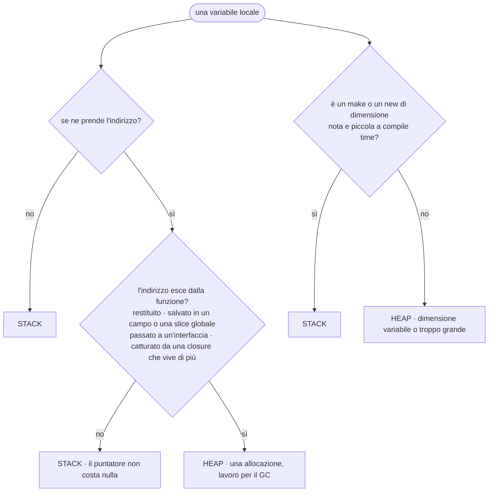
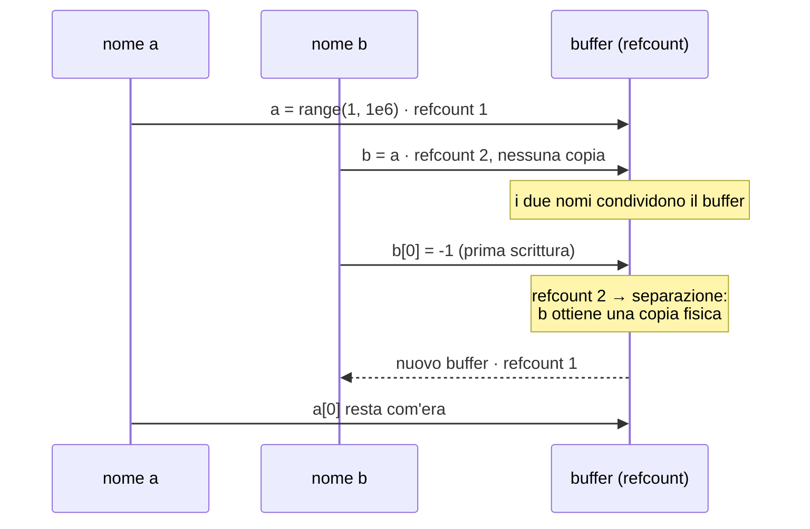
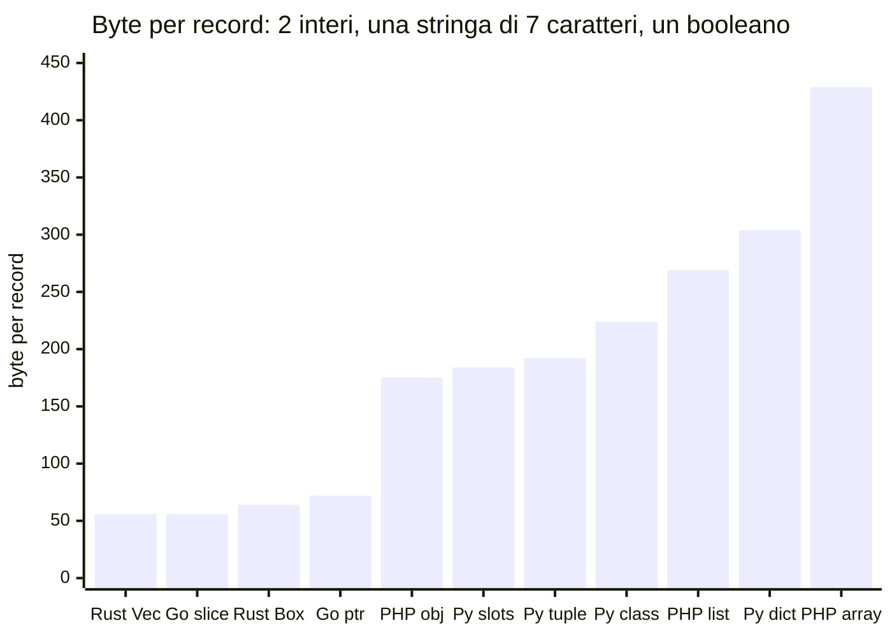
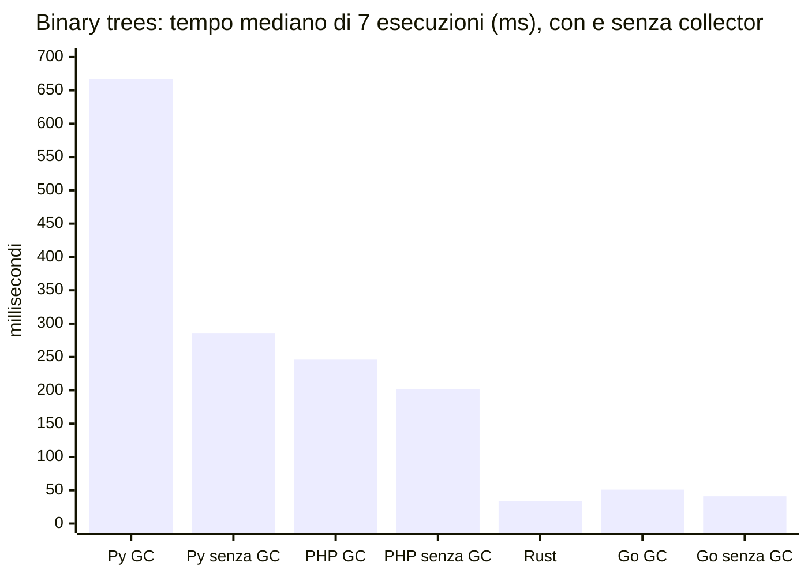

> File C10-parte5.md (parte 5 di 7) — Capitolo C10, Modelli di memoria

## L10.5 — Puntatori ed escape analysis in Go; reference e copy-on-write in PHP; mutabilità condivisa in Python

Ogni linguaggio ha, accanto al modello generale, una «insidia di casa» che chi viene dagli altri tre non si aspetta. Questa lezione le prende una per una e chiude con il **costo** delle scelte, misurato.

### Go: puntatori ed escape analysis

#### Concetto

Go ha puntatori espliciti (`*T`, `&x`) ma **senza aritmetica** dei puntatori e con un GC che li rende sicuri: non esiste l'*use-after-free*. Assegnazione e passaggio di argomenti sono **sempre per valore** (e1); un puntatore serve a condividere. Non c'è nessuna parola per dire «questa variabile sta nello stack» o «nell'heap»: lo decide il compilatore con l'**escape analysis**: se l'indirizzo di una variabile **può sopravvivere** alla funzione che la dichiara, la variabile viene allocata nell'heap («sfugge», *escapes*); altrimenti resta nello stack, dove costa quasi nulla e non pesa sul GC.



La conseguenza pratica è che **in Go non si ragiona in termini di «stack o heap»**, ma di *«quanto di questo codice produce allocazioni?»*: meno allocazioni, meno lavoro per il GC. Gli strumenti sono due: il compilatore (`go build -gcflags=-m`, che spiega le decisioni) e `testing.AllocsPerRun` (che le conta).

#### Esperimento e6 — che cosa «sfugge» nell'heap?

Otto funzioni, ciascuna con un diverso modo di usare un indirizzo, o una dimensione; si chiede al compilatore che cosa ha deciso e si contano le allocazioni a ogni chiamata (`//go:noinline` evita che l'inlining nasconda la decisione).

```go
package main

import (
	"fmt"
	"testing"
)

type P struct{ x, y int }

var sink any

//go:noinline
func byValue() int { p := P{1, 2}; return p.x + p.y }

//go:noinline
func localPointer() int { p := &P{1, 2}; return p.x + p.y } // a pointer, but it never leaves the function

//go:noinline
func returnPointer() *P { p := P{1, 2}; return &p } // the pointer outlives the call

//go:noinline
func toInterface() { sink = P{1, 2} } // a value stored in an interface variable that lives on

//go:noinline
func counter() func() int { n := 0; return func() int { n++; return n } }

//go:noinline
func smallSlice() int { s := make([]int, 8); s[0] = 1; return s[0] }

//go:noinline
func variableSlice(n int) int { s := make([]int, n); s[0] = 1; return s[0] }

//go:noinline
func bigSlice() int { s := make([]int, 1<<20); s[0] = 1; return s[0] }

func main() {
	cases := []struct {
		name string
		f    func()
	}{
		{"byValue", func() { byValue() }},
		{"localPointer", func() { localPointer() }},
		{"returnPointer", func() { sink = returnPointer() }},
		{"toInterface", toInterface},
		{"counter", func() { sink = counter() }},
		{"smallSlice", func() { smallSlice() }},
		{"variableSlice", func() { variableSlice(8) }},
		{"bigSlice", func() { bigSlice() }},
	}
	for _, c := range cases {
		fmt.Printf("%-14s allocations per call: %.0f\n", c.name, testing.AllocsPerRun(100, c.f))
	}
}
```

```text
### e6 go build -gcflags=-m (relevant lines)
main.go:16:32: &P{...} does not escape
main.go:19:27: moved to heap: p
main.go:22:30: P{...} escapes to heap
main.go:25:29: moved to heap: n
main.go:25:44: func literal escapes to heap
main.go:28:34: make([]int, 8) does not escape
main.go:31:42: make([]int, n) escapes to heap
main.go:34:32: make([]int, 1048576) escapes to heap
[exit 0]
### e6 run
byValue        allocations per call: 0
localPointer   allocations per call: 0
returnPointer  allocations per call: 1
toInterface    allocations per call: 1
counter        allocations per call: 2
smallSlice     allocations per call: 0
variableSlice  allocations per call: 1
bigSlice       allocations per call: 1
[exit 0]
```

| Funzione | Decisione del compilatore | Allocazioni | Perché |
|---|---|---|---|
| `byValue` | — | 0 | una struct per valore sta nello stack |
| `localPointer` | `&P{...} does not escape` | **0** | **c'è un puntatore, ma non esce dalla funzione**: nessuna allocazione |
| `returnPointer` | `moved to heap: p` | 1 | l'indirizzo viene restituito: deve sopravvivere alla funzione |
| `toInterface` | `P{...} escapes to heap` | 1 | un valore in una variabile di tipo interfaccia (`any`) che vive oltre la funzione viene *impacchettato* nell'heap |
| `counter` | `moved to heap: n`, `func literal escapes to heap` | 2 | la closure cattura `n` e viene restituita: serve una allocazione per la variabile e una per la closure (C04) |
| `smallSlice` | `make([]int, 8) does not escape` | 0 | dimensione costante e piccola |
| `variableSlice` | `make([]int, n) escapes to heap` | 1 | **dimensione nota solo a runtime**: lo stack non può prevederla |
| `bigSlice` | `make([]int, 1048576) escapes to heap` | 1 | costante, ma troppo grande per lo stack |

Due letture. La prima: **un puntatore non è sinonimo di allocazione** (`localPointer`), contrariamente all'abitudine di chi viene da C o da Java. La seconda: in Go un'interfaccia ha un costo nascosto (`toInterface`), perché il valore nel suo interno è un puntatore a un blocco: è la stessa osservazione del *fat pointer* di C07 (e9) vista dal lato della memoria. Questo spiega perché `fmt.Println(x)`, che prende `any`, alloca.

Il caso di Go è speculare a quello di Rust: Rust chiede di **dichiarare** chi possiede cosa e verifica; Go lascia scegliere al compilatore **dove** mettere ciascuna variabile e raccoglie tutto con un GC. Nessuno dei due chiede al programmatore di chiamare `free`; il primo ha un costo di apprendimento, il secondo un costo a runtime (e12).

### PHP: copy-on-write e reference

#### Concetto

In PHP un array è un **valore**: `$b = $a` produce, per la semantica del linguaggio, una copia indipendente. Se la copia fosse fisica ogni volta, passare un array a una funzione costerebbe *O(n)*. Il motore usa quindi il **copy-on-write** (*CoW*): i due nomi condividono lo stesso buffer, con contatore di riferimenti 2; la **prima scrittura** su uno dei due duplica il buffer e separa i nomi. Il programmatore non lo vede, ma lo paga in memoria e tempo nel momento della scrittura.



Una **reference** (`&`) è la risposta opposta: due nomi per **la stessa variabile**, con lo scopo di rendere visibile una scrittura. È potente e insidiosa, perché «contagia» la copia dell'array che la contiene (e7, punto 2).

#### Esperimento e7 — copy-on-write e il tranello di `foreach` per reference

```php
<?php
function mb(): string
{
    return number_format(memory_get_usage() / 1048576, 1) . ' MB';
}

echo "1) copy-on-write\n";
echo '   start                      : ', mb(), "\n";
$a = range(1, 1_000_000);
echo '   $a = range(1, 1e6)         : ', mb(), "\n";
$b = $a; // logically a copy, physically the same buffer (refcount 2)
echo '   $b = $a                    : ', mb(), "\n";
function readOnly(array $xs): int
{
    return count($xs);
}
readOnly($a);
echo '   passed to a function       : ', mb(), "\n";
$b[0] = -1; // the first write forces the real copy
echo '   $b[0] = -1 (first write)   : ', mb(), "\n";
$b[1] = -2; // already separated: no further copy
echo '   $b[1] = -2 (second write)  : ', mb(), "\n";
echo '   $a[0] is still             : ', $a[0], "\n";
unset($a, $b);

echo "2) references (&) make two names ONE variable\n";
$x = [1, 2, 3];
$r = &$x[1]; // a reference to one slot
$y = $x;     // the copy of the array shares the reference slot
$y[1] = 99;
echo '   $x after writing $y[1]     : ', json_encode($x), "\n";
unset($r);

echo "3) the foreach-by-reference trap\n";
$list = [1, 2, 3];
foreach ($list as &$v) {
    $v *= 10;
}
// $v is still a reference to $list[2]
foreach ($list as $v) {
    // writes into $list[2] at every iteration
}
echo '   $list                      : ', json_encode($list), "\n";
unset($v);
```

```text
### e7.php
1) copy-on-write
   start                      : 0.4 MB
   $a = range(1, 1e6)         : 16.4 MB
   $b = $a                    : 16.4 MB
   passed to a function       : 16.4 MB
   $b[0] = -1 (first write)   : 32.4 MB
   $b[1] = -2 (second write)  : 32.4 MB
   $a[0] is still             : 1
2) references (&) make two names ONE variable
   $x after writing $y[1]     : [1,99,3]
3) the foreach-by-reference trap
   $list                      : [10,20,20]
[exit 0]
```

1. **CoW.** Un array di un milione di interi occupa 16 MB; `$b = $a` e il passaggio a una funzione non aggiungono nulla (`16.4 MB`); la **prima scrittura** su `$b` raddoppia l'occupazione (`32.4 MB`); la seconda non aggiunge niente (i buffer sono già separati); `$a[0]` è ancora `1`. Passare array grandi a una funzione di sola lettura è quindi economico; scriverci dentro, no.
2. **Reference dentro un array.** Dopo `$r = &$x[1]`, la cella `$x[1]` è una *reference*; una **copia** dell'array (`$y = $x`) **condivide** quella cella: scrivere `$y[1] = 99` cambia anche `$x` (`[1,99,3]`). L'unico caso in cui la copia di un array di PHP non è indipendente.
3. **Il tranello classico.** `foreach ($list as &$v)` lascia `$v` come reference all'ultimo elemento; un successivo `foreach ($list as $v)` **scrive nell'ultimo elemento a ogni iterazione**, e il risultato è `[10,20,20]` invece di `[10,20,30]`. La correzione è `unset($v)` subito dopo il primo ciclo (quello che il codice fa alla fine), o non usare mai `&` nei `foreach`.

Un'ultima caratteristica di PHP riguarda il **tempo di vita**: il modello classico (PHP-FPM) è **shared-nothing per richiesta** (C00): al termine di ogni richiesta tutta la memoria viene rilasciata in blocco. La strategia di gestione della memoria più economica che esista, il termine del processo, rende irrilevanti per molti programmi PHP sia i cicli sia i *leak*. Cambia nei processi *long-running* (RoadRunner, Swoole, FrankenPHP in worker mode, i comandi di console): lì tutto quello visto in L10.2 torna a contare.

### Python: mutabilità condivisa

In Python **ogni nome è un riferimento** (e1) e quasi tutto è mutabile: da qui nascono i tranelli più frequenti, tutti riconducibili a «due nomi, un oggetto». I casi già visti: la lista `more = nums` (e1), il default mutabile (C04 e3), il contenitore ripetuto `[[0]*3]*3` (C05). Qui ne serve uno nuovo, perché è esattamente quello del programma: la **copia profonda con riferimenti deboli**.

#### Esperimento e8 — `copy.deepcopy` e il padre debole

Lo stesso albero (`/docs/a.txt`) copiato con `copy.deepcopy` e con la funzione `deep_copy` del programma. Si chiede: il padre della foglia copiata è la cartella **copiata**, o quella **originale**?

```python
import copy
import sys

sys.path.insert(0, "../prog")
from main import Node, deep_copy, full_path  # the Node of the program: children strong, parent weak

root = Node("", True)
docs = Node("docs", True, 0, root)
root.children["docs"] = docs
leaf = Node("a.txt", False, 5, docs)
docs.children["a.txt"] = leaf

for label, make in (("copy.deepcopy", copy.deepcopy), ("deep_copy (ours)", deep_copy)):
    dup = make(root)
    d_docs = dup.children["docs"]
    d_leaf = d_docs.children["a.txt"]
    parent = d_leaf.parent() if d_leaf.parent is not None else None
    print(f"{label:17}: parent of the copied leaf is the copied dir: {parent is d_docs}"
          f" | is the ORIGINAL dir: {parent is docs}")
    print(f"{'':17}  path: {full_path(d_leaf)}")
    del dup, d_docs, d_leaf, parent

dup = copy.deepcopy(root)
d_leaf = dup.children["docs"].children["a.txt"]
del root, docs, leaf  # the original tree is released
print("after releasing the original, the deepcopy's leaf has path:", full_path(d_leaf))
```

```text
### e8.py
copy.deepcopy    : parent of the copied leaf is the copied dir: False | is the ORIGINAL dir: True
                   path: /docs/a.txt
deep_copy (ours) : parent of the copied leaf is the copied dir: True | is the ORIGINAL dir: False
                   path: /docs/a.txt
after releasing the original, the deepcopy's leaf has path: /a.txt
[exit 0]
```

`copy.deepcopy` tratta `weakref.ref` come un valore **atomico**, quindi non lo copia: il padre della foglia copiata resta la cartella **originale** (`is the ORIGINAL dir: True`). Il percorso stampato sembra giusto (`/docs/a.txt`), ma solo perché l'originale esiste ancora; appena lo si rilascia, la foglia copiata perde il padre e il suo percorso diventa `/a.txt`: un bug che compare *dopo*, lontano dalla causa. `deep_copy` fa invece ciò che serve, ricreando ogni collegamento. La lezione generale: **le copie profonde automatiche non conoscono la semantica dei riferimenti non possessori**; con collegamenti al padre, riferimenti deboli, file aperti o connessioni, la copia va scritta o controllata a mano.

### Il costo di tutto questo

#### Esperimento e9 — quanto pesa un record?

Lo stesso dato logico in 100 000 esemplari: due interi, una stringa di 7 caratteri, un booleano. Ciascun linguaggio con le rappresentazioni più comuni. Le quattro misure **non sono identiche** (cambia che cosa conta lo strumento: Python `tracemalloc` conta le allocazioni tracciate; PHP `memory_get_usage` conta i byte dell'allocatore del motore; Go `HeapAlloc` conta i byte arrotondati alla classe di dimensione; Rust conta con un allocatore contatore i byte *richiesti*), ma gli ordini di grandezza sono confrontabili.

```python
import sys
import tracemalloc
from typing import NamedTuple

N = 100_000


class Plain:
    def __init__(self, id: int, size: int, name: str, is_dir: bool) -> None:
        self.id, self.size, self.name, self.is_dir = id, size, name, is_dir


class Slotted:
    __slots__ = ("id", "size", "name", "is_dir")

    def __init__(self, id: int, size: int, name: str, is_dir: bool) -> None:
        self.id, self.size, self.name, self.is_dir = id, size, name, is_dir


class Named(NamedTuple):
    id: int
    size: int
    name: str
    is_dir: bool


makers = {
    "dict": lambda i: {"id": i, "size": i * 3, "name": f"n{i:06d}", "is_dir": False},
    "plain class": lambda i: Plain(i, i * 3, f"n{i:06d}", False),
    "class with __slots__": lambda i: Slotted(i, i * 3, f"n{i:06d}", False),
    "tuple": lambda i: (i, i * 3, f"n{i:06d}", False),
}
for label, make in makers.items():
    tracemalloc.start()
    data = [make(i) for i in range(N)]
    current, _ = tracemalloc.get_traced_memory()
    tracemalloc.stop()
    print(f"python {label:21}: {current / N:6.0f} bytes per record")
    del data

print("one int / one 7-char str / bool:", sys.getsizeof(100_001), sys.getsizeof("n000001"), sys.getsizeof(False))
```

```php
<?php
final class Rec
{
    public function __construct(public int $id, public int $size, public string $name, public bool $isDir)
    {
    }
}

const N = 100_000;

function name(int $i): string
{
    return 'n' . str_pad((string) $i, 6, '0', STR_PAD_LEFT);
}

function measure(string $label, callable $make): void
{
    gc_collect_cycles();
    $before = memory_get_usage();
    $data = [];
    for ($i = 0; $i < N; $i++) {
        $data[] = $make($i);
    }
    printf("php %-26s: %6.0f bytes per record\n", $label, (memory_get_usage() - $before) / N);
    unset($data);
}

measure('assoc array', fn(int $i) => ['id' => $i, 'size' => $i * 3, 'name' => name($i), 'isDir' => false]);
measure('list array [id, size, ...]', fn(int $i) => [$i, $i * 3, name($i), false]);
measure('object (typed properties)', fn(int $i) => new Rec($i, $i * 3, name($i), false));

// a side observation: the SAME 7-character string, built in two ways
measure('string only: concatenation', fn(int $i) => name($i));
measure('string only: sprintf()', fn(int $i) => sprintf('n%06d', $i));
```

```rust
use std::alloc::{GlobalAlloc, Layout, System};
use std::mem::size_of;
use std::sync::atomic::{AtomicUsize, Ordering};

struct Counting;
static LIVE: AtomicUsize = AtomicUsize::new(0);

unsafe impl GlobalAlloc for Counting {
    unsafe fn alloc(&self, l: Layout) -> *mut u8 {
        LIVE.fetch_add(l.size(), Ordering::Relaxed);
        unsafe { System.alloc(l) }
    }
    unsafe fn dealloc(&self, p: *mut u8, l: Layout) {
        LIVE.fetch_sub(l.size(), Ordering::Relaxed);
        unsafe { System.dealloc(p, l) }
    }
}

#[global_allocator]
static A: Counting = Counting;

#[allow(dead_code)]
struct Rec {
    id: i64,
    size: i64,
    name: String,
    is_dir: bool,
}

const N: usize = 100_000;

fn rec(i: usize) -> Rec {
    Rec { id: i as i64, size: i as i64 * 3, name: format!("n{i:06}"), is_dir: false }
}

fn main() {
    println!("size_of Rec = {} bytes (i64 + i64 + String(ptr,cap,len) + bool, padded)", size_of::<Rec>());
    let before = LIVE.load(Ordering::Relaxed);
    let inline: Vec<Rec> = (0..N).map(rec).collect();
    let used = LIVE.load(Ordering::Relaxed) - before;
    println!("rust Vec<Rec>      : {:6.0} bytes per record (requested bytes, inline records)", used as f64 / N as f64);
    drop(inline);
    let before = LIVE.load(Ordering::Relaxed);
    let boxed: Vec<Box<Rec>> = (0..N).map(|i| Box::new(rec(i))).collect();
    let used = LIVE.load(Ordering::Relaxed) - before;
    println!("rust Vec<Box<Rec>> : {:6.0} bytes per record (requested bytes, one allocation per record)", used as f64 / N as f64);
    drop(boxed);
}
```

```go
package main

import (
	"fmt"
	"runtime"
)

type Rec struct {
	ID    int
	Size  int
	Name  string
	IsDir bool
}

const N = 100_000

func heap() uint64 {
	runtime.GC()
	var m runtime.MemStats
	runtime.ReadMemStats(&m)
	return m.HeapAlloc
}

func rec(i int) Rec { return Rec{i, i * 3, fmt.Sprintf("n%06d", i), false} }

var keep1 []Rec
var keep2 []*Rec

func main() {
	base := heap()
	keep1 = make([]Rec, 0, N)
	for i := 0; i < N; i++ {
		keep1 = append(keep1, rec(i))
	}
	fmt.Printf("go []Rec  : %6.0f bytes per record (inline records)\n", float64(heap()-base)/N)
	keep1 = nil
	base = heap()
	keep2 = make([]*Rec, 0, N)
	for i := 0; i < N; i++ {
		r := rec(i)
		keep2 = append(keep2, &r)
	}
	fmt.Printf("go []*Rec : %6.0f bytes per record (one allocation per record)\n", float64(heap()-base)/N)
}
```

```text
### e9.py
python dict                 :    304 bytes per record
python plain class          :    224 bytes per record
python class with __slots__ :    184 bytes per record
python tuple                :    192 bytes per record
one int / one 7-char str / bool: 28 48 28
[exit 0]
### e9.php
php assoc array               :    429 bytes per record
php list array [id, size, ...]:    269 bytes per record
php object (typed properties) :    175 bytes per record
php string only: concatenation:     53 bytes per record
php string only: sprintf()    :    341 bytes per record
[exit 0]
### e9.rs
size_of Rec = 48 bytes (i64 + i64 + String(ptr,cap,len) + bool, padded)
rust Vec<Rec>      :     56 bytes per record (requested bytes, inline records)
rust Vec<Box<Rec>> :     64 bytes per record (requested bytes, one allocation per record)
[exit 0]
### e9.go
go []Rec  :     56 bytes per record (inline records)
go []*Rec :     72 bytes per record (one allocation per record)
[exit 0]
```



| Rappresentazione | Byte per record | Che cosa c'è dentro |
|---|---|---|
| Rust `Vec<Rec>` / Go `[]Rec` | **56** | record inline (48 byte di struct: 8 + 8 + 24 di `String` + 1, con padding) più 8 byte di testo nell'heap |
| Rust `Vec<Box<Rec>>` | 64 | il puntatore (8) in più, uno per record |
| Go `[]*Rec` | 72 | puntatore (8) + struct arrotondata alla classe di dimensione (48) + testo |
| PHP oggetto con proprietà tipizzate | 175 | intestazione dell'oggetto + 4 slot da 16 byte + stringa |
| Python classe con `__slots__` | 184 | tre oggetti `int`/`str`/`bool` separati (28 + 28 + 48 byte di `sys.getsizeof` per intero, intero e stringa) più l'oggetto |
| Python tupla | 192 | quasi lo stesso, senza nomi |
| Python classe normale | 224 | in più il dizionario degli attributi dell'istanza |
| PHP array a lista `[id, size, name, flag]` | 269 | un array vero per ogni record |
| Python `dict` | 304 | una hash table per record |
| PHP array associativo | 429 | hash table con chiavi stringa per record |

Dal più compatto al più voluminoso, lo **stesso dato** costa da 56 a 429 byte: un fattore circa 8. Il confronto è fra *rappresentazioni*, non solo fra linguaggi: Python con `__slots__` e Rust-con-`Box` sono nello stesso ordine di grandezza perché entrambi pagano un puntatore e un blocco per record, mentre Go e Rust con record inline pagano solo il dato. Le due ragioni sono (1) in Python e PHP anche un intero è un oggetto con intestazione e contatore, (2) un record dinamico ha bisogno di una struttura per i nomi dei campi, oppure di una tabella hash.

Una nota PHP, emersa in stesura: la **stessa stringa di 7 caratteri** pesa 53 byte per record se costruita con la concatenazione e **341** se costruita con `sprintf` (ultime due righe dell'output). Non ho indagato la causa nel motore; l'ipotesi è che `sprintf` lasci nel risultato il buffer di lavoro che aveva allocato. La conseguenza pratica, se l'ipotesi è giusta: in un programma che conserva molte stringhe prodotte da `sprintf`, la memoria cresce molto più del previsto. Il tema ricompare in C21 (profiling della memoria): **le misure vanno fatte, non assunte**.

#### Esperimento e12 — il costo di un garbage collector

Un carico classico che alloca molto (*binary trees*): si costruisce un albero binario completo di profondità 16 e lo si tiene vivo (131 071 nodi), poi otto volte se ne costruisce, percorre e scarta un altro. In totale 1 179 639 nodi per esecuzione. Ogni linguaggio nella sua forma naturale: oggetti con `__slots__` (Python), oggetti (PHP), `Option<Box<Tree>>` (Rust, `-O`), `*Tree` (Go). Poi di nuovo con il collector spento (`gc.disable()`, `gc_disable()`, `GOGC=off`). Mediana di 7 esecuzioni; tempi totali, **compreso l'avvio del processo** (misurato in questo ambiente: circa 14 ms per `python3 -c pass`, circa 30 ms per `php -r ''`); memoria di picco (RSS).

```python
import gc
import sys


class Tree:
    __slots__ = ("left", "right")

    def __init__(self, left: "Tree | None", right: "Tree | None") -> None:
        self.left, self.right = left, right


def build(d: int) -> Tree:
    return Tree(build(d - 1), build(d - 1)) if d > 0 else Tree(None, None)


def check(t: Tree) -> int:
    return 1 + (check(t.left) + check(t.right) if t.left else 0)


if len(sys.argv) > 1 and sys.argv[1] == "nogc":
    gc.disable()
long_lived = build(16)
total = 0
for _ in range(8):
    total += check(build(16))  # a short-lived tree: built, walked, dropped
print(total + check(long_lived))
```

```php
<?php
final class Tree
{
    public function __construct(public ?Tree $left, public ?Tree $right)
    {
    }
}

function build(int $d): Tree
{
    return $d > 0 ? new Tree(build($d - 1), build($d - 1)) : new Tree(null, null);
}

function check(Tree $t): int
{
    return 1 + ($t->left !== null ? check($t->left) + check($t->right) : 0);
}

if (($argv[1] ?? '') === 'nogc') {
    gc_disable();
}
$longLived = build(16);
$total = 0;
for ($i = 0; $i < 8; $i++) {
    $total += check(build(16)); // a short-lived tree: built, walked, dropped
}
echo $total + check($longLived), "\n";
```

```rust
struct Tree {
    left: Option<Box<Tree>>,
    right: Option<Box<Tree>>,
}

fn build(d: u32) -> Tree {
    if d > 0 {
        Tree { left: Some(Box::new(build(d - 1))), right: Some(Box::new(build(d - 1))) }
    } else {
        Tree { left: None, right: None }
    }
}

fn check(t: &Tree) -> u64 {
    1 + match (&t.left, &t.right) {
        (Some(l), Some(r)) => check(l) + check(r),
        _ => 0,
    }
}

fn main() {
    let long_lived = build(16);
    let mut total = 0;
    for _ in 0..8 {
        total += check(&build(16)); // a short-lived tree: built, walked, dropped
    }
    println!("{}", total + check(&long_lived));
}
```

```go
package main

import "fmt"

type Tree struct{ left, right *Tree }

func build(d int) *Tree {
	if d > 0 {
		return &Tree{build(d - 1), build(d - 1)}
	}
	return &Tree{}
}

func check(t *Tree) int {
	if t.left == nil {
		return 1
	}
	return 1 + check(t.left) + check(t.right)
}

func main() {
	longLived := build(16)
	total := 0
	for i := 0; i < 8; i++ {
		total += check(build(16)) // a short-lived tree: built, walked, dropped
	}
	fmt.Println(total + check(longLived))
}
```

```text
### e12 (median of 7, nodes per run: 1179639)
Python (cyclic GC on)  median    667 ms  (min   603, max   715)  peak RSS    21 MB
Python (gc.disable)    median    286 ms  (min   240, max   320)  peak RSS    21 MB
PHP (cycle GC on)      median    246 ms  (min   235, max   284)  peak RSS    54 MB
PHP (gc_disable)       median    202 ms  (min   189, max   228)  peak RSS    55 MB
Rust (-O, Box)         median     34 ms  (min    33, max    35)  peak RSS    12 MB
Go (GC on)             median     51 ms  (min    42, max    55)  peak RSS    13 MB
Go (GOGC=off)          median     41 ms  (min    36, max    48)  peak RSS    21 MB
[exit 0]
```



Letture, con la cautela dovuta a una misura su una sola macchina condivisa:

1. **Spegnere il collector ciclico di Python taglia il tempo da 667 a 286 ms** (−57%), perché ogni collezione delle generazioni vecchie riattraversa i 131 071 nodi dell'albero vivo. In questo carico non ci sono cicli: il collector lavora a vuoto. Il lavoro dei contatori (che in Python non si può spegnere) resta.
2. **PHP** perde meno (246 contro 202 ms, −18%), ma consuma **54 MB** di picco contro i 21 di Python e i 12 di Rust: un oggetto PHP è più grande (e9).
3. **Rust (34 ms) e Go (51 ms)** sono di un ordine di grandezza più veloci degli interpreti. Il GC di Go costa circa il 20% (51 contro 41 ms) e, spento, la memoria di picco passa da 13 a 21 MB: la memoria liberata non viene mai riusata. Rust non ha un collector da spegnere: alloca e libera per proprietà.
4. Il confronto **non** dice «Go è più lento di Rust» in generale: un albero di nodi allocati uno a uno è il caso peggiore per un allocatore e il migliore per far risaltare un GC. Una misura sensata dipende dal carico reale (C13, C21).

### Focus comparativo

| Aspetto | PHP | Python | Rust | Go |
|---|---|---|---|---|
| «Insidia di casa» | `&` in `foreach`; reference contagiose; CoW invisibile | due nomi, un oggetto; `deepcopy` e riferimenti deboli | `Rc` ciclici che perdono memoria; `RefCell` che va in panic | `append` che rialloca; interfacce che allocano |
| Dove si decide la posizione in memoria | motore (tutto heap) | interprete (tutto heap) | programmatore (tipi) | **compilatore** (escape analysis) |
| Costo per record (e9) | 175–429 byte | 184–304 byte | 56–64 byte | 56–72 byte |
| Costo del collector (e12) | circa 18% | circa 57% (cicli spenti) | nessun collector | circa 20% |
| Strumento per misurare | `memory_get_usage`, `gc_status` | `tracemalloc`, `sys.getsizeof` (superficiale), `gc` | allocatore contatore, `size_of` | `-gcflags=-m`, `runtime.MemStats`, `pprof` |

### Esercizio Rosetta (4′)

Misura nel linguaggio primario la memoria di `Drive` con 100 000 file (`add /a/fNNNNNN 1`): byte per nodo, con e senza i nomi. Poi sposta il collegamento al padre da forte a debole (o viceversa) e rimisura. Quale dei due cambiamenti pesa di più?

---

## Il programma completo e il collaudo

Il programma completo (circa 190–250 righe per linguaggio, per intero in Appendice) assembla T1–T7: legge `ops.txt`, esegue ogni istruzione sul `Drive`, scrive il risultato di `du` e `show` su *stdout*, i rifiuti su *stderr*, e il riepilogo finale. Si lancia con un argomento:

```bash
python3 main.py ops.txt
php main.php ops.txt
./main_rs ops.txt      # rustc --edition 2024 -O main.rs -o main_rs
./main_go ops.txt      # go build -o main_go
```

Il collaudo ha **cinque casi**, ciascuno eseguito nei quattro linguaggi con confronto byte per byte di *stdout*, *stderr* ed exit code.

| # | Caso | Che cosa verifica | Esito atteso | I quattro concordano? |
|---|---|---|---|---|
| 1 | `ops.txt` di riferimento (35 istruzioni, 13 rifiuti) | tutto il flusso T1–T7, snapshot, rollback, segnalibri vivi e scomparsi | `applied=22 rejected=13`, exit 1 | sì |
| 2 | file vuoto | nessuna istruzione: nessun errore, solo la radice | `ops=0 nodes=1`, exit 0 | sì |
| 3 | terminatori `\r\n`, riga vuota | `trim` prima di dividere; un segnalibro vivo | `bookmarks_alive=1`, exit 0 | sì |
| 4 | file inesistente | errore di input, non un'eccezione non gestita | `cannot open …`, exit 2 | sì |
| 5 | **catena di 3000 cartelle annidate** (`t_deep.txt`) | profondità dello stack in `du` | `du / size=0 nodes=3001`, exit 0 | **no: Python diverge** |

```text
### t_empty.txt
ops=0 applied=0 rejected=0 nodes=1 snapshots=0 bookmarks_alive=0 bookmarks_gone=0
[exit 0]

### t_min.txt
ops=2 applied=2 rejected=0 nodes=3 snapshots=0 bookmarks_alive=0 bookmarks_gone=0
[exit 0]

### t_crlf.txt
show b alive path=/a/f.txt
du / size=10 nodes=3
ops=5 applied=5 rejected=0 nodes=3 snapshots=0 bookmarks_alive=1 bookmarks_gone=0
[exit 0]

### t_deep.txt (python)
--- stderr (last lines)
    s, c = du(child)
           ~~^^^^^^^
  [Previous line repeated 993 more times]
RecursionError: maximum recursion depth exceeded
[exit 1]

### t_deep.txt (php)
du / size=0 nodes=3001
ops=3002 applied=3002 rejected=0 nodes=3001 snapshots=0 bookmarks_alive=1 bookmarks_gone=0
[exit 0]

### t_deep.txt (rust)
du / size=0 nodes=3001
ops=3002 applied=3002 rejected=0 nodes=3001 snapshots=0 bookmarks_alive=1 bookmarks_gone=0
[exit 0]

### t_deep.txt (go)
du / size=0 nodes=3001
ops=3002 applied=3002 rejected=0 nodes=3001 snapshots=0 bookmarks_alive=1 bookmarks_gone=0
[exit 0]

### missing.txt
cannot open missing.txt
[exit 2]
```

### Il caso 5: dove Python diverge

`t_deep.txt` crea `/d`, `/d/d`, `/d/d/d`… fino a 3000 livelli e chiede `du /`. PHP, Rust e Go rispondono `size=0 nodes=3001`. Python termina con `RecursionError`: la ricorsione di `du` supera il limite di 1000 frame di CPython. Non è un errore di uno dei quattro: è la conseguenza di **come ciascuno gestisce lo stack** (L10.1). Le correzioni possibili sono due, e nessuna è neutra: alzare il limite (`sys.setrecursionlimit`), che sposta il problema più in là e rischia un crash vero dell'interprete oltre una certa profondità; oppure riscrivere `du` con una **pila esplicita** (una lista nell'heap), che toglie il limite ma cambia la forma del codice. Per la scelta tra le due serve un criterio: da dove viene la profondità? Se è sotto controllo (un albero di dimensioni note) basta il limite più alto; se arriva da dati esterni, la pila esplicita (o un limite di profondità che rifiuta l'input, C14).

### Due bug veri emersi in stesura

**Un `?` che inverte il significato.** Nella prima versione Rust, la validazione del percorso in `add` era scritta `split_path(path)?;`, dentro una funzione che restituisce `Option<&'static str>`. Ma in questo contratto **`None` significa «nessun rifiuto», cioè successo**: l'operatore `?` su un `None` interrompe la funzione restituendo `None`, quindi un percorso non valido veniva contato come istruzione **applicata**. L'output differiva dagli altri tre in due punti: `applied=23 rejected=12` invece di `22/13` e l'assenza della riga `reject line=35 op=add reason=path`. Come in C08, a rivelarlo è stata la **divergenza** da Python, PHP e Go, non un errore del compilatore: il codice era corretto per il compilatore e sbagliato per il contratto. La lezione di tipo: un `Option` il cui `None` significa «tutto bene» è una trappola; con `Result<(), Reject>` (C09) il `?` avrebbe propagato un errore, che è ciò che `?` fa di solito. La correzione è un `if split_path(path).is_none() { return Some("path"); }` esplicito, e il tema torna in C09 come «errori tipizzati».

**Il debug di una misura.** Nei primi tentativi di e9, PHP risultava 463 byte per oggetto invece di 175. La differenza era `sprintf` (vedi sopra): il problema non era l'oggetto, era la stringa. Un esperimento che non si capisce va scomposto fino a isolare un solo fattore.

