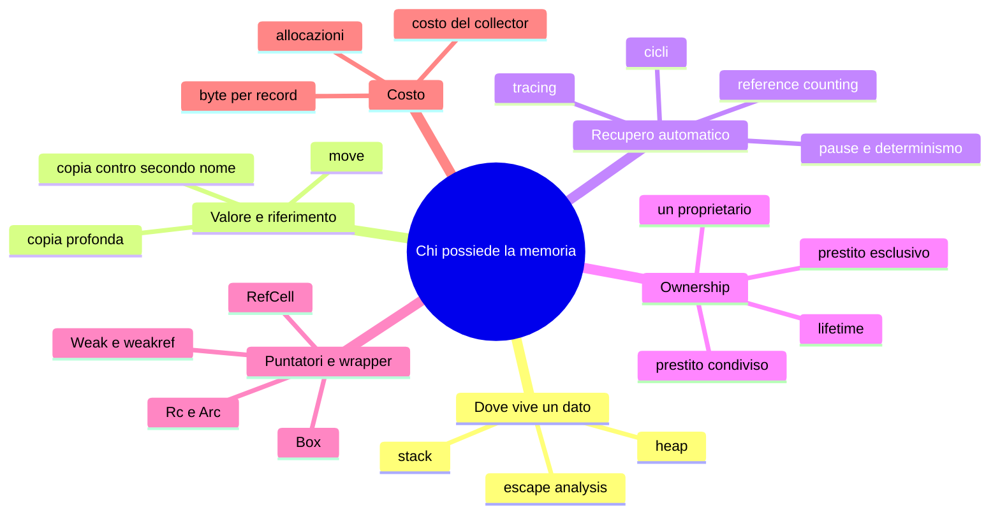

> File C10-parte6.md (parte 6 di 7) — Capitolo C10, Modelli di memoria

## Matrice degli approcci

Legenda: ● nativo e idiomatico · ◐ alternativa assimilabile (libreria, convenzione) · ○ assente o non idiomatico. È un indice, non una dichiarazione di equivalenza.

| Costrutto | PHP | Python | Rust | Go |
|---|---|---|---|---|
| Stack e heap gestiti automaticamente | ● (tutto heap per gli oggetti) | ● (tutto heap) | ● (stack per default) | ● (escape analysis) |
| Reference counting | ● | ● (CPython) | ◐ `Rc`, `Arc` opt-in | ○ |
| Garbage collector a tracing | ◐ solo per i cicli | ◐ solo per i cicli | ○ | ● concorrente |
| Gestione dei cicli | ● collector dei cicli | ● GC ciclico generazionale | ○ (perdita) → `Weak` | ● (non è un problema) |
| Ownership e borrowing | ○ | ○ | ● | ○ |
| Lifetime espliciti | ○ | ○ | ● | ○ |
| Distruttore deterministico | ● `__destruct` | ● `__del__` (CPython) | ● `Drop` | ○ (`defer`, `Close`) |
| Riferimento debole | ● `WeakReference` | ● `weakref` | ● `Weak<T>` | ● `weak.Pointer` (1.24) |
| Copia superficiale / profonda | `clone` / a mano | `copy.copy` / `deepcopy` | `.clone()` (un solo livello di default) | assegnazione / a mano |
| Copy-on-write | ● array | ○ | ◐ `Cow`, `Rc::make_mut` | ○ |
| Mutabilità interna controllata | ○ (sempre mutabile) | ○ (sempre mutabile) | ● `RefCell`, `Mutex` | ○ (sempre mutabile) |
| Puntatori espliciti | ◐ reference `&` | ○ | ● riferimenti, `*const`/`*mut` | ● senza aritmetica |
| Controllo del collector | `gc_disable`, `gc_collect_cycles` | `gc.disable`, `gc.collect` | — | `GOGC`, `runtime.GC` |

## Addendum — Il perché della scelta

Il tema è uno: **chi risponde della memoria**. Le quattro risposte sono quattro idee di responsabilità.

**Delegare al runtime (Python, PHP, Go).** Il programmatore non pensa alla liberazione: la comodità è immediata, il costo è durante l'esecuzione e nel *quando*. Ma delegare si può in due modi. PHP e CPython delegano **contando**: ogni riferimento paga un piccolo prezzo, in cambio la memoria torna subito e i distruttori hanno un momento (il costo è in chi non si accorge dei cicli). Go delega **cercando**: i riferimenti non costano nulla, il lavoro si concentra nel GC, e l'ordine in cui le cose muoiono non è garantito (per questo il linguaggio non ha distruttori, e usa `defer`). Dietro la scelta di PHP c'è un'altra idea, più pragmatica: se ogni richiesta è un processo breve, il modo più semplice di non perdere memoria è finire il processo.

**Dichiarare nel codice e far verificare (Rust).** La responsabilità non è delegata, è **scritta nei tipi** e verificata dal compilatore. Costo nell'apprendimento, nessuno a runtime. Il modello ricalca un'idea antica, la proprietà e il prestito: una cosa ha un solo proprietario; si può darla in prestito a più persone che la guardano oppure a una sola che la modifica, mai a entrambe. Il compilatore non fa altro che applicare con rigore le regole di un buon prestito. Lo slogan di Rust, *memory safety without garbage collection*, è il risultato.

**Lasciar decidere al compilatore dove (Go).** Go non chiede al programmatore di pensare né alla proprietà né alla posizione: l'escape analysis decide stack o heap, il GC fa il resto. È coerente con l'idea del linguaggio (C00): semplicità come vincolo voluto, meno scelte da sbagliare, a spese di un po' di controllo.

**Una domanda per scegliere.** Chi sbaglia più spesso: chi libera troppo presto o troppo tardi? Il C risponde «il programmatore» e paga con una famiglia di vulnerabilità. Gli altri quattro (compreso Rust) rispondono «mai il programmatore», ma lo fanno spostando la responsabilità in tre posti diversi: il contatore, il collector, il compilatore. La scelta è quindi tra **costo a runtime**, **costo di apprendimento** e **imprevedibilità del momento**, e si fa guardando il carico: un servizio con tempi di risposta stretti e memoria limitata tende verso Rust; uno scritto in fretta e con pause tollerabili verso Go; uno con molta logica di dominio e carichi moderati verso Python o PHP.

## Anti-pattern

| Anti-pattern | Dove si vede | Perché è un problema | Alternativa |
|---|---|---|---|
| Collegamento al padre **forte** in un albero | Python, PHP, Rust | ciclo: liberazione ritardata (Python/PHP) o **perdita permanente** (Rust, e3) | riferimento debole (`weakref`, `Weak`) |
| `copy.deepcopy` su strutture con riferimenti deboli, file o connessioni | Python | copia valori atomici, lascia i collegamenti sull'originale (e8) | copia profonda scritta a mano, o `__deepcopy__` |
| `foreach (... as &$v)` senza `unset($v)` | PHP | `$v` resta una reference all'ultimo elemento (e7) | evitare `&` nei `foreach`; `unset($v)` subito dopo |
| `Rc<RefCell<T>>` ovunque | Rust | si importa il modello di Python con errori a runtime (panic) | un solo proprietario e prestiti; `Rc` solo dove serve davvero |
| Clonare per far tacere il compilatore | Rust | costi nascosti; il problema di progetto resta | ripensare chi possiede il dato; firma con `&T` |
| Slice che trattiene un grande array | Go | `big[:3]` tiene vivo l'intero array sottostante | copiare la parte che serve (`slices.Clone`) |
| Cache globale senza limite né riferimenti deboli | tutti | la raggiungibilità involontaria è la perdita tipica nei linguaggi con GC (e3) | cache con capacità (LRU, C08) o `WeakValueDictionary` |
| Distruttori per rilasciare risorse | Python, PHP | funzionano in CPython/PHP, ma il momento non è garantito altrove (PyPy, tracing) | `with`, `try/finally`, `defer`, `Drop` (C09) |
| Dipendere dall'ordine di distruzione dei distruttori | Python, PHP | non è una garanzia del linguaggio (e4) | rilascio esplicito con scope |
| Ricorsione senza controllo di profondità su dati esterni | tutti | `RecursionError`, stack overflow, `Segmentation fault` (e11, caso 5) | pila esplicita o limite di profondità |
| `sprintf` per generare milioni di stringhe da conservare | PHP | memoria molto più alta del previsto (e9, ipotesi) | misurare; concatenazione o `str_pad` |

## Quiz

1. Che cosa succede alla riga `b = a` in Python, PHP (oggetto), Rust e Go quando `a` è una struttura con due campi?
2. Perché in Python e PHP l'esperimento e3 caso A lascia gli oggetti vivi dopo `del`/`unset`, mentre il caso B li libera subito?
3. Perché un ciclo di `Rc` in Rust non viene mai liberato, mentre in Go lo stesso ciclo viene raccolto?
4. Perché `show` in Go chiama `runtime.GC()` prima di chiedere il valore del weak pointer?
5. Che cosa significa «o molti lettori, o un solo scrittore»? Quale errore di C05 impedisce?
6. Che cosa dice `E0106 missing lifetime specifier` e perché il compilatore non lo deduce da solo in `longest`?
7. Perché `Option<Box<u64>>` pesa quanto `Box<u64>`?
8. In Go `p := &P{1,2}; return p.x + p.y` non alloca. Perché? E `return &p`?
9. In e7, perché la seconda scrittura su `$b` non aumenta la memoria?
10. Perché `copy.deepcopy` non basta per fare lo snapshot del `Drive` in Python?

**Risposte**

> 1. Python: secondo nome per la stessa struttura. PHP: copia dell'handle, un oggetto, due nomi. Rust: **move**, `a` non è più utilizzabile (a meno che il tipo sia `Copy`). Go: **copia** della struttura intera, due valori indipendenti.
> 2. Nel caso A padre e figlio si riferiscono a vicenda con riferimenti forti: i contatori non arrivano mai a zero, quindi li libera solo il collector dei cicli, quando gira. Nel caso B il collegamento al padre è debole, non conta: il contatore del padre va a zero subito al `del`, e a cascata quello del figlio.
> 3. `Rc` conta soltanto: in un ciclo ciascuno tiene a 1 il contatore dell'altro. Go non conta, **traccia** dalle radici: un ciclo non raggiungibile da nessuna radice non viene marcato e viene liberato.
> 4. Un weak pointer si azzera quando un ciclo di GC trova l'oggetto irraggiungibile; senza una collezione forzata la risposta dipenderebbe da quando il GC gira, e l'output non sarebbe riproducibile.
> 5. Una regola di esclusione: si possono avere molti riferimenti condivisi (`&T`) oppure uno solo esclusivo (`&mut T`), mai insieme. Impedisce l'invalidazione degli iteratori (modificare una collezione mentre la si scorre, C05) e le data race.
> 6. La funzione restituisce un riferimento e ne riceve due: il compilatore non sa se il risultato dipende da `a` o da `b`. Serve dichiararlo con `'a` su entrambi, cioè «il risultato non vive più del più corto dei due».
> 7. Perché un `Box` non può essere nullo: il compilatore usa l'indirizzo zero per rappresentare `None` (niche optimization).
> 8. Perché l'indirizzo non esce dalla funzione: l'escape analysis lo tiene nello stack. In `return &p` l'indirizzo viene restituito, quindi `p` viene spostata nell'heap.
> 9. Alla prima scrittura i due buffer si sono separati: `$b` ha già una copia fisica propria, quindi altre scritture non ne richiedono un'altra.
> 10. Perché `deepcopy` tratta `weakref.ref` come atomico: il padre di un nodo copiato resterebbe il nodo originale (e8).

## Esercizi

| # | Livello | Consegna |
|---|---|---|
| 1 | base | Aggiungere `ls PERCORSO` che stampa i nomi dei figli in ordine alfabetico. Quale struttura usa ciascun linguaggio, e che ordine hanno i figli «per natura»? |
| 2 | base | Aggiungere `size PERCORSO` che stampa solo la dimensione del nodo (senza i figli). Dove sta la proprietà, e che cosa restituisci? |
| 3 | medio | Cambiare il collegamento al padre da debole a **forte** in Python, PHP e Rust e rieseguire `ops.txt`. Che cosa cambia nell'output? In quale linguaggio il problema è visibile solo con un'analisi della memoria? |
| 4 | medio | Rendere `du` iterativo (pila esplicita) nei quattro linguaggi e rieseguire `t_deep.txt`. Quale dei quattro cambia comportamento? Qual è il nuovo limite? |
| 5 | medio | Implementare `rollback` senza copia profonda, condividendo i nodi della fotografia con l'albero corrente (*structural sharing*), con `Rc` in Rust e riferimenti in Python/PHP/Go. Che cosa ti obbliga a cambiare in `add` e `rm`? |
| 6 | avanzato | Aggiungere `link PERCORSO_A PERCORSO_B` che rende un file raggiungibile da due cartelle (esercizio Rosetta di L10.4). Come si decide quando liberare il nodo? Quale tipo usi per i figli in Rust? |
| 7 | avanzato | In Rust, riscrivere il modello con indici in un `Vec<Node>` («arena») al posto di `Rc<RefCell<…>>`. Che cosa diventano `parent` e il segnalibro? Che cosa perdi (il `gone` automatico) e che cosa guadagni (un'allocazione, nessun contatore)? |
| 8 | avanzato | Misurare con `go build -gcflags=-m` quali variabili del `Drive` Go sfuggono nell'heap. Quante allocazioni fa `add` per nodo, e come ridurle? |

## Mappa mentale

## Ponte ai capitoli successivi

C11 riprende tutto ciò che qui è stato detto sui contatori e sulle regole di esclusione: `Rc` contro `Arc`, `RefCell` contro `Mutex`, `Send` e `Sync`, il GIL di Python come protezione dei contatori di riferimento, il *race detector* di Go, e lo stato condiviso del `Drive` quando più goroutine o thread lo usano insieme. C12 usa la visibilità per modulo e package per nascondere il modello dei nodi dietro un'interfaccia. C13 porta in test il controllo della memoria (fixture con `Drop`, test dei segnalibri, benchmark di allocazione). C14 riprende la profondità dei dati esterni (JSON annidato, limite di ricorsione e `RecursionError` come errore di validazione). C21 usa `tracemalloc`, `pprof` e `memory_get_usage` per misurare in produzione ciò che qui è stato misurato in laboratorio. C23 riprende il confine FFI, dove la proprietà della memoria passa da un linguaggio all'altro e un `free` mancato diventa una perdita vera. Dal lato di C09, il `Reject` e gli `Option` il cui `None` significa «successo» (il bug del caso 5) vengono sostituiti da errori tipizzati.

## Limiti dichiarati

- **Linguaggi e versioni:** il comportamento del GC, dei distruttori e dell'ordine di distruzione (e4) è quello osservato in CPython 3.13.16, PHP 8.3.6, Rust 1.97.0, Go 1.24.7; Go 1.25+ e PHP 8.4+ (baseline del corso) non sono stati riverificati. In particolare, il comportamento dei weak pointer e di `runtime.GC()` può cambiare con le versioni.
- **PyPy, GraalPy, JIT PHP:** non provati. `__del__` immediato è un dettaglio di CPython.
- **Misure (e9, e12):** ordini di grandezza su una sola macchina condivisa a 2 core; e9 usa quattro strumenti di misura diversi, e12 include l'avvio del processo. La causa del consumo di `sprintf` in PHP è un'ipotesi, non è stata verificata nel codice del motore.
- **Non provati:** Miri e Valgrind sul codice Rust, `-race` di Go, `go tool pprof`, `Xdebug`/profiler PHP, `gc.get_stats()` di Python in dettaglio; `Arc` e `Mutex` sono solo citati (C11).
- **PHP:** il segfault di e11 (exit 139) è stato osservato su PHP 8.3.6 e non indagato oltre; la spiegazione (liberazione ricorsiva senza protezione) è un'inferenza dal sintomo.
- Il `Drive` non è thread-safe: non c'è alcun tentativo di concorrenza (C11).
- La verifica `PHPStan`/`Psalm`, `staticcheck`, `clippy` e `mypy --strict` non è stata eseguita per questo capitolo.

