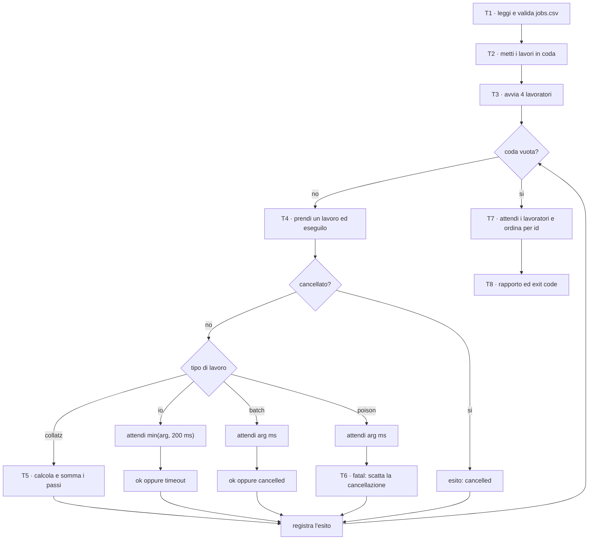
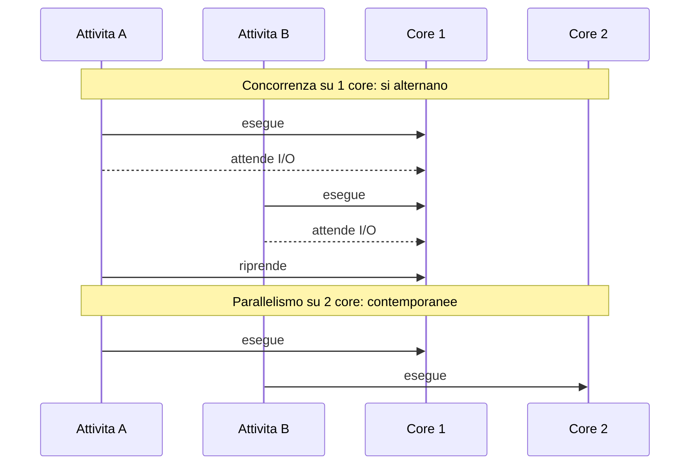
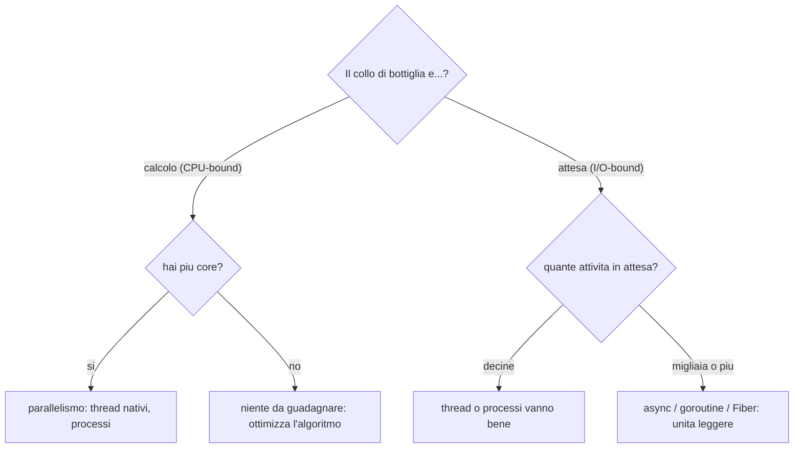
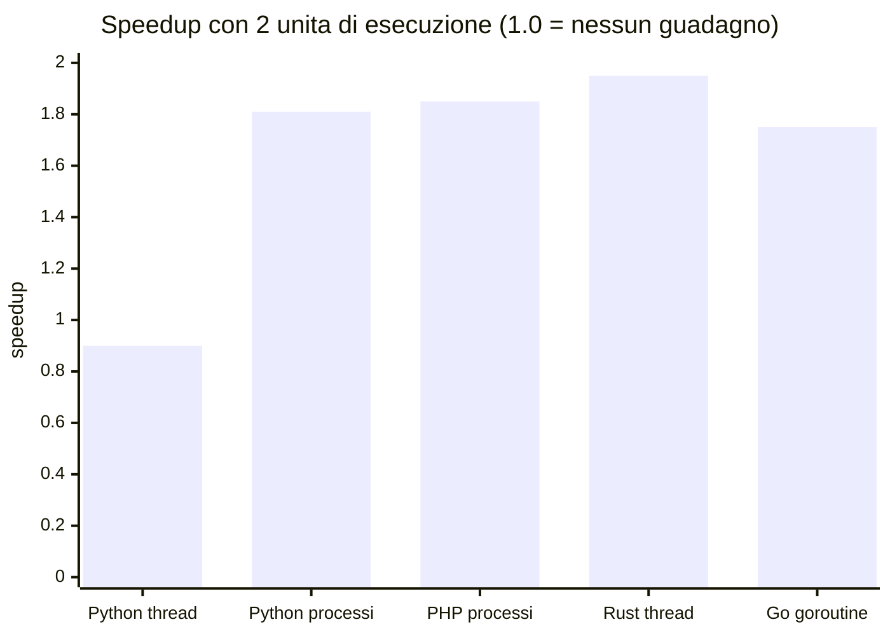

> File C11-parte1.md (parte 1 di 6) — Obiettivi … L11.1 — Concorrenza contro parallelismo; modelli di esecuzione a confronto

# C11 — Concorrenza, parallelismo, async

> Parte III — Memoria e concorrenza · 6 lezioni da 45′ (L11.1–L11.6) · ingresso B (professionista) · con addendum «Il perché della scelta»

**Ambiente di prova.** PHP 8.3.6 (baseline del corso 8.4+: da riverificare), Python 3.13.16 (build con GIL; la build free-threaded non era disponibile), Rust 1.97.0 (`--edition 2024`; `tokio` 1.53.3 per gli esperimenti async), Go 1.24.7 (baseline 1.25+: da riverificare). Macchina cloud condivisa con **2 core**: tutti i numeri di scalabilità sono su 2 core e vanno letti come ordini di grandezza, non come classifiche. PHP non ha thread in questa installazione (nessuna estensione `parallel`): il programma del capitolo usa Fibers; `pcntl_fork` serve solo agli esperimenti. Packagist e Go proxy restano bloccati: nessuna dipendenza esterna per PHP e Go; Rust usa solo `std` nel programma e `tokio` negli esperimenti e5 e e3.

## Obiettivi

Al termine del capitolo sai:

- distinguere **concorrenza** (struttura: più attività in corso) da **parallelismo** (esecuzione: più attività nello stesso istante) e scegliere il modello giusto per un carico CPU-bound o I/O-bound;
- spiegare perché un contatore condiviso senza protezione perde aggiornamenti, e come lo evitano `Mutex`, atomic e channel nei quattro linguaggi;
- leggere gli errori `E0277`/`E0373` di Rust come garanzie di sicurezza (`Send`/`Sync`) e non come ostacoli;
- usare un channel limitato per ottenere **backpressure**;
- spiegare event loop, `await`, perché una chiamata bloccante dentro una coroutine ferma tutto;
- confrontare il costo di thread, task, goroutine e Fiber (tempo e memoria);
- costruire un **worker pool con cancellation e timeout** che dà lo stesso risultato nei quattro linguaggi, e riconoscere i punti in cui il risultato dipende invece dalla temporizzazione.

## Il problema reale

> Un'azienda deve eseguire una **coda di lavori** letta da un file `jobs.csv`. Alcuni sono calcoli (contare i passi della congettura di Collatz per un numero), altri attendono una risorsa esterna (un'API lenta, simulata con un'attesa), altri sono lavori lunghi che non hanno una scadenza propria. I lavori vanno eseguiti da **4 lavoratori** in parallelo. Ogni attesa su una risorsa esterna ha una **scadenza di 200 ms**: oltre quella, il lavoro è «scaduto». Se un lavoro riporta un **errore fatale** (un `poison`), tutto il resto deve **fermarsi subito**: i lavori in corso vengono interrotti, quelli in coda non partono. Alla fine si stampa un rapporto stabile, ordinato per numero di lavoro, e il programma esce con codice 0 solo se tutto è andato a buon fine.

Il file di prova:

```text
id,op,arg
1,collatz,27
2,collatz,97
3,io,30
4,collatz,871
5,io,50
6,collatz,6171
7,io,400
8,collatz,77031
9,collatz,837799
10,io,10
11,collatz,3
12,collatz,0
13,poison,300
14,batch,2000
15,batch,2000
16,batch,2000
17,batch,2000
18,batch,2000
19,collatz,27
13,io,5
20,sleep,10
21,io,abc
22,collatz
```

Le righe 21–24 del file sono errate di proposito (id duplicato, operazione sconosciuta, argomento non numerico, campo mancante) e devono essere scartate con un motivo, non bloccare il resto.

### Scomposizione

| Task | Che cosa fa | Concetto del capitolo |
|---|---|---|
| T1 | Leggere `jobs.csv` e validare ogni riga (scartare con motivo) | confine di input, nessuna concorrenza |
| T2 | Mettere i lavori validi in una coda | coda = channel / `Queue` |
| T3 | Avviare 4 lavoratori che prelevano dalla coda | thread, goroutine, Fiber |
| T4 | Eseguire un lavoro: calcolo, attesa con scadenza, lavoro lungo, poison | attesa **interrompibile** |
| T5 | Accumulare risultati e un contatore condiviso (`steps_total`) | stato condiviso, atomic, lock |
| T6 | Propagare la cancellazione a tutti quando un lavoro è fatale | cancellation |
| T7 | Attendere i lavoratori, ordinare i risultati per id | join, `WaitGroup`, ordine deterministico |
| T8 | Stampare il rapporto ed uscire con il codice giusto | contratto: exit 0/1/2 |



Ogni commento `T<n> -` nel codice del capitolo corrisponde a una riga di questa tabella.

---

## L11.1 — Concorrenza contro parallelismo; modelli di esecuzione a confronto

### Concetto

**Concorrenza** significa avere più attività *in corso* nello stesso periodo: la struttura del programma le tiene separate e ognuna può avanzare quando può. **Parallelismo** significa eseguirle *nello stesso istante* su più core. Una cassiera che serve due file alternando i clienti è concorrente; due cassiere che servono una fila ciascuna sono parallele; due cassiere che alternano ciascuna due file sono entrambe le cose. Si può avere concorrenza senza parallelismo (un solo core, tante attività I/O) e parallelismo senza concorrenza nel senso stretto (un calcolo diviso in blocchi indipendenti).



La distinzione guida la scelta dello strumento. Un carico **CPU-bound** (calcolo) migliora solo con il parallelismo: servono più core effettivamente in uso. Un carico **I/O-bound** (attese di rete, disco, database) migliora con la concorrenza: mentre un'attività attende, un'altra usa la CPU, e bastano anche un core e una sola riga di esecuzione.



### I quattro punti di partenza

| | PHP | Python | Rust | Go |
|---|---|---|---|---|
| Modello di partenza | un processo per richiesta, **shared-nothing** | processo con thread e **GIL** | thread del sistema operativo, nessun runtime | **goroutine** su un runtime con scheduler |
| Parallelismo CPU in un processo | no (si usano più processi) | no con i thread (GIL), sì con `multiprocessing` | sì | sì |
| Concorrenza I/O leggera | Fibers, librerie (AMPHP, ReactPHP, Swoole) | `asyncio` | `async`/`await` + runtime esterno (`tokio`) | goroutine, nativo |
| Chi pianifica | il programmatore (cooperativo) | OS (thread) o event loop (task) | OS (thread) o runtime (task) | runtime Go (M:N) |

### Implementazione — e2: lo stesso calcolo su 1 e 2 unità di esecuzione

Il calcolo è la somma dei passi di Collatz per i numeri da 1 a 300 000 (CPU-bound puro, nessuna memoria condivisa), diviso in blocchi uguali. Il totale è identico ovunque (`35669725`).

**Python** (thread con GIL e processi con `multiprocessing`):

```python
import sys, time, threading, statistics, multiprocessing as mp
LIMIT = 300_000

def steps(n):
    s = 0
    while n > 1:
        n = n // 2 if n % 2 == 0 else 3 * n + 1
        s += 1
    return s

def chunk(a, b):
    return sum(steps(n) for n in range(a, b))

def split(k):
    step = LIMIT // k
    return [(1 + i * step, 1 + (i + 1) * step if i < k - 1 else LIMIT + 1) for i in range(k)]

def with_threads(k):
    out = [0] * k
    def w(i, a, b): out[i] = chunk(a, b)
    ts = [threading.Thread(target=w, args=(i, a, b)) for i, (a, b) in enumerate(split(k))]
    [t.start() for t in ts]; [t.join() for t in ts]
    return sum(out)

def with_procs(k):
    with mp.Pool(k) as p:
        return sum(p.starmap(chunk, split(k)))

def timed(f, *a):
    t = time.perf_counter(); r = f(*a); return r, (time.perf_counter() - t) * 1000

if __name__ == "__main__":
    for name, f, k in (("threads", with_threads, 1), ("threads", with_threads, 2), ("processes", with_procs, 2)):
        runs = [timed(f, k) for _ in range(5)]
        print(f"python {name:9} k={k} total={runs[0][0]} median_ms={statistics.median(r[1] for r in runs):.0f}")
```

**PHP** (processi con `pcntl_fork`; i risultati tornano da un socket pair):

```php
<?php
// k forked processes, each sends its partial sum through a pipe
const LIMIT = 300000;
function steps(int $n): int { $s = 0; while ($n > 1) { $n = $n % 2 === 0 ? intdiv($n, 2) : 3 * $n + 1; $s++; } return $s; }
function chunk(int $a, int $b): int { $t = 0; for ($n = $a; $n < $b; $n++) { $t += steps($n); } return $t; }
function run(int $k): int {
    $step = intdiv(LIMIT, $k); $pipes = []; $pids = [];
    for ($i = 0; $i < $k; $i++) {
        $a = 1 + $i * $step; $b = $i < $k - 1 ? 1 + ($i + 1) * $step : LIMIT + 1;
        $pair = stream_socket_pair(STREAM_PF_UNIX, STREAM_SOCK_STREAM, STREAM_IPPROTO_IP);
        $pid = pcntl_fork();
        if ($pid === 0) { fwrite($pair[1], (string) chunk($a, $b)); exit(0); }
        fclose($pair[1]); $pipes[] = $pair[0]; $pids[] = $pid;
    }
    $total = 0;
    foreach ($pipes as $i => $p) { $total += (int) stream_get_contents($p); pcntl_waitpid($pids[$i], $st); }
    return $total;
}
foreach ([1, 2] as $k) {
    $ms = []; for ($r = 0; $r < 5; $r++) { $t = hrtime(true); $tot = run($k); $ms[] = (hrtime(true) - $t) / 1e6; }
    sort($ms);
    printf("php processes k=%d total=%d median_ms=%.0f\n", $k, $tot, $ms[2]);
}
```

**Rust** (thread con `thread::scope`):

```rust
use std::thread;
use std::time::Instant;
const LIMIT: u64 = 300_000;
fn steps(mut n: u64) -> u64 { let mut s = 0; while n > 1 { n = if n % 2 == 0 { n / 2 } else { 3 * n + 1 }; s += 1; } s }
fn chunk(a: u64, b: u64) -> u64 { (a..b).map(steps).sum() }
fn run(k: u64) -> u64 {
    let step = LIMIT / k;
    thread::scope(|s| {
        let hs: Vec<_> = (0..k).map(|i| {
            let a = 1 + i * step;
            let b = if i < k - 1 { 1 + (i + 1) * step } else { LIMIT + 1 };
            s.spawn(move || chunk(a, b))
        }).collect();
        hs.into_iter().map(|h| h.join().unwrap()).sum()
    })
}
fn main() {
    for k in [1u64, 2] {
        let mut ms = Vec::new(); let mut tot = 0;
        for _ in 0..5 { let t = Instant::now(); tot = run(k); ms.push(t.elapsed().as_secs_f64() * 1000.0); }
        ms.sort_by(|a, b| a.partial_cmp(b).unwrap());
        println!("rust threads k={k} total={tot} median_ms={:.0}", ms[2]);
    }
}
```

**Go** (goroutine):

```go
package main

import (
	"fmt"
	"sort"
	"sync"
	"time"
)

const limit = 300000

func steps(n uint64) uint64 {
	var s uint64
	for n > 1 {
		if n%2 == 0 {
			n /= 2
		} else {
			n = 3*n + 1
		}
		s++
	}
	return s
}

func run(k int) uint64 {
	step := limit / k
	parts := make([]uint64, k)
	var wg sync.WaitGroup
	for i := 0; i < k; i++ {
		a, b := 1+i*step, limit+1
		if i < k-1 {
			b = 1 + (i+1)*step
		}
		wg.Add(1)
		go func() {
			defer wg.Done()
			for n := a; n < b; n++ {
				parts[i] += steps(uint64(n))
			}
		}()
	}
	wg.Wait()
	var t uint64
	for _, p := range parts {
		t += p
	}
	return t
}

func main() {
	for _, k := range []int{1, 2} {
		var ms []float64
		var tot uint64
		for r := 0; r < 5; r++ {
			t := time.Now()
			tot = run(k)
			ms = append(ms, float64(time.Since(t).Microseconds())/1000)
		}
		sort.Float64s(ms)
		fmt.Printf("go goroutines k=%d total=%d median_ms=%.0f\n", k, tot, ms[2])
	}
}
```

Risultato (mediana di 5 esecuzioni, ambiente condiviso a 2 core, Rust con `-O`):

```text
### cpu_py
python threads   k=1 total=35669725 median_ms=3697
python threads   k=2 total=35669725 median_ms=4095
python processes k=2 total=35669725 median_ms=2044
[exit 0]
```

```text
### cpu_php
php processes k=1 total=35669725 median_ms=1698
php processes k=2 total=35669725 median_ms=920
[exit 0]
```

```text
### cpu_rs
rust threads k=1 total=35669725 median_ms=41
rust threads k=2 total=35669725 median_ms=21
[exit 0]
```

```text
### cpu_go
go goroutines k=1 total=35669725 median_ms=70
go goroutines k=2 total=35669725 median_ms=40
[exit 0]
```



Python con due **thread** è più lento che con uno (3697 ms contro 4095 ms): il GIL (Global Interpreter Lock) permette a un solo thread di eseguire bytecode alla volta, e il passaggio del lock costa. Con due **processi** lo speedup è 1,81. PHP, che non ha thread, ottiene 1,85 con due processi `fork`. Rust e Go sfruttano i due core (1,95 e 1,75; il valore Go è nel rumore dell'ambiente condiviso). I tempi assoluti riflettono anche il costo dell'interprete (Rust 41 ms, Go 70 ms, PHP 1698 ms, Python 3697 ms per lo stesso lavoro con una unità); non sono l'oggetto di questo esperimento.

### Focus comparativo

- Per il CPU-bound la domanda non è «async o thread?» ma «quanti core effettivi posso usare?». In Python e PHP la risposta passa dai **processi**; in Rust e Go dai thread/goroutine dello stesso processo.
- Il processo costa di più (memoria separata, comunicazione esplicita via pipe/socket) ma offre isolamento: un crash non abbatte gli altri.
- La build *free-threaded* di Python 3.13 (opzionale, senza GIL) non era disponibile in questo ambiente: non è stata provata e il numero 0,90 vale solo per la build con GIL.

### Esercizio Rosetta

Modifica il programma e2 in modo che la somma sia calcolata in **4** blocchi invece di 2. Su 2 core, che speedup ti aspetti rispetto ai 2 blocchi? Verifica nel linguaggio che preferisci e spiega la differenza tra «più unità di esecuzione» e «più core».

**Risposte**

> Su 2 core i 4 blocchi non vanno più veloci dei 2: lo speedup è limitato dal numero di core, non dal numero di unità. Più unità di esecuzione che core aggiungono solo cambi di contesto; sono utili quando le unità passano tempo ad attendere (I/O), non quando calcolano.

---
