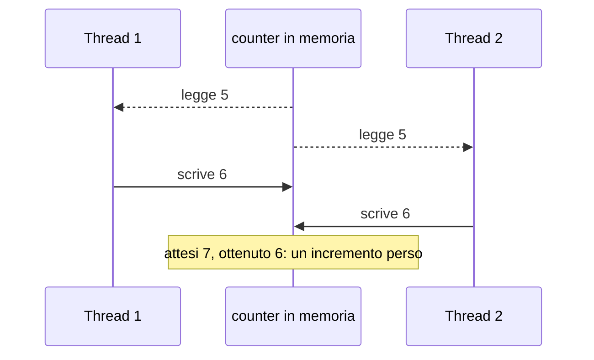
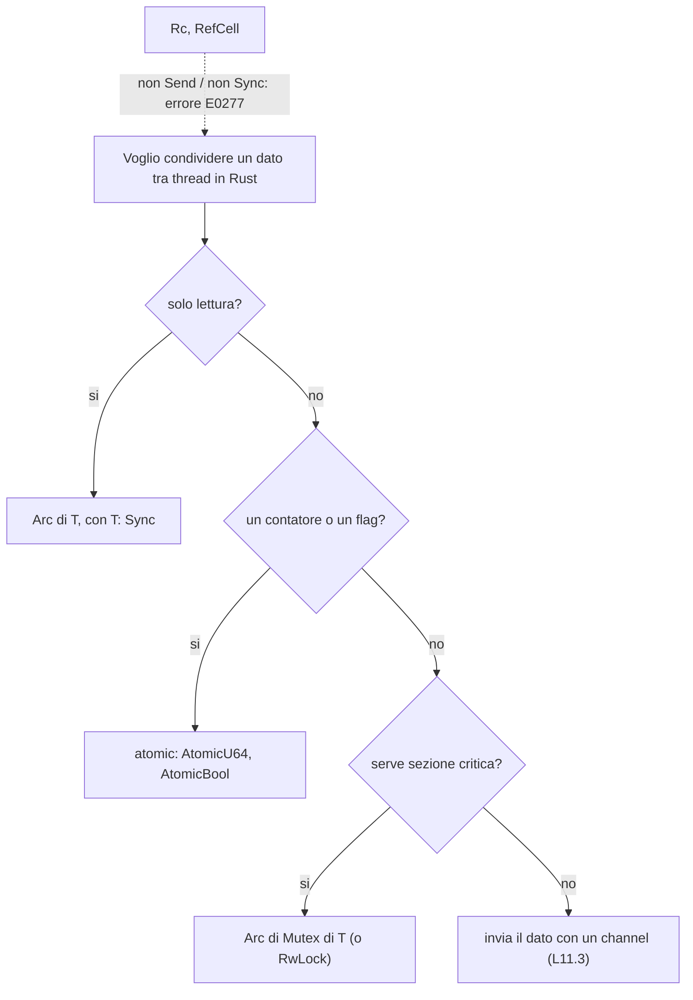
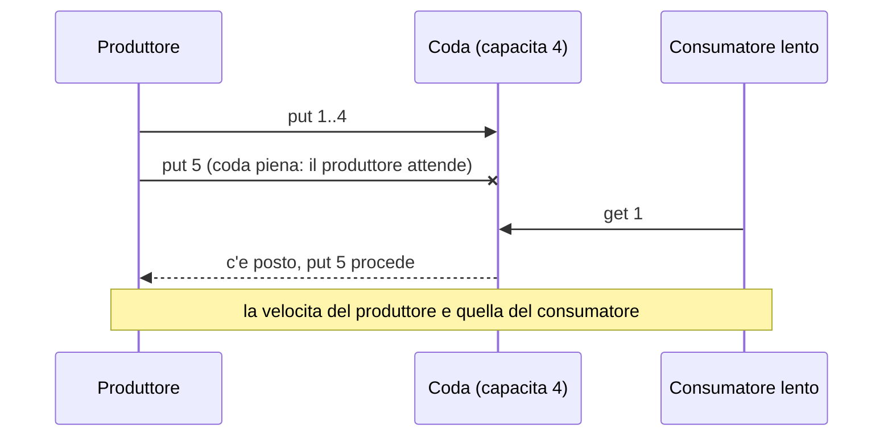

> File C11-parte2.md (parte 2 di 6) — L11.2 — Thread e stato condiviso: mutex, atomics, GIL … L11.3 — Message passing: channel, queue, CSP

## L11.2 — Thread e stato condiviso: mutex, atomics, GIL

### Concetto

Due thread che leggono e scrivono la stessa variabile senza coordinarsi producono una **data race**: il risultato dipende dall'intreccio delle istruzioni. L'esempio classico è `counter += 1`, che in realtà sono tre passi: leggere, sommare, scrivere. Se due thread leggono lo stesso valore prima che uno dei due scriva, un incremento va perso (*lost update*).



Tre strumenti rendono l'operazione sicura, con costi diversi:

1. **Mutex (lock)**: una sola unità alla volta entra nella sezione critica. Generale, ma serializza.
2. **Atomic**: l'hardware esegue leggi-somma-scrivi come un'unica istruzione indivisibile. Velocissimo, ma solo per operazioni semplici su un valore.
3. **Non condividere**: ogni unità ha il proprio dato e si scambiano messaggi (L11.3), oppure ognuna lavora su una copia (PHP).

### Implementazione — e1: il contatore condiviso

Quattro unità incrementano un contatore un milione di volte ciascuna: atteso `4000000`.

**Python** (4 thread, senza e con `Lock`):

```python
import threading, sys
N = 1_000_000
counter = 0
lock = threading.Lock()

def bump_unsafe():
    global counter
    for _ in range(N):
        counter += 1

def bump_safe():
    global counter
    for _ in range(N):
        with lock:
            counter += 1

for name, fn in (("unsafe", bump_unsafe), ("locked", bump_safe)):
    counter = 0
    ts = [threading.Thread(target=fn) for _ in range(4)]
    [t.start() for t in ts]; [t.join() for t in ts]
    print(f"{name}: expected={4*N} got={counter}")
```

```text
### py_run1
unsafe: expected=4000000 got=4000000
locked: expected=4000000 got=4000000
[exit 0]
```

Nelle tre esecuzioni registrate (`py_run1..3`, tutte uguali) la versione *senza* lock non perde aggiornamenti. **Non è una garanzia**: in CPython 3.13 il GIL viene ceduto solo in punti precisi del bytecode, e `counter += 1` tra due di questi punti spesso non viene interrotto. Un secondo tentativo, con `sys.setswitchinterval(1e-6)` e lettura e scrittura separate, ha dato `800000` su `800000` in due esecuzioni:

```text
### py_race
expected=800000 got=800000
[exit 0]
```

Il bug quindi **non si è riprodotto** in questo ambiente; la documentazione di Python non promette che `+=` su una variabile condivisa sia atomico, e su altre versioni o build (in particolare la free-threaded) il risultato può essere diverso. Assenza di sintomi non è assenza di bug.

**Go** (goroutine; contatore semplice, `atomic.Int64`, `sync.Mutex`):

```go
package main

import (
	"fmt"
	"sync"
	"sync/atomic"
)

const N = 1_000_000

func run(name string, f func()) {
	var wg sync.WaitGroup
	for i := 0; i < 4; i++ {
		wg.Add(1)
		go func() { defer wg.Done(); f() }()
	}
	wg.Wait()
	_ = name
}

func main() {
	var plain int
	run("plain", func() {
		for i := 0; i < N; i++ {
			plain++
		}
	})
	fmt.Printf("plain:  expected=%d got=%d\n", 4*N, plain)

	var at atomic.Int64
	run("atomic", func() {
		for i := 0; i < N; i++ {
			at.Add(1)
		}
	})
	fmt.Printf("atomic: expected=%d got=%d\n", 4*N, at.Load())

	var mu sync.Mutex
	var locked int
	run("mutex", func() {
		for i := 0; i < N; i++ {
			mu.Lock()
			locked++
			mu.Unlock()
		}
	})
	fmt.Printf("mutex:  expected=%d got=%d\n", 4*N, locked)
}
```

```text
### go_run
plain:  expected=4000000 got=2893850
atomic: expected=4000000 got=4000000
mutex:  expected=4000000 got=4000000
[exit 0]
```

Qui il bug si vede subito: `2893850` invece di `4000000`, con due goroutine su due core che si pestano i piedi. Il **race detector** (`go run -race`) lo segnala con le due righe di codice coinvolte:

```text
### go_race
==================
WARNING: DATA RACE
Read at 0x00c000112078 by goroutine 9:
  main.main.func1()
      main.go:25 +0x37
  main.run.func1()
      main.go:15 +0x81

Previous write at 0x00c000112078 by goroutine 7:
  main.main.func1()
      main.go:25 +0x49
  main.run.func1()
      main.go:15 +0x81

Goroutine 9 (running) created at:
  main.run()
      main.go:15 +0x64
  main.main()
      main.go:23 +0xd1

Goroutine 7 (running) created at:
  main.run()
      main.go:15 +0x64
  main.main()
[exit 0]
```

**Rust**: la stessa idea non compila. Il compilatore rifiuta tre tentativi diversi, ognuno per un motivo distinto.

```rust
use std::rc::Rc;
use std::thread;

fn main() {
    let counter = Rc::new(5);
    let c2 = Rc::clone(&counter);
    let h = thread::spawn(move || println!("{}", c2));
    h.join().unwrap();
}
```

```text
### rs_rc
error[E0277]: `Rc<i32>` cannot be sent between threads safely
 --> rc.rs:7:27
  |
7 |     let h = thread::spawn(move || println!("{}", c2));
  |             ------------- -------^^^^^^^^^^^^^^^^^^^
  |             |             |
  |             |             `Rc<i32>` cannot be sent between threads safely
  |             |             within this `{closure@rc.rs:7:27: 7:34}`
  |             required by a bound introduced by this call
  |
  = help: within `{closure@rc.rs:7:27: 7:34}`, the trait `Send` is not implemented for `Rc<i32>`
note: required because it's used within this closure
 --> rc.rs:7:27
  |
7 |     let h = thread::spawn(move || println!("{}", c2));
  |                           ^^^^^^^
note: required by a bound in `spawn`
 --> /rustc/2d8144b7880597b6e6d3dfd63a9a9efae3f533d3/library/std/src/thread/functions.rs:125:0

error: aborting due to 1 previous error

For more information about this error, try `rustc --explain E0277`.
[exit 1]
```

`Rc` (reference counting non atomico, C10) non implementa `Send`: non può attraversare il confine tra thread. Con `Arc<RefCell<_>>` il problema si sposta sul secondo marcatore, `Sync`:

```text
### rs_refcell
error[E0277]: `RefCell<i32>` cannot be shared between threads safely
 --> refcell.rs:8:27
  |
8 |     let h = thread::spawn(move || *c2.borrow_mut() += 1);
  |             ------------- ^^^^^^^^^^^^^^^^^^^^^^^^^^^^^ `RefCell<i32>` cannot be shared between threads safely
  |             |
  |             required by a bound introduced by this call
  |
  = help: the trait `Sync` is not implemented for `RefCell<i32>`
  = note: if you want to do aliasing and mutation between multiple threads, use `std::sync::RwLock` instead
  = note: required for `Arc<RefCell<i32>>` to implement `Send`
note: required because it's used within this closure
 --> refcell.rs:8:27
  |
8 |     let h = thread::spawn(move || *c2.borrow_mut() += 1);
  |                           ^^^^^^^
note: required by a bound in `spawn`
 --> /rustc/2d8144b7880597b6e6d3dfd63a9a9efae3f533d3/library/std/src/thread/functions.rs:125:0

error: aborting due to 1 previous error

For more information about this error, try `rustc --explain E0277`.
[exit 1]
```

E con una semplice variabile catturata per riferimento:

```rust
use std::thread;

fn main() {
    let mut counter = 0;
    let h1 = thread::spawn(|| counter += 1);
    let h2 = thread::spawn(|| counter += 1);
    h1.join().unwrap();
    h2.join().unwrap();
    println!("{counter}");
}
```

```text
### rs_plain
error[E0373]: closure may outlive the current function, but it borrows `counter`, which is owned by the current function
 --> plain.rs:5:28
  |
5 |     let h1 = thread::spawn(|| counter += 1);
  |                            ^^ ------- `counter` is borrowed here
  |                            |
  |                            may outlive borrowed value `counter`
  |
note: function requires argument type to outlive `'static`
 --> plain.rs:5:14
  |
5 |     let h1 = thread::spawn(|| counter += 1);
  |              ^^^^^^^^^^^^^^^^^^^^^^^^^^^^^^
help: to force the closure to take ownership of `counter` (and any other referenced variables), use the `move` keyword
  |
5 |     let h1 = thread::spawn(move || counter += 1);
  |                            ++++

error[E0499]: cannot borrow `counter` as mutable more than once at a time
 --> plain.rs:6:28
  |
5 |     let h1 = thread::spawn(|| counter += 1);
  |              ------------------------------
  |              |             |  |
  |              |             |  first borrow occurs due to use of `counter` in closure
  |              |             first mutable borrow occurs here
  |              argument requires that `counter` is borrowed for `'static`
6 |     let h2 = thread::spawn(|| counter += 1);
  |                            ^^ ------- second borrow occurs due to use of `counter` in closure
  |                            |
  |                            second mutable borrow occurs here
  |
note: requirement that the value outlives `'static` introduced here
 --> /rustc/2d8144b7880597b6e6d3dfd63a9a9efae3f533d3/library/std/src/thread/functions.rs:128:14

error[E0373]: closure may outlive the current function, but it borrows `counter`, which is owned by the current function
 --> plain.rs:6:28
  |
6 |     let h2 = thread::spawn(|| counter += 1);
  |                            ^^ ------- `counter` is borrowed here
  |                            |
  |                            may outlive borrowed value `counter`
  |
note: function requires argument type to outlive `'static`
 --> plain.rs:6:14
  |
6 |     let h2 = thread::spawn(|| counter += 1);
  |              ^^^^^^^^^^^^^^^^^^^^^^^^^^^^^^
help: to force the closure to take ownership of `counter` (and any other referenced variables), use the `move` keyword
  |
6 |     let h2 = thread::spawn(move || counter += 1);
  |                            ++++

error[E0502]: cannot borrow `counter` as immutable because it is also borrowed as mutable
 --> plain.rs:9:16
  |
5 |     let h1 = thread::spawn(|| counter += 1);
  |              ------------------------------
  |              |             |  |
  |              |             |  first borrow occurs due to use of `counter` in closure
  |              |             mutable borrow occurs here
  |              argument requires that `counter` is borrowed for `'static`
...
9 |     println!("{counter}");
  |                ^^^^^^^ immutable borrow occurs here
  |
note: requirement that the value outlives `'static` introduced here
 --> /rustc/2d8144b7880597b6e6d3dfd63a9a9efae3f533d3/library/std/src/thread/functions.rs:128:14

error: aborting due to 4 previous errors

Some errors have detailed explanations: E0373, E0499, E0502.
For more information about an error, try `rustc --explain E0373`.
[exit 1]
```

Quattro errori per un solo difetto: `E0373` (la chiusura potrebbe sopravvivere alla funzione), `E0499` (due prestiti mutabili), `E0502` (lettura mentre c'è un prestito mutabile). La versione corretta usa un atomic e *scoped threads* (`thread::scope`), che garantiscono che i thread finiscano prima del termine dello scope e quindi possono prendere in prestito variabili locali:

```rust
use std::sync::atomic::{AtomicU64, Ordering};
use std::thread;

fn main() {
    let counter = AtomicU64::new(0);
    // scoped threads may borrow `counter`: they are joined before the scope ends
    thread::scope(|s| {
        for _ in 0..4 {
            s.spawn(|| {
                for _ in 0..1_000_000 {
                    counter.fetch_add(1, Ordering::Relaxed);
                }
            });
        }
    });
    println!("atomic: expected=4000000 got={}", counter.load(Ordering::Relaxed));
}
```

```text
### rs_ok
atomic: expected=4000000 got=4000000
[exit 0]
```

**PHP**: il problema non si presenta perché la memoria non è condivisa. Un figlio creato con `pcntl_fork` ha una **copia** delle variabili:

```php
<?php
// PHP is shared-nothing: a forked child gets a COPY of the variables.
$counter = 0;
$pid = pcntl_fork();
if ($pid === 0) {
    for ($i = 0; $i < 1000; $i++) { $counter++; }
    echo "child  counter=$counter\n";
    exit(0);
}
pcntl_waitpid($pid, $status);
echo "parent counter=$counter\n";
```

```text
### php_fork
child  counter=1000
parent counter=0
[exit 0]
```

### Chi garantisce che cosa

I due tratti `Send` e `Sync` di Rust spiegano gli errori sopra:

- `T: Send` significa che il valore di tipo `T` può essere **spostato** in un altro thread (`Rc` no, `Arc` sì);
- `T: Sync` significa che un riferimento `&T` può essere **condiviso** tra thread (`RefCell` no, `Mutex` e atomic sì).

Sono *auto trait*: il compilatore li deriva dai campi. `thread::spawn` richiede `Send + 'static` nella sua firma; per questo il compilatore stesso impedisce ciò che in Go è un bug a runtime.



### Il costo degli strumenti — e9

Un milione di incrementi per unità, su 1 e 2 unità, mediana di 5 esecuzioni (Rust con `-O`, ambiente condiviso a 2 core):

```text
go     atomic   workers=1 median_ms=   5  (n=1e6 per worker, runs=5)
go     atomic   workers=2 median_ms=  15  (n=1e6 per worker, runs=5)
go     channel  workers=1 median_ms=  73  (n=1e6 per worker, runs=5)
go     channel  workers=2 median_ms= 139  (n=1e6 per worker, runs=5)
go     mutex    workers=1 median_ms=  16  (n=1e6 per worker, runs=5)
go     mutex    workers=2 median_ms=  49  (n=1e6 per worker, runs=5)
python lock     workers=1 median_ms= 244  (n=1e6 per worker, runs=5)
python lock     workers=2 median_ms= 598  (n=1e6 per worker, runs=5)
rust   atomic   workers=1 median_ms=   5  (n=1e6 per worker, runs=5)
rust   atomic   workers=2 median_ms=  25  (n=1e6 per worker, runs=5)
rust   channel  workers=1 median_ms= 364  (n=1e6 per worker, runs=5)
rust   channel  workers=2 median_ms= 426  (n=1e6 per worker, runs=5)
rust   mutex    workers=1 median_ms=  15  (n=1e6 per worker, runs=5)
rust   mutex    workers=2 median_ms=  96  (n=1e6 per worker, runs=5)
```

Tre letture, con prudenza data la misura su ambiente condiviso. Primo: l'atomic è l'ordine di grandezza più economico quando non c'è contesa (5 ms per milione) e peggiora con due unità che si contendono la stessa cache line (15 ms in Go, 25 ms in Rust). Secondo: il mutex costa circa 3 volte l'atomic senza contesa e si degrada ancora di più con due unità (49 ms in Go, 96 ms in Rust). Terzo: il channel, usato come contatore, è il più lento (73 ms in Go, 364 ms in Rust con `sync_channel`); non è il suo mestiere, il suo scopo è trasferire dati e proprietà, non sommare. In Python il lock costa 244 ms per milione (e 598 ms con due thread, che si contendono anche il GIL).

### Il GIL

Il **GIL** è un lock globale dell'interprete CPython: protegge le strutture interne (contatori di riferimenti, C10) rendendo semplice l'interprete e le estensioni C, al prezzo del parallelismo CPU tra thread. Non rende però sicuro il *tuo* codice: le sezioni critiche sulle tue strutture dati richiedono comunque un `Lock`. Per I/O bloccante il GIL viene rilasciato, e i thread aiutano; per il calcolo no (e2).

### Focus comparativo

| | PHP | Python | Rust | Go |
|---|---|---|---|---|
| Memoria condivisa tra unità | no (processi) | sì, con GIL | sì, verificata dal compilatore | sì, verificata (parzialmente) a runtime |
| Contatore atomico | `apcu_inc` (estensione), `Atomic` in `parallel` | nessun tipo dedicato; `+=` con `Lock` | `AtomicU64` ecc. | `atomic.Int64` ecc. |
| Mutex | `Mutex` in `parallel`/`Swoole` (non nel core) | `threading.Lock` | `Mutex<T>` (possiede il dato) | `sync.Mutex` (accanto al dato) |
| Rilevazione di data race | non applicabile | nessuna | compile-time (`Send`/`Sync`) | `go run -race`, runtime |
| Errore di accesso concorrente a una mappa | non applicabile | il `dict` è thread-safe per singola operazione | non compila senza `Mutex` | `fatal error: concurrent map writes` |

In Rust il `Mutex<T>` **possiede** il dato: l'unico modo di raggiungerlo è prendere il lock. In Go il `Mutex` è un oggetto separato dal dato, e dimenticarlo non dà errore. Il runtime di Go rileva alcuni usi scorretti delle mappe e abortisce l'intero processo:

```text
### map
fatal error: concurrent map writes

goroutine 9 [running]:
internal/runtime/maps.fatal({0x4cc5fe?, 0x4b4660?})
	/usr/local/go1.24.7/src/runtime/panic.go:1058 +0x18
[exit 0]
```

### Esercizio Rosetta

Scrivi un contatore condiviso da 8 unità di esecuzione in due versioni: una con `Mutex`, una con atomic (o, in Python, con `Lock` e senza). Misura il tempo per 1 000 000 incrementi per unità e commenta: perché la versione atomica non esiste in Python?

**Risposte**

> In Python l'incremento di un intero non è un'operazione atomica a livello di linguaggio e non esiste un tipo `Atomic` nella libreria standard: `threading.Lock` è lo strumento. In pratica nella build con GIL il lock è comunque necessario per correttezza logica (sezioni critiche su più istruzioni), anche quando il difetto non si riproduce.

---

## L11.3 — Message passing: channel, queue, CSP

### Concetto

L'alternativa allo stato condiviso protetto da lock è il **message passing**: le unità non condividono dati, si *passano* valori attraverso un canale. Il modello teorico è CSP (*Communicating Sequential Processes*, Hoare 1978): processi sequenziali che comunicano su canali, e il motto di Go lo ricalca: *«non comunicare condividendo memoria, condividi memoria comunicando»*.

Due aspetti decidono il comportamento di un channel:

- **capacità**: un channel *unbuffered* (capacità 0) sincronizza mittente e destinatario («rendez-vous»); uno *bounded* ha un buffer finito e fa **attendere il mittente** quando è pieno; uno *unbounded* non blocca mai il mittente e la coda cresce senza limite;
- **chiusura**: chiudere il canale è il segnale «non arriveranno altri messaggi»; i destinatari terminano di leggere quando il canale è vuoto *e* chiuso.

Il worker pool del capitolo è esattamente questo: una coda di lavori prelevata da 4 lavoratori, e il segnale «finito» è la chiusura della coda (o una sentinella).

### Implementazione — la coda di lavori (T2, T3, T7)

**Python**

```python
def worker(jobs_q, shared):
    while True:
        job = jobs_q.get()
        if job is None:  # sentinel: no more work
            return
        shared.record(run_job(job, shared))


def run_pool(jobs):
    """T2, T3, T7 - queue the jobs, start W threads, wait for them."""
    shared = Shared()
    jobs_q = queue.Queue()
    for job in jobs:
        jobs_q.put(job)
    for _ in range(WORKERS):
        jobs_q.put(None)
    threads = [threading.Thread(target=worker, args=(jobs_q, shared)) for _ in range(WORKERS)]
    for t in threads:
        t.start()
    for t in threads:
        t.join()
    return sorted(shared.results, key=lambda o: o.job.id), shared.steps_total
```

**PHP**

```php
/** T2, T3, T7 - queue the jobs, start W fibers, run the event loop until all are done. */
function runPool(array $jobs): array
{
    $cancel = new Cancel();
    $shared = ['steps_total' => 0, 'results' => []];
    $queue = new SplQueue();
    foreach ($jobs as $job) {
        $queue->enqueue($job);
    }

    $workers = [];
    for ($w = 0; $w < WORKERS; $w++) {
        $workers[] = new Fiber(function () use ($queue, $cancel, &$shared): void {
            while (!$queue->isEmpty()) {
                $job = $queue->dequeue();
                [$status, $detail] = runJob($job, $cancel, $shared);
                $shared['results'][] = ['job' => $job, 'status' => $status, 'detail' => $detail];
            }
        });
    }

    // the event loop: each entry is [fiber, deadline|null, cancel|null]
    $waiting = [];
    foreach ($workers as $f) {
        $waiting[] = [$f, null, null];
    }
    while ($waiting) {
        $now = hrtime(true);
        $next = [];
        $earliest = null;
        foreach ($waiting as [$f, $deadline, $c]) {
            $ready = $deadline === null || $now >= $deadline || $c->set;
            if (!$ready) {
                $next[] = [$f, $deadline, $c];
                $earliest = $earliest === null ? $deadline : min($earliest, $deadline);
                continue;
            }
            $req = $f->isStarted() ? $f->resume() : $f->start();
            if (!$f->isTerminated()) {
                $next[] = [$f, $req[0], $req[1]];
                $earliest = ($earliest === null || $req[0] < $earliest) ? $req[0] : $earliest;
                if ($req[1]->set) {
                    $earliest = 0; // already cancelled: do not sleep, loop again
                }
            }
        }
        $waiting = $next;
        if ($waiting && $earliest !== null && $earliest > hrtime(true)) {
            usleep(max(0, intdiv($earliest - hrtime(true), 1000)));
        }
    }
    usort($shared['results'], fn($a, $b) => $a['job']['id'] <=> $b['job']['id']);
    return [$shared['results'], $shared['steps_total']];
}
```

**Rust**

```rust
/// T2, T3, T7 - queue the jobs, start W threads, collect the outcomes.
fn run_pool(jobs: Vec<Job>) -> (Vec<Outcome>, u64) {
    let cancel = Arc::new(Cancel::new());
    let steps_total = Arc::new(AtomicU64::new(0));

    let (job_tx, job_rx) = mpsc::channel::<Job>();
    let job_rx = Arc::new(Mutex::new(job_rx)); // Receiver is not Sync: share it behind a Mutex
    let (out_tx, out_rx) = mpsc::channel::<Outcome>();

    for job in jobs {
        job_tx.send(job).unwrap();
    }
    drop(job_tx); // closing the channel is the "no more work" signal

    let mut handles = Vec::new();
    for _ in 0..WORKERS {
        let (job_rx, out_tx) = (Arc::clone(&job_rx), out_tx.clone());
        let (cancel, steps_total) = (Arc::clone(&cancel), Arc::clone(&steps_total));
        handles.push(thread::spawn(move || {
            loop {
                let next = job_rx.lock().unwrap().recv(); // lock released at the end of the statement
                let Ok(job) = next else { return };
                let (status, detail) = run_job(&job, &cancel, &steps_total);
                out_tx.send(Outcome { job, status, detail }).unwrap();
            }
        }));
    }
    drop(out_tx); // the main thread keeps no sender: the loop below ends when workers exit
    let mut results: Vec<Outcome> = out_rx.iter().collect();
    for h in handles {
        h.join().unwrap();
    }
    results.sort_by_key(|o| o.job.id);
    (results, steps_total.load(Ordering::Relaxed))
}
```

**Go**

```go
// runPool is T2, T3, T7: queue the jobs, start the workers, wait for them.
func runPool(jobs []Job) ([]Outcome, uint64) {
	ctx, cancel := context.WithCancel(context.Background())
	defer cancel()
	sh := &Shared{cancel: cancel}

	queue := make(chan Job, len(jobs))
	for _, j := range jobs {
		queue <- j
	}
	close(queue) // workers stop when the queue is drained

	var wg sync.WaitGroup
	for i := 0; i < workers; i++ {
		wg.Add(1)
		go func() {
			defer wg.Done()
			for j := range queue {
				sh.record(runJob(ctx, j, sh))
			}
		}()
	}
	wg.Wait()

	sort.Slice(sh.results, func(a, b int) bool { return sh.results[a].Job.ID < sh.results[b].Job.ID })
	return sh.results, sh.stepsTotal.Load()
}
```


Osservazioni:

- **Python** non ha un channel con chiusura: `queue.Queue` è una coda thread-safe e la fine si segnala con una **sentinella** (`None`), una per lavoratore.
- **Rust** ha `mpsc` (*multi-producer, single-consumer*): il `Receiver` è uno solo, quindi per condividerlo tra 4 lavoratori lo si avvolge in `Arc<Mutex<Receiver>>`; il lock è tenuto solo per la durata di `recv()`. La chiusura è `drop(job_tx)`: quando tutti i mittenti sono stati rilasciati, `recv()` restituisce `Err`.
- **Go** ha il channel nel linguaggio: `close(queue)` e `for j := range queue` terminano insieme. La capacità `len(jobs)` rende l'invio non bloccante, così la coda si riempie prima di avviare i lavoratori.
- **PHP** ha `SplQueue` e nessun channel: i Fiber della sezione L11.5 condividono semplicemente l'oggetto, perché non c'è parallelismo vero.

### Backpressure — e7

Se il produttore è più veloce del consumatore, una coda **illimitata** cresce senza controllo (memoria, latenza). Una coda **limitata** costringe il produttore ad aspettare: è la **backpressure**, la propagazione verso monte del segnale «rallenta». Esperimento: 300 elementi, consumatore lento (2 ms per elemento), coda di 4 contro illimitata.

```python
import queue, threading, time
N = 300

def run(maxsize):
    q = queue.Queue(maxsize)          # maxsize=0 means unbounded
    consumed = 0
    peak = 0
    def consumer():
        nonlocal consumed
        while (item := q.get()) is not None:
            time.sleep(0.002)         # slow consumer: 2 ms per item
            consumed += 1
    c = threading.Thread(target=consumer); c.start()
    t = time.perf_counter()
    for i in range(N):
        q.put(i)                      # blocks when the queue is full (backpressure)
        peak = max(peak, (i + 1) - consumed)
    produce_ms = (time.perf_counter() - t) * 1000
    q.put(None); c.join()
    label = f"maxsize={maxsize}" if maxsize else "unbounded"
    print(f"python {label:12} producer finished after {produce_ms:5.0f} ms, peak backlog={peak}")

run(4)
run(0)
```

```rust
use std::sync::atomic::{AtomicI64, Ordering};
use std::sync::mpsc;
use std::sync::Arc;
use std::thread;
use std::time::{Duration, Instant};

const N: i64 = 300;

fn consume<I: Iterator<Item = i64> + Send + 'static>(it: I, consumed: Arc<AtomicI64>) -> thread::JoinHandle<()> {
    thread::spawn(move || {
        for _ in it {
            thread::sleep(Duration::from_millis(2)); // slow consumer
            consumed.fetch_add(1, Ordering::Relaxed);
        }
    })
}

fn main() {
    // bounded: send() blocks when 4 items are waiting
    let consumed = Arc::new(AtomicI64::new(0));
    let (tx, rx) = mpsc::sync_channel::<i64>(4);
    let c = consume(rx.into_iter(), Arc::clone(&consumed));
    let t = Instant::now();
    let mut peak = 0;
    for i in 0..N { tx.send(i).unwrap(); peak = peak.max(i + 1 - consumed.load(Ordering::Relaxed)); }
    let prod = t.elapsed().as_millis();
    drop(tx); c.join().unwrap();
    println!("rust sync_channel(4) producer finished after {prod:4} ms, peak backlog={peak}");

    // unbounded: send() never blocks, the queue grows
    let consumed = Arc::new(AtomicI64::new(0));
    let (tx, rx) = mpsc::channel::<i64>();
    let c = consume(rx.into_iter(), Arc::clone(&consumed));
    let t = Instant::now();
    let mut peak = 0;
    for i in 0..N { tx.send(i).unwrap(); peak = peak.max(i + 1 - consumed.load(Ordering::Relaxed)); }
    let prod = t.elapsed().as_millis();
    drop(tx); c.join().unwrap();
    println!("rust channel()       producer finished after {prod:4} ms, peak backlog={peak}");
}
```

```go
package main

import (
	"fmt"
	"sync/atomic"
	"time"
)

const n = 300

func run(capacity int) {
	ch := make(chan int, capacity)
	var consumed atomic.Int64
	done := make(chan struct{})
	go func() {
		for range ch {
			time.Sleep(2 * time.Millisecond) // slow consumer
			consumed.Add(1)
		}
		close(done)
	}()
	t := time.Now()
	peak := int64(0)
	for i := 0; i < n; i++ {
		ch <- i // blocks when the buffer is full
		if b := int64(i+1) - consumed.Load(); b > peak {
			peak = b
		}
	}
	prod := time.Since(t)
	close(ch)
	<-done
	fmt.Printf("go buffer=%-4d producer finished after %4d ms, peak backlog=%d\n", capacity, prod.Milliseconds(), peak)
}

func main() {
	run(4)
	run(n) // large buffer: stands in for "unbounded" (Go channels are always bounded)
}
```

```text
### bp
python maxsize=4    producer finished after   640 ms, peak backlog=5
python unbounded    producer finished after     0 ms, peak backlog=300
[exit 0]
```

Con la coda limitata il produttore termina dopo circa 640 ms (il tempo del consumatore) e il *backlog* non supera 5; con la coda illimitata il produttore finisce in 0 ms e il backlog arriva a 300: tutto il lavoro è in memoria. Il risultato è lo stesso nei tre linguaggi. In Go i channel sono sempre limitati (la riga `buffer=300` simula l'illimitato con un buffer grande); `mpsc::channel()` di Rust e `queue.Queue()` di Python sono illimitati per default.



### Focus comparativo

| | PHP | Python | Rust | Go |
|---|---|---|---|---|
| Channel nel linguaggio | no | no (`queue.Queue`, `asyncio.Queue`) | no, ma in `std::sync::mpsc` | sì (`chan`, `select`) |
| Capacità | n/a | `maxsize` (0 = illimitata) | `sync_channel(n)` limitato, `channel()` illimitato | sempre limitata, 0 = unbuffered |
| Segnale di fine | n/a | sentinella | drop dei mittenti | `close(ch)` |
| Più consumatori | n/a | sì | `Arc<Mutex<Receiver>>` (o crossbeam) | sì, nativo |
| Attesa su più canali | n/a | `asyncio.wait`, `queue` senza `select` | `select!` in tokio, crossbeam | `select` |

### Esercizio Rosetta

Nel programma del capitolo, rendi la coda **limitata** a 2 elementi, con un produttore separato che legge il file e un solo consumatore. In quale linguaggio il codice cambia di più e perché?

**Risposte**

> In Go cambia una sola riga (`make(chan Job, 2)`) più un goroutine per il produttore. In Rust si passa a `sync_channel(2)`. In Python a `queue.Queue(maxsize=2)`. Il codice cambia di più dove il channel non è nel linguaggio (PHP): servirebbe un'astrazione propria.

---
