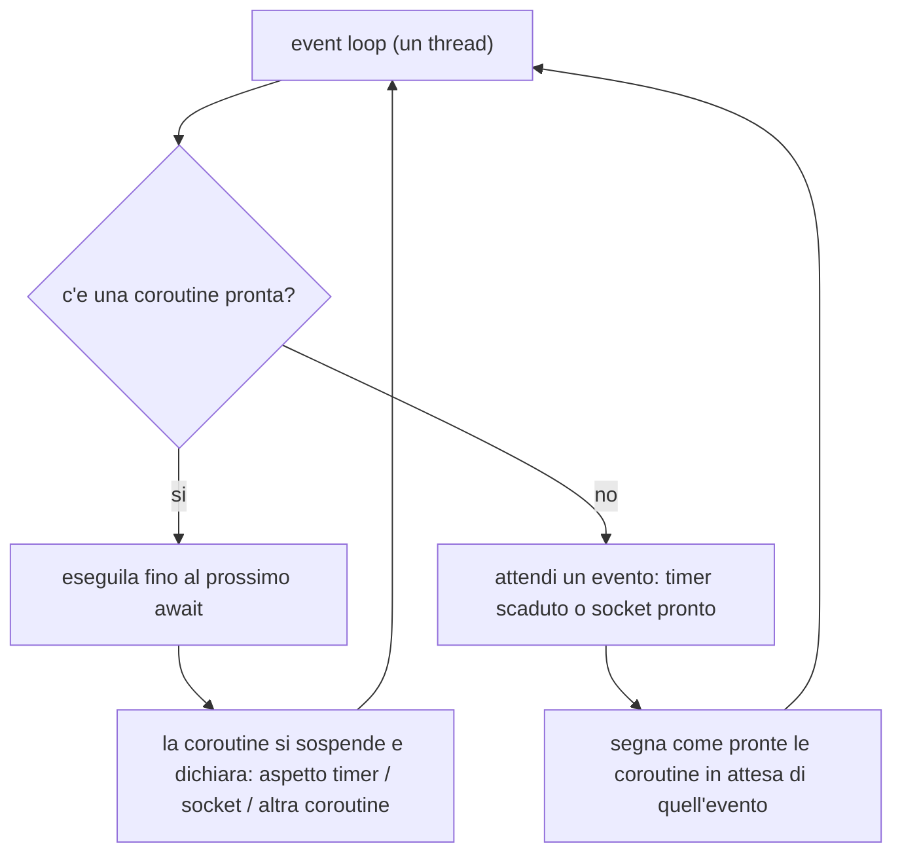
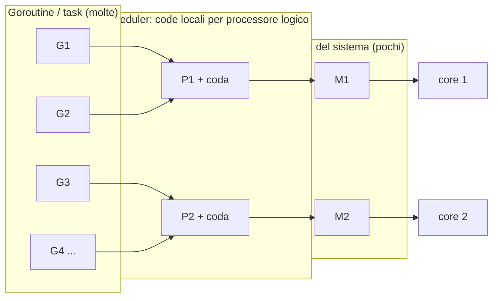
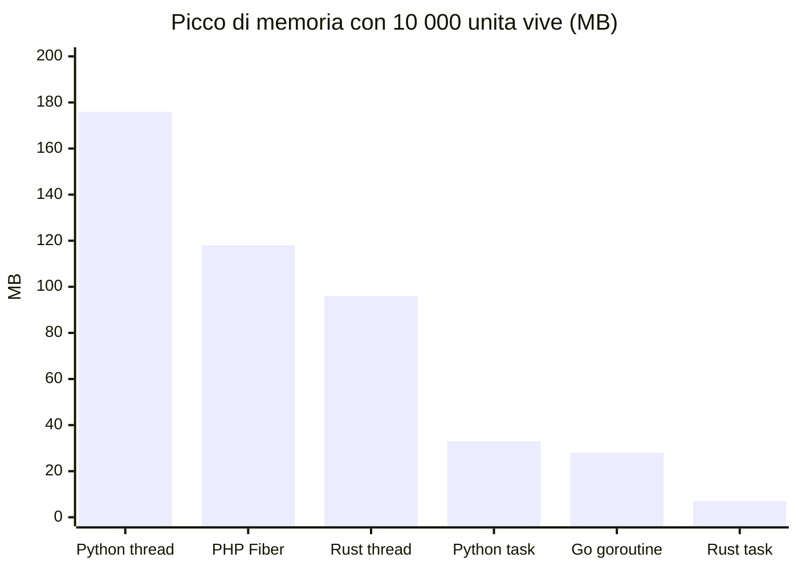

> File C11-parte3.md (parte 3 di 6) — L11.4 — Async/await ed event loop … L11.5 — I runtime: scheduler di Go, tokio, asyncio, Fibers

## L11.4 — Async/await ed event loop

### Concetto

I thread del sistema operativo costano (memoria per lo stack, cambio di contesto, e2/e3). Per migliaia di attività che passano quasi tutto il tempo ad aspettare, si usa un'altra idea: un **solo thread** che esegue molte attività a turno. Ogni attività è una **coroutine**: una funzione che può *sospendersi* in punti espliciti (`await`) restituendo il controllo a un coordinatore, l'**event loop**, che sceglie la prossima attività pronta.



La sospensione è **cooperativa**: nessuno toglie la CPU a una coroutine che non fa `await`. Da qui discende la regola d'oro dell'async: *non bloccare mai l'event loop*. Un calcolo lungo o una chiamata bloccante (`time.sleep`, lettura di file sincrona, query con driver bloccante) ferma **tutte** le altre coroutine.

### Implementazione — il tempo di tre attività (e10)

**Python** (`asyncio`):

```python
import asyncio

async def job(name, delay):
    print(f"{name}: start")
    await asyncio.sleep(delay)      # suspension point: control returns to the loop
    print(f"{name}: end")

async def main():
    await asyncio.gather(job("A", 0.2), job("B", 0.1), job("C", 0.05))

asyncio.run(main())
```

```text
### asyncio
A: start
B: start
C: start
C: end
B: end
A: end
[exit 0]
```

Le tre attività partono nell'ordine dichiarato e finiscono in ordine di scadenza (50, 100, 200 ms): in 200 ms totali, non 350. Questo è il guadagno della concorrenza I/O.

**PHP** (Fiber, nessuna keyword `async`): il Fiber è una coroutine *stackful* sospendibile con `Fiber::suspend()`; lo scheduler va scritto a mano (o preso da una libreria):

```php
<?php
// Two fibers interleave only where they call Fiber::suspend(): cooperative scheduling.
function task(string $name, int $steps): void {
    for ($i = 1; $i <= $steps; $i++) {
        echo "$name step $i\n";
        Fiber::suspend();          // give control back to the scheduler
    }
    echo "$name done\n";
}
$fibers = [new Fiber(fn() => task('A', 3)), new Fiber(fn() => task('B', 2))];
foreach ($fibers as $f) { $f->start(); }
while ($fibers) {                                  // round-robin scheduler
    foreach ($fibers as $k => $f) {
        if ($f->isTerminated()) { unset($fibers[$k]); continue; }
        $f->resume();
    }
}
```

```text
### fibers
A step 1
B step 1
A step 2
B step 2
A step 3
B done
A done
[exit 0]
```

**Rust**: una `async fn` restituisce un `Future`, cioè una *macchina a stati* che non fa nulla finché un runtime non la **polla**. Senza runtime la funzione non viene mai eseguita, e la libreria standard non ne fornisce uno:

```rust
async fn hello() {
    println!("inside the future");
}

fn main() {
    let _fut = hello();      // creates a state machine; nothing runs yet
    println!("main finished, the future was never polled");
}
```

```text
### lazy
main finished, the future was never polled
[exit 0]
```

**Go** non ha `async`/`await`: ogni goroutine ha il proprio stack e il runtime la sospende quando blocca su un channel, un timer o un'operazione di rete; il programmatore scrive codice sequenziale.

### Il caso più comune di errore: bloccare il loop — e4, e5

```python
import asyncio, time

async def good(i):  await asyncio.sleep(0.2)          # yields to the loop
async def bad(i):   time.sleep(0.2)                    # blocks the whole loop
async def offload(i): await asyncio.to_thread(time.sleep, 0.2)  # blocking call in a worker thread

async def timed(label, fn):
    t = time.perf_counter()
    await asyncio.gather(*(fn(i) for i in range(5)))
    print(f"{label:22} 5 jobs of 200 ms -> {(time.perf_counter()-t)*1000:5.0f} ms")

async def main():
    await timed("await asyncio.sleep", good)
    await timed("time.sleep (blocking)", bad)
    await timed("asyncio.to_thread", offload)

asyncio.run(main())
```

```text
### blocking
await asyncio.sleep    5 jobs of 200 ms ->   201 ms
time.sleep (blocking)  5 jobs of 200 ms ->  1001 ms
asyncio.to_thread      5 jobs of 200 ms ->   204 ms
[exit 0]
```

Tre versioni della stessa «attesa di 200 ms» per 5 lavori: con `await asyncio.sleep` i lavori si sovrappongono (201 ms), con `time.sleep` dentro la coroutine si accodano (1001 ms: ogni attesa blocca il loop), con `asyncio.to_thread` la chiamata bloccante viene eseguita in un thread di un pool e il loop resta libero (204 ms). Lo stesso errore in Rust con `tokio` su runtime a thread singolo:

```text
### tokio
1) timeout: the future is dropped at the .await point
  drop a
  result is_err=true
2) select!: the losing branch is dropped
  drop b
  timer won
3) JoinSet: dropping the set aborts the tasks
  leaving the scope
  drop c1
  drop c2
4) blocking call inside async on a single-thread runtime
  5 x std::thread::sleep(200ms) -> 1001 ms
  5 x tokio::time::sleep(200ms) -> 201 ms
[exit 0]
```

(l'ultimo blocco: 5 × `std::thread::sleep(200 ms)` dentro `tokio::spawn` danno 1001 ms contro 201 ms con `tokio::time::sleep`.) Il sintomo non è un errore: è latenza inspiegabile su *tutte* le richieste. In Rust esiste `tokio::task::spawn_blocking`; in Python `asyncio.to_thread` o `run_in_executor`.

### Cancellation: due filosofie

In Python una task asincrona si ferma con `task.cancel()`: all'`await` successivo la coroutine riceve `CancelledError` e può eseguire `finally`. In Rust un `Future` si cancella **abbandonandolo** (`drop`): al punto di `await` corrente il future cessa di esistere, e i suoi campi vengono distrutti (RAII, C10 e C09).

```python
import asyncio, threading, time

async def slow():
    try:
        await asyncio.sleep(10)
    except asyncio.CancelledError:
        print("  coroutine: CancelledError received, cleaning up")
        raise
    finally:
        print("  coroutine: finally runs")

async def main():
    print("1) task.cancel()")
    t = asyncio.create_task(slow())
    await asyncio.sleep(0.05)
    t.cancel()
    try:
        await t
    except asyncio.CancelledError:
        print("  main: task is cancelled ->", t.cancelled())
    print("2) wait_for with timeout")
    try:
        await asyncio.wait_for(slow(), timeout=0.1)
    except TimeoutError:
        print("  main: TimeoutError")
    print("3) TaskGroup: one failure cancels the siblings")
    async def boom(): await asyncio.sleep(0.05); raise ValueError("boom")
    try:
        async with asyncio.TaskGroup() as tg:
            tg.create_task(slow()); tg.create_task(boom())
    except* ValueError as eg:
        print("  main: caught", [str(e) for e in eg.exceptions])

asyncio.run(main())

print("4) a thread cannot be cancelled from outside")
def worker():
    time.sleep(1.0); print("  thread: still running after 'cancel' (no API to stop it)")
th = threading.Thread(target=worker); th.start()
print("  main: no th.cancel()/th.kill() exists:", [a for a in dir(th) if a in ("cancel", "kill", "terminate", "stop")])
th.join()
```

```text
### cancel
1) task.cancel()
  coroutine: CancelledError received, cleaning up
  coroutine: finally runs
  main: task is cancelled -> True
2) wait_for with timeout
  coroutine: CancelledError received, cleaning up
  coroutine: finally runs
  main: TimeoutError
3) TaskGroup: one failure cancels the siblings
  coroutine: CancelledError received, cleaning up
  coroutine: finally runs
  main: caught ['boom']
4) a thread cannot be cancelled from outside
  main: no th.cancel()/th.kill() exists: []
  thread: still running after 'cancel' (no API to stop it)
[exit 0]
```

I quattro scenari Python mostrano: cancellazione esplicita, `wait_for` con scadenza (cancella la coroutine e solleva `TimeoutError`), `TaskGroup` (un errore cancella i fratelli: *structured concurrency*, L11.6) e, per confronto, un **thread** che non si può fermare dall'esterno: il thread continua a girare. Per questo i thread usano un flag cooperativo (`Event`), come nel programma del capitolo.

In Rust, `timeout`, `select!` e `JoinSet` implementano la cancellazione per *drop*, e `Drop` (C10) si esegue esattamente al punto dell'`await` in cui il future viene abbandonato:

```rust
use std::time::{Duration, Instant};
use tokio::task::JoinSet;
use tokio::time::{sleep, timeout};

struct Guard(&'static str);
impl Drop for Guard {
    fn drop(&mut self) { println!("  drop {}", self.0); }
}

async fn slow(name: &'static str) -> &'static str {
    let _g = Guard(name); // runs when the future finishes OR is dropped
    sleep(Duration::from_secs(10)).await;
    name
}

#[tokio::main(flavor = "current_thread")]
async fn main() {
    println!("1) timeout: the future is dropped at the .await point");
    let r = timeout(Duration::from_millis(100), slow("a")).await;
    println!("  result is_err={}", r.is_err());

    println!("2) select!: the losing branch is dropped");
    tokio::select! {
        v = slow("b") => println!("  b finished: {v}"),
        _ = sleep(Duration::from_millis(100)) => println!("  timer won"),
    }

    println!("3) JoinSet: dropping the set aborts the tasks");
    {
        let mut set = JoinSet::new();
        set.spawn(slow("c1"));
        set.spawn(slow("c2"));
        tokio::task::yield_now().await;
        println!("  leaving the scope");
    }
    tokio::task::yield_now().await;

    println!("4) blocking call inside async on a single-thread runtime");
    let t = Instant::now();
    let hs: Vec<_> = (0..5).map(|_| tokio::spawn(async { std::thread::sleep(Duration::from_millis(200)); })).collect();
    for h in hs { h.await.unwrap(); }
    println!("  5 x std::thread::sleep(200ms) -> {} ms", t.elapsed().as_millis());
    let t = Instant::now();
    let hs: Vec<_> = (0..5).map(|_| tokio::spawn(async { sleep(Duration::from_millis(200)).await; })).collect();
    for h in hs { h.await.unwrap(); }
    println!("  5 x tokio::time::sleep(200ms) -> {} ms", t.elapsed().as_millis());
}
```

Con `tokio` 1.53.3 (`Cargo.toml`: `tokio = { version = "1.53.3", features = ["rt-multi-thread", "macros", "time", "sync"] }`) l'esecuzione registrata sopra mostra in ordine: `drop a` prima del `result`, `drop b` quando vince il timer, `drop c1`/`drop c2` all'uscita dallo scope del `JoinSet`.

> **Attenzione.** Cancellare un future per drop è sicuro per la memoria ma **non** per la logica: se il future era a metà di un'operazione a più passi (scritto metà file, tolto il denaro dal conto A prima di accreditarlo sul B), l'operazione resta a metà. Si chiama *cancel safety* e va dichiarata nella documentazione di ogni funzione async.

### Focus comparativo

| | PHP | Python | Rust | Go |
|---|---|---|---|---|
| Keyword `async`/`await` | no (Fibers) | sì, nel linguaggio | sì, nel linguaggio | no (non necessaria) |
| Runtime nella libreria standard | no | sì (`asyncio`) | **no** (`tokio`, `async-std`, `smol`) | sì (nel runtime) |
| «Colore» delle funzioni | no | sì (`async def` si chiama con `await`) | sì | no |
| Cancellazione | libreria | `CancelledError` all'`await` | drop del future | `context.Context` |
| Chiamata bloccante nel loop | ferma tutto | ferma tutto (`to_thread`) | ferma il thread (`spawn_blocking`) | blocca solo la goroutine |

Il **colore delle funzioni** è il costo ergonomico di `async`: una funzione `async` può essere chiamata solo da un'altra `async` (o da un runtime), e il «contagio» risale la catena delle chiamate. Go lo evita rendendo economico il blocco a livello di runtime (L11.5).

### Esercizio Rosetta

Scrivi, nel linguaggio che preferisci, tre attività che attendono 50, 100 e 200 ms e stampano quando finiscono, in modo che il tempo totale sia circa 200 ms. Poi sostituisci una delle attese con una chiamata bloccante e misura la differenza.

**Risposte**

> Con attese cooperative il totale è circa il massimo (200 ms), non la somma (350 ms). Sostituendo un'attesa con una chiamata bloccante nello stesso thread (`time.sleep`, `std::thread::sleep`) il totale diventa circa la somma (350 ms): l'event loop era occupato. In Go l'esperimento non mostra differenza perché ogni goroutine ha il proprio stack: `time.Sleep` sospende solo quella goroutine.

---

## L11.5 — I runtime: scheduler di Go, tokio, asyncio, Fibers

### Concetto

Chi decide *quale unità di esecuzione gira su quale core?* Tre risposte:

1. **Il sistema operativo** (thread nativi): preemptive, costoso (stack di centinaia di KB–MB per thread), limitato a migliaia di unità.
2. **Un runtime in un solo thread** (`asyncio`, Fiber, `tokio` current-thread): cooperativo, leggerissimo, nessun parallelismo.
3. **Un runtime M:N**: *M* unità leggere (goroutine, task) su *N* thread del sistema. È il modello di Go e di `tokio` multi-thread.



Gli elementi essenziali dello scheduler di Go (modello G-M-P): ogni **P** (processore logico, in numero pari a `GOMAXPROCS`, di default il numero di core) ha una coda locale di **G** (goroutine) e un **M** (thread) che le esegue. Quando una goroutine blocca su un channel o su un timer, il P passa alla successiva; quando un P resta senza lavoro, ne *ruba* da un altro (*work stealing*). Una chiamata di sistema bloccante libera il P dal suo M. Dalla versione 1.14 le goroutine sono anche interrompibili in modo preemptive, e non solo ai punti di chiamata.

`tokio` multi-thread ha la stessa struttura (un thread worker per core, work stealing), con una differenza decisiva: la cooperazione è **esplicita**. Un task Rust cede il controllo solo a ogni `.await`: un ciclo CPU di 10 secondi dentro un task non cede mai e occupa un worker. Per questo la regola è: lavoro CPU-bound su `spawn_blocking` o su un pool dedicato.

### Il costo di un'unità — e3

Quante unità si possono tenere vive insieme, e a che prezzo? Ogni unità attende su un «cancello» comune; poi il cancello si apre e si attende che tutte finiscano. Tempo e picco di memoria residente (`VmHWM` da `/proc/self/status`):

```python
import asyncio, sys, threading, time

def rss_mb():
    for line in open("/proc/self/status"):
        if line.startswith("VmHWM"):
            return int(line.split()[1]) / 1024

def threads(n):
    gate = threading.Event()
    ts = [threading.Thread(target=gate.wait) for _ in range(n)]
    t = time.perf_counter()
    for x in ts: x.start()
    gate.set()
    for x in ts: x.join()
    return (time.perf_counter() - t) * 1000

async def tasks(n):
    gate = asyncio.Event()
    async def unit(): await gate.wait()
    t = time.perf_counter()
    ts = [asyncio.create_task(unit()) for _ in range(n)]
    await asyncio.sleep(0); gate.set()
    await asyncio.gather(*ts)
    return (time.perf_counter() - t) * 1000

kind, n = sys.argv[1], int(sys.argv[2])
ms = threads(n) if kind == "threads" else asyncio.run(tasks(n))
print(f"python {kind:7} n={n:>6} ms={ms:7.0f} peak_rss_mb={rss_mb():.0f}")
```

```php
<?php
$n = (int) $argv[1];
$fibers = [];
$t = hrtime(true);
for ($i = 0; $i < $n; $i++) { $f = new Fiber(function (): void { Fiber::suspend(); }); $f->start(); $fibers[] = $f; }
foreach ($fibers as $f) { $f->resume(); }
$ms = (hrtime(true) - $t) / 1e6;
preg_match('/VmHWM:\s+(\d+)/', file_get_contents('/proc/self/status'), $m);
printf("php fibers   n=%6d ms=%7.0f peak_rss_mb=%.0f\n", $n, $ms, $m[1] / 1024);
```

```rust
use std::sync::{Arc, Barrier};
use std::thread;
use std::time::Instant;
fn rss_mb() -> f64 {
    let s = std::fs::read_to_string("/proc/self/status").unwrap();
    let l = s.lines().find(|l| l.starts_with("VmHWM")).unwrap();
    l.split_whitespace().nth(1).unwrap().parse::<f64>().unwrap() / 1024.0
}
fn main() {
    let n: usize = std::env::args().nth(1).unwrap().parse().unwrap();
    let gate = Arc::new(Barrier::new(n + 1));
    let t = Instant::now();
    let hs: Vec<_> = (0..n).map(|_| { let g = Arc::clone(&gate); thread::spawn(move || { g.wait(); }) }).collect();
    gate.wait();
    for h in hs { h.join().unwrap(); }
    println!("rust threads n={n:>6} ms={:7.0} peak_rss_mb={:.0}", t.elapsed().as_secs_f64() * 1000.0, rss_mb());
}
```

Rust, task `tokio` (stesso `Cargo.toml` di e5; il tempo include 50 ms di attesa prima di aprire il cancello):

```rust
use std::sync::Arc;
use std::time::Instant;
use tokio::sync::Notify;
fn rss_mb() -> f64 {
    let s = std::fs::read_to_string("/proc/self/status").unwrap();
    let l = s.lines().find(|l| l.starts_with("VmHWM")).unwrap();
    l.split_whitespace().nth(1).unwrap().parse::<f64>().unwrap() / 1024.0
}
#[tokio::main]
async fn main() {
    let n: usize = std::env::args().nth(1).unwrap().parse().unwrap();
    let gate = Arc::new(Notify::new());
    let t = Instant::now();
    let hs: Vec<_> = (0..n).map(|_| { let g = Arc::clone(&gate); tokio::spawn(async move { g.notified().await; }) }).collect();
    tokio::task::yield_now().await;
    tokio::time::sleep(std::time::Duration::from_millis(50)).await;
    gate.notify_waiters();
    for h in hs { h.await.unwrap(); }
    println!("rust tokio   n={n:>6} ms={:7.0} peak_rss_mb={:.0}", t.elapsed().as_secs_f64() * 1000.0, rss_mb());
}
```

```go
package main

import (
	"fmt"
	"os"
	"regexp"
	"strconv"
	"sync"
	"time"
)

func rssMB() float64 {
	b, _ := os.ReadFile("/proc/self/status")
	m := regexp.MustCompile(`VmHWM:\s+(\d+)`).FindSubmatch(b)
	v, _ := strconv.Atoi(string(m[1]))
	return float64(v) / 1024
}

func main() {
	n, _ := strconv.Atoi(os.Args[1])
	gate := make(chan struct{})
	var wg sync.WaitGroup
	t := time.Now()
	for i := 0; i < n; i++ {
		wg.Add(1)
		go func() { defer wg.Done(); <-gate }()
	}
	close(gate)
	wg.Wait()
	fmt.Printf("go goroutines n=%6d ms=%7.0f peak_rss_mb=%.0f\n", n, float64(time.Since(t).Microseconds())/1000, rssMB())
}
```

Risultati registrati (una sola esecuzione per riga, ambiente condiviso: l'ordine di grandezza è significativo, la cifra esatta no):

```text
### units
python threads n=  1000 ms=    303 peak_rss_mb=35
[exit 0]
### units
rust threads n=  1000 ms=    113 peak_rss_mb=12
[exit 0]
### units
python threads n= 10000 ms=   6415 peak_rss_mb=176
[exit 0]
### units
rust threads n= 10000 ms=   1321 peak_rss_mb=96
[exit 0]
### units
python tasks   n= 10000 ms=     96 peak_rss_mb=33
[exit 0]
### units
php fibers   n= 10000 ms=    244 peak_rss_mb=118
[exit 0]
### units
go goroutines n= 10000 ms=     47 peak_rss_mb=28
[exit 0]
### units
rust tokio   n= 10000 ms=     65 peak_rss_mb=7
[exit 0]
### units
python tasks   n=100000 ms=   1598 peak_rss_mb=158
[exit 0]
### units
PHP Fatal error:  Uncaught Exception: Fiber stack protect failed: mprotect failed: Cannot allocate memory (12) in units.php:5
Stack trace:
#0 units.php(5): Fiber->start()
#1 {main}
  thrown in units.php on line 5
[exit 255]
### units
go goroutines n=100000 ms=    340 peak_rss_mb=258
[exit 0]
### units
rust tokio   n=100000 ms=    215 peak_rss_mb=40
[exit 0]
### units_php30k
php fibers   n= 30000 ms=    867 peak_rss_mb=291
[exit 0]
```

| Unità | n = 10 000: tempo | n = 10 000: picco RSS | n = 100 000 |
|---|---|---|---|
| Python thread | 6 415 ms | 176 MB | non provato |
| Rust thread | 1 321 ms | 96 MB | non provato |
| PHP Fiber | 244 ms | 118 MB | **fallisce** (vedi sotto) |
| Python task `asyncio` | 96 ms | 33 MB | 1 598 ms, 158 MB |
| Go goroutine | 47 ms | 28 MB | 340 ms, 258 MB |
| Rust task `tokio` | 65 ms | 7 MB | 215 ms, 40 MB |



Letture e limiti dichiarati:

- Un task `tokio` costa 7 MB per 10 000 unità (circa 0,7 KB ciascuno): è una macchina a stati senza stack. Una goroutine parte con uno stack piccolo e dinamico (28 MB per 10 000, circa 2,8 KB; 258 MB per 100 000 in questa misura). Un thread nativo costa 10–100 volte di più.
- Con 100 000 **Fiber** PHP il processo termina con `Fiber stack protect failed: mprotect failed: Cannot allocate memory` (exit 255). Ogni Fiber ha uno stack C riservato con una pagina di guardia, e il sistema ha un limite al numero di mappature di memoria; con 30 000 funziona (867 ms, 291 MB, misura `units_php30k`). La **causa** del limite (numero massimo di mappature per processo) è **un'ipotesi** coerente con il messaggio, non verificata (non è stato letto `vm.max_map_count`).
- I thread nativi a 100 000 non sono stati provati (a 10 000 sono già lenti: 1,3 s in Rust e 6,4 s in Python).

### Come lavorano gli altri runtime

- **`asyncio`**: un event loop (basato su `selectors`: `epoll` su Linux) in un thread; le task sono coroutine. Non c'è parallelismo: per usare più core si avviano più processi, ciascuno con il proprio loop.
- **PHP**: i Fibers (PHP 8.1+) sono coroutine, ma lo **scheduler non c'è**: lo forniscono AMPHP, ReactPHP, Swoole, o lo si scrive come nel programma del capitolo. In un server tradizionale (PHP-FPM) la concorrenza si ottiene con più processi, ognuno con una richiesta alla volta, e lo stato condiviso passa dal database o dalla cache.
- **`tokio`**: runtime multi-thread (default) o `current_thread`; le task devono essere `Send` se il runtime può spostarle da un thread all'altro. Con `current_thread` non servono `Send`.

### Focus comparativo

| | PHP | Python | Rust | Go |
|---|---|---|---|---|
| Unità leggera | Fiber | task `asyncio` | task `tokio` | goroutine |
| Costo per 10 000 (misurato) | 118 MB | 33 MB | 7 MB | 28 MB |
| Scheduler | da scrivere/libreria | event loop in `asyncio` | `tokio` (libreria) | runtime Go (G-M-P) |
| Parallelismo tra unità leggere | no | no (un processo = un loop) | sì (multi-thread) | sì |
| Preemption | no | no | no (cooperativo ai `.await`) | sì (da Go 1.14) |
| Limite osservato | 30 000 sì, 100 000 no | 100 000 sì | 100 000 sì | 100 000 sì |

### Esercizio Rosetta

Scrivi un programma che avvia 10 000 attività, ciascuna attende 100 ms e incrementa un contatore condiviso; al termine stampa il contatore e il tempo totale. Per ogni linguaggio dichiara quale strumento di sincronizzazione hai usato e perché è, o non è, necessario.

**Risposte**

> Python con `asyncio` su un solo thread: nessun lock è necessario, perché fra due `await` non c'è interleaving. Go: `atomic.Int64` o `Mutex`. Rust `tokio`: `AtomicU64` o `Arc<Mutex<_>>`. PHP con Fibers: nessun lock (un solo thread). Totale atteso ~100 ms in tutti i casi, non 1000 s.

---
