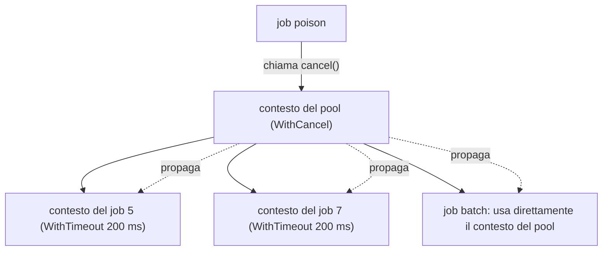
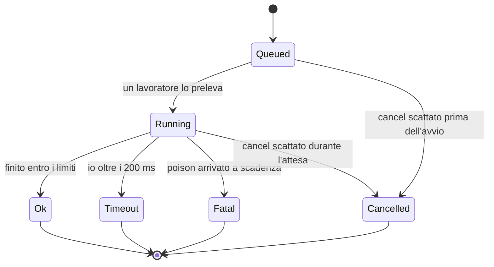
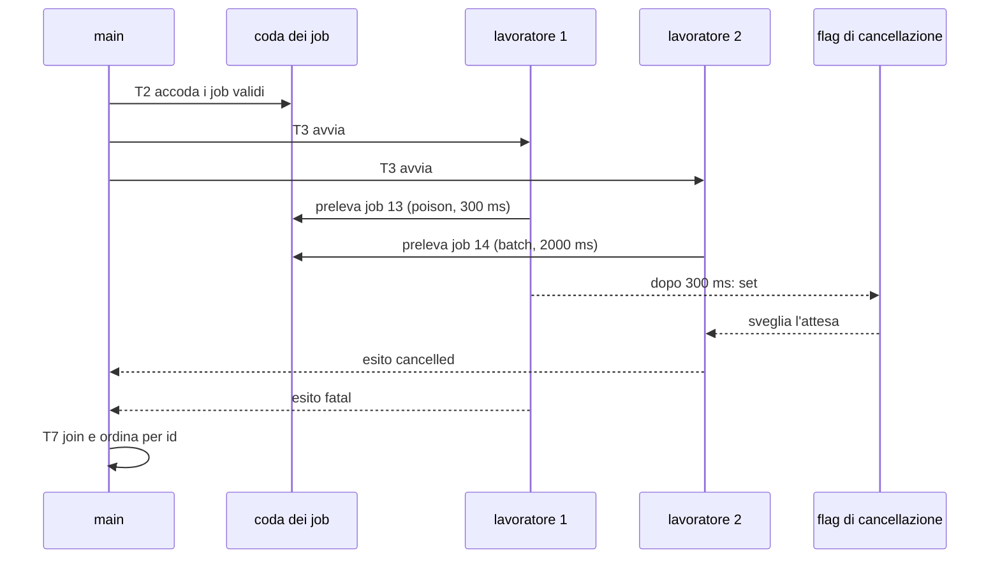
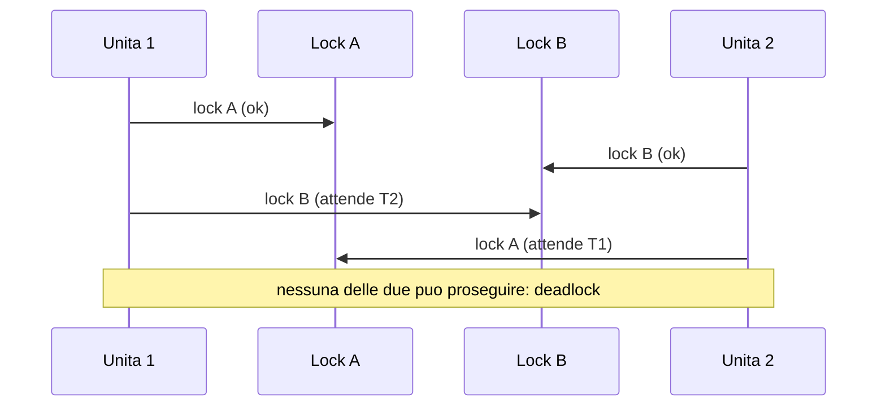

> File C11-parte4.md (parte 4 di 6) — L11.6 — Pattern: worker pool, cancellation, timeout, backpressure, structured concurrency … L11.6 — Pattern: worker pool, cancellation, timeout, backpressure, structured concurrency

## L11.6 — Pattern: worker pool, cancellation, timeout, backpressure, structured concurrency

### Concetto

Cinque pattern si ripetono in ogni sistema concorrente. Il programma del capitolo li usa tutti.

| Pattern | Problema che risolve | Come si ottiene |
|---|---|---|
| **Worker pool** | limitare il numero di unità attive e riusarle | coda condivisa + N lavoratori |
| **Cancellation** | fermare il lavoro inutile quando l'esito è già deciso | segnale propagato a tutte le attese |
| **Timeout** | non aspettare per sempre una risorsa lenta | scadenza su ogni attesa esterna |
| **Backpressure** | non accumulare più lavoro di quanto si smaltisca | coda limitata, produttore che attende |
| **Structured concurrency** | nessuna unità sopravvive al blocco che l'ha creata | scope che attende tutti i figli e li cancella sull'errore |

La cancellazione e la scadenza sono la stessa cosa vista da due lati: una **scadenza** è una cancellazione che parte da un timer. In Go questa unificazione è nel tipo `context.Context`: una scadenza è un contesto figlio con `WithTimeout`, e cancellare il padre cancella i figli.



Il ciclo di vita di un job nel programma è una piccola macchina a stati:



La **structured concurrency** è l'idea che il ciclo di vita di un'attività concorrente sia legato al blocco di codice che la crea, come una variabile locale: all'uscita dal blocco tutti i figli sono terminati (o cancellati). Le sue forme: `asyncio.TaskGroup` (Python 3.11+), `errgroup.Group` (Go, modulo `golang.org/x/sync`, non nella libreria standard), `thread::scope` e `JoinSet` (Rust), nessuna forma nativa in PHP. Un `TaskGroup` ha già mostrato il suo effetto in e4: un fallimento cancella i fratelli. Il pool del programma applica la stessa regola in modo esplicito: `join`/`WaitGroup`/ritorno dell'event loop sono nel punto T7, e nessun lavoratore vive oltre `run_pool`.

### Implementazione — il programma, passo per passo

Il programma completo è in appendice; qui i frammenti per task. Il comportamento osservabile è identico nei quattro linguaggi.

#### T1 — leggere e validare

**Python**

```python
def parse_jobs(lines):
    """T1 - validate every line; return (jobs, rejects) where rejects are (line_no, reason)."""
    jobs, rejects, seen = [], [], set()
    for no, raw in enumerate(lines, 1):
        line = raw.strip()
        if no == 1 or not line:
            continue  # header and blank lines
        parts = line.split(",")
        if len(parts) != 3:
            rejects.append((no, "fields"))
            continue
        sid, op, sarg = (p.strip() for p in parts)
        if not sid.isascii() or not sid.isdigit() or int(sid) == 0:
            rejects.append((no, "id"))
        elif int(sid) in seen:
            rejects.append((no, "duplicate"))
        elif op not in OPS:
            rejects.append((no, "op"))
        elif not sarg.isascii() or not sarg.isdigit():
            rejects.append((no, "arg"))
        else:
            seen.add(int(sid))
            jobs.append(Job(int(sid), op, int(sarg)))
    return jobs, rejects
```

**PHP**

```php
/** T1 - validate every line; return [jobs, rejects] with rejects as [line_no, reason]. */
function parseJobs(array $lines): array
{
    $jobs = [];
    $rejects = [];
    $seen = [];
    foreach ($lines as $i => $raw) {
        $no = $i + 1;
        $line = trim($raw);
        if ($no === 1 || $line === '') {
            continue; // header and blank lines
        }
        $parts = array_map('trim', explode(',', $line));
        if (count($parts) !== 3) {
            $rejects[] = [$no, 'fields'];
            continue;
        }
        [$sid, $op, $sarg] = $parts;
        $isDigits = fn(string $s): bool => preg_match('/^[0-9]+$/D', $s) === 1;
        if (!$isDigits($sid) || (int) $sid === 0) {
            $rejects[] = [$no, 'id'];
        } elseif (isset($seen[(int) $sid])) {
            $rejects[] = [$no, 'duplicate'];
        } elseif (!in_array($op, OPS, true)) {
            $rejects[] = [$no, 'op'];
        } elseif (!$isDigits($sarg)) {
            $rejects[] = [$no, 'arg'];
        } else {
            $seen[(int) $sid] = true;
            $jobs[] = ['id' => (int) $sid, 'op' => $op, 'arg' => (int) $sarg];
        }
    }
    return [$jobs, $rejects];
}
```

**Rust**

```rust
/// T1 - validate every line; return the jobs and the rejects as (line_no, reason).
fn parse_jobs(lines: &[&str]) -> (Vec<Job>, Vec<(usize, &'static str)>) {
    let mut jobs = Vec::new();
    let mut rejects = Vec::new();
    let mut seen = HashSet::new();
    for (i, raw) in lines.iter().enumerate() {
        let no = i + 1;
        let line = raw.trim();
        if no == 1 || line.is_empty() {
            continue; // header and blank lines
        }
        let parts: Vec<&str> = line.split(',').map(str::trim).collect();
        if parts.len() != 3 {
            rejects.push((no, "fields"));
            continue;
        }
        let digits = |s: &str| !s.is_empty() && s.bytes().all(|b| b.is_ascii_digit());
        let id = if digits(parts[0]) { parts[0].parse::<u64>().ok() } else { None };
        match id {
            None | Some(0) => rejects.push((no, "id")),
            Some(id) if seen.contains(&id) => rejects.push((no, "duplicate")),
            Some(id) => {
                if !["collatz", "io", "batch", "poison"].contains(&parts[1]) {
                    rejects.push((no, "op"));
                } else if !digits(parts[2]) {
                    rejects.push((no, "arg"));
                } else if let Ok(arg) = parts[2].parse::<u64>() {
                    seen.insert(id);
                    jobs.push(Job { id, op: parts[1].to_string(), arg });
                } else {
                    rejects.push((no, "arg")); // digits but does not fit in u64
                }
            }
        }
    }
    (jobs, rejects)
}
```

**Go**

```go
// parseJobs is T1: validate every line, collect rejects with their reason.
func parseJobs(lines []string) ([]Job, []Reject) {
	var jobs []Job
	var rejects []Reject
	seen := map[int]bool{}
	for i, raw := range lines {
		no := i + 1
		line := strings.TrimSpace(raw)
		if no == 1 || line == "" {
			continue // header and blank lines
		}
		parts := strings.Split(line, ",")
		if len(parts) != 3 {
			rejects = append(rejects, Reject{no, "fields"})
			continue
		}
		sid, op, sarg := strings.TrimSpace(parts[0]), strings.TrimSpace(parts[1]), strings.TrimSpace(parts[2])
		id, idErr := parseUint(sid)
		arg, argErr := parseUint(sarg)
		switch {
		case idErr != nil || id == 0:
			rejects = append(rejects, Reject{no, "id"})
		case seen[id]:
			rejects = append(rejects, Reject{no, "duplicate"})
		case op != "collatz" && op != "io" && op != "batch" && op != "poison":
			rejects = append(rejects, Reject{no, "op"})
		case argErr != nil:
			rejects = append(rejects, Reject{no, "arg"})
		default:
			seen[id] = true
			jobs = append(jobs, Job{id, op, arg})
		}
	}
	return jobs, rejects
}

// parseUint accepts ASCII digits only (no sign, no underscores).
func parseUint(s string) (int, error) {
	if s == "" {
		return 0, errors.New("empty")
	}
	for _, r := range s {
		if r < '0' || r > '9' {
			return 0, errors.New("not a digit")
		}
	}
	return strconv.Atoi(s)
}
```


Tre differenze di linguaggio nel parsing: Python e PHP usano `isdigit()`/espressione regolare con `ascii` per rifiutare cifre non ASCII; Rust controlla `is_ascii_digit` e fallisce con `parse::<u64>()` se non entra in 64 bit; Go ha `parseUint` scritta a mano perché `strconv.Atoi` accetta un segno `+`/`-`. È il tema del capitolo C14 (validazione al confine) e produce il caso di divergenza che vedremo nel collaudo.

#### T4 — eseguire un lavoro, con attese interrompibili

La funzione centrale: ogni attesa deve poter essere interrotta dalla cancellazione. Tutto ruota intorno a una primitiva «attendi al massimo *d* ms, ma svegliami subito se arriva la cancellazione», che ognuno dei quattro linguaggi esprime diversamente:

**Python** — `threading.Event`, con `wait(timeout)` che restituisce `True` se l'evento è scattato:

```python
class Shared:
    """State shared by all workers: the cancel flag, the results and the steps counter."""

    def __init__(self):
        self.cancel = threading.Event()  # T6 - set once, never cleared
        self.lock = threading.Lock()
        self.results = []
        self.steps_total = 0

    def add_steps(self, n):
        with self.lock:  # T5 - += on an int is read-modify-write, not atomic
            self.steps_total += n

    def record(self, outcome):
        with self.lock:
            self.results.append(outcome)
```

**Rust** — `Mutex<bool>` + `Condvar`: `wait_timeout_while` sospende il thread finché il flag non diventa vero o scade il tempo:

```rust
/// A one-way flag with a timed wait: set once, wakes every waiter.
struct Cancel {
    flag: Mutex<bool>,
    cv: Condvar,
}

impl Cancel {
    fn new() -> Self {
        Cancel { flag: Mutex::new(false), cv: Condvar::new() }
    }
    fn is_set(&self) -> bool {
        *self.flag.lock().unwrap()
    }
    fn set(&self) {
        *self.flag.lock().unwrap() = true;
        self.cv.notify_all(); // T6 - wake all the sleepers
    }
    /// Wait up to `d`; returns true if the flag was set (before or during the wait).
    fn wait(&self, d: Duration) -> bool {
        let guard = self.flag.lock().unwrap();
        let (guard, _) = self.cv.wait_timeout_while(guard, d, |set| !*set).unwrap();
        *guard
    }
}
```

**Go** — un `select` tra `ctx.Done()` e un timer:

```go
// wait blocks for d or until ctx is done; it reports whether ctx ended first.
func wait(ctx context.Context, d time.Duration) bool {
	t := time.NewTimer(d)
	defer t.Stop()
	select {
	case <-ctx.Done():
		return true
	case <-t.C:
		return false
	}
}
```

```go
// Shared is the state touched by all workers.
type Shared struct {
	cancel     context.CancelFunc // T6 - cancels the context every worker watches
	stepsTotal atomic.Uint64      // T5 - lock-free accumulator
	mu         sync.Mutex         // protects results
	results    []Outcome
}

func (s *Shared) record(o Outcome) {
	s.mu.Lock()
	defer s.mu.Unlock()
	s.results = append(s.results, o)
}
```

**PHP** — nessun blocco del thread: il Fiber si sospende dichiarando scadenza e flag, lo scheduler lo risveglia:

```php
/** A one-way flag shared by reference: set once, read by every fiber. */
final class Cancel
{
    public bool $set = false;
}

/**
 * Cancel-aware sleep. The fiber suspends and the scheduler resumes it when the
 * deadline passes or the flag is set. Returns true if cancelled.
 */
function sleepMs(int $ms, Cancel $cancel): bool
{
    if ($cancel->set) {
        return true;
    }
    $deadline = hrtime(true) + $ms * 1_000_000;
    Fiber::suspend([$deadline, $cancel]);
    return $cancel->set;
}
```

Con queste primitive, `runjob` è quasi uguale in tutti:

**Python**

```python
def run_job(job, shared):
    """T4 - execute one job; every wait is cancel-aware."""
    if shared.cancel.is_set():
        return Outcome(job, "cancelled")
    if job.op == "collatz":
        steps = collatz_steps(job.arg)
        shared.add_steps(steps)
        return Outcome(job, "ok", f"steps={steps}")
    if job.op == "io":
        wait_ms = min(job.arg, JOB_TIMEOUT_MS)
        if shared.cancel.wait(wait_ms / 1000):  # True if cancelled while waiting
            return Outcome(job, "cancelled")
        if job.arg > JOB_TIMEOUT_MS:
            return Outcome(job, "timeout", f"limit={JOB_TIMEOUT_MS}")
        return Outcome(job, "ok", f"waited={job.arg}")
    if job.op == "batch":  # long job without a timeout: only cancellation stops it
        if shared.cancel.wait(job.arg / 1000):
            return Outcome(job, "cancelled")
        return Outcome(job, "ok", f"waited={job.arg}")
    # poison: wait, then trip the cancel flag for everybody (T6)
    if shared.cancel.wait(job.arg / 1000):
        return Outcome(job, "cancelled")
    shared.cancel.set()
    return Outcome(job, "fatal")
```

**PHP**

```php
/** T4 - execute one job; every wait is cancel-aware. Returns [status, detail]. */
function runJob(array $job, Cancel $cancel, array &$shared): array
{
    if ($cancel->set) {
        return ['cancelled', ''];
    }
    switch ($job['op']) {
        case 'collatz':
            $steps = collatzSteps($job['arg']);
            $shared['steps_total'] += $steps; // T5 - safe: only one fiber runs at a time
            return ['ok', "steps=$steps"];
        case 'io':
            if (sleepMs(min($job['arg'], JOB_TIMEOUT_MS), $cancel)) {
                return ['cancelled', ''];
            }
            return $job['arg'] > JOB_TIMEOUT_MS
                ? ['timeout', 'limit=' . JOB_TIMEOUT_MS]
                : ['ok', 'waited=' . $job['arg']];
        case 'batch': // long job without a timeout: only cancellation stops it
            return sleepMs($job['arg'], $cancel) ? ['cancelled', ''] : ['ok', 'waited=' . $job['arg']];
        default: // poison: wait, then cancel everybody (T6)
            if (sleepMs($job['arg'], $cancel)) {
                return ['cancelled', ''];
            }
            $cancel->set = true;
            return ['fatal', ''];
    }
}
```

**Rust**

```rust
/// T4 - execute one job; every wait is cancel-aware.
fn run_job(job: &Job, cancel: &Cancel, steps_total: &AtomicU64) -> (&'static str, String) {
    if cancel.is_set() {
        return ("cancelled", String::new());
    }
    match job.op.as_str() {
        "collatz" => {
            let steps = collatz_steps(job.arg);
            steps_total.fetch_add(steps, Ordering::Relaxed); // T5
            ("ok", format!("steps={steps}"))
        }
        "io" => {
            let wait_ms = job.arg.min(JOB_TIMEOUT_MS);
            if cancel.wait(Duration::from_millis(wait_ms)) {
                ("cancelled", String::new())
            } else if job.arg > JOB_TIMEOUT_MS {
                ("timeout", format!("limit={JOB_TIMEOUT_MS}"))
            } else {
                ("ok", format!("waited={}", job.arg))
            }
        }
        "batch" => {
            // long job without a timeout: only cancellation stops it
            if cancel.wait(Duration::from_millis(job.arg)) {
                ("cancelled", String::new())
            } else {
                ("ok", format!("waited={}", job.arg))
            }
        }
        _ => {
            // poison: wait, then cancel everybody (T6)
            if cancel.wait(Duration::from_millis(job.arg)) {
                ("cancelled", String::new())
            } else {
                cancel.set();
                ("fatal", String::new())
            }
        }
    }
}
```

**Go**

```go
// runJob is T4: execute one job; every wait is cancel-aware.
func runJob(ctx context.Context, j Job, sh *Shared) Outcome {
	if ctx.Err() != nil {
		return Outcome{j, "cancelled", ""}
	}
	switch j.Op {
	case "collatz":
		steps := collatzSteps(uint64(j.Arg))
		sh.stepsTotal.Add(steps)
		return Outcome{j, "ok", fmt.Sprintf("steps=%d", steps)}
	case "io":
		// the per-job deadline is a child context of the pool context
		jctx, stop := context.WithTimeout(ctx, jobTimeoutMS*time.Millisecond)
		defer stop()
		if wait(jctx, time.Duration(j.Arg)*time.Millisecond) {
			if ctx.Err() != nil {
				return Outcome{j, "cancelled", ""}
			}
			return Outcome{j, "timeout", fmt.Sprintf("limit=%d", jobTimeoutMS)}
		}
		return Outcome{j, "ok", fmt.Sprintf("waited=%d", j.Arg)}
	case "batch": // long job without a timeout: only cancellation stops it
		if wait(ctx, time.Duration(j.Arg)*time.Millisecond) {
			return Outcome{j, "cancelled", ""}
		}
		return Outcome{j, "ok", fmt.Sprintf("waited=%d", j.Arg)}
	}
	// poison: wait, then cancel everybody (T6)
	if wait(ctx, time.Duration(j.Arg)*time.Millisecond) {
		return Outcome{j, "cancelled", ""}
	}
	sh.cancel()
	return Outcome{j, "fatal", ""}
}
```


Due scelte meritano attenzione:

- Il controllo `cancel.is_set()` / `ctx.Err() != nil` **in testa** impedisce di avviare lavoro nuovo dopo la cancellazione. Non basta da solo: un lavoro già avviato deve poter essere interrotto *durante* l'attesa, per questo ogni attesa è cancel-aware.
- In Go la scadenza di 200 ms è un **contesto figlio**: `ctx.Err()` del padre distingue «cancellato dal pool» da «scaduto» (quando solo il figlio è `DeadlineExceeded`). Negli altri tre linguaggi si calcola `min(arg, 200)` e si guarda se l'attesa era più lunga del limite.

#### T5 — stato condiviso

Il contatore `steps_total` e la lista dei risultati sono gli unici dati condivisi. Python li protegge con un `Lock`, Go con `atomic.Uint64` e un `Mutex` per la lista, Rust con `AtomicU64` per il contatore e un `mpsc` per i risultati (nessun lock sulla lista: i risultati *viaggiano*), PHP con nulla (un solo thread). Quattro scelte diverse per lo stesso scopo, ognuna corretta per il proprio modello.



#### T7 e T8 — attendere, ordinare, riferire

**Python**

```python
def worker(jobs_q, shared):
    while True:
        job = jobs_q.get()
        if job is None:  # sentinel: no more work
            return
        shared.record(run_job(job, shared))


def run_pool(jobs):
    """T2, T3, T7 - queue the jobs, start W threads, wait for them."""
    shared = Shared()
    jobs_q = queue.Queue()
    for job in jobs:
        jobs_q.put(job)
    for _ in range(WORKERS):
        jobs_q.put(None)
    threads = [threading.Thread(target=worker, args=(jobs_q, shared)) for _ in range(WORKERS)]
    for t in threads:
        t.start()
    for t in threads:
        t.join()
    return sorted(shared.results, key=lambda o: o.job.id), shared.steps_total


def report(results, steps_total, rejected):
    """T8 - stable, diff-able output; exit code is the contract."""
    count = {"ok": 0, "timeout": 0, "fatal": 0, "cancelled": 0}
    for o in results:
        count[o.status] += 1
        tail = f" {o.detail}" if o.detail else ""
        print(f"job {o.job.id} {o.job.op} {o.status}{tail}")
    print(f"jobs={len(results)} ok={count['ok']} timeout={count['timeout']} "
          f"fatal={count['fatal']} cancelled={count['cancelled']} rejected={rejected}")
    print(f"steps_total={steps_total} workers={WORKERS}")
    return 0 if count["ok"] == len(results) and rejected == 0 else 1
```

**PHP**

```php
/** T2, T3, T7 - queue the jobs, start W fibers, run the event loop until all are done. */
function runPool(array $jobs): array
{
    $cancel = new Cancel();
    $shared = ['steps_total' => 0, 'results' => []];
    $queue = new SplQueue();
    foreach ($jobs as $job) {
        $queue->enqueue($job);
    }

    $workers = [];
    for ($w = 0; $w < WORKERS; $w++) {
        $workers[] = new Fiber(function () use ($queue, $cancel, &$shared): void {
            while (!$queue->isEmpty()) {
                $job = $queue->dequeue();
                [$status, $detail] = runJob($job, $cancel, $shared);
                $shared['results'][] = ['job' => $job, 'status' => $status, 'detail' => $detail];
            }
        });
    }

    // the event loop: each entry is [fiber, deadline|null, cancel|null]
    $waiting = [];
    foreach ($workers as $f) {
        $waiting[] = [$f, null, null];
    }
    while ($waiting) {
        $now = hrtime(true);
        $next = [];
        $earliest = null;
        foreach ($waiting as [$f, $deadline, $c]) {
            $ready = $deadline === null || $now >= $deadline || $c->set;
            if (!$ready) {
                $next[] = [$f, $deadline, $c];
                $earliest = $earliest === null ? $deadline : min($earliest, $deadline);
                continue;
            }
            $req = $f->isStarted() ? $f->resume() : $f->start();
            if (!$f->isTerminated()) {
                $next[] = [$f, $req[0], $req[1]];
                $earliest = ($earliest === null || $req[0] < $earliest) ? $req[0] : $earliest;
                if ($req[1]->set) {
                    $earliest = 0; // already cancelled: do not sleep, loop again
                }
            }
        }
        $waiting = $next;
        if ($waiting && $earliest !== null && $earliest > hrtime(true)) {
            usleep(max(0, intdiv($earliest - hrtime(true), 1000)));
        }
    }
    usort($shared['results'], fn($a, $b) => $a['job']['id'] <=> $b['job']['id']);
    return [$shared['results'], $shared['steps_total']];
}

/** T8 - stable, diff-able output; the exit code is the contract. */
function report(array $results, int $stepsTotal, int $rejected): int
{
    $count = ['ok' => 0, 'timeout' => 0, 'fatal' => 0, 'cancelled' => 0];
    foreach ($results as $o) {
        $count[$o['status']]++;
        $tail = $o['detail'] !== '' ? ' ' . $o['detail'] : '';
        echo "job {$o['job']['id']} {$o['job']['op']} {$o['status']}{$tail}\n";
    }
    echo 'jobs=' . count($results) . " ok={$count['ok']} timeout={$count['timeout']} "
        . "fatal={$count['fatal']} cancelled={$count['cancelled']} rejected=$rejected\n";
    echo "steps_total=$stepsTotal workers=" . WORKERS . "\n";
    return ($count['ok'] === count($results) && $rejected === 0) ? 0 : 1;
}
```

**Rust**

```rust
/// T2, T3, T7 - queue the jobs, start W threads, collect the outcomes.
fn run_pool(jobs: Vec<Job>) -> (Vec<Outcome>, u64) {
    let cancel = Arc::new(Cancel::new());
    let steps_total = Arc::new(AtomicU64::new(0));

    let (job_tx, job_rx) = mpsc::channel::<Job>();
    let job_rx = Arc::new(Mutex::new(job_rx)); // Receiver is not Sync: share it behind a Mutex
    let (out_tx, out_rx) = mpsc::channel::<Outcome>();

    for job in jobs {
        job_tx.send(job).unwrap();
    }
    drop(job_tx); // closing the channel is the "no more work" signal

    let mut handles = Vec::new();
    for _ in 0..WORKERS {
        let (job_rx, out_tx) = (Arc::clone(&job_rx), out_tx.clone());
        let (cancel, steps_total) = (Arc::clone(&cancel), Arc::clone(&steps_total));
        handles.push(thread::spawn(move || {
            loop {
                let next = job_rx.lock().unwrap().recv(); // lock released at the end of the statement
                let Ok(job) = next else { return };
                let (status, detail) = run_job(&job, &cancel, &steps_total);
                out_tx.send(Outcome { job, status, detail }).unwrap();
            }
        }));
    }
    drop(out_tx); // the main thread keeps no sender: the loop below ends when workers exit
    let mut results: Vec<Outcome> = out_rx.iter().collect();
    for h in handles {
        h.join().unwrap();
    }
    results.sort_by_key(|o| o.job.id);
    (results, steps_total.load(Ordering::Relaxed))
}

/// T8 - stable, diff-able output; the exit code is the contract.
fn report(results: &[Outcome], steps_total: u64, rejected: usize) -> u8 {
    let count = |s: &str| results.iter().filter(|o| o.status == s).count();
    for o in results {
        let tail = if o.detail.is_empty() { String::new() } else { format!(" {}", o.detail) };
        println!("job {} {} {}{}", o.job.id, o.job.op, o.status, tail);
    }
    println!(
        "jobs={} ok={} timeout={} fatal={} cancelled={} rejected={}",
        results.len(), count("ok"), count("timeout"), count("fatal"), count("cancelled"), rejected
    );
    println!("steps_total={steps_total} workers={WORKERS}");
    if count("ok") == results.len() && rejected == 0 { 0 } else { 1 }
}
```

**Go**

```go
// runPool is T2, T3, T7: queue the jobs, start the workers, wait for them.
func runPool(jobs []Job) ([]Outcome, uint64) {
	ctx, cancel := context.WithCancel(context.Background())
	defer cancel()
	sh := &Shared{cancel: cancel}

	queue := make(chan Job, len(jobs))
	for _, j := range jobs {
		queue <- j
	}
	close(queue) // workers stop when the queue is drained

	var wg sync.WaitGroup
	for i := 0; i < workers; i++ {
		wg.Add(1)
		go func() {
			defer wg.Done()
			for j := range queue {
				sh.record(runJob(ctx, j, sh))
			}
		}()
	}
	wg.Wait()

	sort.Slice(sh.results, func(a, b int) bool { return sh.results[a].Job.ID < sh.results[b].Job.ID })
	return sh.results, sh.stepsTotal.Load()
}

// report is T8: stable, diff-able output; the exit code is the contract.
func report(results []Outcome, stepsTotal uint64, rejected int) int {
	count := map[string]int{}
	for _, o := range results {
		count[o.Status]++
		tail := ""
		if o.Detail != "" {
			tail = " " + o.Detail
		}
		fmt.Printf("job %d %s %s%s\n", o.Job.ID, o.Job.Op, o.Status, tail)
	}
	fmt.Printf("jobs=%d ok=%d timeout=%d fatal=%d cancelled=%d rejected=%d\n",
		len(results), count["ok"], count["timeout"], count["fatal"], count["cancelled"], rejected)
	fmt.Printf("steps_total=%d workers=%d\n", stepsTotal, workers)
	if count["ok"] == len(results) && rejected == 0 {
		return 0
	}
	return 1
}
```


L'ordinamento finale per `id` è ciò che rende il rapporto **stabile**: l'ordine in cui i lavoratori finiscono non lo è. Questo è un principio generale: *l'output di un programma concorrente va ordinato esplicitamente, mai affidato all'ordine di completamento*.

#### Il programma principale

**Python**

```python
def main(argv):
    if len(argv) != 2:
        print("usage: main.py jobs.csv", file=sys.stderr)
        return 2
    try:
        with open(argv[1], encoding="utf-8") as f:
            lines = f.read().splitlines()
    except OSError as e:
        print(f"error: cannot read {argv[1]}", file=sys.stderr)
        return 2
    jobs, rejects = parse_jobs(lines)
    for no, reason in rejects:
        print(f"reject line {no}: {reason}", file=sys.stderr)
    results, steps_total = run_pool(jobs)
    return report(results, steps_total, len(rejects))
```

**PHP**

```php
function main(array $argv): int
{
    if (count($argv) !== 2) {
        fwrite(STDERR, "usage: main.php jobs.csv\n");
        return 2;
    }
    $text = @file_get_contents($argv[1]);
    if ($text === false) {
        fwrite(STDERR, "error: cannot read {$argv[1]}\n");
        return 2;
    }
    $lines = explode("\n", rtrim(str_replace("\r\n", "\n", $text), "\n"));
    [$jobs, $rejects] = parseJobs($lines);
    foreach ($rejects as [$no, $reason]) {
        fwrite(STDERR, "reject line $no: $reason\n");
    }
    [$results, $stepsTotal] = runPool($jobs);
    return report($results, $stepsTotal, count($rejects));
}

exit(main($argv));
```

**Rust**

```rust
fn main() -> ExitCode {
    let args: Vec<String> = std::env::args().collect();
    if args.len() != 2 {
        eprintln!("usage: main jobs.csv");
        return ExitCode::from(2);
    }
    let Ok(text) = std::fs::read_to_string(&args[1]) else {
        eprintln!("error: cannot read {}", args[1]);
        return ExitCode::from(2);
    };
    let lines: Vec<&str> = text.lines().collect(); // lines() also strips a trailing \r
    let (jobs, rejects) = parse_jobs(&lines);
    for (no, reason) in &rejects {
        eprintln!("reject line {no}: {reason}");
    }
    let (results, steps_total) = run_pool(jobs);
    ExitCode::from(report(&results, steps_total, rejects.len()))
}
```

**Go**

```go
func main() { os.Exit(run(os.Args)) }

func run(args []string) int {
	if len(args) != 2 {
		fmt.Fprintln(os.Stderr, "usage: main jobs.csv")
		return 2
	}
	data, err := os.ReadFile(args[1])
	if err != nil {
		fmt.Fprintf(os.Stderr, "error: cannot read %s\n", args[1])
		return 2
	}
	text := strings.ReplaceAll(string(data), "\r\n", "\n")
	lines := strings.Split(strings.TrimSuffix(text, "\n"), "\n")
	jobs, rejects := parseJobs(lines)
	for _, r := range rejects {
		fmt.Fprintf(os.Stderr, "reject line %d: %s\n", r.Line, r.Reason)
	}
	results, steps := runPool(jobs)
	return report(results, steps, len(rejects))
}
```


### Output e collaudo

Output standard (identico in Python, PHP, Rust e Go, confrontato con `cmp`):

```text
job 1 collatz ok steps=111
job 2 collatz ok steps=118
job 3 io ok waited=30
job 4 collatz ok steps=178
job 5 io ok waited=50
job 6 collatz ok steps=261
job 7 io timeout limit=200
job 8 collatz ok steps=350
job 9 collatz ok steps=524
job 10 io ok waited=10
job 11 collatz ok steps=7
job 12 collatz ok steps=0
job 13 poison fatal
job 14 batch cancelled
job 15 batch cancelled
job 16 batch cancelled
job 17 batch cancelled
job 18 batch cancelled
job 19 collatz cancelled
jobs=19 ok=11 timeout=1 fatal=1 cancelled=6 rejected=4
steps_total=1549 workers=4
```

Errori standard (le quattro righe di scarto, in ordine di riga):

```text
reject line 21: duplicate
reject line 22: op
reject line 23: arg
reject line 24: fields
```

Exit code: **1** (ci sono scarti e un lavoro non `ok`); **2** se il file manca (`error: cannot read <file>`).

I numeri raccontano il comportamento voluto: i lavori 1–12 sono eseguiti (compreso il 7, `io 400`, che scade a 200 ms: `timeout`); il lavoro 13 (`poison 300`) scatta dopo 300 ms e cancella tutto; i cinque `batch 2000` (14–18) e il `collatz` 19 non hanno mai terminato: `cancelled`. Se la cancellazione non funzionasse, il programma impiegherebbe 2 secondi invece di ~0,4.

### Collaudo su sei casi

| Caso | Contenuto | Python / PHP / Rust / Go |
|---|---|---|
| `jobs.csv` | il file del capitolo | identici, exit 1 |
| `t_empty.csv` | solo intestazione | identici, exit 0, `jobs=0` |
| `t_crlf.csv` | stesso file con terminatori `\r\n` | identici, exit 1 |
| file mancante | percorso inesistente | identici, exit 2, stesso messaggio |
| `t_odd.csv` | `io` con argomento di 20 cifre, cifre larghe Unicode | **divergono** |
| `t_poison0.csv` | `poison 0`, `batch 3000`, `collatz` subito dopo | **divergono / non deterministico** |

**`t_odd.csv`** (caso didattico di divergenza, tema C02/C14). La riga `1,io,99999999999999999999`: Python e PHP la accettano (Python con interi di precisione arbitraria; PHP con un cast che **satura a `PHP_INT_MAX` in silenzio**, e poi si comporta come un `io` scaduto); Rust e Go la scartano con motivo `arg` perché il valore non entra in 64 bit. La riga `３,io,5` (cifra larga Unicode) è scartata ovunque (`id`).

**`t_poison0.csv`** (caso didattico di **non determinismo**). Il lavoro 1 è un `poison` con attesa 0 ms, il 2 un `batch` da 3000 ms, il 3 un `collatz`. Quale lavoro sia già partito quando la cancellazione scatta dipende dalla corsa tra lavoratori. Trenta esecuzioni per linguaggio:

```text
py:      30 jobs=3 ok=0 timeout=0 fatal=1 cancelled=2 rejected=0;
php:      30 jobs=3 ok=1 timeout=0 fatal=1 cancelled=1 rejected=0;
rs:      30 jobs=3 ok=0 timeout=0 fatal=1 cancelled=2 rejected=0;
go:      24 jobs=3 ok=0 timeout=0 fatal=1 cancelled=2 rejected=0;      6 jobs=3 ok=1 timeout=0 fatal=1 cancelled=1 rejected=0;
```

Python e Rust: sempre `cancelled=2` (il `poison` vince la corsa). Go: 24 volte su 30 `cancelled=2`, 6 volte `ok=1`: il risultato **cambia da un'esecuzione all'altra**. PHP: sempre `ok=1`, in modo **deterministico** ma diverso: con i Fiber lo scheduler esegue i tre lavori in ordine, e il `collatz` gira prima che il `poison` venga risvegliato. Cooperativo non significa uguale: significa riproducibile.

Il file `jobs.csv` è deterministico *per costruzione*: tra l'avvio dei lavori 1–12 (che finiscono in meno di 250 ms) e lo scatto della cancellazione a 300 ms c'è un margine di decine di millisecondi. È un margine di tempo, non una garanzia logica: su una macchina molto carica il test potrebbe diventare instabile. **Un test concorrente che dipende dai tempi è fragile**: la soluzione è nel capitolo C13 (orologi finti, sincronizzazione esplicita).

### Due bug classici che il programma non ha

#### Deadlock — e6

Due unità prendono due lock in ordine opposto e restano per sempre in attesa l'una dell'altra.



```go
package main

import (
	"fmt"
	"sync"
	"time"
)

func main() {
	var a, b sync.Mutex
	var wg sync.WaitGroup
	wg.Add(2)
	go func() { // locks a then b
		defer wg.Done()
		a.Lock()
		time.Sleep(50 * time.Millisecond)
		b.Lock()
		fmt.Println("g1 got both")
	}()
	go func() { // locks b then a: opposite order
		defer wg.Done()
		b.Lock()
		time.Sleep(50 * time.Millisecond)
		a.Lock()
		fmt.Println("g2 got both")
	}()
	wg.Wait()
}
```

```python
import faulthandler, sys, threading, time
faulthandler.dump_traceback_later(2, exit=True)   # after 2 s print every thread's stack and exit
a, b = threading.Lock(), threading.Lock()

def t1():
    with a:
        time.sleep(0.05)
        with b: print("t1 got both")

def t2():
    with b:
        time.sleep(0.05)
        with a: print("t2 got both")

ts = [threading.Thread(target=t1), threading.Thread(target=t2)]
[t.start() for t in ts]; [t.join() for t in ts]
```

```rust
use std::sync::{Arc, Mutex};
use std::thread;
use std::time::Duration;

fn main() {
    let a = Arc::new(Mutex::new(0));
    let b = Arc::new(Mutex::new(0));
    let (a1, b1) = (Arc::clone(&a), Arc::clone(&b));
    let (a2, b2) = (Arc::clone(&a), Arc::clone(&b));
    let t1 = thread::spawn(move || {
        let _ga = a1.lock().unwrap();
        thread::sleep(Duration::from_millis(50));
        let _gb = b1.lock().unwrap();
        println!("t1 got both");
    });
    let t2 = thread::spawn(move || {
        let _gb = b2.lock().unwrap();
        thread::sleep(Duration::from_millis(50));
        let _ga = a2.lock().unwrap();
        println!("t2 got both");
    });
    t1.join().unwrap();
    t2.join().unwrap();
}
```

```text
### go
fatal error: all goroutines are asleep - deadlock!

goroutine 1 [sync.WaitGroup.Wait]:
sync.runtime_SemacquireWaitGroup(0xc00007a040?)
	/usr/local/go1.24.7/src/runtime/sema.go:110 +0x25
sync.(*WaitGroup).Wait(0x0?)
	/usr/local/go1.24.7/src/sync/waitgroup.go:118 +0x48
main.main()
	main.go:27 +0x125

goroutine 6 [sync.Mutex.Lock]:
internal/sync.runtime_SemacquireMutex(0x0?, 0x0?, 0x0?)
	/usr/local/go1.24.7/src/runtime/sema.go:95 +0x25
internal/sync.(*Mutex).lockSlow(0xc000010108)
[exit 0]
### python
Timeout (0:00:02)!
Thread 0x00007fbb1bfff6c0 (most recent call first):
  File "dl.py", line 13 in t2
  File "/usr/lib/python3.13/threading.py", line 995 in run
  File "/usr/lib/python3.13/threading.py", line 1044 in _bootstrap_inner
  File "/usr/lib/python3.13/threading.py", line 1015 in _bootstrap

Thread 0x00007fbb20b9c6c0 (most recent call first):
  File "dl.py", line 8 in t1
  File "/usr/lib/python3.13/threading.py", line 995 in run
  File "/usr/lib/python3.13/threading.py", line 1044 in _bootstrap_inner
  File "/usr/lib/python3.13/threading.py", line 1015 in _bootstrap

Thread 0x00007fbb21875080 (most recent call first):
  File "/usr/lib/python3.13/threading.py", line 1095 in join
  File "dl.py", line 16 in <module>
[exit 1]
### rust
timeout exit=124
[exit 0]
```

Go rileva «all goroutines are asleep» e termina con lo stack di tutte le goroutine; Python, con `faulthandler.dump_traceback_later`, stampa dopo 2 secondi lo stack di ogni thread e mostra le righe in cui sono bloccati (`t1` alla riga 8, `t2` alla riga 13); Rust **si blocca** senza messaggio (`timeout 3` ha terminato il processo con exit 124). Attenzione: il rilevamento di Go funziona solo perché *tutte* le goroutine sono bloccate; in un server con altre goroutine attive il deadlock parziale **non** è rilevato. La cura è la stessa dappertutto: un **ordine globale** di acquisizione dei lock, o non tenere due lock insieme.

#### Perdita di goroutine (leak) — e8

Una goroutine bloccata per sempre su un'operazione di channel non viene mai raccolta dal garbage collector, e trattiene memoria e stack. Il caso tipico: il chiamante rinuncia per timeout, ma il lavoratore sta ancora per inviare il risultato su un channel senza buffer.

```go
package main

import (
	"context"
	"fmt"
	"os"
	"runtime"
	"time"
)

// leaky: the worker blocks forever on an unbuffered send once the caller gave up.
func leaky() int {
	ch := make(chan int)
	go func() {
		time.Sleep(20 * time.Millisecond) // slow work
		ch <- 42                          // nobody is listening any more
	}()
	select {
	case v := <-ch:
		return v
	case <-time.After(5 * time.Millisecond):
		return -1
	}
}

// fixed: the worker watches the context and the channel has room for one result.
func fixed() int {
	ctx, cancel := context.WithTimeout(context.Background(), 5*time.Millisecond)
	defer cancel()
	ch := make(chan int, 1)
	go func() {
		select {
		case <-time.After(20 * time.Millisecond): // slow work
			ch <- 42
		case <-ctx.Done():
		}
	}()
	select {
	case v := <-ch:
		return v
	case <-ctx.Done():
		return -1
	}
}

func main() {
	if len(os.Args) > 1 && os.Args[1] == "map" {
		mapRace()
		return
	}
	call := leaky
	if len(os.Args) > 1 && os.Args[1] == "fixed" {
		call = fixed
	}
	fmt.Println("goroutines at start:      ", runtime.NumGoroutine())
	for i := 0; i < 1000; i++ {
		call()
	}
	time.Sleep(100 * time.Millisecond)
	fmt.Println("after 1000 timed-out calls:", runtime.NumGoroutine())
}
```

```text
### leaky
goroutines at start:       1
after 1000 timed-out calls: 1001
[exit 0]
```

```text
### fixed
goroutines at start:       1
after 1000 timed-out calls: 1
[exit 0]
```

Dopo 1000 chiamate scadute la versione con channel senza buffer lascia 1001 goroutine; la versione con channel da 1 posto e contesto non ne lascia nessuna. Regola: ogni goroutine deve avere un modo di **terminare** (contesto, canale chiuso, buffer sufficiente). L'equivalente in Python è un thread dimenticato (non si può fermare dall'esterno, e4), in Rust una task `tokio` staccata senza handle.

### Focus comparativo

| Pattern | PHP | Python | Rust | Go |
|---|---|---|---|---|
| Worker pool | Fibers + coda (a mano) | `ThreadPoolExecutor`, `asyncio` + `Queue` | thread + `mpsc`, `rayon`, `JoinSet` | goroutine + channel |
| Cancellation | flag condiviso | `Event` (thread), `cancel()` (task) | flag/`CancellationToken`, drop del future | `context.Context` |
| Timeout | `usleep` a mano | `wait_for`, `Event.wait(t)` | `tokio::time::timeout`, `Condvar::wait_timeout` | `context.WithTimeout` |
| Backpressure | n/a | `Queue(maxsize)` | `sync_channel(n)` | channel con buffer |
| Structured concurrency | assente | `TaskGroup` | `thread::scope`, `JoinSet` | `errgroup` (esterno) |
| Rilevare i guasti | nessuno | `faulthandler`, `asyncio` debug | compilatore, tool esterni | `-race`, rilevatore di deadlock totale |

### Esercizio Rosetta

Estendi il programma: aggiungi l'operazione `retry,n` che fallisce le prime *n−1* volte e riesce alla *n*-esima, con al massimo 3 tentativi e 50 ms tra uno e l'altro, **interrompibili dalla cancellazione**. Che cosa cambia nell'esito se la cancellazione arriva durante la pausa tra due tentativi?

**Risposte**

> Va aggiunta una `wait(50 ms)` cancel-aware tra i tentativi; se la cancellazione scatta durante la pausa, l'esito è `cancelled` e non `failed`, perché l'esito non dipende dal lavoro ma dal contesto. È lo stesso principio di `runjob`: ogni attesa passa dalla primitiva cancel-aware.

---

