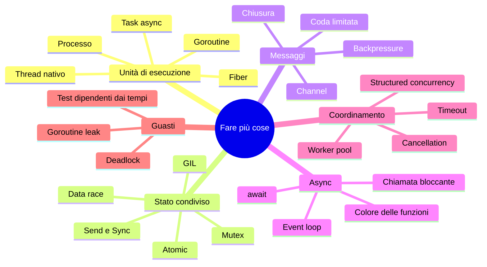

> File C11-parte5.md (parte 5 di 6) — Matrice comparativa del capitolo … Limiti dichiarati

## Matrice comparativa del capitolo

| Costrutto | PHP | Python | Rust | Go |
|---|---|---|---|---|
| Thread di sistema | ◐ ext-parallel, modello a processi | ● `threading` (GIL; build free-threaded) | ● `std::thread` | ◐ goroutine M:N |
| Coroutine / green thread | ● Fibers | ● coroutine | ◐ task su runtime esterno | ● goroutine |
| Keyword `async`/`await` | ○ (AMPHP, ReactPHP, Swoole) | ● | ● (runtime esterno) | ○ (non necessaria) |
| Channel | ◐ librerie | ◐ `queue`, `asyncio.Queue` | ● `mpsc`, tokio, crossbeam | ● `chan`, `select` |
| Prevenzione data race | ○ (shared-nothing) | ○ | ● `Send`/`Sync` a compile-time | ◐ race detector a runtime |
| Cancellation | ◐ librerie | ● `cancel`, `timeout` | ● drop del future, token | ● `context.Context` |
| Structured concurrency | ◐ | ● `TaskGroup` | ● `JoinSet`, scope | ● `errgroup` |

Le celle sono indicative e riprendono la matrice del TOC; solo alcune sono state verificate in questo capitolo (vedi «Limiti dichiarati»). Due celle meritano una nota: «Thread di sistema, Go ◐» perché le goroutine non sono thread, ma sono eseguite da thread; «Cancellation, Python ●» vale per le task `asyncio`, non per i thread (e4, scenario 4).

---

## Il perché della scelta

Quattro risposte allo stesso pericolo, lo **stato condiviso**.

**PHP** lo evita isolando ogni richiesta: ogni richiesta ha il proprio mondo e non lo condivide con le altre (*shared-nothing*). La concorrenza viene dal sistema operativo e dal server web, non dal linguaggio; quello che serve condividere passa dal database o da una cache. È la scelta più semplice e la più robusta ai bug di concorrenza, al prezzo di dover riavviare lo stato a ogni richiesta (e e1 lo mostra: la copia del figlio non tocca il padre).

**Python** lo ha contenuto con il **GIL**: un compromesso storico che rende semplice l'interprete e le estensioni C, a spese del parallelismo (e2: lo speedup dei thread è 0,90). Non è una soluzione di principio ma un'ottimizzazione di un'implementazione che è diventata una caratteristica del linguaggio. La build free-threaded è il tentativo recente di superarlo.

**Go** inverte l'abitudine: *non comunicare condividendo memoria, condividi memoria comunicando*. Le goroutine costano poco (e3), i channel sono nel linguaggio, `select` permette di aspettare più eventi, e `context` propaga cancellazione e scadenze. Il linguaggio **non impedisce** però la condivisione scorretta: il race detector è uno strumento, non una garanzia (e1: il bug si vede, ma solo se lo si cerca).

**Rust** trasforma gli errori di concorrenza in **errori di tipo**: `Send` e `Sync` rendono la data race non compilabile nel codice sicuro (e1: `E0277`, `E0373`, `E0499`). Il prezzo è l'apprendimento e un modello async con più concetti (futures lazy, runtime esterno, `Pin`, cancel safety).

**Sull'async**: Python e Rust distinguono le funzioni asincrone nella firma («colore»); Go rifiuta la distinzione e rende economico bloccare, perché il runtime sospende la goroutine, non il thread. È un compromesso tra esplicitezza (si vede dove si può sospendere) e uniformità (un solo tipo di funzione).

La domanda guida del corso, applicata alla concorrenza: *che cosa questo linguaggio rende facile, e che cosa rende difficile di proposito?* PHP rende facile ignorare il problema; Python rende facile cominciare e difficile scalare sul CPU; Go rende facile la concorrenza e facile sbagliarla; Rust rende difficile sbagliarla e più difficile scriverla.

---

## Anti-pattern

| Anti-pattern | Dove | Che cosa fa | Come evitarlo |
|---|---|---|---|
| Contatore condiviso senza protezione | tutti | aggiornamenti persi, a volte invisibili (e1) | atomic, lock o channel |
| Chiamata bloccante in una coroutine | Python, Rust async | ferma tutte le attività (e4, e5) | `to_thread`, `spawn_blocking` |
| Coda illimitata tra produttore veloce e consumatore lento | tutti | memoria che cresce (e7) | coda limitata |
| Goroutine senza modo di terminare | Go | leak (e8) | contesto, buffer, canale chiuso |
| Due lock in ordine diverso | tutti | deadlock (e6) | ordine globale |
| Test concorrente che dipende dai tempi | tutti | instabile (`t_poison0`) | sincronizzazione esplicita |
| Affidarsi all'ordine di completamento per l'output | tutti | output instabile | ordinare per chiave |
| Cancellare un future a metà di un'operazione a più passi | Rust async | stato incoerente | cancel safety documentata |
| «Funziona, non ho visto perdite» | Python con GIL | difetto latente (e1) | ragionare, non osservare |

---

## Quiz

1. Che differenza c'è tra concorrenza e parallelismo? Un event loop con 10 000 task è un esempio di quale?
2. Perché due thread Python che calcolano non vanno più veloci di uno?
3. Che cosa garantisce `Send` e che cosa `Sync`? Perché `Rc` non è `Send`?
4. Quando conviene un atomic al posto di un mutex? Quando no?
5. Che cosa rende il `Mutex<T>` di Rust diverso dal `sync.Mutex` di Go?
6. Perché `time.sleep` dentro una coroutine è un errore? Come si corregge?
7. Che cosa succede a un `Future` Rust se non lo si polla? E se lo si abbandona a metà?
8. Che cosa è la backpressure e quale struttura la realizza?
9. Che cosa è un deadlock e perché il rilevatore di Go non lo trova sempre?
10. Perché un test concorrente basato su `sleep` è fragile?

**Risposte**

> 1. La concorrenza è struttura (più attività in corso), il parallelismo è esecuzione simultanea; l'event loop è concorrenza senza parallelismo. 2. Il GIL lascia eseguire bytecode a un solo thread alla volta (e2: 0,90 di speedup). 3. `Send`: il valore può essere spostato in un altro thread; `Sync`: un riferimento può essere condiviso fra thread; `Rc` usa un contatore non atomico. 4. Per una sola variabile con operazioni semplici senza contesa; non quando servono più istruzioni insieme (invariante su più campi). 5. In Rust il mutex possiede il dato e l'unico accesso passa dal lock. 6. Ferma l'event loop (e4: 1001 ms contro 201 ms); `await asyncio.sleep` o `to_thread`. 7. Non fa nulla (lazy); se abbandonato, viene distrutto al punto dell'`await` (e5). 8. Il rallentamento propagato al produttore: coda limitata. 9. Attesa circolare su risorse; il rilevatore di Go scatta solo se *tutte* le goroutine sono bloccate. 10. Il risultato dipende dalla temporizzazione della macchina (`t_poison0`).

---

## Esercizi

1. **(base)** Aggiungi al programma un'opzione `--workers N` (default 4) e verifica che l'output sia identico con N = 1, 2, 8. Che cosa cambia nel tempo totale?
2. **(base)** Sostituisci in Go il `Mutex` sulla lista dei risultati con un channel di risultati raccolto dal main, come in Rust. Cambia qualcosa nell'output?
3. **(medio)** Aggiungi un'operazione `retry` come nell'esercizio Rosetta, con 3 tentativi e pausa di 50 ms interrompibile.
4. **(medio)** Riscrivi il worker pool Python con `asyncio` (`TaskGroup` e `asyncio.Queue`) mantenendo l'output identico. Che cosa sparisce (lock)? Che cosa compare (`await`, `to_thread`)?
5. **(avanzato)** Riscrivi il pool Rust con `tokio` (`JoinSet`, `CancellationToken` o `watch`) e confronta con la versione a thread: numero di righe, tempo, memoria con 10 000 job.
6. **(avanzato)** Rendi deterministico `t_poison0.csv`: l'esito deve essere lo stesso in tutte le esecuzioni. Quale scelta di semantica hai dovuto fare (cancellare i job già in coda prima o dopo il poison)?

---

## Mappa mentale

---

## Ponte verso i prossimi capitoli

- **C12–C13.** Il test concorrente stabile: orologi finti, sincronizzazione esplicita, `-race`, test della cancellazione e del timeout, benchmark con le regole di misura già usate in e2/e3/e9.
- **C14.** La normalizzazione dell'input al confine: `t_odd.csv` (saturazione PHP, bignum Python) è lo stesso problema di C08.
- **C16.** Modelli di server HTTP: PHP-FPM e worker mode, WSGI/ASGI, `hyper`, `net/http` sono questo capitolo applicato alla rete.
- **C19.** Pool di connessioni: un worker pool in cui l'unità limitata è la connessione.
- **C21.** Profiling di CPU, memoria e contesa sui lock; percentili di latenza.
- **C09 (riallineamento).** Gli esiti di questo capitolo usano stringhe (`ok`, `timeout`, `fatal`, `cancelled`): da sostituire con tipi di errore come in C09.
- **C10.** `Rc` contro `Arc`, `RefCell` contro `Mutex` (qui chiuso), `weak.Pointer` e goroutine (non trattato).

---

## Limiti dichiarati

- Ambiente con **2 core** condivisi: gli speedup e i tempi (e2, e3, e7, e9) sono ordini di grandezza; le mediane sono su 5 esecuzioni, e3 su una sola.
- Python 3.13 **con GIL**: la build free-threaded non è stata provata. Il bug del contatore non si è riprodotto in Python: non dimostra che non esista.
- PHP: nessuna estensione `parallel`/Swoole/AMPHP; le affermazioni su librerie PHP (`apcu_inc`, `Mutex` di `parallel`, AMPHP, ReactPHP, Swoole) e su `TaskGroup`/`errgroup`/`tokio` fuori da quanto eseguito qui provengono dalla documentazione, **non** da esecuzioni. Il limite dei Fiber a 100 000 ha causa ipotizzata (mappature di memoria), non verificata.
- Preemption di Go dal 1.14 e struttura G-M-P: da conoscenza della documentazione, non misurate qui. Go 1.25+ e PHP 8.4+ non riverificati; la velocità di mutex/atomic va rimisurata.
- `errgroup` non è nella libreria standard Go (modulo `golang.org/x/sync`): non provato (Go proxy bloccato).
- Il rapporto `jobs.csv` è deterministico grazie a margini di tempo, non per costruzione logica.
- Non provati: PHPStan/Psalm sul codice, `clippy`, `staticcheck`, `-race` sul programma intero, `loom`/`miri`, Miri su `Condvar`.
- Il capitolo non è stato riletto da un secondo lettore: le affermazioni sono controllate contro gli output catturati.

---

