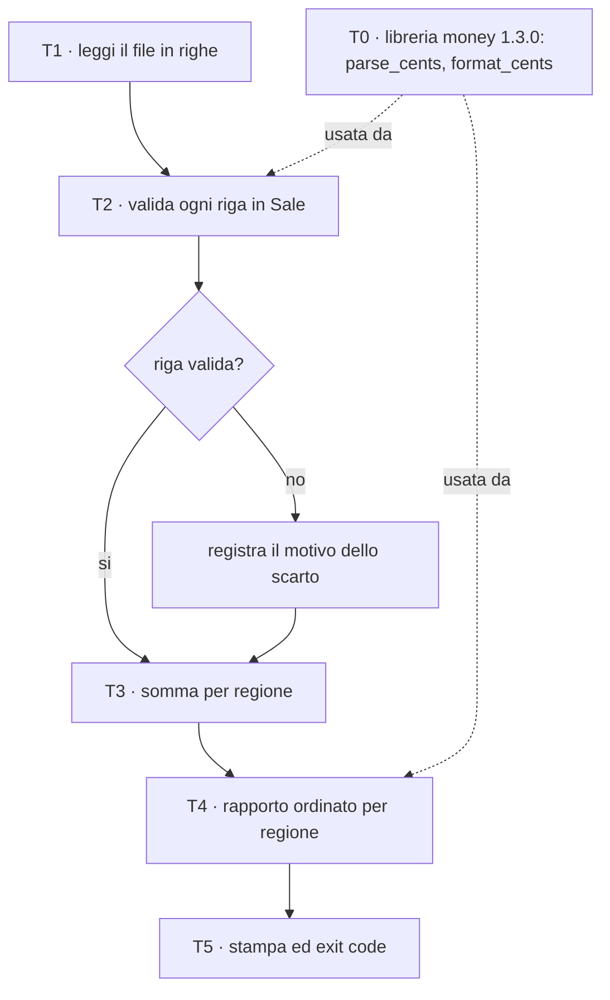
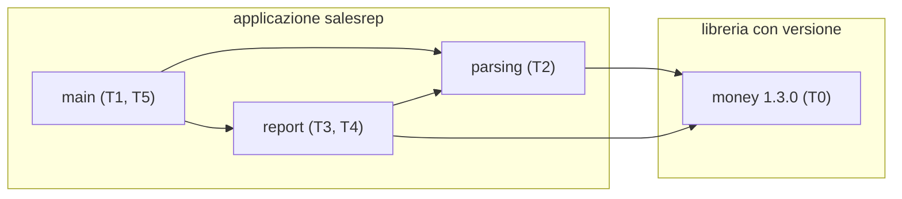
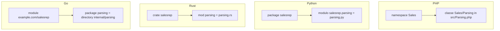
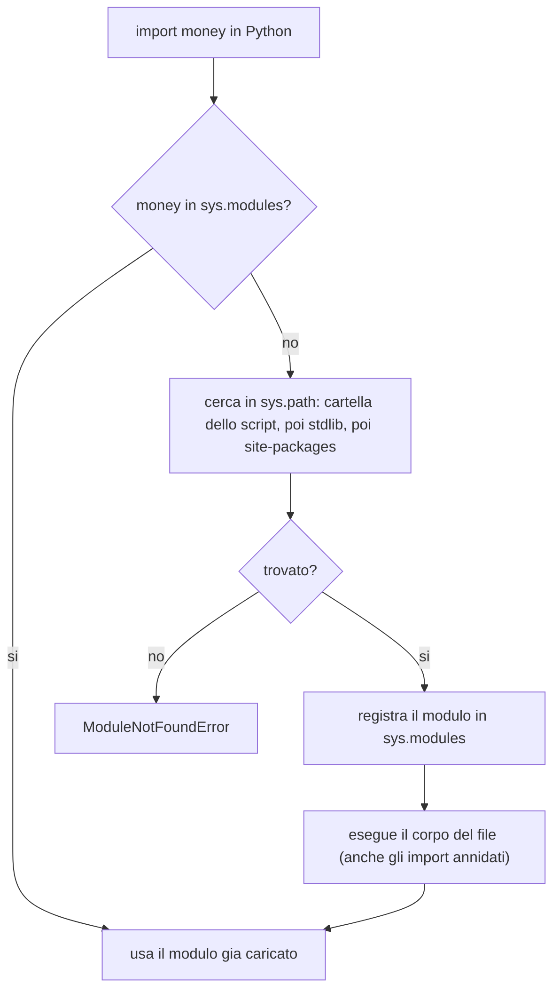
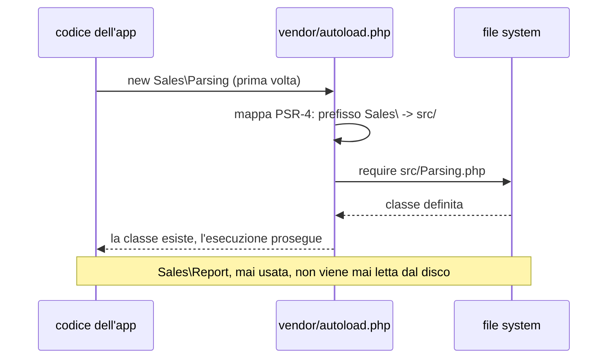
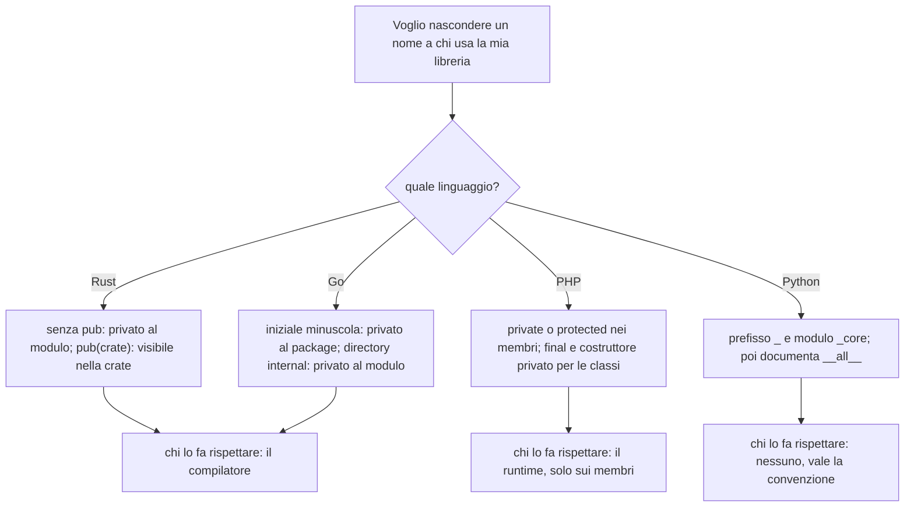

> File C12-parte1.md (parte 1 di 4) — capitolo C12, Moduli, package e dipendenze; le parti, lette in ordine, ricompongono capitoli/C12-moduli-package-dipendenze.md

# C12 — Moduli, package e dipendenze

> Parte IV — Ingegneria del software · 3 lezioni da 45′ (L12.1–L12.3) · ingresso B (professionista) · senza addendum «Il perché della scelta» (la scelta è tecnica e di ecosistema)

**Ambiente di prova.** PHP 8.3.6 con Composer (baseline del corso 8.4+: da riverificare), Python 3.13.16 con `uv` 0.11.32 (build `hatchling`), Rust 1.97.0 (`--edition 2024`, Cargo 1.97.0), Go 1.24.7 (baseline 1.25+: da riverificare). **Packagist e Go proxy sono bloccati** nell'ambiente cloud (policy, non aggirata): le librerie del programma sono quindi **locali** (repository `path` di Composer, `path` di Cargo e di `uv`, `replace` di Go). PyPI e crates.io rispondono: gli esperimenti sui lockfile (e5) usano due pacchetti veri, `tabulate` da PyPI e `itoa` da crates.io. Nulla di ciò che richiede il registry di PHP o il proxy di Go (checksum database `sum.golang.org`, `composer audit`, `govulncheck`) è stato provato: è detto ogni volta. Macchina cloud con 2 core, irrilevante per questo capitolo.

## Obiettivi

Al termine del capitolo sai:

- distinguere **file**, **modulo**, **package**, **crate**, **namespace** e **module** di Go, e spiegare perché la stessa parola indica cose diverse nei quattro linguaggi;
- dichiarare che cosa di una libreria è **pubblico** e che cosa è **privato**, e sapere chi fa rispettare la regola: il compilatore (Rust, Go), il runtime (PHP) o la sola convenzione (Python);
- riconoscere e risolvere un **import circolare** e un **modulo che ne oscura un altro** con lo stesso nome;
- leggere un vincolo di versione (`^1.3`, `>=1.3,<2`, `v1.3.0`) e dire che cosa il gestore di dipendenze ha il permesso di scegliere;
- prevedere l'esito di un **conflitto di versioni maggiori** nei quattro ecosistemi (errore di risoluzione o due copie nello stesso programma);
- spiegare che cosa registra un **lockfile**, che cosa lo invalida e perché va versionato per le applicazioni;
- organizzare un progetto in più unità con un **workspace** (Cargo, `uv`, `go.work`) invece di percorsi sparsi, e sapere che cosa non deve finire in un repository condiviso (`replace` con percorso assoluto).

## Il problema reale

> Un'azienda ha uno script unico che legge `sales.csv` (identificativo, regione, importo di una vendita) e stampa i totali per regione. Cresce: un secondo reparto vuole **riusare il codice che interpreta gli importi** (`12.5` diventa 1250 centesimi) per un altro programma, e il team vuole poter **cambiare quel codice senza rompere gli utilizzatori**. Servono tre cose: separare lo script in **unità con confini chiari** (lettura e validazione, aggregazione, programma principale), estrarre la parte riusabile in una **libreria con una versione** (`money 1.3.0`), e garantire che chiunque ricostruisca il programma ottenga **le stesse versioni** delle dipendenze. La libreria deve esporre solo due operazioni e tenere private le funzioni di servizio.

Il file di prova (le righe errate sono volute):

```text
id,region,amount
1,north,120.50
2,south,80.00
3,north,45.25
4,east,300.00
5,south,19.99
6,north,-5.00
7,west,abc
8,east,12.5
9,,10.00
10,south,7
3,east,1.00
11,north
12,north,1000.001
13,east,0.10
14,west,99.90
```

Le righe 7, 8, 10, 12, 13 e 14 del file sono scartate con un motivo (`amount`, `region`, `duplicate`, `fields`); la riga 1 è l'intestazione. Il programma non si ferma alla prima riga errata.

### Scomposizione

| Task | Che cosa fa | Concetto del capitolo |
|---|---|---|
| T0 | Convertire `"12.5"` in 1250 centesimi e formattare 1250 come `12.50` | la libreria `money`: API pubblica contro helper privati, versione |
| T1 | Leggere il file e dividerlo in righe | il programma principale |
| T2 | Validare ogni riga e costruire i record `Sale` | un modulo che dipende dalla libreria |
| T3 | Sommare gli importi per regione | un modulo che dipende da T2 e da T0 |
| T4 | Produrre il rapporto ordinato | l'output stabile, dipendenza da T0 |
| T5 | Stampare, scegliere il codice di uscita | il contratto: 0 / 1 / 2 |



Ogni commento `T<n> -` nel codice del capitolo corrisponde a una riga di questa tabella. Il grafo dei **moduli** del programma, invece, è questo:



Le frecce vanno da chi dipende a chi è dipeso. Il grafo non ha cicli, ed è una proprietà voluta (e2): è la prima cosa che un linguaggio o un gestore di dipendenze può chiedere.

---

## L12.1 — Moduli, namespace e visibilità

### Concetto

Un programma che cresce ha bisogno di **confini**: parti che si possono capire, sostituire e testare una alla volta. Un linguaggio li offre in tre livelli, che conviene tenere distinti:

1. **l'unità di codice**: la cosa che si scrive e si carica (un file, una directory, una libreria compilata);
2. **il nome** con cui il resto del programma la raggiunge (un percorso di import, un namespace);
3. **la visibilità**: quali nomi dell'unità sono utilizzabili da fuori.

La parola «modulo» è un falso amico, e il glossario va fissato subito:

| Parola | PHP | Python | Rust | Go |
|---|---|---|---|---|
| File sorgente | `.php` | `.py` | `.rs` | `.go` |
| Unità minima di nome | `namespace` (solo prefisso di nome, non carica nulla) | **modulo** = un file `.py` | **modulo** (`mod`): un file o un blocco | nessuna: la più piccola è il package |
| Raggruppamento | directory + PSR-4 (convenzione di autoload) | **package** = directory con i suoi moduli | **crate** = unità di compilazione, albero di moduli | **package** = directory; **module** = insieme di package con un `go.mod` |
| Unità di distribuzione | pacchetto Composer | distribuzione (wheel, sdist) | crate (registry) | **module** (percorso di un repository) |

Il caso più insidioso è `module`: in Python è un file, in Go è l'intera unità di versionamento e distribuzione, in Rust è un blocco di organizzazione *dentro* una crate.



### Come si arriva da un nome al codice

Quando il programma scrive `Money::parseCents`, `from money import parse_cents`, `use money::parse_cents` o `money.ParseCents`, qualcuno deve trovare il codice. Il *quando* è la differenza più nascosta (e7):

- **Python** esegue l'import a runtime, la prima volta che viene incontrato: cerca il modulo (cache `sys.modules`, poi i percorsi di `sys.path`), **esegue il corpo del file**, e associa il risultato al nome. Un import è quindi codice che gira e può avere effetti.
- **PHP** carica per **autoload**: il codice di una classe viene cercato solo quando la classe è usata per la prima volta. Composer genera `vendor/autoload.php`, che traduce un nome come `Sales\Parsing` nel percorso `src/Parsing.php` secondo la regola PSR-4 dichiarata in `composer.json`.
- **Rust** e **Go** risolvono tutto **in compilazione**: il binario contiene già le dipendenze, e non esiste un «import mancante» a runtime.





Esperimento **e7**. Quando viene caricato il codice di un modulo?

```python
import sys
print("1. before import: salesrep modules loaded =", sorted(m for m in sys.modules if m.startswith(("salesrep", "money"))))
import salesrep.report                      # runs the module body, and its imports, now
print("2. after import : salesrep modules loaded =", sorted(m for m in sys.modules if m.startswith(("salesrep", "money"))))
```

```php
<?php
require '/path/to/salesrep/vendor/autoload.php';
$count = fn() => count(array_filter(get_included_files(), fn($f) => str_contains($f, '/salesrep/src/') || str_contains($f, '/money/src/')));
echo "1. after require autoload.php: app/library files included = ", $count(), "\n";
class_exists(Sales\Parsing::class);
echo "2. after first use of Sales\\Parsing: ", $count(), "\n";
Example\Money\Money::formatCents(1);
echo "3. after first use of Money: ", $count(), "\n";
```

```text
### python
1. before import: salesrep modules loaded = []
2. after import : salesrep modules loaded = ['money', 'money._core', 'salesrep', 'salesrep.parsing', 'salesrep.report']
[exit 0]
```

```text
### php
1. after require autoload.php: app/library files included = 0
2. after first use of Sales\Parsing: 1
3. after first use of Money: 2
   Sales\Report never used -> loaded: no
[exit 0]
```

In Python l'`import salesrep.report` ha caricato anche `salesrep.parsing`, `money` e `money._core`, perché il corpo di `report.py` importa a sua volta. In PHP, dopo `require autoload.php`, nessun file dell'applicazione è ancora letto: `Parsing.php` entra alla prima `class_exists`, `Money.php` alla prima chiamata, e `Report.php` non entra mai perché nessuno la usa. In Rust e Go non c'è nulla da osservare a runtime: il percorso dei moduli è chiuso al termine della compilazione, e Go lo scrive nel binario, come si vedrà in L12.2.

### La visibilità: chi la fa rispettare

Tutti e quattro i linguaggi permettono di dire «questo nome è pubblico» e «questo no», con quattro meccanismi diversi:

| | PHP | Python | Rust | Go |
|---|---|---|---|---|
| Pubblico | `public` (default dei metodi) | tutto, per default | `pub` | nome con **iniziale maiuscola** |
| Privato alla classe | `private`, `protected` | convenzione `_nome` | non esiste per le classi: privato al **modulo** | non esiste: privato al **package** |
| Privato alla libreria | `final`, `@internal` (solo documentazione) | modulo `_core.py`, `__all__` | `pub(crate)` | directory `internal/` |
| Chi lo applica | il **runtime**, al momento della chiamata | **nessuno** | il **compilatore** | il **compilatore** |

Esperimento **e1**. La libreria `money` ha un helper privato (`digits_only`) e due funzioni pubbliche. Che cosa succede se un utilizzatore prova a chiamare l'helper?

**Python**

```python
"""money 1.3.0 - parse and format amounts as integer cents."""
from ._core import digits_only as _digits_only

__all__ = ["parse_cents", "format_cents", "__version__"]
__version__ = "1.3.0"


def parse_cents(text: str) -> int:
    """T0 - '12.5' -> 1250. Accepts N, N.D or N.DD; raises ValueError otherwise."""
    whole, dot, frac = text.partition(".")
    if not _digits_only(whole) or (dot and not (1 <= len(frac) <= 2 and _digits_only(frac))):
        raise ValueError(f"invalid amount: {text!r}")
    return int(whole) * 100 + int(frac.ljust(2, "0"))


def format_cents(cents: int) -> str:
    """1250 -> '12.50'."""
    return f"{cents // 100}.{cents % 100:02d}"
```

**PHP**

```php
declare(strict_types=1);

namespace Example\Money;

/** money 1.3.0 - parse and format amounts as integer cents. */
final class Money
{
    /** T0 - '12.5' -> 1250, null when the text is not N, N.D or N.DD. */
    public static function parseCents(string $text): ?int
    {
        $parts = explode('.', $text, 2);
        $whole = $parts[0];
        $frac = $parts[1] ?? '';
        if (!self::digitsOnly($whole)) {
            return null;
        }
        if (count($parts) === 2 && !(strlen($frac) >= 1 && strlen($frac) <= 2 && self::digitsOnly($frac))) {
            return null;
        }
        return (int) $whole * 100 + (int) str_pad($frac, 2, '0');
    }

    /** 1250 -> '12.50'. */
    public static function formatCents(int $cents): string
    {
        return sprintf('%d.%02d', intdiv($cents, 100), $cents % 100);
    }

    /** Private helper: not part of the public API. */
    private static function digitsOnly(string $s): bool
    {
        return preg_match('/^[0-9]+$/D', $s) === 1;
    }
}
```

**Rust**

```rust
//! money 1.3.0 - parse and format amounts as integer cents.

/// The only error this crate can report.
#[derive(Debug, PartialEq)]
pub enum MoneyError {
    Invalid,
    Overflow,
}

/// T0 - "12.5" -> 1250. Accepts N, N.D or N.DD.
pub fn parse_cents(text: &str) -> Result<i64, MoneyError> {
    let (whole, frac) = match text.split_once('.') {
        Some((w, f)) => (w, Some(f)),
        None => (text, None),
    };
    if !digits_only(whole) {
        return Err(MoneyError::Invalid);
    }
    let frac_cents = match frac {
        None => 0,
        Some(f) if (1..=2).contains(&f.len()) && digits_only(f) => {
            f.parse::<i64>().unwrap() * if f.len() == 1 { 10 } else { 1 }
        }
        Some(_) => return Err(MoneyError::Invalid),
    };
    let whole: i64 = whole.parse().map_err(|_| MoneyError::Overflow)?;
    whole.checked_mul(100).and_then(|w| w.checked_add(frac_cents)).ok_or(MoneyError::Overflow)
}

/// 1250 -> "12.50".
pub fn format_cents(cents: i64) -> String {
    format!("{}.{:02}", cents / 100, cents % 100)
}

// private: not visible outside the crate
fn digits_only(s: &str) -> bool {
    !s.is_empty() && s.bytes().all(|b| b.is_ascii_digit())
}
```

**Go**

```go
// Package money parses and formats amounts as integer cents (version 1.3.0).
package money

import (
	"errors"
	"fmt"
	"strconv"
	"strings"
)

// ErrInvalid is returned for anything but N, N.D or N.DD.
var ErrInvalid = errors.New("invalid amount")

// ParseCents is T0: it converts "12.5" into 1250.
func ParseCents(text string) (int64, error) {
	whole, frac, hasDot := strings.Cut(text, ".")
	if !digitsOnly(whole) || (hasDot && (len(frac) < 1 || len(frac) > 2 || !digitsOnly(frac))) {
		return 0, ErrInvalid
	}
	w, err := strconv.ParseInt(whole, 10, 64)
	if err != nil {
		return 0, fmt.Errorf("amount %q: %w", text, err)
	}
	f := int64(0)
	if hasDot {
		f, _ = strconv.ParseInt((frac + "0")[:2], 10, 64)
	}
	return w*100 + f, nil
}

// FormatCents converts 1250 into "12.50".
func FormatCents(cents int64) string {
	return fmt.Sprintf("%d.%02d", cents/100, cents%100)
}

// digitsOnly starts with a lowercase letter: it is private to the package.
func digitsOnly(s string) bool {
	if s == "" {
		return false
	}
	for _, r := range s {
		if r < '0' || r > '9' {
			return false
		}
	}
	return true
}
```


Python:

```python
import money
from money._core import digits_only          # private module: nothing stops this
print("private helper reachable:", digits_only("123"))
print("underscore alias reachable:", money._digits_only("12"))
ns = {}
exec("from money import *", ns)
print("star-import exposes:", sorted(k for k in ns if not k.startswith("__")))
try:
    from money import digits_only as d2
except ImportError as e:
    print("ImportError:", e)
```

```text
### python
private helper reachable: True
underscore alias reachable: True
star-import exposes: ['format_cents', 'parse_cents']
ImportError: cannot import name 'digits_only' from 'money' (py/.venv/lib/python3.13/site-packages/money/__init__.py)
[exit 0]
```

PHP (`Money::digitsOnly()` è `private`; la funzione `helper()` dichiarata in un namespace non ha visibilità):

```php
try { Money::digitsOnly("12"); } catch (Error $e) { echo get_class($e), ": ", $e->getMessage(), "\n"; }
echo \Example\Money\helper(), "\n";
```

```text
### php
12.50
Error: Call to private method Example\Money\Money::digitsOnly() from global scope
namespaced functions are always public
[exit 0]
```

Rust (`money::digits_only("12")` da un altro crate):

```text
### rust
error[E0603]: function `digits_only` is private
 --> vis.rs:3:27
  |
3 |     println!("{}", money::digits_only("12"));
  |                           ^^^^^^^^^^^ private function
  |
note: the function `digits_only` is defined here
 --> money/src/lib.rs:37:0

error: aborting due to 1 previous error

For more information about this error, try `rustc --explain E0603`.
[exit 1]
```

Go, dall'esterno del package (`money.digitsOnly("12")`) e da un altro modulo che prova a importare `example.com/salesrep/internal/parsing`:

```text
### go_private
# example.com/vis
./main.go:11:20: undefined: money.digitsOnly
[exit 1]
```

```text
### go_internal
package example.com/other
	main.go:6:2: use of internal package example.com/salesrep/internal/parsing not allowed
[exit 1]
```

Quattro risposte, quattro momenti:

- **Python** non impedisce nulla. `__all__` governa soltanto `from money import *`, e il prefisso `_` è un invito: l'helper è raggiungibile in due modi. La privatezza è un *accordo* tra gli autori e gli utilizzatori. L'unico errore è `ImportError` al tentativo di importare dal nome sbagliato, non per violazione di privacy.
- **PHP** protegge i **membri di una classe** con un errore di runtime (`Error`, in questo caso alla chiamata), ma non protegge i nomi di funzioni e costanti dichiarati in un namespace: il namespace è solo un prefisso. Per nascondere un'intera libreria PHP si usano classi `final`, costruttori privati e la convenzione `@internal`, che gli analizzatori statici leggono ma il linguaggio ignora.
- **Rust** rifiuta il programma in compilazione (`E0603`) e ha tre livelli: privato al modulo (default), `pub(crate)`, `pub`. Una funzione senza `pub` è invisibile *fuori dal suo modulo*, anche dentro la stessa crate.
- **Go** distingue per **iniziale maiuscola** e fa rispettare la regola in compilazione. La regola ha una sola unità, il package. Per nascondere un package intero a chi sta fuori dal modulo si usa la directory speciale `internal/`: il compilatore stesso lo impedisce.



La conseguenza per chi scrive una libreria è pratica: **tutto ciò che è raggiungibile prima o poi sarà usato**. In Python la superficie pubblica reale è quella che qualcuno ha già importato, non quella dichiarata; per questo la versione di una libreria Python promette l'API documentata e basta.

### Cicli e oscuramento

Due errori di struttura capitano a ogni progetto che cresce.

**Il ciclo.** Se `a` importa `b` e `b` importa `a`, che cosa succede dipende da quando e come il linguaggio carica (e2). Con due file Python:

```python
# a.py
from b import fb
def fa(): return "a"
```

```python
# b.py
from a import fa
def fb(): return "b"
```

```text
### py_cycle
Traceback (most recent call last):
  File "e2/py/main.py", line 1, in <module>
    import a
  File "e2/py/a.py", line 1, in <module>
    from b import fb
  File "e2/py/b.py", line 1, in <module>
    from a import fa
ImportError: cannot import name 'fa' from 'a' (consider renaming 'e2/py/a.py' if it has the same name as a library you intended to import)
[exit 1]
```

L'import di `a` incomincia a eseguire il corpo di `a.py`, che chiede `b`, il cui corpo chiede `a` mentre il corpo di `a` non è ancora arrivato a definire `fa`: il nome non esiste ancora. La correzione minima è importare il **modulo** (`import b`) e usare `b.fb()` solo dentro una funzione, quando tutti i corpi sono già stati eseguiti:

```text
### py_cycle_module_import
b a
[exit 0]
```

Negli altri linguaggi la stessa struttura ha esiti diversi:

```text
### php_cycle
B A
[exit 0]
```

```text
### rust_mod_cycle
b a
[exit 0]
```

```text
### rust_crate_cycle
error: cyclic package dependency: package `a v0.1.0 (e2/cargo/a)` depends on itself. Cycle:
package `a v0.1.0 (e2/cargo/a)`
    ... which satisfies path dependency `a` of package `b v0.1.0 (e2/cargo/b)`
    ... which satisfies path dependency `b` of package `a v0.1.0 (e2/cargo/a)`
[exit 101]
```

```text
### go_cycle
package example.com/cyc
	imports example.com/cyc/a from main.go
	imports example.com/cyc/b from a.go
	imports example.com/cyc/a from b.go: import cycle not allowed
[exit 1]
```

PHP non ha il problema, perché le classi sono cercate al momento dell'uso e non al momento della dichiarazione. In Rust i **moduli** di una stessa crate possono riferirsi a vicenda (`crate::b::fb` dentro `a`), perché l'albero dei moduli è risolto dal compilatore come un insieme; ma due **crate** non possono dipendere l'una dall'altra, e Cargo lo dice prima di compilare. Go vieta i cicli tra package, con un messaggio che ricostruisce il percorso. La lezione architetturale è la stessa: **un grafo delle dipendenze senza cicli** è un requisito di fatto, e dove il linguaggio lo tollera (moduli Rust, classi PHP) il ciclo resta un debito di progetto.

**L'oscuramento.** Un file locale con lo stesso nome di un modulo della libreria standard viene preferito a quest'ultimo, perché la cartella dello script è la prima in `sys.path`:

```python
# random.py (a local file)
print("my own random.py is being imported")
```

```python
# main.py
import random
print(random.randint(1, 6))
```

```text
### py_shadow
my own random.py is being imported
Traceback (most recent call last):
  File "e2/shadow/main.py", line 2, in <module>
    print(random.randint(1, 6))
          ^^^^^^^^^^^^^^
AttributeError: module 'random' has no attribute 'randint' (consider renaming 'e2/shadow/random.py' since it has the same name as the standard library module named 'random' and prevents importing that standard library module)
[exit 1]
```

Il messaggio di Python 3.13 suggerisce di rinominare il file: è un errore di nome, non di programma. Il rimedio è evitare nomi come `random.py`, `json.py`, `test.py` e `types.py` nei progetti, e raggruppare il codice in un package (`salesrep/random.py` si importa come `salesrep.random`).

PHP ha l'errore speculare, dovuto non all'oscuramento ma alla corrispondenza tra nome e file. Con la regola PSR-4 la classe `App\Wrongcase` deve stare in `src/Wrongcase.php`; con il file `src/wrongcase.php` il caricamento fallisce, su un file system sensibile alle maiuscole come quello di Linux:

```text
### php_filename_case
PHP Fatal error:  Uncaught Error: Class "App\Wrongcase" not found in e2/php/main2.php:3
Stack trace:
#0 {main}
[exit 255]
```

Su macOS e Windows, che di default non distinguono maiuscole e minuscole, lo stesso progetto può invece funzionare: l'errore compare solo nel container di produzione. È un buon motivo per sviluppare nello stesso sistema operativo su cui si distribuisce (C20).

### Focus comparativo

| | PHP | Python | Rust | Go |
|---|---|---|---|---|
| Unità di nome | namespace (prefisso) | modulo (file), package (directory) | modulo, crate | package (directory) |
| Quando si risolve | al primo uso (autoload) | all'import, a runtime | in compilazione | in compilazione |
| Privato alla libreria | `final`, `@internal` | `_core.py`, `__all__` | `pub(crate)` | `internal/` |
| Chi lo applica | runtime, solo membri di classe | nessuno | compilatore | compilatore |
| Ciclo tra unità | tollerato (classi) | errore alla prima esecuzione | tollerato tra moduli, vietato tra crate | vietato tra package |
| Errore tipico | file con maiuscole sbagliate | modulo locale che oscura la stdlib | `E0603` (privato) | nome non esportato |

### Esercizio Rosetta

Nella libreria `money` aggiungi una funzione `percent(cents, rate)` che sia **pubblica** e una seconda, `round_half_up`, usata soltanto da `percent`. Per ciascun linguaggio scrivi il codice che un utilizzatore esterno **non** può compilare o eseguire, e indica chi lo vieta (compilatore, runtime, nessuno).

**Risposte**

> In Rust `round_half_up` è una `fn` senza `pub` e `percent` è `pub fn`: l'uso esterno di `round_half_up` dà `E0603` in compilazione. In Go `roundHalfUp` (minuscola) dà `undefined` in compilazione. In PHP `private static function roundHalfUp` dà `Error` a runtime alla chiamata. In Python `_round_half_up` resta importabile: nessuno lo vieta, e lo si tutela solo con `__all__` e con la documentazione.

---

