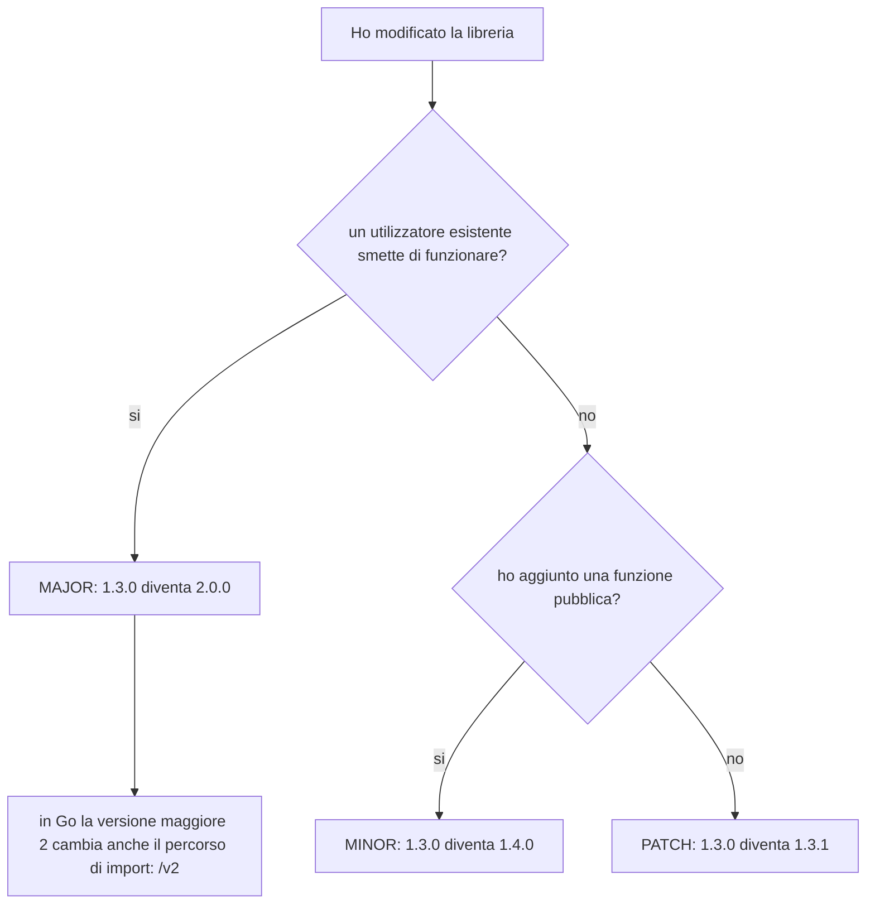
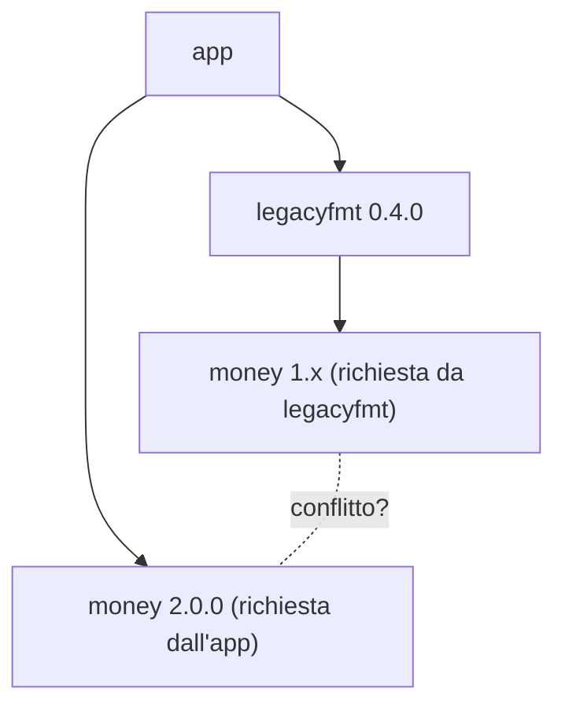
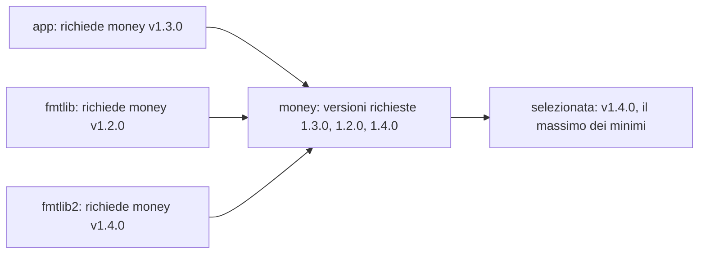
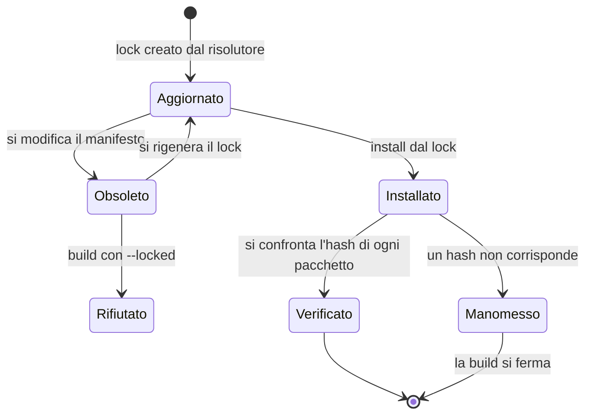
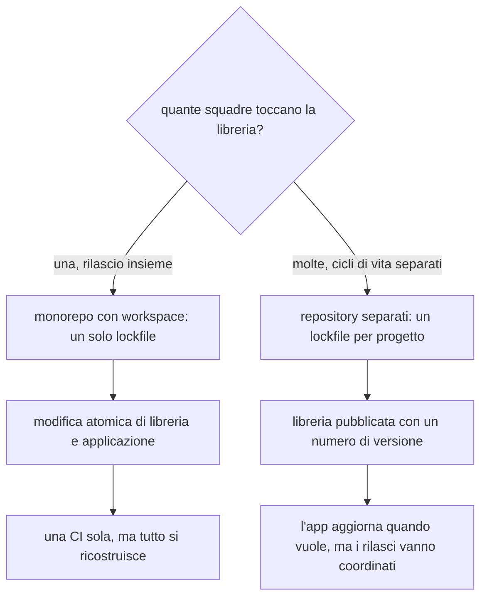

> File C12-parte2.md (parte 2 di 4) — capitolo C12, Moduli, package e dipendenze; le parti, lette in ordine, ricompongono capitoli/C12-moduli-package-dipendenze.md

## L12.2 — Dipendenze: semver, risoluzione, lockfile, supply chain

### Concetto

Una **dipendenza** è codice scritto da altri, o da un'altra parte dell'azienda, che il programma usa a condizione di una **versione**. Tre domande governano tutto il capitolo:

1. *Quale versione accetto?* — un **vincolo** (constraint) in un file di manifesto.
2. *Quale versione scelgo davvero?* — la **risoluzione** (resolution), fatta dal gestore di dipendenze.
3. *Come garantisco che domani e su un'altra macchina sia la stessa?* — il **lockfile** e, a monte, la verifica dell'integrità (checksum).

### Semantic versioning

Il **semver** dà un significato alle tre cifre `MAJOR.MINOR.PATCH`: si incrementa `PATCH` per una correzione compatibile, `MINOR` per una funzione aggiunta compatibile, `MAJOR` per una modifica che può rompere chi usa la libreria. È un *accordo di comunicazione*, non una garanzia tecnica: nessuno dei quattro gestori verifica che una `1.4.0` sia davvero compatibile con la `1.3.0`.



I vincoli che il programma del capitolo dichiara nei quattro manifesti (T0 è la libreria `money`, 1.3.0) dicono tutti «accetto la 1.3 e le successive purché con la stessa versione maggiore», in quattro sintassi:

| | Manifesto | Vincolo usato | Significato |
|---|---|---|---|
| PHP | `composer.json` | `"example/money": "^1.3"` | da 1.3.0 incluso a 2.0.0 escluso |
| Python | `pyproject.toml` | `"money>=1.3,<2"` | idem, scritto per esteso (PEP 440) |
| Rust | `Cargo.toml` | `money = { path = "../money", version = "1.3" }` | un numero senza operatore vale `^1.3` |
| Go | `go.mod` | `require example.com/money v1.3.0` | **minimo** richiesto: non è un intervallo (vedi sotto) |

Python (`pyproject.toml` dell'applicazione):

```toml
[project]
name = "salesrep"
version = "0.1.0"
requires-python = ">=3.12"
dependencies = ["money>=1.3,<2"]

[tool.uv.sources]
money = { path = "libs/money" }

[build-system]
requires = ["hatchling"]
build-backend = "hatchling.build"

[tool.hatch.build.targets.wheel]
packages = ["src/salesrep"]
```

Rust (`Cargo.toml` dell'applicazione):

```toml
[package]
name = "salesrep"
version = "0.1.0"
edition = "2024"

[dependencies]
money = { path = "../money", version = "1.3" }
```

Go (`go.mod` dell'applicazione):

```go
module example.com/salesrep

go 1.24

require example.com/money v1.3.0

// no proxy needed: the module lives next to this one
replace example.com/money => ../money
```

PHP (`composer.json` non ammette commenti, perciò per intero):

```json
{
    "name": "example/salesrep",
    "type": "project",
    "require": { "php": ">=8.2", "example/money": "^1.3" },
    "repositories": [
        { "type": "path", "url": "../money" },
        { "packagist.org": false }
    ],
    "autoload": { "psr-4": { "Sales\\": "src/" } }
}
```

Nota il `{ "packagist.org": false }`: dice a Composer di non consultare Packagist, che in questo ambiente è bloccato. In un progetto normale quella riga non c'è e la dipendenza verrebbe cercata sul registry.

### Quando due vincoli non si incontrano — e3

Il caso che mette alla prova un risolutore è il **diamante con maggiori incompatibili**. L'applicazione usa la libreria `money` versione **2** (la `format_cents` è stata rinominata `format_amount`, un cambio di API: serve un major); una seconda libreria, `legacyfmt`, richiede ancora la **1.x**. Nel grafo ci sono due richieste per lo stesso nome.



Esito nei quattro ecosistemi, con le due librerie locali identiche:

Python, con `uv sync`:

```text
### py
Using CPython 3.13.16 interpreter at: /usr/bin/python3
Creating virtual environment at: .venv
  × No solution found when resolving dependencies:
  ╰─▶ Because only legacyfmt==0.4.0 is available and legacyfmt==0.4.0 depends
      on money>=1.3,<2, we can conclude that all versions of legacyfmt depend
      on money>=1.3,<2.
      And because only the following versions of money are available:
          money<1.3
          money>=2
      and your project depends on legacyfmt, we can conclude that your
      project's requirements are unsatisfiable.
[exit 2]
```

PHP, con `composer update`:

```text
### php
Loading composer repositories with package information
Updating dependencies
Your requirements could not be resolved to an installable set of packages.

  Problem 1
    - Root composer.json requires example/legacyfmt * -> satisfiable by example/legacyfmt[0.4.0].
    - example/legacyfmt 0.4.0 requires example/money ^1.3 -> found example/money[2.0.0] but it does not match the constraint.
[exit 2]
```

Rust, con `cargo run` e `cargo tree`:

```text
### rust_run
12.50
EUR 12.50
[exit 0]
```

```text
### rust_tree
app v0.1.0 (e3/rs/app)
├── legacyfmt v0.4.0 (e3/rs/legacyfmt)
│   └── money v1.3.0 (e3/rs/money1)
└── money v2.0.0 (e3/rs/money2)
[exit 0]
```

Go, con `go run` e `go list -m all` (la versione 2 vive nel percorso `example.com/money/v2`):

```text
### go_run
12.50
EUR 12.50
[exit 0]
```

```text
### go_list
example.com/app
example.com/legacyfmt v0.4.0 => ../legacyfmt
example.com/money v1.3.0 => go/money
example.com/money/v2 v2.0.0 => ../money2
[exit 0]
```

Due famiglie di risposte:

- **Una sola copia per nome** (Python, PHP): il risolutore deve trovare **una** versione di `money` che soddisfi tutti i vincoli, e se non esiste rifiuta di procedere e spiega perché. Il motivo è tecnico: nello stesso processo Python esiste un solo modulo `money`, e PHP ha un solo `Example\Money\Money`.
- **Più copie per nome** (Rust, Go): le due versioni maggiori convivono. In Rust il programma contiene `money 1.3.0` e `money 2.0.0` come due crate distinte (`cargo tree` le mostra entrambe, e `cargo tree -d` elenca proprio i pacchetti presenti in più versioni); in Go la `v2` ha un percorso di import diverso, quindi è un package diverso. Il prezzo è che i tipi delle due copie **non sono intercambiabili**: un valore costruito dalla v1 non si passa a una funzione della v2, e i binari crescono.

Il conflitto è una forma di **errore dell'ecosistema**, non del tuo programma: l'unico rimedio, quando la regola è «una copia sola», è aggiornare `legacyfmt` (o sostituirla). Per questo il semver comunica i breaking change con la cifra `MAJOR`.

### Come si sceglie la versione: due filosofie

Dietro il comando `install` ci sono algoritmi diversi (indicazione dalla documentazione dei progetti, non misurata qui):

| | Algoritmo | Idea |
|---|---|---|
| Composer | risolutore **SAT** | trova una combinazione che soddisfa tutti i vincoli, preferendo le versioni più recenti |
| `uv` | **PubGrub** | come SAT, ma produce messaggi che spiegano la catena del conflitto (è il testo che hai visto sopra) |
| Cargo | ricerca con backtracking | sceglie la versione più recente compatibile, e ammette più maggiori dello stesso crate |
| Go | **Minimal Version Selection** (MVS) | sceglie la versione **minima** che soddisfa i requisiti: il massimo tra i minimi richiesti |

L'MVS è la più diversa, e conviene vederla. Esperimento **e4**: l'applicazione richiede `money v1.3.0` e `fmtlib` richiede `money v1.2.0`. Quale versione sceglie Go?

```text
### mvs_graph
example.com/app example.com/fmtlib@v0.1.0
example.com/app example.com/money@v1.3.0
example.com/app go@1.24
example.com/fmtlib@v0.1.0 example.com/money@v1.2.0
example.com/fmtlib@v0.1.0 go@1.24
example.com/money@v1.3.0 go@1.24
go@1.24 toolchain@go1.24
[exit 0]
```

```text
### mvs_selected
example.com/money v1.3.0 => go/money
[exit 0]
```

Sceglie la `v1.3.0`: il massimo tra i minimi (1.3.0 e 1.2.0). Non guarda che cosa esiste di più recente nel registry. Ora una seconda dipendenza, `fmtlib2`, che richiede `money v1.4.0` mentre `go.mod` dell'applicazione dice ancora `v1.3.0`:

```text
### mvs_up_before
	example.com/money v1.3.0
example.com/app example.com/money@v1.4.0
example.com/fmtlib@v0.1.0 example.com/money@v1.2.0
example.com/fmtlib2@v0.1.0 example.com/money@v1.4.0
example.com/money@v1.4.0 go@1.24
	example.com/money v1.3.0
[exit 0]
```

Il grafo mostra che la versione selezionata è già la `v1.4.0` (la richiede `fmtlib2`), mentre il `go.mod` dell'applicazione riporta ancora la `v1.3.0`. `go mod tidy` riallinea il file:

```text
### mvs_up_tidy
	example.com/money v1.4.0
[exit 0]
```



Il vantaggio è la **riproducibilità senza lockfile**: dato lo stesso insieme di `go.mod`, la scelta è deterministica e non dipende dal momento in cui si installa. Il prezzo è che le correzioni di sicurezza non arrivano da sole: per prendere una `v1.3.5` bisogna chiederla (`go get`).

### Il lockfile — e5

Un **lockfile** registra la scelta del risolutore: per ciascun pacchetto, la versione esatta, l'origine e un'impronta (hash) del contenuto. Non è un duplicato del manifesto: il manifesto dice che cosa accetti, il lockfile dice che cosa hai ottenuto.

| | Manifesto (intento) | Lockfile (risultato) | Impronta |
|---|---|---|---|
| Python/uv | `pyproject.toml` | `uv.lock` | `sha256` di sdist e wheel |
| PHP/Composer | `composer.json` | `composer.lock` | `content-hash` del manifesto; riferimenti `dist`/`source` |
| Rust/Cargo | `Cargo.toml` | `Cargo.lock` | `checksum` sha256 del pacchetto del registry |
| Go | `go.mod` | `go.sum` (+ le versioni di `go.mod`) | hash del contenuto di ogni modulo e del suo `go.mod` |



Esperimento **e5**. Aggiungiamo al progetto Python `tabulate` da PyPI e al progetto Rust `itoa` da crates.io, e leggiamo che cosa il gestore ha scritto.

```text
### py_lock_entry
name = "tabulate"
version = "0.9.0"
source = { registry = "https://pypi.org/simple" }
sdist = { url = ".../tabulate-0.9.0.tar.gz", hash = "sha256:0095b12bf5966de5...", upload-time = "2022-10-06T17:21:48.54Z" }
wheels = [
    { url = ".../tabulate-0.9.0-py3-none-any.whl", hash = "sha256:024ca478df22e934...", upload-time = "2022-10-06T17:21:44.262Z" },
]

dependencies = [
    "money>=1.3,<2",
    "tabulate>=0.9,<0.10",
]
[exit 0]
```

(URL e hash accorciati con `...` per leggibilità: nel file sono interi.)

```text
### rs_add
    Updating crates.io index
     Locking 1 package to latest Rust 1.97.0 compatible version
      Adding itoa v1.0.18
[[package]]
name = "itoa"
version = "1.0.18"
source = "registry+https://github.com/rust-lang/crates.io-index"
checksum = "8f42a60cbdf9a97f5d2305f08a87dc4e09308d1276d28c869c684d7777685682"
[exit 0]
```

La libreria **locale**, invece, non ha impronta:

```text
### py_lock_money
[[package]]
name = "money"
version = "1.3.0"
source = { directory = "libs/money" }
[exit 0]
```

```text
### rs_lock_money
[[package]]
name = "money"
version = "1.3.0"
[exit 0]
```

`money` compare con la sola versione (`1.3.0`) e senza `checksum`: è un percorso nel file system, e nessun hash potrebbe garantire che domani contenga lo stesso codice. Una dipendenza `path` o `replace` è conveniente in sviluppo, e **fuori dalla garanzia** del lockfile.

**Il lockfile deve stare d'accordo con il manifesto.** Se si cambia il manifesto senza aggiornare il lockfile, i gestori reagiscono in modo diverso. `uv sync --locked` (il comando per CI e deploy) accetta un lockfile aggiornato e rifiuta uno obsoleto. Prima il caso a posto, poi lo stesso progetto dopo aver aggiunto `colorama` al manifesto senza rieseguire `uv lock`:

```text
### py_locked_ok
Resolved 3 packages in 2ms
Checked 3 packages in 0.11ms
[exit 0]
```

```text
### py_locked_stale
Resolved 4 packages in 5ms
error: The lockfile at `uv.lock` needs to be updated, but `--locked` was provided.

hint: To update the lockfile, run `uv lock`.
[exit 1]
```

Composer, con la stessa situazione (aggiunta di `ext-json` al manifesto):

```text
### php_lock
  - Installing example/money (1.3.0): Symlinking from ../money
Generating autoload files
7:    "content-hash": "5a1ec4136ca7acb1a5776a45b88489fe",
10:            "name": "example/money",
11:            "version": "1.3.0",
bin
composer.json
composer.lock
src
vendor
[exit 0]
```

```text
### php_stale
Installing dependencies from lock file (including require-dev)
Verifying lock file contents can be installed on current platform.
Warning: The lock file is not up to date with the latest changes in composer.json. You may be getting outdated dependencies. It is recommended that you run `composer update` or `composer update <package name>`.
Nothing to install, update or remove
Generating autoload files
[exit 0]
```

Composer avvisa e **prosegue con le versioni del lockfile** (exit 0): se nella CI non c'è un controllo esplicito (`composer validate`, non provato qui), una dipendenza dichiarata e non bloccata passa inosservata. Un lockfile obsoleto è un difetto che alcuni strumenti fermano e altri solo segnalano.

**L'impronta fa il suo lavoro se qualcuno la manomette.** Alteriamo i primi caratteri del `checksum` di `itoa` in `Cargo.lock` e ricostruiamo con `--locked`:

```text
### rs_tampered
this could be indicative of a few possible errors:

    * the lock file is corrupt
    * a replacement source in use (e.g., a mirror) returned a different checksum
    * the source itself may be corrupt in one way or another

unable to verify that `itoa v1.0.18` is the same as when the lockfile was generated
[exit 101]
```

Cargo non prosegue: non sa dire se il pacchetto scaricato è quello che era stato fissato. Le cause elencate (lockfile corrotto, mirror che serve un altro contenuto, sorgente corrotta) sono proprio gli scenari di *supply chain attack* che l'impronta serve a intercettare. In Go la stessa funzione è di `go.sum`, con in più un **database pubblico di checksum** (`sum.golang.org`); quel database non era raggiungibile e non è stato provato.

### Supply chain: che cosa entra nel binario

Ogni dipendenza è codice di terzi che gira con i tuoi privilegi. Tre pratiche minime, dal basso:

1. **Sapere che cosa c'è dentro.** Go incorpora l'elenco dei moduli nel binario (e7); Cargo lo mostra con `cargo tree`; Python con `uv tree`/`pip list`; Composer con `composer show`.
2. **Bloccare e verificare.** Lockfile con impronte, versionato per le applicazioni.
3. **Sorvegliare.** Strumenti di audit per ciascun ecosistema (`composer audit`, `pip-audit`, `cargo-audit`, `govulncheck`): **nessuno è stato eseguito** in questo capitolo; li affronta C22, insieme a SBOM e firma degli artefatti.

Esperimento **e7**, seconda parte. Che cosa si legge dal binario Go compilato?

```text
### go_buildinfo
salesrep_go: go1.24.7
	path	example.com/salesrep
	mod	example.com/salesrep	(devel)	
	dep	example.com/money	v1.3.0
	=>	../money	(devel)	
	
[exit 0]
```

Il binario sa di essere stato costruito con `example.com/money v1.3.0` sostituito da un percorso locale `../money (devel)`. È un esempio concreto di quanto dicevamo sopra: in produzione quella dicitura `(devel)` indica una dipendenza non riproducibile, e non dovrebbe esistere.

```text
### rust_tree
salesrep v0.1.0 (rs/salesrep)
└── money v1.3.0 (rs/money)
[exit 0]
```

### Focus comparativo

| | PHP | Python | Rust | Go |
|---|---|---|---|---|
| Registry | Packagist (bloccato qui) | PyPI | crates.io | decentralizzato: repository VCS + proxy (bloccato qui) |
| Copie dello stesso nome | una | una | più (anche major diversi) | più (`/v2` nel percorso) |
| Algoritmo | SAT | PubGrub | backtracking | MVS |
| Lockfile | `composer.lock` | `uv.lock` | `Cargo.lock` | `go.sum` + `go.mod` |
| Lockfile obsoleto | avviso, prosegue | errore con `--locked` | errore con `--locked` | non si applica: la scelta è deterministica |
| Dipendenza locale | repository `path` | `[tool.uv.sources]` `path` | `path = "..."` | `replace` o `go.work` |
| Dipendenze nel binario | no (sorgente + autoload) | no | sì, linkate | sì, linkate, con elenco incorporato |

### Esercizio Rosetta

Nel progetto Rust aggiungi `itoa` e usalo per formattare il totale; nel progetto Python aggiungi `tabulate` per stampare il rapporto in forma tabellare. In ciascun caso: (a) quale file è cambiato oltre al manifesto? (b) alterando di un carattere un hash nel lockfile, che cosa fa il gestore?

**Risposte**

> (a) Il lockfile (`Cargo.lock`, `uv.lock`): contiene la versione esatta e l'impronta. (b) Cargo rifiuta con `--locked` e dice «unable to verify that `itoa` is the same as when the lockfile was generated». `uv` verifica gli hash durante l'installazione dei pacchetti e rifiuta un pacchetto il cui contenuto non corrisponde (provato qui solo per Cargo: per `uv` la risposta viene dalla documentazione, non da un esperimento).

---

## L12.3 — Layout di progetto, workspace e monorepo

### Concetto

Quando il progetto ha più unità (qui un'applicazione e una libreria) servono tre decisioni: **dove stanno i file**, **come si dichiara che appartengono allo stesso insieme**, **come si costruisce tutto con un solo comando**. Un **workspace** è la risposta dei gestori alla seconda: un manifesto radice elenca le unità, e i gestori risolvono le dipendenze **una volta sola** per l'insieme (un solo lockfile, una sola cartella di build). Un **monorepo** è un repository che contiene più unità; il workspace è lo strumento tecnico che lo rende comodo.

### Gli alberi del programma

I quattro progetti del capitolo, ognuno con una libreria `money` e un'applicazione `salesrep` separate:

```text
py/                              php/                           rs/                          go/
  pyproject.toml  (app)            money/                         Cargo.toml  (workspace)      money/
  uv.lock                            composer.json  (1.3.0)       Cargo.lock                     go.mod
  libs/money/                        src/Money.php                money/                         money.go
    pyproject.toml (1.3.0)         salesrep/                        Cargo.toml (1.3.0)         salesrep/
    src/money/                       composer.json                  src/lib.rs                   go.mod
      __init__.py                    composer.lock                salesrep/                      main.go
      _core.py                       bin/main.php                   Cargo.toml                   internal/
  src/salesrep/                      src/{Sale,Parsing,Report}.php  src/main.rs                    parsing/parsing.go
    __init__.py                                                     src/parsing.rs               report/report.go
    parsing.py                                                      src/report.rs
    report.py
    __main__.py
```

Ogni ecosistema ha una convenzione per il layout, ed è una convenzione forte:

- **Rust**: la presenza di `src/main.rs` rende il crate un eseguibile, di `src/lib.rs` una libreria; `mod parsing;` in `main.rs` dichiara il modulo e fa caricare `src/parsing.rs` (il compilatore non scopre i file da solo: va dichiarato).
- **Go**: una directory è un package; il nome del package e quello della directory coincidono per convenzione; `internal/` è una directory con effetto sul compilatore.
- **Python**: il layout `src/` (pacchetto sotto `src/salesrep/`) evita che i test importino per errore il codice della cartella corrente invece di quello installato. `__main__.py` rende il package eseguibile con `python -m salesrep`.
- **PHP**: il layout non è imposto dal linguaggio, ma dalla mappa PSR-4 dichiarata in `composer.json`; `bin/` ospita gli eseguibili, `src/` il codice.

### Il workspace: un insieme, un risolutore — e6

**Rust.** Il `Cargo.toml` radice dichiara i membri e un solo `Cargo.lock` li copre tutti; `cargo build` dalla radice costruisce app e libreria:

```toml
[workspace]
members = ["money", "salesrep"]
resolver = "3"
```

**Python (`uv`).** Un workspace dichiara i membri sotto `[tool.uv.workspace]` e li marca come tali con `workspace = true`: la libreria è risolta nel repository, e installata in modalità *editable* (il codice è quello della cartella, non una copia):

```toml
[tool.uv.workspace]
members = ["libs/*"]

[tool.uv.sources]
money = { workspace = true }
```

```text
### uv_workspace
Prepared 2 packages in 408ms
Installed 2 packages in 1ms
 + money==1.3.0 (from file://e6/py/libs/money)
 + salesrep==0.1.0 (from file://e6/py)
rows=15 valid=9 rejected=6
grand_total=685.24
name = "money"
version = "1.3.0"
source = { editable = "libs/money" }

libs
pyproject.toml
src
uv.lock
[exit 0]
```

(Nel lockfile `money` ha `source = { editable = "libs/money" }`.)

**Go.** Il file `go.work` elenca i moduli in sviluppo; con un `go.work` il `go.mod` dell'applicazione non ha bisogno di `replace`:

```text
### go_work
go 1.24

use (
	./money
	./salesrep
)

rows=15 valid=9 rejected=6
grand_total=685.24

example.com/money
example.com/salesrep
[exit 0]
```

Senza `go.work` e senza `replace`, lo stesso `go.mod` non trova dove prendere `example.com/money` (il proxy non è raggiungibile e non esiste una copia in cache):

```text
### go_nowork
internal/parsing/parsing.go:10:2: missing go.sum entry for module providing package example.com/money (imported by example.com/salesrep/internal/parsing); to add:
	go get example.com/salesrep/internal/parsing
[exit 1]
```

Un limite emerso nell'esperimento: in modalità workspace `go list -m all` ha tentato di contattare il proxy per `example.com/money@v1.3.0` ed è fallito (rete bloccata), mentre `go build` e `go list -m` hanno funzionato. La causa, probabilmente il caricamento del grafo dei moduli richiesti (il `require` dell'app cita ancora la v1.3.0), è **un'ipotesi non verificata**.

**PHP.** Composer non ha un workspace: la libreria locale è dichiarata come repository di tipo `path` (visto in L12.2) e installata con un **link simbolico** (`Symlinking from ../money` nell'output di `composer install`). Funziona in sviluppo, ma il `composer.lock` registra un percorso relativo che altrove non esiste.

### Che cosa non va nel repository condiviso

Tre abitudini comode in locale e dannose in squadra:

1. **`replace` con percorso assoluto** in `go.mod` (come in diversi esperimenti qui, scritti per un ambiente effimero): sul computer di un collega il percorso non esiste. In un repository si usano `go.work`, escluso dal commit quando è locale, oppure un percorso relativo e la regola che sia rimosso prima del rilascio.
2. **Dipendenze `path` nel manifesto pubblicato**: una libreria pubblicata sul registry con una dipendenza `path` non è installabile da nessun altro. Cargo accetta `path` insieme a `version` proprio per questo, come nella nostra libreria: in sviluppo si usa il percorso, alla pubblicazione la `version`.
3. **Un lockfile non versionato in un'applicazione**: due build dello stesso commit possono produrre binari diversi.



La regola pratica: se libreria e applicazione cambiano **insieme** e le gestisce la stessa squadra, un workspace evita di pubblicare una versione per ogni modifica; se hanno **cicli di vita separati**, la libreria si pubblica con un numero di versione e il semver diventa il contratto.

### Focus comparativo

| | PHP | Python | Rust | Go |
|---|---|---|---|---|
| Workspace | no (repository `path`) | `uv` workspace | `[workspace]` in Cargo | `go.work` |
| Lockfile condiviso | no | sì (`uv.lock` unico) | sì (`Cargo.lock` unico) | `go.work.sum` (non provato) |
| Libreria locale | symlink in `vendor/` | editable install | compilata nel workspace | modulo in `use` |
| Eseguibile di un package | `bin/` + script | `__main__.py` | `src/main.rs` | package `main` |
| Convenzione di layout | PSR-4 + `src/` | layout `src/` | `src/lib.rs`, `src/main.rs` | directory = package, `internal/` |

### Esercizio Rosetta

Aggiungi al workspace una **seconda applicazione** `salescli` che usa solo `money` (per esempio, converte un importo da riga di comando). Per ogni linguaggio: quale file modifichi nella radice? Quanti lockfile ottieni?

**Risposte**

> Rust: aggiungi `"salescli"` ai `members` del `Cargo.toml` radice, un solo `Cargo.lock`. Python: una directory sotto `libs/` o l'aggiunta a `members` di `[tool.uv.workspace]`, un solo `uv.lock`. Go: aggiungi `./salescli` alle righe `use` di `go.work`; ogni modulo ha il proprio `go.mod`. PHP: nuovo `composer.json` con repository `path`, un `composer.lock` per ogni applicazione.

---

