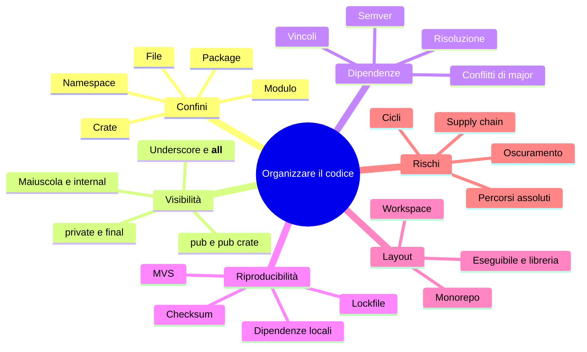

> File C12-parte3.md (parte 3 di 4) — capitolo C12, Moduli, package e dipendenze; le parti, lette in ordine, ricompongono capitoli/C12-moduli-package-dipendenze.md

## Il programma completo e il collaudo

Le lezioni hanno già mostrato T0 (la libreria `money`, in L12.1) e i manifesti. Qui i moduli dell'applicazione, task per task. Ogni blocco sta in un file diverso: l'appendice riporta tutti i file, con il percorso.

### T2 — validare le righe (modulo `parsing`)

**Python**

```python
from dataclasses import dataclass

from money import parse_cents


@dataclass(frozen=True)
class Sale:
    id: int
    region: str
    cents: int


def parse_sales(lines: list[str]) -> tuple[list[Sale], list[tuple[int, str]]]:
    """T2 - validate every line; return (sales, rejects) with rejects as (line_no, reason)."""
    sales: list[Sale] = []
    rejects: list[tuple[int, str]] = []
    seen: set[int] = set()
    for no, raw in enumerate(lines, 1):
        line = raw.strip()
        if no == 1 or not line:
            continue  # header and blank lines
        parts = [p.strip() for p in line.split(",")]
        if len(parts) != 3:
            rejects.append((no, "fields"))
            continue
        sid, region, amount = parts
        if not (sid.isascii() and sid.isdigit()) or int(sid) == 0:
            rejects.append((no, "id"))
        elif int(sid) in seen:
            rejects.append((no, "duplicate"))
        elif region == "":
            rejects.append((no, "region"))
        else:
            try:
                cents = parse_cents(amount)
            except ValueError:
                rejects.append((no, "amount"))
                continue
            seen.add(int(sid))
            sales.append(Sale(int(sid), region, cents))
    return sales, rejects
```

**PHP**

```php
declare(strict_types=1);

namespace Sales;

use Example\Money\Money;

final class Parsing
{
    /** T2 - validate every line; return [sales, rejects] with rejects as [line_no, reason]. */
    public static function parseSales(array $lines): array
    {
        $sales = [];
        $rejects = [];
        $seen = [];
        foreach ($lines as $i => $raw) {
            $no = $i + 1;
            $line = trim($raw);
            if ($no === 1 || $line === '') {
                continue; // header and blank lines
            }
            $parts = array_map('trim', explode(',', $line));
            if (count($parts) !== 3) {
                $rejects[] = [$no, 'fields'];
                continue;
            }
            [$sid, $region, $amount] = $parts;
            if (preg_match('/^[0-9]+$/D', $sid) !== 1 || (int) $sid === 0) {
                $rejects[] = [$no, 'id'];
            } elseif (isset($seen[(int) $sid])) {
                $rejects[] = [$no, 'duplicate'];
            } elseif ($region === '') {
                $rejects[] = [$no, 'region'];
            } elseif (($cents = Money::parseCents($amount)) === null) {
                $rejects[] = [$no, 'amount'];
            } else {
                $seen[(int) $sid] = true;
                $sales[] = new Sale((int) $sid, $region, $cents);
            }
        }
        return [$sales, $rejects];
    }
}
```

**Rust**

```rust
use std::collections::HashSet;

use money::parse_cents;

#[derive(Debug, Clone)]
pub struct Sale {
    #[allow(dead_code)] // kept for symmetry with the other languages
    pub id: u64,
    pub region: String,
    pub cents: i64,
}

/// T2 - validate every line; return the sales and the rejects as (line_no, reason).
pub fn parse_sales(lines: &[&str]) -> (Vec<Sale>, Vec<(usize, &'static str)>) {
    let mut sales = Vec::new();
    let mut rejects = Vec::new();
    let mut seen = HashSet::new();
    for (i, raw) in lines.iter().enumerate() {
        let no = i + 1;
        let line = raw.trim();
        if no == 1 || line.is_empty() {
            continue; // header and blank lines
        }
        let parts: Vec<&str> = line.split(',').map(str::trim).collect();
        if parts.len() != 3 {
            rejects.push((no, "fields"));
            continue;
        }
        let id = if !parts[0].is_empty() && parts[0].bytes().all(|b| b.is_ascii_digit()) {
            parts[0].parse::<u64>().ok()
        } else {
            None
        };
        match id {
            None | Some(0) => rejects.push((no, "id")),
            Some(id) if seen.contains(&id) => rejects.push((no, "duplicate")),
            Some(_) if parts[1].is_empty() => rejects.push((no, "region")),
            Some(id) => match parse_cents(parts[2]) {
                Ok(cents) => {
                    seen.insert(id);
                    sales.push(Sale { id, region: parts[1].to_string(), cents });
                }
                Err(_) => rejects.push((no, "amount")),
            },
        }
    }
    (sales, rejects)
}
```

**Go**

```go
// Package parsing turns CSV lines into validated sales. internal/ makes it
// importable only from inside example.com/salesrep.
package parsing

import (
	"strconv"
	"strings"

	"example.com/money"
)

type Sale struct {
	ID     int
	Region string
	Cents  int64
}

type Reject struct {
	Line   int
	Reason string
}

// ParseSales is T2: validate every line, collect rejects with their reason.
func ParseSales(lines []string) ([]Sale, []Reject) {
	var sales []Sale
	var rejects []Reject
	seen := map[int]bool{}
	for i, raw := range lines {
		no := i + 1
		line := strings.TrimSpace(raw)
		if no == 1 || line == "" {
			continue // header and blank lines
		}
		parts := strings.Split(line, ",")
		if len(parts) != 3 {
			rejects = append(rejects, Reject{no, "fields"})
			continue
		}
		sid, region, amount := strings.TrimSpace(parts[0]), strings.TrimSpace(parts[1]), strings.TrimSpace(parts[2])
		id, err := strconv.Atoi(sid)
		switch {
		case err != nil || id <= 0 || strings.ContainsAny(sid, "+-"):
			rejects = append(rejects, Reject{no, "id"})
		case seen[id]:
			rejects = append(rejects, Reject{no, "duplicate"})
		case region == "":
			rejects = append(rejects, Reject{no, "region"})
		default:
			cents, err := money.ParseCents(amount)
			if err != nil {
				rejects = append(rejects, Reject{no, "amount"})
				continue
			}
			seen[id] = true
			sales = append(sales, Sale{id, region, cents})
		}
	}
	return sales, rejects
}
```


PHP definisce anche il record, in un file proprio (`Sale.php`: una classe per file è la regola di PSR-4):

```php
declare(strict_types=1);

namespace Sales;

final class Sale
{
    public function __construct(
        public readonly int $id,
        public readonly string $region,
        public readonly int $cents,
    ) {
    }
}
```

La dipendenza dalla libreria è la riga di import: `from money import parse_cents` (Python), `use Example\Money\Money;` (PHP), `use money::parse_cents;` (Rust), `"example.com/money"` (Go). Nessuno dei quattro parla di versioni nel codice: la versione sta nel manifesto.

### T3 e T4 — aggregare e produrre il rapporto (modulo `report`)

**Python**

```python
from collections import defaultdict

from money import format_cents

from .parsing import Sale


def totals_by_region(sales: list[Sale]) -> dict[str, tuple[int, int]]:
    """T3 - region -> (count, total_cents)."""
    acc: dict[str, list[int]] = defaultdict(lambda: [0, 0])
    for s in sales:
        acc[s.region][0] += 1
        acc[s.region][1] += s.cents
    return {r: (c, t) for r, (c, t) in acc.items()}


def render(totals: dict[str, tuple[int, int]], rows: int, rejected: int) -> list[str]:
    """T4 - stable output: regions sorted by name, then the summary lines."""
    out = [f"region {r} count={c} total={format_cents(t)}" for r, (c, t) in sorted(totals.items())]
    valid = sum(c for c, _ in totals.values())
    grand = sum(t for _, t in totals.values())
    out.append(f"rows={rows} valid={valid} rejected={rejected}")
    out.append(f"grand_total={format_cents(grand)}")
    return out
```

**PHP**

```php
declare(strict_types=1);

namespace Sales;

use Example\Money\Money;

final class Report
{
    /** T3 - region => [count, total_cents]. */
    public static function totalsByRegion(array $sales): array
    {
        $acc = [];
        foreach ($sales as $s) {
            $acc[$s->region] ??= [0, 0];
            $acc[$s->region][0]++;
            $acc[$s->region][1] += $s->cents;
        }
        return $acc;
    }

    /** T4 - stable output: regions sorted by name, then the summary lines. */
    public static function render(array $totals, int $rows, int $rejected): array
    {
        ksort($totals, SORT_STRING);
        $out = [];
        $valid = 0;
        $grand = 0;
        foreach ($totals as $r => [$c, $t]) {
            $out[] = "region $r count=$c total=" . Money::formatCents($t);
            $valid += $c;
            $grand += $t;
        }
        $out[] = "rows=$rows valid=$valid rejected=$rejected";
        $out[] = 'grand_total=' . Money::formatCents($grand);
        return $out;
    }
}
```

**Rust**

```rust
use std::collections::BTreeMap;

use money::format_cents;

use crate::parsing::Sale;

/// T3 - region -> (count, total_cents). BTreeMap keeps the keys sorted.
pub fn totals_by_region(sales: &[Sale]) -> BTreeMap<String, (u64, i64)> {
    let mut acc: BTreeMap<String, (u64, i64)> = BTreeMap::new();
    for s in sales {
        let e = acc.entry(s.region.clone()).or_insert((0, 0));
        e.0 += 1;
        e.1 += s.cents;
    }
    acc
}

/// T4 - stable output: regions sorted by name, then the summary lines.
pub fn render(totals: &BTreeMap<String, (u64, i64)>, rows: usize, rejected: usize) -> Vec<String> {
    let mut out: Vec<String> = totals
        .iter()
        .map(|(r, (c, t))| format!("region {r} count={c} total={}", format_cents(*t)))
        .collect();
    let valid: u64 = totals.values().map(|(c, _)| c).sum();
    let grand: i64 = totals.values().map(|(_, t)| t).sum();
    out.push(format!("rows={rows} valid={valid} rejected={rejected}"));
    out.push(format!("grand_total={}", format_cents(grand)));
    out
}
```

**Go**

```go
// Package report aggregates sales by region and renders the report.
package report

import (
	"fmt"
	"sort"

	"example.com/money"
	"example.com/salesrep/internal/parsing"
)

type Total struct {
	Count int
	Cents int64
}

// TotalsByRegion is T3.
func TotalsByRegion(sales []parsing.Sale) map[string]Total {
	acc := map[string]Total{}
	for _, s := range sales {
		t := acc[s.Region]
		t.Count++
		t.Cents += s.Cents
		acc[s.Region] = t
	}
	return acc
}

// Render is T4: regions sorted by name, then the summary lines.
func Render(totals map[string]Total, rows, rejected int) []string {
	names := make([]string, 0, len(totals))
	for r := range totals {
		names = append(names, r)
	}
	sort.Strings(names)
	var out []string
	valid, grand := 0, int64(0)
	for _, r := range names {
		t := totals[r]
		out = append(out, fmt.Sprintf("region %s count=%d total=%s", r, t.Count, money.FormatCents(t.Cents)))
		valid += t.Count
		grand += t.Cents
	}
	out = append(out, fmt.Sprintf("rows=%d valid=%d rejected=%d", rows, valid, rejected))
	out = append(out, "grand_total="+money.FormatCents(grand))
	return out
}
```


### T1 e T5 — il programma principale

**Python**

```python
"""T1, T5 - read the file, run the pipeline, exit with the contract code."""
import sys

from .parsing import parse_sales
from .report import render, totals_by_region


def main(argv: list[str]) -> int:
    if len(argv) != 2:
        print("usage: python -m salesrep sales.csv", file=sys.stderr)
        return 2
    try:
        with open(argv[1], encoding="utf-8") as f:
            lines = f.read().splitlines()  # T1
    except OSError:
        print(f"error: cannot read {argv[1]}", file=sys.stderr)
        return 2
    sales, rejects = parse_sales(lines)
    for no, reason in rejects:
        print(f"reject line {no}: {reason}", file=sys.stderr)
    rows = max(len(lines) - 1, 0)
    print("\n".join(render(totals_by_region(sales), rows, len(rejects))))
    return 1 if rejects else 0  # T5


if __name__ == "__main__":
    sys.exit(main(sys.argv))
```

**PHP**

```php
declare(strict_types=1);

require __DIR__ . '/../vendor/autoload.php'; // generated by Composer from the PSR-4 map

use Sales\Parsing;
use Sales\Report;

function main(array $argv): int
{
    if (count($argv) !== 2) {
        fwrite(STDERR, "usage: php bin/main.php sales.csv\n");
        return 2;
    }
    $text = @file_get_contents($argv[1]); // T1
    if ($text === false) {
        fwrite(STDERR, "error: cannot read {$argv[1]}\n");
        return 2;
    }
    $lines = explode("\n", rtrim(str_replace("\r\n", "\n", $text), "\n"));
    [$sales, $rejects] = Parsing::parseSales($lines);
    foreach ($rejects as [$no, $reason]) {
        fwrite(STDERR, "reject line $no: $reason\n");
    }
    $rows = max(count($lines) - 1, 0);
    echo implode("\n", Report::render(Report::totalsByRegion($sales), $rows, count($rejects))), "\n";
    return $rejects ? 1 : 0; // T5
}

exit(main($argv));
```

**Rust**

```rust
mod parsing; // declares the module: the compiler loads src/parsing.rs
mod report;

use std::process::ExitCode;

fn main() -> ExitCode {
    let args: Vec<String> = std::env::args().collect();
    if args.len() != 2 {
        eprintln!("usage: salesrep sales.csv");
        return ExitCode::from(2);
    }
    let Ok(text) = std::fs::read_to_string(&args[1]) else { // T1
        eprintln!("error: cannot read {}", args[1]);
        return ExitCode::from(2);
    };
    let lines: Vec<&str> = text.lines().collect(); // lines() also strips a trailing \r
    let (sales, rejects) = parsing::parse_sales(&lines);
    for (no, reason) in &rejects {
        eprintln!("reject line {no}: {reason}");
    }
    let rows = lines.len().saturating_sub(1);
    let totals = report::totals_by_region(&sales);
    println!("{}", report::render(&totals, rows, rejects.len()).join("\n"));
    if rejects.is_empty() { ExitCode::SUCCESS } else { ExitCode::from(1) } // T5
}
```

**Go**

```go
package main

import (
	"fmt"
	"os"
	"strings"

	"example.com/salesrep/internal/parsing"
	"example.com/salesrep/internal/report"
)

func main() { os.Exit(run(os.Args)) }

func run(args []string) int {
	if len(args) != 2 {
		fmt.Fprintln(os.Stderr, "usage: salesrep sales.csv")
		return 2
	}
	data, err := os.ReadFile(args[1]) // T1
	if err != nil {
		fmt.Fprintf(os.Stderr, "error: cannot read %s\n", args[1])
		return 2
	}
	text := strings.ReplaceAll(string(data), "\r\n", "\n")
	lines := strings.Split(strings.TrimSuffix(text, "\n"), "\n")
	sales, rejects := parsing.ParseSales(lines)
	for _, r := range rejects {
		fmt.Fprintf(os.Stderr, "reject line %d: %s\n", r.Line, r.Reason)
	}
	rows := max(len(lines)-1, 0)
	fmt.Println(strings.Join(report.Render(report.TotalsByRegion(sales), rows, len(rejects)), "\n"))
	if len(rejects) > 0 { // T5
		return 1
	}
	return 0
}
```


Il comportamento osservabile è lo stesso nei quattro. L'`__main__.py` di Python viene eseguito da `python -m salesrep`; il `main.php` carica `vendor/autoload.php`, la porta d'ingresso dell'autoload generato da Composer; `mod parsing;` in `main.rs` è la dichiarazione che porta `parsing.rs` nella crate; in Go gli import del package `main` puntano a `internal/`, importabile solo dentro il modulo.

### Output e collaudo

Output standard (identico nei quattro, confrontato con `md5sum`):

```text
### stdout
region east count=3 total=312.60
region north count=2 total=165.75
region south count=3 total=106.99
region west count=1 total=99.90
rows=15 valid=9 rejected=6
grand_total=685.24
[exit 1]
```

Errori standard (le sei righe di scarto, in ordine di riga):

```text
### stderr
reject line 7: amount
reject line 8: amount
reject line 10: region
reject line 12: duplicate
reject line 13: fields
reject line 14: amount
```

Exit code: **1** (ci sono scarti); **0** se il file non ne ha; **2** se il file manca (`error: cannot read <file>`).

### Collaudo su cinque casi

| Caso | Contenuto | Python / PHP / Rust / Go |
|---|---|---|
| `sales.csv` | il file del capitolo | identici, exit 1 |
| `t_empty.csv` | solo intestazione | identici, exit 0, `rows=0 valid=0 rejected=0` |
| `t_crlf.csv` | stesso file con terminatori `\r\n` | identici, exit 1 |
| file mancante | percorso inesistente | identici, exit 2, stesso messaggio |
| `t_odd.csv` | importo di 20 cifre, cifra larga Unicode, tre decimali, zeri iniziali, regione con spazio | **divergono** |

`t_odd.csv`:

```text
id,region,amount
1,north,99999999999999999999
2,south,12.50
３,east,5.00
4,west,1.234
5,north,0012.5
6,Nord ,7
7,north,.5
8,north,5.
```

La libreria `money` è la stessa in quattro versioni e **la riga 2** (importo `99999999999999999999`) le fa comportare in tre modi:

- **Python**: l'importo è accettato (interi di precisione arbitraria), la regione `north` somma 100000000000000000011,50;
- **Rust** e **Go**: l'importo non entra in 64 bit, la libreria segnala un errore (`Overflow`, `strconv.ParseInt` fallisce) e il programma scarta la riga con `amount`;
- **PHP**: `(int) $whole * 100` supera `PHP_INT_MAX` e il risultato diventa un `float`, che il tipo di ritorno `?int` con `strict_types` rifiuta con un `TypeError`. Nessun codice gestisce quella eccezione, il processo termina con exit 255.

```text
### odd_py
region Nord count=1 total=7.00
region north count=2 total=100000000000000000011.50
region south count=1 total=12.50
rows=8 valid=4 rejected=4
grand_total=100000000000000000031.00
-- stderr
reject line 4: id
reject line 5: amount
reject line 8: amount
reject line 9: amount
[exit 1]
```

```text
### odd_php
-- stderr
PHP Fatal error:  Uncaught TypeError: Example\Money\Money::parseCents(): Return value must be of type ?int, float returned in php/money/src/Money.php:22
Stack trace:
#0 php/salesrep/src/Parsing.php(35): Example\Money\Money::parseCents()
#1 php/salesrep/bin/main.php(22): Sales\Parsing::parseSales()
#2 php/salesrep/bin/main.php(31): main()
#3 {main}
[exit 255]
```

```text
### odd_rs
region Nord count=1 total=7.00
region north count=1 total=12.50
region south count=1 total=12.50
rows=8 valid=3 rejected=5
grand_total=32.00
-- stderr
reject line 2: amount
reject line 4: id
reject line 5: amount
reject line 8: amount
reject line 9: amount
[exit 1]
```

È il tema di C02 e di C14 (normalizzazione dell'input al confine), ma qui ha una lettura aggiuntiva: **il contratto di una libreria comprende il suo comportamento ai limiti**, e quattro implementazioni «della stessa libreria» non sono intercambiabili finché non lo dichiarano. Le altre righe di `t_odd.csv` danno gli stessi esiti nei quattro linguaggi: `３` (cifra larga) è scartata come `id`, `1.234`, `.5` e `5.` come `amount`, `0012.5` è accettato come 12,50 e `Nord ` diventa `Nord` dopo il `trim`.

Una nota sul codice Rust: il campo `id` di `Sale` non è letto da nessuno (l'identificativo serve solo al controllo dei duplicati, che usa un insieme), e il compilatore lo segnala come codice morto (`dead_code`). Il codice lo tace con `#[allow(dead_code)]` e un commento: è una scelta dichiarata, non una dimenticanza.

---

## Matrice comparativa del capitolo

| Costrutto | PHP | Python | Rust | Go |
|---|---|---|---|---|
| Unità di modularità | `namespace` + autoload PSR-4 | modulo = file, package = directory | `mod`, crate | package = directory, module = `go.mod` |
| Visibilità imposta dal linguaggio | ◐ solo i membri di classe | ○ convenzione `_` | ● `pub`, `pub(crate)` | ● maiuscola, `internal/` |
| Caricamento | ● autoload a runtime | ● import a runtime | ● in compilazione | ● in compilazione |
| Più versioni dello stesso nome | ○ | ○ | ● | ● (`/v2`) |
| Registry | ● Packagist | ● PyPI | ● crates.io | ◐ decentralizzato (VCS + proxy) |
| Lockfile | ● `composer.lock` | ◐ dipende dal tool (`uv.lock`) | ● `Cargo.lock` | ◐ `go.sum` + MVS |
| Workspace | ◐ repository `path` | ● uv workspace | ● Cargo workspace | ● `go.work` |
| Verifica di integrità | ◐ hash nel lock (non provato) | ● hash in `uv.lock` | ● `checksum`, provato | ● `go.sum` + sumdb (non provato) |

Le celle riprendono la matrice del TOC; solo alcune sono state verificate qui (vedi «Limiti dichiarati»). Una nota sulla riga «Visibilità imposta dal linguaggio»: Python è ○ perché nessun costrutto *impedisce* l'accesso (e1), non perché non esista uno stile.

---

## Anti-pattern

| Anti-pattern | Dove | Che cosa fa | Come evitarlo |
|---|---|---|---|
| Importare da un modulo `_privato` di un'altra libreria | Python | si rompe al primo refactoring dell'autore | usare solo ciò che è in `__all__` e nella documentazione |
| File `random.py`, `json.py`, `types.py` nel progetto | Python | oscura la libreria standard (e2) | nomi propri, codice in un package |
| Import circolare risolto con import locali sparsi | Python, Go, Rust | nasconde un difetto di progetto | spostare il codice comune in un terzo modulo |
| Nome di file diverso dal nome della classe | PHP | `Class not found` solo su Linux (e2) | allineare maiuscole e minuscole; test in container |
| `replace` con percorso assoluto nel repository | Go | non compila altrove | `go.work` locale, percorsi relativi, rimozione prima del rilascio |
| Dipendenza `path` in una libreria pubblicata | Rust, PHP, Python | non installabile da altri | versione sul registry |
| Lockfile non versionato in un'applicazione | tutti | build non riproducibili | versionarlo e usare `--locked` in CI |
| Vincolo troppo largo (`*`, `>=1`) | tutti | un major incompatibile entra al prossimo `update` | `^1.3`, `>=1.3,<2` |
| Aggiornare tutto in blocco senza leggere il changelog | tutti | rompe al primo major | aggiornare una dipendenza per volta |
| Ignorare un lockfile «obsoleto» | Composer | dipendenze dichiarate ma non bloccate (e5) | `composer validate` in CI |
| Credere che il semver sia verificato | tutti | un minor che rompe l'API passa i vincoli | test di integrazione sulle dipendenze critiche |

---

## Quiz

1. Qual è la differenza tra un *module* di Go e un *module* di Python?
2. In quale dei quattro linguaggi la regola di visibilità non è imposta da nessuno, e come si comunica la superficie pubblica?
3. Perché un ciclo tra due crate Rust è un errore e tra due moduli della stessa crate no?
4. Che cosa significa `^1.3` in Composer e Cargo? Come lo scrivi in `pyproject.toml`?
5. Un'applicazione richiede `money` 2 e una libreria richiede `money` 1. Che cosa succede in Python, PHP, Rust e Go?
6. Che cosa sceglie la Minimal Version Selection di Go se `A` richiede `m v1.2.0` e `B` richiede `m v1.4.0`?
7. Che cosa contiene un lockfile che il manifesto non contiene? Perché una dipendenza `path` ne è priva?
8. Perché in produzione la dicitura `(devel)` in `go version -m` è un segnale d'allarme?
9. Quale errore commette un file chiamato `random.py` nel progetto?
10. Quando preferisci un workspace a repository separati?

**Risposte**

> 1. In Go è l'unità di versionamento (un `go.mod`, molti package); in Python è un singolo file `.py`. 2. In Python: la superficie pubblica si comunica con `__all__`, il prefisso `_` e la documentazione (e1). 3. Il compilatore Rust risolve i moduli di una crate come un insieme; le crate invece si compilano in ordine, e un ciclo non ha un ordine (e2). 4. Da 1.3.0 (incluso) a 2.0.0 (escluso); `money>=1.3,<2`. 5. Python e PHP: errore di risoluzione, nessuna soluzione; Rust: due crate distinte nel binario; Go: due package (`money` e `money/v2`) (e3). 6. `v1.4.0`: il massimo tra i minimi (e4). 7. L'impronta (hash/checksum) del contenuto scaricato: per un percorso locale il contenuto può cambiare senza che il lockfile possa saperlo (e5). 8. Indica una dipendenza sostituita da un percorso locale, non riproducibile altrove (e7). 9. Oscura il modulo `random` della libreria standard: `import random` carica il tuo file (e2). 10. Quando libreria e applicazione cambiano insieme, le gestisce la stessa squadra, e pubblicare una versione per ogni modifica sarebbe un costo.

---

## Esercizi

1. **(base)** Aggiungi alla libreria `money` una funzione `negate_cents` pubblica e un helper privato. Verifica per ciascun linguaggio chi impedisce l'accesso all'helper.
2. **(base)** Porta la libreria `money` da 1.3.0 a 1.4.0 (aggiunta di `negate_cents`) e verifica che l'applicazione continui a compilare senza modificare i vincoli. Che cosa cambia nel lockfile?
3. **(medio)** Riproduci e3 con la tua libreria: crea una `money 2.0.0` con una funzione rinominata e una libreria intermedia che richiede la 1.x. Prevedi l'esito nei quattro linguaggi prima di eseguire.
4. **(medio)** Sostituisci in Go la direttiva `replace` con un `go.work` e verifica che l'applicazione compili da una directory pulita. Quale file aggiungi a `.gitignore`?
5. **(avanzato)** Aggiungi un controllo di CI che fallisce se il lockfile non è aggiornato (`uv sync --locked`, `cargo build --locked`, `composer validate --strict`, `go mod tidy -diff`). Quali dei quattro comandi hai provato davvero?
6. **(avanzato)** Rendi deterministico il comportamento di `money` per importi enormi nei quattro linguaggi: stesso esito, stesso messaggio, stesso exit code. Dove si dichiara il contratto?

---

## Mappa mentale



---

## Ponte verso i prossimi capitoli

- **C13.** Testare un modulo vuol dire sostituire le sue dipendenze: la libreria `money` come dipendenza da isolare, `pub(crate)` e `internal/` che rendono alcuni helper non testabili dall'esterno (i test stanno nello stesso package), il lockfile come parte della riproducibilità della CI.
- **C14.** Il comportamento di `money` ai limiti (`t_odd.csv`) è una questione di validazione al confine; qui si chiude il contratto.
- **C15.** Il programma diventa una CLI: argomenti, sottocomandi e configurazione; il `__main__.py` e il `main` di ciascun linguaggio diventano un punto d'ingresso con più modalità.
- **C20.** Build e immagini: `uv sync --locked`, `cargo build --locked`, `go build` e `composer install --no-dev` nei Dockerfile; la dipendenza non risolta come causa di errore di deploy; il file system sensibile alle maiuscole.
- **C22.** Supply chain: `cargo audit`, `pip-audit`, `composer audit`, `govulncheck`, SBOM, firma degli artefatti, `sum.golang.org`.
- **C09 (riallineamento).** `money` segnala l'errore con eccezione (Python), `null` (PHP), `Result` (Rust) e `error` (Go): è l'argomento di C09, ripreso qui senza un tipo di errore comune. I motivi di scarto del programma sono stringhe, da sostituire con tipi come previsto dal riallineamento di C09.
- **C24.** Architettura esagonale: i confini tra moduli diventano porte e adattatori.

---

## Limiti dichiarati

- **Registry bloccati.** Packagist e Go proxy (e `sum.golang.org`) non sono raggiungibili: tutto ciò che in PHP e Go richiede il registry, compresi `composer audit`, `govulncheck`, `go.sum` per moduli reali, il database dei checksum e la pubblicazione, **non è stato provato**. Le librerie del programma sono locali: le garanzie del lockfile non coprono le dipendenze `path`/`replace`.
- **PyPI e crates.io funzionano**: e5 usa `tabulate` 0.9.0 e `itoa` 1.0.18, ma un solo pacchetto per lingua: il comportamento con grafi grandi (aggiornamenti parziali, `cargo update -p`, `uv lock --upgrade-package`) non è stato provato.
- **Il conflitto di maggiori** (e3) è stato provato con librerie locali equivalenti; con pacchetti pubblicati lo stesso grafo si comporterebbe come sopra, ma non è stato eseguito.
- Gli **algoritmi** di risoluzione (SAT, PubGrub, backtracking, MVS) sono descritti dalla documentazione; il loro comportamento visibile (e3, e4) è stato misurato, i dettagli interni no.
- `uv run` e `uv sync` stampano un avviso sul parametro `UV_NATIVE_TLS` dell'ambiente (deprecato): rimosso dagli output riportati. Le righe `Do not run Composer as root` e simili di Composer, causate dall'esecuzione come root nel container, sono state rimosse allo stesso modo.
- `go list -m all` in modalità workspace ha fallito per la rete bloccata (e6): la causa è un'ipotesi.
- **Non provati**: `composer validate`, `composer audit`, `uv sync` con un hash alterato nel lockfile e `go mod tidy -diff` (che compaiono solo negli esercizi).
- Non provati: PHPStan/Psalm, `clippy`, `staticcheck`, `cargo-deny`, `pip-audit`; Windows e macOS (la sensibilità alle maiuscole di e2 è stata mostrata solo su Linux); Go 1.25+ e PHP 8.4+ non riverificati.
- Il capitolo non è stato riletto da un secondo lettore: le affermazioni sono controllate contro gli output catturati. Sessione non presidiata (routine pianificata).

---

## Appendice — i programmi completi

Ogni sottosezione elenca i file del progetto nell'ordine di lettura. Esecuzione: `sales.csv` nella directory radice del progetto; codice di uscita 0/1/2 come nel capitolo. Per Rust il comando è `cargo build --release`, con la crate in modalità `--edition 2024`; per Go `go.mod` dichiara `go 1.24`.

