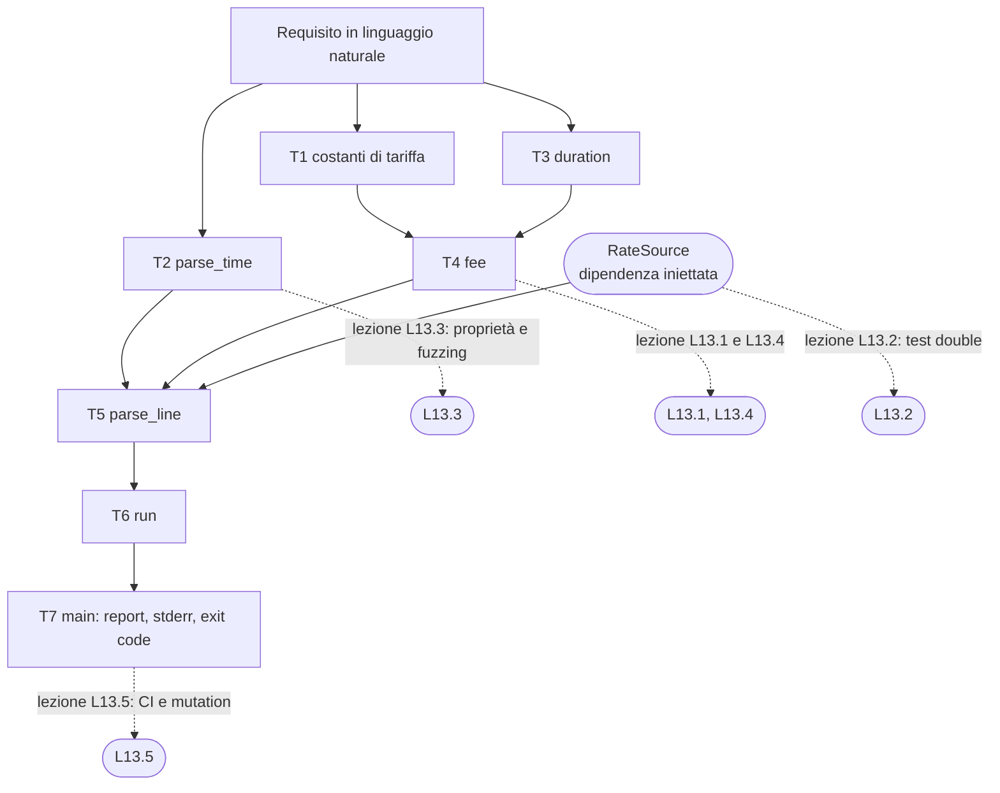
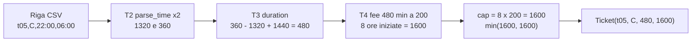
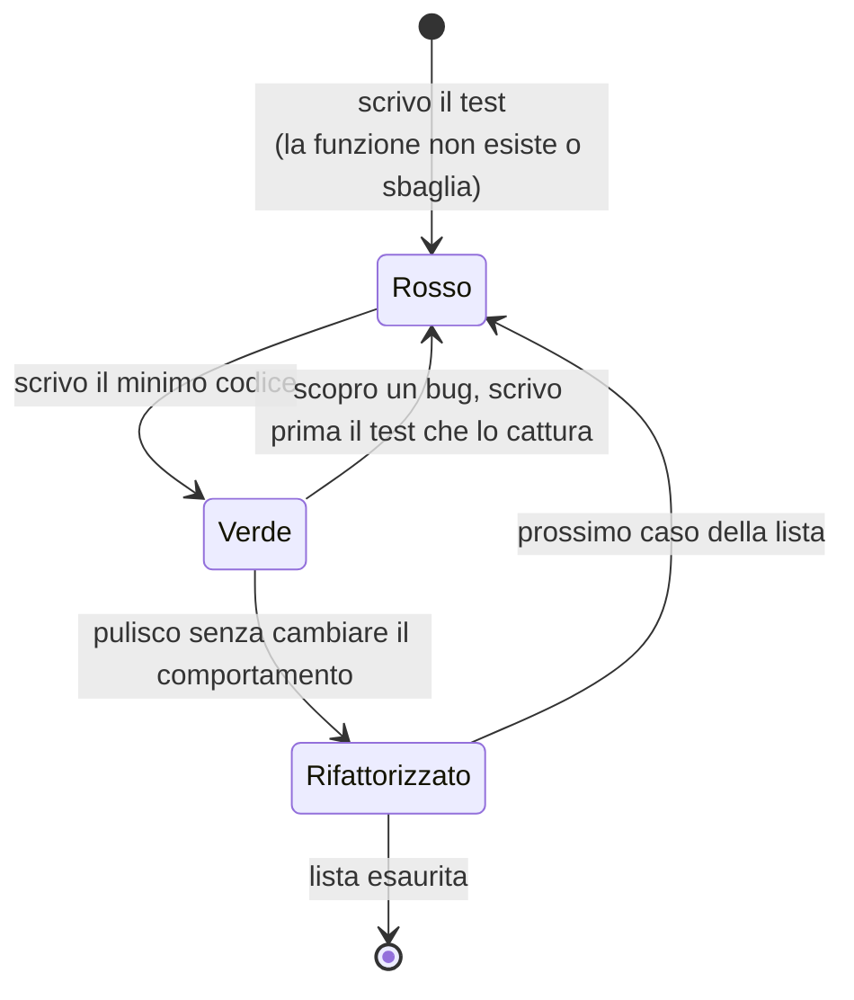
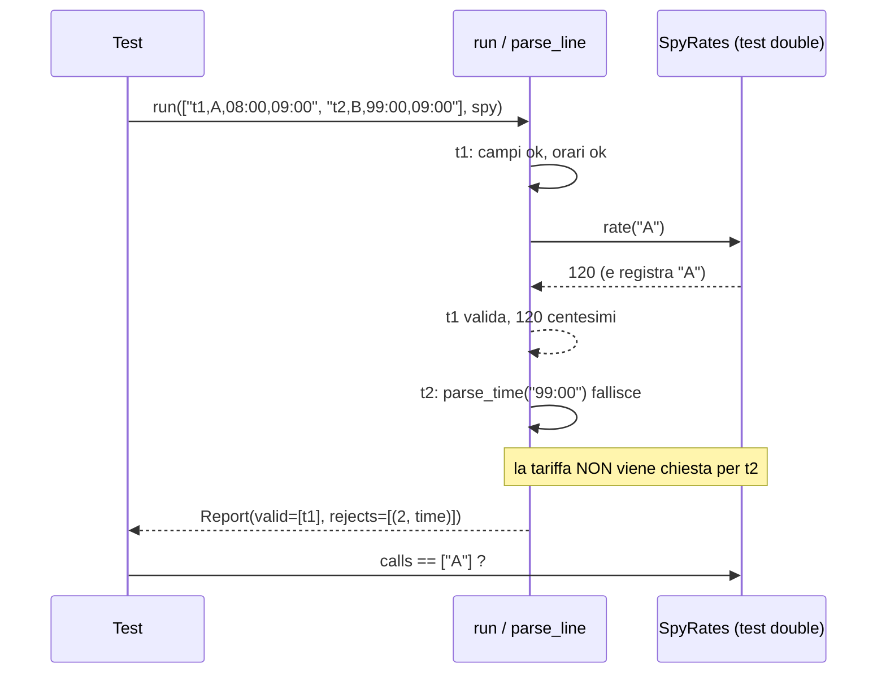
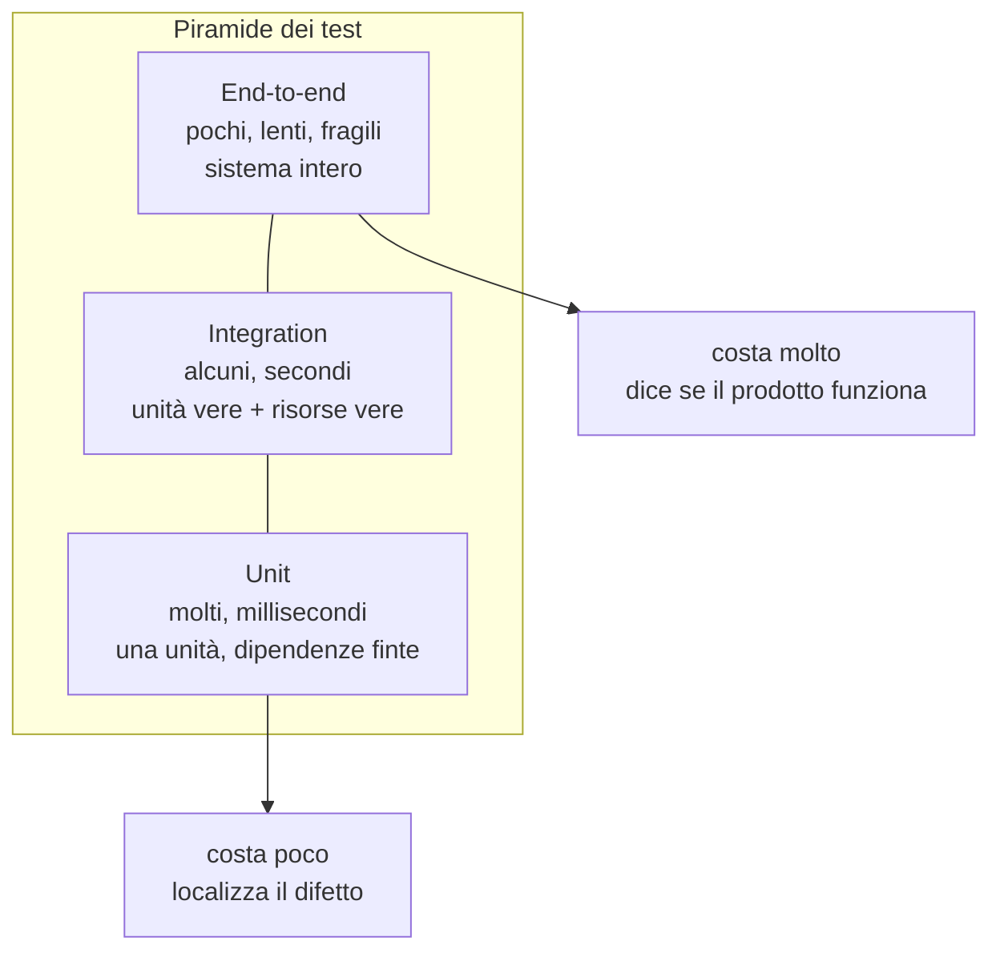

> File C13-parte1.md (parte 1 di 5) — C13 Testing e qualità, corso di programmazione multi-linguaggio (PHP, Python, Rust, Go)

# C13 — Testing e qualità

> Parte IV — Ingegneria del software · Ingresso B (professionista) · 5 lezioni da 45′ (3,75 ore) · Bozza 1 del 2026-10-17

**Ambiente di prova.** PHP 8.3.6, Python 3.13.16 (mypy 2.3.1, coverage 7.16, Hypothesis 6.170, pytest 9.1), Rust 1.97.0 con `--edition 2024` (proptest 1, clippy 0.1.97), Go 1.24.7 (`go 1.24` in `go.mod`). Macchina a 2 core condivisi. Packagist è bloccato dalla policy dell'ambiente cloud: **PHPUnit, Pest, Eris, PHPStan e Psalm non sono stati installati né provati**; per PHP usiamo un harness minimo di 15 righe che mostra la meccanica e dichiariamo il limite. Le versioni baseline del corso (PHP 8.4+, Go 1.25+) non sono state riverificate.

## Obiettivi

Al termine del capitolo saprai:

1. derivare una **lista di test** dalle frasi di un requisito scritto in linguaggio naturale, e scegliere i casi ai bordi invece dei casi comodi;
2. scrivere unit test con tabelle di casi, asserzioni e fixture nei quattro linguaggi, e leggere un test che fallisce;
3. distinguere **stub, spy, fake e mock**, iniettare una dipendenza al posto di quella vera e capire dove finisce lo unit test e dove comincia l'integration test (e perché Testcontainers esiste);
4. enunciare **proprietà** di una funzione, farle verificare da un generatore di input (Hypothesis, proptest, `testing/quick`) e da un fuzzer (`go test -fuzz`), e capire perché un generatore ingenuo può non trovare nulla;
5. misurare un tempo di esecuzione in modo ripetibile (mediana, dispersione) e riconoscere un benchmark che misura l'ottimizzatore invece del codice;
6. usare analisi statica, coverage e **mutation testing** come strumenti con limiti diversi, e comporli in una pipeline CI con un cancello per riga.

## Il problema reale

> **Il parcheggio di via Esempio.** La barriera del parcheggio scrive una riga per ogni auto che esce: un identificativo del biglietto, la zona in cui ha sostato (A, B o C), l'ora di entrata e l'ora di uscita, entrambe nel formato `HH:MM`. Il gestore vuole un report a fine giornata. La tariffa è la seguente: **i primi 15 minuti sono gratuiti**; oltre i 15 minuti si paga **ogni ora iniziata** alla tariffa oraria della zona (A 1,20 €, B 0,80 €, C 2,00 €); il costo di una giornata **non supera mai 8 ore di tariffa**; se l'uscita è **precedente** all'entrata, l'auto è uscita il giorno dopo; se la sosta supera le 24 ore, ogni giornata intera costa il massimale e la parte restante si calcola come sopra. Le righe malformate (campi mancanti, orari inesistenti, zona sconosciuta, identificativo ripetuto) vanno **scartate con il motivo**, senza fermare il report. Il programma stampa i totali in centesimi, e il suo exit code dice se ci sono stati scarti.

Questo non è un capitolo su come *scrivere* il programma (lo abbiamo fatto nei capitoli C03–C12) ma su come **sapere che è giusto e continuare a saperlo** quando qualcuno lo modifica. Per questo il programma è piccolo e le regole sono precise: sono tutte verificabili con un esempio.

Il testo del requisito contiene già la lista dei test. Ogni frase è una o più asserzioni:

| Frase del requisito | Casi da provare (bordi in grassetto) |
|---|---|
| «primi 15 minuti gratuiti» | 0, **15** (gratis), **16** (una ora iniziata) |
| «ogni ora iniziata» | **60** (una ora), **61** (due ore) |
| «non supera 8 ore di tariffa» | **480** (esatto), **481** (cap), 1439 |
| «uscita precedente all'entrata: giorno dopo» | 22:00→06:00, **stessa ora** (zero minuti) |
| «oltre 24 ore: una cap per giornata intera» | **1440**, **1455** (15 minuti di troppo = gratis), **1456**, 2880 |
| «orari inesistenti» | `24:00`, `12:60`, `9:05` (una cifra), ` 9:05`, `09:05:00` |
| «scartare con il motivo» | `fields`, `time`, `zone`, `duplicate` |
| «exit code» | 0 senza scarti, 1 con scarti, 2 file illeggibile |

## Scomposizione

| # | Task | Output verificabile |
|---|---|---|
| T1 | Fissare le costanti di tariffa (`FREE_MINUTES`, `DAY_MINUTES`, `CAP_HOURS`) | un solo posto in cui cambiano |
| T2 | `parse_time`: `HH:MM` → minuti dalla mezzanotte o «errore» | accetta solo due cifre ASCII per campo, 00–23 e 00–59 |
| T3 | `duration`: minuti di sosta, con passaggio di mezzanotte | sempre tra 0 e 1439 |
| T4 | `fee`: centesimi dovuti per `minutes` a tariffa `rate` | funzione pura, nessuna I/O |
| T5 | `parse_line`: una riga → `Ticket` oppure motivo di scarto | consulta la tariffa tramite un'**interfaccia** (`RateSource`) |
| T6 | `run`: tutte le righe, duplicati, righe vuote | `Report` con valide e scarti numerati |
| T7 | `main`: file, stdout, stderr, exit code | contratto verificabile con `diff` |



I test non sono un compito a parte, dopo il codice: sono il modo in cui ciascun task dichiara che cosa vuole dire «finito». Ogni snippet di questo capitolo porta nel commento il numero del task (`T2 -`, `T4 -`, …), che coincide con la tabella.



Il programma completo, nei quattro linguaggi, è in appendice. Le sezioni che seguono ne usano frammenti incollati dai file testati.

## L13.1 — Unit test: struttura, asserzioni, fixture

### Concetto

Uno **unit test** è un programma piccolo che chiama una unità (qui una funzione) con input scelti e confronta il risultato con quello atteso. Ha una forma fissa, spesso chiamata *Arrange–Act–Assert*: preparo i dati, eseguo, confronto. Quattro regole lo rendono utile invece che decorativo:

- **Deterministico.** Stesso codice, stesso esito, sempre. Se dipende dall'orologio, dalla rete, dall'ordine di esecuzione o dal caso, è un test che prima o poi mentirà (*flaky*).
- **Indipendente.** Nessun test deve richiedere che un altro sia girato prima.
- **Con un nome che dice che cosa è rotto.** `test_table` che fallisce con `(minutes=15, rate=120)` dice già il bordo violato.
- **Che fallisce per la ragione giusta.** Un test mai visto fallire non è un test: va visto rosso almeno una volta (nel ciclo qui sotto, o con una *mutazione*, L13.5).



Il ciclo **red–green–refactor** è un metodo, non un dogma: l'idea utile è che la lista dei casi viene prima e che il bug scoperto diventa un test prima di diventare una correzione. Una **fixture** è tutto ciò che il test prepara prima di eseguire (file temporanei, oggetti, dati); una **tabella di casi** è la fixture più economica e quella che abbiamo usato qui.

Un'asserzione dice *che cosa* ci si aspetta; la **qualità del messaggio** decide quanto costa capire un fallimento. `assertEqual(120, 0)` è meglio di `assertTrue(fee(15,120) == 0)`, perché stampa i due valori.

### Implementazione

Lo stesso test della funzione `fee` (T4) nei quattro linguaggi: una tabella `(minuti, tariffa, atteso)` con i bordi del requisito e un ciclo che la percorre.

**Python**

```python
class FeeTest(unittest.TestCase):
    def test_table(self):
        # (minutes, rate, expected cents): boundaries first
        cases = [
            (0, 120, 0), (15, 120, 0), (16, 120, 120), (60, 120, 120),
            (61, 120, 240), (480, 120, 960), (481, 120, 960),  # daily cap 8*120
            (1439, 120, 960), (1440, 120, 960), (1455, 120, 960),
            (1456, 120, 1080), (2880, 80, 1280),
        ]
        for minutes, rate, want in cases:
            with self.subTest(minutes=minutes, rate=rate):
                self.assertEqual(fee(minutes, rate), want)
```

**PHP**

```php
$cases = [
    [0, 120, 0], [15, 120, 0], [16, 120, 120], [60, 120, 120], [61, 120, 240],
    [480, 120, 960], [481, 120, 960], [1439, 120, 960], [1440, 120, 960],
    [1455, 120, 960], [1456, 120, 1080], [2880, 80, 1280],
];
foreach ($cases as [$m, $r, $want]) {
    check("fee($m,$r)", fee($m, $r), $want);
}
```

**Rust**

```rust
#[test]
fn fee_table() {
    // (minutes, rate, expected cents): boundaries first
    let cases = [
        (0, 120, 0),
        (15, 120, 0),
        (16, 120, 120),
        (60, 120, 120),
        (61, 120, 240),
        (480, 120, 960),
        (481, 120, 960),
        (1439, 120, 960),
        (1440, 120, 960),
        (1455, 120, 960),
        (1456, 120, 1080),
        (2880, 80, 1280),
    ];
    for (minutes, rate, want) in cases {
        assert_eq!(fee(minutes, rate), want, "fee({minutes}, {rate})");
    }
}
```

**Go**

```go
func TestFee(t *testing.T) {
	// minutes, rate, expected cents: boundaries first
	cases := []struct{ minutes, rate, want int }{
		{0, 120, 0}, {15, 120, 0}, {16, 120, 120}, {60, 120, 120}, {61, 120, 240},
		{480, 120, 960}, {481, 120, 960}, {1439, 120, 960}, {1440, 120, 960},
		{1455, 120, 960}, {1456, 120, 1080}, {2880, 80, 1280},
	}
	for _, c := range cases {
		t.Run("", func(t *testing.T) {
			if got := parking.Fee(c.minutes, c.rate); got != c.want {
				t.Errorf("Fee(%d, %d) = %d, want %d", c.minutes, c.rate, got, c.want)
			}
		})
	}
}
```


I framework differiscono nel modo in cui segnalano *quale riga della tabella* è fallita. In Python `subTest` continua dopo il primo errore e stampa i parametri; in Go `t.Run` crea un sotto-test e `t.Errorf` ne stampa i valori; in Rust `assert_eq!` con un messaggio formattato **ferma il test al primo fallimento** (le altre righe della tabella non vengono eseguite, e va ricordato quando si legge «1 failed»); nel nostro harness PHP `check()` incrementa un contatore e prosegue. Nessuna scelta è migliore in assoluto: fermarsi subito dà un errore più pulito, proseguire dà tutto il quadro in un colpo solo.

Il test di `parse_time` (T2) e di `duration` (T3):

**Python**

```python
class TimeTest(unittest.TestCase):
    def test_valid(self):
        self.assertEqual(parse_time("00:00"), 0)
        self.assertEqual(parse_time("23:59"), 1439)

    def test_invalid(self):
        for bad in ["", "9:05", "09:5", "24:00", "12:60", "12-30", "ab:cd", " 9:05", "09:05:00", "+9:05"]:
            with self.subTest(text=bad):
                self.assertIsNone(parse_time(bad))

    def test_duration_wraps_midnight(self):
        self.assertEqual(duration(22 * 60, 6 * 60), 8 * 60)
        self.assertEqual(duration(600, 600), 0)
```

**PHP**

```php
check('00:00', parseTime('00:00'), 0);
check('23:59', parseTime('23:59'), 1439);
foreach (['', '9:05', '09:5', '24:00', '12:60', '12-30', 'ab:cd', ' 9:05', '09:05:00', '+9:05', "09:05\n"] as $bad) {
    check('bad ' . json_encode($bad), parseTime($bad), null);
}
check('wrap', duration(22 * 60, 6 * 60), 8 * 60);
```

**Rust**

```rust
#[test]
fn time_valid_and_invalid() {
    assert_eq!(parse_time("00:00"), Some(0));
    assert_eq!(parse_time("23:59"), Some(1439));
    for bad in [
        "", "9:05", "09:5", "24:00", "12:60", "12-30", "ab:cd", " 9:05", "09:05:00", "+9:05",
    ] {
        assert_eq!(parse_time(bad), None, "{bad:?}");
    }
}

#[test]
fn duration_wraps_midnight() {
    assert_eq!(duration(22 * 60, 6 * 60), 8 * 60);
    assert_eq!(duration(600, 600), 0);
}
```

**Go**

```go
func TestParseTime(t *testing.T) {
	if m, ok := parking.ParseTime("23:59"); !ok || m != 1439 {
		t.Errorf("ParseTime(23:59) = %d, %v", m, ok)
	}
	for _, bad := range []string{"", "9:05", "09:5", "24:00", "12:60", "12-30", "ab:cd", " 9:05", "09:05:00", "+9:05"} {
		if _, ok := parking.ParseTime(bad); ok {
			t.Errorf("ParseTime(%q) accepted", bad)
		}
	}
}

func TestDurationWrapsMidnight(t *testing.T) {
	if got := parking.Duration(22*60, 6*60); got != 8*60 {
		t.Errorf("got %d", got)
	}
}
```


Qui la tabella contiene due categorie di cattivi: forme **sbagliate** (`9:05`, `12-30`) e forme **quasi giuste** (` 9:05` con uno spazio, `+9:05`, `09:05:00`). Le seconde sono quelle che i parser indulgenti accettano (lo vedremo in L13.3).

### Focus comparativo

| Aspetto | PHP | Python | Rust | Go |
|---|---|---|---|---|
| Framework di base | nessuno nello stdlib; PHPUnit/Pest (non provati qui) | `unittest` nello stdlib; pytest molto diffuso | `#[test]` e `cargo test` nel linguaggio | `testing` e `go test` nello stdlib |
| Dove stanno i test | cartella `tests/` per convenzione | `tests/` o `test_*.py` | `#[cfg(test)] mod` nello stesso crate, `tests/` per l'integrazione | `*_test.go` nello **stesso package** (accesso al privato) o in `pkg_test` |
| Tabella di casi | `dataProvider` (PHPUnit); qui array | `subTest`, `pytest.mark.parametrize` | array di tuple e ciclo | slice di struct anonime e `t.Run` |
| Primo fallimento ferma il test? | `assert*` sì, `check` custom no | `assert*` sì, `subTest` no | sì (`assert_eq!` è un panic) | `t.Errorf` no, `t.Fatalf` sì |
| Isolamento | un processo per esecuzione | un processo, stato di modulo condiviso | un thread per test, in parallelo di default | un processo per package, test in sequenza salvo `t.Parallel()` |

Due differenze si pagano in pratica. In **Rust i test girano in parallelo di default** sullo stesso processo: uno stato globale condiviso fra test (una variabile statica, una variabile d'ambiente) produce fallimenti intermittenti. In **Python lo stato di modulo sopravvive tra i test** (un dizionario di cache a livello di modulo, un default mutabile come in C04 e3): l'ordine di esecuzione diventa parte dell'esito.

### Esercizio Rosetta

Aggiungi alla tabella di `fee` il caso `(959, 120, 960)` e spiega perché non è un bordo interessante, poi scegli due casi che lo sono. **Risposte**

> `959 minuti` supera già il massimale (8 ore = 480 minuti): il risultato è 960 come per 481, quindi non aggiunge informazione. I bordi interessanti stanno dove la funzione **cambia comportamento**: 480/481 (cap), 1439/1440 (cambio di giornata) e 1455/1456 (fine dei minuti gratuiti nella seconda giornata).

## L13.2 — Test double e integration test

### Concetto

`parse_line` (T5) non conosce le tariffe: le chiede a un `RateSource`. In produzione è una tabella statica; potrebbe domani essere un database o un servizio HTTP. Questa **dipendenza iniettata** è il punto in cui il test può sostituirla con una controfigura. Le controfigure si chiamano in modo diverso a seconda di che cosa fanno (la terminologia è di Gerard Meszaros):

| Tipo | Che cosa fa | Esempio qui |
|---|---|---|
| **Dummy** | riempie un parametro obbligatorio, mai usato | un `RateSource` passato a una funzione che non lo chiama |
| **Stub** | risponde con valori fissi | `{"A": 120}` |
| **Spy** | un stub che **registra** come è stato usato | `calls = ["A"]` |
| **Fake** | implementazione funzionante ma semplificata | un `RateSource` su dizionario al posto del database |
| **Mock** | oggetto programmato con le chiamate attese, che fa fallire il test se non avvengono | librerie come Mockito, `unittest.mock`, `mockall` |

La differenza che conta è tra verificare **lo stato** (il `Report` contiene queste righe) e verificare **il comportamento** (la dipendenza è stata chiamata così). Il primo resiste ai rifattoring; il secondo li incatena all'implementazione. Un buon test usa un fake o uno stub quando può, e una spy solo dove la chiamata *è* il requisito (qui: «non chiedere la tariffa per le righe già scartate»).



### Implementazione

La controfigura e i test che la usano:

**Python**

```python
class SpyRates:
    """Test double: records every lookup (spy) and answers from a table (stub)."""

    def __init__(self, table):
        self.table, self.calls = table, []

    def rate(self, zone):
        self.calls.append(zone)
        return self.table.get(zone)


class RunTest(unittest.TestCase):
    def test_reject_reasons(self):
        spy = SpyRates({"A": 120})
        rep = run(["t1,A,08:00,09:00", "t2,Z,08:00,09:00", "t3,A,8:00,09:00",
                   "t4,A,08:00", "t1,A,10:00,11:00", "", "  "], spy)
        self.assertEqual(rep.tickets, 5)
        self.assertEqual(rep.valid, [Ticket("t1", "A", 60, 120)])
        self.assertEqual(rep.rejects, [(2, "zone"), (3, "time"), (4, "fields"), (5, "duplicate")])

    def test_rate_source_is_asked_only_for_well_formed_lines(self):
        spy = SpyRates({"A": 120})
        run(["t1,A,08:00,09:00", "t2,B,99:00,09:00"], spy)
        self.assertEqual(spy.calls, ["A"])  # the malformed line never reaches the source

    def test_parse_line_with_static_rates(self):
        t = parse_line("x, B ,10:00,12:30", StaticRates({"B": 80}))
        self.assertEqual(t, Ticket("x", "B", 150, 240))
```

**PHP**

```php
/** Test double: records every lookup (spy) and answers from a table (stub). */
final class SpyRates implements RateSource
{
    public array $calls = [];

    public function __construct(private array $table) {}

    public function rate(string $zone): ?int
    {
        $this->calls[] = $zone;
        return $this->table[$zone] ?? null;
    }
}

$spy = new SpyRates(['A' => 120]);
$rep = run(['t1,A,08:00,09:00', 't2,Z,08:00,09:00', 't3,A,8:00,09:00', 't4,A,08:00', 't1,A,10:00,11:00', '', '  '], $spy);
check('tickets', $rep->tickets, 5);
check('valid', count($rep->valid), 1);
check('rejects', $rep->rejects, [[2, 'zone'], [3, 'time'], [4, 'fields'], [5, 'duplicate']]);
$spy2 = new SpyRates(['A' => 120]);
run(['t1,A,08:00,09:00', 't2,B,99:00,09:00'], $spy2);
check('spy', $spy2->calls, ['A']);
$t = parseLine('x, B ,10:00,12:30', new StaticRates(['B' => 80]));
check('static', [$t->id, $t->minutes, $t->cents], ['x', 150, 240]);
```

**Rust**

```rust
use std::cell::RefCell;

/// Test double: records every lookup (spy) and answers from a table (stub).
struct SpyRates {
    table: HashMap<String, u32>,
    calls: RefCell<Vec<String>>,
}

impl RateSource for SpyRates {
    fn rate(&self, zone: &str) -> Option<u32> {
        self.calls.borrow_mut().push(zone.to_string());
        self.table.get(zone).copied()
    }
}

fn spy(pairs: &[(&str, u32)]) -> SpyRates {
    SpyRates {
        table: pairs.iter().map(|(z, r)| (z.to_string(), *r)).collect(),
        calls: RefCell::new(vec![]),
    }
}

#[test]
fn reject_reasons() {
    let rates = spy(&[("A", 120)]);
    let rep = run(
        &[
            "t1,A,08:00,09:00",
            "t2,Z,08:00,09:00",
            "t3,A,8:00,09:00",
            "t4,A,08:00",
            "t1,A,10:00,11:00",
            "",
            "  ",
        ],
        &rates,
    );
    assert_eq!(rep.tickets, 5);
    assert_eq!(
        rep.valid,
        vec![Ticket {
            id: "t1".into(),
            zone: "A".into(),
            minutes: 60,
            cents: 120
        }]
    );
    assert_eq!(
        rep.rejects,
        vec![(2, "zone"), (3, "time"), (4, "fields"), (5, "duplicate")]
    );
}

#[test]
fn rate_source_is_asked_only_for_well_formed_lines() {
    let rates = spy(&[("A", 120)]);
    run(&["t1,A,08:00,09:00", "t2,B,99:00,09:00"], &rates);
    assert_eq!(*rates.calls.borrow(), vec!["A".to_string()]);
}
```

**Go**

```go
// spyRates is a test double: it records every lookup (spy) and answers from a table (stub).
type spyRates struct {
	table map[string]int
	calls []string
}

func (s *spyRates) Rate(zone string) (int, bool) {
	s.calls = append(s.calls, zone)
	r, ok := s.table[zone]
	return r, ok
}

func TestRunRejectReasons(t *testing.T) {
	spy := &spyRates{table: map[string]int{"A": 120}}
	rep := parking.Run([]string{"t1,A,08:00,09:00", "t2,Z,08:00,09:00", "t3,A,8:00,09:00",
		"t4,A,08:00", "t1,A,10:00,11:00", "", "  "}, spy)
	if rep.Tickets != 5 {
		t.Fatalf("tickets = %d", rep.Tickets)
	}
	if want := []parking.Ticket{{ID: "t1", Zone: "A", Minutes: 60, Cents: 120}}; !reflect.DeepEqual(rep.Valid, want) {
		t.Errorf("valid = %+v", rep.Valid)
	}
	want := []parking.Reject{{2, "zone"}, {3, "time"}, {4, "fields"}, {5, "duplicate"}}
	if !reflect.DeepEqual(rep.Rejects, want) {
		t.Errorf("rejects = %+v", rep.Rejects)
	}
}

func TestRateSourceAskedOnlyForWellFormedLines(t *testing.T) {
	spy := &spyRates{table: map[string]int{"A": 120}}
	parking.Run([]string{"t1,A,08:00,09:00", "t2,B,99:00,09:00"}, spy)
	if !reflect.DeepEqual(spy.calls, []string{"A"}) {
		t.Errorf("calls = %v", spy.calls)
	}
}
```


Tre note per leggere il codice. In Python, grazie al `Protocol` (C07) la spy non dichiara di implementare `RateSource`: basta che abbia il metodo `rate`. In Go l'interfaccia è soddisfatta implicitamente: la spy è un tipo del package di test e il codice di produzione non sa che esiste. In Rust, `RateSource` è un trait e la spy lo implementa; poiché `rate(&self)` non può mutare, la registrazione delle chiamate richiede `RefCell` (mutabilità interiore, C10): è il prezzo della garanzia che un metodo `&self` non cambi stato di nascosto. In PHP la spy implementa l'interfaccia nominale.

Nessuna di queste librerie di *mock* è stata necessaria: quando la dipendenza è un'interfaccia piccola, scrivere a mano la controfigura costa meno che imparare una libreria e produce test più leggibili. Le librerie di mock (`unittest.mock`, Mockito-like come `mockall` o `gomock`) servono quando l'interfaccia è larga o non è sotto il tuo controllo; non le abbiamo provate.

### Dallo unit test all'integration test

Un **integration test** esercita più unità *vere* insieme, o un'unità e un sistema esterno vero. Nel nostro caso il test della CLI (T7) è già di integrazione: legge un file vero da disco, attraversa `run` e `parse_line` con la tabella di tariffe vera, e controlla stdout, stderr ed exit code.

**Python**

```python
import io
import contextlib
import pathlib
import tempfile
import unittest

from parking.__main__ import main

CSV = "a,B,08:00,09:00\nb,A,08:00,09:30\nc,A,08:00\nd,B,08:00,08:20\n"


def call(argv):
    out, err = io.StringIO(), io.StringIO()
    with contextlib.redirect_stdout(out), contextlib.redirect_stderr(err):
        code = main(argv)
    return code, out.getvalue(), err.getvalue()


class CliTest(unittest.TestCase):
    def test_golden_output_and_exit_code(self):
        with tempfile.TemporaryDirectory() as d:
            p = pathlib.Path(d, "t.csv")
            p.write_text(CSV)
            code, out, err = call(["prog", str(p)])
        self.assertEqual(code, 1)
        self.assertEqual(out, "tickets=4 valid=3 rejected=1 total=400\nzone=A count=1 total=240\nzone=B count=2 total=160\n")
        self.assertEqual(err, "line 3: rejected (fields)\n")

    def test_missing_file(self):
        code, out, err = call(["prog", "/nonexistent/x.csv"])
        self.assertEqual((code, out, err), (2, "", "error: cannot read /nonexistent/x.csv\n"))
```


Questo test è di tipo **golden**: l'output atteso è scritto per intero nel test. Funziona quando l'output è un contratto (come qui, dove i quattro programmi devono produrre gli stessi byte); è fragile quando l'output contiene dettagli accidentali (timestamp, ordine non deterministico). In L13.5 vedremo perché questo test, da solo, è molto più prezioso di quanto sembri.

Quando l'unità vera è un **database** o una coda, il test di integrazione richiede un'istanza reale. **Testcontainers** è una libreria che avvia container Docker usa-e-getta dal codice di test (Postgres, Redis, Kafka), li lascia a disposizione del test e li distrugge alla fine. Esistono binding per Java, Go, Python, Rust e PHP (con maturità diversa). In questo ambiente cloud non c'è un Docker daemon: **Testcontainers non è stato provato**. Lo riprenderemo con i database in C19 e con i container in C20.



La piramide dice dove investire: molti test piccoli e veloci alla base, pochi test grandi in cima. Il suo rovescio (il «cono gelato», pochi unit e molti end-to-end) produce suite lente e fragili che nessuno vuole eseguire.

### Focus comparativo

| Aspetto | PHP | Python | Rust | Go |
|---|---|---|---|---|
| Controfigura a mano | ● classe che implementa l'interfaccia | ● duck typing, `Protocol` | ● trait + `RefCell` per registrare | ● interfaccia implicita |
| Libreria di mock | ◐ Mockery, PHPUnit mocks (non provati) | ● `unittest.mock` nello stdlib | ◐ `mockall` (non provato) | ◐ `gomock`, `testify/mock` (non provati) |
| Integration con container | ◐ Testcontainers PHP (non provato) | ◐ testcontainers-python (non provato) | ◐ testcontainers-rs (non provato) | ◐ testcontainers-go (non provato) |
| Cosa rende facile sostituire | interfacce nominali, DI container (C17) | tutto è sostituibile a runtime (anche troppo: `patch`) | trait + generics: si sostituisce al compile-time | interfacce piccole e implicite: «accept interfaces, return structs» |

In Python si può sostituire *qualsiasi* cosa a runtime con `unittest.mock.patch`, anche dove non c'è un punto di iniezione: comodo, ma accoppia il test al nome interno del modulo. Rust e Go spingono verso il disegno corretto (le dipendenze sono parametri) perché il linguaggio rende scomodo il rimedio opposto.

### Esercizio Rosetta

Scrivi un **fake** di `RateSource` che cambia tariffa nel tempo (la prima chiamata per una zona dà 120, le successive 130) e un test che dimostra che `run` si comporta in modo coerente per due righe della stessa zona. Che cosa scopri sul contratto di `RateSource`? **Risposte**

> `run` chiede la tariffa a ogni riga valida: con il fake «instabile» due biglietti della stessa zona e stessa durata costano diverso. Il contratto di `RateSource` non dice che la risposta sia stabile durante un report. Due rimedi: dichiararlo («stessa zona, stessa tariffa per tutta l'esecuzione») e memorizzare la risposta in `run`, oppure dichiarare che la tariffa può cambiare e includere l'istante nel biglietto. Il test ha trovato un buco nella specifica, non nel codice.

