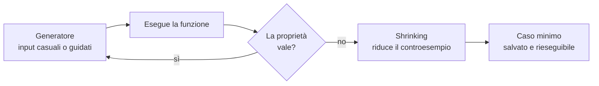
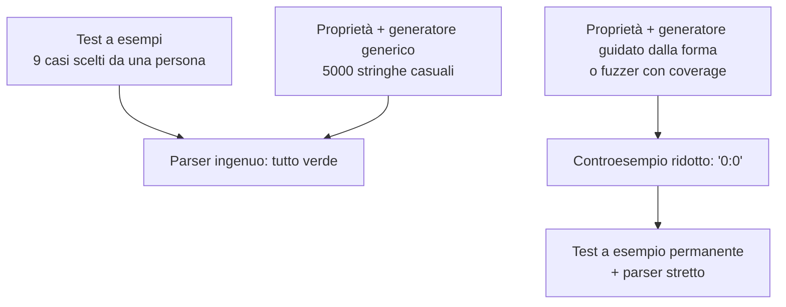
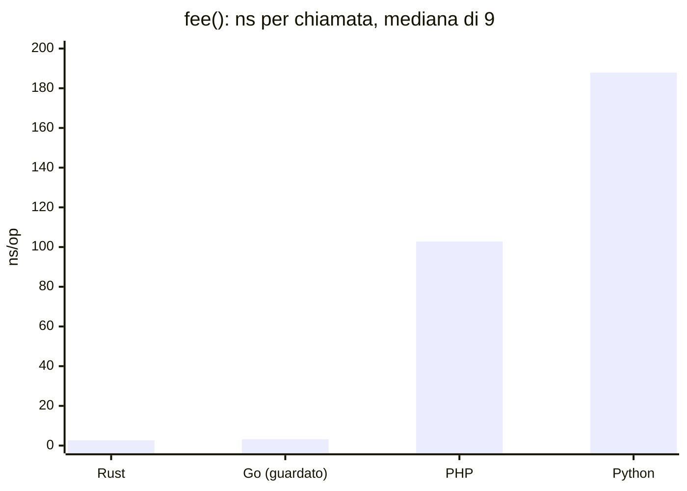

> File C13-parte2.md (parte 2 di 5) — C13 Testing e qualità, corso di programmazione multi-linguaggio (PHP, Python, Rust, Go)

## L13.3 — Property-based testing e fuzzing

### Concetto

Un test a esempi dice: «per questo input, questo output». Un test **a proprietà** dice: «per *qualunque* input di questa forma, vale questa relazione». Il framework genera centinaia di input, controlla la relazione e, se la trova violata, **riduce** (*shrink*) il controesempio al caso più piccolo che fallisce ancora.

Le proprietà di `fee` si ricavano dal requisito, senza conoscere l'implementazione:

| Proprietà | Enunciato | Da quale frase del requisito |
|---|---|---|
| P1 | `fee(m, r) == 0` per `m <= 15` | «primi 15 minuti gratuiti» |
| P2 | `a <= b` implica `fee(a, r) <= fee(b, r)` (monotonia) | «ogni ora iniziata» (restare più a lungo non costa meno) |
| P3 | `fee(m, r) <= giornate_iniziate(m) * 8 * r` | «non supera 8 ore di tariffa» |
| P4 | `0 <= duration(a, b) < 1440` | «uscita precedente: giorno dopo» |
| P5 | se `parse_time(s)` riesce, `format(parse_time(s)) == s` (round trip) | «orari inesistenti» e forma `HH:MM` |



Il **fuzzing** è parente stretto: invece di generare input dalla sola struttura dei tipi, il fuzzer osserva quale codice viene raggiunto (*coverage-guided*) e muta gli input che hanno aperto strade nuove, in un ciclo che può girare per ore. Il generatore a proprietà è bravo con input *strutturati*; il fuzzer con input *opachi* come parser, decoder e protocolli.

Una proprietà non dimostra la correttezza: è un test a esempi con un'enorme quantità di esempi scelti da una macchina. Il suo difetto tipico è **la distribuzione degli input**: un generatore che produce stringhe casuali lunghe raramente produce `0:0`.

### Implementazione

Le cinque proprietà, nei tre ecosistemi con un framework dedicato, e a mano in PHP (generatore con seme fisso, così un fallimento si può riprodurre).

**Python**

```python
from hypothesis import given, strategies as st

from parking.core import CAP_HOURS, DAY_MINUTES, FREE_MINUTES, duration, fee, parse_time

minutes = st.integers(min_value=0, max_value=10 * DAY_MINUTES)
rates = st.integers(min_value=1, max_value=1000)


@given(minutes, rates)
def test_free_window(m, r):
    # P1: parking up to the free window costs nothing
    if m <= FREE_MINUTES:
        assert fee(m, r) == 0


@given(minutes, minutes, rates)
def test_monotonic(a, b, r):
    # P2: staying longer never costs less
    lo, hi = sorted((a, b))
    assert fee(lo, r) <= fee(hi, r)


@given(minutes, rates)
def test_cap_per_day(m, r):
    # P3: never more than one daily cap per started day
    days_started = -(-m // DAY_MINUTES)
    assert fee(m, r) <= days_started * CAP_HOURS * r


@given(st.integers(0, 1439), st.integers(0, 1439))
def test_duration_range(t_in, t_out):
    # P4: a duration is always within one day
    assert 0 <= duration(t_in, t_out) < DAY_MINUTES


@given(st.text())
def test_parse_time_accepts_only_hh_mm(s):
    # P5: if it parses, it had the exact shape HH:MM in ASCII digits
    v = parse_time(s)
    if v is not None:
        assert len(s) == 5 and s[2] == ":" and s.replace(":", "").isascii() and s.replace(":", "").isdigit()
        assert f"{v // 60:02d}:{v % 60:02d}" == s
```

**PHP**

```php
// Property tests by hand: a seeded generator, so a failure can be replayed.
mt_srand(12345);
for ($i = 0; $i < 2000; $i++) {
    $r = mt_rand(1, 1000);
    $a = mt_rand(0, 14400);
    $b = mt_rand(0, 14400);
    [$lo, $hi] = $a <= $b ? [$a, $b] : [$b, $a];
    check("P2 seed-iter $i", fee($lo, $r) <= fee($hi, $r), true);
    check("P3 seed-iter $i", fee($a, $r) <= intdiv($a + 1439, 1440) * 8 * $r, true);
    if ($a <= 15) {
        check("P1 seed-iter $i", fee($a, $r), 0);
    }
}
```

**Rust**

```rust
use parking::{CAP_HOURS, DAY_MINUTES, FREE_MINUTES, duration, fee, parse_time};
use proptest::prelude::*;

proptest! {
    // P1: parking up to the free window costs nothing
    #[test]
    fn free_window(m in 0..=FREE_MINUTES, r in 1u32..1000) {
        prop_assert_eq!(fee(m, r), 0);
    }

    // P2: staying longer never costs less
    #[test]
    fn monotonic(a in 0u32..14400, b in 0u32..14400, r in 1u32..1000) {
        let (lo, hi) = if a <= b { (a, b) } else { (b, a) };
        prop_assert!(fee(lo, r) <= fee(hi, r));
    }

    // P3: never more than one daily cap per started day
    #[test]
    fn cap_per_day(m in 0u32..14400, r in 1u32..1000) {
        prop_assert!(fee(m, r) <= m.div_ceil(DAY_MINUTES) * CAP_HOURS * r);
    }

    // P4: a duration is always within one day
    #[test]
    fn duration_range(a in 0u32..1440, b in 0u32..1440) {
        prop_assert!(duration(a, b) < DAY_MINUTES);
    }

    // P5: if it parses, it had the exact shape HH:MM and round-trips
    #[test]
    fn parse_time_round_trip(s in "\\PC{0,8}") {
        if let Some(v) = parse_time(&s) {
            prop_assert_eq!(format!("{:02}:{:02}", v / 60, v % 60), s);
        }
    }
}
```

**Go**

```go
func TestFeeProperties(t *testing.T) {
	// testing/quick feeds random arguments; we shrink them into range ourselves
	monotonic := func(a, b uint16, r uint16) bool {
		lo, hi, rate := int(a%14400), int(b%14400), int(r%1000)+1
		if lo > hi {
			lo, hi = hi, lo
		}
		return parking.Fee(lo, rate) <= parking.Fee(hi, rate) // P2
	}
	capPerDay := func(m uint16, r uint16) bool {
		min, rate := int(m%14400), int(r%1000)+1
		return parking.Fee(min, rate) <= (min+1439)/1440*parking.CapHours*rate // P3
	}
	freeWindow := func(m uint8, r uint16) bool {
		return parking.Fee(int(m%16), int(r%1000)+1) == 0 // P1
	}
	for name, p := range map[string]any{"monotonic": monotonic, "cap": capPerDay, "free": freeWindow} {
		if err := quick.Check(p, nil); err != nil {
			t.Errorf("%s: %v", name, err)
		}
	}
}
```


In Python Hypothesis sceglie gli input (comprese le «facce scomode»: zero, estremi, stringhe Unicode), conserva i controesempi in un database locale e li riesegue ai giri successivi. `proptest` fa lo stesso per Rust e salva i seed dei fallimenti in `proptest-regressions/`. `testing/quick` di Go è volutamente minimale (nessuno shrinking, nessun database dei fallimenti): per questo noi riconduciamo gli argomenti nell'intervallo con `%`. In PHP la proprietà è un ciclo con `mt_srand(12345)`: funziona, ma lo shrinking resta a carico di chi legge.

### e1 — Un parser indulgente supera i test a esempi

Una versione ingenua di `parse_time`, la prima che viene in mente: separa su `:`, converte con la funzione di conversione del linguaggio, controlla gli intervalli.

**Python**

```python
def parse_time(text):
    """Naive version: split, int(), range check."""
    parts = text.split(":")
    if len(parts) != 2:
        return None
    try:
        hh, mm = int(parts[0]), int(parts[1])
    except ValueError:
        return None
    if not (0 <= hh <= 23 and 0 <= mm <= 59):
        return None
    return hh * 60 + mm
```


Pare corretta e passa i test a esempi più ovvi. Ma `int("9")`, `Atoi("9")` e `(int)"9"` accettano molto più di due cifre. Cerchiamo la differenza con tre strumenti.

**Hypothesis con `st.text()`**, 100 esempi di default e poi 5000:

```text
### python-hypothesis-naive
1 passed in 1.61s
[exit 0]
```

Nessun controesempio: stringhe casuali raramente hanno la forma `n:n`. Con 5000 esempi il risultato non cambia. Passando a un generatore **guidato dalla forma** (`from_regex` con cifre, spazi, segno e underscore ai due lati dei due punti):

```text
### python-hypothesis-text-vs-shaped
E       AssertionError: assert False
E        +  where False = round_trips('0:0')
E       Failing test case: test_shaped(
E           s='0:0',
E       )
E       Explanation:
E           These lines were always and only run by failing test cases:
E               e1py/naive.py:13
FAILED test_naive2.py::test_shaped - AssertionError: assert False
1 failed, 1 passed in 2.60s
[exit 1]
```

Il controesempio ridotto è `'0:0'`: il parser l'accetta (minuti 0) ma `format(0) == "00:00" != "0:0"`. La riga `1 passed, 1 failed` nel riepilogo dice che `test_text_5000` (generatore generico) passa e `test_shaped` fallisce.

**Il fuzzer nativo di Go** parte dai semi `00:00` e `23:59` e trova lo stesso difetto in meno di un secondo:

```text
### go-fuzz-naive
fuzz: elapsed: 0s, gathering baseline coverage: 0/2 completed
fuzz: elapsed: 0s, gathering baseline coverage: 2/2 completed, now fuzzing with 2 workers
fuzz: elapsed: 0s, execs: 49 (3577/sec), new interesting: 0 (total: 2)
--- FAIL: FuzzParseTime (0.01s)
    --- FAIL: FuzzParseTime (0.00s)
        p_test.go:13: ParseTime("0:0") = 0 does not round-trip
    
    Failing input written to testdata/fuzz/FuzzParseTime/97e6dd5d4b67a0c1
    To re-run:
    go test -run=FuzzParseTime/97e6dd5d4b67a0c1
FAIL
exit status 1
FAIL	example.com/e1/p	0.016s
97e6dd5d4b67a0c1
go test fuzz v1
string("0:0")
[exit 0]
```

Il file in `testdata/fuzz/` è il **corpus di regressione**: `go test` lo rilegge a ogni esecuzione normale, senza opzioni di fuzzing, quindi il difetto trovato resta coperto per sempre. Il file va messo sotto controllo di versione.

**PHP** con `is_numeric` e cast intero accetta di più:

```text
### php-naive-is_numeric
"9:05"     -> 545
" 9:05"    -> 545
"09:5"     -> 545
"+9:05"    -> 545
"9:5.9"    -> 545
"1e1:00"   -> 600
"09:05\n"  -> 545
[exit 0]
```

Sono sette forme che una barriera non dovrebbe mai produrre (`" 9:05"`, `"+9:05"`, `"1e1:00"`, `"09:05\n"`) e il programma le tratterebbe come orari validi. La versione del capitolo, in tutti e quattro i linguaggi, è **stretta**: lunghezza due, solo cifre ASCII, nessuna conversione indulgente (in PHP la regex termina con `\z` e non con `$`, perché `$` in PCRE accetta anche un a-capo finale: è comportamento documentato, qui non misurato; `is_numeric`, invece, tollera già lo spazio finale, come mostra l'ultima riga dell'output sopra).



La conclusione pratica è doppia. **Primo**: una proprietà è utile quanto il generatore che la alimenta; scrivere la strategia (la «forma» degli input) fa parte del lavoro. **Secondo**: il controesempio trovato va trasformato in un test a esempio, che resta e documenta il motivo.

### Focus comparativo

| Aspetto | PHP | Python | Rust | Go |
|---|---|---|---|---|
| Framework a proprietà | ◐ Eris (non provato); ciclo con seme fisso | ◐ Hypothesis | ◐ proptest, quickcheck | ◐ `testing/quick` (senza shrinking), rapid |
| Shrinking | ○ a mano | ● | ● | ○ con `quick` |
| Database dei fallimenti | ○ | ● `.hypothesis/` | ● `proptest-regressions/` | ● `testdata/fuzz/` (fuzzer) |
| Fuzzer coverage-guided | ◐ php-fuzzer (non provato) | ◐ Atheris (non provato) | ◐ cargo-fuzz (non provato) | ● nativo, `go test -fuzz` |
| Quando è vicino ai tipi | eccezioni su input anomali | `st.builds`, strategie di tipo | `Arbitrary` derivabile | generatori di `reflect` |

### Esercizio Rosetta

Scrivi una proprietà per `run`: «il numero di righe valide più il numero di scarti è uguale a `tickets`». Quale generatore usi per le righe? **Risposte**

> La proprietà vale per qualunque lista di righe, ma un generatore di stringhe casuali produrrebbe quasi solo righe scartate per `fields`. Un buon generatore combina quattro pezzi (id, zona, due orari) con probabilità non trascurabile di essere validi, sbagliati o duplicati: con Hypothesis `st.lists(st.builds(...))`, con proptest `prop::collection::vec` di una `prop_compose!`. La distribuzione degli input decide quali rami del codice vedi.

## L13.4 — Benchmark e statistica delle misure

### Concetto

Un **benchmark** misura quanto tempo impiega un frammento di codice. Una sola misura non vale nulla: il tempo varia con il carico della macchina, la frequenza della CPU, la cache, il garbage collector. Le regole minime sono quattro:

1. **Ripeti** (qui 9 esecuzioni) e riporta una misura *robusta*: la **mediana**, non la media, perché un singolo valore anomalo sposta la media ma non la mediana.
2. **Riporta la dispersione**: minimo e massimo, o meglio l'intervallo interquartile. Una differenza tra due versioni minore della dispersione non è una differenza.
3. **Misura il codice, non l'ottimizzatore.** Un compilatore può eliminare un calcolo il cui risultato non viene usato, o calcolarlo a compile-time se gli argomenti sono costanti.
4. **Dichiara l'ambiente**: qui macchina a 2 core condivisi, quindi i numeri sono indicativi e non assoluti.

Un benchmark risponde a «questa modifica ha reso `fee` più lenta?», non a «Rust è cento volte più veloce di Python»: confrontare linguaggi con un micro-benchmark significa confrontare *anche* il modo in cui ciascun harness è scritto.

### Implementazione

Il lavoro è lo stesso in tutti: sommare `fee(i % 3000, 120)` per `i` da 0 a N−1 e dividere il tempo per N. In Go il benchmark ufficiale è `testing.B`; negli altri tre un ciclo di misura scritto a mano con 9 ripetizioni.

**Go**

```go
func BenchmarkFee(b *testing.B) {
	sink := 0
	for i := 0; i < b.N; i++ {
		sink += parking.Fee(i%3000, 120)
	}
	_ = sink
}
```


### e2 — Un benchmark che misura l'ottimizzatore

**Prima misura, ingenua.** Python, PHP e Go con il benchmark più naturale; Rust con `black_box` perché senza non si ottiene nulla di leggibile:

```text
### python
python  median=187.9 ns/op  min=161.6  max=224.1
[exit 0]
```

```text
### php
php     median=102.8 ns/op  min=72.2  max=130.8
[exit 0]
```

```text
### rust
rust    median=2.66 ns/op  min=2.25  max=2.99
[exit 0]
```

```text
### go-testing-B-count9
0.1266 0.1316 0.1329 0.1366 0.1422 0.1578 0.1652 0.2051 0.2137 
[exit 0]
```

Il numero di Go (0,13 ns per chiamata) è **impossibile**: a circa 3 GHz sono 0,4 cicli. Il compilatore ha inlinato `Fee`, sa che `rate` è la costante 120 e ha ridotto il ciclo a poche istruzioni. Quella misura descrive l'ottimizzatore. Correzione: la tariffa diventa una variabile di package (non foldabile), la chiamata passa per una funzione `//go:noinline` e il risultato finisce in una variabile di package.

**Go**

```go
var (
	rateVar = 120 // not a constant: the compiler cannot fold it
	sinkVar int   // package-level sink: the result must be kept
)

//go:noinline
func feeNoInline(m, r int) int { return parking.Fee(m, r) }

func BenchmarkFeeGuarded(b *testing.B) {
	s := 0
	for i := 0; i < b.N; i++ {
		s += feeNoInline(i%3000, rateVar)
	}
	sinkVar = s
}
```


```text
### go-guarded-B-count9
2.806 3.060 3.126 3.199 3.202 3.359 3.409 4.235 4.636 
[exit 0]
```



| Linguaggio | Mediana (ns/op) | Min | Max | Note di lettura |
|---|---|---|---|---|
| Python 3.13 | 187,9 | 161,6 | 224,1 | interprete, ciclo e chiamata dentro l'harness |
| PHP 8.3 | 102,8 | 72,2 | 130,8 | senza JIT, `hrtime` |
| Rust 1.97, `-O`, `black_box` | 2,66 | 2,25 | 2,99 | `black_box` su entrambi gli argomenti |
| Go 1.24, `noinline` e sink | 3,20 | 2,81 | 4,64 | mediana del 5° valore ordinato su 9 |
| Go 1.24, versione ingenua | 0,14 | 0,13 | 0,21 | **misura l'ottimizzatore, da scartare** |

I numeri sono indicativi: ambiente condiviso, un solo run per linguaggio di 9 ripetizioni. Il rapporto tra i valori dipende dall'harness, e Rust e Go sono confrontabili solo perché entrambi hanno impedito che il compilatore eliminasse il lavoro; le differenze fra loro (2,66 contro 3,20) sono dello stesso ordine della dispersione di ciascuno (Go: da 2,81 a 4,64) e **non vanno interpretate**. La differenza tra i primi due e gli ultimi due, di due ordini di grandezza, è invece molto maggiore della dispersione.

### Focus comparativo

| Aspetto | PHP | Python | Rust | Go |
|---|---|---|---|---|
| Strumento nativo | ○ | ◐ `timeit` | ◐ `#[bench]` solo nightly; `criterion` esterno (non provato) | ● `testing.B`, `-benchmem`, `-count` |
| Guardia contro l'ottimizzatore | non serve in pratica (interprete) | non serve | `std::hint::black_box` | variabile di package, `//go:noinline` |
| Confronto statistico di due run | ○ | ◐ pytest-benchmark (non provato) | ◐ criterion (non provato) | ◐ `benchstat` (non provato: modulo non scaricabile qui) |
| Warm-up | OPcache | nessuno | nessuno | automatico (`b.N` cresce) |

### Esercizio Rosetta

Un collega dice «ho ottimizzato `fee`: da 3,2 a 2,9 ns». Che cosa gli chiedi prima di crederci? **Risposte**

> Quante ripetizioni, quale statistica (mediana?), la dispersione (qui da 2,8 a 4,6: la differenza è dentro il rumore), se l'ambiente era scarico e identico nei due casi, e se il benchmark è protetto dall'ottimizzatore. Con la sola informazione «3,2 contro 2,9» la differenza non è dimostrata.

