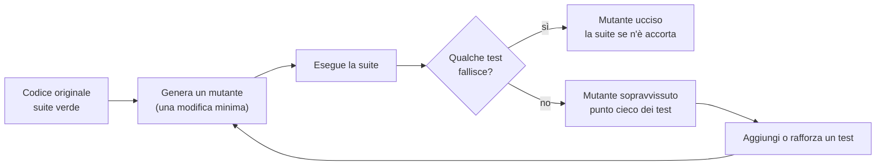
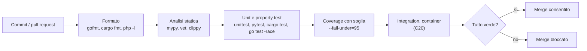
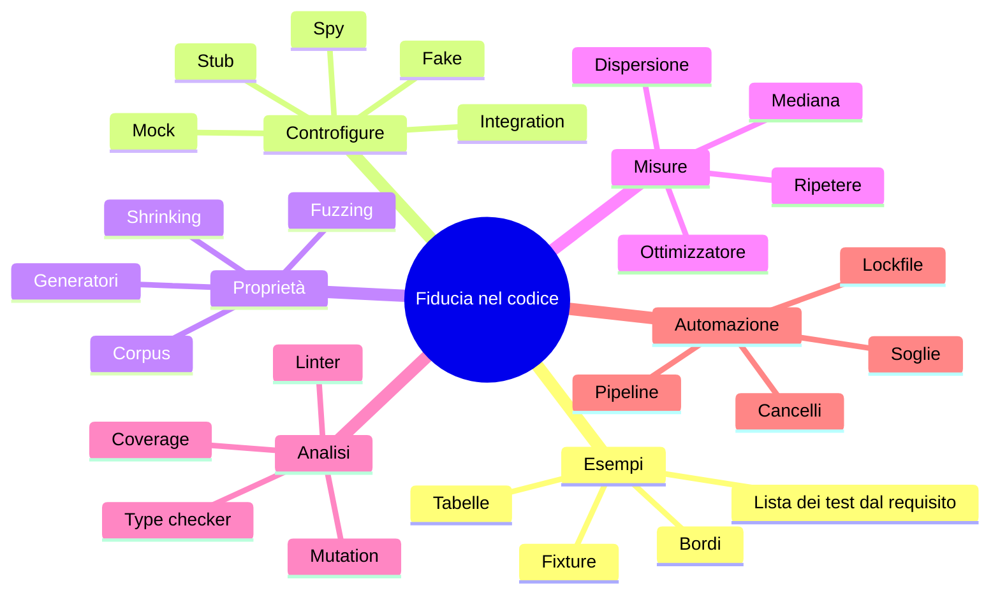

> File C13-parte3.md (parte 3 di 5) — C13 Testing e qualità, corso di programmazione multi-linguaggio (PHP, Python, Rust, Go)

## L13.5 — Analisi statica, coverage, mutation, CI

### Concetto

Quattro strumenti, quattro domande diverse. Non sono alternativi: ciascuno vede cose che gli altri non vedono.

| Strumento | Domanda | Cosa NON dice |
|---|---|---|
| **Analisi statica** (type checker, linter) | questo codice contiene schemi sospetti, senza eseguirlo? | se la logica fa quel che serve |
| **Test** | per questi input, il risultato è giusto? | per gli altri input |
| **Coverage** | quali righe/rami sono stati *eseguiti* dai test? | se i test *controllano* quel che eseguono |
| **Mutation testing** | se rompo il codice, i test se ne accorgono? | quali mutazioni conviene provare |


### e3 — L'analisi statica trova un bug, senza eseguire nulla

Abbiamo piantato un bug in ciascun linguaggio.

```python
from parking.core import RateSource, fee


def price(rates: RateSource, zone: str, minutes: int) -> int:
    rate = rates.rate(zone)          # may be None
    return fee(minutes, rate)        # seeded bug: None is not int
```

```text
### mypy-strict
bug.py:6: error: Argument 2 to "fee" has incompatible type "int | None"; expected "int"  [arg-type]
Found 1 error in 1 file (checked 1 source file)
[exit 1]
```

`rates.rate(zone)` può restituire `None` (C02): `mypy --strict` lo vede e rifiuta di passarlo a `fee`. Lo stesso errore in PHP e Python senza type checker emergerebbe a runtime, probabilmente in produzione, con un `TypeError`.

In Go:

```go
package main

import (
	"fmt"
	"os"
)

func main() {
	n := 3
	fmt.Printf("tickets=%d zone=%s\n", n)       // seeded bug: missing argument
	fmt.Printf("total=%d\n", "120")              // seeded bug: wrong verb for string
	_, err := os.Open("x")
	if err != nil {
		fmt.Println("error:", err)
	}
	for i := 0; i < 2; i++ {
		go func() { fmt.Println(i) }()
	}
}
```

```text
### go-vet
# example.com/e4
# [example.com/e4]
./main.go:10:2: fmt.Printf format %s reads arg #2, but call has 1 arg
./main.go:11:2: fmt.Printf format %d has arg "120" of wrong type string
[exit 1]
```

`go vet` ha trovato i due errori di formato (argomento mancante, verbo sbagliato); non ha segnalato il ciclo con la closure perché da Go 1.22 ogni iterazione ha la sua variabile (`go 1.24` in `go.mod`, C04 e2).

In Rust:

```rust
fn parse(s: &str) -> Result<u32, std::num::ParseIntError> { s.parse() }

pub fn total(lines: &[&str]) -> u32 {
    let mut t = 0;
    for l in lines {
        parse(l);                       // seeded bug: Result ignored
        t += l.len() as u32;
    }
    let v = vec![1, 2, 3];
    let _ = v.iter().map(|x| x + 1);    // seeded bug: lazy iterator never consumed
    if t == 0 { return 0 } else { return t }
}
```

```text
### rustc-warnings
warning: unused `Result` that must be used
warning: 1 warning emitted
[exit 0]
```

```text
### clippy
clippy 0.1.97 (2d8144b788 2026-07-07)
warning: unneeded `return` statement
warning: unneeded `return` statement
warning: useless use of `vec!`
warning: unused `std::result::Result` that must be used
warning: 4 warnings emitted
[exit 0]
```

Il compilatore segnala il `Result` ignorato; **clippy** aggiunge tre osservazioni di stile e correttezza (due `return` superflui, un `vec!` inutile). Il `let _ = v.iter().map(...)`, in cui un iteratore lazy non viene mai consumato, **non è segnalato**: `let _ =` è un'esplicita rinuncia al valore. Per PHP:

```text
### php-lint
No syntax errors detected in php/src/core.php
phpstan/psalm: not installed
[exit 0]
```

`php -l` controlla solo la **sintassi**. L'analisi statica vera in PHP è affidata a PHPStan e Psalm, che qui non sono installabili: non possiamo dire che cosa avrebbero trovato.

### e4 — Il 100% di coverage non basta

Misuriamo la coverage della suite di `core.py` con `coverage.py` (con i **rami**, non solo le righe):

```text
### coverage-core-only
OK
Name                  Stmts   Miss Branch BrPart  Cover
-------------------------------------------------------
parking/__init__.py       0      0      0      0   100%
parking/__main__.py      21     21      6      0     0%
parking/core.py          66      0     18      0   100%
-------------------------------------------------------
TOTAL                    87     21     24      0    76%
[exit 0]
```

`core.py` è al 100% (righe e rami): ogni istruzione del nucleo è stata eseguita. `__main__.py` è allo 0%: nessun test lo tocca. Quanto vale il 100%? Lo scopriamo con il **mutation testing**: uno script applica una piccola alterazione alla volta (un `<=` diventa `<`, una costante cambia, un `if` viene disattivato) e riesegue la suite. Se i test passano ancora, il **mutante sopravvive**: il codice è cambiato e nessuno se n'è accorto.



Dieci mutanti sul nucleo (`fee`, `duration`, `parse_time`, `run`):

```text
### mutants-core
mutant                                       unittest  +hypothesis
fee: rem <= FREE -> rem < FREE               killed    killed
fee: ceil -> floor                           killed    killed
fee: drop daily cap on remainder             killed    killed
fee: cap hours 8 -> 9                        killed    killed
duration: wrap +1440 -> +1439                killed    killed
duration: d >= 0 -> d > 0                    killed    killed
time: hh <= 23 -> hh <= 24                   killed    killed
time: mm <= 59 -> mm <= 60                   killed    killed
run: duplicates not detected                 killed    killed
run: blank lines counted                     killed    killed
[exit 0]
```

Il nucleo è ben difeso: i dieci mutanti sono **tutti uccisi**, e già dai soli test a esempio (la colonna «+hypothesis» non aggiunge nulla). Il risultato è merito della tabella di L13.1, scritta sui bordi del requisito. Sulla CLI la storia cambia: quattro mutanti sul `main` (exit code, ordine delle zone, totale).

```text
### mutants-main-no-cli-test
mutant                                       unittest  +hypothesis
main: exit 1 -> 0 on rejects                 SURVIVED  SURVIVED
main: missing file exit 2 -> 1               SURVIVED  SURVIVED
main: zones in reverse order                 SURVIVED  SURVIVED
main: total ignores last ticket              SURVIVED  SURVIVED
[exit 0]
```

Senza test della CLI sopravvivono tutti: coerente con lo 0% della coverage. Aggiungiamo il test **golden** di L13.2 nella sua **prima versione**, scritta senza pensare ai mutanti (tre righe: la prima valida costa 120, la seconda, ultima valida, costa zero, la terza è scartata):

```text
### mutants-main-weak-cli-test
mutant                                       unittest  +hypothesis
main: exit 1 -> 0 on rejects                 killed    killed
main: missing file exit 2 -> 1               killed    killed
main: zones in reverse order                 killed    killed
main: total ignores last ticket              SURVIVED  SURVIVED
[exit 0]
```

Il test di CLI uccide tre mutanti su quattro. **Sopravvive** «total ignores last ticket»: nei dati usati l'ultimo biglietto valido costava 0 centesimi, quindi ignorarlo non cambia il totale. Il test *eseguiva* quella riga e *controllava* il totale, ma con dati che non discriminano. Lo rafforziamo con dati in cui l'ultimo biglietto costa qualcosa e le zone non sono già in ordine: è la versione che trovi nello snippet di L13.2.

```text
### mutants-main-strong-cli-test
mutant                                       unittest  +hypothesis
main: exit 1 -> 0 on rejects                 killed    killed
main: missing file exit 2 -> 1               killed    killed
main: zones in reverse order                 killed    killed
main: total ignores last ticket              killed    killed
[exit 0]
```

```text
### coverage-all
OK
Name                  Stmts   Miss Branch BrPart  Cover   Missing
-----------------------------------------------------------------
parking/__init__.py       0      0      0      0   100%
parking/__main__.py      21      1      6      1    93%   30
parking/core.py          66      0     18      0   100%
-----------------------------------------------------------------
TOTAL                    87      1     24      1    98%
[exit 0]
```

La coverage è passata dal 76% al 98%, ma la lezione non è il numero: è che **la coverage misura se una riga è stata eseguita, non se il suo risultato è stato controllato**. Il mutation testing è l'unico dei quattro strumenti che testa i *test*. Costa molto (una esecuzione della suite per ogni mutante), per questo si applica ai moduli critici e non a tutto. Per i quattro linguaggi esistono strumenti dedicati (`mutmut`/`cosmic-ray` per Python, `cargo-mutants` per Rust, `go-mutesting` per Go, Infection per PHP): **non provati**; lo script di questo capitolo (`claude/tools/mutate-c13.py` nel Project) è un'illustrazione artigianale di una cinquantina di righe.

Un'ultima nota di processo: nella prima stesura di questo test il mutante «zones unsorted» (`list` al posto di `sorted` su un insieme) sopravviveva *o moriva a caso* a seconda del `PYTHONHASHSEED` della singola esecuzione, perché l'ordine di un insieme di stringhe in Python cambia da un avvio all'altro. Un mutante deve essere deterministico quanto un test: lo abbiamo sostituito con «zones in reverse order».

### La pipeline CI

Un'**integrazione continua** (CI) esegue a ogni modifica l'insieme dei cancelli e dice sì o no. Un cancello è un comando con exit code: la pipeline si ferma al primo che fallisce. Questo è lo script che esegue i dodici cancelli del capitolo (quattro per Python, due per PHP, tre per Rust, tre per Go). Non serve conoscere GitHub Actions: la stessa sequenza, riga per riga, è un workflow:

```bash
#!/bin/bash
# One gate per line: a non-zero exit stops the pipeline (like a CI job).
set -euo pipefail
cd "$(dirname "$0")"
gate() { printf '== %s\n' "$1"; shift; "$@" > /tmp/ci.log 2>&1 && echo "   ok" || { cat /tmp/ci.log; echo "   FAILED"; exit 1; }; }

gate "py  mypy --strict"     bash -c 'cd py && mypy --strict parking'
gate "py  unittest"          bash -c 'cd py && python3 -m unittest discover -s tests -t .'
gate "py  hypothesis"        bash -c 'cd py && python3 -m pytest -q -p no:cacheprovider tests/test_props.py'
gate "py  coverage >= 95%"   bash -c 'cd py && python3 -m coverage run --branch --source=parking -m unittest discover -s tests -t . && python3 -m coverage report --fail-under=95'
gate "php lint"              bash -c 'php -l php/src/core.php && php -l php/main.php'
gate "php tests"             php php/tests/run.php
gate "rs  fmt --check"       bash -c 'cd rs && cargo fmt --check'
gate "rs  clippy -D warnings" bash -c 'cd rs && cargo clippy --all-targets --locked -- -D warnings'
gate "rs  test --locked"     bash -c 'cd rs && cargo test --locked'
gate "go  gofmt"             bash -c 'cd go && test -z "$(gofmt -l .)"'
gate "go  vet"               bash -c 'cd go && go vet ./...'
gate "go  test -race -cover" bash -c 'cd go && go test -race -cover ./...'
echo "all gates passed"
```



Con una modifica sbagliata (`rem <= FREE_MINUTES` diventa `rem < FREE_MINUTES`) la pipeline si ferma al secondo cancello:

```text
### red-run
== py  mypy --strict
   ok
== py  unittest
..FF......
======================================================================
FAIL: test_table (tests.test_core.FeeTest.test_table) (minutes=15, rate=120)
----------------------------------------------------------------------
Traceback (most recent call last):
  File "prog/py/tests/test_core.py", line 32, in test_table
    self.assertEqual(fee(minutes, rate), want)
    ~~~~~~~~~~~~~~~~^^^^^^^^^^^^^^^^^^^^^^^^^^
AssertionError: 120 != 0

======================================================================
FAIL: test_table (tests.test_core.FeeTest.test_table) (minutes=1455, rate=120)
----------------------------------------------------------------------
Traceback (most recent call last):
  File "prog/py/tests/test_core.py", line 32, in test_table
    self.assertEqual(fee(minutes, rate), want)
    ~~~~~~~~~~~~~~~~^^^^^^^^^^^^^^^^^^^^^^^^^^
AssertionError: 1080 != 960

----------------------------------------------------------------------
Ran 9 tests in 0.002s

FAILED (failures=2)
   FAILED
[exit 1]
```

I due casi che falliscono sono esattamente i bordi del requisito (15 minuti e 1455), perché la tabella di L13.1 era stata scritta lì. Con il codice originale:

```text
### green-run
== py  mypy --strict
   ok
== py  unittest
   ok
== py  hypothesis
   ok
== py  coverage >= 95%
   ok
== php lint
   ok
== php tests
   ok
== rs  fmt --check
   ok
== rs  clippy -D warnings
   ok
== rs  test --locked
   ok
== go  gofmt
   ok
== go  vet
   ok
== go  test -race -cover
   ok
all gates passed
[exit 0]
```

Tre scelte nella pipeline meritano di essere dette. Il **cancello di coverage** ha una soglia (95%) perché serve a impedire il crollo, non a premiare il 100%. Cargo gira con `--locked` (come `uv sync --locked` per Python) perché una CI che risolve versioni nuove a ogni giro non è riproducibile (C12 e5). Il rilevatore di race di Go (`-race`) è nei cancelli per la stessa ragione di C11: costa poco e trova ciò che i test non vedono.

### Focus comparativo

| Aspetto | PHP | Python | Rust | Go |
|---|---|---|---|---|
| Analisi statica | ◐ PHPStan, Psalm (non provati) | ◐ mypy, pyright, ruff | ● compilatore + clippy | ● `go vet` (+ ◐ staticcheck, non provato) |
| Formatter come cancello | ◐ PHP-CS-Fixer, Pint | ◐ `ruff format --check` | ● `cargo fmt --check` | ● `gofmt -l` |
| Coverage | ◐ Xdebug/PCOV (non provati) | ● `coverage.py` | ◐ `cargo llvm-cov`, tarpaulin (non provati) | ● `go test -cover`, `go tool cover` |
| Mutation testing | ◐ Infection (non provato) | ◐ mutmut, cosmic-ray (non provati) | ◐ cargo-mutants (non provato) | ◐ go-mutesting (non provato) |
| Race / sicurezza dei thread | ○ (shared-nothing) | ○ | ● compile-time (C11) | ◐ `-race` a runtime |

### Esercizio Rosetta

Aggiungi alla pipeline un cancello che fallisce se **un file di test contiene `print(`/`var_dump(`/`dbg!(`/`fmt.Println(`** dimenticato. In quale gruppo di cancelli lo metti e perché prima degli unit test? **Risposte**

> Nel gruppo «formato/analisi statica», con `grep -rn` e exit code inverso (`! grep ...`). Va prima dei test perché è economico (millisecondi), non richiede di eseguire nulla e dà un errore preciso (file e riga); l'ordine dei cancelli va dal più economico al più costoso, in modo che il feedback sia veloce.

## Il programma completo e il collaudo

I quattro programmi (appendice) producono lo stesso output: report su stdout, scarti su stderr, exit code 0 senza scarti, 1 con scarti, 2 se il file non si legge. Il collaudo li confronta byte per byte con quello Python su cinque casi.

| Caso | Contenuto | Esito |
|---|---|---|
| `tickets.csv` | 15 righe: bordi di tariffa, mezzanotte, zona ignota, orario 25:00, campi mancanti, duplicato, riga vuota, `9:5` | identici: `tickets=15 valid=10 rejected=5 total=4720`, exit 1 |
| `t_empty.csv` | file vuoto | identici: `tickets=0 valid=0 rejected=0 total=0`, exit 0 |
| `t_crlf.csv` | stesso file con `\r\n` | identici: gli a-capo di Windows non cambiano nulla |
| file mancante | `nope.csv` | identici: `error: cannot read nope.csv`, exit 2 |
| `t_odd.csv` | cifre arabo-indiane, due punti a larghezza piena, spazio finale, **U+00A0 dopo la zona** | **PHP diverge** (exit code uguale, output diverso) |

```text
t01,A,08:00,08:10
t02,A,08:00,08:15
t03,A,08:00,08:16
t04,B,09:00,11:30
t05,C,22:00,06:00
t06,A,07:00,19:00
t07,B,10:00,10:00
t08,Z,10:00,11:00
t09,A,25:00,11:00
t10,A,10:00
t11,A,10:00,11:00
t11,A,12:00,13:00

t12,C,00:00,23:59
t13,B,23:30,00:20
t14,A,9:5,10:00
```

```text
### tickets.csv
case tickets.csv: exit 1 | tickets=15 valid=10 rejected=5 total=4720
  php: identical
  rs: identical
  go: identical
[exit 0]
```

```text
### t_odd.csv
case t_odd.csv: exit 1 | tickets=8 valid=6 rejected=2 total=560
  php: DIFF in o e
  rs: identical
  go: identical
[exit 0]
```

```text
### t_odd-php-vs-python
-- Python/Rust/Go
line 1: rejected (time)
line 2: rejected (time)
tickets=8 valid=6 rejected=2 total=560
zone=A count=5 total=360
zone=C count=1 total=200
-- PHP
line 1: rejected (time)
line 2: rejected (time)
line 4: rejected (zone)
tickets=8 valid=5 rejected=3 total=440
zone=A count=4 total=240
zone=C count=1 total=200
[exit 1]
```

Le righe 1 e 2 (cifre `٠٨` e due punti `：`) sono scartate da tutti: il parser stretto di L13.3 funziona in tutti i linguaggi. La riga 4 contiene `A` seguita da U+00A0 (spazio non separabile): `str.strip()` di Python, `str::trim` di Rust e `strings.TrimSpace` di Go lo considerano spazio Unicode e lo tolgono, la zona diventa `A` e il biglietto è valido; `trim()` di PHP rimuove solo sei byte ASCII (spazio, `\t`, `\n`, `\r`, `\0`, `\x0B`), non lo toglie e la zona `A\xa0` risulta sconosciuta. **Tutti e quattro i set di test della lezione passano**, perché nessuno prova uno spazio non separabile.

È la lezione più utile del capitolo e non dipende dalla tecnica: **un test dimostra la presenza di un comportamento controllato, non l'assenza di difetti.** Il confronto tra quattro implementazioni dello stesso contratto, che questo corso usa ovunque, è a sua volta un test (un oracolo *differenziale*): ha trovato il difetto che i test a esempio, le cinque proprietà e il fuzzing non cercavano. Il caso diventa un test permanente nelle quattro suite e una decisione di progetto: la normalizzazione dell'input al confine (C14) deve scegliere *una* definizione di «spazio» e applicarla uguale in tutti i linguaggi.

## Matrice degli approcci

| Costrutto | PHP | Python | Rust | Go |
|---|---|---|---|---|
| Framework di test nello stdlib o nel toolchain | ○ | ● `unittest` | ● `cargo test` | ● `go test` |
| Tabella di casi idiomatica | ◐ `dataProvider` | ● `subTest`, `parametrize` | ◐ array + ciclo | ● slice di struct + `t.Run` |
| Test accanto al codice (accesso al privato) | ○ | ◐ | ● `#[cfg(test)] mod` | ● stesso package |
| Test double a mano | ● | ● | ● trait | ● interfaccia implicita |
| Libreria di mock | ◐ | ● `unittest.mock` | ◐ | ◐ |
| Property-based | ◐ | ◐ Hypothesis | ◐ proptest | ◐ `testing/quick` |
| Fuzzing coverage-guided | ◐ | ◐ | ◐ | ● nativo |
| Benchmark nello stdlib | ○ | ◐ `timeit` | ○ (stabile) | ● `testing.B` |
| Analisi statica nel toolchain | ○ `php -l` | ○ | ● compilatore, ◐ clippy | ● `go vet` |
| Formatter ufficiale | ○ | ○ | ● | ● |
| Coverage nel toolchain | ○ | ○ | ○ | ● |
| Rilevatore di race | ○ | ○ | ● compile-time | ◐ `-race` |

La matrice è un indice: l'assenza dal toolchain (○) non significa assenza dall'ecosistema, e per PHP non abbiamo potuto provare quasi nulla di quanto sta fuori dal linguaggio.

## Anti-pattern

| Anti-pattern | Perché fa male | Alternativa |
|---|---|---|
| Test che dipende da orologio, rete, ordine, caso | flaky: si impara a ignorare il rosso | iniettare orologio e rete; semi fissi |
| Un test per ogni riga di codice, non per ogni requisito | congela l'implementazione, ostacola il refactoring | un test per ogni comportamento dichiarato |
| Mock di tutto | il test verifica il mock | fake o stub; spy solo dove la chiamata è il requisito |
| Coverage come obiettivo | le righe eseguite non sono righe controllate (e4) | coverage come soglia minima + mutation sui moduli critici |
| Benchmark con una sola misura o senza guardia | numeri che descrivono l'ottimizzatore (e2) | ripetere, mediana, dispersione, `black_box`/`noinline` |
| Property test con generatore generico | passa sempre, dà sicurezza falsa (e1) | strategia guidata dalla forma; fuzzer per input opachi |
| Test golden con dettagli accidentali | si rompe a ogni modifica innocua | golden solo sul contratto; normalizzare timestamp e ordine |
| Correggere il bug senza il test che lo cattura | il bug torna | rosso, poi verde: il controesempio diventa un test |
| Soglia di coverage al 100% | si scrivono test inutili per le ultime righe | soglia realistica, il resto in revisione |
| CI che risolve versioni nuove a ogni giro | build non riproducibile | lockfile e `--locked` (C12) |

## Quiz

1. Perché un test che non è mai stato visto fallire è sospetto?
2. Qual è la differenza tra uno stub e una spy? Quando una spy è giustificata?
3. Una property test passa 5000 volte e un fuzzer trova un controesempio in 20 ms: come è possibile?
4. Perché la mediana è preferibile alla media in un benchmark?
5. Un benchmark Go dà 0,13 ns per chiamata: che cosa sospetti e come lo verifichi?
6. Che cosa significa che un mutante «sopravvive» e in che cosa è diverso da una riga non coperta?
7. Perché i cancelli della CI sono ordinati dal più economico al più costoso?
8. Perché `t_odd.csv` non è stato trovato dai test, ma dal confronto tra i quattro linguaggi?

**Risposte**

> 1. Perché non si sa se verifica qualcosa: potrebbe passare anche con il codice sbagliato. Si vede rosso una volta scrivendo il test prima, o applicando una mutazione.
> 2. Lo stub risponde con valori fissi; la spy in più registra come è stata chiamata. È giustificata quando la chiamata *è* il requisito (qui: la tariffa non si chiede per le righe già scartate).
> 3. Il generatore produce stringhe casuali che quasi mai hanno la forma `n:n`; il fuzzer guidato dalla coverage muta i semi in direzione del codice nuovo. Il controesempio esisteva, il generatore non guardava lì.
> 4. Un singolo valore anomalo (interruzione dello scheduler, GC, cache fredda) sposta la media ma non la mediana.
> 5. Che il compilatore abbia inlinato la funzione e foldato gli argomenti costanti, eliminando il lavoro. Si verifica con `-gcflags=-m`, rendendo non costanti gli argomenti e usando `//go:noinline` e un risultato conservato in una variabile di package.
> 6. Il codice è stato alterato e tutti i test passano ancora: nessun test controlla quel comportamento. Una riga non coperta non è mai stata eseguita; un mutante sopravvissuto può essere su una riga eseguita ma non controllata.
> 7. Per avere un feedback veloce: se il formato fallisce, non serve lanciare una suite di integrazione di minuti.
> 8. Perché nessuno dei test cercava lo spazio non separabile; il confronto differenziale ha rivelato che due definizioni di «spazio» convivevano nei quattro linguaggi.

## Esercizi

1. **Specifica.** Riscrivi in tabella i requisiti di C06 (`Order` a stati) come lista di test, con i bordi in grassetto.
2. **Spy.** Aggiungi a `run` un `RateSource` con cache e scrivi un test che dimostra che per 1000 righe della stessa zona la sorgente viene chiamata una volta sola.
3. **Proprietà.** Enuncia due proprietà di `duration` oltre a P4 (per esempio: `duration(a, a) == 0`; la somma di `duration(a, b)` e `duration(b, a)` vale 1440 se `a != b`) e verificale nei quattro linguaggi.
4. **Fuzzing.** Scrivi `FuzzRun` in Go (input: una riga CSV come stringa) con la proprietà «nessun panic, `valid + rejects == tickets`». Che cosa trovi?
5. **Mutazione.** Aggiungi allo script `mutate-c13.py` cinque mutanti nuovi su `parse_line` e verifica quali sopravvivono; scrivi i test che li uccidono.
6. **Benchmark.** Misura `parse_time` in Go con un benchmark protetto, con 9 ripetizioni e la mediana; confronta la versione stretta con quella naive e dichiara se la differenza è maggiore della dispersione.
7. **CI.** Trasforma `ci.sh` in un workflow di GitHub Actions con una job per linguaggio e la cache delle dipendenze; quali cancelli sono comuni a tutti?
8. **Caso `t_odd`.** Aggiungi un test nelle quattro suite per lo spazio non separabile e correggi PHP (suggerimento: `preg_replace('/^[\p{Z}\s]+|[\p{Z}\s]+$/u', '', ...)` o `mb_trim` in PHP 8.4+, non provato qui).

## Mappa mentale



Collegamenti: C08 (type checker e analisi statica), C09 (errori tipizzati come casi di test), C12 (lockfile e riproducibilità), C20 (CI/CD e container), C21 (profiling e percentili).

## Ponte

C14 (I/O, serializzazione, tempo) riprende il caso `t_odd`: l'input esterno va **normalizzato e validato al confine**, con il parser stretto di L13.3 come modello; e riprende il tempo: nel capitolo ci siamo limitati a `HH:MM` senza fusi proprio per non fare dipendere i test dall'orologio. C15 userà la CLI di T7 come base. C19 usa Testcontainers per i database. C21 porta le regole di L13.4 al profiling e ai percentili.

## Limiti dichiarati

- **PHPUnit, Pest, Eris, PHPStan, Psalm, Infection non provati** (Packagist bloccato dalla policy dell'ambiente, non aggirato). PHP è presente con un harness da 15 righe, `php -l` e un generatore a seme fisso.
- **Testcontainers non provato** (nessun Docker daemon nell'ambiente cloud).
- Non provati: `criterion`, `benchstat`, `cargo-mutants`, `go-mutesting`, `mutmut`, `cosmic-ray`, `cargo llvm-cov`, `cargo-fuzz`, `staticcheck`, `unittest.mock`, `mockall`, `gomock`, `pytest-benchmark`.
- Il mutation testing è uno script artigianale con 14 mutanti scelti a mano, non un'analisi sistematica: «tutti i mutanti uccisi» riguarda *quei* 10 mutanti del nucleo e i 4 della CLI.
- I benchmark sono su una macchina a 2 core condivisi, 9 ripetizioni per linguaggio, un solo giorno di misura: indicativi. Il rapporto fra linguaggi dipende dall'harness.
- L'affermazione che `testing/quick` non ha shrinking e quella sulle capacità delle librerie non provate vengono dalla documentazione, non da esecuzioni.
- La causa del fatto che Hypothesis con `st.text()` non trovi `0:0` è un'inferenza (distribuzione delle stringhe generate), non un'analisi della strategia.
- Il confronto tra i quattro tipi di spazio Unicode (`trim`/`strip`/`TrimSpace`) è provato solo su U+00A0 e sugli spazi usati nel file `t_odd.csv`.
- PHP 8.4+ (`mb_trim`) e Go 1.25+ non sono stati riverificati.

## Appendice — i programmi completi

I sorgenti, nell'ordine in cui si leggono. Tutti i blocchi sono estratti dai file eseguiti per il collaudo.

