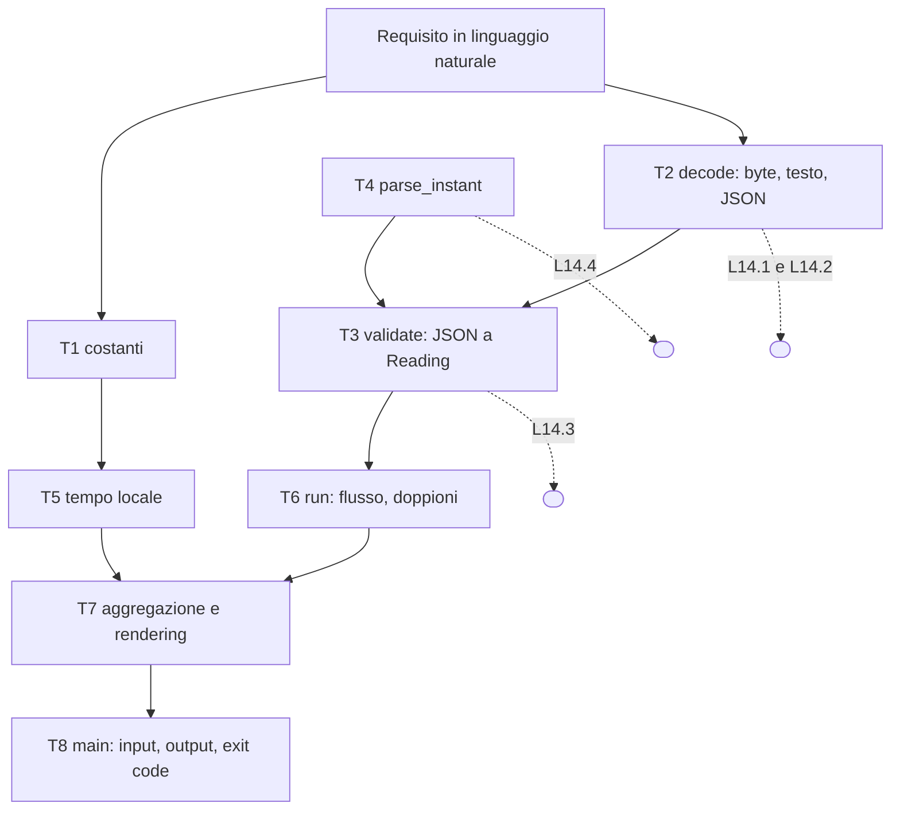
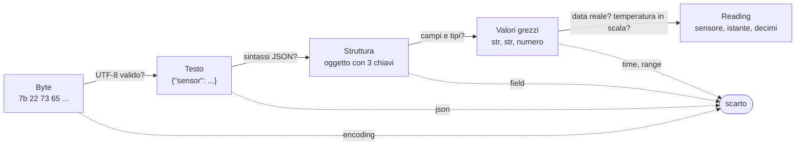
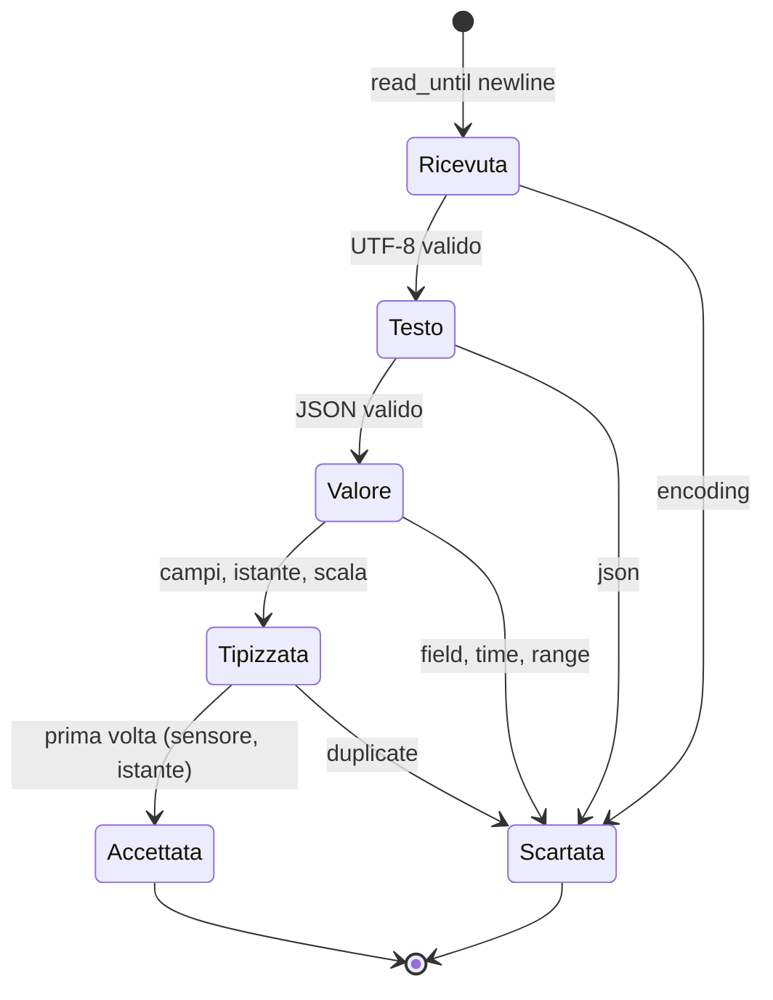

> File C14-parte1.md (parte 1 di 8) — C14 I/O, serializzazione, tempo; corso di programmazione multi-linguaggio

# C14 — I/O, serializzazione, tempo

> Parte IV — Ingegneria del software · Ingresso B (professionista) · 4 lezioni da 45′ (3 ore) · Bozza 1 del 2026-10-17

**Ambiente di prova.** PHP 8.3.6 (`json`, `mbstring`, `zlib`, `pcre`), Python 3.13.16 (mypy 2.3.1 `--strict` pulito, `zoneinfo` dello stdlib, `tomllib`; Pydantic 2.13.5, jsonschema 4.26.0, PyYAML 6.0.3, msgpack e cbor2 solo negli esperimenti), Rust 1.97.0 con `--edition 2024` (`serde_json` 1.0.154, `chrono` 0.4.45, `chrono-tz` 0.10.4, `flate2` 1.1.10; `cargo clippy` e `cargo fmt --check` puliti), Go 1.24.7 (`go 1.24` in `go.mod`; `gofmt -l` vuoto, `go vet` pulito; solo stdlib). Macchina a 2 core condivisi, 8 GB di RAM, un file system locale. **Nessun servizio di rete è coinvolto** in questo capitolo. Il tempo e i fusi orari usano il database IANA del sistema (versione `2026c` nel file `tzdata.zi`); `chrono-tz` ne porta una copia propria, la `2025b` (esperimento e13). Le versioni baseline del corso (PHP 8.4+, Go 1.25+) non sono state riverificate.

## Obiettivi

Al termine del capitolo saprai:

1. **leggere e scrivere flussi di byte** senza caricare tutto in memoria, e spiegare che cosa è un buffer, quando si svuota e quanto costa non averlo;
2. distinguere **byte, testo, struttura e tipo** come quattro livelli diversi di un dato che entra nel programma, e dire in quale livello è avvenuto un errore;
3. usare **JSON** (e NDJSON) in lettura e scrittura nei quattro linguaggi, conoscendo i punti in cui i valori di default dei parser e degli encoder non coincidono: numeri, chiavi duplicate, maiuscole, `NaN`, escape;
4. **validare al confine**: trasformare il dato grezzo in un tipo del dominio con regole esplicite, motivi di scarto da un insieme chiuso, e riconoscere la differenza tra *coercizione* e *validazione*;
5. distinguere un **istante** da un'**ora civile**, un **offset** da un **fuso**, e calcolare correttamente giorni di 23 o 25 ore, differenze tra letture e ore locali ambigue o inesistenti;
6. riconoscere dove il **database dei fusi orari** vive (sistema, libreria, binario) e che cosa succede quando manca.

## Il problema reale

> **La catena del freddo del magazzino di via Esempio.** Tre celle frigorifere (due a +4 °C, una a −18 °C) hanno ciascuna un sensore che, ogni 30 minuti circa, invia una lettura al gateway del magazzino. Il gateway le accumula in un file di testo, **una lettura per riga**, in formato JSON: l'identificativo del sensore (`cella-1`), l'istante della misura con data, ora e **offset rispetto a UTC** (`2026-03-29T03:10:00+02:00`; alcuni sensori vecchi sono rimasti configurati su UTC e scrivono `Z`) e la temperatura in gradi Celsius con al massimo **un decimale**. Il file arriva, a volte, compresso (`.gz`) e a volte da una pipe. Il responsabile qualità vuole, per ogni sensore e per ogni **giorno solare del magazzino** (fuso `Europe/Rome`), il numero di letture, la temperatura minima, massima e media, **la durata di quel giorno in ore** (perché due giorni all'anno non durano 24 ore) e l'elenco dei **silenzi**: intervalli superiori a 30 minuti tra due letture consecutive dello stesso sensore. Le righe sbagliate (JSON rotto, campi mancanti o di tipo errato, data impossibile, temperatura fuori scala o con troppi decimali, doppioni) vanno **scartate con il motivo** senza fermare il resto. Un file con scarti deve far terminare il programma con exit code 1; un file illeggibile con exit code 2. Sul report, oltre alla forma leggibile, serve una forma **JSON** per un altro programma.

Il problema è piccolo di proposito: quasi tutte le sue difficoltà stanno al **confine** del programma, dove il mondo esterno (byte su disco, testo, orologi) diventa tipi del linguaggio. Il requisito, riletto frase per frase, è già una lista di decisioni:

| Frase del requisito | Decisione da prendere | Dove nel capitolo |
|---|---|---|
| «una lettura per riga, in JSON» | che cosa è una riga? e un carattere? e un errore di lettura a metà file? | L14.1 |
| «a volte compresso, a volte da una pipe» | il programma deve lavorare su **un flusso**, non su un file | L14.1 |
| «temperatura con al massimo un decimale» | un numero JSON è un `float`? come si rappresentano i decimali esatti? | L14.2, L14.3 |
| «scartate con il motivo» | insieme **chiuso** di motivi, in ordine di controllo definito | L14.3 |
| «istante con offset», «alcuni su UTC» | istante o ora civile? come si confrontano due letture? | L14.4 |
| «giorno solare del magazzino» | conversione in un **fuso** (non un offset); giorni da 23 e 25 ore | L14.4 |
| «silenzi oltre 30 minuti» | differenza tra istanti, non tra orari scritti | L14.4 |
| «forma JSON per un altro programma» | la scrittura ha gli stessi problemi della lettura (ordine delle chiavi, escape, `NaN`) | L14.2 |

## Scomposizione

| # | Task | Output verificabile |
|---|---|---|
| T1 | Fissare le costanti: fuso, soglia dei silenzi, scala delle temperature, BOM, spazi di JSON | un solo posto in cui cambiano |
| T2 | `decode`: byte → testo UTF-8 → valore JSON, oppure il motivo del rifiuto (`encoding`, `json`) | nessuna eccezione esce da qui |
| T3 | `validate`: valore JSON → `Reading` tipizzato, oppure `field` / `time` / `range` | un solo ordine di controllo, uguale nei 4 linguaggi |
| T4 | `parse_instant`: timestamp RFC 3339 **stretto** → secondi UTC dall'epoca | accetta una sola forma |
| T5 | Tempo locale: data civile in `Europe/Rome`, durata del giorno in ore, istante formattato con offset | giorni da 23, 24, 25 ore |
| T6 | `run`: consumo del flusso riga per riga, doppioni, righe vuote, BOM | memoria costante in lettura |
| T7 | Aggregazione: giorni per sensore e silenzi; rendering testo e JSON | output identico nei 4 |
| T8 | `main`: file, `.gz` o stdin; stdout, stderr, exit code | contratto verificabile con `diff` |



Una riga del file attraversa i livelli uno dopo l'altro, e ogni livello ha il suo modo di fallire:



La stessa idea come macchina a stati di una riga: ogni stato è un tipo di dato diverso, e solo l'ultimo è fidato.



Il programma completo, nei quattro linguaggi, è in appendice; le sezioni che seguono ne usano frammenti incollati dai file eseguiti. Ogni frammento porta nel commento il numero del task (`T2 -`, `T4 -`, …).

Il file di prova `readings.ndjson` ha 31 righe fisiche (una vuota), 30 letture, 20 valide e 10 scartate, e copre i due cambi di ora del 2026 a Roma (29 marzo e 25 ottobre):

```text
{"sensor":"cella-1","ts":"2026-03-28T22:50:00Z","temp":3.8}
{"sensor":"cella-1","ts":"2026-03-28T23:20:00Z","temp":4.1}
{"sensor":"cella-1","ts":"2026-03-28T23:50:00Z","temp":4.2}
{"sensor":"cella-1","ts":"2026-03-29T00:20:00Z","temp":4.3}
{"sensor":"cella-1","ts":"2026-03-29T00:50:00+00:00","temp":4.4}
{"sensor":"cella-1","ts":"2026-03-29T03:10:00+02:00","temp":5.0}
{"sensor":"cella-1","ts":"2026-03-29T01:40:00Z","temp":4.8}
{"sensor":"cella-1","ts":"2026-03-29T08:00:00Z","temp":-0.5}
{"sensor":"cella-1","ts":"2026-03-29T08:20:00Z","temp":4.9,"note":"door"}
{"sensor":"cella-2","ts":"2026-03-29T00:50:00Z","temp":-18.2}
{"sensor":"cella-2","ts":"2026-03-29T01:10:00Z","temp":-17.9}
{"sensor":"cella-2","ts":"2026-03-29T01:30:00Z","temp":-17.5}
{"sensor":"cella-1","ts":"2026-03-29T01:50:00+01:00","temp":9.9}
{"sensor":"cella-1"
{"sensor":"cella-1","ts":"2026-03-29T09:00:00Z"}
{"sensor":"cella-1","ts":"2026-03-29T09:00:00Z","temp":"4.2"}
{"sensor":"cella-1","ts":"2026-02-30T09:00:00Z","temp":4.2}
{"sensor":"cella-1","ts":"2026-03-29 09:00:00","temp":4.2}
{"sensor":"cella-1","ts":"2026-03-29T10:00:00Z","temp":99.0}
{"sensor":"cella-1","ts":"2026-03-29T10:00:00Z","temp":4.25}
{"sensor":"Cella 1","ts":"2026-03-29T10:00:00Z","temp":4.2}

[1,2,3]
{"sensor":"cella-1","ts":"2026-03-30T22:30:00Z","temp":4.0}
{"sensor":"cella-3","ts":"2026-10-24T23:30:00Z","temp":-18.0}
{"sensor":"cella-3","ts":"2026-10-25T00:00:00Z","temp":-17.8}
{"sensor":"cella-3","ts":"2026-10-25T00:30:00Z","temp":-17.6}
{"sensor":"cella-3","ts":"2026-10-25T01:00:00Z","temp":-17.4}
{"sensor":"cella-3","ts":"2026-10-25T01:30:00Z","temp":-17.2}
{"sensor":"cella-3","ts":"2026-10-25T02:00:00Z","temp":-17.0}
{"sensor":"cella-3","ts":"2026-10-25T23:00:00Z","temp":-18.4}
```

Il risultato di riferimento (Python; gli altri tre sono identici byte per byte, vedi il collaudo):

```text
### stdout
readings=30 valid=20 rejected=10
day sensor=cella-1 date=2026-03-28 hours=24 count=1 min=3.8 max=3.8 avg=3.80
day sensor=cella-1 date=2026-03-29 hours=23 count=8 min=-0.5 max=5.0 avg=3.90
day sensor=cella-1 date=2026-03-31 hours=24 count=1 min=4.0 max=4.0 avg=4.00
day sensor=cella-2 date=2026-03-29 hours=23 count=3 min=-18.2 max=-17.5 avg=-17.87
day sensor=cella-3 date=2026-10-25 hours=25 count=6 min=-18.0 max=-17.0 avg=-17.50
day sensor=cella-3 date=2026-10-26 hours=24 count=1 min=-18.4 max=-18.4 avg=-18.40
gap sensor=cella-1 from=2026-03-29T03:40:00+02:00 to=2026-03-29T10:00:00+02:00 minutes=380
gap sensor=cella-1 from=2026-03-29T10:20:00+02:00 to=2026-03-31T00:30:00+02:00 minutes=2290
gap sensor=cella-3 from=2026-10-25T03:00:00+01:00 to=2026-10-26T00:00:00+01:00 minutes=1260
[exit 1]
```

```text
### stderr
line 13: rejected (duplicate)
line 14: rejected (json)
line 15: rejected (field)
line 16: rejected (field)
line 17: rejected (time)
line 18: rejected (time)
line 19: rejected (range)
line 20: rejected (range)
line 21: rejected (field)
line 23: rejected (field)
[exit 1]
```

Quattro cose meritano di essere guardate subito. La giornata `2026-03-29` dura **23 ore** e quella del `2026-10-25` dura **25**. Nessun silenzio è segnalato attorno al cambio d'ora di marzo, anche se le letture delle `01:50` e delle `03:10` locali sembrano distanti 80 minuti: sono distanti 20. La riga 13 (`01:50:00+01:00`) è scartata come `duplicate`: è lo stesso istante della riga 5 (`00:50:00+00:00`) scritto con un altro offset. Infine, i silenzi portano l'offset in vigore **in quell'istante**: `+02:00` in marzo; in ottobre il silenzio di `cella-3` parte da `03:00+01:00`, che è l'istante `02:00Z`, un'ora dopo il ritorno all'ora solare. Spiegheremo ogni caso in L14.4.

