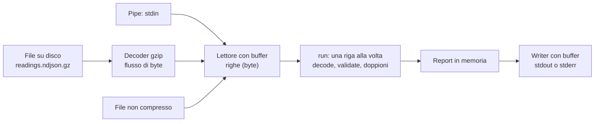
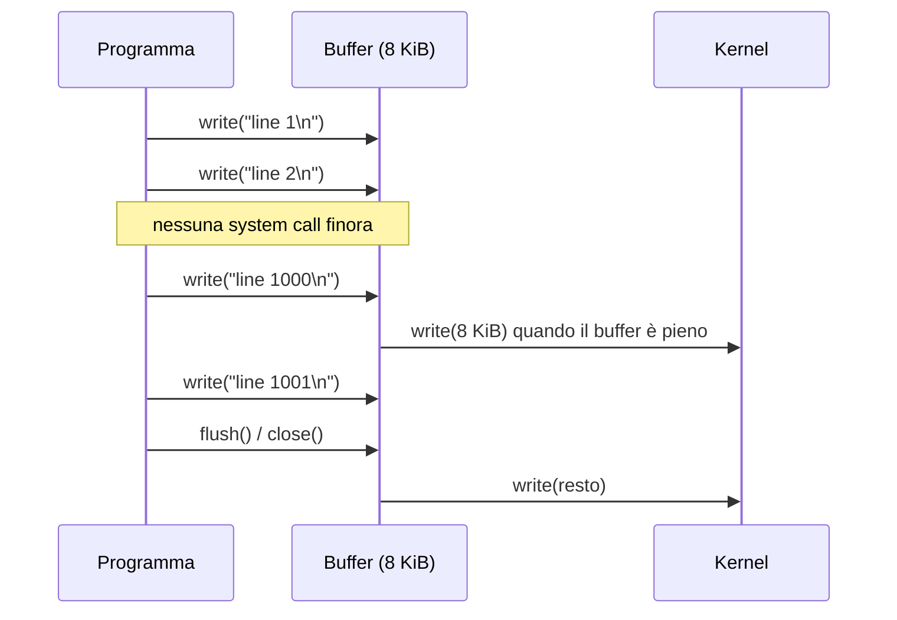

> File C14-parte2.md (parte 2 di 8) — C14 I/O, serializzazione, tempo; corso di programmazione multi-linguaggio

## L14.1 — File, stream e buffering

### Concetto

Un **flusso** (*stream*) è una sequenza di byte che si consuma in ordine, un pezzo alla volta, senza poter tornare indietro (a meno che la sorgente lo permetta). È l'astrazione che permette allo stesso codice di leggere un file, una pipe, un socket di rete, un file compresso o un buffer in memoria. Ogni linguaggio la offre con un nome diverso:

| Idea | Python | PHP | Rust | Go |
|---|---|---|---|---|
| Sorgente di byte | oggetto file (`io.RawIOBase`, `BufferedReader`) | risorsa *stream* (`php://stdin`, `file://`, `compress.zlib://`) | trait `std::io::Read` | interfaccia `io.Reader` |
| Lettura per righe | iterazione sul file; `readline()` | `fgets()` | trait `BufRead`: `read_until`, `lines()` | `bufio.Reader.ReadBytes`, `bufio.Scanner` |
| Destinazione di byte | `write()` | `fwrite()` | trait `Write` | interfaccia `io.Writer` |
| Decoratore (compressione, buffer) | `gzip.open`, `io.BufferedWriter` | *stream wrapper* e *filter* | `BufReader`, `BufWriter`, `GzDecoder` | `bufio`, `gzip.NewReader` |
| Chiusura | `with`, `close()` | `fclose()` | `Drop` (RAII, C09) | `defer f.Close()` |

Due decisioni vanno prese **prima** di scrivere codice, perché cambiano la forma del programma:

1. **Tutto in memoria o a flusso?** Leggere l'intero file in una stringa è comodo per file piccoli e disastroso per file grandi: il consumo di memoria cresce con la dimensione dell'input. Un programma che legge a flusso consuma memoria costante in lettura, qualunque sia il file (quello che *accumula* dopo è un problema separato: il nostro `Report` tiene le letture valide, quindi cresce comunque con il numero di righe valide; lo vedremo misurato in e14).
2. **Che cosa è una riga, che cosa è un carattere?** Un file è fatto di byte. Il testo è una **interpretazione** dei byte (UTF-8 qui) e la riga è un'interpretazione ulteriore (separata da `\n`, `\r\n`, a volte `\r`). Lasciare queste decisioni alla modalità di default del linguaggio significa ereditare le sue scelte: lo vedremo in e3.



Il disegno mostra la proprietà che sfruttiamo in T8: `run` vede solo «un flusso di righe di byte». Che la sorgente sia un file, una pipe o un file compresso è deciso **fuori**, in `open_input`, con la stessa logica del decorator di C07: ogni strato implementa la stessa interfaccia dello strato che avvolge.

Un **buffer** è una zona di memoria che si interpone tra il programma e il sistema operativo. Ogni lettura o scrittura che arriva al sistema operativo è una **system call** (`read`, `write`), con un costo fisso di alcune centinaia di nanosecondi o più, indipendente da quanti byte trasporta. Se il programma scrive una riga alla volta e ogni scrittura diventa una system call, 200 000 righe sono 200 000 chiamate; con un buffer da 8–64 KiB diventano poche centinaia. Il buffer va **svuotato** (*flush*) alla chiusura e a richiesta: un programma che termina senza svuotare perde l'ultimo pezzo di output.



### Implementazione

`run` (T6) consuma un flusso una riga alla volta e non sa nulla del file. Notare tre scelte, uguali nei quattro linguaggi: il flusso è letto **in byte** (non in testo), il BOM UTF-8 viene tolto solo dalla prima riga, e una riga è «vuota» solo se contiene soli spazi *di JSON* (spazio, tab, CR, LF), non qualunque spazio Unicode (il caso `U+00A0` di C13 insegna).

**Python**

```python
@dataclass
class Report:
    readings: int = 0
    valid: list[Reading] = field(default_factory=list)
    rejects: list[tuple[int, Reason]] = field(default_factory=list)


def run(lines: Iterable[bytes]) -> Report:
    """T6 - consume the stream one line at a time; blank lines are skipped."""
    rep, seen = Report(), set()
    for n, raw in enumerate(lines, 1):
        if n == 1 and raw.startswith(BOM):
            raw = raw[len(BOM):]
        if not raw.strip(JSON_WS):
            continue
        rep.readings += 1
        value = decode(raw)
        res = value if isinstance(value, Reason) else validate(value)
        if isinstance(res, Reason):
            rep.rejects.append((n, res))
        elif (res.sensor, res.at) in seen:
            rep.rejects.append((n, Reason.DUPLICATE))
        else:
            seen.add((res.sensor, res.at))
            rep.valid.append(res)
    return rep
```

**PHP**

```php
final class Report
{
    public int $readings = 0;
    /** @var list<Reading> */
    public array $valid = [];
    /** @var list<array{int,Reason}> */
    public array $rejects = [];
}

/** T6 - consume the stream one line at a time; blank lines are skipped. */
function run(iterable $lines): Report
{
    $rep = new Report();
    $seen = [];
    $n = 0;
    foreach ($lines as $raw) {
        $n++;
        if ($n === 1 && str_starts_with($raw, BOM)) {
            $raw = substr($raw, strlen(BOM));
        }
        if (trim($raw, JSON_WS) === '') {
            continue;
        }
        $rep->readings++;
        $value = decode($raw);
        $res = $value instanceof Reason ? $value : validate($value);
        if ($res instanceof Reason) {
            $rep->rejects[] = [$n, $res];
        } elseif (isset($seen[$res->sensor . "\0" . $res->at])) {
            $rep->rejects[] = [$n, Reason::Duplicate];
        } else {
            $seen[$res->sensor . "\0" . $res->at] = true;
            $rep->valid[] = $res;
        }
    }
    return $rep;
}
```

**Rust**

```rust
#[derive(Debug, Default)]
pub struct Report {
    pub readings: usize,
    pub valid: Vec<Reading>,
    pub rejects: Vec<(usize, Reason)>,
}

/// T6 - consume the stream one line at a time; blank lines are skipped.
pub fn run(mut input: impl BufRead) -> io::Result<Report> {
    let mut rep = Report::default();
    let mut seen = HashSet::new();
    let mut buf = Vec::new();
    let mut n = 0;
    loop {
        buf.clear();
        if input.read_until(b'\n', &mut buf)? == 0 {
            break;
        }
        n += 1;
        let mut raw: &[u8] = &buf;
        if n == 1 && raw.starts_with(BOM) {
            raw = &raw[BOM.len()..];
        }
        if raw.iter().all(|b| JSON_WS.contains(b)) {
            continue;
        }
        rep.readings += 1;
        match decode(raw).and_then(|v| validate(&v)) {
            Err(reason) => rep.rejects.push((n, reason)),
            Ok(r) if !seen.insert((r.sensor.clone(), r.at)) => {
                rep.rejects.push((n, Reason::Duplicate))
            }
            Ok(r) => rep.valid.push(r),
        }
    }
    Ok(rep)
}
```

**Go**

```go
// Rejected is a rejected input line.
type Rejected struct {
	Line   int    `json:"line"`
	Reason Reason `json:"reason"`
}

// Report is the outcome of Run.
type Report struct {
	Readings int
	Valid    []Reading
	Rejects  []Rejected
}

// Run is T6: consume the stream one line at a time; blank lines are skipped.
func Run(in *bufio.Reader) (Report, error) {
	var rep Report
	type key struct {
		sensor string
		at     int64
	}
	seen := map[key]bool{}
	for n := 1; ; n++ {
		raw, err := in.ReadBytes('\n') // no Scanner: its 64 KiB line limit would silently stop the loop
		if len(raw) > 0 {
			if n == 1 {
				raw = bytes.TrimPrefix(raw, bom)
			}
			if strings.Trim(string(raw), jsonWS) != "" {
				rep.Readings++
				v, reason := Decode(raw)
				var r Reading
				if reason == "" {
					r, reason = Validate(v)
				}
				switch {
				case reason != "":
					rep.Rejects = append(rep.Rejects, Rejected{n, reason})
				case seen[key{r.Sensor, r.At}]:
					rep.Rejects = append(rep.Rejects, Rejected{n, Duplicate})
				default:
					seen[key{r.Sensor, r.At}] = true
					rep.Valid = append(rep.Valid, r)
				}
			}
		}
		if err == io.EOF {
			return rep, nil
		}
		if err != nil {
			return rep, err
		}
	}
}
```


La lettura per righe cambia strumento ma non idea. In Python si itera sul file aperto in binario. In PHP `fgets` restituisce una riga con il suo `\n`; il generatore (`lines`) la consegna a `run`, che non sa se la sorgente è un file, `STDIN` o un wrapper di compressione. In Rust `read_until(b'\n', &mut buf)` riempie un buffer che viene **riusato** a ogni giro. In Go `ReadBytes('\n')` restituisce una nuova slice a ogni riga e l'errore `io.EOF` può arrivare **insieme all'ultima riga** (file senza newline finale): per questo il codice elabora prima i dati e poi guarda l'errore.

Il punto di ingresso, T8, sceglie la sorgente e traduce qualunque errore di lettura in un solo messaggio e in un solo exit code:

**Python**

```python
def open_input(path: str) -> io.BufferedIOBase | BinaryIO:
    """A stream of bytes: stdin, a gzip file decompressed on the fly, or a plain file."""
    if path == "-":
        return sys.stdin.buffer
    return gzip.open(path, "rb") if path.endswith(".gz") else open(path, "rb")


def main(argv: list[str]) -> int:
    """T8 - CLI: stream the file (or stdin), report on stdout, rejects on stderr."""
    args = [a for a in argv[1:] if a != "--json"]
    as_json = len(args) != len(argv) - 1
    path = args[0] if args else "-"
    try:
        with open_input(path) as fh:  # binary: we decide what a line and a character are
            rep = run(fh)
    except (OSError, EOFError, zlib.error):  # EOFError: truncated gzip
        print(f"error: cannot read {path}", file=sys.stderr)
        return 2
    for n, reason in rep.rejects:
        print(f"line {n}: rejected ({reason})", file=sys.stderr)
    sys.stdout.write(render_json(rep) if as_json else render_text(rep))
    return 1 if rep.rejects else 0
```

**PHP**

```php
/** Yield the lines of a stream one at a time, newline included; false means a read error. */
function lines($fh): Generator
{
    while (($line = fgets($fh)) !== false) {
        yield $line;
    }
    if (!feof($fh)) {
        throw new RuntimeException('read error');
    }
}

/** T8 - CLI: stream the file (or stdin), report on stdout, rejects on stderr. */
function main(array $argv): int
{
    $args = array_values(array_filter(array_slice($argv, 1), fn($a) => $a !== '--json'));
    $asJson = count($args) !== count($argv) - 1;
    $path = $args[0] ?? '-';
    try {
        if ($path === '-') {
            $rep = run(lines(STDIN));
        } else {
            // a directory opens fine but cannot be read; compress.zlib:// is a stream wrapper
            $url = str_ends_with($path, '.gz') ? "compress.zlib://$path" : $path;
            $fh = is_file($path) ? @fopen($url, 'rb') : false;
            if ($fh === false) {
                throw new RuntimeException('open error');
            }
            $rep = run(lines($fh));
            fclose($fh);
        }
    } catch (RuntimeException) {
        fwrite(STDERR, "error: cannot read $path\n");
        return 2;
    }
    foreach ($rep->rejects as [$n, $reason]) {
        fwrite(STDERR, "line $n: rejected ({$reason->value})\n");
    }
    echo $asJson ? renderJson($rep) : renderText($rep);
    return count($rep->rejects) > 0 ? 1 : 0;
}

exit(main($argv));
```

**Rust**

```rust
/// A stream of bytes: stdin, a gzip file decompressed on the fly, or a plain file.
fn open_input(path: &str) -> io::Result<Box<dyn BufRead>> {
    Ok(match path {
        "-" => Box::new(io::stdin().lock()),
        p if p.ends_with(".gz") => Box::new(BufReader::new(MultiGzDecoder::new(File::open(p)?))),
        p => Box::new(BufReader::new(File::open(p)?)),
    })
}

fn read_report(path: &str) -> io::Result<Report> {
    run(open_input(path)?)
}

/// T8 - CLI: stream the file (or stdin), report on stdout, rejects on stderr.
fn main() -> ExitCode {
    let all: Vec<String> = std::env::args().skip(1).collect();
    let args: Vec<&String> = all.iter().filter(|a| *a != "--json").collect();
    let as_json = args.len() != all.len();
    let path = args.first().map_or("-", |s| s.as_str());
    let Ok(rep) = read_report(path) else {
        eprintln!("error: cannot read {path}");
        return ExitCode::from(2);
    };
    for (n, reason) in &rep.rejects {
        eprintln!("line {n}: rejected ({})", reason.as_str());
    }
    print!(
        "{}",
        if as_json {
            render_json(&rep)
        } else {
            render_text(&rep)
        }
    );
    ExitCode::from(if rep.rejects.is_empty() { 0 } else { 1 })
}
```

**Go**

```go
// openInput returns a stream of bytes: stdin, a gzip file decompressed on the fly, or a plain file.
func openInput(path string) (io.Reader, func(), error) {
	if path == "-" {
		return os.Stdin, func() {}, nil
	}
	f, err := os.Open(path)
	if err != nil {
		return nil, nil, err
	}
	if !strings.HasSuffix(path, ".gz") {
		return f, func() { f.Close() }, nil
	}
	gz, err := gzip.NewReader(f)
	if err != nil {
		f.Close()
		return nil, nil, err
	}
	return gz, func() { gz.Close(); f.Close() }, nil
}

// T8 - CLI: stream the file (or stdin), report on stdout, rejects on stderr.
func main() {
	var args []string
	asJSON := false
	for _, a := range os.Args[1:] {
		if a == "--json" {
			asJSON = true
		} else {
			args = append(args, a)
		}
	}
	path := "-"
	if len(args) > 0 {
		path = args[0]
	}
	in, closeIn, err := openInput(path)
	if err != nil {
		fmt.Fprintf(os.Stderr, "error: cannot read %s\n", path)
		os.Exit(2)
	}
	rep, err := coldchain.Run(bufio.NewReader(in))
	closeIn()
	if err != nil {
		fmt.Fprintf(os.Stderr, "error: cannot read %s\n", path)
		os.Exit(2)
	}
	for _, r := range rep.Rejects {
		fmt.Fprintf(os.Stderr, "line %d: rejected (%s)\n", r.Line, r.Reason)
	}
	if asJSON {
		out, err := coldchain.RenderJSON(rep)
		if err != nil {
			fmt.Fprintln(os.Stderr, "error:", err)
			os.Exit(2)
		}
		fmt.Print(out)
	} else {
		fmt.Print(coldchain.RenderText(rep))
	}
	if len(rep.Rejects) > 0 {
		os.Exit(1)
	}
}
```


Tre dettagli. Lo **stesso** codice di `run` legge un file `.gz` perché `open_input` restituisce un flusso decompresso: `gzip.open` in Python, lo stream wrapper `compress.zlib://` in PHP, `MultiGzDecoder` (crate `flate2`) in Rust, `gzip.NewReader` in Go. Un file **illeggibile** non è solo quello che non si apre: un percorso che è una directory si apre senza errori in Rust, Go e PHP e fallisce alla prima lettura (Python invece solleva `IsADirectoryError` già in `open`). Rust e Go restituiscono un errore di `read`, che il programma traduce in exit 2. **PHP no**: `fopen` su una directory riesce, `fgets` restituisce `false` e `feof` risponde `true`, quindi la directory sembrerebbe un **file vuoto** e il report uscirebbe con exit 0; per questo il codice PHP controlla `is_file` prima di aprire. Infine, in tutti e quattro i casi l'**output finale** si scrive solo dopo aver letto tutto: nessun output parziale se il file si rompe a metà. Il costo è la memoria per il `Report` (e14).

### e1 — Tutto in memoria o a flusso

Stesso lavoro (contare le righe non vuote), due modi di leggere il file, un file da 1 000 000 di righe e 61 MB. Le versioni «a flusso» (le quattro qui sotto) leggono una riga alla volta; le versioni «tutto in memoria» sostituiscono la prima riga con `f.read()`, `file_get_contents`, `read_to_string`, `os.ReadFile` e poi dividono il testo.

**Python**

```python
import sys
with open(sys.argv[1], "rb") as fh:             # one line at a time
    print("lines", sum(1 for l in fh if l.strip()))
```

**PHP**

```php
<?php
$fh = fopen($argv[1], 'rb');                     // one line at a time
$n = 0;
while (($l = fgets($fh)) !== false) { if (trim($l) !== '') { $n++; } }
echo "lines $n\n";
```

**Rust**

```rust
use std::io::{BufRead, BufReader};
fn main() {
    let f = std::fs::File::open(std::env::args().nth(1).unwrap()).unwrap();
    let mut r = BufReader::new(f); // one line at a time, buffer reused
    let (mut buf, mut n) = (Vec::new(), 0);
    while r.read_until(b'\n', &mut buf).unwrap() > 0 {
        if !buf.iter().all(|b| b.is_ascii_whitespace()) { n += 1; }
        buf.clear();
    }
    println!("lines {n}");
}
```

**Go**

```go
package main

import (
	"bufio"
	"bytes"
	"fmt"
	"os"
)

func main() {
	f, _ := os.Open(os.Args[1])
	r, n := bufio.NewReader(f), 0 // one line at a time
	for {
		l, err := r.ReadBytes('\n')
		if len(bytes.TrimSpace(l)) > 0 {
			n++
		}
		if err != nil {
			break
		}
	}
	fmt.Println("lines", n)
}
```

Picco di memoria residente (RSS) e tempo mediano di 5 esecuzioni:

```text
### e1 (1000000 lines, 61 MB)
Python-all     peak_rss= 167 MB  median_time=   245 ms  (n=5)
Python-stream  peak_rss=   9 MB  median_time=   115 ms  (n=5)
PHP-all        peak_rss= 199 MB  median_time=   226 ms  (n=5)
PHP-stream     peak_rss=  31 MB  median_time=   125 ms  (n=5)
Rust-all       peak_rss=  61 MB  median_time=    86 ms  (n=5)
Rust-stream    peak_rss=   8 MB  median_time=    39 ms  (n=5)
Go-all         peak_rss=  84 MB  median_time=    92 ms  (n=5)
Go-stream      peak_rss=   8 MB  median_time=    89 ms  (n=5)
[exit 0]
```


Il consumo a flusso è di **8–31 MB** (il resto è il runtime) contro **61–199 MB** per la lettura intera, che cresce con l'input. Il rapporto cambia per linguaggio: Python e PHP, che rappresentano ogni riga come oggetto, occupano circa 3 volte la dimensione del file; Rust, con una sola `String`, circa 1; Go circa 1,4. Per i tempi la lettura a flusso è circa due volte più veloce in Python, PHP e Rust (115 contro 245 ms, 125 contro 226, 39 contro 86) e pari in Go (89 contro 92 ms: nel run precedente erano invertiti, quindi la differenza è dentro il rumore). **Conclusione operativa**: a parità di lavoro, la lettura a flusso costa meno memoria e quasi mai più tempo; la lettura intera si giustifica solo quando serve l'accesso casuale.

### e2 — Quante volte si chiama il kernel

Stesso lavoro (scrivere 200 000 righe `line N`) su un file e su stdout rediretto a un file; `strace -f -e trace=write` conta le chiamate `write`. Tempo mediano di 5.

```rust
use std::io::{BufWriter, Write};
fn main() {
    let f = std::fs::File::create("/tmp/e2.out").unwrap();
    if std::env::args().nth(1).as_deref() == Some("unbuf") {
        let mut f = f;
        for i in 0..200000 { writeln!(f, "line {i}").unwrap(); }
    } else {
        let mut w = BufWriter::new(f);
        for i in 0..200000 { writeln!(w, "line {i}").unwrap(); }
    }
}
```

```go
package main

import (
	"bufio"
	"fmt"
	"os"
)

func main() {
	f, _ := os.Create("/tmp/e2.out")
	defer f.Close()
	if os.Args[1] == "unbuf" {
		for i := 0; i < 200000; i++ {
			fmt.Fprintf(f, "line %d\n", i)
		}
		return
	}
	w := bufio.NewWriter(f)
	defer w.Flush()
	for i := 0; i < 200000; i++ {
		fmt.Fprintf(w, "line %d\n", i)
	}
}
```

```text
### e2 (200000 lines)
Python-unbuffered      writes= 200000  median_time=  146 ms
Python-buffered        writes=    560  median_time=   63 ms
PHP-default            writes= 200000  median_time=  125 ms
PHP-64KiB-buffer       writes= 200000  median_time=  128 ms
Rust-File              writes= 600000  median_time=  233 ms
Rust-BufWriter         writes=    280  median_time=   11 ms
Go-File                writes= 200000  median_time=  143 ms
Go-bufio               writes=    559  median_time=   22 ms
-- stdout redirected to a file
Python-print           writes=    280  median_time=  125 ms
Python-print-UNBUF     writes= 800000  median_time=  356 ms
PHP-echo               writes= 200000  median_time=   67 ms
Rust-println           writes= 200000  median_time=   57 ms
Rust-BufWriter         writes=    414  median_time=    8 ms
Go-fmt.Println         writes= 200000  median_time=   82 ms
Go-bufio               writes=    559  median_time=   21 ms
[exit 0]
```

Tre osservazioni, tutte misurate. **Primo**: senza buffer ogni scrittura è una system call, e il buffer riduce le chiamate di due-tre ordini di grandezza (da 200 000 a circa 560 in Python e Go e 280 in Rust) e il tempo da 2 a 20 volte (Python 146 → 63 ms, Go 143 → 22, Rust 233 → 11). **Secondo**: `writeln!(file, "line {i}")` in Rust produce **tre** `write` per riga (il testo, il numero e il newline sono tre pezzi di formato scritti separatamente quando il destinatario non è bufferizzato): 600 000 chiamate, 233 ms. **Terzo**: lo stesso programma Python che stampa con `print` fa 280 `write` normalmente e **800 000** con `PYTHONUNBUFFERED=1`, una variabile d'ambiente che molte immagini container impostano per far vedere i log subito: stesso codice, 3 volte il tempo. Altri linguaggi hanno le loro regole di default su stdout: Rust `println!` esegue una `write` per riga anche quando stdout è un file (lo stdout di Rust è bufferizzato per riga), Go `fmt.Println` una per chiamata, PHP `echo` una per chiamata; la versione con `BufWriter`/`bufio.Writer` ne fa circa 400–560.

La causa dell'assenza di effetto di `stream_set_write_buffer($f, 65536)` in PHP (200 000 `write` anche con il buffer richiesto) non è stata indagata: riportiamo solo la misura. Il nostro programma non incorre in nessuno di questi costi perché compone il report in una sola stringa e lo scrive con **una** chiamata (`sys.stdout.write`, `echo`, `print!`, `fmt.Print`).

### e3 — Che cosa è una riga

Un file di prova di 14 byte, `a\r\nb\rc\nd\xff\n\xEF\xBB\xBFe`, contiene un a-capo di Windows, un `\r` isolato, un byte non UTF-8 e un BOM a metà file. Ogni linguaggio lo legge con lo strumento che userebbe «normalmente» (byte stampati in esadecimale):

**Python**

```python
p = "/tmp/e3.bin"
print("text mode:  ", end="")
try:
    with open(p, encoding="utf-8") as fh:               # default newline=None: universal newlines
        for line in fh:
            print(line.encode().hex(), end=" ")
except UnicodeDecodeError as e:
    print("<UnicodeDecodeError:", e.reason + ">", end="")
print()
print("binary mode:", " ".join(l.hex() for l in open(p, "rb")))
print("splitlines: ", " ".join(l.hex() for l in open(p, "rb").read().splitlines()))
```

**PHP**

```php
<?php
$fh = fopen('/tmp/e3.bin', 'rb');
echo "fgets:      ";
while (($l = fgets($fh)) !== false) { echo bin2hex($l), ' '; }
echo "\n";
```

**Rust**

```rust
use std::io::{BufRead, BufReader};
fn main() {
    let f = std::fs::File::open("/tmp/e3.bin").unwrap();
    print!("lines():    ");
    for l in BufReader::new(f).lines() {
        match l {
            Ok(s) => print!("{} ", s.bytes().map(|b| format!("{b:02x}")).collect::<String>()),
            Err(e) => print!("<Err: {e}> "),
        }
    }
    println!();
}
```

**Go**

```go
package main

import (
	"bufio"
	"fmt"
	"os"
	"strings"
)

func main() {
	f, _ := os.Open("/tmp/e3.bin")
	sc := bufio.NewScanner(f)
	fmt.Print("Scanner:    ")
	for sc.Scan() {
		fmt.Printf("%x ", sc.Bytes())
	}
	fmt.Println()

	long := strings.Repeat("x", 70000) + "\nsecond\n" // one line longer than 64 KiB
	sc = bufio.NewScanner(strings.NewReader(long))
	n := 0
	for sc.Scan() {
		n++
	}
	fmt.Printf("long line:  lines read = %d, sc.Err() = %v\n", n, sc.Err())
}
```

```text
### python
text mode:  <UnicodeDecodeError: invalid start byte>
binary mode: 610d0a 620d630a 64ff0a efbbbf65
splitlines:  61 62 63 64ff efbbbf65
[exit 0]
```

```text
### php
fgets:      610d0a 620d630a 64ff0a efbbbf65 
[exit 0]
```

```text
### rust
lines():    61 620d63 <Err: stream did not contain valid UTF-8> efbbbf65 
[exit 0]
```

```text
### go
Scanner:    61 620d63 64ff efbbbf65 
long line:  lines read = 0, sc.Err() = bufio.Scanner: token too long
[exit 0]
```

Come si legge. **Python in modalità testo** (il default) non produce *nemmeno la prima riga*: solleva `UnicodeDecodeError` per il byte `\xff` prima di consegnare `a` (il risultato è coerente con una decodifica a blocchi, non con una riga per volta; non abbiamo ispezionato l'implementazione). Il default `newline=None` spezza anche su `\r` isolato (documentato, non misurato qui). In modalità binaria le righe sono quelle del file (`\n` come terminatore, `\r` resta nel contenuto). `bytes.splitlines()` invece **spezza anche su `\r`**: `b` e `c` diventano due righe. **PHP** `fgets` spezza solo su `\n` e non si accorge dei byte non validi. **Rust** `lines()` toglie `\n` e `\r\n` ma non `\r` isolato, e restituisce `Err` per la riga non UTF-8 senza fermare il flusso. **Go** `bufio.Scanner` toglie il `\r` solo prima di `\n` e lascia passare i byte non validi; ma ha un limite di 64 KiB per riga: una riga più lunga **ferma il ciclo senza errori visibili**, e l'errore (`bufio.Scanner: token too long`) esiste solo se si interroga `sc.Err()`: nell'esperimento il ciclo ha letto 0 righe, non la seconda riga corta che segue.

Per questo `run` opera su byte, usa `read_until`/`ReadBytes` (nessun limite), decide da sé che cosa è «vuoto» e decodifica UTF-8 **dopo** aver isolato la riga: un byte sbagliato scarta una riga con motivo `encoding` e non ne ferma altre 29 999.

### Focus comparativo

| Aspetto | PHP | Python | Rust | Go |
|---|---|---|---|---|
| Lettura per righe senza limite | ● `fgets` | ● iterazione su file binario | ● `read_until` | ● `ReadBytes`, ◐ `Scanner` (limite 64 KiB) |
| Modalità di default su testo | byte, nessuna decodifica | testo con decodifica e `newline` universale | `lines()` richiede UTF-8 | byte; `Scanner` toglie `\r` finale |
| Buffer di scrittura per default | ○ file semplici senza buffer (misurato) | ● sì (8 KiB), `PYTHONUNBUFFERED` lo toglie | ○ `File` no; `stdout` per riga | ○ `os.File` no; `fmt.Print` no |
| Decoratori di flusso | ● stream wrapper e filter | ● `gzip`, `io` | ● trait `Read`/`BufRead` | ● `io.Reader` |
| Chiusura | ● `fclose` | ● `with` | ● `Drop` | ● `defer` |
| Errore di lettura | `false` da `fgets`, da distinguere da EOF con `feof` | eccezione `OSError` | `Result` in ogni chiamata | `err` in ogni chiamata |
| File `.gz` troncato o falso | ○ **nessun errore** (misurato nel collaudo) | ● `EOFError` (troncato), `BadGzipFile` (corrotto o non gzip) | ● errore di lettura | ● errore di lettura |

L'ultima riga è un risultato del collaudo (vedi sotto): lo stream wrapper `compress.zlib://` di PHP legge **in silenzio** un file `.gz` troncato (restituisce le righe che riesce a decomprimere e poi termina) e legge come testo semplice un file che non è affatto gzip. È comodo e pericoloso: l'errore di integrità sparisce.

### Esercizio Rosetta

Scrivi un programma che legga il file di prova da stdin e stampi la lunghezza (in byte) della riga più lunga **senza mai tenere in memoria più di una riga**. Quale tra i 4 strumenti di lettura di e3 ti obbliga a scrivere codice in più per non fallire su una riga da 1 MB? **Risposte**

> `Scanner` di Go, che va ricreato con `sc.Buffer(make([]byte, 0, 64*1024), 16<<20)` (o sostituito con `bufio.Reader.ReadBytes`) per righe oltre 64 KiB. Gli altri tre non hanno un limite predefinito, ma tutti tengono la riga intera in memoria: per limitarne la dimensione bisogna leggere a pezzi (`readline(n)` in Python, `fgets($fh, n)` in PHP, `Take` in Rust, `ReadSlice` in Go).

