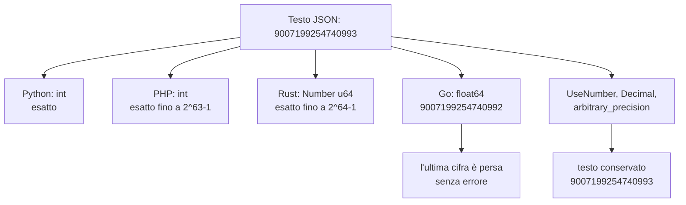
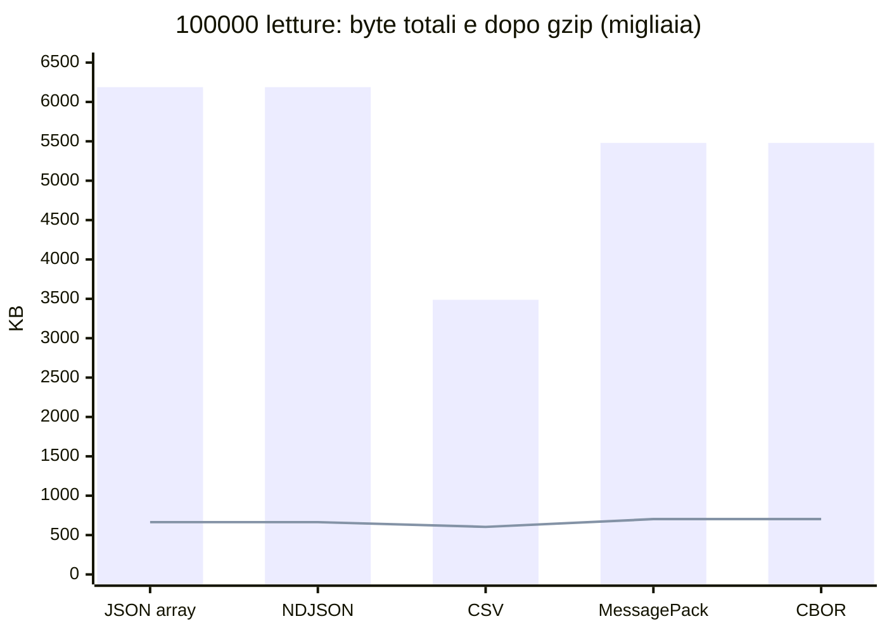

> File C14-parte3.md (parte 3 di 8) — C14 I/O, serializzazione, tempo; corso di programmazione multi-linguaggio

## L14.2 — JSON e formati di scambio

### Concetto

**JSON** (RFC 8259) è un formato di testo con sei tipi di valore: oggetto (insieme di coppie nome/valore), array, stringa, numero, `true`/`false` e `null`. È diventato il formato di scambio di default per tre ragioni pratiche: il testo si legge e si corregge a mano, ogni linguaggio ha un parser, la grammatica entra in una pagina. La stessa pagina è anche il motivo per cui **non dice** cose che i programmi danno per scontate:

- non ha un tipo per le **date** (si usa una stringa, e la stringa va interpretata: L14.4);
- il **numero** è una sequenza di cifre senza dimensione né distinzione tra intero e decimale; l'RFC ammette che le implementazioni pongano limiti a intervallo e precisione e avverte che l'interoperabilità è sicura solo entro un `double` IEEE 754;
- i nomi delle coppie *dovrebbero* essere unici, ma non è un obbligo: che cosa fare con `{"a":1,"a":2}` è lasciato ai parser (e i parser fanno scelte diverse);
- non ha `NaN`, `Infinity`, commenti, virgole finali, apici singoli.

JSON è un **formato**, non un tipo del linguaggio. Dopo la decodifica si ottiene un valore **dinamico**, che il linguaggio rappresenta così per default:

| Valore JSON | Python | PHP (`json_decode`) | Rust (`serde_json::Value`) | Go (`any`) |
|---|---|---|---|---|
| oggetto | `dict` (ordine di inserimento) | `stdClass` (o `array` con `true`) | `Map`, ordinata per chiave salvo la feature `preserve_order` | `map[string]any` (ordine non definito) |
| array | `list` | `array` | `Vec<Value>` | `[]any` |
| stringa | `str` | `string` | `String` | `string` |
| numero | `int` o `float` | `int` o `float` | `Number` (`u64`, `i64` o `f64`) | `float64` |
| `true`/`false` | `bool` (sottoclasse di `int`!) | `bool` | `Bool` | `bool` |
| `null` | `None` | `null` | `Null` | `nil` |

Quando il documento è grande, o arriva in continuazione, si usa **NDJSON** (*newline-delimited JSON*, detto anche JSON Lines): un valore JSON per riga, separato da `\n`, senza array contenitore. È il formato di questo capitolo e ha due vantaggi che un array non ha: si legge a flusso (L14.1) e un errore in una riga non invalida le altre. Il prezzo è che non è un documento JSON valido (non si può dare in pasto a un parser JSON così com'è) e che i record non possono contenere newline non codificati (in JSON un newline dentro una stringa è sempre `\n`, quindi la regola vale).

### Implementazione

Il decoder del programma (T2) fa solo due cose, in questo ordine: controlla che i byte siano UTF-8 valido e chiede al parser un valore. Ogni eccezione o errore del parser diventa un motivo di scarto. Notare la riga con `parse_constant` in Python: lo stdlib accetta per default `NaN`, `Infinity` e `-Infinity`, che **non sono JSON**, e li rifiuta solo se glielo si chiede.

**Python**

```python
def _no_constant(name: str) -> Any:
    raise ValueError(name)  # NaN, Infinity and -Infinity are not JSON


def decode(raw: bytes) -> Any | Reason:
    """T2 - bytes -> text -> JSON value, or the reason why not."""
    try:
        text = raw.decode("utf-8")
    except UnicodeDecodeError:
        return Reason.ENCODING
    try:
        return json.loads(text, parse_constant=_no_constant)
    except (ValueError, RecursionError):
        return Reason.JSON
```

**PHP**

```php
/** T2 - bytes -> text -> JSON value, or the reason why not. */
function decode(string $raw): mixed
{
    if (!mb_check_encoding($raw, 'UTF-8')) {
        return Reason::Encoding;
    }
    try {
        return json_decode($raw, false, 512, JSON_THROW_ON_ERROR);
    } catch (\JsonException) {
        return Reason::Json;
    }
}
```

**Rust**

```rust
/// T2 - bytes -> text -> JSON value, or the reason why not.
pub fn decode(raw: &[u8]) -> Result<Value, Reason> {
    let text = std::str::from_utf8(raw).map_err(|_| Reason::Encoding)?;
    serde_json::from_str(text).map_err(|_| Reason::Json)
}
```

**Go**

```go
// Decode is T2: bytes -> text -> JSON value, or the reason why not.
func Decode(raw []byte) (any, Reason) {
	if !utf8.Valid(raw) {
		return nil, Encoding
	}
	var v any
	if err := json.Unmarshal(raw, &v); err != nil {
		return nil, BadJSON
	}
	return v, ""
}
```


L'altra direzione è la scrittura del report in JSON. Qui le scelte sono nostre e vanno prese esplicitamente, perché i default non coincidono (e5): niente escape ASCII (`ensure_ascii=False`, `JSON_UNESCAPED_UNICODE`), niente escape del `/` in PHP, niente escape di `<`, `>` e `&` in Go, ordine delle chiavi fisso (per struct in Rust e Go, per inserimento in Python e PHP), una sola riga, e **solo interi**: le temperature escono come decimi di grado (`min_tenths`), per non dipendere da come ogni linguaggio stampa un `5.0`.

**Python**

```python
def fixed(n: int, decimals: int) -> str:
    """Integer in 10**-decimals units -> decimal text, no floats involved."""
    p = 10 ** decimals
    return f"{'-' if n < 0 else ''}{abs(n) // p}.{abs(n) % p:0{decimals}d}"


def render_text(rep: Report) -> str:
    out = [f"readings={rep.readings} valid={len(rep.valid)} rejected={len(rep.rejects)}"]
    for d in daily(rep.valid):
        out.append(
            f"day sensor={d.sensor} date={d.date} hours={d.hours} count={d.count} "
            f"min={fixed(d.lo, 1)} max={fixed(d.hi, 1)} avg={fixed(d.avg_h, 2)}"
        )
    for g in gaps(rep.valid):
        out.append(f"gap sensor={g.sensor} from={g.start} to={g.end} minutes={g.minutes}")
    return "\n".join(out) + "\n"


def render_json(rep: Report) -> str:
    doc = {
        "readings": rep.readings,
        "valid": len(rep.valid),
        "rejected": len(rep.rejects),
        "days": [
            {"sensor": d.sensor, "date": d.date, "hours": d.hours, "count": d.count,
             "min_tenths": d.lo, "max_tenths": d.hi, "avg_hundredths": d.avg_h}
            for d in daily(rep.valid)
        ],
        "gaps": [
            {"sensor": g.sensor, "from": g.start, "to": g.end, "minutes": g.minutes}
            for g in gaps(rep.valid)
        ],
        "rejects": [{"line": n, "reason": str(r)} for n, r in rep.rejects],
    }
    return json.dumps(doc, ensure_ascii=False, separators=(",", ":")) + "\n"
```

**PHP**

```php
/** Integer in 10**-$decimals units -> decimal text, no floats involved. */
function fixed(int $n, int $decimals): string
{
    $p = 10 ** $decimals;
    return ($n < 0 ? '-' : '') . intdiv(abs($n), $p) . '.' . str_pad((string) (abs($n) % $p), $decimals, '0', STR_PAD_LEFT);
}

function renderText(Report $rep): string
{
    $out = [sprintf('readings=%d valid=%d rejected=%d', $rep->readings, count($rep->valid), count($rep->rejects))];
    foreach (daily($rep->valid) as $d) {
        $out[] = sprintf(
            'day sensor=%s date=%s hours=%d count=%d min=%s max=%s avg=%s',
            $d['sensor'], $d['date'], $d['hours'], $d['count'], fixed($d['lo'], 1), fixed($d['hi'], 1), fixed($d['avg_h'], 2),
        );
    }
    foreach (gaps($rep->valid) as $g) {
        $out[] = sprintf('gap sensor=%s from=%s to=%s minutes=%d', $g['sensor'], $g['from'], $g['to'], $g['minutes']);
    }
    return implode("\n", $out) . "\n";
}

function renderJson(Report $rep): string
{
    $doc = [
        'readings' => $rep->readings,
        'valid' => count($rep->valid),
        'rejected' => count($rep->rejects),
        'days' => array_map(fn($d) => [
            'sensor' => $d['sensor'], 'date' => $d['date'], 'hours' => $d['hours'], 'count' => $d['count'],
            'min_tenths' => $d['lo'], 'max_tenths' => $d['hi'], 'avg_hundredths' => $d['avg_h'],
        ], daily($rep->valid)),
        'gaps' => gaps($rep->valid),
        'rejects' => array_map(fn($r) => ['line' => $r[0], 'reason' => $r[1]->value], $rep->rejects),
    ];
    return json_encode($doc, JSON_UNESCAPED_UNICODE | JSON_UNESCAPED_SLASHES | JSON_THROW_ON_ERROR) . "\n";
}
```

**Rust**

```rust
#[derive(Serialize)]
struct RejectOut {
    line: usize,
    reason: &'static str,
}

#[derive(Serialize)]
struct Doc {
    readings: usize,
    valid: usize,
    rejected: usize,
    days: Vec<Day>,
    gaps: Vec<Gap>,
    rejects: Vec<RejectOut>,
}

/// Integer in 10**-decimals units -> decimal text, no floats involved.
pub fn fixed(n: i64, decimals: u32) -> String {
    let p = 10_i64.pow(decimals);
    format!(
        "{}{}.{:0w$}",
        if n < 0 { "-" } else { "" },
        n.abs() / p,
        n.abs() % p,
        w = decimals as usize
    )
}

pub fn render_text(rep: &Report) -> String {
    let mut out = vec![format!(
        "readings={} valid={} rejected={}",
        rep.readings,
        rep.valid.len(),
        rep.rejects.len()
    )];
    for d in daily(&rep.valid) {
        out.push(format!(
            "day sensor={} date={} hours={} count={} min={} max={} avg={}",
            d.sensor,
            d.date,
            d.hours,
            d.count,
            fixed(d.lo, 1),
            fixed(d.hi, 1),
            fixed(d.avg_h, 2)
        ));
    }
    for g in gaps(&rep.valid) {
        out.push(format!(
            "gap sensor={} from={} to={} minutes={}",
            g.sensor, g.start, g.end, g.minutes
        ));
    }
    out.join("\n") + "\n"
}

pub fn render_json(rep: &Report) -> String {
    let doc = Doc {
        readings: rep.readings,
        valid: rep.valid.len(),
        rejected: rep.rejects.len(),
        days: daily(&rep.valid),
        gaps: gaps(&rep.valid),
        rejects: rep
            .rejects
            .iter()
            .map(|(n, r)| RejectOut {
                line: *n,
                reason: r.as_str(),
            })
            .collect(),
    };
    serde_json::to_string(&doc).expect("plain data always serializes") + "\n"
}
```

**Go**

```go
// Fixed writes an integer in 10**-decimals units as decimal text, no floats involved.
func Fixed(n, decimals int) string {
	p := 1
	for i := 0; i < decimals; i++ {
		p *= 10
	}
	sign, abs := "", n
	if n < 0 {
		sign, abs = "-", -n
	}
	return fmt.Sprintf("%s%d.%0*d", sign, abs/p, decimals, abs%p)
}

// RenderText is the human-readable report.
func RenderText(rep Report) string {
	var b strings.Builder
	fmt.Fprintf(&b, "readings=%d valid=%d rejected=%d\n", rep.Readings, len(rep.Valid), len(rep.Rejects))
	for _, d := range Daily(rep.Valid) {
		fmt.Fprintf(&b, "day sensor=%s date=%s hours=%d count=%d min=%s max=%s avg=%s\n",
			d.Sensor, d.Date, d.Hours, d.Count, Fixed(d.Lo, 1), Fixed(d.Hi, 1), Fixed(d.AvgH, 2))
	}
	for _, g := range Gaps(rep.Valid) {
		fmt.Fprintf(&b, "gap sensor=%s from=%s to=%s minutes=%d\n", g.Sensor, g.Start, g.End, g.Minutes)
	}
	return b.String()
}

// RenderJSON is the machine-readable report: one compact line, fixed key order.
func RenderJSON(rep Report) (string, error) {
	rejects := rep.Rejects
	if rejects == nil {
		rejects = []Rejected{}
	}
	doc := struct {
		Readings int        `json:"readings"`
		Valid    int        `json:"valid"`
		Rejected int        `json:"rejected"`
		Days     []Day      `json:"days"`
		Gaps     []Gap      `json:"gaps"`
		Rejects  []Rejected `json:"rejects"`
	}{rep.Readings, len(rep.Valid), len(rep.Rejects), Daily(rep.Valid), Gaps(rep.Valid), rejects}
	var buf bytes.Buffer
	enc := json.NewEncoder(&buf)
	enc.SetEscapeHTML(false) // by default Go writes < > & as \u003c \u003e \u0026
	if err := enc.Encode(doc); err != nil {
		return "", err
	}
	return buf.String(), nil // Encode already added the newline
}
```


Due dettagli di Go meritano attenzione. Una slice `nil` si codifica come `null`, non `[]`: per questo `Daily` e `Gaps` partono da `[]Day{}`/`[]Gap{}` e `RenderJSON` sostituisce `rejects` nil con una slice vuota. E `Encode` aggiunge il newline da solo, mentre in Python, PHP e Rust lo aggiungiamo noi.

### e4 — Numeri: lo stesso testo, quattro valori

Dieci testi JSON, decodificati con il tipo di default e ricodificati. La tabella riporta il testo ricodificato e, tra parentesi quadre, il tipo del valore decodificato.

```python
import json
for line in open("/tmp/e4.json"):
    line = line.strip()
    v = json.loads(line)
    print(f"{line:<42} -> {json.dumps(v):<42} [{type(v).__name__}]")
```

```go
package main

import (
	"encoding/json"
	"fmt"
	"os"
	"strings"
)

func main() {
	data, _ := os.ReadFile("/tmp/e4.json")
	for _, line := range strings.Split(strings.TrimSpace(string(data)), "\n") {
		var v any
		if err := json.Unmarshal([]byte(line), &v); err != nil {
			fmt.Printf("%-42s -> ERROR %v\n", line, err)
			continue
		}
		out, _ := json.Marshal(v)
		fmt.Printf("%-42s -> %-42s [%T]\n", line, out, v)
	}
}
```

(I programmi PHP e Rust sono analoghi: `json_decode` + `json_encode` e `serde_json::from_str::<Value>` + `to_string`.)

| Testo JSON | Python | PHP | Rust | Go |
|---|---|---|---|---|
| `9007199254740993` | `9007199254740993` [int] | `9007199254740993` [integer] | `9007199254740993` [u64] | `9007199254740992` [float64] |
| `18446744073709551616` | `18446744073709551616` [int] | `1.8446744073709552e+19` [double] | `1.8446744073709552e+19` [f64] | `18446744073709552000` [float64] |
| `1e400` | `Infinity` [float] | `false` [double] | `ERROR number out of range at line 1 column 5` | `ERROR json: cannot unmarshal number 1e400 into Go value of type float64` |
| `1E2` | `100.0` [float] | `100` [double] | `100.0` [f64] | `100` [float64] |
| `0.1` | `0.1` [float] | `0.1` [double] | `0.1` [f64] | `0.1` [float64] |
| `1.0` | `1.0` [float] | `1` [double] | `1.0` [f64] | `1` [float64] |
| `-0` | `0` [int] | `0` [integer] | `-0.0` [f64] | `-0` [float64] |
| `0.30000000000000004` | `0.30000000000000004` [float] | `0.30000000000000004` [double] | `0.30000000000000004` [f64] | `0.30000000000000004` [float64] |
| `100000000000000000000` | `100000000000000000000` [int] | `1.0e+20` [double] | `1e+20` [f64] | `100000000000000000000` [float64] |
| `123456789.123456789012345678901234567890` | `123456789.12345679` [float] | `123456789.12345679` [double] | `123456789.1234568` [f64] | `123456789.12345679` [float64] |

Nota: per PHP, `false` nella riga `1e400` è il risultato di `json_encode(INF)`, che fallisce (il valore decodificato è `INF`).

Che cosa ne segue, riga per riga. L'intero `9007199254740993` è 2^53+1, il primo che un `double` non rappresenta: Go lo decodifica in `float64` e lo ricodifica come `...992`, **perdendo l'ultima cifra senza alcun errore**. Python lo conserva (interi a precisione arbitraria), PHP lo conserva fino a 2^63−1 e oltre lo converte in `float`, Rust lo conserva fino a 2^64−1 (`u64`) e oltre passa a `f64`. Per `1e400`, Python e PHP producono l'infinito (e `json.dumps` di Python emette poi `Infinity`, che **non è JSON**), Rust e Go lo rifiutano: è la divergenza che abbiamo visto nel collaudo con `t_odd`. `-0` resta `-0.0` in Rust e `-0` in Go, ma diventa `0` in Python e PHP, perché è un intero. E la riga dell'ultimo testo, con trenta cifre decimali, mostra che Rust stampa `123456789.1234568` mentre gli altri tre `123456789.12345679`: non è un problema di stampa, ma di lettura. Il confronto dei bit del `double` ottenuto:

```text
### rust-ulp-default
serde_json default: 0x419d6f34547e6b76
std parse::<f64>:   0x419d6f34547e6b75
[exit 0]
```

```text
### rust-ulp-float_roundtrip
serde_json default: 0x419d6f34547e6b75
std parse::<f64>:   0x419d6f34547e6b75
[exit 0]
```

`serde_json` nella configurazione predefinita ha letto il numero con **un'unità nell'ultima cifra binaria** di differenza rispetto a Python e alla `parse::<f64>` dello stesso Rust (`...76` contro `...75`); con la feature `float_roundtrip` il risultato coincide. Il fenomeno è stato osservato su questo input; non abbiamo stimato quanto sia frequente. Le temperature del nostro programma hanno poche cifre e non sono toccate, ma il lettore che trasporta con JSON dati scientifici o finanziari deve saperlo.

Quando serve la **precisione esatta**, ogni linguaggio ha un'uscita di sicurezza, tutte provate con lo stesso input:

| Linguaggio | Come si ottiene il testo esatto |
|---|---|
| Python | `json.loads(text, parse_float=Decimal)`; gli interi sono già esatti |
| PHP | `json_decode($t, false, 512, JSON_BIGINT_AS_STRING)`: solo gli interi oltre `int64` diventano stringhe, i decimali restano `float` |
| Rust | feature `arbitrary_precision` di `serde_json`: `Number` conserva il testo |
| Go | `decoder.UseNumber()`: il numero resta un `json.Number` (una stringa) |

| Testo JSON | Python | PHP | Rust | Go |
|---|---|---|---|---|
| `9007199254740993` | `9007199254740993` [int] | `9007199254740993` [integer] | `9007199254740993` [Number] | `9007199254740993` [json.Number] |
| `18446744073709551616` | `18446744073709551616` [int] | `18446744073709551616` [string] | `18446744073709551616` [Number] | `18446744073709551616` [json.Number] |
| `1e400` | `1E+400` [Decimal] | `INF` [double] | `1e+400` [Number] | `1e400` [json.Number] |
| `1E2` | `1E+2` [Decimal] | `100.0` [double] | `1e+2` [Number] | `1E2` [json.Number] |
| `0.1` | `0.1` [Decimal] | `0.1` [double] | `0.1` [Number] | `0.1` [json.Number] |
| `1.0` | `1.0` [Decimal] | `1.0` [double] | `1.0` [Number] | `1.0` [json.Number] |
| `-0` | `0` [int] | `0` [integer] | `-0` [Number] | `-0` [json.Number] |
| `0.30000000000000004` | `0.30000000000000004` [Decimal] | `0.30000000000000004` [double] | `0.30000000000000004` [Number] | `0.30000000000000004` [json.Number] |
| `100000000000000000000` | `100000000000000000000` [int] | `100000000000000000000` [string] | `100000000000000000000` [Number] | `100000000000000000000` [json.Number] |
| `123456789.123456789012345678901234567890` | `123456789.123456789012345678901234567890` [Decimal] | `123456789.12345679` [double] | `123456789.123456789012345678901234567890` [Number] | `123456789.123456789012345678901234567890` [json.Number] |

Il risultato mostra anche i limiti: in PHP i decimali non hanno una via d'uscita nativa (l'ultima riga resta un `double`), e con `arbitrary_precision` e `UseNumber` il testo `1e400` viene accettato e conservato, perché è sintatticamente un numero: la verifica di *scala* è passata dal parser al nostro codice. È esattamente il lavoro di L14.3.



### e5 — La scrittura ha i suoi default

Lo stesso documento (`z`, `a`, `f`), con una stringa piena di caratteri sensibili, scritto con il codice più naturale in ciascun linguaggio.

```python
import json
doc = {"z": 1, "a": "caffè ☃ </a> & / \"q\"", "f": 5.0}
print("default:   ", json.dumps(doc))
print("configured:", json.dumps(doc, ensure_ascii=False, separators=(",", ":")))
print("NaN:       ", json.dumps({"x": float("nan")}))
```

```go
package main

import (
	"bytes"
	"encoding/json"
	"fmt"
	"math"
)

func main() {
	doc := map[string]any{"z": 1, "a": "caffè ☃ </a> & / \"q\"", "f": 5.0}
	b, _ := json.Marshal(doc)
	fmt.Println("default:    ", string(b))
	var buf bytes.Buffer
	enc := json.NewEncoder(&buf)
	enc.SetEscapeHTML(false)
	enc.Encode(doc)
	fmt.Print("configured: ", buf.String())
	_, err := json.Marshal(map[string]any{"x": math.NaN()})
	fmt.Println("NaN:        ", err)
}
```

```text
### python
default:    {"z": 1, "a": "caff\u00e8 \u2603 </a> & / \"q\"", "f": 5.0}
configured: {"z":1,"a":"caffè ☃ </a> & / \"q\"","f":5.0}
NaN:        {"x": NaN}
[exit 0]
```

```text
### php
default:    {"z":1,"a":"caff\u00e8 \u2603 <\/a> & \/ \"q\"","f":5}
configured: {"z":1,"a":"caffè ☃ </a> & / \"q\"","f":5}
zero frac:  {"z":1,"a":"caff\u00e8 \u2603 <\/a> & \/ \"q\"","f":5.0}
NaN:        false (Inf and NaN cannot be JSON encoded)
[exit 0]
```

```text
### rust
default:    {"a":"caffè ☃ </a> & / \"q\"","f":5.0,"z":1}
NaN:        {"x":null}
NaN direct: null
[exit 0]
```

```text
### go
default:     {"a":"caffè ☃ \u003c/a\u003e \u0026 / \"q\"","f":5,"z":1}
configured: {"a":"caffè ☃ </a> & / \"q\"","f":5,"z":1}
NaN:         json: unsupported value: NaN
[exit 0]
```

| Aspetto | Python | PHP | Rust (`serde_json`) | Go |
|---|---|---|---|---|
| Ordine delle chiavi | inserimento | inserimento | **alfabetico** (la `Map` di default è un `BTreeMap`) | **alfabetico** per `map`; dichiarazione per `struct` |
| Non-ASCII (`è`, `☃`) | `è` (default), diretto con `ensure_ascii=False` | `è` (default), diretto con `JSON_UNESCAPED_UNICODE` | diretto | diretto |
| `/` | non scritto | **`\/`** (default) | non scritto | non scritto |
| `<`, `>`, `&` | non scritti | `<\/a>`, `&` non scritto | non scritti | **`\u003c`, `\u003e`, `\u0026`** (default) |
| `5.0` | `5.0` | `5` (`5.0` con `JSON_PRESERVE_ZERO_FRACTION`) | `5.0` | `5` |
| `NaN` | **scrive `NaN`** (non è JSON) | `false` + «Inf and NaN cannot be JSON encoded» | **scrive `null`** | errore «unsupported value: NaN» |

Su ciascuno dei sei aspetti almeno un linguaggio si discosta dagli altri. Se il documento viene confrontato con `diff` o firmato (un hash, una firma HMAC, una cache chiave-valore), basta una differenza di spaziatura o di ordine per ottenere un valore diverso: due programmi «corretti» producono JSON equivalente ma non **identico**. Per questo i programmi del capitolo scrivono con impostazioni esplicite e il collaudo confronta i byte. Il comportamento di `NaN` merita un'etichetta: Python e Rust producono un documento *sbagliato in silenzio* (non JSON, oppure un `null` al posto di un numero); PHP e Go falliscono.

### e6 — Decodifica tipizzata: chi si accorge di che cosa

Il programma decodifica in valori dinamici e valida a mano. La strada alternativa, comune in Go e Rust, è dichiarare una `struct` e lasciare al parser il lavoro. Lo stesso tipo `R { sensor: string, temp: number }` e sette documenti, che variano **un aspetto alla volta**:

```go
package main

import (
	"encoding/json"
	"fmt"
)

type R struct {
	Sensor string  `json:"sensor"`
	Temp   float64 `json:"temp"`
}

func main() {
	cases := []struct{ name, text string }{
		{"A baseline", `{"sensor":"a","temp":1}`},
		{"B key case", `{"SENSOR":"a","temp":1}`},
		{"C dup key", `{"sensor":"a","sensor":"b","temp":1}`},
		{"D null", `{"sensor":null,"temp":1}`},
		{"E missing", `{"temp":1}`},
		{"F unknown", `{"sensor":"a","temp":1,"extra":true}`},
		{"G str->num", `{"sensor":"a","temp":"1"}`},
	}
	for _, c := range cases {
		var r R
		if err := json.Unmarshal([]byte(c.text), &r); err != nil {
			fmt.Printf("%-12s ERROR %v\n", c.name, err)
		} else {
			fmt.Printf("%-12s ok    %+v\n", c.name, r)
		}
	}
}
```

```rust
use serde::Deserialize;

#[derive(Debug, Deserialize)]
struct R {
    sensor: String,
    temp: f64,
}

fn main() {
    let cases = [
        ("A baseline", r#"{"sensor":"a","temp":1}"#),
        ("B key case", r#"{"SENSOR":"a","temp":1}"#),
        ("C dup key", r#"{"sensor":"a","sensor":"b","temp":1}"#),
        ("D null", r#"{"sensor":null,"temp":1}"#),
        ("E missing", r#"{"temp":1}"#),
        ("F unknown", r#"{"sensor":"a","temp":1,"extra":true}"#),
        ("G str->num", r#"{"sensor":"a","temp":"1"}"#),
    ];
    for (name, text) in cases {
        match serde_json::from_str::<R>(text) {
            Ok(r) => println!("{name:<12} ok    {r:?}"),
            Err(e) => println!("{name:<12} ERROR {e}"),
        }
    }
}
```

```python
import json
from pydantic import BaseModel, ValidationError

class R(BaseModel):
    sensor: str
    temp: float

CASES = {
 "A baseline":  '{"sensor":"a","temp":1}',
 "B key case":  '{"SENSOR":"a","temp":1}',
 "C dup key":   '{"sensor":"a","sensor":"b","temp":1}',
 "D null":      '{"sensor":null,"temp":1}',
 "E missing":   '{"temp":1}',
 "F unknown":   '{"sensor":"a","temp":1,"extra":true}',
 "G str->num":  '{"sensor":"a","temp":"1"}',
}
for name, text in CASES.items():
    try:
        print(f"{name:<12} ok    {R.model_validate_json(text)!r}")
    except ValidationError as e:
        print(f"{name:<12} ERROR {e.errors()[0]['type']}")
```

```text
### python
A baseline   ok    R(sensor='a', temp=1.0)
B key case   ERROR missing
C dup key    ok    R(sensor='b', temp=1.0)
D null       ERROR string_type
E missing    ERROR missing
F unknown    ok    R(sensor='a', temp=1.0)
G str->num   ok    R(sensor='a', temp=1.0)
[exit 0]
```

```text
### php
A baseline   ok    sensor='a' temp=1
B key case   ok    sensor='MISSING' temp=1
C dup key    ok    sensor='b' temp=1
D null       ok    sensor='MISSING' temp=1
E missing    ok    sensor='MISSING' temp=1
F unknown    ok    sensor='a' temp=1
G str->num   ok    sensor='a' temp='1'
[exit 0]
```

```text
### rust
A baseline   ok    R { sensor: "a", temp: 1.0 }
B key case   ERROR missing field `sensor` at line 1 column 23
C dup key    ERROR duplicate field `sensor` at line 1 column 22
D null       ERROR invalid type: null, expected a string at line 1 column 14
E missing    ERROR missing field `sensor` at line 1 column 10
F unknown    ok    R { sensor: "a", temp: 1.0 }
G str->num   ERROR invalid type: string "1", expected f64 at line 1 column 24
[exit 0]
```

```text
### go
A baseline   ok    {Sensor:a Temp:1}
B key case   ok    {Sensor:a Temp:1}
C dup key    ok    {Sensor:b Temp:1}
D null       ok    {Sensor: Temp:1}
E missing    ok    {Sensor: Temp:1}
F unknown    ok    {Sensor:a Temp:1}
G str->num   ERROR json: cannot unmarshal string into Go struct field R.temp of type float64
[exit 0]
```

| Caso | Pydantic | PHP (dinamico) | Rust `derive` | Go `struct` |
|---|---|---|---|---|
| B: chiave `SENSOR` | errore (mancante) | `sensor` assente | errore (mancante) | **accettata** (confronto senza maiuscole) |
| C: chiave duplicata | l'ultima vince | l'ultima vince | **errore** `duplicate field` | l'ultima vince |
| D: `"sensor": null` | errore | `null` (con `??` indistinguibile da assente) | errore | **`""` in silenzio** |
| E: campo mancante | errore | assente | errore | **`""` in silenzio** |
| F: campo in più | ignorato | ignorato | ignorato | ignorato |
| G: `"temp": "1"` | **accettata e convertita** (modalità lax) | accettata come stringa | errore | errore |

Le righe interessanti sono quelle in cui un linguaggio fa qualcosa di diverso e *silenzioso*. Go confonde `SENSOR` con `sensor` (il pacchetto `encoding/json` confronta i nomi dei campi ignorando le maiuscole, come documentato) e trasforma un `null` o un campo mancante in valore zero: un `Sensor == ""` è indistinguibile da un sensore con nome vuoto, a meno di usare un puntatore (`*string`) per il campo. Pydantic, in modalità predefinita, converte la stringa `"1"` in numero: lo vedremo meglio in e8. Rust è il più severo e rifiuta anche le chiavi duplicate; gli altri tre accettano il documento e **l'ultimo valore vince**. Sul valore dinamico, che è quello che usa il nostro programma, la regola «l'ultimo vince» vale in tutti e quattro: una riga con `"temp":2.0,"temp":99` viene scartata da tutti per `range`, cioè ha vinto il secondo. Quando due componenti (un firewall, un validatore e l'applicazione) leggono lo stesso JSON e non concordano su quale duplicato vince, un attaccante può far vedere a ciascuno un valore diverso: è un tema di C22.

Il nostro programma non usa la decodifica tipizzata proprio per non ereditare queste scelte: decodifica in valore dinamico (il caso peggiore è uguale per tutti: ultima chiave vince, nomi esatti, `null` distinguibile) e valida con regole sue, identiche nei quattro linguaggi.

### e7 — Altri formati: dimensioni, tempi, trappole

Centomila delle letture del file di prova grande, serializzate in cinque formati (Python con `json`, `csv`, `msgpack`, `cbor2`; mediana di 5; il confronto riguarda i formati, non i linguaggi):

```python
import csv, gzip, io, json, statistics, time
import cbor2, msgpack

rows = [json.loads(l) for l in open("/tmp/big.ndjson").readlines()[:100_000]]
enc = {
 "JSON array":      lambda: json.dumps(rows, separators=(",", ":")).encode(),
 "NDJSON":          lambda: ("\n".join(json.dumps(r, separators=(",", ":")) for r in rows) + "\n").encode(),
 "CSV":             lambda: (lambda b: (csv.writer(b, lineterminator="\n").writerows([r["sensor"], r["ts"], r["temp"]] for r in rows), b.getvalue().encode())[1])(io.StringIO()),
 "MessagePack":     lambda: msgpack.packb(rows),
 "CBOR":            lambda: cbor2.dumps(rows),
}
dec = {
 "JSON array":  lambda b: json.loads(b),
 "NDJSON":      lambda b: [json.loads(l) for l in b.splitlines()],
 "CSV":         lambda b: list(csv.reader(io.StringIO(b.decode()))),
 "MessagePack": lambda b: msgpack.unpackb(b),
 "CBOR":        lambda b: cbor2.loads(b),
}
def med(f, n=5):
    t = []
    for _ in range(n):
        s = time.perf_counter(); f(); t.append(time.perf_counter() - s)
    return statistics.median(t) * 1000
print(f"{'format':<16}{'bytes':>10}{'gzip':>10}{'encode ms':>11}{'decode ms':>11}")
for name in enc:
    b = enc[name]()
    print(f"{name:<16}{len(b):>10}{len(gzip.compress(b, 6)):>10}{med(enc[name]):>11.0f}{med(lambda: dec[name](b)):>11.0f}")
```

```text
### sizes
format               bytes      gzip  encode ms  decode ms
JSON array         6187632    664267         51         56
NDJSON             6187631    664266        270        291
CSV                3487631    604031         82         59
MessagePack        5480005    703184         20         46
CBOR               5480005    703179         83         80
[exit 0]
```



La barra è la dimensione grezza, la linea la dimensione dopo gzip. Il testo JSON ha l'overhead dei nomi delle chiavi, ripetuti 100 000 volte (6,2 MB contro 3,5 MB del CSV, che le chiavi non le ripete), ma dopo `gzip` il vantaggio dei formati binari scompare: **MessagePack e CBOR, più piccoli da soli, compressi sono più grandi del JSON** (703 KB contro 664 KB), perché il compressore trova ripetizioni nelle chiavi di testo. La scelta del formato dipende da compatibilità, schema e strumenti più che dalla dimensione; i formati con schema (Protocol Buffers, Avro) sono materia di C18.

I formati orientati alla configurazione hanno trappole proprie. YAML 1.1 (la versione implementata da PyYAML) interpreta il contenuto, e TOML no:

```text
### yaml-toml
-- YAML 1.1 (PyYAML safe_load)
country: no        -> {'country': False}
country: NO        -> {'country': False}
version: 1.10      -> {'version': 1.1}
port: 22:22        -> {'port': 1342}
id: 0123           -> {'id': 83}
when: 2026-03-29   -> {'when': datetime.date(2026, 3, 29)}
name: null         -> {'name': None}
-- TOML 1.0 (tomllib)
country = "no"                       -> {'country': 'no'}
version = 1.10                       -> {'version': 1.1}
id = 0o123                           -> {'id': 83}
when = 2026-03-29T03:10:00+02:00     -> {'when': datetime.datetime(2026, 3, 29, 3, 10, tzinfo=datetime.timezone(datetime.timedelta(seconds=7200)))}
day = 2026-03-29                     -> {'day': datetime.date(2026, 3, 29)}
local = 2026-03-29T03:10:00          -> {'local': datetime.datetime(2026, 3, 29, 3, 10)}
[exit 0]
```

Il codice paese norvegese `no` diventa `False`, `1.10` diventa `1.1`, `22:22` diventa 1342 (notazione sessagesimale) e `0123` diventa 83 (ottale). Sono rischi ben noti di YAML 1.1; non abbiamo provato YAML 1.2 né i parser di PHP, Rust e Go. In TOML i tipi sono dichiarati dalla sintassi (`"no"` è una stringa, `2026-03-29T03:10:00+02:00` è un datetime con offset, la data senza orario è una data), e una data-ora senza offset è un tipo diverso (*local datetime*, senza istante). TOML è un formato di configurazione; lo riprenderemo in C15.

### Focus comparativo

| Aspetto | PHP | Python | Rust | Go |
|---|---|---|---|---|
| Libreria JSON | ● `json_*` nel core | ● `json` | ◐ `serde_json` (crate) | ● `encoding/json` |
| Tipo del valore dinamico | `stdClass` / `array` | `dict` / `list` | `serde_json::Value` | `any` |
| Decodifica diretta in tipo | ○ (librerie esterne) | ◐ dataclass non automatica; Pydantic | ● `#[derive(Deserialize)]` | ● `struct` con tag |
| Numeri esatti | `JSON_BIGINT_AS_STRING` (solo interi) | `parse_float=Decimal` | `arbitrary_precision` | `UseNumber` |
| Chiavi duplicate | ultima vince | ultima vince | errore su `struct`, ultima vince su `Value` | ultima vince |
| `NaN` in scrittura | errore | **scrive `NaN`** | **scrive `null`** | errore |
| Formati oltre JSON | ◐ estensioni (`yaml` PECL, `msgpack`) | ● `tomllib` stdlib; ◐ PyYAML, msgpack | ◐ crate `toml`, `serde_yaml`, `rmp-serde` | ◐ `gopkg.in/yaml`, `BurntSushi/toml` (non provati) |

### Esercizio Rosetta

Il documento `{"sensor":"cella-1","ts":"2026-03-29T10:00:00Z","temp":4.2}` deve essere prodotto **byte per byte uguale** da una funzione `encode(sensor, ts, temp_tenths)` nei quattro linguaggi, con `temp` come numero con un decimale. Quale linguaggio non ti permette di farlo con il solo encoder di default e perché? **Risposte**

> Nessuno ci riesce in modo ovvio con i soli default, perché `4.2` è un `float` e la stampa dei `float` non è la stessa (`5.0` contro `5`). La via robusta è costruire il testo del numero da interi (`fixed(42, 1)` → `4.2`) e inserirlo nel documento come numero già formattato; in Go si usa `json.RawMessage` o `json.Number`, in PHP una stringa letterale, in Rust `serde_json::value::RawValue` o la feature `arbitrary_precision`, in Python un `Decimal` con un encoder personalizzato. È lo stesso motivo per cui il nostro report JSON usa decimi interi.

