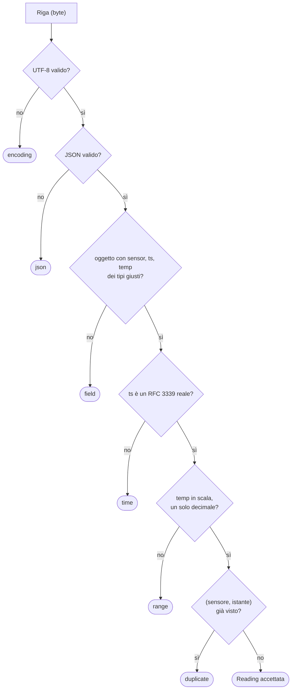

> File C14-parte4.md (parte 4 di 8) — C14 I/O, serializzazione, tempo; corso di programmazione multi-linguaggio

## L14.3 — Validazione e schema: dal dato grezzo al tipo

### Concetto

Dopo la decodifica abbiamo un valore dinamico: un dizionario che *potrebbe* contenere un sensore, un istante e una temperatura. **Validare** è decidere, con regole esplicite, se il dato è accettabile; **tipizzare** è trasformarlo in un valore del dominio (`Reading`) che dal resto del programma in poi si può usare senza ricontrollare. Le due operazioni vanno fatte **insieme**, al confine: l'idea, nota come *parse, don't validate*, è che una funzione che si limita a rispondere «sì/no» lascia il dato grezzo in giro e obbliga ogni funzione successiva a rifare i controlli (o a dimenticarli); una funzione che restituisce un tipo nuovo, oppure un motivo di rifiuto, sposta la prova nel tipo (C06: rendere irrappresentabili gli stati illegali).

Le regole si dispongono in quattro strati, dal più economico al più costoso, e conviene controllarli **in quest'ordine fisso**, così che lo stesso input produca lo stesso motivo in tutte le implementazioni:

| Strato | Domanda | Esempio qui | Motivo |
|---|---|---|---|
| Codifica | i byte sono testo valido? | un byte `0xFF` | `encoding` |
| Sintassi | il testo è JSON? | `{"sensor":"cella-1"` (troncato) | `json` |
| Struttura | è un oggetto con i campi giusti, dei tipi giusti? | `temp` assente o stringa; `[1,2,3]` | `field` |
| Semantica | i valori hanno senso nel dominio? | `2026-02-30`; `99.0`; `4.25` | `time`, `range` |
| Relazione | il dato è coerente con gli altri già visti? | stesso sensore e stesso istante | `duplicate` |



Due principi pratici. **Insieme chiuso di motivi:** un enum (`Reason` in Python e PHP, `enum` in Rust, `type Reason string` con costanti in Go), non una stringa libera. È l'idea di C09 applicata: il chiamante deve poter fare un `match` esaustivo sul motivo, e i test (C13) possono verificare che ogni motivo sia raggiunto. **Un solo errore alla volta:** ci fermiamo al primo controllo fallito. Alternativa legittima è raccogliere *tutti* gli errori di una riga (utile in un form, dove chi ha scritto vuole correggere tutto in una volta, meno in un flusso automatico dove interessa classificare). Pydantic e JSON Schema raccolgono tutti gli errori; noi no.

Infine la distinzione che più conta, quella tra **coercizione** e **validazione**. Una libreria in modalità *lax* converte: `"4.2"` diventa `4.2`, `true` diventa `1`, un intero diventa una data. La conversione è comoda per un form web dove tutto arriva come testo; è pericolosa per un'API o per un flusso di sensori dove un tipo sbagliato è un segnale (il sensore che manda stringhe ha un firmware rotto, e vogliamo saperlo).

### Implementazione

`validate` (T3) prende il valore decodificato e restituisce un `Reading` oppure un `Reason`. Ordine: forma, tipi, calendario, scala. La conversione della temperatura in decimi (`to_tenths`) fa tre controlli in un ordine preciso: prima l'**intervallo**, scritto in modo che anche `NaN` e gli infiniti falliscano (i confronti con `NaN` sono sempre falsi, quindi la condizione è formulata come «non è vero che sta nell'intervallo»); poi l'arrotondamento a decimo; poi la verifica che il numero sia davvero a un decimo, con tolleranza di `1e-6` perché `4.2 * 10` in virgola mobile può non essere esattamente `42`.

**Python**

```python
def to_tenths(x: float) -> int | None:
    """A temperature in degrees -> tenths, only if in range with at most one decimal."""
    scaled = x * 10
    if not (TEMP_MIN <= scaled <= TEMP_MAX):  # False for NaN too
        return None
    n = round(scaled)
    return n if abs(scaled - n) < 1e-6 else None


def validate(value: Any) -> Reading | Reason:
    """T3 - a decoded JSON value -> Reading, or the first rule it breaks."""
    if not isinstance(value, dict):
        return Reason.FIELD
    sensor, ts, temp = value.get("sensor"), value.get("ts"), value.get("temp")
    if not isinstance(sensor, str) or SENSOR.match(sensor) is None:
        return Reason.FIELD
    if not isinstance(ts, str):
        return Reason.FIELD
    if isinstance(temp, bool) or not isinstance(temp, (int, float)):
        return Reason.FIELD  # bool is an int in Python: exclude it
    at = parse_instant(ts)
    if at is None:
        return Reason.TIME
    tenths = to_tenths(temp)
    if tenths is None:
        return Reason.RANGE
    return Reading(sensor, at, tenths)
```

**PHP**

```php
/** A temperature in degrees -> tenths, only if in range with at most one decimal. */
function toTenths(int|float $x): ?int
{
    $scaled = $x * 10;
    if (!(TEMP_MIN <= $scaled && $scaled <= TEMP_MAX)) {  // false for NAN too
        return null;
    }
    $n = (int) round($scaled);
    return abs($scaled - $n) < 1e-6 ? $n : null;
}

/** T3 - a decoded JSON value -> Reading, or the first rule it breaks. */
function validate(mixed $value): Reading|Reason
{
    if (!($value instanceof \stdClass)) {
        return Reason::Field;
    }
    $o = (array) $value;
    $sensor = $o['sensor'] ?? null;
    $ts = $o['ts'] ?? null;
    $temp = $o['temp'] ?? null;
    if (!is_string($sensor) || preg_match('/\A[a-z0-9-]{1,32}\z/', $sensor) !== 1) {
        return Reason::Field;
    }
    if (!is_string($ts) || !(is_int($temp) || is_float($temp))) {
        return Reason::Field;
    }
    $at = parseInstant($ts);
    if ($at === null) {
        return Reason::Time;
    }
    $tenths = toTenths($temp);
    if ($tenths === null) {
        return Reason::Range;
    }
    return new Reading($sensor, $at, $tenths);
}
```

**Rust**

```rust
fn valid_sensor(s: &str) -> bool {
    (1..=32).contains(&s.len())
        && s.bytes()
            .all(|c| c.is_ascii_lowercase() || c.is_ascii_digit() || c == b'-')
}

/// A temperature in degrees -> tenths, only if in range with at most one decimal.
pub fn to_tenths(x: f64) -> Option<i64> {
    let scaled = x * 10.0;
    if !(TEMP_MIN as f64 <= scaled && scaled <= TEMP_MAX as f64) {
        return None; // also true for NaN
    }
    let n = scaled.round();
    ((scaled - n).abs() < 1e-6).then_some(n as i64)
}

/// T3 - a decoded JSON value -> Reading, or the first rule it breaks.
pub fn validate(value: &Value) -> Result<Reading, Reason> {
    let o = value.as_object().ok_or(Reason::Field)?;
    let sensor = o
        .get("sensor")
        .and_then(Value::as_str)
        .filter(|s| valid_sensor(s))
        .ok_or(Reason::Field)?;
    let ts = o.get("ts").and_then(Value::as_str).ok_or(Reason::Field)?;
    let temp = o.get("temp").and_then(Value::as_f64).ok_or(Reason::Field)?; // None unless a JSON number
    let at = parse_instant(ts).ok_or(Reason::Time)?;
    let tenths = to_tenths(temp).ok_or(Reason::Range)?;
    Ok(Reading {
        sensor: sensor.to_string(),
        at,
        tenths,
    })
}
```

**Go**

```go
// ToTenths converts degrees to tenths, only if in range with at most one decimal.
func ToTenths(x float64) (int, bool) {
	scaled := x * 10
	if !(TempMin <= scaled && scaled <= TempMax) { // false for NaN too
		return 0, false
	}
	n := math.Round(scaled)
	if math.Abs(scaled-n) >= 1e-6 {
		return 0, false
	}
	return int(n), true
}

// Validate is T3: a decoded JSON value -> Reading, or the first rule it breaks.
func Validate(v any) (Reading, Reason) {
	o, ok := v.(map[string]any)
	if !ok {
		return Reading{}, Field
	}
	sensor, ok1 := o["sensor"].(string)
	ts, ok2 := o["ts"].(string)
	temp, ok3 := o["temp"].(float64) // a JSON number; true is a bool, not a float64
	if !ok1 || !ok2 || !ok3 || !sensorRe.MatchString(sensor) {
		return Reading{}, Field
	}
	at, ok := ParseInstant(ts)
	if !ok {
		return Reading{}, BadTime
	}
	tenths, ok := ToTenths(temp)
	if !ok {
		return Reading{}, BadRange
	}
	return Reading{sensor, at, tenths}, ""
}
```


Alcuni dettagli che si ripetono. **Python:** `bool` è una sottoclasse di `int`, quindi `isinstance(True, int)` è vero e va escluso a mano; le espressioni regolari usano `[0-9]` e `\Z` (non `\d`, che in Python 3 accetta anche le cifre di altri alfabeti, e non `$`, che accetta un newline finale). **PHP:** `\z` e non `$` per la stessa ragione (in PCRE `$` ammette un newline finale), `(array)$value` per accedere ai campi dell'oggetto, e `is_int || is_float` per escludere `bool`. **Rust:** `Value::as_f64` restituisce `None` per ogni valore che non sia un numero, quindi `true` e `"4.2"` cadono su `field` senza codice aggiuntivo, e l'alfabeto del sensore è controllato byte per byte. **Go:** l'asserzione `.(float64)` fallisce per `bool` e per `string`; `^...$` in `regexp` di Go non accetta un newline finale. Il sensore è ristretto a `[a-z0-9-]{1,32}`: non è una scelta estetica ma una **decisione di confine**, che evita le differenze tra «lunghezza in caratteri» (Python), «in byte» (PHP, Rust, Go) e tra le nozioni di lettera e cifra di ciascun linguaggio.

### e8 — Lo stesso schema in Pydantic: lax contro strict

Pydantic è la libreria di riferimento per la validazione tipizzata in Python. Lo stesso contratto (sensore a pattern, istante con fuso, temperatura tra −50 e 60) scritto come modello, applicato in modalità predefinita (*lax*), in modalità `strict=True`, e confrontato con la nostra `validate` a mano, su dieci input che variano un aspetto alla volta:

```python
import json, sys
from typing import Annotated
from pydantic import AwareDatetime, BaseModel, Field, StringConstraints, ValidationError
sys.path.insert(0, "py")
from coldchain.core import Reading, validate

class R(BaseModel):
    sensor: Annotated[str, StringConstraints(pattern=r"^[a-z0-9-]{1,32}$")]
    ts: AwareDatetime
    temp: Annotated[float, Field(ge=-50, le=60)]

CASES = [
 ('normal',          '{"sensor":"cella-1","ts":"2026-03-29T10:00:00Z","temp":4.2}'),
 ('temp "4.2"',      '{"sensor":"cella-1","ts":"2026-03-29T10:00:00Z","temp":"4.2"}'),
 ('temp true',       '{"sensor":"cella-1","ts":"2026-03-29T10:00:00Z","temp":true}'),
 ('temp 4.25',       '{"sensor":"cella-1","ts":"2026-03-29T10:00:00Z","temp":4.25}'),
 ('ts date only',    '{"sensor":"cella-1","ts":"2026-03-29","temp":4.2}'),
 ('ts naive',        '{"sensor":"cella-1","ts":"2026-03-29T10:00:00","temp":4.2}'),
 ('ts epoch int',    '{"sensor":"cella-1","ts":1774778400,"temp":4.2}'),
 ('ts space sep',    '{"sensor":"cella-1","ts":"2026-03-29 10:00:00Z","temp":4.2}'),
 ('ts fraction',     '{"sensor":"cella-1","ts":"2026-03-29T10:00:00.5Z","temp":4.2}'),
 ('sensor "cella 1"','{"sensor":"cella 1","ts":"2026-03-29T10:00:00Z","temp":4.2}'),
]
def verdict(f):
    try:
        f(); return "ok"
    except ValidationError as e:
        return "no:" + e.errors()[0]["type"]
print(f"{'input':<18}{'hand-written':<14}{'Pydantic lax':<28}{'Pydantic strict':<28}")
for name, text in CASES:
    hand = "ok" if isinstance(validate(json.loads(text)), Reading) else "no:" + str(validate(json.loads(text)))
    print(f"{name:<18}{hand:<14}{verdict(lambda: R.model_validate_json(text)):<28}{verdict(lambda: R.model_validate_json(text, strict=True)):<28}")
```

```text
### pydantic
input             hand-written  Pydantic lax                Pydantic strict             
normal            ok            ok                          ok                          
temp "4.2"        no:field      ok                          no:float_type               
temp true         no:field      ok                          no:float_type               
temp 4.25         no:range      ok                          ok                          
ts date only      no:time       no:timezone_aware           no:datetime_parsing         
ts naive          no:time       no:timezone_aware           no:timezone_aware           
ts epoch int      no:field      ok                          no:datetime_type            
ts space sep      no:time       ok                          ok                          
ts fraction       no:time       ok                          ok                          
sensor "cella 1"  no:field      no:string_pattern_mismatch  no:string_pattern_mismatch  
[exit 0]
```

Come si legge. In modalità lax Pydantic **accetta** `"4.2"` (stringa), `true` (booleano) e un intero come istante (`1774778400`, interpretato come secondi dall'epoca), perché li converte; la modalità strict li rifiuta tutti e tre, ma accetta ancora `"2026-03-29 10:00:00Z"` (separatore spazio) e un istante con frazione di secondo. La nostra `validate` rifiuta tutto ciò che non è esattamente la forma documentata. Nessuna delle due configurazioni di Pydantic rifiuta `4.25`: *una temperatura con al massimo un decimale* è una regola di dominio che nel modello non c'è, e va aggiunta come validatore personalizzato. È il punto più generale: **una libreria di validazione fornisce i mattoni e la struttura, ma le regole del dominio restano da scrivere**; quanto del lavoro sia fatto dalla libreria e quanto dal nostro codice è una scelta di progetto. Il costo di non averla (il codice a mano di T3, circa 30 righe per linguaggio) è basso per un modello da tre campi e cresce con il numero di campi e di regole.

### e9 — JSON Schema: un contratto che non è codice

**JSON Schema** è un documento JSON che descrive la forma di altri documenti JSON, indipendente dal linguaggio: lo stesso file può essere usato da validatori in decine di linguaggi, in un gateway, in una pipeline CI, e come sorgente di documentazione (OpenAPI lo usa, C18). Lo schema della nostra lettura:

```json
{
  "$schema": "https://json-schema.org/draft/2020-12/schema",
  "type": "object",
  "required": ["sensor", "ts", "temp"],
  "properties": {
    "sensor": {"type": "string", "pattern": "^[a-z0-9-]{1,32}$"},
    "ts": {"type": "string", "format": "date-time"},
    "temp": {"type": "number", "minimum": -50, "maximum": 60, "multipleOf": 0.1}
  }
}
```

Validatore Python `jsonschema` 4.26 (bozza 2020-12), nove input, una colonna a «formati ignorati» (il comportamento predefinito) e una con `FormatChecker`. Le prime due serie sono eseguite con la libreria opzionale `rfc3339-validator` **assente**, l'ultima **presente**.

```text
### jsonschema-without-rfc3339-validator
input               schema, formats ignored   + FormatChecker           
normal 4.2          ok                        ok                        
temp 4.25           multipleOf                multipleOf                
temp 4.7            ok                        ok                        
temp 99             maximum                   maximum                   
ts not a date       ok                        ok                        
ts 2026-02-30       ok                        ok                        
ts naive            ok                        ok                        
unknown field       ok                        ok                        
duplicate reading   ok                        ok                        
[exit 0]
```

```text
### jsonschema-with-rfc3339-validator
input               schema, formats ignored   + FormatChecker           
normal 4.2          ok                        ok                        
temp 4.25           multipleOf                multipleOf                
temp 4.7            ok                        ok                        
temp 99             maximum                   maximum                   
ts not a date       ok                        format                    
ts 2026-02-30       ok                        format                    
ts naive            ok                        format                    
unknown field       ok                        ok                        
duplicate reading   ok                        ok                        
[exit 0]
```

Tre lezioni. **Primo**: `"format": "date-time"` è per default *solo un'annotazione*: lo schema dice che `ts` è «una data-ora» ma il validatore non controlla. Anche con `FormatChecker` attivo il controllo **non avviene** se manca il pacchetto opzionale che sa verificare quel formato (le prime due tabelle: `yesterday` e `2026-02-30` passano); con il pacchetto presente, tre input vengono rifiutati per `format`, compreso quello senza fuso (`2026-03-29T10:00:00`). Una validazione che sparisce in silenzio per una dipendenza mancante è la peggiore. **Secondo**: lo schema esprime bene forma, tipi, intervalli e pattern (`maximum`, `multipleOf`, `pattern`), e `4.25` viene rifiutato da `multipleOf: 0.1`; ma non può esprimere `duplicate` (una proprietà dell'insieme di documenti, non del singolo) né «questo istante è realmente esistito nel fuso del magazzino». **Terzo**: un campo in più (`"x": 1`) passa, perché lo schema non dice `additionalProperties: false`: l'estensibilità è un'opzione, non un default. Lo schema è dunque un buon **primo filtro**, condivisibile e documentato; il confine di un programma serio ha comunque codice proprio per le regole che lo schema non vede. I validatori JSON Schema di PHP, Rust e Go (`opis/json-schema`, `jsonschema`, `santhosh-tekuri/jsonschema`) esistono ma non sono stati provati.

### Il collaudo della validazione

Il file `readings.ndjson` tocca cinque dei sei motivi (`encoding` è nei file `t_bom` e `t_odd`). Il collaudo ha prodotto due risultati utili, uno su ciascun fronte della validazione.

**Numero fuori scala letterale.** Nel file `t_odd.ndjson` la prima riga ha `"temp":1e999`. Python e PHP, che leggono `1e999` come infinito, la scartano per `range`; Rust e Go, il cui parser rifiuta il numero perché non rappresentabile, per `json`. L'exit code e l'output su stdout sono identici (la riga è scartata in entrambi i casi); cambia il **motivo**:

```text
### t_odd-py
line 1: rejected (range)
line 2: rejected (field)
line 3: rejected (json)
```

```text
### t_odd-rs
line 1: rejected (json)
line 2: rejected (field)
line 3: rejected (json)
```

**Profondità.** `t_deep.ndjson` contiene un array annidato di 200 livelli, uno di 100 000 livelli e una lettura valida. La profondità 200 è `field` in Python, PHP e Go (JSON valido, ma non un oggetto) e `json` in Rust, il cui parser ha un limite di ricorsione predefinito, osservato qui tra 128 (valore documentato) e 200; a 100 000 livelli tutti e quattro rispondono `json` (Python con `RecursionError`, che nel nostro codice è catturato insieme a `ValueError`: senza questa clausola il programma terminerebbe con un'eccezione non gestita; PHP oltre il limite di profondità 512; Go oltre i 10 000 livelli). Un parser con limite di profondità **fa parte del contratto**: un input ostile a un servizio può essere costruito per esaurire lo stack (C10, e11, C22).

```text
### t_deep-py
line 1: rejected (field)
line 2: rejected (json)
```

```text
### t_deep-rs
line 1: rejected (json)
line 2: rejected (json)
```

### Focus comparativo

| Aspetto | PHP | Python | Rust | Go |
|---|---|---|---|---|
| Validazione a mano su valore dinamico | ● | ● | ● | ● |
| Libreria di validazione tipizzata | ◐ Symfony Validator, Valinor (non provati) | ◐ Pydantic (provato) | ◐ `serde` + `validator`/`garde` (non provati) | ◐ tag + `go-playground/validator` (non provato) |
| Distinzione assente / `null` / zero | `null` e assente confusi da `??` | `dict.get` confonde, `in` distingue | `Option<T>` e `Value::get` distinguono | **valore zero** per i campi non puntatori |
| Tipo non negoziabile (`true` non è un numero) | `is_int`/`is_float` | `isinstance(bool)` da escludere a mano | ● `as_f64` | ● asserzione di tipo |
| Insieme chiuso dei motivi | `enum` con valore | `StrEnum` | `enum` + `match` esaustivo | `type Reason string` + costanti (non esaustivo) |
| Schema condiviso | ◐ librerie | ◐ `jsonschema`, Pydantic genera schema | ◐ `schemars` (non provato) | ◐ librerie (non provate) |

### Esercizio Rosetta

Se il parser JSON conservasse il testo del numero (`Decimal`, `UseNumber`, `arbitrary_precision`), come scriveresti `to_tenths_text("4.25")` senza passare dai `float` e senza tolleranza `1e-6`? Quali casi di test aggiungeresti? **Risposte**

> Si controlla il testo con una grammatica stretta (`-?[0-9]+(\.[0-9])?`) e si ricava l'intero dei decimi dai due gruppi di cifre, senza moltiplicare nulla: `"4.25"` ha due decimali e viene scartato per `range` senza ambiguità, `"4.2"` dà 42, `"-0.5"` dà −5, `"5"` dà 50. Casi da aggiungere: `"-0"`, `"+4.2"` (il segno `+` non è JSON), `"4."` e `".5"` (non sono JSON), `"1e1"` (valido JSON ma non nella grammatica stretta: da decidere se accettarlo), `"60.0"` e `"60.1"` ai bordi. Il costo è che il valore del campo non è più un `float` ma un testo e che l'esponente va gestito o rifiutato esplicitamente.


