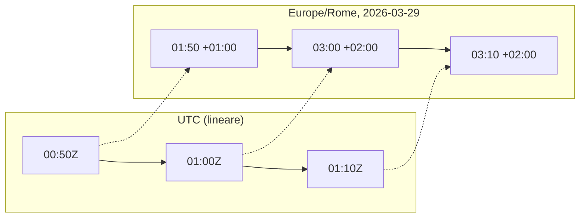
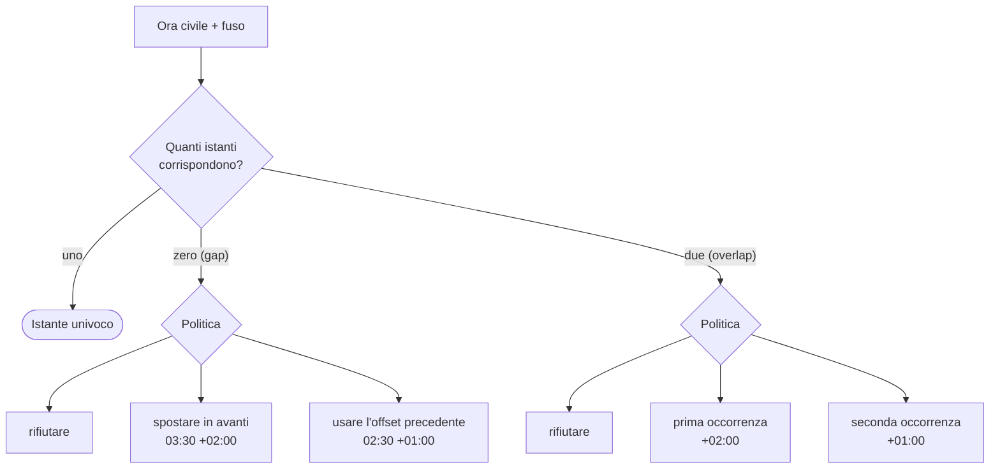

> File C14-parte5.md (parte 5 di 8) — C14 I/O, serializzazione, tempo; corso di programmazione multi-linguaggio

## L14.4 — Tempo, date, timezone

### Concetto

Il tempo è l'input più ingannevole perché sembra un numero e invece è una **convenzione sociale** con eccezioni. Cinque parole vanno tenute distinte.

| Concetto | Che cos'è | Esempio | Si può confrontare con un altro? |
|---|---|---|---|
| **Istante** | un punto sulla linea del tempo fisico, uguale per tutti | `1774742400` secondi dall'epoca (1970-01-01T00:00:00Z) | sì, è un numero |
| **Ora civile** (*wall clock*) | quello che mostra un orologio a muro: data e ora, senza altro | `2026-03-29 02:30` | no: da sola non identifica un istante |
| **Offset** | differenza fissa rispetto a UTC al momento della misura | `+02:00` | sì, ma vale solo per quell'istante |
| **Fuso** (*time zone*) | un **insieme di regole** nel tempo che dice quale offset vale quando | `Europe/Rome` (+01:00 d'inverno, +02:00 d'estate) | è un nome, non un numero |
| **Durata** | tempo trascorso tra due istanti | 20 minuti | sì |

Un timestamp `2026-03-29T03:10:00+02:00` è un istante scritto in forma civile con il suo offset: contiene tutta l'informazione per tornare all'istante (`01:10:00Z`). Ma **non** dice in quale fuso vive chi l'ha scritto: `+02:00` è l'offset di Roma d'estate, ma anche di molte altre città. Per questo il report del problema reale fa due cose distinte: **confronta** le letture come istanti (secondi UTC), e **raggruppa per giorno** convertendo ogni istante nel fuso `Europe/Rome`, perché «giorno del magazzino» è una nozione civile e dipende da regole.

Le regole di un fuso vengono dal database **IANA tz** (*tzdata*), che i governi cambiano più spesso di quanto si pensi: la versione `2026c` sul sistema di prova e la `2025b` incorporata in `chrono-tz` possono dare risposte diverse per date future o recenti. Il database vive in tre posti diversi nei quattro linguaggi (sistema, libreria, binario), come si vede in e13.

Due giorni all'anno a Roma mettono in crisi l'ora civile. Il **29 marzo 2026** alle 02:00 gli orologi saltano alle 03:00: l'intervallo `02:00–02:59` **non esiste** (*gap*) e quel giorno dura 23 ore. Il **25 ottobre 2026** alle 03:00 tornano alle 02:00: l'intervallo `02:00–02:59` **esiste due volte** (*overlap*, ambiguità) e quel giorno dura 25 ore.



Il diagramma mostra la ragione per cui `01:50` e `03:10` locali, che sembrano distanti 80 minuti, sono distanti 20: in UTC il tempo scorre senza salti, l'ora civile no. Se un programma sottrae gli orari scritti invece degli istanti, segnala un silenzio che non c'è.

Quando l'input è un'ora civile (un utente che scrive «02:30 del 29 marzo, Roma»), il programma deve **decidere** che cosa fare nei due casi patologici. Non c'è una risposta giusta, ci sono politiche, e ogni libreria ne ha una di default:



La regola che ne discende: **conservare istanti (UTC) e, se serve, il nome del fuso come campo a parte**. Per un evento nel passato basta l'istante. Per un evento **futuro** deciso in ora civile («la riunione è alle 09:00 a Roma tra sei mesi») si memorizzano ora civile e fuso, non l'istante, perché le regole del fuso possono cambiare prima di quella data.

Resta la differenza tra due modi di «aggiungere un giorno». L'aritmetica *wall clock* («stessa ora del giorno dopo») e l'aritmetica *elapsed* («86 400 secondi dopo») coincidono quasi sempre e divergono proprio nei giorni di cambio d'ora. Nessuna delle due è sbagliata: sono due domande diverse («stesso appuntamento domani» contro «24 ore di scadenza»). L'errore è usare l'una per rispondere all'altra.

### Implementazione

`parse_instant` (T4) accetta **una sola forma**, `YYYY-MM-DDTHH:MM:SS` seguita da `Z` o da `±HH:MM`, controlla gli intervalli dei campi con una grammatica stretta e delega al parser nativo solo la verifica del **calendario** (31 febbraio, anni bisestili). Restituisce i secondi UTC dall'epoca, oppure «niente» (`None`, `null`, `Option`, `ok=false`), che `validate` traduce nel motivo `time`. Anni ammessi: 1970–2100; ora ≤ 23, minuti e secondi ≤ 59 (niente secondo intercalare), offset ≤ 14 ore.

**Python**

```python
SENSOR = re.compile(r"[a-z0-9-]{1,32}\Z")
STAMP = re.compile(
    r"([0-9]{4})-([0-9]{2})-([0-9]{2})T([0-9]{2}):([0-9]{2}):([0-9]{2})"
    r"(?:Z|[+-]([0-9]{2}):([0-9]{2}))\Z"
)


def parse_instant(text: str) -> int | None:
    """T4 - strict RFC 3339 (no fraction) -> UTC epoch seconds, or None."""
    m = STAMP.match(text)
    if m is None:
        return None
    y, hh, mi, ss = int(m[1]), int(m[4]), int(m[5]), int(m[6])
    oh, om = int(m[7] or 0), int(m[8] or 0)
    if not (1970 <= y <= 2100 and hh <= 23 and mi <= 59 and ss <= 59 and oh <= 14 and om <= 59):
        return None
    try:
        return int(datetime.fromisoformat(text).timestamp())  # also checks the calendar
    except ValueError:
        return None
```

**PHP**

```php
/** T4 - strict RFC 3339 (no fraction) -> UTC epoch seconds, or null. */
function parseInstant(string $text): ?int
{
    $re = '/\A([0-9]{4})-([0-9]{2})-([0-9]{2})T([0-9]{2}):([0-9]{2}):([0-9]{2})(?:Z|[+-]([0-9]{2}):([0-9]{2}))\z/';
    if (preg_match($re, $text, $m) !== 1) {
        return null;
    }
    [$y, $mo, $d, $hh, $mi, $ss] = array_map('intval', array_slice($m, 1, 6));
    $oh = (int) ($m[7] ?? 0);
    $om = (int) ($m[8] ?? 0);
    if ($y < 1970 || $y > 2100 || $hh > 23 || $mi > 59 || $ss > 59 || $oh > 14 || $om > 59) {
        return null;
    }
    if (!checkdate($mo, $d, $y)) {  // new DateTimeImmutable('2026-02-30') would roll over to March
        return null;
    }
    return (new DateTimeImmutable($text))->getTimestamp();
}
```

**Rust**

```rust
fn digits(b: &[u8], from: usize, to: usize) -> Option<u32> {
    let part = b.get(from..to)?;
    if !part.iter().all(u8::is_ascii_digit) {
        return None;
    }
    Some(part.iter().fold(0, |acc, d| acc * 10 + u32::from(d - b'0')))
}

/// T4 - strict RFC 3339 (no fraction) -> UTC epoch seconds, or None.
pub fn parse_instant(text: &str) -> Option<i64> {
    let b = text.as_bytes();
    let shape_ok = match b.len() {
        20 => b[19] == b'Z',
        25 => (b[19] == b'+' || b[19] == b'-') && b[22] == b':',
        _ => false,
    } && b[4] == b'-'
        && b[7] == b'-'
        && b[10] == b'T'
        && b[13] == b':'
        && b[16] == b':';
    if !shape_ok {
        return None;
    }
    let (y, hh, mi, ss) = (
        digits(b, 0, 4)?,
        digits(b, 11, 13)?,
        digits(b, 14, 16)?,
        digits(b, 17, 19)?,
    );
    digits(b, 5, 7)?;
    digits(b, 8, 10)?;
    let (oh, om) = if b.len() == 25 {
        (digits(b, 20, 22)?, digits(b, 23, 25)?)
    } else {
        (0, 0)
    };
    if !(1970..=2100).contains(&y) || hh > 23 || mi > 59 || ss > 59 || oh > 14 || om > 59 {
        return None;
    }
    // also checks the calendar (Feb 30); the leap second 23:59:60 is already excluded above
    DateTime::parse_from_rfc3339(text)
        .ok()
        .map(|dt| dt.timestamp())
}
```

**Go**

```go
var (
	sensorRe = regexp.MustCompile(`^[a-z0-9-]{1,32}$`)
	stampRe  = regexp.MustCompile(`^([0-9]{4})-([0-9]{2})-([0-9]{2})T([0-9]{2}):([0-9]{2}):([0-9]{2})(?:Z|[+-]([0-9]{2}):([0-9]{2}))$`)
)

func atoi(s string) int {
	n := 0
	for _, c := range s {
		n = n*10 + int(c-'0')
	}
	return n
}

// ParseInstant is T4: strict RFC 3339 (no fraction) -> UTC epoch seconds.
func ParseInstant(text string) (int64, bool) {
	m := stampRe.FindStringSubmatch(text)
	if m == nil {
		return 0, false
	}
	y, hh, mi, ss, oh, om := atoi(m[1]), atoi(m[4]), atoi(m[5]), atoi(m[6]), atoi(m[7]), atoi(m[8])
	if y < 1970 || y > 2100 || hh > 23 || mi > 59 || ss > 59 || oh > 14 || om > 59 {
		return 0, false
	}
	t, err := time.Parse(time.RFC3339, text) // also checks the calendar: time.Date would roll Feb 30 over
	if err != nil {
		return 0, false
	}
	return t.Unix(), true
}
```


La scelta del «cancello stretto prima, parser nativo dopo» non è estetica: e10 mostra che i parser nativi sono molto diversi tra loro per indulgenza.

### e10 — Quanto è indulgente il parser nativo

Quattordici stringhe vicine a un RFC 3339 valido, date ai quattro parser **nativi** (senza il nostro cancello): `datetime.fromisoformat`, `new DateTimeImmutable($s, new DateTimeZone('UTC'))` (le stringhe senza offset sono quindi lette come UTC), `DateTime::parse_from_rfc3339` di chrono, `time.Parse(time.RFC3339, ...)`.

```python
from datetime import datetime
for s in open("/tmp/e10.txt").read().split("\n")[:-1]:
    try:
        dt = datetime.fromisoformat(s)
        print(f"ok {int(dt.timestamp())}" if dt.tzinfo else f"naive:{dt.isoformat()}")
    except ValueError:
        print("ERR")
```

```text
### e10
input                             Python                      PHP            Rust           Go             
'2026-03-29T10:00:00Z'            ok 1774778400               ok 1774778400  ok 1774778400  ok 1774778400  
'2026-03-29 10:00:00Z'            ok 1774778400               ok 1774778400  ok 1774778400  ERR            
'2026-03-29t10:00:00z'            ERR                         ok 1774778400  ok 1774778400  ERR            
'20260329T100000Z'                ok 1774778400               ok 1774778400  ERR            ERR            
'2026-03-29'                      naive:2026-03-29T00:00:00   ok 1774742400  ERR            ERR            
'2026-03-29T10:00:00'             naive:2026-03-29T10:00:00   ok 1774778400  ERR            ERR            
'2026-03-29T10:00:00.123456789Z'  ok 1774778400               ok 1774778400  ok 1774778400  ok 1774778400  
'2026-03-29T10:00:00+0200'        ok 1774771200               ok 1774771200  ERR            ERR            
'2026-03-29T10:00Z'               ok 1774778400               ok 1774778400  ERR            ERR            
'2026-02-30T10:00:00Z'            ERR                         ok 1772445600  ERR            ERR            
'2026-03-29T24:00:00Z'            ERR                         ok 1774828800  ERR            ERR            
'2026-03-29T23:59:60Z'            ERR                         ok 1774828800  ok 1774828799  ERR            
' 2026-03-29T10:00:00Z'           ERR                         ok 1774778400  ERR            ERR            
'2026-03-29T10:00:00Z '           ERR                         ok 1774778400  ERR            ERR            
[exit 0]
```

Come leggere la tabella. **PHP accetta quasi tutto**, compresi `2026-02-30` (diventa il 2 marzo) e `24:00:00` (diventa il giorno dopo) e le stringhe con spazi ai bordi: è un parser pensato per capire testo libero come «tomorrow», non per validare. **Python** (3.11+) è largo sulle forme (spazio al posto di `T`, formato compatto `20260329T100000Z`, `+0200`, senza secondi) ma controlla il calendario; restituisce inoltre un valore **naive** (senza fuso, `naive:`) per le stringhe senza offset, che non è un istante e non va confuso con uno. **Rust** accetta il `t` e la `z` minuscoli (RFC 3339 lo ammette) e il secondo intercalare `:60` (lo schiaccia sul secondo precedente: 1774828799), ma niente altro. **Go** è il più severo di tutti e, a differenza degli altri, rifiuta anche il separatore minuscolo.

Ogni riga della tabella è una scelta che il programma sta subendo senza averla fatta. Con il cancello stretto davanti, i quattro linguaggi accettano e rifiutano le stesse stringhe, e questo è il motivo per cui `parse_instant` in ogni linguaggio ha prima una grammatica e poi il parser nativo.

Dalla conversione in secondi si passa all'ora civile del magazzino (T5):

**Python**

```python
def local_date(at: int) -> date:
    return datetime.fromtimestamp(at, ZONE).date()


def day_hours(d: date) -> int:
    """T5 - length of a local day in hours: 23, 24 or 25."""
    nxt = d + timedelta(days=1)
    start = datetime(d.year, d.month, d.day, tzinfo=ZONE).timestamp()
    end = datetime(nxt.year, nxt.month, nxt.day, tzinfo=ZONE).timestamp()
    return round((end - start) / 3600)


def local_iso(at: int) -> str:
    return datetime.fromtimestamp(at, ZONE).isoformat()
```

**PHP**

```php
/** The local civil date (Y-m-d) of an instant. */
function localDate(int $at): string
{
    return (new DateTimeImmutable("@$at"))->setTimezone(zone())->format('Y-m-d');
}

/** T5 - length of a local day in hours: 23, 24 or 25. */
function dayHours(string $date): int
{
    $next = (new DateTimeImmutable($date . ' 00:00:00', new DateTimeZone('UTC')))->modify('+1 day')->format('Y-m-d');
    $start = (new DateTimeImmutable($date . ' 00:00:00', zone()))->getTimestamp();
    $end = (new DateTimeImmutable($next . ' 00:00:00', zone()))->getTimestamp();
    return intdiv($end - $start, 3600);
}

function localIso(int $at): string
{
    return (new DateTimeImmutable("@$at"))->setTimezone(zone())->format('c');
}
```

**Rust**

```rust
fn local(at: i64) -> DateTime<chrono_tz::Tz> {
    Rome.timestamp_opt(at, 0)
        .single()
        .expect("an instant has exactly one local time")
}

pub fn local_date(at: i64) -> NaiveDate {
    local(at).date_naive()
}

fn midnight(d: NaiveDate) -> i64 {
    // `earliest()` is None when the local midnight does not exist (not the case in Europe/Rome)
    let naive = d.and_hms_opt(0, 0, 0).expect("00:00:00 is a valid time");
    Rome.from_local_datetime(&naive)
        .earliest()
        .expect("midnight exists in Europe/Rome")
        .timestamp()
}

/// T5 - length of a local day in hours: 23, 24 or 25.
pub fn day_hours(d: NaiveDate) -> i64 {
    (midnight(d.succ_opt().expect("date in range")) - midnight(d)) / 3600
}

pub fn local_iso(at: i64) -> String {
    local(at).to_rfc3339()
}
```

**Go**

```go
func localDate(at int64) string { return time.Unix(at, 0).In(rome).Format("2006-01-02") }

// DayHours is T5: the length of a local day in hours: 23, 24 or 25.
func DayHours(date string) int {
	start, _ := time.ParseInLocation("2006-01-02", date, rome)
	end := time.Date(start.Year(), start.Month(), start.Day()+1, 0, 0, 0, 0, rome)
	return int(end.Sub(start).Hours())
}

func localISO(at int64) string { return time.Unix(at, 0).In(rome).Format(time.RFC3339) }
```


`day_hours` calcola la lunghezza del giorno **come differenza tra due istanti** (mezzanotte locale di oggi, mezzanotte locale di domani), non come `24`: è il valore 23/24/25 del report. `local_date` converte l'istante nel fuso; `local_iso` lo formatta con l'offset in vigore **in quel momento** (per questo nel report lo stesso sensore compare con `+01:00` e `+02:00`).

Infine T7: l'aggregazione per giorno e sensore, e la ricerca dei silenzi.

**Python**

```python
@dataclass(frozen=True)
class Day:
    sensor: str
    date: str
    hours: int
    count: int
    lo: int
    hi: int
    avg_h: int  # mean in hundredths of a degree


@dataclass(frozen=True)
class Gap:
    sensor: str
    start: str
    end: str
    minutes: int


def div_round(n: int, d: int) -> int:
    """n / d rounded half away from zero (d > 0); integer division differs by language."""
    q = (2 * abs(n) + d) // (2 * d)
    return -q if n < 0 else q


def daily(valid: list[Reading]) -> list[Day]:
    groups: dict[tuple[str, date], list[int]] = {}
    for r in valid:
        groups.setdefault((r.sensor, local_date(r.at)), []).append(r.tenths)
    return [
        Day(s, d.isoformat(), day_hours(d), len(v), min(v), max(v), div_round(sum(v) * 10, len(v)))
        for (s, d), v in sorted(groups.items())
    ]


def gaps(valid: list[Reading]) -> list[Gap]:
    by_sensor: dict[str, list[int]] = {}
    for r in valid:
        by_sensor.setdefault(r.sensor, []).append(r.at)
    out = []
    for s in sorted(by_sensor):
        times = sorted(by_sensor[s])
        for a, b in zip(times, times[1:]):
            if b - a > GAP_SECONDS:
                out.append(Gap(s, local_iso(a), local_iso(b), (b - a) // 60))
    return out
```

**PHP**

```php
/** n / d rounded half away from zero (d > 0); integer division differs by language. */
function divRound(int $n, int $d): int
{
    $q = intdiv(2 * abs($n) + $d, 2 * $d);
    return $n < 0 ? -$q : $q;
}

/** @param list<Reading> $valid */
function daily(array $valid): array
{
    $groups = [];
    foreach ($valid as $r) {
        $groups[$r->sensor][localDate($r->at)][] = $r->tenths;
    }
    ksort($groups, SORT_STRING);
    $out = [];
    foreach ($groups as $sensor => $days) {
        ksort($days, SORT_STRING);
        foreach ($days as $date => $v) {
            $out[] = [
                'sensor' => (string) $sensor, 'date' => (string) $date, 'hours' => dayHours((string) $date),
                'count' => count($v), 'lo' => min($v), 'hi' => max($v),
                'avg_h' => divRound(array_sum($v) * 10, count($v)),
            ];
        }
    }
    return $out;
}

/** @param list<Reading> $valid */
function gaps(array $valid): array
{
    $by = [];
    foreach ($valid as $r) {
        $by[$r->sensor][] = $r->at;
    }
    ksort($by, SORT_STRING);
    $out = [];
    foreach ($by as $sensor => $times) {
        sort($times);
        for ($i = 1; $i < count($times); $i++) {
            $diff = $times[$i] - $times[$i - 1];
            if ($diff > GAP_SECONDS) {
                $out[] = [
                    'sensor' => (string) $sensor, 'from' => localIso($times[$i - 1]),
                    'to' => localIso($times[$i]), 'minutes' => intdiv($diff, 60),
                ];
            }
        }
    }
    return $out;
}
```

**Rust**

```rust
#[derive(Debug, Serialize)]
pub struct Day {
    pub sensor: String,
    pub date: String,
    pub hours: i64,
    pub count: usize,
    #[serde(rename = "min_tenths")]
    pub lo: i64,
    #[serde(rename = "max_tenths")]
    pub hi: i64,
    #[serde(rename = "avg_hundredths")]
    pub avg_h: i64, // mean in hundredths of a degree
}

#[derive(Debug, Serialize)]
pub struct Gap {
    pub sensor: String,
    #[serde(rename = "from")]
    pub start: String,
    #[serde(rename = "to")]
    pub end: String,
    pub minutes: i64,
}

/// n / d rounded half away from zero (d > 0); integer division differs by language.
pub fn div_round(n: i64, d: i64) -> i64 {
    let q = (2 * n.abs() + d) / (2 * d);
    if n < 0 { -q } else { q }
}

pub fn daily(valid: &[Reading]) -> Vec<Day> {
    let mut groups: BTreeMap<(&str, NaiveDate), Vec<i64>> = BTreeMap::new();
    for r in valid {
        groups
            .entry((r.sensor.as_str(), local_date(r.at)))
            .or_default()
            .push(r.tenths);
    }
    groups
        .into_iter()
        .map(|((s, d), v)| Day {
            sensor: s.to_string(),
            date: d.format("%Y-%m-%d").to_string(),
            hours: day_hours(d),
            count: v.len(),
            lo: *v.iter().min().unwrap(),
            hi: *v.iter().max().unwrap(),
            avg_h: div_round(v.iter().sum::<i64>() * 10, v.len() as i64),
        })
        .collect()
}

pub fn gaps(valid: &[Reading]) -> Vec<Gap> {
    let mut by_sensor: BTreeMap<&str, Vec<i64>> = BTreeMap::new();
    for r in valid {
        by_sensor.entry(r.sensor.as_str()).or_default().push(r.at);
    }
    let mut out = Vec::new();
    for (s, mut times) in by_sensor {
        times.sort_unstable();
        for w in times.windows(2) {
            if w[1] - w[0] > GAP_SECONDS {
                out.push(Gap {
                    sensor: s.to_string(),
                    start: local_iso(w[0]),
                    end: local_iso(w[1]),
                    minutes: (w[1] - w[0]) / 60,
                });
            }
        }
    }
    out
}
```

**Go**

```go
// Day is one sensor on one local day.
type Day struct {
	Sensor string `json:"sensor"`
	Date   string `json:"date"`
	Hours  int    `json:"hours"`
	Count  int    `json:"count"`
	Lo     int    `json:"min_tenths"`
	Hi     int    `json:"max_tenths"`
	AvgH   int    `json:"avg_hundredths"` // mean in hundredths of a degree
}

// Gap is a silence longer than GapSeconds.
type Gap struct {
	Sensor  string `json:"sensor"`
	Start   string `json:"from"`
	End     string `json:"to"`
	Minutes int    `json:"minutes"`
}

// DivRound is n / d rounded half away from zero (d > 0); integer division differs by language.
func DivRound(n, d int) int {
	abs := n
	if n < 0 {
		abs = -n
	}
	q := (2*abs + d) / (2 * d)
	if n < 0 {
		return -q
	}
	return q
}

// Daily groups valid readings by sensor and local date.
func Daily(valid []Reading) []Day {
	type key struct{ sensor, date string }
	groups := map[key][]int{}
	for _, r := range valid {
		k := key{r.Sensor, localDate(r.At)}
		groups[k] = append(groups[k], r.Tenths)
	}
	keys := make([]key, 0, len(groups))
	for k := range groups {
		keys = append(keys, k)
	}
	sort.Slice(keys, func(i, j int) bool {
		if keys[i].sensor != keys[j].sensor {
			return keys[i].sensor < keys[j].sensor
		}
		return keys[i].date < keys[j].date
	})
	out := []Day{} // not nil: a nil slice would be encoded as null
	for _, k := range keys {
		v := groups[k]
		lo, hi, sum := v[0], v[0], 0
		for _, x := range v {
			lo, hi, sum = min(lo, x), max(hi, x), sum+x
		}
		out = append(out, Day{k.sensor, k.date, DayHours(k.date), len(v), lo, hi, DivRound(sum*10, len(v))})
	}
	return out
}

// Gaps finds silences between consecutive readings of the same sensor.
func Gaps(valid []Reading) []Gap {
	by := map[string][]int64{}
	for _, r := range valid {
		by[r.Sensor] = append(by[r.Sensor], r.At)
	}
	sensors := make([]string, 0, len(by))
	for s := range by {
		sensors = append(sensors, s)
	}
	sort.Strings(sensors)
	out := []Gap{}
	for _, s := range sensors {
		times := by[s]
		sort.Slice(times, func(i, j int) bool { return times[i] < times[j] })
		for i := 1; i < len(times); i++ {
			if d := times[i] - times[i-1]; d > GapSeconds {
				out = append(out, Gap{s, localISO(times[i-1]), localISO(times[i]), int(d / 60)})
			}
		}
	}
	return out
}
```


Due scelte che vengono dal capitolo. I silenzi si cercano sugli istanti **ordinati** (`b - a > GAP_SECONDS`, secondi interi): niente aritmetica su orari civili. E la media è un intero in centesimi di grado con arrotondamento esplicito (`div_round`, «mezzo si allontana da zero»), perché la divisione intera di un numero negativo cambia significato tra i linguaggi (C06/C02).

Prima di toccare le ore ambigue, una prova sul programma completo: l'output **non dipende dal fuso del sistema**. Con `TZ` impostata a `Pacific/Auckland` e a `America/New_York`, i quattro programmi producono lo stesso identico output (stdout e stderr, stesso `md5sum`) dell'esecuzione di riferimento. Il programma legge il fuso `Europe/Rome` dal suo nome e non chiede mai al sistema «che ora è qui»; è la proprietà che si perde appena si scrive `datetime.now()` senza fuso o `date('Y-m-d')`.

### e11 — Un'ora che non esiste e un'ora che esiste due volte

Convertiamo `02:30` civile a Roma in un istante, nei due giorni critici, con le funzioni di ciascun linguaggio.

```python
from datetime import datetime, timezone
from zoneinfo import ZoneInfo
rome = ZoneInfo("Europe/Rome")
for label, (y, m, d) in (("gap     2026-03-29 02:30", (2026, 3, 29)), ("overlap 2026-10-25 02:30", (2026, 10, 25))):
    for fold in (0, 1):
        dt = datetime(y, m, d, 2, 30, tzinfo=rome, fold=fold)
        print(f"{label} fold={fold} -> {dt.isoformat()}  utc={dt.astimezone(timezone.utc).isoformat()}")
```

```text
### python
gap     2026-03-29 02:30 fold=0 -> 2026-03-29T02:30:00+01:00  utc=2026-03-29T01:30:00+00:00
gap     2026-03-29 02:30 fold=1 -> 2026-03-29T02:30:00+02:00  utc=2026-03-29T00:30:00+00:00
overlap 2026-10-25 02:30 fold=0 -> 2026-10-25T02:30:00+02:00  utc=2026-10-25T00:30:00+00:00
overlap 2026-10-25 02:30 fold=1 -> 2026-10-25T02:30:00+01:00  utc=2026-10-25T01:30:00+00:00
[exit 0]
```

```text
### php
gap     2026-03-29 02:30 -> 2026-03-29T03:30:00+02:00  utc=2026-03-29T01:30:00+00:00
overlap 2026-10-25 02:30 -> 2026-10-25T02:30:00+01:00  utc=2026-10-25T01:30:00+00:00
[exit 0]
```

```text
### rust
gap     2026-03-29 02:30 -> None
overlap 2026-10-25 02:30 -> Ambiguous("2026-10-25T02:30:00+02:00", "2026-10-25T02:30:00+01:00")
[exit 0]
```

```text
### go
gap     2026-03-29 02:30 -> 2026-03-29T03:30:00+02:00  utc=2026-03-29T01:30:00Z
overlap 2026-10-25 02:30 -> 2026-10-25T02:30:00+01:00  utc=2026-10-25T01:30:00Z
[exit 0]
```

| | Gap (02:30 non esiste) | Overlap (02:30 esiste due volte) |
|---|---|---|
| Python `zoneinfo` | `fold=0`: `02:30+01:00` (offset **precedente**, equivale a 03:30 locale); `fold=1`: `02:30+02:00` | `fold=0` prima occorrenza (+02:00); `fold=1` seconda (+01:00) |
| PHP `DateTime` | sposta in avanti: `03:30+02:00` | sceglie la **seconda** occorrenza (+01:00) |
| Rust `chrono-tz` | `None`: è l'API che obbliga a decidere | `Ambiguous(prima, seconda)`: restituisce entrambe |
| Go `time.Date` | sposta in avanti: `03:30+02:00` | sceglie la **seconda** (+01:00) (come PHP in questo test) |

Python produce due risultati per lo **stesso** input civile a seconda di un bit (`fold`) che quasi nessuno scrive, e per il gap restituisce un orario che stampato sembra valido (`02:30+01:00`) ma che, convertito in UTC, cade alle 01:30Z, cioè alle 03:30 locali. Rust è l'unico che non sceglie al posto tuo. Nessuno dei comportamenti è un bug: sono quattro politiche, e una di esse è stata scelta per te dalla libreria che hai importato.

### e12 — Un giorno non è 24 ore

Partiamo da `2026-03-28T12:00` a Roma (il giorno prima del cambio) e «aggiungiamo un giorno» in due modi.

```python
from datetime import datetime, timedelta, timezone
from zoneinfo import ZoneInfo
rome = ZoneInfo("Europe/Rome")
start = datetime(2026, 3, 28, 12, 0, tzinfo=rome)           # the day before the clocks change
def show(label, end):
    print(f"{label:<28} -> {end.isoformat()}  elapsed={(end.timestamp() - start.timestamp()) / 3600:.0f} h")
show("+ timedelta(days=1)", start + timedelta(days=1))
show("+ timedelta(hours=24)", start + timedelta(hours=24))      # still wall-clock arithmetic!
show("UTC + 24 h, back to Rome", (start.astimezone(timezone.utc) + timedelta(hours=24)).astimezone(rome))

# two readings 20 minutes apart that straddle the change (01:50 CET and 03:10 CEST)
a = datetime(2026, 3, 29, 1, 50, tzinfo=rome); b = datetime(2026, 3, 29, 3, 10, tzinfo=rome)
print(f"b - a (same tzinfo)           = {(b - a).total_seconds() / 60:.0f} min   <- wall clock")
print(f"b.timestamp() - a.timestamp() = {(b.timestamp() - a.timestamp()) / 60:.0f} min   <- elapsed")
```

```text
### python
+ timedelta(days=1)          -> 2026-03-29T12:00:00+02:00  elapsed=23 h
+ timedelta(hours=24)        -> 2026-03-29T12:00:00+02:00  elapsed=23 h
UTC + 24 h, back to Rome     -> 2026-03-29T13:00:00+02:00  elapsed=24 h
b - a (same tzinfo)           = 80 min   <- wall clock
b.timestamp() - a.timestamp() = 20 min   <- elapsed
[exit 0]
```

```text
### php
modify('+1 day')             -> 2026-03-29T12:00:00+02:00  elapsed=23 h
modify('+24 hours')          -> 2026-03-29T12:00:00+02:00  elapsed=23 h
add(P1D)                     -> 2026-03-29T12:00:00+02:00  elapsed=23 h
add(PT24H)                   -> 2026-03-29T13:00:00+02:00  elapsed=24 h
[exit 0]
```

```text
### rust
checked_add_days(1)          -> 2026-03-29T12:00:00+02:00  elapsed=23 h
+ TimeDelta::hours(24)       -> 2026-03-29T13:00:00+02:00  elapsed=24 h
[exit 0]
```

```text
### go
AddDate(0, 0, 1)             -> 2026-03-29T12:00:00+02:00  elapsed=23 h
Add(24 * time.Hour)          -> 2026-03-29T13:00:00+02:00  elapsed=24 h
[exit 0]
```

In tutti e quattro: l'operazione «un giorno» (`timedelta(days=1)`, `modify('+1 day')`, `add(P1D)`, `checked_add_days`, `AddDate`) mantiene l'**ora civile** (12:00) e dura 23 ore; l'operazione «24 ore» fatta correttamente (in UTC, oppure `PT24H`, `TimeDelta::hours(24)`, `Add(24*time.Hour)`) dura 24 ore e arriva alle 13:00. Il tranello è che in **Python** e in **PHP** (`modify('+24 hours')`) l'operazione che si chiama «24 ore» fa aritmetica civile e dura 23 ore: la riga `timedelta(hours=24)` dà 12:00 e `elapsed=23 h`. Anche la sottrazione di due `datetime` con lo stesso `tzinfo` in Python è aritmetica civile: la differenza tra `01:50` e `03:10` del 29 marzo è 80 minuti, quella dei timestamp 20.

La regola di lavoro: **per misurare una durata si sottraggono istanti; per scadenze civili («domani alla stessa ora») si usa l'aritmetica di calendario; non si mescolano.** Per intervalli di tempo trascorso nel codice (timeout, retry, benchmark) esiste un terzo orologio, quello **monotonico** (`time.monotonic`, `std::time::Instant`, `hrtime`): non è mai riportato a un'ora civile e non salta se qualcuno corregge l'orologio di sistema. L'ora civile non è adatta a misurare quanto dura qualcosa.

### e13 — Dove vive il database dei fusi orari

Tre programmi minimi chiedono «Europe/Rome» in un ambiente che il database dei fusi non ce l'ha: una directory radice minima (`chroot`, come in un'immagine container `scratch`) con il solo binario.

```text
### go-scratch-without-tzdata
LoadLocation: unknown time zone Europe/Rome
[exit 0]
```

```text
### go-scratch-with-time-tzdata
2026-03-29T03:10:00+02:00
[exit 0]
```

```text
### python-no-tz-database
zoneinfo._common.ZoneInfoNotFoundError: 'No time zone found with key Europe/Rome'
[exit 1]
```

```text
### system-tzdata
# version 2026c
[exit 0]
```

```text
### php
timezone_version_get() = 0.system
[exit 0]
```

```text
### rust
chrono-tz bundles IANA tzdata 2025b
[exit 0]
```

| | Dove sono le regole | Se mancano |
|---|---|---|
| Python | file di sistema (`/usr/share/zoneinfo`) o pacchetto `tzdata` su PyPI | `ZoneInfoNotFoundError` |
| PHP | database **incorporato** nell'interprete, oppure di sistema (qui `0.system`) | dipende dalla build |
| Rust | **dentro il binario** (`chrono-tz`, qui tz 2025b) | non può mancare, ma è vecchio quanto la libreria |
| Go | file di sistema; `import _ "time/tzdata"` incorpora una copia (+0,41 MB nel binario) | `unknown time zone Europe/Rome` |

Significa che lo **stesso codice Go** funziona sul portatile e fallisce in un'immagine `scratch`, e che un binario Rust può dare un giorno di 24 ore dove il sistema operativo (aggiornato) risponde 23 perché una legge è cambiata dopo la pubblicazione della libreria. Nel nostro programma `main.go` importa `time/tzdata` per questo; su un container si può invece installare il pacchetto di sistema (C20). Le versioni (`2026c` di sistema, `2025b` in `chrono-tz`) sono quelle lette dalle esecuzioni sopra; non abbiamo confrontato le due basi di dati regola per regola.

### Focus comparativo

| Aspetto | PHP | Python | Rust | Go |
|---|---|---|---|---|
| Istante | `DateTimeImmutable`/timestamp `int` | `datetime` aware / `int` | `DateTime<Utc>` | `time.Time` |
| Fuso | database di sistema/incorporato | `zoneinfo` (stdlib dal 3.9) | `chrono-tz` (crate esterna) | `time.LoadLocation` |
| Ora senza fuso (*naive*) | tipo unico, il fuso è quello di default del processo | `datetime` naive: tipo **identico** all'aware | `NaiveDateTime`: tipo **distinto** | non esiste: ogni `Time` ha una `Location` |
| Gap | sposta in avanti | dipende da `fold` | `None` | sposta in avanti |
| Overlap | seconda occorrenza | dipende da `fold` | `Ambiguous` | seconda occorrenza |
| «+1 giorno» | civile | civile | civile (`checked_add_days`) | civile (`AddDate`) |
| Durata trascorsa | differenza di timestamp | `timestamp()` o UTC | `TimeDelta` tra `DateTime<Utc>` | `Sub` tra `Time` |
| Orologio monotonico | `hrtime(true)` | `time.monotonic()` | `Instant` | `time.Now()` porta una lettura monotonica |
| Parser nativo | molto indulgente | indulgente sulle forme | stretto | il più stretto |

### Esercizio Rosetta

Scrivi `add_local_days(instant, n)` che aggiunge `n` giorni **civili** a un istante nel fuso `Europe/Rome` mantenendo l'ora civile, e restituisce `None` (`null`, `Option`, `ok=false`) se l'ora civile di arrivo non esiste (gap). Che cosa restituisci nel caso ambiguo (overlap), e perché? Quali quattro casi di test aggiungi? **Risposte**

> Algoritmo: convertire l'istante in ora civile nel fuso, sommare `n` alla data lasciando intatta l'ora, riconvertire in istante. In Rust il passaggio finale (`from_local_datetime(...)`) restituisce già `None`, `Single` o `Ambiguous` e basta fare `match`. In Python bisogna rilevare il gap a mano: si converte l'istante ottenuto di nuovo in ora civile e si controlla che coincida con quella richiesta (se non coincide, l'ora non esisteva); in Go si fa lo stesso confronto sul risultato di `time.Date`, in PHP idem. Nel caso ambiguo la scelta è una politica: la più prevedibile è prendere la **prima** occorrenza (la più vecchia) e dichiararlo, perché è quella che l'orologio ha mostrato per prima; la seconda è altrettanto difendibile, purché la scelta sia documentata e coperta da un test. Casi di test: giorno normale (+1 giorno = +24 h), +1 giorno attraverso il cambio di marzo (+23 h), +1 giorno attraverso quello di ottobre (+25 h), arrivo nel gap (`02:30` del 29 marzo, risultato «assente»). Aggiungi anche `n = 0` e `n < 0`.


