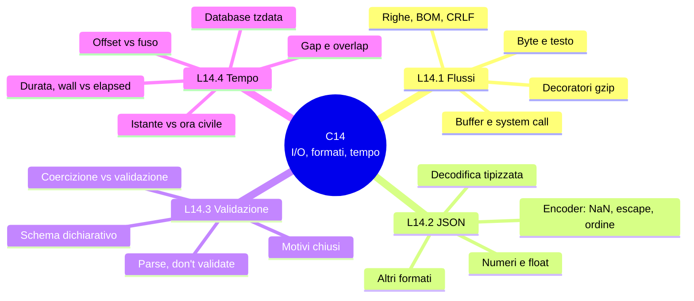

> File C14-parte6.md (parte 6 di 8) — C14 I/O, serializzazione, tempo; corso di programmazione multi-linguaggio

## Il programma completo e il collaudo

Il programma `coldchain` è lo stesso in quattro linguaggi: stesso ordine di controllo, stessi motivi di scarto, stesso output byte per byte. Il collaudo lancia i quattro programmi su undici file e su una pipe, e confronta stdout, stderr ed exit code con Python.

| Caso | Che cosa verifica | Exit | PHP | Rust | Go |
|---|---|---|---|---|---|
| `readings.ndjson` | 30 letture, 20 valide, 10 scarti con motivo | 1 | = | = | = |
| `t_empty` | file vuoto: report vuoto, nessun errore | 0 | = | = | = |
| `t_crlf` | righe terminate da `\r\n` | 1 | = | = | = |
| `t_bom` | BOM sulla prima riga | 1 | = | = | = |
| `t_odd` | 22 righe ai limiti: `1e999`, `NaN`, 20 cifre, chiave duplicata, chiave in maiuscolo, `-0.0`, secondo intercalare, offset `+15:00`… | 1 | = | **stderr diverso** | **stderr diverso** |
| `t_deep` | array annidati di 200 e di 100 000 livelli, più una lettura valida | 1 | = | **stderr diverso** | = |
| `nope.ndjson` | file inesistente | 2 | = | = | = |
| `readings.ndjson.gz` | stesso contenuto compresso | 1 | = | = | = |
| `t_trunc.ndjson.gz` | gzip troncato | 2 | **exit 1, legge 8 righe** | = | = |
| `t_corrupt.ndjson.gz` | gzip corrotto | 2 | = | = | = |
| `t_fake.ndjson.gz` | testo semplice con estensione `.gz` | 2 | **legge come testo, exit 1** | = | = |
| stdin (`cat file \| prog -`) | il flusso al posto del file | 1 | = | = | = |

Quattro file su dodici producono differenze. Su `t_odd` e `t_deep` cambia solo lo **stderr** (il motivo di scarto, `json` o `field` o `range`, dipende dal parser: casi di L14.3) e mai l'output di una riga valida. Su `t_trunc` e `t_fake` è PHP a divergere anche su stdout ed exit code: lo stream wrapper `compress.zlib://` non segnala l'errore di integrità (L14.1).

Nota sui tempi (e14): sul file di prova da un milione di letture (61 MB), il programma completo con il suo `Report` in memoria misura:

| | Picco RSS | Tempo (mediana di 3) |
|---|---|---|
| Python | 317 MB | 10 156 ms |
| PHP | 270 MB | 17 490 ms |
| Rust | 194 MB | 1 683 ms |
| Go | 245 MB | 4 243 ms |

Il picco non è piatto come nella lettura di e1: il `Report` conserva ogni lettura valida per poter calcolare giorno e silenzi, e questo domina il consumo. I rapporti di tempo (Rust 6 volte più veloce di Python, PHP 1,7 volte più lento) sono quelli di queste esecuzioni su due core condivisi, 3 ripetizioni; le cause (costo del parsing JSON per riga, allocazioni per riga, interprete) sono **ipotesi** non confermate da un profilo.

## Matrice degli approcci

| Decisione | Approccio semplice | Approccio robusto | Quando passare al secondo |
|---|---|---|---|
| Lettura | tutto in memoria (`read()`) | flusso riga per riga (decoratori per `.gz`) | file più grandi della RAM o input da pipe |
| Formato | JSON array | NDJSON (un oggetto per riga) | file che cresce, errori isolabili |
| Parsing | parser nativo | cancello stretto + parser nativo | input da fonti non fidate |
| Tipizzazione | dizionario | tipo del dominio, creato al confine | il dato viaggia oltre la prima funzione |
| Errori | stringa libera | insieme chiuso di motivi | serve classificare o contare |
| Schema | codice a mano | schema dichiarativo (JSON Schema, Pydantic) | molti formati o consumatori diversi |
| Tempo | ora civile come stringa | istante UTC + fuso come nome | confronti, giorni, durate |
| Orologio | `now()` ovunque | orologio iniettato | test deterministici |

## Anti-pattern

| Anti-pattern | Perché fa male | Alternativa |
|---|---|---|
| `json_decode` / `json.loads` e poi usare il dizionario ovunque | ogni funzione rifà i controlli, o li dimentica | parse once, tipo del dominio al confine |
| Fidarsi di `float` per i decimali esatti | `0.1 + 0.2`, `2^53 + 1`, `4.2 * 10` | interi in unità minime; tolleranza esplicita o testo del numero |
| Parser nativo di date come validatore | PHP accetta `2026-02-30` e `24:00`; Python accetta `2026-03-29 10:00:00Z` | grammatica stretta prima, parser nativo per il calendario |
| Sottrarre orari civili | 80 minuti invece di 20 attorno al cambio d'ora | sottrarre istanti |
| `+ 24 ore` con aritmetica civile | 23 ore a marzo, 25 a ottobre | UTC o API di durata (`PT24H`, `Add`) |
| `datetime.now()` / `date()` senza fuso | l'output dipende dalla macchina | fuso esplicito, orologio iniettato |
| Leggere tutto un `.gz` troncato senza controllare l'esito | PHP `compress.zlib://` tace | segnalare l'errore di integrità; testare il caso troncato |
| Scrivere `NaN` e `Infinity` nel JSON | Python li emette, non sono JSON; Rust scrive `null` | rifiutare prima o usare un encoder stretto (`allow_nan=False`) |
| Confrontare chiavi JSON senza considerare maiuscole e duplicati | Go decodifica chiavi case-insensitive; i duplicati hanno regole diverse | decodifica stretta o schema |
| Affidarsi al database dei fusi di sistema in un'immagine `scratch` | `unknown time zone` | incorporare (`time/tzdata`) o installare il pacchetto |

## Quiz

1. Una lettura `2026-03-29T01:50:00+01:00` e un'altra `2026-03-29T00:50:00Z` dello stesso sensore: sono un doppione? Perché?
2. Quale livello fallisce per `{"sensor":"cella-1"` seguito da fine riga? E per `{"sensor":"cella-1","ts":"2026-02-30T10:00:00Z","temp":4.1}`?
3. Perché `to_tenths` formula il test dell'intervallo come «non è vero che sta nell'intervallo»?
4. Python restituisce due risultati diversi per `02:30` del 29 marzo a Roma. Da che cosa dipende, e come lo eviti?
5. Perché il giorno `2026-03-29` ha `hours=23` nel report senza che il codice contenga la costante 23?
6. In quale caso conserveresti ora civile e fuso invece dell'istante UTC?
7. Perché un binario Go che gira sul tuo portatile può fallire con `unknown time zone` in un container `scratch`?
8. Che cosa distingue *coercizione* da *validazione*, e quale usi per un flusso di sensori?

**Risposte**

> 1. Sì: sono lo stesso istante (`00:50Z`) scritto con due offset. Il confronto avviene sui secondi UTC, non sul testo, ed è la riga 13 del file di prova scartata come `duplicate`. 2. Il primo fallisce al livello **sintassi** (`json`); il secondo supera la sintassi e la struttura e fallisce nella **semantica** del tempo (`time`): il calendario non ha il 30 febbraio. 3. Perché ogni confronto con `NaN` è falso: `not (a <= x <= b)` rifiuta anche `NaN`, mentre `x < a or x > b` lo lascerebbe passare. 4. Dal bit `fold` del `datetime` (0 o 1): nel gap sceglie l'offset precedente o quello successivo. Lo eviti convertendo in istante con una politica dichiarata (rifiutare, spostare in avanti) o usando un'API che obbliga a decidere, come quella di `chrono-tz`. 5. Perché `day_hours` sottrae due istanti (mezzanotte locale di oggi e di domani); il 23 è un risultato, non un dato. 6. Per eventi futuri decisi in ora civile («alle 09:00 di Roma tra sei mesi»), perché le regole del fuso possono cambiare prima di quella data. 7. Perché `LoadLocation` legge le regole dai file di sistema, che nell'immagine non ci sono; `import _ "time/tzdata"` le incorpora nel binario. 8. La coercizione converte (`"4.2"` diventa `4.2`), la validazione verifica e rifiuta; per un flusso di sensori un tipo sbagliato è un segnale e va scartato, quindi validazione.

## Esercizi

1. **Clock injection.** Aggiungi l'opzione `--now <istante>` che aggiunge al report la riga `stale sensor=... minutes=...` per ogni sensore la cui ultima lettura è più vecchia di 60 minuti rispetto a `now`. Il programma non deve mai chiamare l'orologio di sistema: `now` arriva da fuori (CLI, test). Verifica l'output sui quattro linguaggi con lo stesso `--now`.
2. **Giorni di 23 e 25 ore, ancora.** Aggiungi al report la colonna `expected` (letture attese a 30 minuti nel giorno) e calcolala da `hours`. Con quanti valori attesi chiude il 25 ottobre?
3. **Politica del gap.** Scrivi `civil_to_instant(date, time, policy)` con `policy ∈ {reject, forward, first, second}` nei quattro linguaggi e testala sui due giorni critici. Per ciascuna combinazione dichiara il risultato prima di eseguire.
4. **Numero come testo.** Riscrivi `to_tenths` in modo che usi il testo del numero (`Decimal`, `UseNumber`, `arbitrary_precision`) e abolisca la tolleranza `1e-6`. Quali righe di `t_odd` cambiano motivo?
5. **Trim e normalizzazione.** Normalizza il sensore (`strip` di spazi Unicode, minuscole) prima di validarlo. In PHP 8.4 esiste `mb_trim`; in 8.3 (usato qui) non c'è: scrivi l'equivalente con `preg_replace` e `\p{Z}`. Quali righe di `readings.ndjson` cambiano?
6. **Formato di uscita.** Aggiungi `--format csv` e scrivi un test che confronti i quattro output con un file di riferimento.
7. **Fuso configurabile.** Rendi `ZONE` un parametro (`--zone Pacific/Auckland`) e spiega perché il numero di giorni nel report può cambiare.

## Mappa mentale



## Ponte

| Capitolo | Che cosa riprende da C14 |
|---|---|
| C15 — CLI, configurazione, logging | il programma diventa una CLI con più opzioni (`--now`, `--zone`, `--format`), exit code come contratto, log strutturato con timestamp |
| C16 — HTTP e client di rete | stesso confine: byte, JSON, tempo, timeout; i fusi in header `Date` |
| C18 — API e formati con schema | Protocol Buffers e Avro come formati con schema, sul confronto di e7 |
| C19 — Database | `TIMESTAMP WITH TIME ZONE`, UTC nel database, tipi e arrotondamenti |
| C20 — Container e CI/CD | immagini `scratch` e database dei fusi, `TZ`, riproducibilità |
| C21 — Prestazioni e osservabilità | percentili sui tempi, profilo del parsing JSON, orologio monotonico |
| C22 — Sicurezza | parser contro input ostili (profondità, dimensioni, bomba gzip), validazione al confine |
| C23 — Interoperabilità | confini FFI, formati binari e il passaggio di tempo tra linguaggi |

## Limiti dichiarati

Che cosa questo capitolo **non** ha dimostrato:

- PHPStan, `staticcheck` e `clippy` sul programma completo (clippy e `cargo fmt` sono puliti; PHPStan e staticcheck non sono stati eseguiti).
- YAML 1.2 (PyYAML implementa 1.1): le trappole di YAML mostrate in e7 sono quelle di PyYAML.
- Validatori di schema per PHP, Rust e Go: solo Python (`jsonschema` 4.26.0) e Pydantic sono stati provati.
- PHP 8.4+ e Go 1.25+ (versioni baseline del corso): tutto è stato eseguito su PHP 8.3.6 e Go 1.24.7. In particolare `mb_trim` esiste solo da PHP 8.4.
- Il database dei fusi: `chrono-tz` incorpora tz `2025b`, il sistema ha la `2026c`; non sono state confrontate regola per regola.
- Le cause di alcuni numeri sono solo **ipotesi**: il comportamento di `stream_set_write_buffer` in PHP (e2) e i tempi di e14.
- Il profilo di Python è solo `cProfile`; altri profiler non provati.
- L'errore di un ulp di `serde_json` senza `float_roundtrip` è visto su un solo input.

## Appendice — i programmi completi

I quattro programmi, estratti dai file eseguiti nel collaudo. Per ricostruirli, creare i file con i nomi indicati e lanciare il comando.

### Python — `cd py && python3 -m coldchain ../readings.ndjson`

#### `coldchain/core.py`

```python
"""Cold-chain report: stream NDJSON readings, validate at the boundary, report per local day."""
from __future__ import annotations

import json
import re
from dataclasses import dataclass, field
from datetime import date, datetime, timedelta
from enum import StrEnum
from typing import Any, Iterable
from zoneinfo import ZoneInfo

ZONE = ZoneInfo("Europe/Rome")  # T1 - the warehouse's civil time
GAP_SECONDS = 30 * 60           # silence longer than this is reported
TEMP_MIN, TEMP_MAX = -500, 600  # tenths of a degree Celsius: -50.0 .. 60.0
BOM = b"\xef\xbb\xbf"           # UTF-8 byte order mark
JSON_WS = b" \t\r\n"            # the only whitespace JSON knows


class Reason(StrEnum):
    """Why a line was rejected: a closed set, not free text."""

    ENCODING = "encoding"    # not valid UTF-8
    JSON = "json"            # not valid JSON
    FIELD = "field"          # valid JSON, wrong shape or type
    TIME = "time"            # timestamp malformed or impossible
    RANGE = "range"          # temperature out of range or too precise
    DUPLICATE = "duplicate"  # same sensor and instant already seen


@dataclass(frozen=True)
class Reading:
    sensor: str
    at: int       # UTC instant, seconds since 1970-01-01T00:00:00Z
    tenths: int   # temperature in tenths of a degree Celsius


def _no_constant(name: str) -> Any:
    raise ValueError(name)  # NaN, Infinity and -Infinity are not JSON


def decode(raw: bytes) -> Any | Reason:
    """T2 - bytes -> text -> JSON value, or the reason why not."""
    try:
        text = raw.decode("utf-8")
    except UnicodeDecodeError:
        return Reason.ENCODING
    try:
        return json.loads(text, parse_constant=_no_constant)
    except (ValueError, RecursionError):
        return Reason.JSON


SENSOR = re.compile(r"[a-z0-9-]{1,32}\Z")
STAMP = re.compile(
    r"([0-9]{4})-([0-9]{2})-([0-9]{2})T([0-9]{2}):([0-9]{2}):([0-9]{2})"
    r"(?:Z|[+-]([0-9]{2}):([0-9]{2}))\Z"
)


def parse_instant(text: str) -> int | None:
    """T4 - strict RFC 3339 (no fraction) -> UTC epoch seconds, or None."""
    m = STAMP.match(text)
    if m is None:
        return None
    y, hh, mi, ss = int(m[1]), int(m[4]), int(m[5]), int(m[6])
    oh, om = int(m[7] or 0), int(m[8] or 0)
    if not (1970 <= y <= 2100 and hh <= 23 and mi <= 59 and ss <= 59 and oh <= 14 and om <= 59):
        return None
    try:
        return int(datetime.fromisoformat(text).timestamp())  # also checks the calendar
    except ValueError:
        return None


def to_tenths(x: float) -> int | None:
    """A temperature in degrees -> tenths, only if in range with at most one decimal."""
    scaled = x * 10
    if not (TEMP_MIN <= scaled <= TEMP_MAX):  # False for NaN too
        return None
    n = round(scaled)
    return n if abs(scaled - n) < 1e-6 else None


def validate(value: Any) -> Reading | Reason:
    """T3 - a decoded JSON value -> Reading, or the first rule it breaks."""
    if not isinstance(value, dict):
        return Reason.FIELD
    sensor, ts, temp = value.get("sensor"), value.get("ts"), value.get("temp")
    if not isinstance(sensor, str) or SENSOR.match(sensor) is None:
        return Reason.FIELD
    if not isinstance(ts, str):
        return Reason.FIELD
    if isinstance(temp, bool) or not isinstance(temp, (int, float)):
        return Reason.FIELD  # bool is an int in Python: exclude it
    at = parse_instant(ts)
    if at is None:
        return Reason.TIME
    tenths = to_tenths(temp)
    if tenths is None:
        return Reason.RANGE
    return Reading(sensor, at, tenths)


def local_date(at: int) -> date:
    return datetime.fromtimestamp(at, ZONE).date()


def day_hours(d: date) -> int:
    """T5 - length of a local day in hours: 23, 24 or 25."""
    nxt = d + timedelta(days=1)
    start = datetime(d.year, d.month, d.day, tzinfo=ZONE).timestamp()
    end = datetime(nxt.year, nxt.month, nxt.day, tzinfo=ZONE).timestamp()
    return round((end - start) / 3600)


def local_iso(at: int) -> str:
    return datetime.fromtimestamp(at, ZONE).isoformat()


@dataclass
class Report:
    readings: int = 0
    valid: list[Reading] = field(default_factory=list)
    rejects: list[tuple[int, Reason]] = field(default_factory=list)


def run(lines: Iterable[bytes]) -> Report:
    """T6 - consume the stream one line at a time; blank lines are skipped."""
    rep, seen = Report(), set()
    for n, raw in enumerate(lines, 1):
        if n == 1 and raw.startswith(BOM):
            raw = raw[len(BOM):]
        if not raw.strip(JSON_WS):
            continue
        rep.readings += 1
        value = decode(raw)
        res = value if isinstance(value, Reason) else validate(value)
        if isinstance(res, Reason):
            rep.rejects.append((n, res))
        elif (res.sensor, res.at) in seen:
            rep.rejects.append((n, Reason.DUPLICATE))
        else:
            seen.add((res.sensor, res.at))
            rep.valid.append(res)
    return rep


@dataclass(frozen=True)
class Day:
    sensor: str
    date: str
    hours: int
    count: int
    lo: int
    hi: int
    avg_h: int  # mean in hundredths of a degree


@dataclass(frozen=True)
class Gap:
    sensor: str
    start: str
    end: str
    minutes: int


def div_round(n: int, d: int) -> int:
    """n / d rounded half away from zero (d > 0); integer division differs by language."""
    q = (2 * abs(n) + d) // (2 * d)
    return -q if n < 0 else q


def daily(valid: list[Reading]) -> list[Day]:
    groups: dict[tuple[str, date], list[int]] = {}
    for r in valid:
        groups.setdefault((r.sensor, local_date(r.at)), []).append(r.tenths)
    return [
        Day(s, d.isoformat(), day_hours(d), len(v), min(v), max(v), div_round(sum(v) * 10, len(v)))
        for (s, d), v in sorted(groups.items())
    ]


def gaps(valid: list[Reading]) -> list[Gap]:
    by_sensor: dict[str, list[int]] = {}
    for r in valid:
        by_sensor.setdefault(r.sensor, []).append(r.at)
    out = []
    for s in sorted(by_sensor):
        times = sorted(by_sensor[s])
        for a, b in zip(times, times[1:]):
            if b - a > GAP_SECONDS:
                out.append(Gap(s, local_iso(a), local_iso(b), (b - a) // 60))
    return out


def fixed(n: int, decimals: int) -> str:
    """Integer in 10**-decimals units -> decimal text, no floats involved."""
    p = 10 ** decimals
    return f"{'-' if n < 0 else ''}{abs(n) // p}.{abs(n) % p:0{decimals}d}"


def render_text(rep: Report) -> str:
    out = [f"readings={rep.readings} valid={len(rep.valid)} rejected={len(rep.rejects)}"]
    for d in daily(rep.valid):
        out.append(
            f"day sensor={d.sensor} date={d.date} hours={d.hours} count={d.count} "
            f"min={fixed(d.lo, 1)} max={fixed(d.hi, 1)} avg={fixed(d.avg_h, 2)}"
        )
    for g in gaps(rep.valid):
        out.append(f"gap sensor={g.sensor} from={g.start} to={g.end} minutes={g.minutes}")
    return "\n".join(out) + "\n"


def render_json(rep: Report) -> str:
    doc = {
        "readings": rep.readings,
        "valid": len(rep.valid),
        "rejected": len(rep.rejects),
        "days": [
            {"sensor": d.sensor, "date": d.date, "hours": d.hours, "count": d.count,
             "min_tenths": d.lo, "max_tenths": d.hi, "avg_hundredths": d.avg_h}
            for d in daily(rep.valid)
        ],
        "gaps": [
            {"sensor": g.sensor, "from": g.start, "to": g.end, "minutes": g.minutes}
            for g in gaps(rep.valid)
        ],
        "rejects": [{"line": n, "reason": str(r)} for n, r in rep.rejects],
    }
    return json.dumps(doc, ensure_ascii=False, separators=(",", ":")) + "\n"
```

#### `coldchain/__main__.py`

```python
import gzip
import io
import sys
import zlib
from typing import BinaryIO

from .core import render_json, render_text, run


def open_input(path: str) -> io.BufferedIOBase | BinaryIO:
    """A stream of bytes: stdin, a gzip file decompressed on the fly, or a plain file."""
    if path == "-":
        return sys.stdin.buffer
    return gzip.open(path, "rb") if path.endswith(".gz") else open(path, "rb")


def main(argv: list[str]) -> int:
    """T8 - CLI: stream the file (or stdin), report on stdout, rejects on stderr."""
    args = [a for a in argv[1:] if a != "--json"]
    as_json = len(args) != len(argv) - 1
    path = args[0] if args else "-"
    try:
        with open_input(path) as fh:  # binary: we decide what a line and a character are
            rep = run(fh)
    except (OSError, EOFError, zlib.error):  # EOFError: truncated gzip
        print(f"error: cannot read {path}", file=sys.stderr)
        return 2
    for n, reason in rep.rejects:
        print(f"line {n}: rejected ({reason})", file=sys.stderr)
    sys.stdout.write(render_json(rep) if as_json else render_text(rep))
    return 1 if rep.rejects else 0


if __name__ == "__main__":
    sys.exit(main(sys.argv))
```

