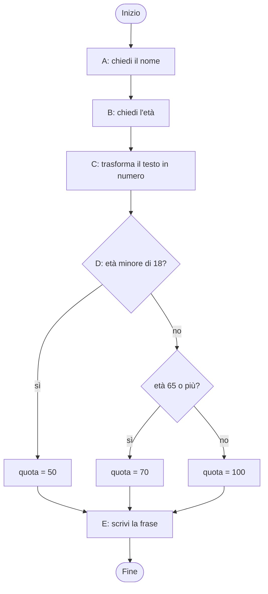
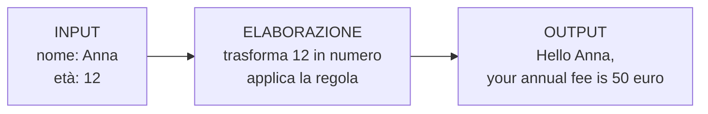
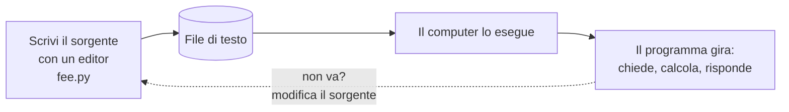
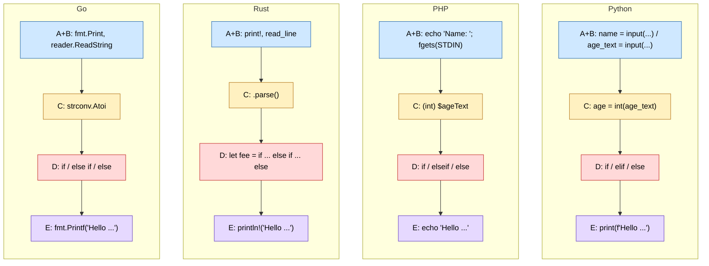
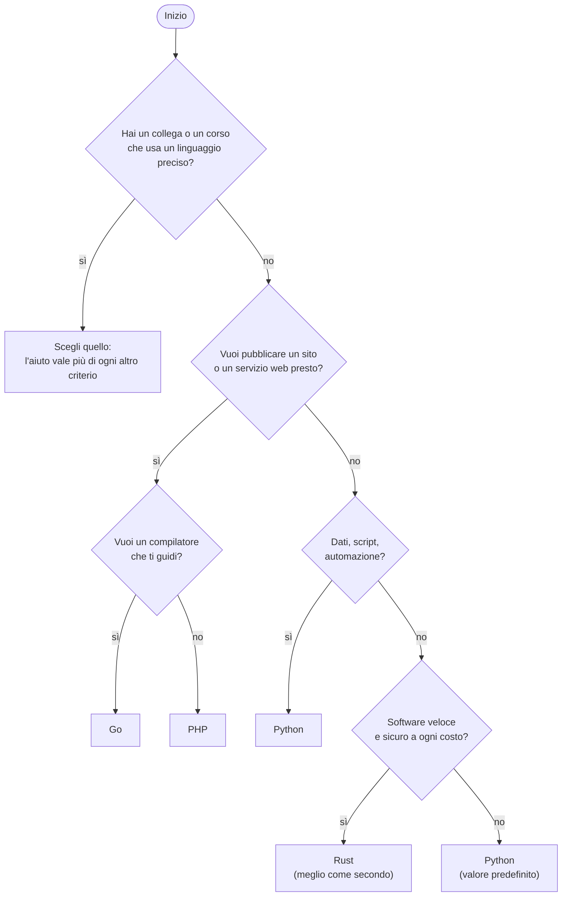
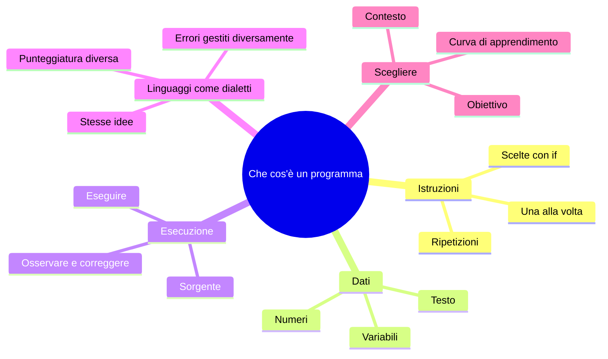

# CP1 — Orientamento per chi inizia

> **Parte P — Propedeutica (solo ingresso A)** · 3 lezioni (LP1.1–LP1.3) · 2,25 ore · formato «primario + lettura»
> **Stato:** bozza 1 (2026-10-11). Codice eseguito e verificato su PHP 8.3.6, Python 3.13.16, Rust 1.97.0 (`rustc --edition 2024`), Go 1.24.7 (baseline del corso: PHP 8.4+, Go 1.25+; da riverificare). In questa parte i quattro linguaggi compaiono **solo in lettura**, fino a CP4: non ci sono matrici degli approcci, l'obiettivo è costruire gli schemi di base prima del confronto.

## Come si usa questo capitolo

Questo capitolo è per chi non ha mai programmato. Non devi scrivere né installare niente per seguirlo: **leggi, esegui se vuoi, rispondi alle domande**. Nel capitolo CP4 scriverai il tuo primo programma completo; qui impari a vedere che cos'è un programma e a scegliere il linguaggio in cui lo scriverai. Quando una parola è nuova, viene spiegata la prima volta che compare. Se un dettaglio ti sembra oscuro, **non fermarti**: i capitoli successivi lo riprendono con calma.

| Lezione | Durata | Che cosa fai |
|---|---|---|
| LP1.1 — Che cosa fa un programma | 45′ | Capisci input, elaborazione e output; sorgente ed esecuzione |
| LP1.2 — Lo stesso mini-programma in quattro linguaggi | 45′ | Riconosci le stesse parti in PHP, Python, Rust e Go |
| LP1.3 — Scegliere il linguaggio primario | 45′ | Usi una scheda decisionale per scegliere dove scriverai |

## Obiettivi

Al termine del capitolo sai: (1) spiegare con parole tue che cosa fa un programma, distinguendo **input**, **elaborazione** e **output**; (2) distinguere il **sorgente** (il testo che scrivi) dall'**esecuzione** (il programma che gira); (3) leggere un breve programma in uno qualunque dei quattro linguaggi e riconoscerne le parti; (4) osservare che lo stesso programma, con dati sbagliati, si comporta in modi diversi nei quattro linguaggi, e perché questo conta; (5) scegliere il tuo **linguaggio primario** con una scheda a criteri.

## Il problema reale

> La segreteria del circolo scacchistico calcola la quota annuale di iscrizione con una regola semplice: **100 euro** per i soci adulti, **50 euro** per chi ha meno di 18 anni, **70 euro** per chi ha 65 anni o più. Oggi la segretaria lo fa a mente, sbaglia ogni tanto e chiede sempre l'età due volte. Vuole un programma che **chieda il nome e l'età** del socio e risponda con una frase come: «Hello Anna, your annual fee is 50 euro».

Questo è tutto: un problema piccolo, con un ingresso (nome ed età), un ragionamento (la regola) e un'uscita (la frase). Ma contiene già **tutte le parti** di un programma qualsiasi.

### Scomposizione in attività

Il primo gesto di un programmatore è dividere il problema in passi. Quelli di oggi sono cinque.

| # | Attività | In una frase |
|---|---|---|
| A | Chiedere il nome | Mostra «Name:» e aspetta che qualcuno scriva |
| B | Chiedere l'età | Mostra «Age:» e aspetta che qualcuno scriva |
| C | Trasformare l'età da testo in numero | Quello che scrivi con la tastiera è testo; per confrontare «è minore di 18?» serve un numero |
| D | Decidere la quota | Se meno di 18 → 50; altrimenti se 65 o più → 70; altrimenti → 100 |
| E | Scrivere la frase | Mostra il nome e la quota |



Come si legge un flowchart (lo rivedrai spesso): si parte dal cerchio «Inizio» e si segue la freccia. Un **rettangolo** è un'azione. Un **rombo** è una domanda con due uscite, «sì» e «no»: si prende l'uscita giusta per i dati che si hanno. Qui, per un'età di 40 anni: «minore di 18?» no → «65 o più?» no → quota 100.

---

## LP1.1 — Che cosa fa un programma (45′)

| Fase | Minuti | Contenuto |
|---|---|---|
| Aggancio | 5 | La segretaria e la sua regola |
| Concetto | 10 | Input, elaborazione, output; istruzioni e dati |
| Implementazione | 15 | Eseguire il programma e osservare un caso |
| Focus comparativo | 10 | Sorgente contro esecuzione |
| Consolidamento | 5 | Esercizio e verifica |

### Concetto 1 — Un programma è una ricetta

Una ricetta ha **ingredienti** (cose su cui lavorare), **passaggi** (cose da fare, nell'ordine giusto) e un **piatto finito** (il risultato). Un programma è lo stesso: riceve dei dati, esegue dei passaggi, produce un risultato.



- **Input**: tutto ciò che entra nel programma dall'esterno. La tastiera è l'input più comune; ce ne sono altri (un file, un sensore, un altro programma).
- **Elaborazione**: i passaggi che trasformano l'input. È la parte che *pensa*.
- **Output**: tutto ciò che il programma restituisce al mondo. Lo schermo è l'output più comune; ma può essere un file, una pagina web, un messaggio.

Quasi ogni programma che incontrerai, dal più piccolo al più grande, ha questa forma. Quando non sai da dove cominciare a leggerne uno, chiediti: *che cosa entra? che cosa esce? che cosa succede nel mezzo?*

### Concetto 2 — Istruzioni e dati

Un programma è fatto di due ingredienti.

- **Dati**: valori su cui si lavora. Possono essere testi (`"Anna"`), numeri (`12`), risposte sì/no.
- **Istruzioni**: ordini che il computer esegue **uno alla volta, nell'ordine in cui sono scritte**, a meno che una istruzione di scelta non lo faccia saltare altrove.

Per ricordare i dati, il programma usa le **variabili**: sono nomi a cui si associa un valore. Nel nostro programma, `name` contiene il testo scritto dall'utente; `age` contiene il numero; `fee` la quota. È come scrivere un'etichetta su una scatola: finché la scatola ha l'etichetta, puoi dire «prendi il contenuto di `fee`».

### Concetto 3 — Sorgente ed esecuzione

Qui c'è una distinzione fondamentale.

- Il **sorgente** (*source code*) è il **testo** che scrivi con un editor: un file come `fee.py`. Non fa niente da solo, è come la ricetta sul foglio.
- L'**esecuzione** è ciò che accade quando chiedi al computer di *eseguire* il sorgente: il programma «gira», legge l'input, calcola, scrive l'output. È come cucinare la ricetta.



Cambiare il programma significa cambiare il sorgente e rieseguire. Questo ciclo — scrivi, esegui, osserva, correggi — è il lavoro quotidiano di chi programma (CP3).

### Implementazione — Eseguire il programma e osservare

Non devi installare niente per ora: puoi seguire gli esempi come lettura. Se vuoi provare, ognuno dei quattro linguaggi ha un *playground* online ufficiale o diffuso (per Rust e Go) oppure un interprete installato (C01). Il comando per eseguire il programma Python è:

```console
$ python3 fee.py
```

Il programma mostra «Name:» e si ferma ad aspettare. Se scrivi `Anna` e premi Invio, mostra «Age:» e aspetta ancora. Se scrivi `12` e premi Invio, risponde:

```text
Name: Age: Hello Anna, your annual fee is 50 euro
```

Il testo «Name: Age: » è su una riga perché i due messaggi non vanno a capo (le righe dei dati inseriti a tastiera sono nel terminale, qui non si vedono perché sono state fornite da un file). Importante: il programma ha fatto **tre cose**, nell'ordine: ha chiesto due dati, ha applicato la regola, ha stampato una frase.

Tracciamo a mano l'esecuzione con i valori `Anna` e `12`:

| Passo | Istruzione (in parole) | `name` | `age_text` | `age` | `fee` |
|---|---|---|---|---|---|
| 1 | Chiedi il nome e conservalo | `"Anna"` | — | — | — |
| 2 | Chiedi l'età e conservala come testo | `"Anna"` | `"12"` | — | — |
| 3 | Trasforma il testo in numero | `"Anna"` | `"12"` | `12` | — |
| 4 | `12 < 18`? Sì: `fee = 50` | `"Anna"` | `"12"` | `12` | `50` |
| 5 | Scrivi la frase | `"Anna"` | `"12"` | `12` | `50` |

Nota: `"12"` (con le virgolette) è un *testo* di due caratteri, `12` è un *numero*. La differenza è l'ostacolo più comune per i principianti e, come vedrai, anche per i professionisti.

### Focus comparativo: sorgente contro esecuzione

| | Sorgente | Esecuzione |
|---|---|---|
| Che cos'è | Un file di testo | Un processo in corso nel computer |
| Dove sta | Sul disco | In memoria, finché non finisce |
| Si può leggere? | Sì, da chiunque | Solo osservando che cosa fa |
| Si può modificare? | Sì, con un editor | No: si modifica il sorgente e si riesegue |
| Esempio | `fee.py` | Il momento in cui rispondi «Anna» |

**Similitudini.** Tutti e quattro i linguaggi hanno un sorgente e un'esecuzione, e in tutti i casi il flusso input → elaborazione → output è lo stesso.
**Differenze.** In Python e PHP l'esecuzione parte direttamente dal sorgente (un *interprete* lo legge e lo esegue); in Rust e Go c'è un passaggio intermedio (la *compilazione*) che trasforma il sorgente in un file eseguibile, e poi si esegue quello. Dal punto di vista di chi usa il programma, la differenza si nota poco; i capitoli C00 e C01 la spiegano a fondo.

### Esercizio (5′)

Traccia a mano l'esecuzione con `Bruno` e `70`, compilando la stessa tabella. Che quota esce?

**Domanda di verifica.** Perché l'età letta da tastiera è un *testo* e non un numero, e perché serve il passaggio C?

**Risposta.** Perché la tastiera produce caratteri: `7` e `0` sono due caratteri, non il numero settanta. Per confrontare «70 ≥ 65» il programma ha bisogno di un numero; il passaggio C converte il testo in numero.

*Risultato dell'esercizio:* Bruno, 70 anni: `70 < 18`? no; `70 >= 65`? sì; quota 70.

---

## LP1.2 — Lo stesso mini-programma letto nei quattro linguaggi (45′)

| Fase | Minuti | Contenuto |
|---|---|---|
| Aggancio | 5 | Hai capito la ricetta: ecco quattro cuochi |
| Concetto | 10 | Le cinque parti si ritrovano in ogni linguaggio |
| Implementazione | 15 | Lettura guidata dei quattro programmi |
| Focus comparativo | 10 | Che cosa si riconosce, che cosa cambia |
| Consolidamento | 5 | Esercizio e verifica |

### Concetto — le stesse cinque parti

Ecco il programma in ciascun linguaggio. **Non devi capire ogni simbolo.** Il compito è un altro: trovare, in ognuno, le cinque parti A–E del problema. Nel codice troverai righe che iniziano con `#` (Python) o `//` (PHP, Rust, Go): sono **commenti**, note per i lettori che il computer ignora.

**Python** — `fee.py`

```python
name = input("Name: ")
age_text = input("Age: ")

age = int(age_text)

if age < 18:
    fee = 50
elif age >= 65:
    fee = 70
else:
    fee = 100

print(f"Hello {name}, your annual fee is {fee} euro")
```

**PHP** — `fee.php`

```php
<?php
echo "Name: ";
$name = trim(fgets(STDIN));
echo "Age: ";
$ageText = trim(fgets(STDIN));

$age = (int) $ageText;

if ($age < 18) {
    $fee = 50;
} elseif ($age >= 65) {
    $fee = 70;
} else {
    $fee = 100;
}

echo "Hello $name, your annual fee is $fee euro\n";
```

**Rust** — `fee.rs`

```rust
use std::io::{self, Write};

fn main() {
    print!("Name: ");
    io::stdout().flush().unwrap();
    let mut name = String::new();
    io::stdin().read_line(&mut name).unwrap();
    let name = name.trim();

    print!("Age: ");
    io::stdout().flush().unwrap();
    let mut age_text = String::new();
    io::stdin().read_line(&mut age_text).unwrap();

    let age: u32 = age_text.trim().parse().unwrap();

    let fee = if age < 18 {
        50
    } else if age >= 65 {
        70
    } else {
        100
    };

    println!("Hello {name}, your annual fee is {fee} euro");
}
```

**Go** — `main.go`

```go
package main

import (
	"bufio"
	"fmt"
	"os"
	"strconv"
	"strings"
)

func main() {
	reader := bufio.NewReader(os.Stdin)

	fmt.Print("Name: ")
	name, _ := reader.ReadString('\n')
	name = strings.TrimSpace(name)

	fmt.Print("Age: ")
	ageText, _ := reader.ReadString('\n')

	age, _ := strconv.Atoi(strings.TrimSpace(ageText))

	var fee int
	if age < 18 {
		fee = 50
	} else if age >= 65 {
		fee = 70
	} else {
		fee = 100
	}

	fmt.Printf("Hello %s, your annual fee is %d euro\n", name, fee)
}
```

### Implementazione — lettura guidata

Segui il metodo in quattro passi.

1. **Trova le parole che compaiono su tutte le righe uguali.** `name`, `age`, `fee` e la frase «Hello … your annual fee is … euro» compaiono, con minime variazioni, in tutti e quattro.
2. **Trova le parole-chiave di scelta.** Cerca `if`, `elif`/`elseif`/`else if`, `else`. Le tre quote `50`, `70`, `100` sono lì, nello stesso ordine.
3. **Trova le richieste all'utente.** Cerca i due messaggi «Name:» e «Age:», e la funzione che legge la risposta (`input`, `fgets`, `read_line`, `ReadString`).
4. **Trova l'uscita.** Cerca la funzione che scrive la frase (`print`, `echo`, `println!`, `Printf`).

Con i colori di un evidenziatore, le cinque parti del programma si distribuirebbero così. Il diagramma seguente mostra, per ogni linguaggio, **quale riga** (o gruppo di righe) corrisponde a ciascuna parte, con lo stesso colore.



(Nel diagramma A e B sono accorpate perché sono la stessa azione ripetuta due volte: chiedere e leggere.)

Una tabella con le stesse corrispondenze:

| Parte | Python | PHP | Rust | Go |
|---|---|---|---|---|
| A/B chiedere e leggere | `input("Name: ")` | `echo "Name: "; fgets(STDIN)` | `print!` + `read_line` | `fmt.Print` + `ReadString` |
| C testo → numero | `int(age_text)` | `(int) $ageText` | `age_text.trim().parse()` | `strconv.Atoi(...)` |
| D scegliere | `if ... elif ... else` | `if ... elseif ... else` | `if ... else if ... else` | `if ... else if ... else` |
| E scrivere | `print(f"Hello {name}...")` | `echo "Hello $name..."` | `println!("Hello {name}...")` | `fmt.Printf("Hello %s...", name)` |
| Fine riga | a capo | `;` | `;` | a capo |
| Blocchi | `:` e rientro | `{ }` | `{ }` | `{ }` |

### Che cosa si riconosce, che cosa cambia

**Si riconosce.** Le parole `if`, `else`, `name`, `age`, `fee`; i numeri `18`, `65`, `50`, `70`, `100`; la frase finale; l'ordine dei passi.

**Cambia, e ora conta poco.** La *punteggiatura*: Python usa i due punti e il rientro (spazi all'inizio della riga) per dire «questo gruppo di righe appartiene all'`if`»; gli altri tre usano le parentesi graffe `{ }`. PHP ha il simbolo `$` davanti a ogni variabile. Rust e Go richiedono alcune righe in più per leggere l'input. Sono differenze di *grafia*, non di sostanza.

**Cambia, e conta molto.** Una cosa nel programma non ha lo stesso comportamento nei quattro linguaggi. Lo vedi se dai un'età sbagliata. Esegui mentalmente (o davvero) i quattro programmi con nome `Anna` e **età `abc`**. Questi sono i risultati reali:

**Python**

```text
Name: Age: Traceback (most recent call last):
  File "/home/claude/cp1/py/fee.py", line 4, in <module>
    age = int(age_text)
ValueError: invalid literal for int() with base 10: 'abc'
```

**PHP**

```text
Name: Age: Hello Anna, your annual fee is 50 euro
```

**Rust**

```text
Name: Age: 
thread 'main' (8959) panicked at fee.rs:15:44:
called `Result::unwrap()` on an `Err` value: ParseIntError { kind: InvalidDigit }
```

**Go**

```text
Name: Age: Hello Anna, your annual fee is 50 euro
```

Tre comportamenti diversi con lo stesso input:

| Linguaggio | Cosa è successo | Giudizio |
|---|---|---|
| Python | Il programma si **ferma** con un messaggio (`ValueError`: «invalid literal for int()») e un traceback che indica la riga | Rumoroso, ma onesto: l'errore non passa inosservato |
| PHP | La conversione `(int) "abc"` restituisce **0**, in silenzio; l'età diventa 0 e la quota esce 50 | Il programma continua e dà un risultato **sbagliato**, senza avvisare |
| Rust | Il programma **si ferma** con un «panic» (`unwrap()` su un `Err`) | Onesto: abbiamo detto «non può fallire» con `unwrap()` e il programma ci ha smentito |
| Go | Abbiamo scritto `age, _ := strconv.Atoi(...)`: il `_` **butta via l'errore**; l'età resta 0, la quota 50 | Silenzioso: il linguaggio ci obbliga a vedere l'errore, ma noi abbiamo scelto di ignorarlo |

Questa non è una gara a chi è migliore. È il primo assaggio di una domanda che accompagna tutto il corso: **che cosa fa il programma quando le cose vanno male?** La risposta dipende dal linguaggio *e da come lo si scrive*. Il capitolo C09 le dedica una intera sezione; ma già ora si capisce una regola semplice:

> Un programma onesto, davanti a un dato sbagliato, **lo dice** e si ferma, invece di inventarsi un risultato.

Il programma di CP4 farà esattamente questo.

### Focus comparativo

| Domanda | Python | PHP | Rust | Go |
|---|---|---|---|---|
| Quante righe servono per leggere l'input? | Poche | Alcune | Molte | Alcune |
| Servono le graffe? | No (rientro) | Sì | Sì | Sì |
| La conversione testo→numero può fallire? | Sì, con errore | Sì, ma di default non lo dice | Sì, restituisce un `Result` | Sì, restituisce un `error` |
| Si può ignorare l'errore? | Sì (non catturandolo: il programma si ferma) | Sì (non si accorge) | Sì, con `unwrap()` (il programma si ferma) | Sì, con `_` (il programma prosegue) |

**Similitudini.** Quattro linguaggi, un'unica ricetta: le cinque parti, l'ordine, il risultato. Chi legge uno dei quattro riconosce gli altri in pochi minuti.
**Differenze.** Il tono: Python e Rust si fermano, PHP e Go (in questa scrittura) vanno avanti. Non è il linguaggio a decidere da solo: è quello che il programmatore ha scritto, ma ogni linguaggio *rende facile* un comportamento e *difficile* un altro.

### Esercizio (5′)

Senza eseguire, prevedi che cosa stampa ciascun programma con età `65`. Poi con età `17`. Poi con una riga vuota al posto dell'età. Perché per l'ultimo caso la risposta dipende dal linguaggio?

**Domanda di verifica.** Quali sono le tre cose che *non cambiano* leggendo lo stesso programma in un altro linguaggio?

**Risposta.** L'ordine dei passi, le parole-chiave di scelta (`if`, `else`) e i valori numerici della regola. (Cambiano la punteggiatura e il modo di leggere e convertire l'input.)

*Risultato dell'esercizio:* con `65` la quota è 70 (`65 >= 65` è vero); con `17` è 50; con la riga vuota Python si ferma con `ValueError`, Rust con un panic, PHP e Go stampano 50 (età 0).

---

## LP1.3 — Scegliere il linguaggio primario (45′)

| Fase | Minuti | Contenuto |
|---|---|---|
| Aggancio | 5 | In quale dei quattro scriverai da CP4 in poi? |
| Concetto | 10 | Perché se ne sceglie uno solo, per ora; che cosa conta davvero |
| Implementazione | 15 | La scheda decisionale a punteggio |
| Focus comparativo | 10 | Profilo dei quattro linguaggi per un principiante |
| Consolidamento | 5 | Il linguaggio di contrasto |

### Concetto — uno per scrivere, tre per leggere

Il corso non ti chiede di imparare quattro linguaggi insieme. Ti chiede di **scrivere** in uno (il *primario*) fino alla Parte II e di **leggere** gli altri tre. La scelta non è irrevocabile: se dopo un mese ti accorgi che non fa per te, ne scegli un altro e i concetti che hai imparato (ciclo, scelta, funzione, errore) si trasferiscono quasi interamente.

Che cosa conta davvero nella scelta, in ordine:

1. **Il tuo obiettivo.** Che cosa vuoi costruire nei prossimi sei mesi?
2. **Il tuo contesto.** Chi ti aiuterà? Che cosa usano a lavoro, a scuola, nella tua comunità?
3. **La curva di apprendimento.** Quanto ti pesano gli ostacoli iniziali?
4. **Il tempo.** Quanto puoi studiare ogni settimana?

Non contano (per ora): la velocità di esecuzione, la moda del momento, la «purezza» del linguaggio.

### Implementazione — la scheda decisionale

Rispondi alle cinque domande scegliendo **una** risposta ciascuna. Poi somma i punti per colonna.

| # | Domanda | Risposta | PHP | Python | Rust | Go |
|---|---|---|---|---|---|---|
| 1 | Che cosa vuoi costruire? | Un sito o un servizio web, presto | 3 | 2 | 0 | 2 |
| | | Analisi di dati, script, automazioni | 0 | 3 | 0 | 1 |
| | | Strumenti da riga di comando e servizi di rete | 0 | 1 | 2 | 3 |
| | | Software che deve essere veloce e sicuro (sistemi, motori) | 0 | 0 | 3 | 2 |
| | | Non lo so ancora | 1 | 3 | 0 | 2 |
| 2 | Hai già esperienza con altri linguaggi o con HTML/JavaScript? | Nessuna | 1 | 3 | 0 | 2 |
| | | Qualcuna, di tipo web | 3 | 2 | 1 | 2 |
| | | Qualcuna, di tipo sistemistico (shell, C) | 1 | 2 | 3 | 3 |
| 3 | Quanto ti disturba un compilatore che rifiuta il programma finché non è corretto? | Mi scoraggia | 2 | 3 | 0 | 1 |
| | | Mi è indifferente | 2 | 2 | 1 | 3 |
| | | Lo preferisco: voglio che mi dica i problemi subito | 0 | 1 | 3 | 3 |
| 4 | Quante ore a settimana puoi dedicare? | Poche (2-3) | 2 | 3 | 0 | 2 |
| | | Medie (4-6) | 2 | 2 | 1 | 3 |
| | | Molte (7 o più) | 2 | 2 | 3 | 3 |
| 5 | Chi puoi chiedere aiuto, nei prossimi mesi? | Un collega che usa PHP | 3 | 0 | 0 | 0 |
| | | Un collega che usa Python | 0 | 3 | 0 | 0 |
| | | Un collega che usa Rust | 0 | 0 | 3 | 0 |
| | | Un collega che usa Go | 0 | 0 | 0 | 3 |
| | | Nessuno in particolare | 1 | 2 | 1 | 1 |

**Come si usa.** Somma i punti di ciascuna colonna. Il punteggio più alto è il **candidato**; se due colonne sono a meno di 2 punti, scegli quella che ti incuriosisce di più. La scheda è un aiuto, non un oracolo: i punteggi sono una stima ragionata di quanto ciascun linguaggio *si adatta* alle risposte, non una misura.



L'albero è una semplificazione: serve come seconda opinione rispetto alla scheda. Se le due discordano, rileggi le risposte che hanno dato il punteggio più alto.

### Focus comparativo — profilo per un principiante

| | PHP | Python | Rust | Go |
|---|---|---|---|---|
| **Per chi è adatto** | Chi vuole realizzare siti web e applicazioni web subito | Chi parte da zero, vuole dati, script, automazione | Chi ha pazienza e vuole imparare come funziona il computer | Chi vuole servizi di rete e strumenti robusti, in un linguaggio piccolo |
| **Primo mese** | Pagine dinamiche, form, database | Script, file, piccoli programmi | Variabili, tipi, i primi messaggi del compilatore | Programmi da riga di comando, funzioni, struct |
| **Ostacolo tipico** | Incoerenze storiche del linguaggio | Errori scoperti solo eseguendo | Ownership e borrowing | Meno costrutti: più righe per cose semplici |
| **Aiuto del linguaggio** | Pragmatico, permissivo | Leggibile, permissivo | Il compilatore guida, ma rifiuta | Il compilatore è rigido, ma semplice |
| **Consiglio del corso** | Buono per obiettivo web immediato | **Buon punto di partenza generale** | Possibile, ma meglio come secondo linguaggio | **Buon punto di partenza generale**, soprattutto per servizi |

Il TOC del corso dà questa indicazione di partenza: **Python o Go per chi parte da zero; PHP per chi ha un obiettivo web immediato; Rust come primario è possibile ma ha la curva più ripida ed è consigliato come secondo linguaggio.**

### Il linguaggio di contrasto

Più avanti (fine della Parte I) sceglierai un secondo linguaggio **di contrasto**, per imparare per opposizione. La regola è semplice: scegli quello che ti fa vedere ciò che il tuo primario nasconde.

| Se il primario è... | il contrasto consigliato è... | e ti mostra... |
|---|---|---|
| Python | Go (o Rust) | Tipi statici, compilazione, errori come valori |
| PHP | Go | Processo long-running, tipi statici, concorrenza |
| Go | Python | Tipizzazione dinamica, eccezioni, espressività |
| Rust | Python | Runtime gestito, garbage collector, prototipazione rapida |

### Esercizio (5′)

Compila la scheda con le **tue** risposte e annota il linguaggio che ne esce. Poi rispondi alla domanda: *c'è una risposta che hai dato per abitudine e non per convinzione?* Rifai la scheda cambiandola. Il risultato cambia?

**Domanda di verifica.** Perché la domanda 5 (chi può aiutarti) pesa quanto le altre, se non riguarda il linguaggio?

**Risposta.** Perché imparare a programmare è soprattutto risolvere ostacoli, e avere una persona a cui chiedere riduce di molto il tempo perso. Un linguaggio «peggiore» con un buon mentore spesso porta più lontano di uno «migliore» da soli.

---

## Errori tipici di chi inizia

| Errore | Come si manifesta | Rimedio |
|---|---|---|
| Confondere testo e numero | `"12"` si comporta in modo strano nei confronti | Convertire sempre l'input prima di confrontarlo |
| Pensare che «il computer capisca cosa volevo dire» | Il programma fa esattamente ciò che è scritto | Tracciare a mano l'esecuzione, passo per passo |
| Fidarsi che l'utente scriva dati giusti | Il programma dà risultati assurdi con dati sbagliati | Pensare sempre al caso «l'utente scrive qualcosa di sbagliato» |
| Scegliere il linguaggio per la fama | Frustrazione dopo due settimane | Usare la scheda, chiedere a chi ti aiuterà |
| Copiare senza capire | Il programma funziona finché non si cambia una riga | Ogni riga copiata va spiegata con parole proprie |

## Quiz di verifica

1. Quali sono le tre parti di un programma, e in quali parti ricade il messaggio «Name:»?
2. Qual è la differenza fra sorgente ed esecuzione?
3. Perché `"12"` e `12` non sono la stessa cosa?
4. In quale dei quattro programmi, con età `abc`, il risultato è **sbagliato senza avvisare**? (Ce n'è più di uno.)
5. Che cosa chiede la scheda decisionale prima di tutto? Perché?

**Risposte**

> 1. Input, elaborazione, output. «Name:» è output (una richiesta all'utente); la risposta dell'utente è input.
> 2. Il sorgente è il testo del programma; l'esecuzione è il programma che gira.
> 3. `"12"` è un testo di due caratteri; `12` è un numero con cui si può fare aritmetica e confronto.
> 4. PHP e Go, nella scrittura mostrata: entrambi stampano quota 50 (età 0) senza dire nulla.
> 5. L'obiettivo, perché determina quale linguaggio ha gli strumenti giusti.

## Esercizi

1. **(base, lettura)** Nel programma del tuo futuro linguaggio primario, evidenzia con un pennarello le cinque parti A–E. Quante righe occupa ciascuna?
2. **(base)** Modifica *a parole* la regola: sopra i 80 anni la quota è 40. In quale punto del flowchart aggiungi il rombo? Quanti rami ha ora il programma?
3. **(medio, lettura)** Trova in ciascun programma il punto in cui cambieresti la soglia «18» in «16». Quante righe devi toccare?
4. **(medio)** Disegna a mano il flowchart di un programma che chiede un numero e dice se è pari o dispari.
5. **(avanzato)** Scrivi in pseudocodice (in italiano strutturato) il programma che, dato il nome e l'età di tre soci, stampa il nome del più giovane. Che cosa ti serve in più rispetto a oggi? (Anticipa CP2.)

## Mappa mentale



Collegamenti: CP4 (il tuo primo programma completo), C00 (perché esistono quattro linguaggi).

## Ponte

CP2 insegna a **pensare prima di scrivere**: scomporre un problema, descrivere un algoritmo, seguire a mano lo stato. CP3 mette in mano gli strumenti del mestiere quotidiano: terminale, errori, debug, Git. CP4 chiude la Parte P con il tuo primo programma completo e la checklist per ogni linguaggio nuovo.

---

## Appendice CP1.A — I quattro programmi

Esecuzione dei programmi: dopo l'installazione (C01) oppure in un playground. Con i dati forniti da un file di testo (`printf 'Anna\n12\n' | python3 fee.py`) si evita di digitare le risposte.

#### Python (fee.py) — `python3 fee.py`

```python
name = input("Name: ")
age_text = input("Age: ")

age = int(age_text)

if age < 18:
    fee = 50
elif age >= 65:
    fee = 70
else:
    fee = 100

print(f"Hello {name}, your annual fee is {fee} euro")
```

#### PHP (fee.php) — `php fee.php`

```php
<?php
echo "Name: ";
$name = trim(fgets(STDIN));
echo "Age: ";
$ageText = trim(fgets(STDIN));

$age = (int) $ageText;

if ($age < 18) {
    $fee = 50;
} elseif ($age >= 65) {
    $fee = 70;
} else {
    $fee = 100;
}

echo "Hello $name, your annual fee is $fee euro\n";
```

#### Rust (fee.rs) — `rustc --edition 2024 fee.rs && ./fee`

```rust
use std::io::{self, Write};

fn main() {
    print!("Name: ");
    io::stdout().flush().unwrap();
    let mut name = String::new();
    io::stdin().read_line(&mut name).unwrap();
    let name = name.trim();

    print!("Age: ");
    io::stdout().flush().unwrap();
    let mut age_text = String::new();
    io::stdin().read_line(&mut age_text).unwrap();

    let age: u32 = age_text.trim().parse().unwrap();

    let fee = if age < 18 {
        50
    } else if age >= 65 {
        70
    } else {
        100
    };

    println!("Hello {name}, your annual fee is {fee} euro");
}
```

#### Go (main.go, go.mod con `module example.com/fee`) — `go run .`

```go
package main

import (
	"bufio"
	"fmt"
	"os"
	"strconv"
	"strings"
)

func main() {
	reader := bufio.NewReader(os.Stdin)

	fmt.Print("Name: ")
	name, _ := reader.ReadString('\n')
	name = strings.TrimSpace(name)

	fmt.Print("Age: ")
	ageText, _ := reader.ReadString('\n')

	age, _ := strconv.Atoi(strings.TrimSpace(ageText))

	var fee int
	if age < 18 {
		fee = 50
	} else if age >= 65 {
		fee = 70
	} else {
		fee = 100
	}

	fmt.Printf("Hello %s, your annual fee is %d euro\n", name, fee)
}
```
